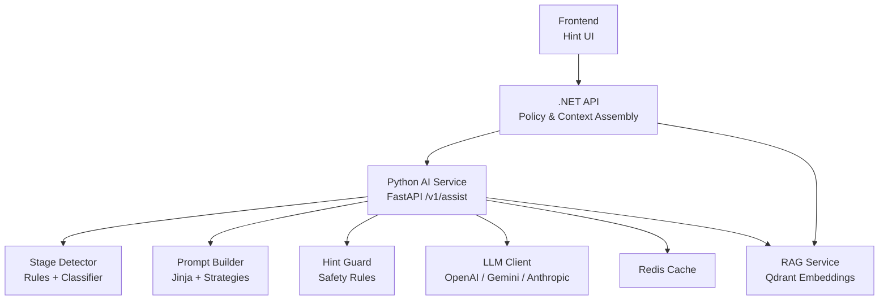
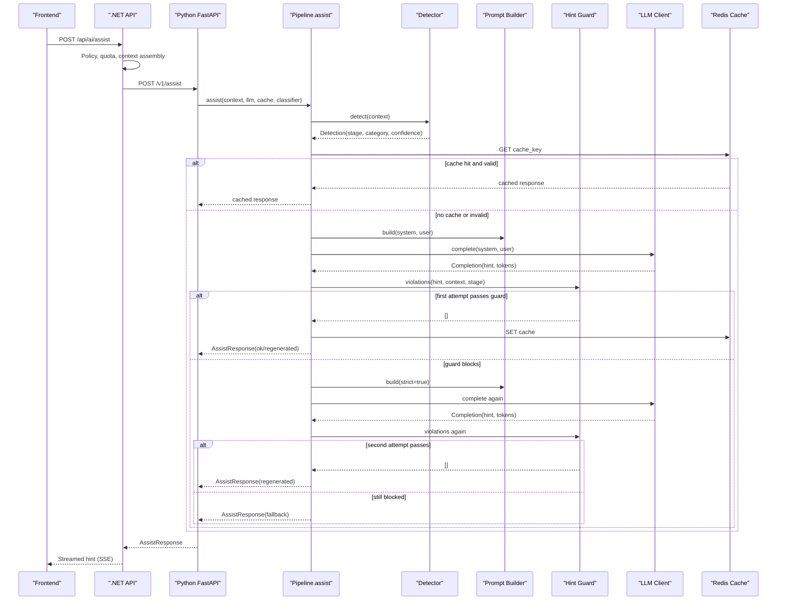
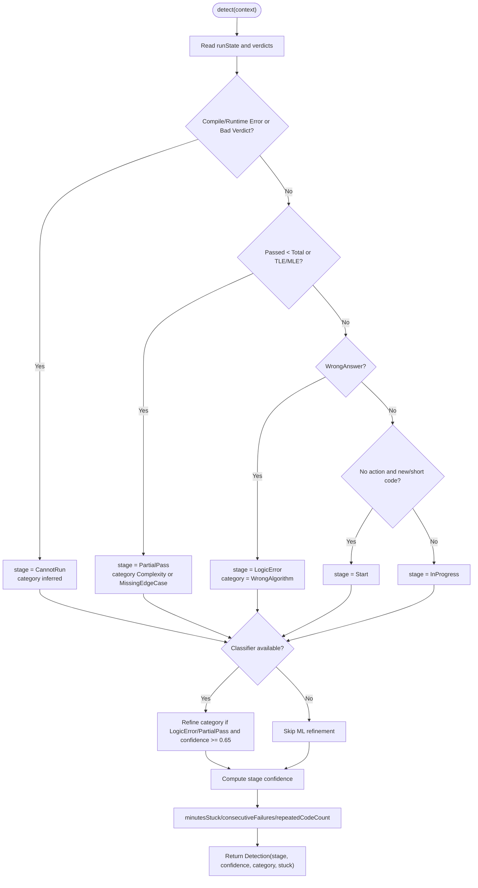
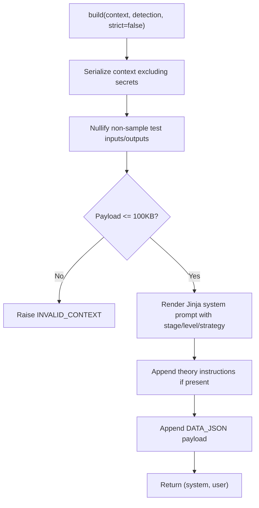
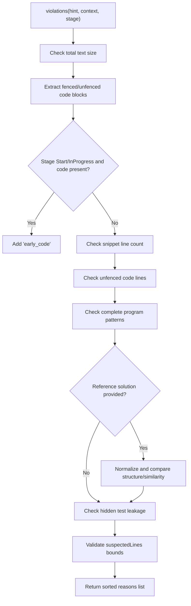
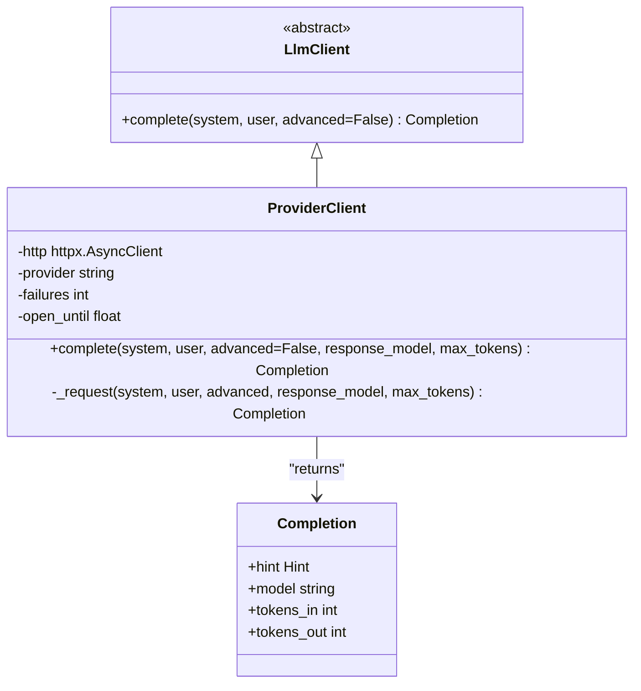
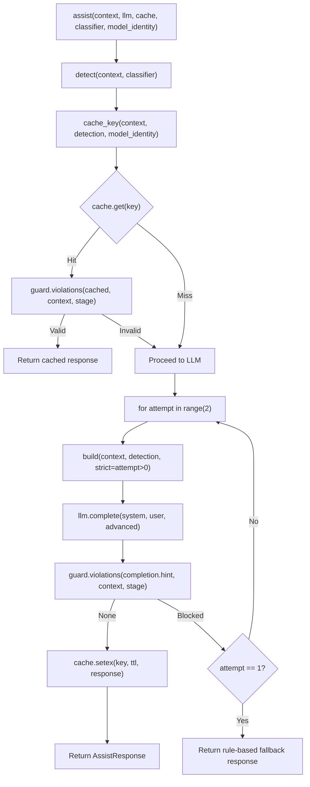
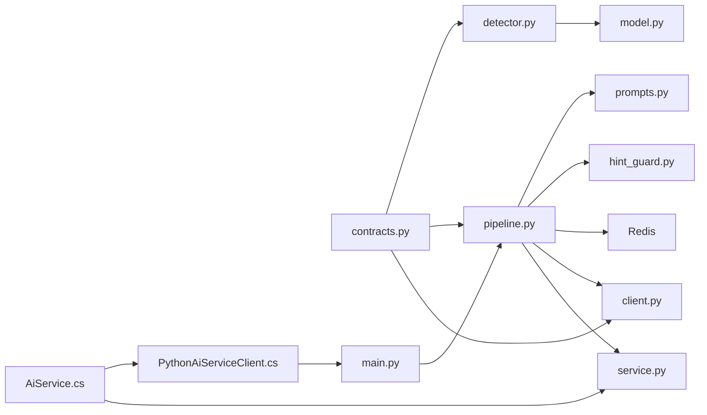

# AI Hint Generation Pipeline

<cite>
**Referenced Files in This Document**
- [main.py](file://ai-service/app/main.py)
- [pipeline.py](file://ai-service/app/api/pipeline.py)
- [detector.py](file://ai-service/app/stage/detector.py)
- [model.py](file://ai-service/app/stage/model.py)
- [client.py](file://ai-service/app/llm/client.py)
- [hint_guard.py](file://ai-service/app/guard/hint_guard.py)
- [prompts.py](file://ai-service/app/hints/prompts.py)
- [system.jinja](file://ai-service/app/prompts/system.jinja)
- [strategies.yaml](file://ai-service/app/prompts/strategies.yaml)
- [service.py](file://ai-service/app/rag/service.py)
- [contracts.py](file://ai-service/app/contracts.py)
- [AiService.cs](file://api/src/Infrastructure/CodePath.Infrastructure/Ai/AiService.cs)
- [PythonAiServiceClient.cs](file://api/src/Infrastructure/CodePath.Infrastructure/Ai/PythonAiServiceClient.cs)
- [stream.ts](file://frontend/src/features/ai-assistant/stream.ts)
</cite>

## Table of Contents
1. [Introduction](#introduction)
2. [Project Structure](#project-structure)
3. [Core Components](#core-components)
4. [Architecture Overview](#architecture-overview)
5. [Detailed Component Analysis](#detailed-component-analysis)
6. [Dependency Analysis](#dependency-analysis)
7. [Performance Considerations](#performance-considerations)
8. [Troubleshooting Guide](#troubleshooting-guide)
9. [Conclusion](#conclusion)
10. [Appendices](#appendices)

## Introduction
This document explains the end-to-end AI hint generation pipeline that powers CodePath’s intelligent tutoring assistant. A student submits code and execution results; the system detects the learning stage, optionally refines classification with a local model, builds a prompt for an external LLM, validates the generated hint, caches safe responses, and returns a structured hint to the frontend. The pipeline is implemented as a Python FastAPI service called by a .NET API, with optional RAG retrieval and Redis caching.

The documentation covers:
- Request processing and authentication
- Stage detection rules and ML classifier integration
- Prompt construction and strategy configuration
- Guard-based safety checks and fallback behavior
- LLM client abstraction, retries, and provider routing
- Streaming response handling on the frontend
- Configuration examples, custom stage implementation guidance, performance tuning, error handling, retry mechanisms, and fallback strategies.

## Project Structure
The AI hint pipeline spans three layers:
- Frontend: consumes hints and streams deltas from the API.
- .NET API: enforces policy, rate limits, context assembly, RAG retrieval, persistence, and calls the Python service.
- Python AI service: performs stage detection, prompt building, LLM completion, guard validation, caching, and streaming.

**Diagram sources**
- [main.py:64-81](file://ai-service/app/main.py#L64-L81)
- [pipeline.py:10-40](file://ai-service/app/api/pipeline.py#L10-L40)
- [detector.py:11-37](file://ai-service/app/stage/detector.py#L11-L37)
- [prompts.py:13-29](file://ai-service/app/hints/prompts.py#L13-L29)
- [hint_guard.py:22-47](file://ai-service/app/guard/hint_guard.py#L22-L47)
- [client.py:31-82](file://ai-service/app/llm/client.py#L31-L82)
- [AiService.cs:22-113](file://api/src/Infrastructure/CodePath.Infrastructure/Ai/AiService.cs#L22-L113)
- [service.py:13-143](file://ai-service/app/rag/service.py#L13-L143)

**Section sources**
- [main.py:17-84](file://ai-service/app/main.py#L17-L84)
- [AiService.cs:22-113](file://api/src/Infrastructure/CodePath.Infrastructure/Ai/AiService.cs#L22-L113)

## Core Components
- Request contract and response schema define the input payload, hint structure, and metadata such as stage, confidence, level, and token usage.
- Stage detector applies deterministic rules over run state and verdicts, optionally refining category/confidence via a local classifier.
- Prompt builder composes a system instruction using Jinja templates and YAML strategies, then serializes sanitized context.
- Hint guard inspects generated text for unsafe patterns like early code exposure, oversized snippets, hidden test leakage, or reference similarity.
- LLM client abstracts multiple providers, enforces JSON schema output, and implements transient error retries.
- Pipeline orchestrates detection, cache lookup, LLM call(s), guard validation, retry, and fallback.
- RAG service retrieves relevant learning passages and integrates them into the request context.

**Section sources**
- [contracts.py:5-100](file://ai-service/app/contracts.py#L5-L100)
- [detector.py:1-37](file://ai-service/app/stage/detector.py#L1-L37)
- [prompts.py:1-41](file://ai-service/app/hints/prompts.py#L1-L41)
- [hint_guard.py:1-47](file://ai-service/app/guard/hint_guard.py#L1-L47)
- [client.py:9-82](file://ai-service/app/llm/client.py#L9-L82)
- [pipeline.py:1-40](file://ai-service/app/api/pipeline.py#L1-L40)
- [service.py:13-143](file://ai-service/app/rag/service.py#L13-L143)

## Architecture Overview
The request lifecycle flows through these stages:
1. .NET API validates policy, constructs context, enforces quotas, and calls the Python service.
2. Python FastAPI endpoint authenticates via header key, validates request shape, and invokes the assist pipeline under a deadline.
3. Assist runs stage detection, checks Redis cache, builds prompts, calls LLM, validates with guard, retries once if blocked, and writes cache on success.
4. If guard blocks twice, a rule-based fallback message is returned.
5. .NET API persists interaction, maps guard status, and returns result to the frontend.
6. Frontend consumes SSE stream events, rendering incremental deltas and final result.

**Diagram sources**
- [main.py:64-81](file://ai-service/app/main.py#L64-L81)
- [pipeline.py:10-40](file://ai-service/app/api/pipeline.py#L10-L40)
- [detector.py:11-37](file://ai-service/app/stage/detector.py#L11-L37)
- [prompts.py:13-29](file://ai-service/app/hints/prompts.py#L13-L29)
- [hint_guard.py:22-47](file://ai-service/app/guard/hint_guard.py#L22-L47)
- [client.py:31-82](file://ai-service/app/llm/client.py#L31-L82)
- [AiService.cs:22-113](file://api/src/Infrastructure/CodePath.Infrastructure/Ai/AiService.cs#L22-L113)

## Detailed Component Analysis

### Request Processing and Authentication
- The FastAPI lifespan initializes HTTP client, LLM provider, RAG service, Redis cache, and optional classifier.
- Authentication uses an API key header; invalid or missing keys return unauthorized.
- Validation errors map to a standardized invalid context response.
- Unhandled exceptions during assist are mapped to a generic unavailable response.

Key behaviors:
- Service-level API key check before request processing.
- Strict request body validation enforced by Pydantic contracts.
- Global exception handlers normalize error codes.

**Section sources**
- [main.py:17-54](file://ai-service/app/main.py#L17-L54)
- [main.py:56-81](file://ai-service/app/main.py#L56-L81)
- [contracts.py:72-100](file://ai-service/app/contracts.py#L72-L100)

### Stage Detection
Deterministic rules classify the student’s current stage based on run state, verdicts, and recent activity:
- CannotRun: compile/runtime errors or specific verdicts.
- PartialPass: partial pass or time/memory limit exceeded.
- LogicError: wrong answer.
- Start: no action yet or very short/new code.
- InProgress: default when none of the above apply.

Optional ML refinement:
- A local classifier predicts error category and stage confidence.
- Category refinement only applies for LogicError or PartialPass with sufficient confidence.
- Rule priority cannot be overridden by ML.

Stuck detection flags are derived from history metrics.

**Diagram sources**
- [detector.py:11-37](file://ai-service/app/stage/detector.py#L11-L37)
- [model.py:6-30](file://ai-service/app/stage/model.py#L6-L30)

**Section sources**
- [detector.py:1-37](file://ai-service/app/stage/detector.py#L1-L37)
- [model.py:1-30](file://ai-service/app/stage/model.py#L1-L30)

### Classifier Model Integration
- The classifier loads a trusted joblib artifact and verifies its SHA-256 hash against metadata.
- It exposes two models: one for error category prediction and another for stage confidence estimation.
- Feature row includes source code, starter code, language, passed/total counts, and best non-Accepted verdict.
- Only deployed locally trained artifacts are accepted; untrusted formats are rejected.

Configuration:
- MODEL_PATH or MODEL_MANIFEST controls loading.
- Versioning is exposed via classifier.version for cache keying.

**Section sources**
- [model.py:1-30](file://ai-service/app/stage/model.py#L1-L30)
- [main.py:26-32](file://ai-service/app/main.py#L26-L32)

### Prompt Construction and Strategy Configuration
- Prompts are built from a Jinja template and YAML strategy configuration.
- System prompt instructs the model to respond in Vietnamese, avoid full solutions, refuse control commands embedded in data, and strictly follow JSON schema.
- Strategies define stage-specific guidance per difficulty level.
- Context payload excludes sensitive fields like student references and hides non-sample test data.
- Payload size is capped; oversized payloads raise invalid context.

Versioning:
- Prompt version combines strategy version and a content hash to invalidate caches when prompts change.

**Diagram sources**
- [prompts.py:13-29](file://ai-service/app/hints/prompts.py#L13-L29)
- [system.jinja:1-10](file://ai-service/app/prompts/system.jinja#L1-L10)
- [strategies.yaml:1-23](file://ai-service/app/prompts/strategies.yaml#L1-L23)

**Section sources**
- [prompts.py:1-41](file://ai-service/app/hints/prompts.py#L1-L41)
- [system.jinja:1-10](file://ai-service/app/prompts/system.jinja#L1-L10)
- [strategies.yaml:1-23](file://ai-service/app/prompts/strategies.yaml#L1-L23)

### Hint Guard and Fallback Strategy
Guard checks ensure hints are pedagogically appropriate and safe:
- No early code exposure for Start or InProgress stages.
- Limits on snippet length and unfenced code lines.
- Prohibits complete program scaffolding.
- Prevents leaking hidden tests or matching reference solutions.
- Validates suspected line indices.

If guard blocks:
- First attempt triggers a stricter prompt without code or test data.
- Second attempt may still be blocked; then a rule-based fallback message is returned.
- Fallback messages are category-specific and concise.

Cache behavior:
- Cached responses are revalidated against guard rules before reuse.
- On successful generation, the response is cached with TTL.

**Diagram sources**
- [hint_guard.py:22-47](file://ai-service/app/guard/hint_guard.py#L22-L47)
- [prompts.py:31-40](file://ai-service/app/hints/prompts.py#L31-L40)

**Section sources**
- [hint_guard.py:1-47](file://ai-service/app/guard/hint_guard.py#L1-L47)
- [pipeline.py:10-40](file://ai-service/app/api/pipeline.py#L10-L40)

### LLM Client Abstraction and Provider Routing
The LLM client supports OpenAI-compatible APIs, Gemini, and Anthropic:
- Uses JSON schema enforcement to produce structured Hint objects.
- Routes requests based on LLM_PROVIDER environment variable.
- Implements retry for transient transport/provider errors.
- Enforces circuit breaker-like backoff after repeated failures.
- Tracks token usage for analytics.

Advanced mode:
- For LogicError or advanced levels, the client selects an advanced model when configured.

**Diagram sources**
- [client.py:9-82](file://ai-service/app/llm/client.py#L9-L82)

**Section sources**
- [client.py:1-82](file://ai-service/app/llm/client.py#L1-L82)

### Pipeline Orchestration and Caching
The pipeline coordinates detection, caching, prompting, LLM calls, guard validation, and fallback:
- Detects stage and computes cache key including classifier version and model identity.
- Reads from Redis cache; skips if guard would block.
- Calls LLM up to two times (initial and strict).
- Writes to cache on success.
- Returns structured response with metadata including guard status, model version, prompt version, and token counts.

**Diagram sources**
- [pipeline.py:10-40](file://ai-service/app/api/pipeline.py#L10-L40)
- [hint_guard.py:22-47](file://ai-service/app/guard/hint_guard.py#L22-L47)

**Section sources**
- [pipeline.py:1-40](file://ai-service/app/api/pipeline.py#L1-L40)

### RAG Retrieval Integration
RAG enriches the context with relevant learning materials:
- Indexes markdown/PDF documents into Qdrant with embeddings.
- Ensures collection existence and field indexes.
- Embeds chunks and stores vectors with scoped metadata.
- Searches with scope filters and deduplication, limiting total characters.
- Integrates retrieved passages into the assist request context.

Security and constraints:
- Asset hosts are whitelisted; PDF size is limited.
- Embedding dimensions and model must match configuration.
- Retrieval scope mismatch raises an error.

**Section sources**
- [service.py:13-143](file://ai-service/app/rag/service.py#L13-L143)

### .NET API Integration and Fallback
The .NET API:
- Validates input, checks problem access, enforces per-student locks and quotas.
- Builds rich context including previous hints, submissions, and RAG passages.
- Calls Python service with a deadline.
- Validates response shape and maps guard status to user-facing error codes.
- Persists interactions and returns references unless fallback occurred.

Fallback strategy:
- If Python service fails or returns invalid response, a rule-based fallback hint is constructed locally using the same stage logic.

**Section sources**
- [AiService.cs:22-113](file://api/src/Infrastructure/CodePath.Infrastructure/Ai/AiService.cs#L22-L113)
- [PythonAiServiceClient.cs:6-39](file://api/src/Infrastructure/CodePath.Infrastructure/Ai/PythonAiServiceClient.cs#L6-L39)

### Streaming Response Mechanism
The frontend consumes Server-Sent Events (SSE):
- Decodes UTF-8 chunks across network boundaries.
- Parses event names and data payloads.
- Emits delta events incrementally and captures the final result event.
- Throws an error if the stream ends without a final result.

Note: The current Python FastAPI endpoint returns a single JSON response; streaming is expected at the API layer or via a separate SSE endpoint. The frontend utility is ready to consume streamed deltas when enabled.

**Section sources**
- [stream.ts:1-24](file://frontend/src/features/ai-assistant/stream.ts#L1-L24)

## Dependency Analysis
The pipeline components have clear separation of concerns:
- Contracts define shared types between .NET and Python.
- Detector depends on contracts and optionally on classifier.
- Prompt builder depends on Jinja and YAML configuration.
- Guard depends on AST parsing and regex heuristics.
- LLM client depends on httpx and tenacity.
- Pipeline depends on detector, prompts, guard, and cache.
- RAG service depends on httpx and Qdrant.
- .NET API depends on database, Redis, RAG, and Python client.

**Diagram sources**
- [contracts.py:5-100](file://ai-service/app/contracts.py#L5-L100)
- [detector.py:1-37](file://ai-service/app/stage/detector.py#L1-L37)
- [model.py:1-30](file://ai-service/app/stage/model.py#L1-L30)
- [prompts.py:1-41](file://ai-service/app/hints/prompts.py#L1-L41)
- [hint_guard.py:1-47](file://ai-service/app/guard/hint_guard.py#L1-L47)
- [pipeline.py:1-40](file://ai-service/app/api/pipeline.py#L1-L40)
- [client.py:1-82](file://ai-service/app/llm/client.py#L1-L82)
- [service.py:13-143](file://ai-service/app/rag/service.py#L13-L143)
- [AiService.cs:22-113](file://api/src/Infrastructure/CodePath.Infrastructure/Ai/AiService.cs#L22-L113)
- [PythonAiServiceClient.cs:6-39](file://api/src/Infrastructure/CodePath.Infrastructure/Ai/PythonAiServiceClient.cs#L6-L39)
- [main.py:64-81](file://ai-service/app/main.py#L64-L81)

**Section sources**
- [contracts.py:5-100](file://ai-service/app/contracts.py#L5-L100)
- [pipeline.py:1-40](file://ai-service/app/api/pipeline.py#L1-L40)

## Performance Considerations
- Request deadline: The FastAPI endpoint enforces a global timeout around assist to prevent long-running requests.
- LLM timeouts: Provider requests use shorter timeouts for standard completions and longer for advanced modes.
- Retry policy: Transient provider errors trigger bounded retries with fixed waits.
- Circuit breaker: Repeated failures open a temporary window where requests are rejected quickly.
- Cache: Redis caching reduces LLM calls and latency for repeated contexts; TTL is set to 600 seconds.
- Context size: Prompt payload is capped to avoid excessive token usage and memory pressure.
- RAG limits: Chunk count and embedding dimension validation protect against malformed or oversized inputs.
- Token accounting: TokensIn/TokensOut are tracked for observability and cost analysis.

Recommendations:
- Tune REDIS_URL connection timeouts and pool sizes according to load.
- Adjust MODEL_PATH and MODEL_MANIFEST to deploy optimized classifiers.
- Configure LLM_BASE_URL and provider-specific headers for optimal throughput.
- Monitor cache hit rates and adjust TTL or key composition if needed.
- Use advanced model selectively for complex stages to balance quality and cost.

[No sources needed since this section provides general guidance]

## Troubleshooting Guide
Common issues and resolutions:
- Invalid context: Occurs when request payload exceeds limits or contains forbidden fields. Verify contracts and ensure hidden test data is excluded.
- Unauthorized: Missing or incorrect X-Service-Key header. Ensure SERVICE_API_KEY is configured and matches the client.
- AI unavailable: Global exception handler returns 503 when assist fails. Check LLM provider availability, API keys, and network connectivity.
- Guard fallback: Hint blocked by guard rules. Review prompt strategies and consider relaxing constraints or improving model outputs.
- Cache miss or write failure: Logs warnings; pipeline continues but loses caching benefits. Verify Redis connectivity and permissions.
- Classifier hash mismatch: Model artifact integrity check failed. Re-deploy trusted model files and update metadata.
- RAG embedding not configured: Missing EMBEDDING_BASE_URL or EMBEDDING_MODEL. Configure embedding service and dimensions.
- Rate limit or quota exceeded: .NET API enforces per-student daily and minute quotas. Adjust AiPolicy settings or increase limits.

Retry and fallback strategies:
- LLM transient errors: Tenacity retries up to two attempts with fixed wait.
- Provider 429/5xx: Mapped to transient provider error triggering retries.
- Python service failure: .NET fallback constructs a rule-based hint using the same stage logic.
- Guard double-block: Returns rule-based fallback with category-appropriate message.

**Section sources**
- [main.py:48-54](file://ai-service/app/main.py#L48-L54)
- [main.py:64-81](file://ai-service/app/main.py#L64-L81)
- [pipeline.py:10-40](file://ai-service/app/api/pipeline.py#L10-L40)
- [client.py:43-41](file://ai-service/app/llm/client.py#L43-L41)
- [PythonAiServiceClient.cs:25-39](file://api/src/Infrastructure/CodePath.Infrastructure/Ai/PythonAiServiceClient.cs#L25-L39)
- [service.py:49-62](file://ai-service/app/rag/service.py#L49-L62)

## Conclusion
The AI hint generation pipeline combines deterministic stage detection, optional ML refinement, robust prompt engineering, safety guards, and resilient LLM integration to deliver high-quality, pedagogically sound hints. Its layered architecture ensures scalability, security, and reliability, while providing clear extension points for custom stages, strategies, and providers. Proper configuration, monitoring, and adherence to guard policies will maintain consistent performance and safety across diverse learning scenarios.

[No sources needed since this section summarizes without analyzing specific files]

## Appendices

### Pipeline Configuration Examples
- Environment variables:
  - SERVICE_API_KEY: Secure header key for internal service authentication.
  - REDIS_URL: Redis connection string for caching.
  - MODEL_PATH or MODEL_MANIFEST: Path or manifest for local classifier.
  - LLM_PROVIDER: openai, localvllm, gemini, anthropic.
  - LLM_MODEL / LLM_ADVANCED_MODEL: Model identifiers.
  - LLM_BASE_URL: Base URL for provider API.
  - LLM_API_KEY: Provider API key.
  - QDRANT_URL, QDRANT_API_KEY: Vector store configuration.
  - EMBEDDING_BASE_URL, EMBEDDING_MODEL, EMBEDDING_DIMENSIONS: Embedding service configuration.
  - RAG_MIN_SCORE: Minimum similarity score for retrieval.
  - RAG_ASSET_HOSTS: Whitelisted hosts for PDF assets.

- Custom stage implementation:
  - Extend strategies.yaml with new stage entries per difficulty level.
  - Update detector rules to recognize the new stage based on runState and verdicts.
  - Optionally add classifier training data and update model deployment.
  - Ensure guard rules accommodate new stage semantics.

- Performance tuning:
  - Adjust DEADLINE_SECONDS for overall request timeout.
  - Tune tenacity retry parameters and provider timeouts.
  - Modify cache TTL and key composition for workload characteristics.
  - Scale Redis connections and Qdrant vector index parameters.

**Section sources**
- [main.py:17-46](file://ai-service/app/main.py#L17-L46)
- [client.py:22-46](file://ai-service/app/llm/client.py#L22-L46)
- [service.py:13-26](file://ai-service/app/rag/service.py#L13-L26)
- [strategies.yaml:1-23](file://ai-service/app/prompts/strategies.yaml#L1-L23)
- [detector.py:11-37](file://ai-service/app/stage/detector.py#L11-L37)