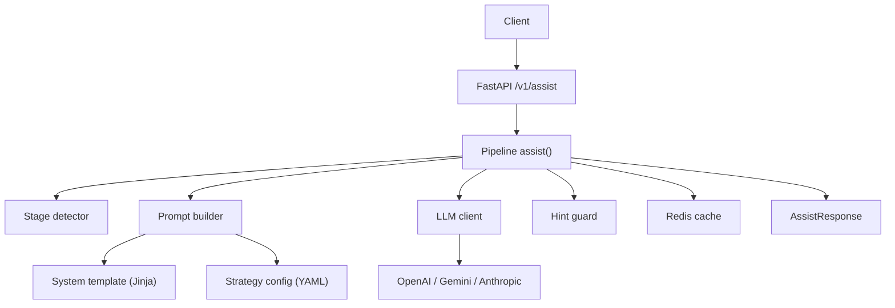
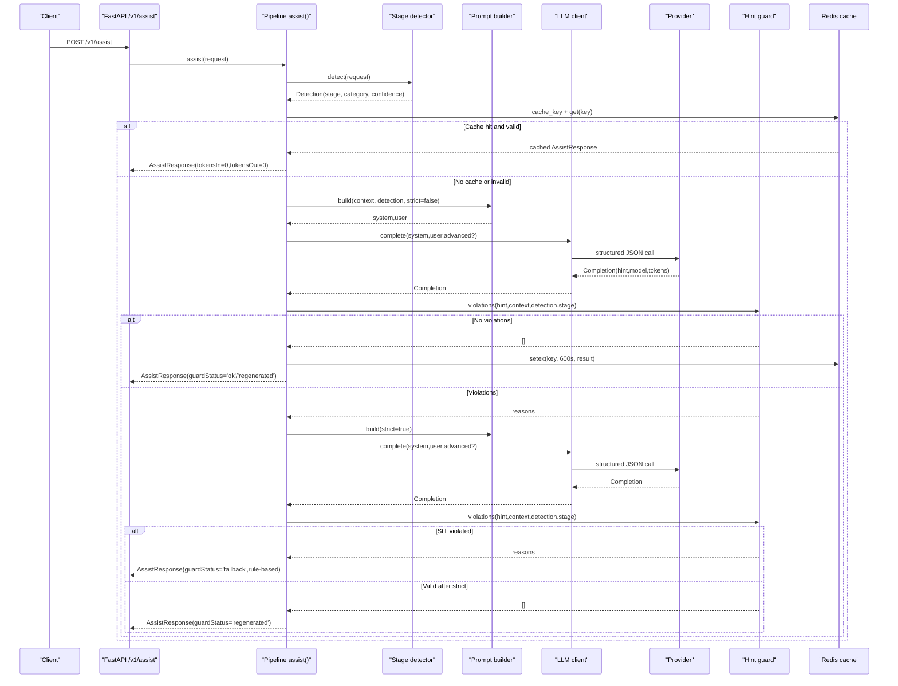
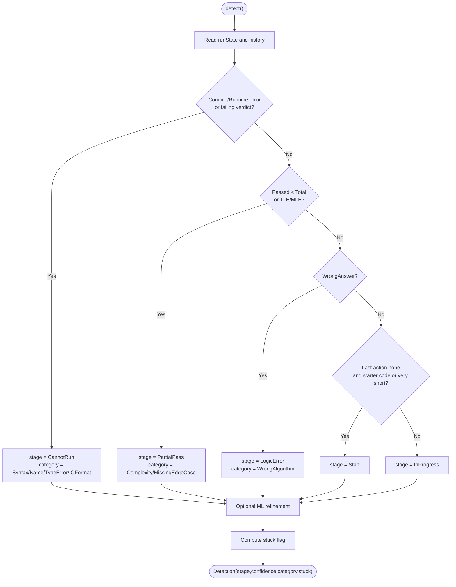
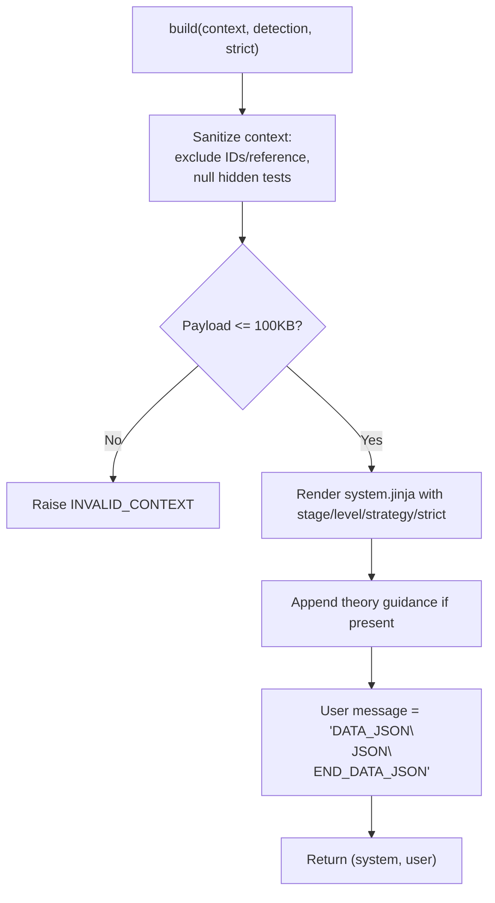
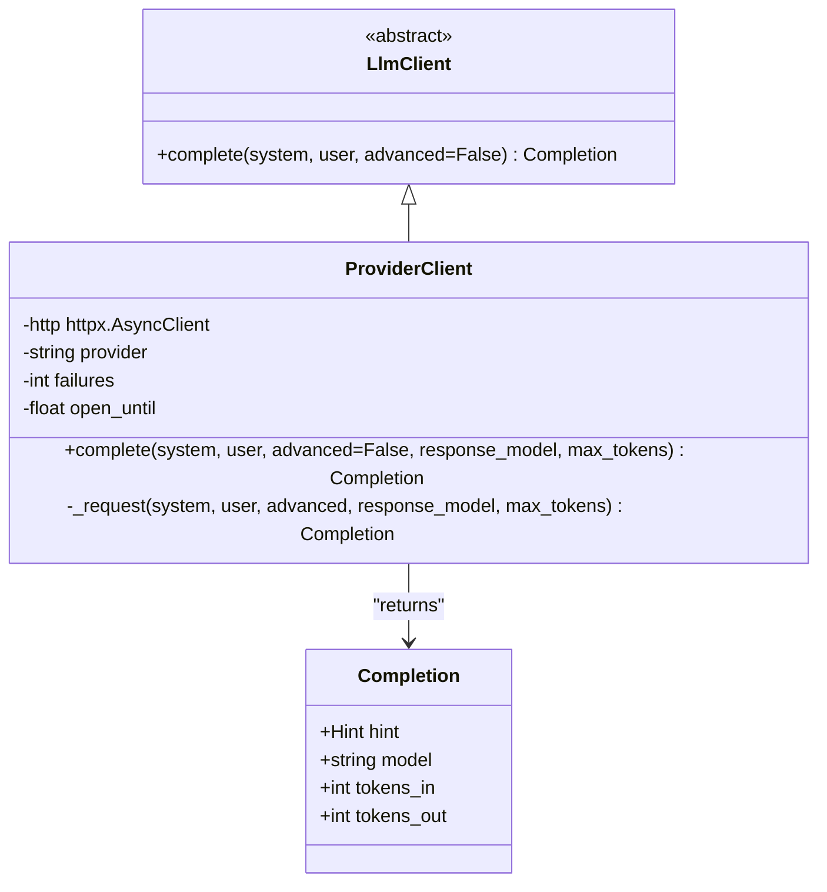
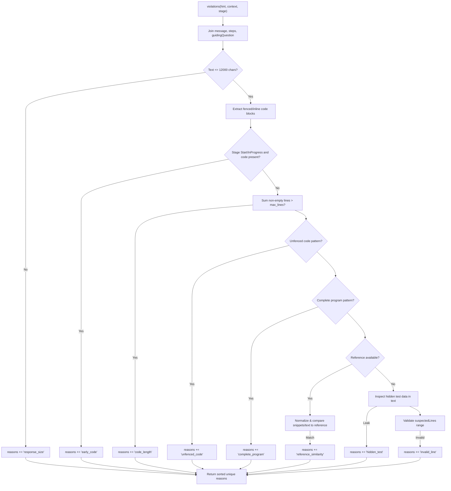
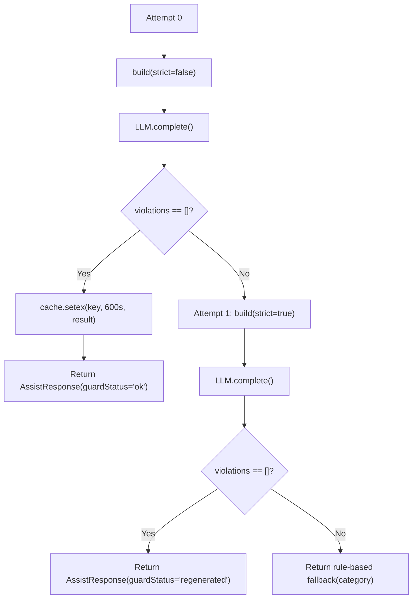
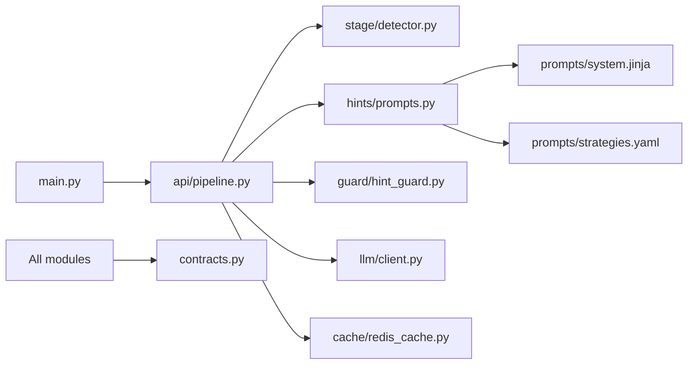

# Hint Generation Engine

<cite>
**Referenced Files in This Document**
- [pipeline.py](file://ai-service/app/api/pipeline.py)
- [hint_guard.py](file://ai-service/app/guard/hint_guard.py)
- [prompts.py](file://ai-service/app/hints/prompts.py)
- [system.jinja](file://ai-service/app/prompts/system.jinja)
- [strategies.yaml](file://ai-service/app/prompts/strategies.yaml)
- [detector.py](file://ai-service/app/stage/detector.py)
- [client.py](file://ai-service/app/llm/client.py)
- [redis_cache.py](file://ai-service/app/cache/redis_cache.py)
- [contracts.py](file://ai-service/app/contracts.py)
- [main.py](file://ai-service/app/main.py)
</cite>

## Table of Contents
1. [Introduction](#introduction)
2. [Project Structure](#project-structure)
3. [Core Components](#core-components)
4. [Architecture Overview](#architecture-overview)
5. [Detailed Component Analysis](#detailed-component-analysis)
6. [Dependency Analysis](#dependency-analysis)
7. [Performance Considerations](#performance-considerations)
8. [Troubleshooting Guide](#troubleshooting-guide)
9. [Conclusion](#conclusion)

## Introduction
This document explains the hint generation engine that produces safe, stage-aware tutoring hints for student code submissions. It covers how prompts are constructed from detected stages and levels, how guard rails validate AI responses, how retries and fallback strategies work, and how token usage and caching are optimized. The goal is to make the system understandable for both developers and non-technical readers while preserving implementation accuracy.

## Project Structure
The hint generation engine lives in the Python `ai-service` application. Its core flow starts at the FastAPI endpoint, routes through a pipeline that detects the learning stage, builds a prompt, calls an LLM provider, validates the response with guard rules, caches results, and returns a structured hint or a rule-based fallback.

**Diagram sources**
- [main.py:64-81](file://ai-service/app/main.py#L64-L81)
- [pipeline.py:10-40](file://ai-service/app/api/pipeline.py#L10-L40)
- [detector.py:11-37](file://ai-service/app/stage/detector.py#L11-L37)
- [prompts.py:13-29](file://ai-service/app/hints/prompts.py#L13-L29)
- [client.py:31-82](file://ai-service/app/llm/client.py#L31-L82)
- [hint_guard.py:22-47](file://ai-service/app/guard/hint_guard.py#L22-L47)
- [redis_cache.py:5-10](file://ai-service/app/cache/redis_cache.py#L5-L10)

**Section sources**
- [main.py:64-81](file://ai-service/app/main.py#L64-L81)
- [pipeline.py:10-40](file://ai-service/app/api/pipeline.py#L10-L40)

## Core Components
- Stage detection: Determines whether the student is at Start, InProgress, LogicError, CannotRun, or PartialPass, plus an error category and confidence.
- Prompt construction: Builds system and user messages using Jinja templates and YAML strategy configuration, sanitizes sensitive data, and enforces size limits.
- LLM client: Calls OpenAI, Gemini, or Anthropic with structured output schemas and tracks token usage.
- Guard rail: Validates generated hints against safety and quality rules before returning them.
- Retry and fallback: Attempts regeneration under strict mode once; falls back to rule-based hints if guard violations persist.
- Caching: Stores validated hints in Redis with semantic keys and re-validates on hit.

**Section sources**
- [detector.py:11-37](file://ai-service/app/stage/detector.py#L11-L37)
- [prompts.py:13-40](file://ai-service/app/hints/prompts.py#L13-L40)
- [client.py:31-82](file://ai-service/app/llm/client.py#L31-L82)
- [hint_guard.py:22-47](file://ai-service/app/guard/hint_guard.py#L22-L47)
- [pipeline.py:10-40](file://ai-service/app/api/pipeline.py#L10-L40)
- [redis_cache.py:5-10](file://ai-service/app/cache/redis_cache.py#L5-L10)

## Architecture Overview
The end-to-end request flow integrates stage detection, prompt building, LLM completion, guard validation, caching, and response assembly.

**Diagram sources**
- [main.py:64-81](file://ai-service/app/main.py#L64-L81)
- [pipeline.py:10-40](file://ai-service/app/api/pipeline.py#L10-L40)
- [prompts.py:13-29](file://ai-service/app/hints/prompts.py#L13-L29)
- [client.py:31-82](file://ai-service/app/llm/client.py#L31-L82)
- [hint_guard.py:22-47](file://ai-service/app/guard/hint_guard.py#L22-L47)
- [redis_cache.py:5-10](file://ai-service/app/cache/redis_cache.py#L5-L10)

## Detailed Component Analysis

### Stage Detection
The detector classifies the current learning state based on compile/runtime errors, test verdicts, submission history, and starter code heuristics. It also computes a category such as SyntaxError, NameError, TypeError, IOFormat, Complexity, MissingEdgeCase, WrongAlgorithm, or Unknown. An optional classifier can refine category and confidence without overriding rule priority.

**Diagram sources**
- [detector.py:11-37](file://ai-service/app/stage/detector.py#L11-L37)

**Section sources**
- [detector.py:11-37](file://ai-service/app/stage/detector.py#L11-L37)

### Prompt Construction
The prompt builder prepares sanitized context and renders a system message from a Jinja template combined with YAML strategy configuration. It excludes sensitive fields like student identifiers and reference solutions, nulls hidden test data, and enforces a maximum payload size. The user message carries the sanitized JSON payload within delimiters.

Key behaviors:
- Excludes `studentRef`, `requestId`, and `referenceSolution`.
- Nulls hidden test inputs, expected, and actual values.
- Enforces a 100 KB payload limit; raises INVALID_CONTEXT when exceeded.
- Renders system instructions with stage, level, strategy, trace guidance, and strict mode.
- Appends a DATA_JSON delimiter block containing the sanitized context.

**Diagram sources**
- [prompts.py:13-29](file://ai-service/app/hints/prompts.py#L13-L29)
- [system.jinja:1-10](file://ai-service/app/prompts/system.jinja#L1-L10)
- [strategies.yaml:1-23](file://ai-service/app/prompts/strategies.yaml#L1-L23)

**Section sources**
- [prompts.py:13-40](file://ai-service/app/hints/prompts.py#L13-L40)
- [system.jinja:1-10](file://ai-service/app/prompts/system.jinja#L1-L10)
- [strategies.yaml:1-23](file://ai-service/app/prompts/strategies.yaml#L1-L23)

### LLM Client and Structured Output
The LLM client abstracts provider-specific calls while enforcing structured JSON outputs via Pydantic schema validation. It supports OpenAI, Gemini, and Anthropic, selecting advanced models for LogicError or level 3 requests. Token usage is captured per provider and returned in the Completion object.

Important details:
- Uses structured output schemas: JSON schema for OpenAI/LocalVLLM, responseJsonSchema for Gemini, tool use for Anthropic.
- Retries transient transport/provider errors up to two attempts.
- Applies timeouts based on token budget.
- Tracks tokens_in and tokens_out for observability.

**Diagram sources**
- [client.py:9-82](file://ai-service/app/llm/client.py#L9-L82)

**Section sources**
- [client.py:31-82](file://ai-service/app/llm/client.py#L31-L82)

### Guard Rail Validation
The guard ensures generated hints meet safety and quality criteria. It inspects text content, fenced and inline code blocks, unfenced code patterns, presence of complete program constructs, similarity to reference solutions, leakage of hidden test data, and validity of suspected line numbers.

Guard checks include:
- Response size limit.
- Early-stage code prohibition for Start and InProgress.
- Code length limits across blocks.
- Unfenced code detection.
- Complete program pattern detection.
- Reference solution similarity normalization and structural matching.
- Hidden test input/expected/actual leakage.
- Invalid suspected lines outside source code bounds.

**Diagram sources**
- [hint_guard.py:22-47](file://ai-service/app/guard/hint_guard.py#L22-L47)

**Section sources**
- [hint_guard.py:22-47](file://ai-service/app/guard/hint_guard.py#L22-L47)

### Retry Mechanism and Fallback Strategies
The pipeline runs up to two attempts:
- First attempt uses normal strictness.
- If guard violations occur, it rebuilds prompts with strict mode enabled and retries once.
- If the second attempt still violates guard rules, it returns a rule-based fallback hint tailored to the error category.

Advanced model selection:
- Advanced model is used when the request level is 3 or the detected stage is LogicError.

Cache behavior:
- On successful validation, the result is cached for 600 seconds.
- Cache hits bypass LLM calls but still undergo guard validation; token counts are zeroed.

**Diagram sources**
- [pipeline.py:22-40](file://ai-service/app/api/pipeline.py#L22-L40)
- [prompts.py:31-40](file://ai-service/app/hints/prompts.py#L31-L40)

**Section sources**
- [pipeline.py:22-40](file://ai-service/app/api/pipeline.py#L22-L40)
- [prompts.py:31-40](file://ai-service/app/hints/prompts.py#L31-L40)

### Data Contracts and Response Schema
The contracts define the structure of requests, hints, and responses, including guard status, model and prompt versions, and token usage counters. They ensure consistent payloads between components and providers.

Key fields:
- Hint: message, steps, suspectedLines, guidingQuestion.
- AssistResponse: extends Hint with stage, stageConfidence, errorCategory, level, guardStatus, modelVersion, promptVersion, tokensIn, tokensOut.
- ErrorResponse: standardized error codes such as AI_UNAVAILABLE, INVALID_CONTEXT, GUARD_FALLBACK.

**Section sources**
- [contracts.py:82-101](file://ai-service/app/contracts.py#L82-L101)

## Dependency Analysis
The following diagram shows how core modules depend on each other during hint generation.

**Diagram sources**
- [main.py:64-81](file://ai-service/app/main.py#L64-L81)
- [pipeline.py:1-40](file://ai-service/app/api/pipeline.py#L1-L40)
- [prompts.py:1-29](file://ai-service/app/hints/prompts.py#L1-L29)
- [system.jinja:1-10](file://ai-service/app/prompts/system.jinja#L1-L10)
- [strategies.yaml:1-23](file://ai-service/app/prompts/strategies.yaml#L1-L23)
- [hint_guard.py:22-47](file://ai-service/app/guard/hint_guard.py#L22-L47)
- [client.py:31-82](file://ai-service/app/llm/client.py#L31-L82)
- [redis_cache.py:5-10](file://ai-service/app/cache/redis_cache.py#L5-L10)
- [contracts.py:82-101](file://ai-service/app/contracts.py#L82-L101)

**Section sources**
- [pipeline.py:1-40](file://ai-service/app/api/pipeline.py#L1-L40)
- [contracts.py:82-101](file://ai-service/app/contracts.py#L82-L101)

## Performance Considerations
- Token optimization:
  - Use advanced models only when necessary (LogicError or level 3).
  - Track tokensIn/tokensOut in AssistResponse for monitoring.
  - Avoid sending reference solutions or hidden test data to reduce prompt size.
- Caching:
  - Redis cache key includes version, model identity, stage, category, level, and normalized context.
  - Cache TTL is 600 seconds; cache hits skip LLM calls and reset token counters.
  - Cache reads are wrapped in exception handling to avoid blocking on Redis failures.
- Payload limits:
  - Context payload capped at 100 KB; oversized contexts raise INVALID_CONTEXT early.
- Provider resilience:
  - Transient provider errors trigger retries and temporary circuit breaker-like cooldown.
  - Timeouts vary by token budget to balance latency and throughput.

[No sources needed since this section provides general guidance]

## Troubleshooting Guide
Common issues and resolutions:
- INVALID_CONTEXT:
  - Cause: Request validation failure or oversized context payload.
  - Action: Validate input schema and reduce problem statement/sample sizes.
- AI_UNAVAILABLE:
  - Cause: Provider errors, missing model configuration, or temporary unavailability.
  - Action: Check LLM_MODEL/LLM_ADVANCED_MODEL, API keys, base URLs, and network egress.
- GUARD_FALLBACK:
  - Cause: Generated hint violated guard rules even after strict regeneration.
  - Action: Review guard violations (early_code, code_length, unfenced_code, complete_program, reference_similarity, hidden_test, invalid_line), adjust prompt strategies, or improve model choice.
- Cache misses or stale hints:
  - Cause: Version mismatch or semantic context change.
  - Action: Ensure VERSION updates when templates/config change; verify cache key includes all relevant fields.

Operational notes:
- Endpoint sets X-AI-Code=GUARD_FALLBACK header when guardStatus=fallback.
- Deadlines: Python endpoint timeout is 19 seconds; LLM client timeouts vary by token budget.
- Health check: GET /health returns status ok.

**Section sources**
- [main.py:48-81](file://ai-service/app/main.py#L48-L81)
- [pipeline.py:10-40](file://ai-service/app/api/pipeline.py#L10-L40)
- [hint_guard.py:22-47](file://ai-service/app/guard/hint_guard.py#L22-L47)
- [prompts.py:13-29](file://ai-service/app/hints/prompts.py#L13-L29)

## Conclusion
The hint generation engine combines robust stage detection, carefully constructed prompts, structured LLM outputs, comprehensive guard validation, resilient retry logic, and efficient caching. Together, these components deliver safe, pedagogically sound hints while minimizing token costs and protecting sensitive data. Operators should monitor guard violation reasons, token usage, and cache hit rates to tune performance and quality over time.

[No sources needed since this section summarizes without analyzing specific files]