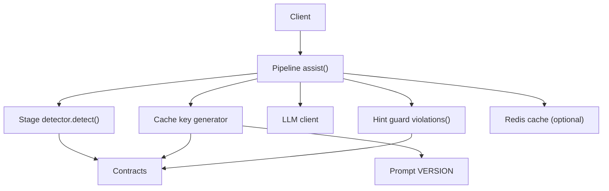
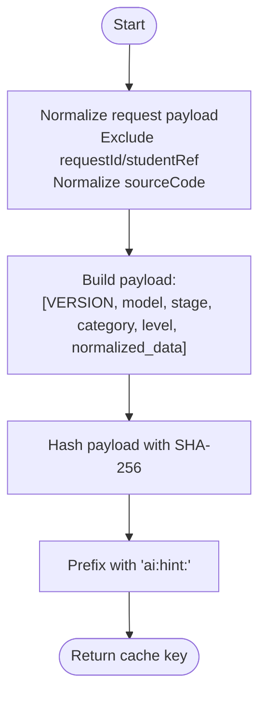
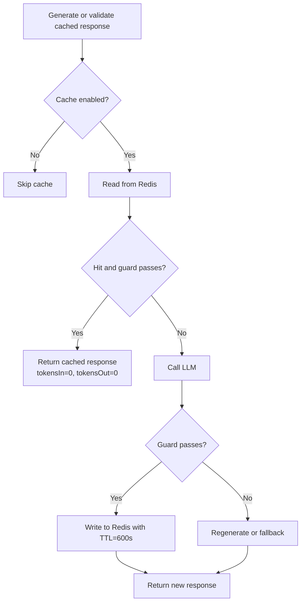
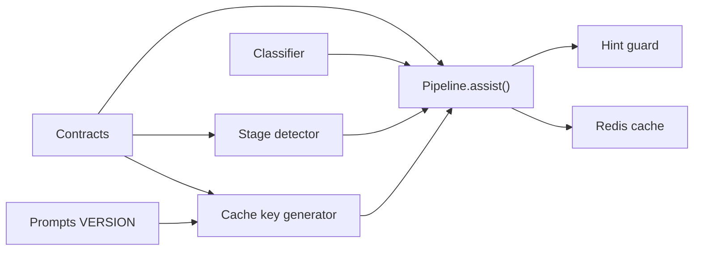

# Response Caching Layer

<cite>
**Referenced Files in This Document**
- [redis_cache.py](file://ai-service/app/cache/redis_cache.py)
- [pipeline.py](file://ai-service/app/api/pipeline.py)
- [detector.py](file://ai-service/app/stage/detector.py)
- [model.py](file://ai-service/app/stage/model.py)
- [contracts.py](file://ai-service/app/contracts.py)
- [prompts.py](file://ai-service/app/hints/prompts.py)
- [hint_guard.py](file://ai-service/app/guard/hint_guard.py)
</cite>

## Table of Contents
1. [Introduction](#introduction)
2. [Project Structure](#project-structure)
3. [Core Components](#core-components)
4. [Architecture Overview](#architecture-overview)
5. [Detailed Component Analysis](#detailed-component-analysis)
6. [Dependency Analysis](#dependency-analysis)
7. [Performance Considerations](#performance-considerations)
8. [Troubleshooting Guide](#troubleshooting-guide)
9. [Conclusion](#conclusion)

## Introduction
This document explains the response caching layer for the AI hint pipeline. It covers how cache keys are generated from request context, stage detection results, and model identity; how Redis-backed distributed caching integrates into the pipeline; TTL management and invalidation policies; cache hit and miss handling; and the impact on performance metrics. It also provides configuration guidance, monitoring recommendations, and troubleshooting steps.

## Project Structure
The caching logic is implemented in a small Python service under `ai-service`. The relevant modules are:
- Cache key generation: `app/cache/redis_cache.py`
- Pipeline orchestration with optional cache integration: `app/api/pipeline.py`
- Stage detection that determines the student’s learning state: `app/stage/detector.py`
- Optional ML classifier used to refine category and confidence: `app/stage/model.py`
- Request/response contracts and types: `app/contracts.py`
- Prompt building and prompt versioning: `app/hints/prompts.py`
- Guardrail validation for hints: `app/guard/hint_guard.py`



**Diagram sources**
- [pipeline.py:10-40](file://ai-service/app/api/pipeline.py#L10-L40)
- [detector.py:11-37](file://ai-service/app/stage/detector.py#L11-L37)
- [redis_cache.py:5-10](file://ai-service/app/cache/redis_cache.py#L5-L10)
- [prompts.py:7-11](file://ai-service/app/hints/prompts.py#L7-L11)
- [hint_guard.py:22-47](file://ai-service/app/guard/hint_guard.py#L22-L47)
- [contracts.py:72-97](file://ai-service/app/contracts.py#L72-L97)

**Section sources**
- [pipeline.py:1-41](file://ai-service/app/api/pipeline.py#L1-L41)
- [redis_cache.py:1-11](file://ai-service/app/cache/redis_cache.py#L1-L11)
- [detector.py:1-38](file://ai-service/app/stage/detector.py#L1-L38)
- [model.py:1-31](file://ai-service/app/stage/model.py#L1-L31)
- [contracts.py:1-101](file://ai-service/app/contracts.py#L1-L101)
- [prompts.py:1-41](file://ai-service/app/hints/prompts.py#L1-L41)
- [hint_guard.py:1-48](file://ai-service/app/guard/hint_guard.py#L1-L48)

## Core Components
- Cache key generator: Produces a stable, semantic cache key based on normalized request data, prompt version, model identity, stage detection result, and request level.
- Pipeline orchestrator: Runs stage detection, computes the cache key, attempts cache reads/writes, performs guard validation, calls the LLM if needed, and returns a typed response.
- Stage detector: Determines the current learning stage and error category from run state and history.
- Classifier (optional): Refines category and confidence using a local ML model; its version participates in cache invalidation.
- Prompt builder: Builds system/user prompts and defines a prompt version string that changes when prompt templates change.
- Hint guard: Validates generated hints against policy rules; failed validations trigger regeneration or fallback.

Key responsibilities:
- Cache key stability and collision avoidance.
- Safe cache read/write with graceful degradation.
- Consistent TTL and invalidation tied to prompt and model versions.
- Accurate token accounting and guard status propagation.

**Section sources**
- [redis_cache.py:5-10](file://ai-service/app/cache/redis_cache.py#L5-L10)
- [pipeline.py:10-40](file://ai-service/app/api/pipeline.py#L10-L40)
- [detector.py:11-37](file://ai-service/app/stage/detector.py#L11-L37)
- [model.py:6-30](file://ai-service/app/stage/model.py#L6-L30)
- [prompts.py:7-11](file://ai-service/app/hints/prompts.py#L7-L11)
- [hint_guard.py:22-47](file://ai-service/app/guard/hint_guard.py#L22-L47)
- [contracts.py:72-97](file://ai-service/app/contracts.py#L72-L97)

## Architecture Overview
The caching layer sits between the pipeline and the LLM. When enabled, it short-circuits repeated requests by returning cached responses that have already passed guard validation.

```mermaid
sequenceDiagram
participant Client as "Client"
participant Pipeline as "Pipeline.assist()"
participant Detector as "Stage detector"
participant KeyGen as "cache_key()"
participant Cache as "Redis cache"
participant LLM as "LLM client"
participant Guard as "hint_guard.violations()"
Client->>Pipeline : AssistRequest
Pipeline->>Detector : detect(context)
Detector-->>Pipeline : Detection(stage, category, confidence)
Pipeline->>KeyGen : cache_key(context, detection, model_identity|classifier.version)
KeyGen-->>Pipeline : cache_key
alt Cache enabled
Pipeline->>Cache : get(cache_key)
alt Cache hit
Cache-->>Pipeline : serialized response
Pipeline->>Guard : violations(response, context, stage)
alt Guard passes
Pipeline-->>Client : Cached response (tokensIn=0, tokensOut=0)
else Guard fails
Pipeline->>LLM : generate new hint
end
else Cache miss or error
Pipeline->>LLM : generate hint(s)
LLM-->>Pipeline : completion
Pipeline->>Guard : violations(hint, context, stage)
alt Guard passes
Pipeline->>Cache : setex(key, 600s, serialized response)
Pipeline-->>Client : New response
else Guard fails
Pipeline->>LLM : regenerate once
LLM-->>Pipeline : completion
Pipeline->>Guard : violations(...)
alt Guard passes
Pipeline->>Cache : setex(key, 600s, serialized response)
Pipeline-->>Client : Regenerated response
else Fallback
Pipeline-->>Client : Fallback response
end
end
end
else Cache disabled
Pipeline->>LLM : generate hint(s)
...
end
```

**Diagram sources**
- [pipeline.py:10-40](file://ai-service/app/api/pipeline.py#L10-L40)
- [redis_cache.py:5-10](file://ai-service/app/cache/redis_cache.py#L5-L10)
- [detector.py:11-37](file://ai-service/app/stage/detector.py#L11-L37)
- [hint_guard.py:22-47](file://ai-service/app/guard/hint_guard.py#L22-L47)
- [prompts.py:7-11](file://ai-service/app/hints/prompts.py#L7-L11)

## Detailed Component Analysis

### Cache Key Generation Strategy
The cache key is designed to be stable across identical semantic inputs while changing when any meaningful input changes. It includes:
- Prompt version: Ensures cache invalidation when prompt templates or strategies change.
- Model identity: Includes the LLM model name and classifier version to avoid cross-model contamination.
- Stage and category: From stage detection so different stages do not share stale hints.
- Request level: Different hint levels produce different outputs.
- Normalized request payload: Excludes sensitive identifiers and normalizes line endings and trailing whitespace.



**Diagram sources**
- [redis_cache.py:5-10](file://ai-service/app/cache/redis_cache.py#L5-L10)
- [prompts.py:7-11](file://ai-service/app/hints/prompts.py#L7-L11)
- [detector.py:11-37](file://ai-service/app/stage/detector.py#L11-L37)
- [contracts.py:72-97](file://ai-service/app/contracts.py#L72-L97)

Important behaviors:
- Sensitive fields like `requestId` and `studentRef` are excluded from hashing to prevent per-request collisions.
- Source code normalization avoids cache misses due to Windows vs Unix line endings.
- Prompt versioning ensures cache invalidation when prompt templates change.
- Classifier version is appended to model identity when present, ensuring model drift does not reuse stale hints.

**Section sources**
- [redis_cache.py:5-10](file://ai-service/app/cache/redis_cache.py#L5-L10)
- [prompts.py:7-11](file://ai-service/app/hints/prompts.py#L7-L11)
- [model.py:6-16](file://ai-service/app/stage/model.py#L6-L16)
- [contracts.py:72-97](file://ai-service/app/contracts.py#L72-L97)

### Redis Integration and TTL Management
- Read path: On cache hit, the pipeline deserializes the stored response and runs guard validation. If valid, it returns immediately with zeroed token counters.
- Write path: On successful generation and guard pass, the pipeline serializes the response and stores it with a fixed TTL of 600 seconds.
- Error handling: Both read and write operations are wrapped in try/except blocks. Failures are logged and treated as cache misses without breaking the request flow.

TTL policy:
- Fixed TTL of 600 seconds for all cached hints.
- No explicit invalidation beyond TTL expiration and prompt/model version changes embedded in the key.



**Diagram sources**
- [pipeline.py:13-36](file://ai-service/app/api/pipeline.py#L13-L36)

**Section sources**
- [pipeline.py:13-36](file://ai-service/app/api/pipeline.py#L13-L36)

### Cache Hit/Miss Handling in the Pipeline Flow
- Cache hit:
  - Deserializes the stored JSON into an `AssistResponse`.
  - Runs guard validation against the original context and detected stage.
  - If valid, returns the cached response with token counters reset to zero.
  - If invalid, proceeds to LLM generation.
- Cache miss or read failure:
  - Proceeds to LLM generation.
  - Attempts up to two generations: first attempt uses default strictness; second attempt uses stricter prompting.
  - After each generation, guard validation is applied.
  - On success, writes to cache with TTL 600s and returns the response.
  - On repeated guard failures, returns a rule-based fallback response.

Metrics and metadata:
- Token counts (`tokensIn`, `tokensOut`) are accumulated only for actual LLM calls.
- `guardStatus` indicates whether the response came from cache, was regenerated, or fell back to rules.
- `modelVersion` and `promptVersion` are included for traceability.

**Section sources**
- [pipeline.py:10-40](file://ai-service/app/api/pipeline.py#L10-L40)
- [contracts.py:88-97](file://ai-service/app/contracts.py#L88-L97)

### Impact on Performance Metrics
- Cache hits eliminate LLM calls, reducing latency and cost.
- Token counters are zeroed for cached responses to reflect no LLM usage.
- Guard validation on cache hits prevents serving unsafe or policy-violating hints.
- Two-attempt regeneration increases robustness at the cost of additional LLM calls on misses.

Operational implications:
- High cache hit rates improve throughput and reduce downstream load.
- Frequent cache misses may indicate unstable keys, prompt/model churn, or high variability in inputs.

**Section sources**
- [pipeline.py:10-40](file://ai-service/app/api/pipeline.py#L10-L40)

### Configuration Options for Cache Behavior
- Enable/disable cache: Pass a cache object to `assist`; if absent, caching is skipped.
- TTL: Hardcoded to 600 seconds in the write path.
- Strict mode: Second generation attempt uses stricter prompting when needed.
- Model identity: Passed explicitly; combined with classifier version when available.
- Classifier: Optional; influences stage/category refinement and cache key via version.

Recommended configuration approach:
- Provide a Redis-backed cache implementation conforming to async `get` and `setex` semantics.
- Ensure consistent TTL across deployments.
- Align classifier deployment versions with cache key inclusion to invalidate stale entries.

**Section sources**
- [pipeline.py:10-40](file://ai-service/app/api/pipeline.py#L10-L40)
- [redis_cache.py:5-10](file://ai-service/app/cache/redis_cache.py#L5-L10)
- [model.py:6-16](file://ai-service/app/stage/model.py#L6-L16)

### Monitoring Cache Effectiveness
Suggested metrics to track:
- Cache hit rate: Number of cache hits divided by total cache lookups.
- Cache miss reasons: Breakdown by guard failure, read errors, and true misses.
- Average latency with and without cache.
- Token savings: Sum of `tokensIn` and `tokensOut` avoided due to cache hits.
- Guard violation distribution: Frequency of violations leading to regeneration or fallback.
- Prompt/model version churn: Correlate cache invalidation events with version updates.

Implementation suggestions:
- Emit structured logs for cache read/write outcomes.
- Instrument guard violation categories.
- Track `guardStatus`, `modelVersion`, and `promptVersion` in telemetry.

**Section sources**
- [pipeline.py:13-36](file://ai-service/app/api/pipeline.py#L13-L36)
- [hint_guard.py:22-47](file://ai-service/app/guard/hint_guard.py#L22-L47)

### Troubleshooting Cache-Related Issues
Common symptoms and resolutions:
- Unexpected cache misses:
  - Verify prompt template changes update `VERSION`.
  - Confirm classifier version changes propagate to cache keys.
  - Check for unexpected differences in normalized source code or request payloads.
- Stale hints after model updates:
  - Ensure classifier version is included in model identity.
  - Validate that deployed classifier metadata version matches expected.
- Guard failures causing regeneration:
  - Review guard rules for early code exposure, reference similarity, hidden test leakage, and line number validity.
  - Adjust prompt strictness or content to reduce violations.
- Redis connectivity issues:
  - Treat read/write failures as cache misses; verify network and credentials.
  - Monitor logs for cache read/write warnings.

Diagnostic checks:
- Inspect cache key composition to ensure deterministic hashing.
- Compare serialized responses before/after guard validation.
- Validate TTL behavior and eviction patterns.

**Section sources**
- [redis_cache.py:5-10](file://ai-service/app/cache/redis_cache.py#L5-L10)
- [pipeline.py:13-36](file://ai-service/app/api/pipeline.py#L13-L36)
- [hint_guard.py:22-47](file://ai-service/app/guard/hint_guard.py#L22-L47)
- [model.py:6-16](file://ai-service/app/stage/model.py#L6-L16)

## Dependency Analysis
The caching layer depends on several components:
- Stage detection informs the cache key and guard validation.
- Prompt versioning ensures cache invalidation on template changes.
- Classifier versioning ensures cache invalidation on model updates.
- Guard validation protects cache contents and triggers regeneration/fallback.



**Diagram sources**
- [contracts.py:72-97](file://ai-service/app/contracts.py#L72-L97)
- [detector.py:11-37](file://ai-service/app/stage/detector.py#L11-L37)
- [prompts.py:7-11](file://ai-service/app/hints/prompts.py#L7-L11)
- [model.py:6-16](file://ai-service/app/stage/model.py#L6-L16)
- [redis_cache.py:5-10](file://ai-service/app/cache/redis_cache.py#L5-L10)
- [pipeline.py:10-40](file://ai-service/app/api/pipeline.py#L10-L40)
- [hint_guard.py:22-47](file://ai-service/app/guard/hint_guard.py#L22-L47)

**Section sources**
- [pipeline.py:10-40](file://ai-service/app/api/pipeline.py#L10-L40)
- [redis_cache.py:5-10](file://ai-service/app/cache/redis_cache.py#L5-L10)
- [detector.py:11-37](file://ai-service/app/stage/detector.py#L11-L37)
- [model.py:6-16](file://ai-service/app/stage/model.py#L6-L16)
- [prompts.py:7-11](file://ai-service/app/hints/prompts.py#L7-L11)
- [hint_guard.py:22-47](file://ai-service/app/guard/hint_guard.py#L22-L47)
- [contracts.py:72-97](file://ai-service/app/contracts.py#L72-L97)

## Performance Considerations
- Cache hit path is O(1) for Redis lookup plus guard validation overhead.
- Cache miss path incurs LLM latency and potential regeneration.
- Normalization and hashing are lightweight but should be measured under high concurrency.
- TTL of 600 seconds balances freshness and memory usage; adjust based on workload characteristics.
- Guard validation can be CPU-bound; consider profiling and optimizing hot paths if necessary.

[No sources needed since this section provides general guidance]

## Troubleshooting Guide
- Symptom: High cache miss rate
  - Check prompt/template version churn.
  - Verify classifier version alignment.
  - Inspect request normalization differences.
- Symptom: Stale hints after model updates
  - Confirm classifier version is part of model identity.
  - Validate model metadata and hash integrity.
- Symptom: Frequent guard violations
  - Review hint content for policy breaches.
  - Tune prompt strictness and strategy selection.
- Symptom: Redis errors
  - Treat as cache misses; monitor logs.
  - Verify connection settings and availability.

**Section sources**
- [pipeline.py:13-36](file://ai-service/app/api/pipeline.py#L13-L36)
- [redis_cache.py:5-10](file://ai-service/app/cache/redis_cache.py#L5-L10)
- [hint_guard.py:22-47](file://ai-service/app/guard/hint_guard.py#L22-L47)
- [model.py:6-16](file://ai-service/app/stage/model.py#L6-L16)

## Conclusion
The response caching layer provides a robust, semantically keyed cache over the AI hint pipeline. It integrates tightly with stage detection, prompt versioning, and classifier identity to ensure correctness while significantly improving performance through cache hits. With proper configuration, monitoring, and troubleshooting practices, the cache delivers reliable, safe, and efficient hint delivery across distributed deployments.

[No sources needed since this section summarizes without analyzing specific files]