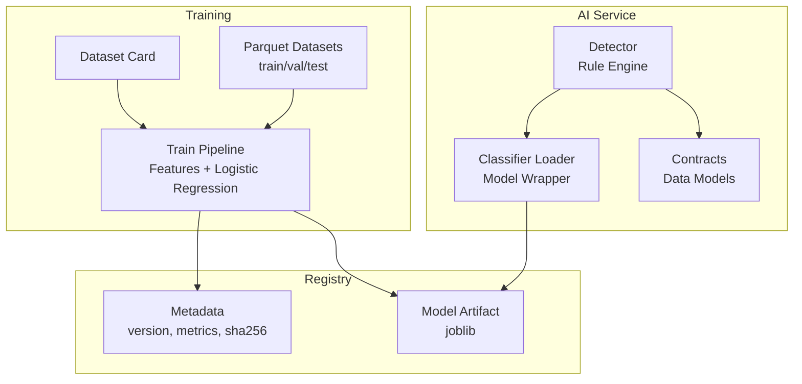
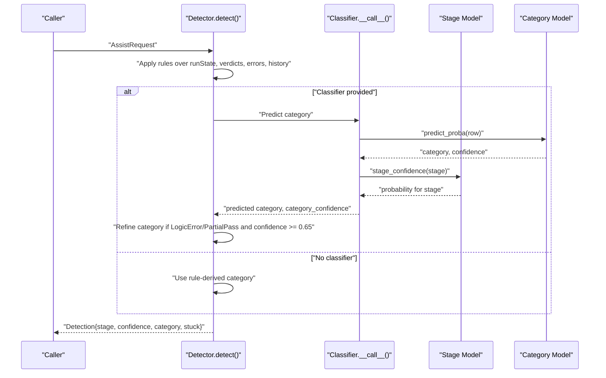
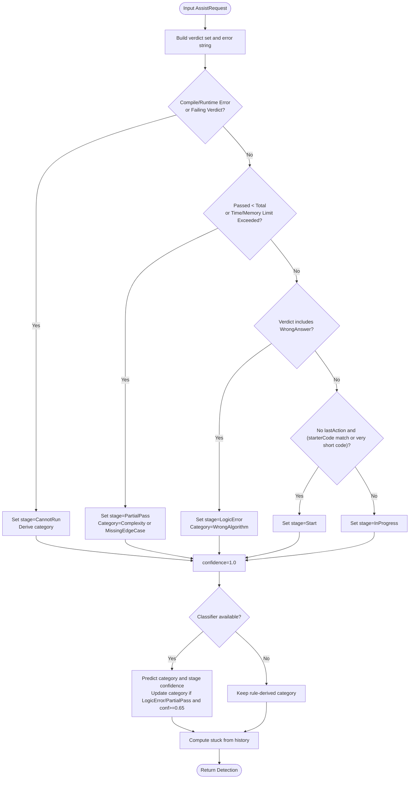
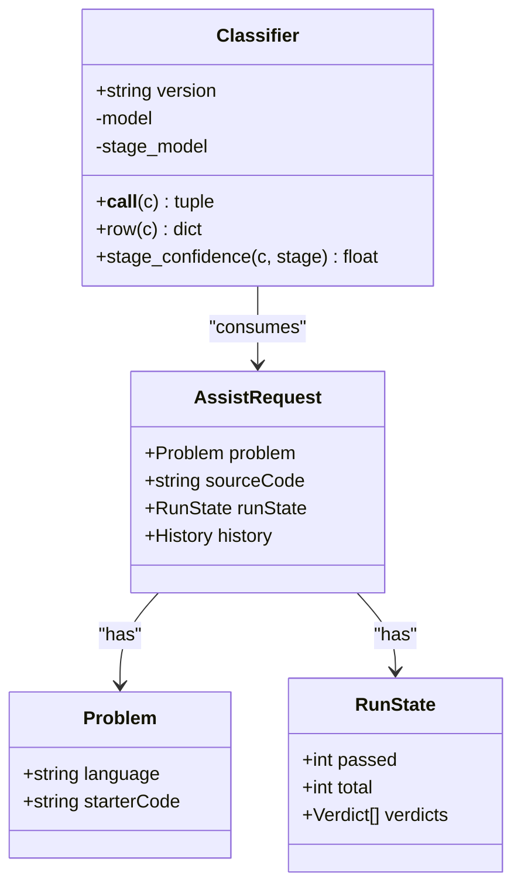
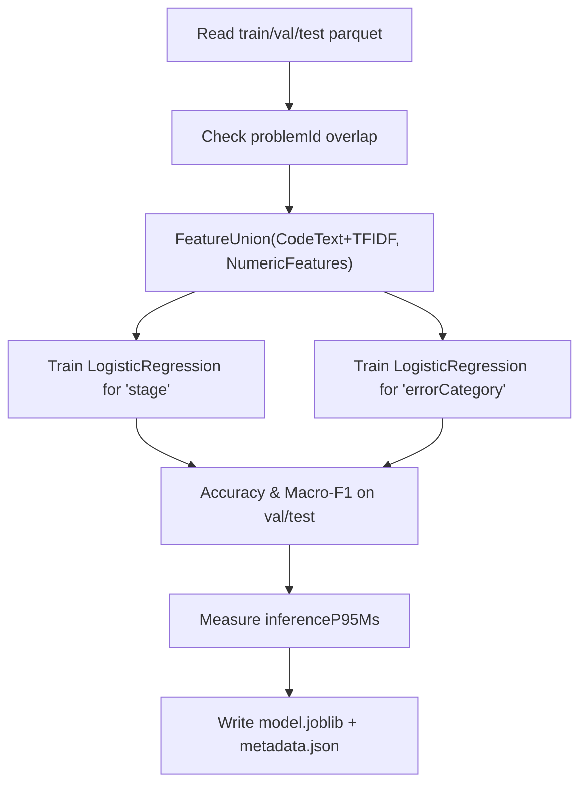
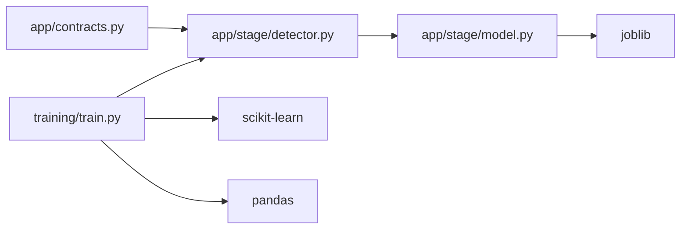

# Stage Detection System

<cite>
**Referenced Files in This Document**
- [detector.py](file://ai-service/app/stage/detector.py)
- [model.py](file://ai-service/app/stage/model.py)
- [contracts.py](file://ai-service/app/contracts.py)
- [train.py](file://ai-service/training/train.py)
- [DATASET_CARD.md](file://ai-service/data/smoke/prepared/DATASET_CARD.md)
- [metadata.json](file://ai-service/data/smoke/models/stage-error/smoke-v1/metadata.json)
</cite>

## Table of Contents
1. [Introduction](#introduction)
2. [Project Structure](#project-structure)
3. [Core Components](#core-components)
4. [Architecture Overview](#architecture-overview)
5. [Detailed Component Analysis](#detailed-component-analysis)
6. [Dependency Analysis](#dependency-analysis)
7. [Performance Considerations](#performance-considerations)
8. [Troubleshooting Guide](#troubleshooting-guide)
9. [Conclusion](#conclusion)

## Introduction
This document explains the stage detection system that classifies a learner’s coding session into pedagogical stages and error categories. It combines deterministic rules with a lightweight classifier to analyze code context, run results, and interaction history. The system outputs:
- A learning stage such as Start, InProgress, CannotRun, LogicError, or PartialPass.
- An error category such as Unknown, SyntaxError, WrongAlgorithm, MissingEdgeCase, Complexity, or IOFormat.
- A confidence score for the selected stage.
- A stuck flag derived from user behavior signals.

The classifier is trained on parquet datasets, packaged as a joblib artifact, and validated by metadata including model hash, metrics, dataset card, and version.

## Project Structure
The stage detection logic lives under the Python AI service:
- Rule-based detector: `app/stage/detector.py`
- ML classifier loader: `app/stage/model.py`
- Request/response contracts: `app/contracts.py`
- Training pipeline: `training/train.py`
- Dataset documentation: `data/smoke/prepared/DATASET_CARD.md`
- Model registry example: `data/smoke/models/stage-error/smoke-v1/metadata.json`

**Diagram sources**
- [detector.py:1-38](file://ai-service/app/stage/detector.py#L1-L38)
- [model.py:1-31](file://ai-service/app/stage/model.py#L1-L31)
- [contracts.py:1-101](file://ai-service/app/contracts.py#L1-L101)
- [train.py:1-67](file://ai-service/training/train.py#L1-L67)
- [DATASET_CARD.md:1-31](file://ai-service/data/smoke/prepared/DATASET_CARD.md#L1-L31)
- [metadata.json:1-56](file://ai-service/data/smoke/models/stage-error/smoke-v1/metadata.json#L1-L56)

**Section sources**
- [detector.py:1-38](file://ai-service/app/stage/detector.py#L1-L38)
- [model.py:1-31](file://ai-service/app/stage/model.py#L1-L31)
- [contracts.py:1-101](file://ai-service/app/contracts.py#L1-L101)
- [train.py:1-67](file://ai-service/training/train.py#L1-L67)
- [DATASET_CARD.md:1-31](file://ai-service/data/smoke/prepared/DATASET_CARD.md#L1-L31)
- [metadata.json:1-56](file://ai-service/data/smoke/models/stage-error/smoke-v1/metadata.json#L1-L56)

## Core Components
- Detector: Applies deterministic rules over run state, verdicts, compile/runtime errors, starter code, and history to determine the primary stage and initial category. It also computes a stuck flag based on behavioral signals.
- Classifier: Loads a trusted joblib model package, validates its integrity via SHA-256, extracts features from an AssistRequest, predicts error categories, and provides per-stage probability confidence.
- Contracts: Define the request schema, run state, verdicts, history, response fields, and allowed stage values.
- Training: Builds feature pipelines using TF-IDF over code text plus numeric features, trains logistic regression models for both stage and error category, evaluates metrics, measures inference latency, and packages artifacts with metadata.

Key responsibilities:
- Deterministic priority: Rules define the authoritative stage; ML can refine category and confidence but cannot override rule priority.
- Category refinement: For LogicError and PartialPass, the classifier may update the category if its confidence meets a threshold.
- Confidence scoring: Uses the stage model’s predicted probability for the chosen stage.
- Stuck detection: Combines minutes stuck, consecutive failures, and repeated code count thresholds.

**Section sources**
- [detector.py:1-38](file://ai-service/app/stage/detector.py#L1-L38)
- [model.py:1-31](file://ai-service/app/stage/model.py#L1-L31)
- [contracts.py:1-101](file://ai-service/app/contracts.py#L1-L101)
- [train.py:1-67](file://ai-service/training/train.py#L1-L67)

## Architecture Overview
The runtime flow integrates rule-based detection with optional ML classification.

**Diagram sources**
- [detector.py:11-37](file://ai-service/app/stage/detector.py#L11-L37)
- [model.py:17-30](file://ai-service/app/stage/model.py#L17-L30)

## Detailed Component Analysis

### Rule-Based Detector
The detector performs the following steps:
- Extracts verdicts and concatenates compile/runtime errors.
- Derives an initial category from known error substrings.
- Determines the stage using a strict priority order:
  - CannotRun when there are compilation/runtime errors or specific failing verdicts.
  - PartialPass when some tests pass or time/memory limits are exceeded.
  - LogicError when the only failure is wrong answer.
  - Start when no action has occurred and code equals starter code or is very short.
  - InProgress otherwise.
- Computes confidence as 1.0 initially, then optionally updates it via the stage model.
- Refines category for LogicError or PartialPass if the classifier’s category confidence is at least 0.65.
- Sets stuck true if any of the following holds: minutes stuck ≥ 5, consecutive failures ≥ 3, or repeated code count ≥ 3.

**Diagram sources**
- [detector.py:11-37](file://ai-service/app/stage/detector.py#L11-L37)

**Section sources**
- [detector.py:11-37](file://ai-service/app/stage/detector.py#L11-L37)

### Classifier Model Integration
The classifier loads a model directory containing:
- `model.joblib`: Contains two sklearn estimators keyed by `errorCategory` and `stage`.
- `metadata.json`: Contains version, metrics, dataset card reference, Python/sklearn versions, and `modelSha256`.

On load:
- Validates the model file’s SHA-256 against metadata.
- Loads both models from the joblib bundle.
- Exposes `__call__(c)` to predict the error category and its probability.
- Exposes `stage_confidence(c, stage)` to return the probability assigned by the stage model to the given stage.
- Converts an AssistRequest into a feature row with source code, starter code, language, passed/total counts, and best non-Accepted verdict.

**Diagram sources**
- [model.py:6-30](file://ai-service/app/stage/model.py#L6-L30)
- [contracts.py:24-48](file://ai-service/app/contracts.py#L24-L48)

**Section sources**
- [model.py:1-31](file://ai-service/app/stage/model.py#L1-L31)
- [contracts.py:24-48](file://ai-service/app/contracts.py#L24-L48)

### Training Data Format and Model Versioning
Training reads parquet files for train, validation, and test splits. It enforces no problem leakage across splits and requires multiple label classes for each target. The training pipeline:
- Builds a feature union combining TF-IDF over tokenized code text and numeric features.
- Trains logistic regression classifiers for both targets: `stage` and `errorCategory`.
- Evaluates accuracy and macro-F1 on validation and test sets.
- Measures inference latency on a sample of test rows and records the 95th percentile.
- Packages models into `model.joblib` and writes `metadata.json` with version, metrics, dataset card, environment details, and model hash.

Dataset card summary:
- Balanced distribution across five stages and four categories in the smoke dataset.
- Weak labels derived from verdicts; detailed pedagogical labels require human review.

Model registry example:
- Includes version, creation timestamp, metrics, dataset card snapshot, and model SHA-256.

**Diagram sources**
- [train.py:18-62](file://ai-service/training/train.py#L18-L62)
- [DATASET_CARD.md:1-31](file://ai-service/data/smoke/prepared/DATASET_CARD.md#L1-L31)
- [metadata.json:1-56](file://ai-service/data/smoke/models/stage-error/smoke-v1/metadata.json#L1-L56)

**Section sources**
- [train.py:18-62](file://ai-service/training/train.py#L18-L62)
- [DATASET_CARD.md:1-31](file://ai-service/data/smoke/prepared/DATASET_CARD.md#L1-L31)
- [metadata.json:1-56](file://ai-service/data/smoke/models/stage-error/smoke-v1/metadata.json#L1-L56)

### Confidence Scoring and Category Mapping
- Confidence:
  - Starts at 1.0 after rule-based stage selection.
  - If a classifier is present, confidence becomes the probability returned by the stage model for the selected stage.
- Category mapping:
  - Rule-based mapping uses error strings and verdicts to assign Unknown, SyntaxError, NameError, TypeError, IOFormat, Complexity, MissingEdgeCase, or WrongAlgorithm.
  - ML refinement applies only for LogicError and PartialPass when the classifier’s category confidence is at least 0.65.
- Stuck flag:
  - True if minutesStuck ≥ 5, or consecutiveFailures ≥ 3, or repeatedCodeCount ≥ 3.

These behaviors ensure deterministic safety while allowing ML to improve interpretability through better category labels and calibrated confidence.

**Section sources**
- [detector.py:11-37](file://ai-service/app/stage/detector.py#L11-L37)
- [model.py:17-30](file://ai-service/app/stage/model.py#L17-L30)

### Input Scenarios and Expected Classifications
Below are representative scenarios mapped to the detector’s logic. These illustrate how different inputs lead to distinct stages and categories.

- Scenario A: No submissions yet, code equals starter code
  - Stage: Start
  - Category: Unknown
  - Confidence: 1.0 unless classifier refines it
  - Stuck: Depends on history thresholds

- Scenario B: Compilation error present
  - Stage: CannotRun
  - Category: SyntaxError (if compile error or syntax-related verdict), else RuntimeError or IOFormat depending on verdicts
  - Confidence: Updated by stage model if classifier is available
  - Stuck: Depends on history thresholds

- Scenario C: Some tests pass, others fail
  - Stage: PartialPass
  - Category: Complexity if time/memory limit exceeded; otherwise MissingEdgeCase
  - Confidence: Updated by stage model if classifier is available
  - Stuck: Depends on history thresholds

- Scenario D: Only WrongAnswer verdict
  - Stage: LogicError
  - Category: WrongAlgorithm (rule baseline); may be refined by classifier if confidence ≥ 0.65
  - Confidence: Updated by stage model if classifier is available
  - Stuck: Depends on history thresholds

- Scenario E: Active editing without submission
  - Stage: InProgress
  - Category: Unknown
  - Confidence: Updated by stage model if classifier is available
  - Stuck: Depends on history thresholds

These mappings follow the deterministic priority and ML refinement rules implemented in the detector.

**Section sources**
- [detector.py:11-37](file://ai-service/app/stage/detector.py#L11-L37)

## Dependency Analysis
Runtime dependencies:
- Detector depends on contracts for data structures and on the optional classifier for ML refinement.
- Classifier depends on joblib and metadata for safe loading and versioning.
- Training depends on pandas, scikit-learn, and custom feature extractors to build and evaluate models.

**Diagram sources**
- [contracts.py:1-101](file://ai-service/app/contracts.py#L1-L101)
- [detector.py:1-38](file://ai-service/app/stage/detector.py#L1-L38)
- [model.py:1-31](file://ai-service/app/stage/model.py#L1-L31)
- [train.py:1-67](file://ai-service/training/train.py#L1-L67)

**Section sources**
- [contracts.py:1-101](file://ai-service/app/contracts.py#L1-L101)
- [detector.py:1-38](file://ai-service/app/stage/detector.py#L1-L38)
- [model.py:1-31](file://ai-service/app/stage/model.py#L1-L31)
- [train.py:1-67](file://ai-service/training/train.py#L1-L67)

## Performance Considerations
- Inference latency:
  - The training script measures inference time on a subset of test rows and reports the 95th percentile as `inferenceP95Ms`.
  - Smoke model metadata shows low millisecond-level latencies, indicating suitability for real-time use.
- Deterministic path:
  - Rule-based detection is O(1) over small fixed-size verdict lists and short error strings.
- ML path:
  - Each classifier call invokes two sklearn predictions: one for category and one for stage confidence.
  - Feature construction is lightweight: TF-IDF over tokens plus numeric features.
- Recommendations:
  - Cache classifier instances per process to avoid repeated model loading.
  - Batch requests where possible if integrating with higher-level services.
  - Monitor `inferenceP95Ms` during deployment and alert if latency increases beyond acceptable thresholds.

[No sources needed since this section provides general guidance]

## Troubleshooting Guide
Common issues and resolutions:
- Model hash mismatch:
  - Occurs when the deployed `model.joblib` does not match the recorded SHA-256 in `metadata.json`.
  - Resolution: Re-deploy the correct model artifact or regenerate metadata after retraining.
- Missing classifier:
  - If no classifier is provided, category remains rule-derived and confidence stays at 1.0 before stage-model calibration.
  - Resolution: Provide a valid classifier instance pointing to a trusted model directory.
- Unexpected category:
  - Category refinement only applies to LogicError and PartialPass when classifier confidence ≥ 0.65.
  - Resolution: Inspect classifier probabilities and consider adjusting thresholds or retraining with better labels.
- High stuck rate:
  - Stuck is triggered by prolonged inactivity, repeated failures, or repeated code submissions.
  - Resolution: Review student history fields and adjust hint strategies accordingly.

Operational checks:
- Validate metadata presence and integrity before loading.
- Verify that the model directory contains both `model.joblib` and `metadata.json`.
- Ensure the dataset card and metrics are reviewed before production deployment.

**Section sources**
- [model.py:7-16](file://ai-service/app/stage/model.py#L7-L16)
- [detector.py:28-37](file://ai-service/app/stage/detector.py#L28-L37)
- [metadata.json:1-56](file://ai-service/data/smoke/models/stage-error/smoke-v1/metadata.json#L1-L56)

## Conclusion
The stage detection system blends robust rule-based logic with a lightweight classifier to deliver reliable, interpretable classifications. Rules establish the authoritative stage and provide safe defaults, while ML refines category labels and supplies calibrated confidence scores. Training produces versioned, hashed model artifacts with comprehensive metrics and dataset provenance. With careful monitoring of latency and model integrity, the system supports real-time assistance workflows and adapts to evolving educational needs.