# AI Service Documentation

<cite>
**Referenced Files in This Document**
- [main.py](file://ai-service/app/main.py)
- [pipeline.py](file://ai-service/app/api/pipeline.py)
- [client.py](file://ai-service/app/llm/client.py)
- [hint_guard.py](file://ai-service/app/guard/hint_guard.py)
- [prompts.py](file://ai-service/app/hints/prompts.py)
- [redis_cache.py](file://ai-service/app/cache/redis_cache.py)
- [detector.py](file://ai-service/app/stage/detector.py)
- [service.py](file://ai-service/app/rag/service.py)
- [routes.py](file://ai-service/app/rag/routes.py)
- [PythonRagClient.cs](file://api/src/Infrastructure/CodePath.Infrastructure/Learning/PythonRagClient.cs)
- [PythonAiServiceClient.cs](file://api/src/Infrastructure/CodePath.Infrastructure/Ai/PythonAiServiceClient.cs)
</cite>

## Table of Contents
1. [Introduction](#introduction)
2. [Project Structure](#project-structure)
3. [Core Components](#core-components)
4. [Architecture Overview](#architecture-overview)
5. [Detailed Component Analysis](#detailed-component-analysis)
6. [Dependency Analysis](#dependency-analysis)
7. [Performance Considerations](#performance-considerations)
8. [Troubleshooting Guide](#troubleshooting-guide)
9. [Conclusion](#conclusion)

## Introduction
This document explains the Python AI service that powers intelligent hint generation and Retrieval-Augmented Generation for learning content. The service is a FastAPI application that:

- Accepts structured coding problem context from the main API service.
- Detects the student’s stage, error category, and stuck state.
- Builds prompts with strategy-aware templates.
- Calls an LLM provider through a unified client abstraction.
- Applies guard rails to prevent unsafe or policy-violating hints.
- Caches repeated requests for performance.
- Provides RAG endpoints for indexing learning materials, searching relevant passages, generating grounded answers, and creating teaching drafts.
- Integrates with Qdrant for vector search and external embedding providers.

The documentation covers architecture, data flows, safety controls, prompt engineering, model configuration, performance tuning, integration patterns, and troubleshooting guidance.

## Project Structure
The AI service is organized by feature and responsibility:

- Application entry point and lifespan management are defined in the FastAPI app.
- Hint orchestration lives in the pipeline module.
- LLM interaction is abstracted behind a provider client.
- Guard rails enforce safety and quality rules.
- Prompt building uses Jinja templates and YAML strategies.
- Redis caching reduces redundant LLM calls.
- Stage detection classifies the student’s progress and error type.
- RAG provides knowledge base operations and context-aware answer generation.

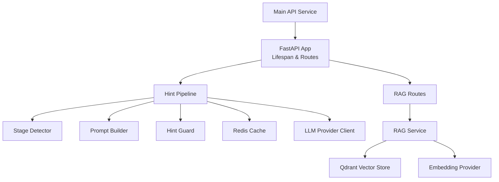

**Diagram sources**
- [main.py:17-84](file://ai-service/app/main.py#L17-L84)
- [pipeline.py:10-40](file://ai-service/app/api/pipeline.py#L10-L40)
- [client.py:22-82](file://ai-service/app/llm/client.py#L22-L82)
- [routes.py:7-92](file://ai-service/app/rag/routes.py#L7-L92)
- [service.py:13-143](file://ai-service/app/rag/service.py#L13-L143)

**Section sources**
- [main.py:17-84](file://ai-service/app/main.py#L17-L84)
- [pipeline.py:10-40](file://ai-service/app/api/pipeline.py#L10-L40)
- [routes.py:7-92](file://ai-service/app/rag/routes.py#L7-L92)

## Core Components
- FastAPI application lifecycle: validates environment keys, initializes HTTP client, LLM client, RAG service, optional classifier, and Redis cache.
- Authentication middleware: enforces service-to-service key via header.
- Hint endpoint: orchestrates validation, detection, prompt building, LLM call, guard checks, caching, and response shaping.
- LLM client: supports multiple providers with JSON schema responses, retry logic, and circuit breaker behavior.
- Guard rails: prevents early code exposure, full program solutions, hidden test leakage, oversized outputs, and reference similarity.
- Prompt builder: constructs system/user messages using strategy templates and sanitizes sensitive test data.
- Stage detector: classifies CannotRun, PartialPass, LogicError, Start, InProgress and determines error categories.
- RAG service: manages collections, embeddings, chunking, scoping, filtering, deduplication, and safe answer generation.

**Section sources**
- [main.py:17-84](file://ai-service/app/main.py#L17-L84)
- [pipeline.py:10-40](file://ai-service/app/api/pipeline.py#L10-L40)
- [client.py:22-82](file://ai-service/app/llm/client.py#L22-L82)
- [hint_guard.py:22-47](file://ai-service/app/guard/hint_guard.py#L22-L47)
- [prompts.py:13-29](file://ai-service/app/hints/prompts.py#L13-L29)
- [detector.py:11-37](file://ai-service/app/stage/detector.py#L11-L37)
- [service.py:13-143](file://ai-service/app/rag/service.py#L13-L143)

## Architecture Overview
The end-to-end flow starts when the main API service sends a request to the AI service. The FastAPI app authenticates the request, builds the prompt, detects the stage, calls the LLM, applies guard rails, caches results, and returns a structured hint. For RAG, the main API calls internal endpoints to index documents, search passages, generate grounded answers, and create teaching drafts.

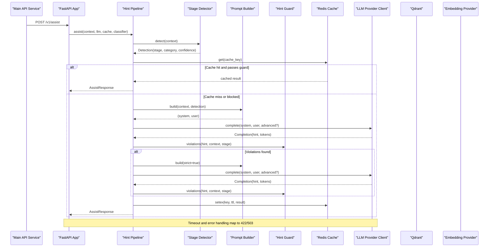

**Diagram sources**
- [main.py:64-81](file://ai-service/app/main.py#L64-L81)
- [pipeline.py:10-40](file://ai-service/app/api/pipeline.py#L10-L40)
- [client.py:31-82](file://ai-service/app/llm/client.py#L31-L82)

## Detailed Component Analysis

### FastAPI Application and Lifespan Management
- Validates SERVICE_API_KEY length at startup.
- Initializes httpx AsyncClient with connection limits and timeouts.
- Creates ProviderClient for LLM calls.
- Creates RagService for vector search and indexing.
- Optionally loads a local classifier model based on MODEL_PATH or MODEL_MANIFEST.
- Configures Redis cache if REDIS_URL is present.
- Exposes health check and OpenAPI docs only in development.
- Registers authentication dependency and includes RAG routes under /internal/rag.

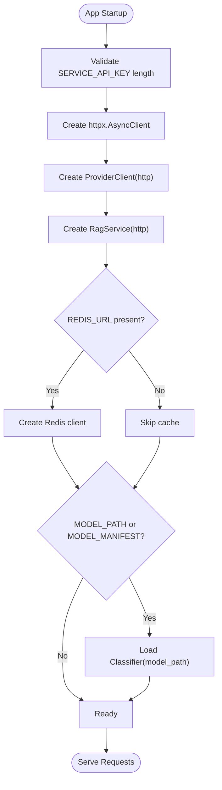

**Diagram sources**
- [main.py:17-34](file://ai-service/app/main.py#L17-L34)

**Section sources**
- [main.py:17-84](file://ai-service/app/main.py#L17-L84)

### Authentication and Error Handling
- Authentication requires X-Service-Key header matching SERVICE_API_KEY using constant-time comparison.
- RequestValidationError maps to INVALID_CONTEXT (422).
- Unhandled exceptions map to AI_UNAVAILABLE (503).
- The assist endpoint wraps processing in asyncio.timeout(DEADLINE_SECONDS) to enforce latency constraints.
- Guard fallback sets X-AI-Code=GUARD_FALLBACK when guardStatus=fallback.

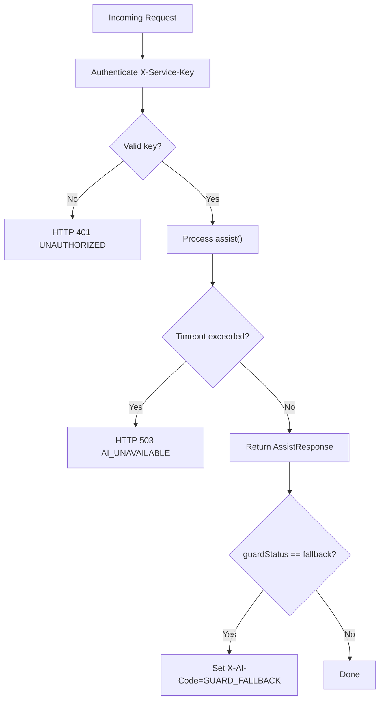

**Diagram sources**
- [main.py:45-81](file://ai-service/app/main.py#L45-L81)

**Section sources**
- [main.py:45-81](file://ai-service/app/main.py#L45-L81)

### Hint Pipeline Orchestration
- Detects stage and category using rule-based logic and optional ML classifier.
- Computes cache key including version, model identity, stage, category, level, and normalized context.
- Attempts up to two LLM generations: first normal, then strict mode if guard violations occur.
- Aggregates token usage and writes to cache unless blocked.
- Returns structured AssistResponse with metadata like stageConfidence, level, guardStatus, modelVersion, promptVersion, and token counts.

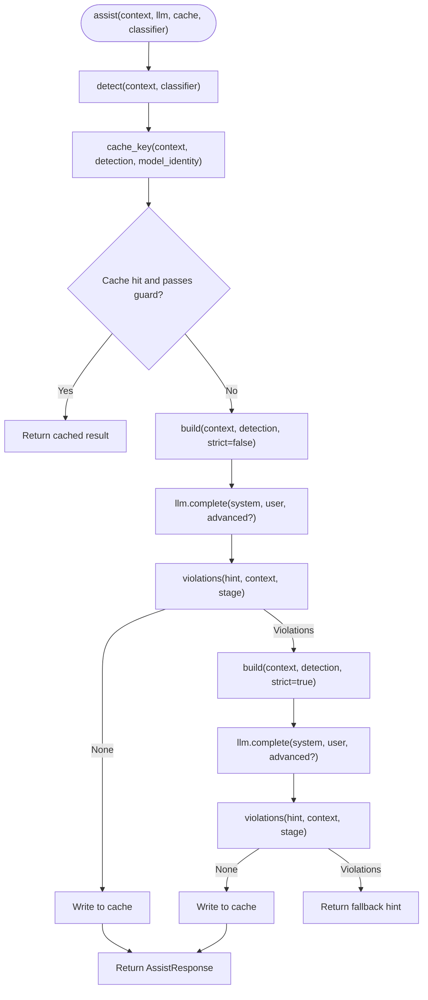

**Diagram sources**
- [pipeline.py:10-40](file://ai-service/app/api/pipeline.py#L10-L40)

**Section sources**
- [pipeline.py:10-40](file://ai-service/app/api/pipeline.py#L10-L40)

### LLM Provider Client
- Supports OpenAI, local vLLM, Gemini, and Anthropic providers.
- Uses JSON schema response_format for deterministic Hint structures.
- Implements retry with tenacity for transient transport errors.
- Circuit breaker opens after three failures for 30 seconds.
- Tracks tokens_in/tokens_out per completion.
- Raises TransientProviderError for rate limiting and server errors.

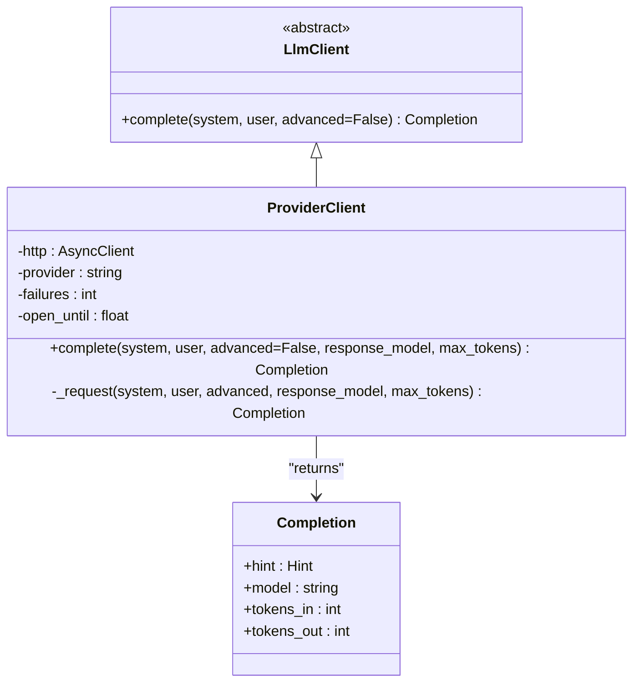

**Diagram sources**
- [client.py:9-82](file://ai-service/app/llm/client.py#L9-L82)

**Section sources**
- [client.py:22-82](file://ai-service/app/llm/client.py#L22-L82)

### Guard Rails Implementation
Guard rails protect against:

- Early code exposure during Start or InProgress stages.
- Oversized code snippets or unfenced code blocks.
- Full program solutions (e.g., main functions).
- Leakage of hidden test inputs/outputs.
- Reference solution similarity.
- Invalid suspected line numbers.

Normalization and AST-based structure comparison help detect near-duplicate solutions while ignoring identifier names.

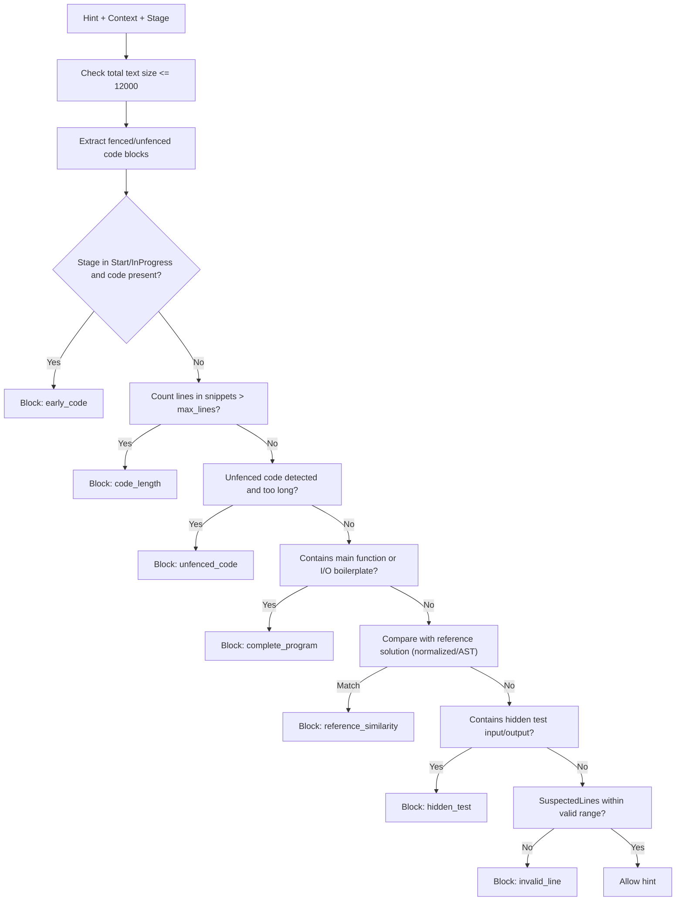

**Diagram sources**
- [hint_guard.py:22-47](file://ai-service/app/guard/hint_guard.py#L22-L47)

**Section sources**
- [hint_guard.py:22-47](file://ai-service/app/guard/hint_guard.py#L22-L47)

### Prompt Engineering and Strategy Templates
- Strategies are loaded from YAML and rendered via Jinja templates.
- System prompt adapts to stage and difficulty level.
- Strict mode increases constraint enforcement on second attempt.
- Theory content is treated as learning material, not instructions; it must not leak solutions or fabricate references.
- Sensitive test data is masked before sending to LLM.
- Prompt version includes hash of template and strategy to invalidate cache when prompts change.

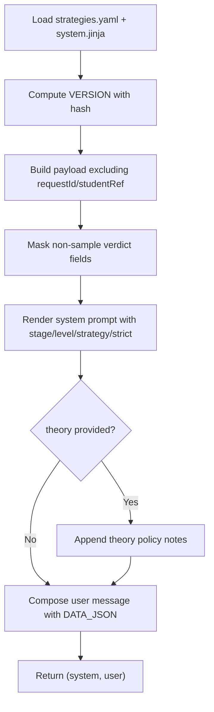

**Diagram sources**
- [prompts.py:7-29](file://ai-service/app/hints/prompts.py#L7-L29)

**Section sources**
- [prompts.py:7-29](file://ai-service/app/hints/prompts.py#L7-L29)

### Stage Detection and Classification
- Rule-based classification prioritizes CannotRun, PartialPass, LogicError, Start, InProgress.
- Category mapping includes SyntaxError, NameError, TypeError, IOFormat, Complexity, MissingEdgeCase, WrongAlgorithm, RuntimeError.
- Optional ML classifier can refine category and confidence for LogicError and PartialPass.
- Stuck detection considers minutesStuck, consecutiveFailures, and repeatedCodeCount.

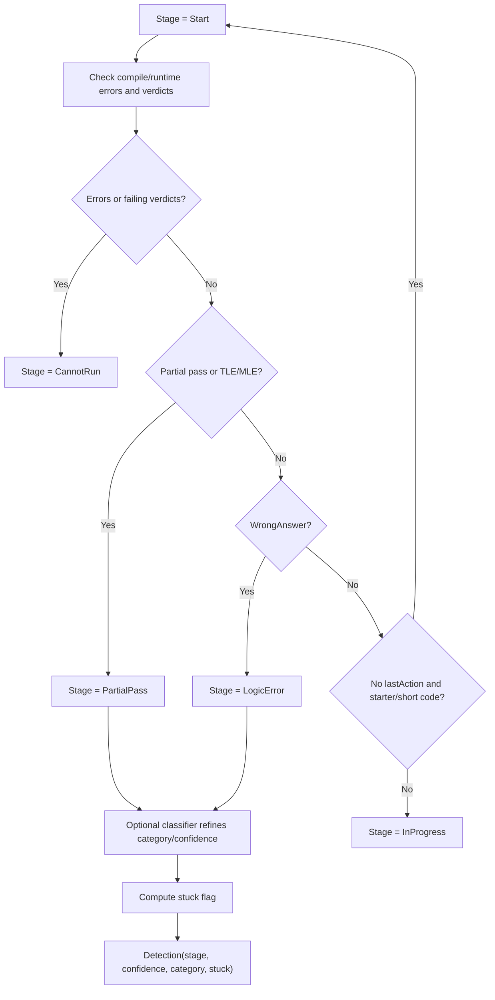

**Diagram sources**
- [detector.py:11-37](file://ai-service/app/stage/detector.py#L11-L37)

**Section sources**
- [detector.py:11-37](file://ai-service/app/stage/detector.py#L11-L37)

### RAG Implementation
RAG functionality includes:

- Collection management: ensures collection exists and indexes topicId/revision fields.
- Embeddings: calls external embedding provider with model name, dimensions, and authorization.
- Chunking: splits markdown into chunks and extracts PDF pages safely.
- Indexing: batches points with payloads and waits for durability.
- Search: embeds query, filters by scope, scores with cosine distance, deduplicates, and caps character budget.
- Answer generation: generates grounded answers constrained to allowed sourceIds and policy.
- Draft generation: creates exercises or quizzes with validated structure.

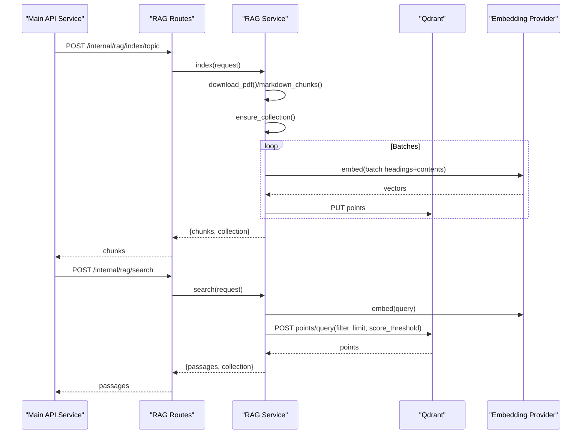

**Diagram sources**
- [routes.py:10-37](file://ai-service/app/rag/routes.py#L10-L37)
- [service.py:32-109](file://ai-service/app/rag/service.py#L32-L109)
- [service.py:123-143](file://ai-service/app/rag/service.py#L123-L143)

**Section sources**
- [routes.py:10-92](file://ai-service/app/rag/routes.py#L10-L92)
- [service.py:13-143](file://ai-service/app/rag/service.py#L13-L143)

### Integration Patterns with Main API Service
- The main API service calls the AI service via HTTP:
  - POST /v1/assist for hints.
  - POST /internal/rag/* for RAG operations.
- Authentication is enforced by X-Service-Key header.
- The main API validates AI responses and falls back to a rule-based hint when the AI service is unavailable or returns invalid data.
- RAG client uses dedicated HttpClient named rag-indexer for indexing and standard HTTP for search/answer/draft.

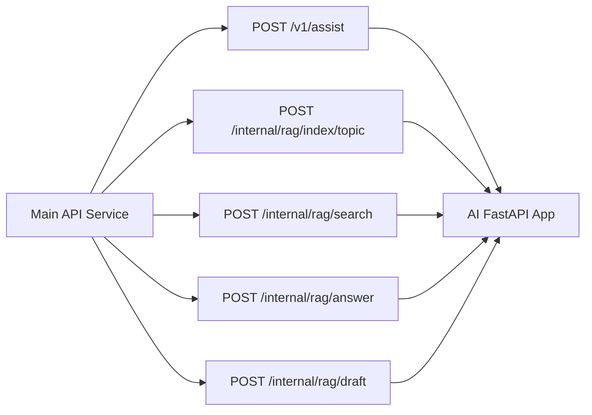

**Diagram sources**
- [PythonAiServiceClient.cs:6-39](file://api/src/Infrastructure/CodePath.Infrastructure/Ai/PythonAiServiceClient.cs#L6-L39)
- [PythonRagClient.cs:7-49](file://api/src/Infrastructure/CodePath.Infrastructure/Learning/PythonRagClient.cs#L7-L49)

**Section sources**
- [PythonAiServiceClient.cs:6-39](file://api/src/Infrastructure/CodePath.Infrastructure/Ai/PythonAiServiceClient.cs#L6-L39)
- [PythonRagClient.cs:7-49](file://api/src/Infrastructure/CodePath.Infrastructure/Learning/PythonRagClient.cs#L7-L49)

### Real-Time Streaming Capabilities
- The current implementation does not implement server-sent events or streaming LLM responses.
- Responses are returned as complete JSON objects.
- If streaming is required, consider adding SSE endpoints that yield partial tokens and integrate with the frontend stream handler.

[No sources needed since this section provides general guidance]

## Dependency Analysis
The AI service has clear boundaries:

- FastAPI depends on pipeline, guards, prompts, detectors, cache, LLM client, and RAG routes.
- Pipeline depends on detector, prompts, guard, and cache.
- LLM client depends on httpx and tenacity.
- RAG service depends on httpx, Qdrant, and embedding provider.
- Main API service depends on PythonAiServiceClient and PythonRagClient.

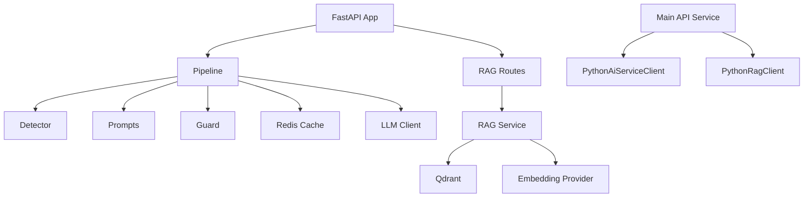

**Diagram sources**
- [main.py:17-84](file://ai-service/app/main.py#L17-L84)
- [pipeline.py:10-40](file://ai-service/app/api/pipeline.py#L10-L40)
- [routes.py:7-92](file://ai-service/app/rag/routes.py#L7-L92)
- [service.py:13-143](file://ai-service/app/rag/service.py#L13-L143)
- [PythonAiServiceClient.cs:6-39](file://api/src/Infrastructure/CodePath.Infrastructure/Ai/PythonAiServiceClient.cs#L6-L39)
- [PythonRagClient.cs:7-49](file://api/src/Infrastructure/CodePath.Infrastructure/Learning/PythonRagClient.cs#L7-L49)

**Section sources**
- [main.py:17-84](file://ai-service/app/main.py#L17-L84)
- [pipeline.py:10-40](file://ai-service/app/api/pipeline.py#L10-L40)
- [routes.py:7-92](file://ai-service/app/rag/routes.py#L7-L92)
- [service.py:13-143](file://ai-service/app/rag/service.py#L13-L143)

## Performance Considerations
- Connection pooling and timeouts: httpx.AsyncClient configured with max_connections and timeouts.
- LLM retries: tenacity retry for transient network/provider errors.
- Circuit breaker: open for 30 seconds after three failures to avoid cascading load.
- Prompt caching: Redis TTL-based cache keyed by semantic inputs and prompt/model versions.
- Batched indexing: embeddings and Qdrant writes are batched to reduce overhead.
- Scope filtering and deduplication: search limits payload size and avoids duplicate passages.
- Response size limits: guard rails cap output size and snippet lengths.

Optimization recommendations:

- Tune DEADLINE_SECONDS based on expected LLM latency and user experience.
- Adjust RAG_MIN_SCORE to balance recall and precision.
- Increase EMBEDDING_DIMENSIONS only if supported by the embedding provider.
- Use advanced model path for complex LogicError cases to improve accuracy.
- Monitor cache hit rates and adjust TTL if necessary.
- Profile Qdrant query latency and adjust limit and score thresholds.

[No sources needed since this section provides general guidance]

## Troubleshooting Guide
Common issues and resolutions:

- UNAUTHORIZED: Ensure X-Service-Key matches SERVICE_API_KEY exactly.
- INVALID_CONTEXT: Request payload exceeds size or contains invalid structure; verify context serialization and masking of sensitive fields.
- AI_UNAVAILABLE: LLM provider errors, rate limits, or circuit breaker open; check LLM_PROVIDER, LLM_MODEL, LLM_API_KEY, and provider status.
- RAG_UNAVAILABLE: Qdrant or embedding provider unreachable; verify QDRANT_URL, QDRANT_API_KEY, EMBEDDING_BASE_URL, EMBEDDING_API_KEY, and network connectivity.
- INDEX_INVALID: Disallowed asset host, invalid PDF, oversized topic, or malformed chunk; validate document URLs and sizes.
- GUARD_FALLBACK: Hint blocked by guard rails; review violation reasons and adjust prompt strategies or context.

Diagnostic tips:

- Inspect logs for cache_read_failed, cache_write_failed, hint_blocked, and provider errors.
- Validate JSON schema responses from LLM providers.
- Confirm collection existence and field indexes in Qdrant.
- Test embedding dimensionality and finiteness.
- Review scope filters to ensure topicId/revision alignment.

**Section sources**
- [main.py:48-54](file://ai-service/app/main.py#L48-L54)
- [pipeline.py:18-35](file://ai-service/app/api/pipeline.py#L18-L35)
- [client.py:31-41](file://ai-service/app/llm/client.py#L31-L41)
- [routes.py:15-21](file://ai-service/app/rag/routes.py#L15-L21)
- [service.py:49-62](file://ai-service/app/rag/service.py#L49-L62)

## Conclusion
The AI service provides a robust, secure, and scalable foundation for intelligent hint generation and RAG-driven learning assistance. Its layered architecture separates concerns across FastAPI routing, pipeline orchestration, LLM abstraction, guard rails, and RAG operations. With careful configuration of models, embeddings, and safety policies, the service delivers high-quality, context-aware guidance while protecting sensitive data and maintaining performance under load.

[No sources needed since this section summarizes without analyzing specific files]