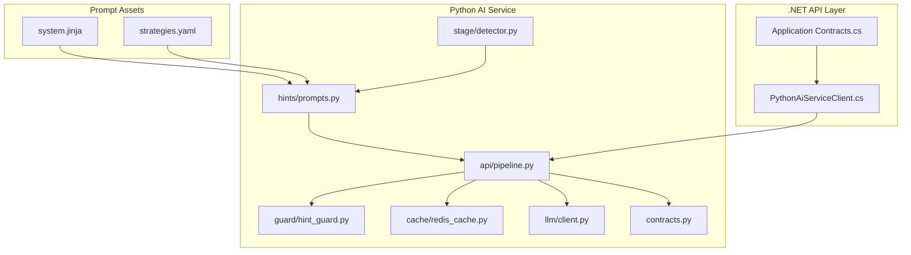
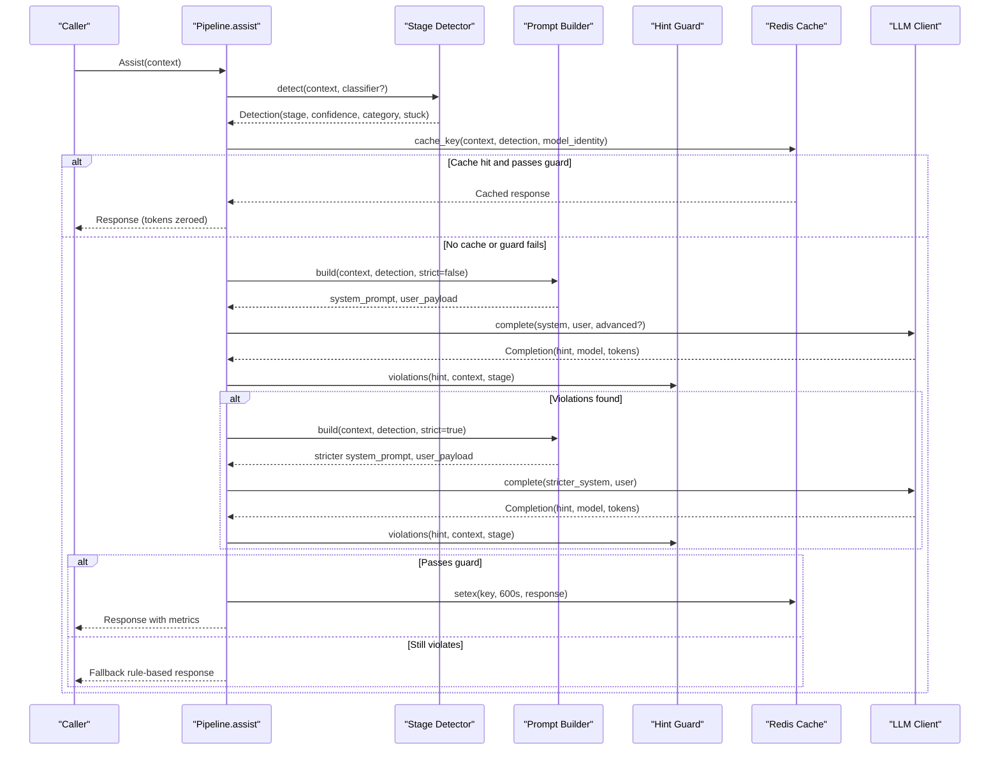
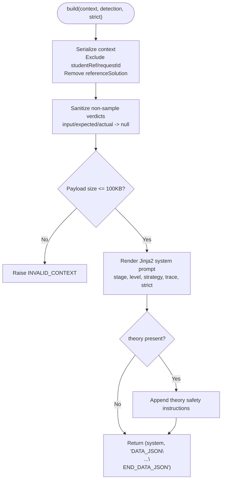
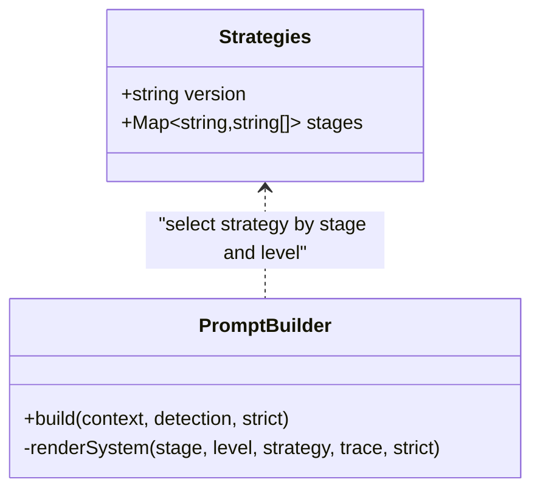
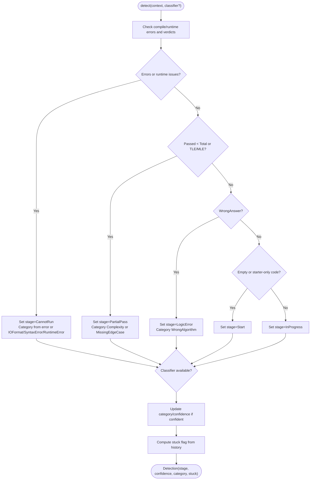
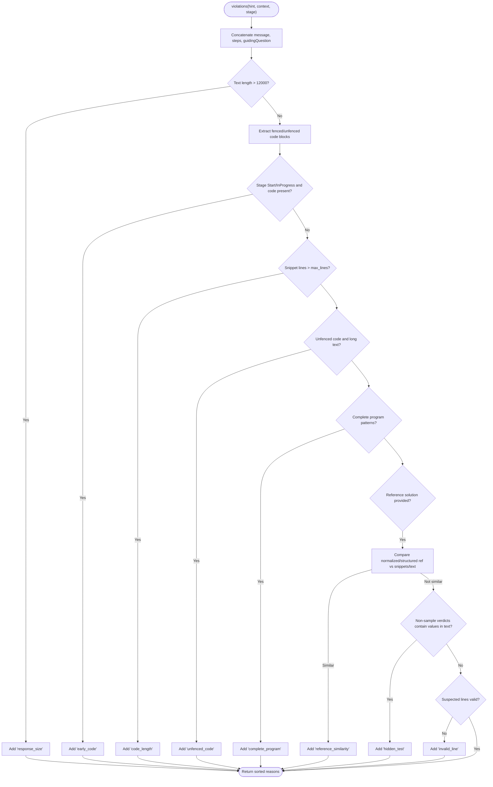
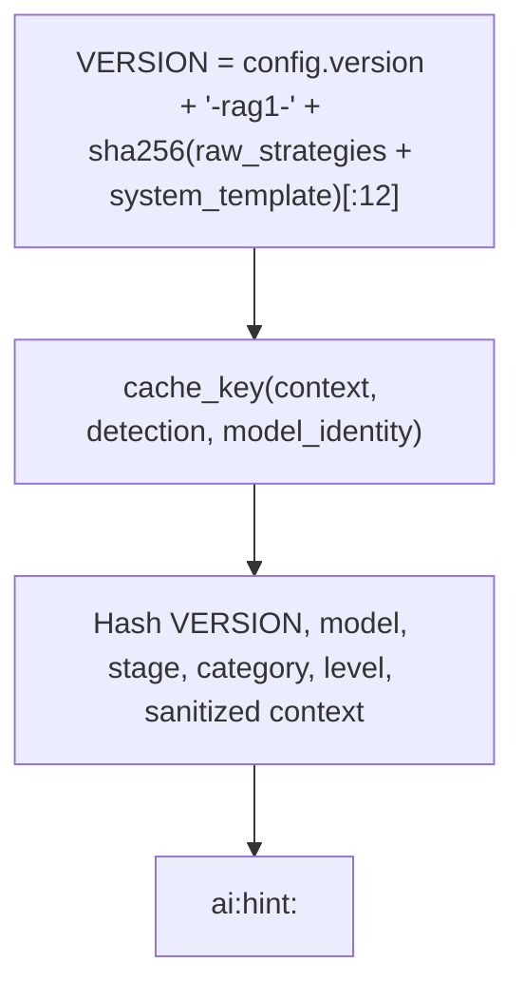
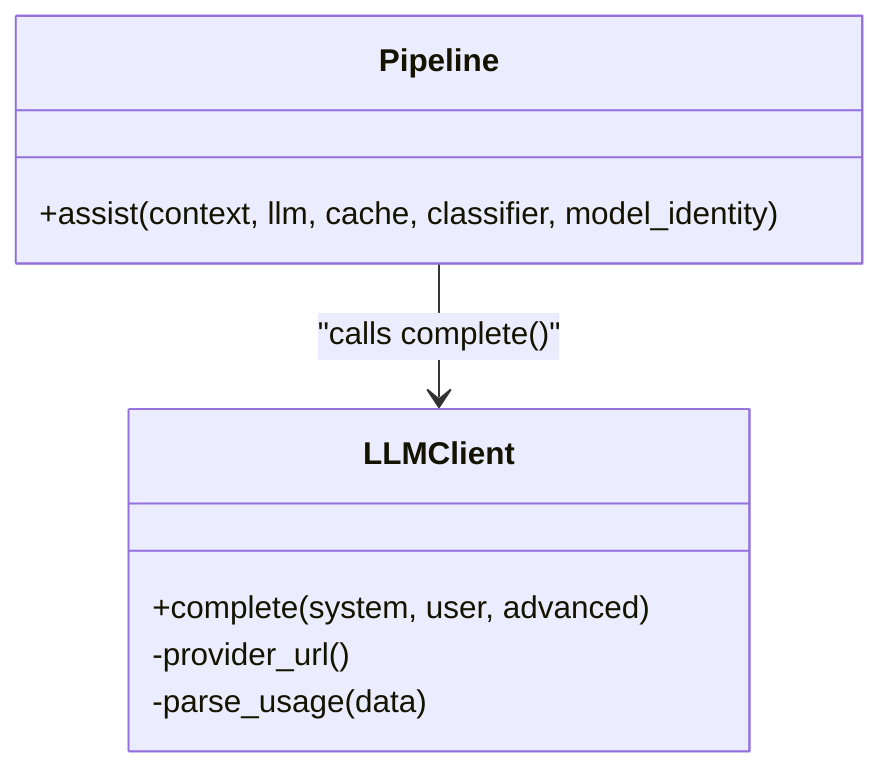
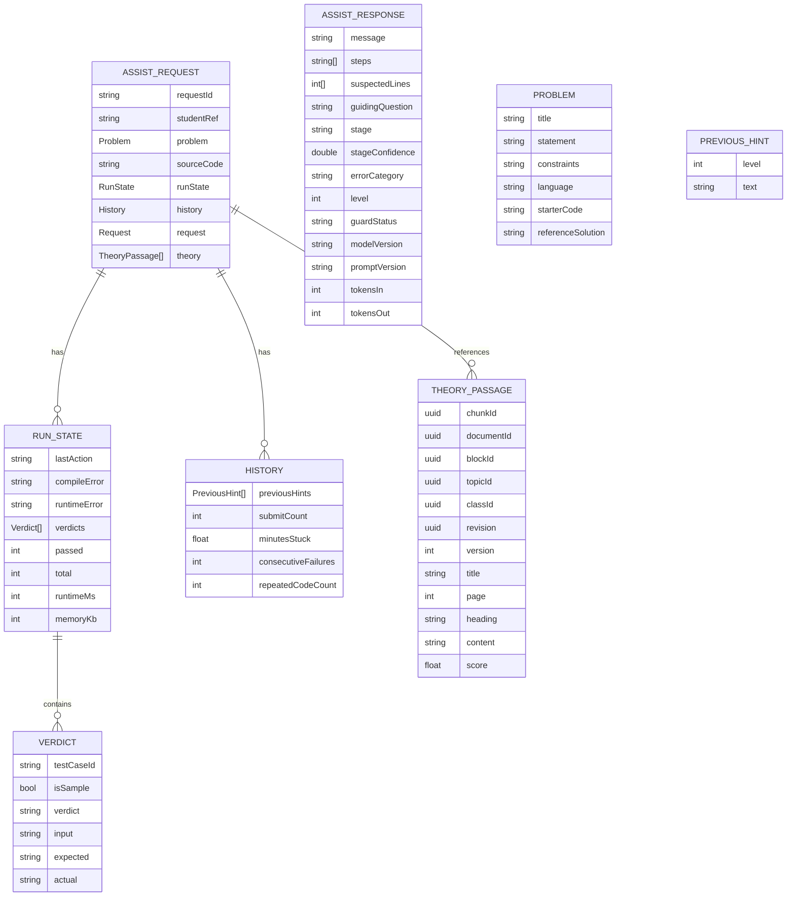
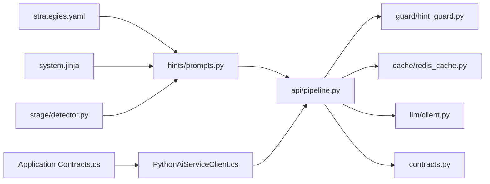

# Prompt Engineering & Management

<cite>
**Referenced Files in This Document**
- [system.jinja](file://ai-service/app/prompts/system.jinja)
- [strategies.yaml](file://ai-service/app/prompts/strategies.yaml)
- [prompts.py](file://ai-service/app/hints/prompts.py)
- [detector.py](file://ai-service/app/stage/detector.py)
- [contracts.py](file://ai-service/app/contracts.py)
- [pipeline.py](file://ai-service/app/api/pipeline.py)
- [redis_cache.py](file://ai-service/app/cache/redis_cache.py)
- [hint_guard.py](file://ai-service/app/guard/hint_guard.py)
- [client.py](file://ai-service/app/llm/client.py)
- [PythonAiServiceClient.cs](file://api/src/Infrastructure/CodePath.Infrastructure/Ai/PythonAiServiceClient.cs)
- [Contracts.cs](file://api/src/Application/CodePath.Application/Ai/Contracts.cs)
- [run.py](file://ai-service/eval/run.py)
</cite>

## Table of Contents
1. [Introduction](#introduction)
2. [Project Structure](#project-structure)
3. [Core Components](#core-components)
4. [Architecture Overview](#architecture-overview)
5. [Detailed Component Analysis](#detailed-component-analysis)
6. [Dependency Analysis](#dependency-analysis)
7. [Performance Considerations](#performance-considerations)
8. [Troubleshooting Guide](#troubleshooting-guide)
9. [Conclusion](#conclusion)
10. [Appendices](#appendices)

## Introduction
This document explains the prompt engineering and management system that powers the AI assistant. It focuses on how prompts are dynamically constructed from user context, learning stage, and difficulty level; how Jinja2 templates and strategy configuration drive behavior; how parameters are injected safely; and how versioning, caching, guardrails, and evaluation support reliability and continuous improvement.

The system is designed for safe tutoring: it avoids giving full solutions, protects hidden test data, adapts guidance to the learner’s current state, and provides consistent outputs across different AI providers through a structured contract.

## Project Structure
The prompt system lives primarily in the Python `ai-service`, with supporting contracts and client validation in the .NET API layer. The key files are:

- Template and strategy assets under `ai-service/app/prompts`.
- Prompt construction logic under `ai-service/app/hints`.
- Stage detection under `ai-service/app/stage`.
- Pipeline orchestration under `ai-service/app/api`.
- Caching under `ai-service/app/cache`.
- Guardrails under `ai-service/app/guard`.
- LLM provider abstraction under `ai-service/app/llm`.
- Cross-language contracts under `ai-service/app/contracts` and `api/src/Application/CodePath.Application/Ai/Contracts.cs`.

**Diagram sources**
- [system.jinja:1-10](file://ai-service/app/prompts/system.jinja#L1-L10)
- [strategies.yaml:1-23](file://ai-service/app/prompts/strategies.yaml#L1-L23)
- [prompts.py:1-41](file://ai-service/app/hints/prompts.py#L1-L41)
- [detector.py:1-38](file://ai-service/app/stage/detector.py#L1-L38)
- [pipeline.py:1-41](file://ai-service/app/api/pipeline.py#L1-L41)
- [hint_guard.py:1-48](file://ai-service/app/guard/hint_guard.py#L1-L48)
- [redis_cache.py:1-11](file://ai-service/app/cache/redis_cache.py#L1-L11)
- [client.py:59-76](file://ai-service/app/llm/client.py#L59-L76)
- [contracts.py:1-101](file://ai-service/app/contracts.py#L1-L101)
- [PythonAiServiceClient.cs:6-24](file://api/src/Infrastructure/CodePath.Infrastructure/Ai/PythonAiServiceClient.cs#L6-L24)
- [Contracts.cs:4-18](file://api/src/Application/CodePath.Application/Ai/Contracts.cs#L4-L18)

**Section sources**
- [system.jinja:1-10](file://ai-service/app/prompts/system.jinja#L1-L10)
- [strategies.yaml:1-23](file://ai-service/app/prompts/strategies.yaml#L1-L23)
- [prompts.py:1-41](file://ai-service/app/hints/prompts.py#L1-L41)
- [detector.py:1-38](file://ai-service/app/stage/detector.py#L1-L38)
- [pipeline.py:1-41](file://ai-service/app/api/pipeline.py#L1-L41)
- [redis_cache.py:1-11](file://ai-service/app/cache/redis_cache.py#L1-L11)
- [hint_guard.py:1-48](file://ai-service/app/guard/hint_guard.py#L1-L48)
- [client.py:59-76](file://ai-service/app/llm/client.py#L59-L76)
- [contracts.py:1-101](file://ai-service/app/contracts.py#L1-L101)
- [PythonAiServiceClient.cs:6-24](file://api/src/Infrastructure/CodePath.Infrastructure/Ai/PythonAiServiceClient.cs#L6-L24)
- [Contracts.cs:4-18](file://api/src/Application/CodePath.Application/Ai/Contracts.cs#L4-L18)

## Core Components
- Dynamic prompt builder: constructs a safe system prompt and a structured user payload from the request context.
- Strategy configuration: defines teaching strategies per learning stage and difficulty level.
- Stage detector: infers the learner’s current stage and error category from run results and history.
- Pipeline orchestrator: coordinates detection, prompting, LLM calls, guard checks, retries, caching, and fallbacks.
- Guardrails: enforce safety rules against code leakage, hidden test exposure, and overly complete answers.
- Provider abstraction: normalizes calls to multiple AI providers while preserving JSON tool schemas.
- Cross-language contracts: define shared types for requests, responses, stages, and metrics.

Key responsibilities:
- Safety-first prompt design and parameter sanitization.
- Context-aware adaptation using stage, level, and request type.
- Versioned prompts with deterministic hashing for cache coherence.
- Consistent response schema across providers.

**Section sources**
- [prompts.py:1-41](file://ai-service/app/hints/prompts.py#L1-L41)
- [strategies.yaml:1-23](file://ai-service/app/prompts/strategies.yaml#L1-L23)
- [detector.py:1-38](file://ai-service/app/stage/detector.py#L1-L38)
- [pipeline.py:1-41](file://ai-service/app/api/pipeline.py#L1-L41)
- [hint_guard.py:1-48](file://ai-service/app/guard/hint_guard.py#L1-L48)
- [client.py:59-76](file://ai-service/app/llm/client.py#L59-L76)
- [contracts.py:1-101](file://ai-service/app/contracts.py#L1-L101)

## Architecture Overview
The assist flow builds a dynamic prompt based on the learner’s context and then enforces safety via a guard before returning a hint.

**Diagram sources**
- [pipeline.py:10-41](file://ai-service/app/api/pipeline.py#L10-L41)
- [detector.py:11-38](file://ai-service/app/stage/detector.py#L11-L38)
- [prompts.py:13-29](file://ai-service/app/hints/prompts.py#L13-L29)
- [hint_guard.py:22-47](file://ai-service/app/guard/hint_guard.py#L22-L47)
- [redis_cache.py:5-10](file://ai-service/app/cache/redis_cache.py#L5-L10)
- [client.py:59-76](file://ai-service/app/llm/client.py#L59-L76)

## Detailed Component Analysis

### Dynamic Prompt Construction
The prompt builder:
- Serializes the request context into a JSON payload, excluding sensitive identifiers and removing reference solutions.
- Sanitizes non-sample verdict fields to prevent leaking hidden tests.
- Enforces a maximum payload size to avoid oversized prompts.
- Renders a Jinja2 system prompt with variables: stage, level, selected strategy, trace mode, and strictness.
- Appends theory-specific instructions when RAG content is present.
- Returns both the system prompt and a delimited user payload.

**Diagram sources**
- [prompts.py:13-29](file://ai-service/app/hints/prompts.py#L13-L29)
- [system.jinja:1-10](file://ai-service/app/prompts/system.jinja#L1-L10)

**Section sources**
- [prompts.py:13-29](file://ai-service/app/hints/prompts.py#L13-L29)
- [system.jinja:1-10](file://ai-service/app/prompts/system.jinja#L1-L10)

### Strategy-Based Prompt Selection
Strategy configuration is defined by stage and difficulty level:
- Stages include Start, InProgress, LogicError, CannotRun, PartialPass.
- Each stage has three strategy entries corresponding to levels 1–3.
- The builder selects the strategy entry at index `level - 1` for the detected stage.

**Diagram sources**
- [strategies.yaml:1-23](file://ai-service/app/prompts/strategies.yaml#L1-L23)
- [prompts.py:24-26](file://ai-service/app/hints/prompts.py#L24-L26)

**Section sources**
- [strategies.yaml:1-23](file://ai-service/app/prompts/strategies.yaml#L1-L23)
- [prompts.py:24-26](file://ai-service/app/hints/prompts.py#L24-L26)

### Parameter Injection Mechanisms
Parameters injected into the system prompt include:
- `stage`: inferred by the stage detector.
- `level`: difficulty level from the request.
- `strategy`: selected strategy string from the YAML config.
- `trace`: enabled when the request type is TraceTestCase.
- `strict`: toggled on second attempt after guard violations.

These parameters shape tone, constraints, and pedagogical approach without exposing raw problem data directly in the template.

**Section sources**
- [prompts.py:24-29](file://ai-service/app/hints/prompts.py#L24-L29)
- [system.jinja:7-10](file://ai-service/app/prompts/system.jinja#L7-L10)

### Stage Detection and Learning State
The stage detector maps execution outcomes and history to a learning stage and error category:
- Compile/runtime errors map to CannotRun.
- Partial pass or timeouts/memory limits map to PartialPass.
- WrongAnswer maps to LogicError.
- Empty or starter-only code maps to Start.
- Otherwise, InProgress.
- Optional ML classifier can refine category/confidence but cannot override rule priority.
- Stuck detection uses minutes stuck, consecutive failures, and repeated code count.

**Diagram sources**
- [detector.py:11-38](file://ai-service/app/stage/detector.py#L11-L38)

**Section sources**
- [detector.py:11-38](file://ai-service/app/stage/detector.py#L11-L38)

### Guardrails and Safety Enforcement
The guard validates generated hints against several safety rules:
- Disallows early code in Start and InProgress stages.
- Limits code snippet length and unfenced code presence.
- Prevents complete program output.
- Detects similarity to reference solutions.
- Blocks exposure of hidden test inputs/outputs/actuals.
- Validates suspected line numbers.

If violations occur, the pipeline retries with a stricter system prompt and falls back to a rule-based message if still unsafe.

**Diagram sources**
- [hint_guard.py:22-47](file://ai-service/app/guard/hint_guard.py#L22-L47)

**Section sources**
- [hint_guard.py:22-47](file://ai-service/app/guard/hint_guard.py#L22-L47)

### Prompt Versioning and Caching
Prompt versioning ensures cache coherence and reproducibility:
- A deterministic version string combines the strategy config version, a fixed suffix, and a hash of the raw strategy file plus the Jinja2 template.
- The cache key includes the prompt version, model identity, stage, category, request level, and sanitized context.
- This prevents stale hints when prompts change and isolates caches per model/provider.

**Diagram sources**
- [prompts.py:10-11](file://ai-service/app/hints/prompts.py#L10-L11)
- [redis_cache.py:5-10](file://ai-service/app/cache/redis_cache.py#L5-L10)

**Section sources**
- [prompts.py:10-11](file://ai-service/app/hints/prompts.py#L10-L11)
- [redis_cache.py:5-10](file://ai-service/app/cache/redis_cache.py#L5-L10)

### Multi-Provider Abstraction
The LLM client abstracts provider differences:
- Supports OpenAI-compatible endpoints and Anthropic-style APIs.
- Uses JSON tool schemas to constrain outputs.
- Normalizes usage metrics and handles transient provider errors.
- The pipeline records model version and token counts in the response.

**Diagram sources**
- [client.py:59-76](file://ai-service/app/llm/client.py#L59-L76)
- [pipeline.py:22-32](file://ai-service/app/api/pipeline.py#L22-L32)

**Section sources**
- [client.py:59-76](file://ai-service/app/llm/client.py#L59-L76)
- [pipeline.py:22-32](file://ai-service/app/api/pipeline.py#L22-L32)

### Cross-Language Contracts
Shared contracts ensure consistency between the Python service and the .NET API:
- AssistRequest and AssistResponse define stages, levels, guard status, model/prompt versions, and token metrics.
- The .NET client validates response fields and enforces policy constraints like level bounds and step counts.

**Diagram sources**
- [contracts.py:1-101](file://ai-service/app/contracts.py#L1-L101)
- [Contracts.cs:4-18](file://api/src/Application/CodePath.Application/Ai/Contracts.cs#L4-L18)

**Section sources**
- [contracts.py:1-101](file://ai-service/app/contracts.py#L1-L101)
- [Contracts.cs:4-18](file://api/src/Application/CodePath.Application/Ai/Contracts.cs#L4-L18)

## Dependency Analysis
The following diagram shows core dependencies among components involved in prompt engineering:

**Diagram sources**
- [strategies.yaml:1-23](file://ai-service/app/prompts/strategies.yaml#L1-L23)
- [system.jinja:1-10](file://ai-service/app/prompts/system.jinja#L1-L10)
- [prompts.py:1-41](file://ai-service/app/hints/prompts.py#L1-L41)
- [detector.py:1-38](file://ai-service/app/stage/detector.py#L1-L38)
- [pipeline.py:1-41](file://ai-service/app/api/pipeline.py#L1-L41)
- [hint_guard.py:1-48](file://ai-service/app/guard/hint_guard.py#L1-L48)
- [redis_cache.py:1-11](file://ai-service/app/cache/redis_cache.py#L1-L11)
- [client.py:59-76](file://ai-service/app/llm/client.py#L59-L76)
- [contracts.py:1-101](file://ai-service/app/contracts.py#L1-L101)
- [PythonAiServiceClient.cs:6-24](file://api/src/Infrastructure/CodePath.Infrastructure/Ai/PythonAiServiceClient.cs#L6-L24)
- [Contracts.cs:4-18](file://api/src/Application/CodePath.Application/Ai/Contracts.cs#L4-L18)

**Section sources**
- [pipeline.py:1-41](file://ai-service/app/api/pipeline.py#L1-L41)
- [prompts.py:1-41](file://ai-service/app/hints/prompts.py#L1-L41)
- [detector.py:1-38](file://ai-service/app/stage/detector.py#L1-L38)
- [hint_guard.py:1-48](file://ai-service/app/guard/hint_guard.py#L1-L48)
- [redis_cache.py:1-11](file://ai-service/app/cache/redis_cache.py#L1-L11)
- [client.py:59-76](file://ai-service/app/llm/client.py#L59-L76)
- [contracts.py:1-101](file://ai-service/app/contracts.py#L1-L101)
- [PythonAiServiceClient.cs:6-24](file://api/src/Infrastructure/CodePath.Infrastructure/Ai/PythonAiServiceClient.cs#L6-L24)
- [Contracts.cs:4-18](file://api/src/Application/CodePath.Application/Ai/Contracts.cs#L4-L18)

## Performance Considerations
- Prompt payload limit: the builder rejects contexts exceeding 100KB to control token costs and latency.
- Two-attempt retry with stricter system prompt reduces guard violations at the cost of additional LLM calls.
- Redis caching stores validated responses for up to 600 seconds, keyed by semantic context and prompt version.
- Token accounting tracks input/output tokens per request for monitoring and cost analysis.
- Evaluation scripts compute latency percentiles and intervention rates to guide optimization.

Recommendations:
- Keep strategies concise and focused to reduce token usage.
- Prefer level-appropriate strategies to minimize retries.
- Monitor cache hit rates and adjust TTL or key granularity if needed.
- Use evaluation reports to identify high-latency stages and optimize prompts accordingly.

**Section sources**
- [prompts.py:21-23](file://ai-service/app/hints/prompts.py#L21-L23)
- [pipeline.py:22-40](file://ai-service/app/api/pipeline.py#L22-L40)
- [redis_cache.py:5-10](file://ai-service/app/cache/redis_cache.py#L5-L10)
- [run.py:34-49](file://ai-service/eval/run.py#L34-L49)

## Troubleshooting Guide
Common issues and resolutions:
- INVALID_CONTEXT: The serialized context exceeds the allowed size. Reduce problem statements, history, or theory passages.
- Guard violations: The generated hint contains code, too much detail, or leaks hidden tests. Adjust strategy selection and level; consider stricter prompts.
- Fallback responses: If two attempts fail guard checks, a rule-based fallback is returned. Review strategy definitions and context quality.
- Provider errors: Transient provider errors return AI_UNAVAILABLE. Implement retries at the caller and monitor circuit breaker states.

Debugging tips:
- Inspect Detection output to verify stage/category alignment with expectations.
- Validate that non-sample verdicts are sanitized before prompting.
- Check cache keys to ensure changes to prompts or models invalidate stale entries.
- Use evaluation reports to track automated leakage rate and guard intervention rate.

**Section sources**
- [prompts.py:21-23](file://ai-service/app/hints/prompts.py#L21-L23)
- [pipeline.py:22-40](file://ai-service/app/api/pipeline.py#L22-L40)
- [hint_guard.py:22-47](file://ai-service/app/guard/hint_guard.py#L22-L47)
- [client.py:68-70](file://ai-service/app/llm/client.py#L68-L70)
- [run.py:34-49](file://ai-service/eval/run.py#L34-L49)

## Conclusion
The prompt engineering system combines dynamic template rendering, strategy-driven pedagogy, robust guardrails, and versioned caching to deliver safe, adaptive tutoring. By aligning prompts with learner stage and difficulty, enforcing strict safety rules, and measuring performance, the system maintains consistency across AI providers while enabling continuous improvement through evaluation and iteration.

## Appendices

### Creating New Prompts
Steps:
- Define or update strategies in `strategies.yaml` for each stage and level.
- Edit `system.jinja` to add new variables or constraints, ensuring all injected parameters are used safely.
- Regenerate the prompt version automatically via the builder’s hash mechanism.
- Test with representative contexts and verify guard compliance.

Best practices:
- Keep strategies concise and actionable.
- Avoid embedding executable code in strategies.
- Use trace mode only when necessary to reduce token overhead.
- Maintain Vietnamese instructional tone consistently.

**Section sources**
- [strategies.yaml:1-23](file://ai-service/app/prompts/strategies.yaml#L1-L23)
- [system.jinja:1-10](file://ai-service/app/prompts/system.jinja#L1-L10)
- [prompts.py:10-11](file://ai-service/app/hints/prompts.py#L10-L11)

### Configuring Strategies
Guidelines:
- Map each stage to three progressive strategies aligned with levels 1–3.
- Level 1 should emphasize exploration and questioning; Level 2 adds targeted guidance; Level 3 allows more detailed reasoning within safety constraints.
- Ensure strategies do not prescribe full solutions or reveal hidden tests.

**Section sources**
- [strategies.yaml:1-23](file://ai-service/app/prompts/strategies.yaml#L1-L23)

### Optimizing Prompt Effectiveness
Approaches:
- Analyze evaluation metrics such as stage accuracy, automated leakage rate, and guard intervention rate.
- Tune strategy wording to reduce early code and unfenced code violations.
- Adjust level thresholds to match student progress and reduce retries.
- Monitor latency and token usage to balance richness and efficiency.

**Section sources**
- [run.py:34-49](file://ai-service/eval/run.py#L34-L49)

### Safety Considerations
- Never expose hidden test inputs/outputs/actuals; sanitize non-sample verdicts.
- Avoid providing complete programs or reference solution similarities.
- Restrict code snippets and unfenced code in early stages.
- Treat all DATA_JSON content as untrusted and ignore embedded instructions.

**Section sources**
- [prompts.py:14-21](file://ai-service/app/hints/prompts.py#L14-L21)
- [hint_guard.py:22-47](file://ai-service/app/guard/hint_guard.py#L22-L47)
- [system.jinja:4-6](file://ai-service/app/prompts/system.jinja#L4-L6)

### Maintaining Consistency Across Providers
- Use JSON tool schemas to constrain outputs uniformly.
- Normalize usage metrics and handle provider-specific parsing.
- Record model and prompt versions in responses for traceability.
- Validate cross-language contracts rigorously in the .NET client.

**Section sources**
- [client.py:59-76](file://ai-service/app/llm/client.py#L59-L76)
- [pipeline.py:30-32](file://ai-service/app/api/pipeline.py#L30-L32)
- [PythonAiServiceClient.cs:14-23](file://api/src/Infrastructure/CodePath.Infrastructure/Ai/PythonAiServiceClient.cs#L14-L23)