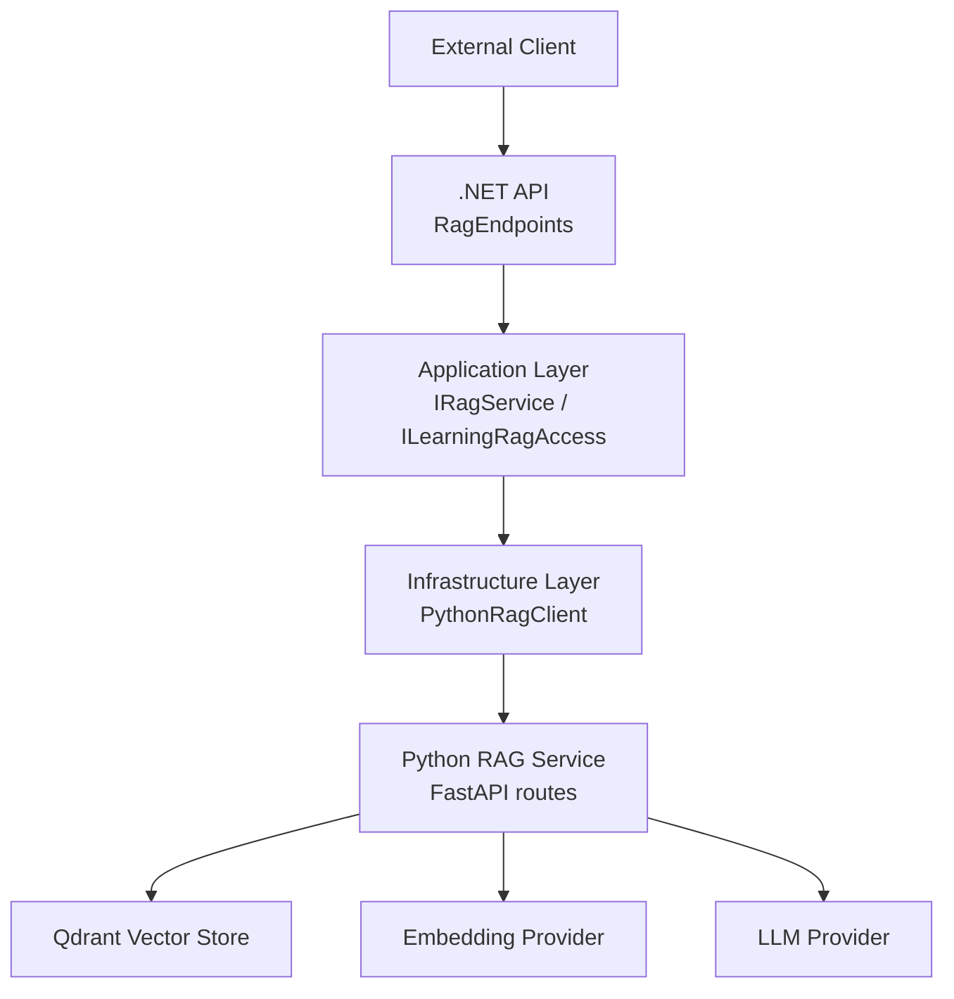
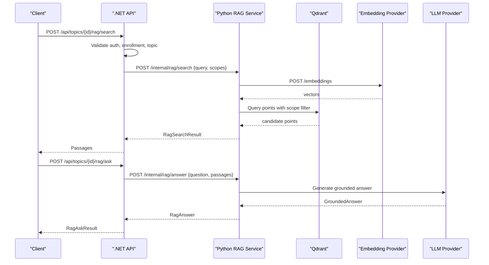
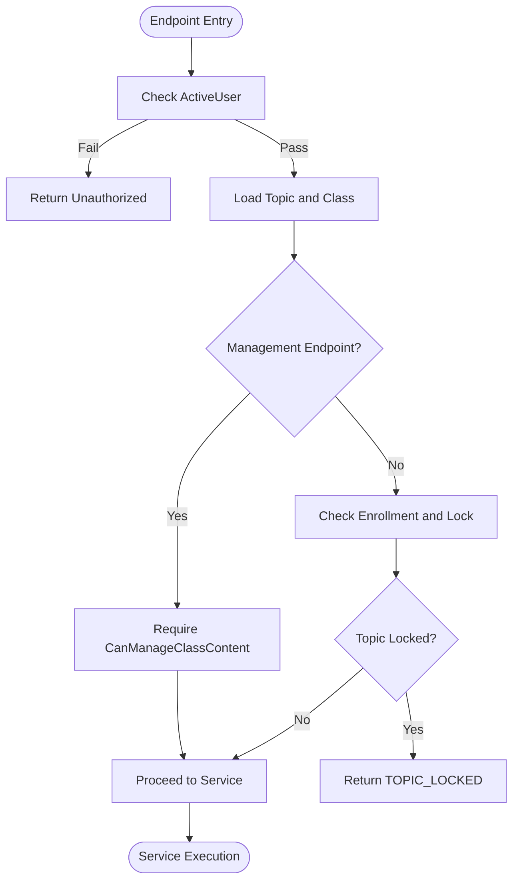
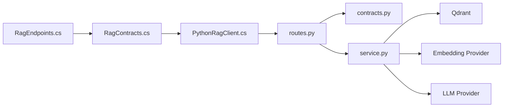

# API Endpoints & Contracts

<cite>
**Referenced Files in This Document**
- [RAG.md](file://api/docs/RAG.md)
- [RagEndpoints.cs](file://api/src/Api/CodePath.Api/Endpoints/RagEndpoints.cs)
- [RagContracts.cs](file://api/src/Application/CodePath.Application/Learning/RagContracts.cs)
- [LearningService.Rag.cs](file://api/src/Infrastructure/CodePath.Infrastructure/Learning/LearningService.Rag.cs)
- [PythonRagClient.cs](file://api/src/Infrastructure/CodePath.Infrastructure/Learning/PythonRagClient.cs)
- [routes.py](file://ai-service/app/rag/routes.py)
- [contracts.py](file://ai-service/app/rag/contracts.py)
- [service.py](file://ai-service/app/rag/service.py)
</cite>

## Table of Contents
1. [Introduction](#introduction)
2. [Project Structure](#project-structure)
3. [Core Components](#core-components)
4. [Architecture Overview](#architecture-overview)
5. [Detailed Component Analysis](#detailed-component-analysis)
6. [Dependency Analysis](#dependency-analysis)
7. [Performance Considerations](#performance-considerations)
8. [Troubleshooting Guide](#troubleshooting-guide)
9. [Conclusion](#conclusion)

## Introduction
This document provides comprehensive API documentation for the RAG subsystem, including REST endpoints exposed by the .NET API and internal Python RAG service contracts. It focuses on:
- Document ingestion via the Python indexer
- Semantic search over learning materials
- Scope-based deletion
- Authentication, authorization, rate limiting, input validation, error handling, and security considerations

The public-facing RAG endpoints are hosted under the .NET API and require authentication. The actual vector indexing, embedding, and retrieval logic run in a separate Python service behind an internal API protected by a service key.

## Project Structure
The RAG feature spans three main layers:
- .NET API layer: HTTP endpoints, authorization, actor context, and orchestration
- Application layer: domain contracts, services, and access rules
- Infrastructure layer: client to the Python RAG service and database access
- Python AI service: FastAPI routes, Pydantic contracts, Qdrant integration, and LLM calls

**Diagram sources**
- [RagEndpoints.cs:17-41](file://api/src/Api/CodePath.Api/Endpoints/RagEndpoints.cs#L17-L41)
- [RagContracts.cs:14-42](file://api/src/Application/CodePath.Application/Learning/RagContracts.cs#L14-L42)
- [PythonRagClient.cs:7-49](file://api/src/Infrastructure/CodePath.Infrastructure/Learning/PythonRagClient.cs#L7-L49)
- [routes.py:7-90](file://ai-service/app/rag/routes.py#L7-L90)
- [service.py:13-143](file://ai-service/app/rag/service.py#L13-L143)

**Section sources**
- [RAG.md:136-157](file://api/docs/RAG.md#L136-L157)
- [RagEndpoints.cs:17-41](file://api/src/Api/CodePath.Api/Endpoints/RagEndpoints.cs#L17-L41)

## Core Components
- Public .NET RAG endpoints:
  - `POST /api/topics/{id}/rag/search`
  - `POST /api/topics/{id}/rag/ask`
  - `GET /api/topics/{id}/rag/sources/{blockId}?version=N`
  - `GET /api/topics/{id}/rag/status`
  - `POST /api/topics/{id}/rag/reindex`
- Internal Python RAG endpoints (protected by service key):
  - `POST /internal/rag/index/topic`
  - `POST /internal/rag/index/delete`
  - `POST /internal/rag/search`
  - `POST /internal/rag/answer`
  - `POST /internal/rag/draft`

Key data structures:
- `RagScope`: pairs `topicId` with `revision`; used as the authoritative scope filter
- `RagPassage`: indexed chunk metadata and content
- `RagSearchResult`, `RagAnswer`, `RagAskInput`, `RagAskResult`
- Python contracts: `IndexRequest`, `Document`, `SearchRequest`, `AnswerRequest`, `GroundedAnswer`, `DraftRequest`, `TeachingDraft`

Authentication and authorization:
- All external endpoints require authentication via the ActiveUser policy; management endpoints additionally require class management permissions
- Internal endpoints require a service key header

Rate limiting:
- Search, ask, generate, verify share Redis quotas per user: 5 requests per minute and 50 requests per UTC day
- Hint quota is tracked separately

Security:
- PDFs are downloaded only from allowlisted hosts using signed URLs generated by the .NET API
- No redirects are followed during asset download
- Source IDs returned by the LLM are validated against allowed passages

**Section sources**
- [RAG.md:136-157](file://api/docs/RAG.md#L136-L157)
- [RagEndpoints.cs:17-41](file://api/src/Api/CodePath.Api/Endpoints/RagEndpoints.cs#L17-L41)
- [RagContracts.cs:4-14](file://api/src/Application/CodePath.Application/Learning/RagContracts.cs#L4-L14)
- [contracts.py:7-67](file://ai-service/app/rag/contracts.py#L7-L67)
- [service.py:64-83](file://ai-service/app/rag/service.py#L64-L83)

## Architecture Overview
The typical flow for semantic search and answer generation is:
1. Client calls `.NET` endpoint with a question and topic ID
2. .NET validates identity, enrollment, and topic access
3. .NET calls Python RAG search with scopes
4. Python embeds the query, queries Qdrant, filters by scope, deduplicates, and returns top passages
5. For answers, .NET passes selected passages back to Python LLM with strict grounding constraints
6. Python validates source IDs and response shape before returning

**Diagram sources**
- [RagEndpoints.cs:22-27](file://api/src/Api/CodePath.Api/Endpoints/RagEndpoints.cs#L22-L27)
- [PythonRagClient.cs:29-41](file://api/src/Infrastructure/CodePath.Infrastructure/Learning/PythonRagClient.cs#L29-L41)
- [routes.py:31-63](file://ai-service/app/rag/routes.py#L31-L63)
- [service.py:49-62](file://ai-service/app/rag/service.py#L49-L62)
- [service.py:123-143](file://ai-service/app/rag/service.py#L123-L143)

## Detailed Component Analysis

### Public REST Endpoints (.NET)
All endpoints are defined in the .NET API and require authentication. Management endpoints require additional class management authorization.

- `POST /api/topics/{id}/rag/search`
  - Purpose: Semantic search within a published Topic
  - Auth: ActiveUser
  - Request body: `{ question: string }`
  - Response: Array of `RagPassage` objects
  - Validation: Question length enforced by downstream contracts
  - Rate limit: Shared Redis quota per user
  - Error codes: Policy exceptions mapped to safe messages; concurrency conflicts return conflict errors

- `POST /api/topics/{id}/rag/ask`
  - Purpose: Generate a grounded answer using retrieved passages
  - Auth: ActiveUser
  - Request body: `{ question: string }`
  - Response: `{ answer, citations, groundingStatus }`
  - Behavior: If no suitable sources, returns insufficient context without calling LLM
  - Rate limit: Shared Redis quota per user

- `GET /api/topics/{id}/rag/sources/{blockId}?version=N`
  - Purpose: Retrieve Markdown or signed PDF URL after permission check
  - Auth: ActiveUser
  - Path parameters: `id`, `blockId`
  - Query parameter: `version`
  - Response: Markdown content or signed URL

- `GET /api/topics/{id}/rag/status`
  - Purpose: View indexing status for a Topic
  - Auth: CanManageClassContent
  - Response: Status object

- `POST /api/topics/{id}/rag/reindex`
  - Purpose: Trigger reindexing/backfill for a Topic
  - Auth: CanManageClassContent
  - Response: Acknowledgement

- Draft endpoints under `/api/topics/{id}/rag/drafts`
  - `GET`, `POST`, `PUT`, `POST /verify`, `POST /review`
  - Auth: CanManageClassContent
  - Purpose: Teacher-only workflow for generating, verifying, and reviewing teaching drafts

Example usage patterns:
- Indexing PDFs: Use the UI to upload PDFs to a Topic, then publish; the system triggers background indexing
- Searching learning materials: Call search with a natural language question scoped to a Topic
- Managing knowledge base scopes: Scopes are always `topicId + revision`; do not treat them as independent lists

**Section sources**
- [RagEndpoints.cs:17-41](file://api/src/Api/CodePath.Api/Endpoints/RagEndpoints.cs#L17-L41)
- [RAG.md:136-157](file://api/docs/RAG.md#L136-L157)

### Internal Python RAG Endpoints
These endpoints are called internally by the .NET API and protected by a service key dependency.

- `POST /internal/rag/index/topic`
  - Purpose: Ingest documents (Markdown text or trusted PDF URLs) into Qdrant
  - Request schema: `IndexRequest`
    - `topicId`, `classId`, `revision`, `version >= 1`
    - `documents[]`: up to 300 items
      - Each `Document`: `documentId`, `blockId`, `title <= 250`, `kind = 'markdown' | 'pdf'`, optional `text <= 200000`, optional `url <= 4000`
  - Response: `{ chunks: number, collection: string }`
  - Timeouts: 240 seconds
  - Errors:
    - 422 with detail code for known validation failures such as `PDF_NEEDS_OCR`, `PDF_ENCRYPTED`, `PDF_TOO_MANY_PAGES`, `DOCUMENT_TOO_LARGE`, `CHUNK_TOO_LARGE`, `PDF_TOO_LARGE`, `INVALID_PDF`, `ASSET_HOST_NOT_ALLOWED`, `TOPIC_TOO_LARGE`
    - 503 `RAG_UNAVAILABLE` for unexpected failures

- `POST /internal/rag/index/delete`
  - Purpose: Delete all chunks matching a single `Scope`
  - Request schema: `Scope { topicId, revision }`
  - Response: `{ deleted: true }`
  - Errors: 503 `RAG_UNAVAILABLE`

- `POST /internal/rag/search`
  - Purpose: Semantic search across provided scopes
  - Request schema: `SearchRequest`
    - `query: string` (min 1, max 4000)
    - `scopes[]`: 1 to 20 items, each `Scope { topicId, revision }`
    - `limit`: default 5, range 1–8
  - Response: `RagSearchResult { passages[], collection }`
  - Timeouts: 5 seconds
  - Errors: 503 `RAG_UNAVAILABLE`

- `POST /internal/rag/answer`
  - Purpose: Generate a grounded answer from provided passages
  - Request schema: `AnswerRequest { question, passages[] }`
  - Response: `GroundedAnswer { answer, sourceIds[], insufficientContext }`
  - Timeouts: 19 seconds
  - Security: If no passages, returns insufficient context; LLM output must cite only allowed chunk IDs and must not include executable code markers
  - Errors: 503 `AI_UNAVAILABLE`

- `POST /internal/rag/draft`
  - Purpose: Generate teacher draft content (exercise or quiz) based on passages
  - Request schema: `DraftRequest { question, kind = 'exercise'|'quiz', language = 'python'|'cpp'|'java'|'csharp', passages[] }`
  - Response: `TeachingDraft { title, description, referenceSolution, tests[], quiz[], sourceIds[] }`
  - Constraints: Exercise requires 10–15 tests with 1–2 samples; quiz requires 3–5 items; source IDs validated
  - Timeouts: 45 seconds
  - Errors: 503 `DRAFT_GENERATION_FAILED`

Example call flows:
- Indexing a PDF:
  - Upload PDF through the .NET API UI
  - System sends `IndexRequest` with `kind='pdf'` and a trusted signed URL
  - Python downloads the PDF from allowlisted host, chunks it, embeds headings+content, and upserts points to Qdrant
- Searching learning materials:
  - Client calls `.NET` search endpoint
  - .NET calls Python search with scopes derived from the Topic
  - Python embeds query, queries Qdrant, filters by scope, deduplicates, and returns top passages
- Managing knowledge base scopes:
  - Deletion uses a single `Scope` pair; cross-pair filtering is enforced at the Python level

**Section sources**
- [routes.py:10-90](file://ai-service/app/rag/routes.py#L10-L90)
- [contracts.py:7-67](file://ai-service/app/rag/contracts.py#L7-L67)
- [service.py:85-143](file://ai-service/app/rag/service.py#L85-L143)

### Data Contracts and Passage Model
Public application contracts define the core shapes used by both .NET and Python layers.

- `RagScope`: Authoritative scope pair `(topicId, revision)`
- `RagPassage`: Indexed chunk with identifiers, metadata, content, and similarity score
- `RagSearchResult`: Contains array of `RagPassage` and the target collection name
- `RagAnswer`: Answer text, list of source IDs, and flag indicating insufficient context
- `RagAskInput` / `RagAskResult`: Request and response wrappers for the ask endpoint
- Python `IndexRequest`, `Document`, `SearchRequest`, `AnswerRequest`, `GroundedAnswer`, `DraftRequest`, `TeachingDraft` mirror these concepts with explicit validation rules

Complexity notes:
- Chunking produces deterministic chunk identities based on topic, revision, document, block, page, and index
- Deduplication removes near-duplicate content and caps total characters to avoid oversized payloads
- Scopes are paired; two independent OR lists are not permitted to match cross-pair combinations

**Section sources**
- [RagContracts.cs:4-14](file://api/src/Application/CodePath.Application/Learning/RagContracts.cs#L4-L14)
- [contracts.py:7-67](file://ai-service/app/rag/contracts.py#L7-L67)
- [service.py:92-109](file://ai-service/app/rag/service.py#L92-L109)
- [service.py:123-143](file://ai-service/app/rag/service.py#L123-L143)

### Authorization and Access Rules
- External endpoints require ActiveUser authentication
- Class listing and Topic access enforce enrollment, active class status, template rules, and lock conditions
- Management endpoints require CanManageClassContent
- Retrieval and generation re-validate permissions and version changes; cache may be invalidated when context changes

**Diagram sources**
- [RagEndpoints.cs:17-41](file://api/src/Api/CodePath.Api/Endpoints/RagEndpoints.cs#L17-L41)
- [LearningService.Rag.cs:14-40](file://api/src/Infrastructure/CodePath.Infrastructure/Learning/LearningService.Rag.cs#L14-L40)

**Section sources**
- [RAG.md:123-135](file://api/docs/RAG.md#L123-L135)
- [LearningService.Rag.cs:14-40](file://api/src/Infrastructure/CodePath.Infrastructure/Learning/LearningService.Rag.cs#L14-L40)

### Error Handling and Status Codes
.NET side:
- Policy exceptions map to safe error messages with standardized codes
- Concurrency conflicts return conflict responses

Python side:
- Known validation errors return 422 with specific detail codes
- Unavailable services return 503 with operation-specific details (`RAG_UNAVAILABLE`, `AI_UNAVAILABLE`, `DRAFT_GENERATION_FAILED`)

Common error categories:
- Input validation: invalid PDF, too many pages, too large, chunk too large, invalid embedding dimensions
- Authorization: forbidden, not enrolled, topic locked
- Availability: embedding provider, Qdrant, or LLM unavailable

**Section sources**
- [RagEndpoints.cs:11-16](file://api/src/Api/CodePath.Api/Endpoints/RagEndpoints.cs#L11-L16)
- [routes.py:10-29](file://ai-service/app/rag/routes.py#L10-L29)
- [routes.py:31-90](file://ai-service/app/rag/routes.py#L31-L90)

## Dependency Analysis

**Diagram sources**
- [RagEndpoints.cs:17-41](file://api/src/Api/CodePath.Api/Endpoints/RagEndpoints.cs#L17-L41)
- [RagContracts.cs:14-42](file://api/src/Application/CodePath.Application/Learning/RagContracts.cs#L14-L42)
- [PythonRagClient.cs:7-49](file://api/src/Infrastructure/CodePath.Infrastructure/Learning/PythonRagClient.cs#L7-L49)
- [routes.py:7-90](file://ai-service/app/rag/routes.py#L7-L90)
- [contracts.py:7-67](file://ai-service/app/rag/contracts.py#L7-L67)
- [service.py:13-143](file://ai-service/app/rag/service.py#L13-L143)

**Section sources**
- [RagEndpoints.cs:17-41](file://api/src/Api/CodePath.Api/Endpoints/RagEndpoints.cs#L17-L41)
- [PythonRagClient.cs:7-49](file://api/src/Infrastructure/CodePath.Infrastructure/Learning/PythonRagClient.cs#L7-L49)

## Performance Considerations
- Indexing:
  - PDFs streamed and limited to 20 MB
  - Chunks capped at 1,500 per Topic
  - Embedding batched in groups of 16
  - Timeout 240 seconds
- Search:
  - Embedding timeout 45 seconds
  - Qdrant query with configurable minimum score
  - Deduplication and character cap to reduce payload size
  - Overall request timeout 5 seconds
- Answers and drafts:
  - Strict timeouts to prevent long-running LLM calls
  - Conservative policies to avoid returning executable solutions

Recommendations:
- Ensure embedding model dimensions match configuration
- Keep topics reasonably sized to avoid excessive chunks
- Monitor Qdrant latency and adjust minimum score thresholds as needed

[No sources needed since this section provides general guidance]

## Troubleshooting Guide
- Indexing fails with 422:
  - Inspect detail code: `PDF_NEEDS_OCR`, `PDF_ENCRYPTED`, `PDF_TOO_MANY_PAGES`, `DOCUMENT_TOO_LARGE`, `CHUNK_TOO_LARGE`, `PDF_TOO_LARGE`, `INVALID_PDF`, `ASSET_HOST_NOT_ALLOWED`, `TOPIC_TOO_LARGE`
  - Fix PDF issues, split large documents, or ensure trusted signed URLs from allowlisted hosts
- Search returns insufficient context:
  - Verify Topic is published and relevant chunks exist
  - Confirm scopes use correct `topicId` and `revision`
- Answer generation fails:
  - Check that passages are non-empty and source IDs are valid
  - Ensure LLM provider is available
- Availability errors:
  - 503 indicates backend unavailability; retry with backoff
  - Verify Qdrant, embedding provider, and LLM health

Operational checks:
- Confirm environment variables for embedding model, dimensions, and API keys
- Ensure Qdrant collection exists and indexes for `topicId` and `revision` are present
- Reindex Topics after changing embedding models or endpoints

**Section sources**
- [routes.py:10-29](file://ai-service/app/rag/routes.py#L10-L29)
- [routes.py:31-90](file://ai-service/app/rag/routes.py#L31-L90)
- [service.py:32-47](file://ai-service/app/rag/service.py#L32-L47)
- [service.py:49-62](file://ai-service/app/rag/service.py#L49-L62)

## Conclusion
The RAG subsystem exposes secure, authenticated .NET endpoints for searching and answering questions about learning materials, while delegating heavy lifting to a Python service backed by Qdrant and an embedding provider. Scopes are strictly paired `topicId` and `revision`, ensuring precise control over which knowledge base segments are searched or deleted. Robust input validation, timeouts, and conservative grounding policies protect availability and correctness. Proper configuration of embedding models, Qdrant, and LLM providers is essential for reliable operation.

[No sources needed since this section summarizes without analyzing specific files]