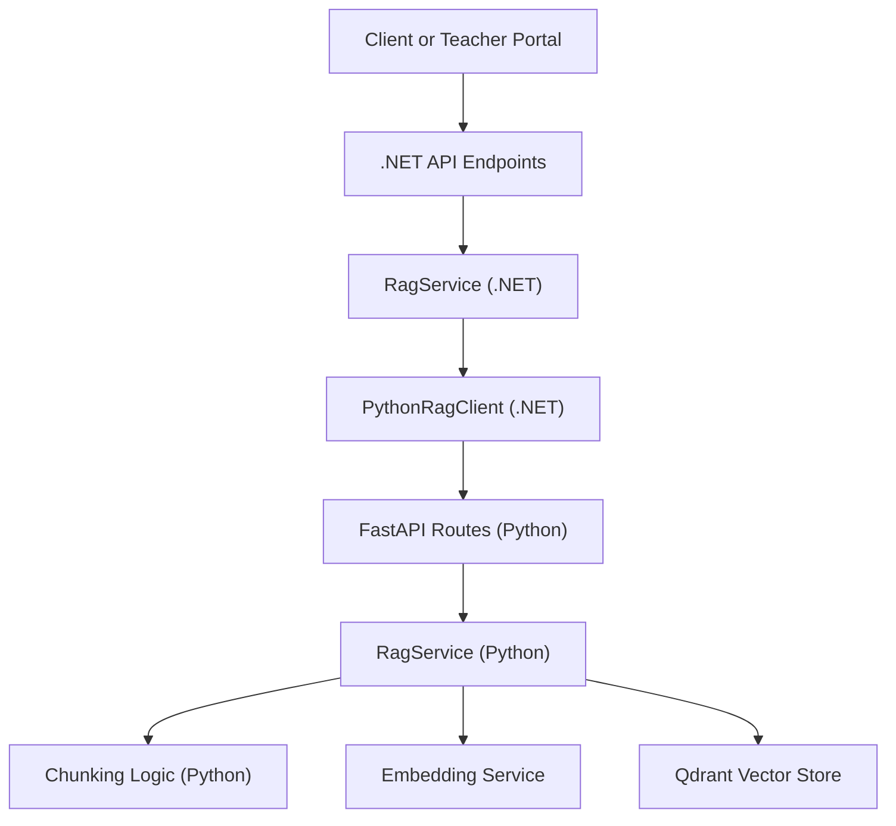
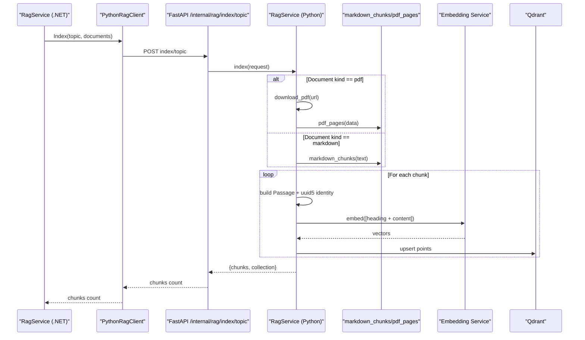
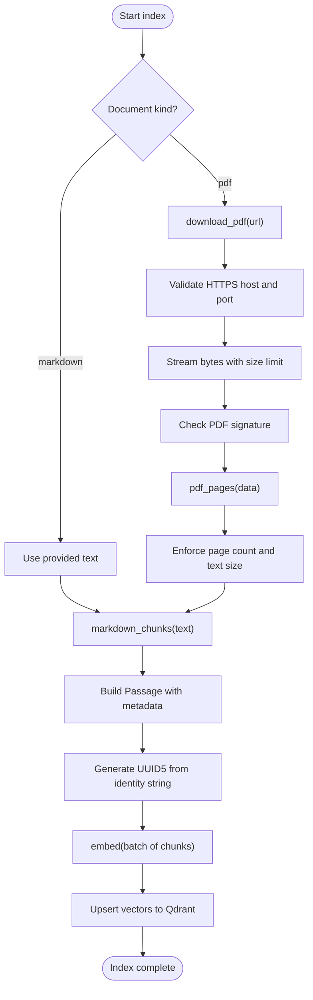
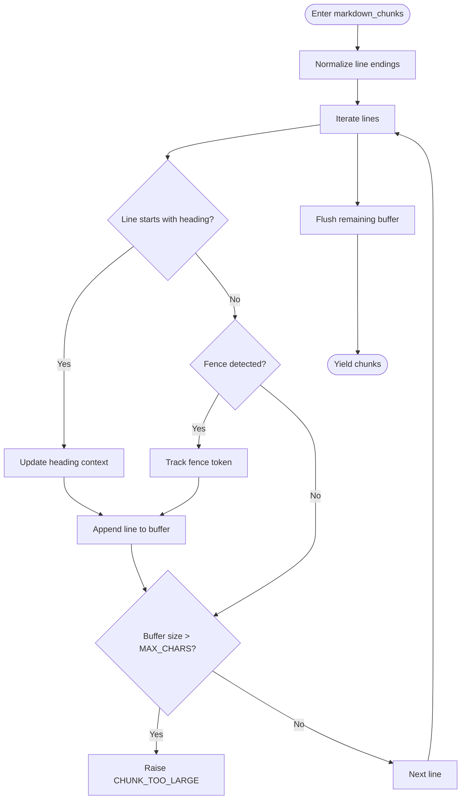
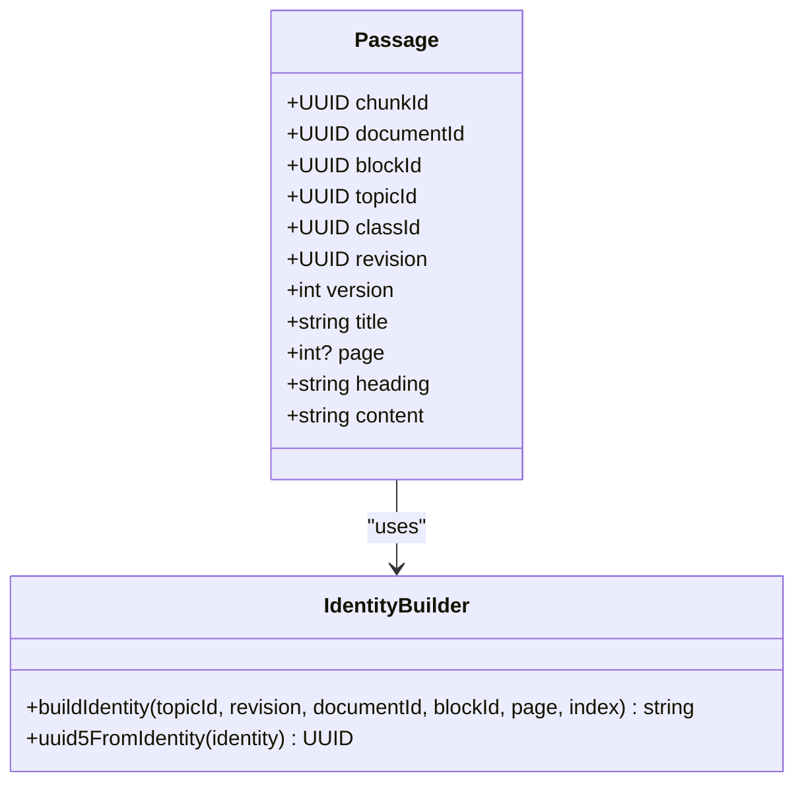
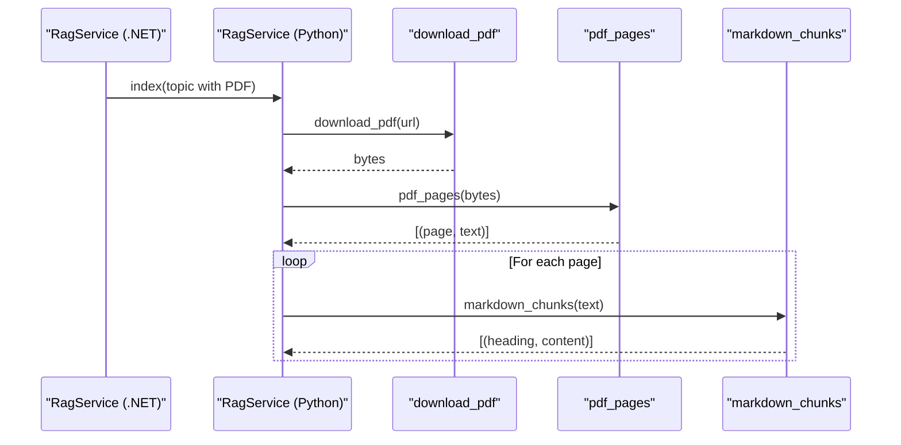
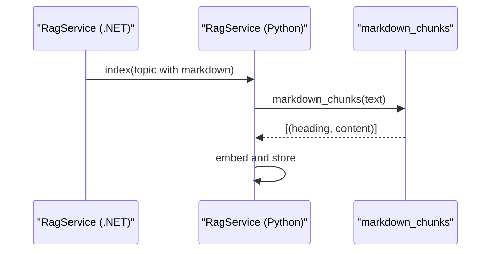
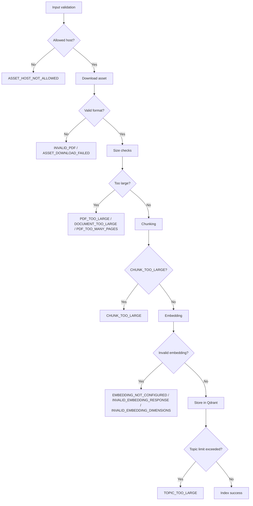
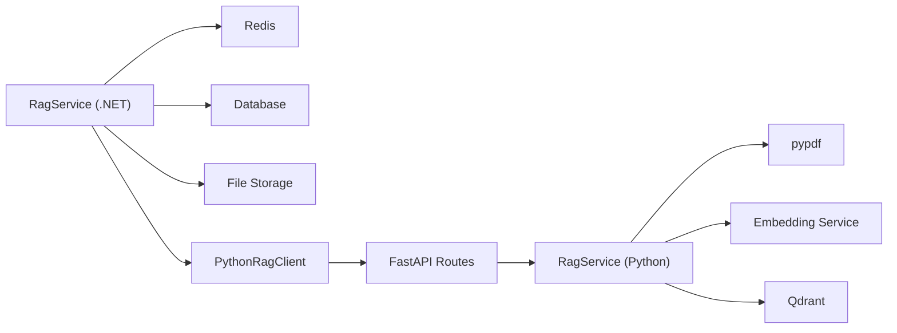

# Data Processing & Chunking

<cite>
**Referenced Files in This Document**
- [chunking.py](file://ai-service/app/rag/chunking.py)
- [service.py](file://ai-service/app/rag/service.py)
- [routes.py](file://ai-service/app/rag/routes.py)
- [contracts.py](file://ai-service/app/rag/contracts.py)
- [RagService.cs](file://api/src/Infrastructure/CodePath.Infrastructure/Learning/RagService.cs)
- [PythonRagClient.cs](file://api/src/Infrastructure/CodePath.Infrastructure/Learning/PythonRagClient.cs)
- [RagContracts.cs](file://api/src/Application/CodePath.Application/Learning/RagContracts.cs)
</cite>

## Table of Contents
1. [Introduction](#introduction)
2. [Project Structure](#project-structure)
3. [Core Components](#core-components)
4. [Architecture Overview](#architecture-overview)
5. [Detailed Component Analysis](#detailed-component-analysis)
6. [Dependency Analysis](#dependency-analysis)
7. [Performance Considerations](#performance-considerations)
8. [Troubleshooting Guide](#troubleshooting-guide)
9. [Conclusion](#conclusion)

## Introduction
This document explains the RAG data processing and chunking system that turns learning materials into searchable vector passages. It covers how documents are ingested, how PDFs and markdown are parsed, how large texts are split into bounded chunks, how passage metadata is assigned, and how deterministic identities are generated using UUID5. It also describes error handling for invalid formats, size limits, and security restrictions on asset hosts.

The pipeline spans two services:
- A .NET API service that owns topics, access control, indexing jobs, and retrieval orchestration.
- A Python AI service that performs document parsing, chunking, embedding, and vector storage.

## Project Structure
The relevant code lives in two main areas:
- Python AI service under `ai-service/app/rag`, which implements ingestion, chunking, embedding, and Qdrant integration.
- .NET API service under `api/src`, which exposes user-facing operations, validates inputs, manages indexing jobs, and calls the Python service.

**Diagram sources**
- [RagService.cs:14-44](file://api/src/Infrastructure/CodePath.Infrastructure/Learning/RagService.cs#L14-L44)
- [PythonRagClient.cs:10-23](file://api/src/Infrastructure/CodePath.Infrastructure/Learning/PythonRagClient.cs#L10-L23)
- [routes.py:10-21](file://ai-service/app/rag/routes.py#L10-L21)
- [service.py:13-25](file://ai-service/app/rag/service.py#L13-L25)
- [chunking.py:8-33](file://ai-service/app/rag/chunking.py#L8-L33)

**Section sources**
- [RagService.cs:14-44](file://api/src/Infrastructure/CodePath.Infrastructure/Learning/RagService.cs#L14-L44)
- [PythonRagClient.cs:10-23](file://api/src/Infrastructure/CodePath.Infrastructure/Learning/PythonRagClient.cs#L10-L23)
- [routes.py:10-21](file://ai-service/app/rag/routes.py#L10-L21)
- [service.py:13-25](file://ai-service/app/rag/service.py#L13-L25)
- [chunking.py:8-33](file://ai-service/app/rag/chunking.py#L8-L33)

## Core Components
- Chunking module: Splits text into bounded chunks with headings and enforces maximum sizes.
- Ingestion service: Downloads assets safely, parses PDFs, applies chunking, creates passages, embeds them, and stores them in a versioned Qdrant collection.
- Contracts: Define request/response shapes, including topic scope, document types, and passage metadata.
- .NET orchestration: Validates access, schedules indexing, retrieves passages, and enforces policy constraints.

Key responsibilities:
- PDF parsing and validation.
- Markdown heading-aware chunking.
- Deterministic chunk identity generation.
- Safe asset host allowlisting.
- Embedding and vector indexing.
- Retrieval scoping by topic and revision.

**Section sources**
- [chunking.py:1-56](file://ai-service/app/rag/chunking.py#L1-L56)
- [service.py:13-109](file://ai-service/app/rag/service.py#L13-L109)
- [contracts.py:12-28](file://ai-service/app/rag/contracts.py#L12-L28)
- [RagService.cs:57-69](file://api/src/Infrastructure/CodePath.Infrastructure/Learning/RagService.cs#L57-L69)

## Architecture Overview
The ingestion flow starts when a topic is reindexed. The .NET service prepares a topic payload and sends it to the Python indexer. The Python service downloads allowed assets, parses content, splits it into chunks, generates deterministic IDs, embeds each chunk, and persists vectors into a Qdrant collection scoped by topic and revision.

**Diagram sources**
- [RagService.cs:45-55](file://api/src/Infrastructure/CodePath.Infrastructure/Learning/RagService.cs#L45-L55)
- [PythonRagClient.cs:10-23](file://api/src/Infrastructure/CodePath.Infrastructure/Learning/PythonRagClient.cs#L10-L23)
- [routes.py:10-21](file://ai-service/app/rag/routes.py#L10-L21)
- [service.py:85-109](file://ai-service/app/rag/service.py#L85-L109)
- [chunking.py:8-55](file://ai-service/app/rag/chunking.py#L8-L55)

## Detailed Component Analysis

### Document Ingestion Pipeline
The ingestion pipeline supports two document kinds:
- PDF: Downloaded from an allowlisted HTTPS host, validated as a PDF, and parsed page-by-page.
- Markdown: Provided inline as text.

For PDFs:
- Host validation ensures only configured hosts are used.
- URL scheme must be HTTPS, no credentials, and port must be 443 or absent.
- Content length is limited during streaming.
- File signature is checked to ensure valid PDF format.
- Page count and total extracted text size are enforced.

For markdown:
- Text is passed directly to the chunker.

Passage creation:
- Each chunk becomes a passage with metadata:
  - `topicId`: Topic identifier.
  - `revision`: Revision identifier.
  - `documentId`: Source document or block identifier.
  - `blockId`: Original block identifier.
  - `classId` and `version`: Class and version context.
  - `title`, `page`, `heading`, and `content`.

Identity generation:
- Each chunk identity string combines topic, revision, document, block, page, and chunk index.
- A deterministic UUID5 is derived from this identity string using a URL namespace.

Embedding and storage:
- Chunks are embedded in batches.
- Vectors are stored in a Qdrant collection named deterministically based on embedding configuration.
- Metadata fields `topicId` and `revision` are indexed for efficient scoping.

**Diagram sources**
- [service.py:64-83](file://ai-service/app/rag/service.py#L64-L83)
- [service.py:85-109](file://ai-service/app/rag/service.py#L85-L109)
- [chunking.py:36-55](file://ai-service/app/rag/chunking.py#L36-L55)

**Section sources**
- [service.py:64-109](file://ai-service/app/rag/service.py#L64-L109)
- [contracts.py:12-28](file://ai-service/app/rag/contracts.py#L12-L28)

### Chunking Strategies
The chunker uses heading-based segmentation with content optimization:
- Headings trigger new chunks.
- Target chunk size is approximately 1800 characters.
- Hard maximum chunk size is 6000 characters; exceeding it raises an error rather than truncating.
- Code fences are tracked so they are not silently split across chunks.
- Very long lines or blocks require manual editing instead of automatic splitting.

PDF pages:
- Extracted text per page is returned with page numbers.
- Encrypted PDFs are rejected.
- Excessive page counts are rejected.
- Empty or OCR-only PDFs are rejected.
- Total extracted text size is capped.

**Diagram sources**
- [chunking.py:8-33](file://ai-service/app/rag/chunking.py#L8-L33)

**Section sources**
- [chunking.py:1-56](file://ai-service/app/rag/chunking.py#L1-L56)

### Metadata Assignment and Identity Generation
Metadata assignment occurs when building passages:
- `topicId`, `revision`, `documentId`, `blockId`, `classId`, `version`, `title`, `page`, `heading`, and `content` are attached to each passage.
- The chunk identity string combines these identifiers plus page and chunk index.
- UUID5 is computed over the identity string using a URL namespace to ensure deterministic chunk IDs across runs.

This design guarantees:
- Stable references to chunks within a topic and revision.
- Clear lineage back to original documents and blocks.
- Efficient scoping by topic and revision in vector search.

**Diagram sources**
- [service.py:92-98](file://ai-service/app/rag/service.py#L92-L98)
- [contracts.py:12-28](file://ai-service/app/rag/contracts.py#L12-L28)

**Section sources**
- [service.py:92-98](file://ai-service/app/rag/service.py#L92-L98)
- [contracts.py:12-28](file://ai-service/app/rag/contracts.py#L12-L28)

### Document Type Workflows

#### PDF Workflow
- The .NET service requests indexing for a topic containing a PDF block.
- The Python service downloads the PDF from an allowlisted host.
- The PDF is validated and parsed page-by-page.
- Each page’s text is chunked using the markdown chunker.
- Passages are embedded and stored.

**Diagram sources**
- [service.py:85-98](file://ai-service/app/rag/service.py#L85-L98)
- [chunking.py:36-55](file://ai-service/app/rag/chunking.py#L36-L55)

**Section sources**
- [service.py:85-98](file://ai-service/app/rag/service.py#L85-L98)
- [chunking.py:36-55](file://ai-service/app/rag/chunking.py#L36-L55)

#### Markdown Workflow
- The .NET service provides markdown text as part of the topic content.
- The Python service passes the text directly to the chunker.
- Headings guide chunk boundaries.
- Passages are embedded and stored.

**Diagram sources**
- [service.py:85-98](file://ai-service/app/rag/service.py#L85-L98)
- [chunking.py:8-33](file://ai-service/app/rag/chunking.py#L8-L33)

**Section sources**
- [service.py:85-98](file://ai-service/app/rag/service.py#L85-L98)
- [chunking.py:8-33](file://ai-service/app/rag/chunking.py#L8-L33)

#### Plain Text Workflow
Plain text is not a supported top-level document kind in the current contracts. If plain text needs to be processed, it should be converted to markdown before indexing. The markdown chunker can still process unstructured text, but headings will not be present unless explicitly added.

**Section sources**
- [contracts.py:12-28](file://ai-service/app/rag/contracts.py#L12-L28)

### Error Handling
Error handling is layered across the pipeline:

- Asset host security:
  - Only HTTPS URLs on configured hosts are allowed.
  - Credentials and non-standard ports are rejected.
  - Invalid responses or unsupported file types raise errors.

- Size and format limits:
  - PDF too large during streaming.
  - Invalid PDF signature.
  - Too many pages.
  - Document too large after extraction.
  - Chunk too large.
  - Topic too large due to excessive passages.

- Embedding validation:
  - Missing embedding configuration.
  - Invalid response ordering.
  - Invalid vector dimensions or non-finite values.

- Retrieval scoping:
  - Retrieved passages must belong to allowed scopes.
  - Duplicate content and character limits are enforced during search.

- API layer mapping:
  - Known validation errors map to HTTP 422 with specific codes.
  - Unexpected failures map to HTTP 503.

**Diagram sources**
- [service.py:64-83](file://ai-service/app/rag/service.py#L64-L83)
- [service.py:49-62](file://ai-service/app/rag/service.py#L49-L62)
- [service.py:92-109](file://ai-service/app/rag/service.py#L92-L109)
- [routes.py:15-21](file://ai-service/app/rag/routes.py#L15-L21)

**Section sources**
- [service.py:49-109](file://ai-service/app/rag/service.py#L49-L109)
- [routes.py:15-21](file://ai-service/app/rag/routes.py#L15-L21)

## Dependency Analysis
The Python RAG service depends on:
- `httpx` for HTTP requests.
- `pypdf` for PDF parsing.
- `uuid.uuid5` for deterministic identity generation.
- External embedding service for vectorization.
- Qdrant for vector storage.

The .NET side depends on:
- Redis for rate limiting.
- Database for indexing job state.
- Cloudinary or configured storage for signed asset URLs.
- Python RAG client for indexing, search, answer, and draft endpoints.

**Diagram sources**
- [RagService.cs:14-44](file://api/src/Infrastructure/CodePath.Infrastructure/Learning/RagService.cs#L14-L44)
- [PythonRagClient.cs:10-49](file://api/src/Infrastructure/CodePath.Infrastructure/Learning/PythonRagClient.cs#L10-L49)
- [service.py:13-25](file://ai-service/app/rag/service.py#L13-L25)
- [chunking.py:36-39](file://ai-service/app/rag/chunking.py#L36-L39)

**Section sources**
- [RagService.cs:14-44](file://api/src/Infrastructure/CodePath.Infrastructure/Learning/RagService.cs#L14-L44)
- [PythonRagClient.cs:10-49](file://api/src/Infrastructure/CodePath.Infrastructure/Learning/PythonRagClient.cs#L10-L49)
- [service.py:13-25](file://ai-service/app/rag/service.py#L13-L25)
- [chunking.py:36-39](file://ai-service/app/rag/chunking.py#L36-L39)

## Performance Considerations
- Chunk size limits prevent oversized payloads and reduce embedding costs.
- Batching embeddings improves throughput.
- Qdrant collection initialization is guarded by a lock to avoid race conditions.
- Search results deduplicate content and cap total characters to keep responses manageable.
- Rate limiting in .NET prevents abuse of RAG features.

Recommendations:
- Keep headings meaningful to improve chunk relevance.
- Avoid extremely long code blocks; split them manually if needed.
- Monitor embedding service latency and adjust batch sizes accordingly.
- Tune minimum score thresholds based on domain requirements.

[No sources needed since this section provides general guidance]

## Troubleshooting Guide
Common issues and resolutions:
- `ASSET_HOST_NOT_ALLOWED`: Ensure the asset URL uses HTTPS and belongs to an allowlisted host.
- `INVALID_PDF` or `PDF_ENCRYPTED`: Provide a valid, unencrypted PDF.
- `PDF_TOO_MANY_PAGES` or `DOCUMENT_TOO_LARGE`: Reduce document size or split into multiple topics.
- `CHUNK_TOO_LARGE`: Edit source content to break very long sections or code blocks.
- `TOPIC_TOO_LARGE`: Reduce the number of documents or chunks per topic.
- `EMBEDDING_NOT_CONFIGURED`: Configure embedding base URL, model, and dimensions.
- `RETRIEVAL_SCOPE_MISMATCH`: Verify that retrieved passages belong to allowed topic-revision scopes.

Operational checks:
- Confirm Qdrant collection exists and has keyword indexes for `topicId` and `revision`.
- Validate embedding service returns correctly ordered and dimensionally consistent vectors.
- Review .NET rate limiting counters if users encounter throttling.

**Section sources**
- [routes.py:15-21](file://ai-service/app/rag/routes.py#L15-L21)
- [service.py:49-83](file://ai-service/app/rag/service.py#L49-L83)
- [service.py:123-143](file://ai-service/app/rag/service.py#L123-L143)

## Conclusion
The RAG data processing and chunking system provides a robust pipeline for turning learning materials into searchable vector passages. It enforces strict security and size constraints, uses deterministic identity generation for stable references, and integrates cleanly with .NET orchestration and external embedding and vector storage services. By following the documented workflows and error handling strategies, teams can reliably ingest PDFs and markdown, optimize chunk quality, and retrieve grounded answers with clear provenance.

[No sources needed since this section summarizes without analyzing specific files]