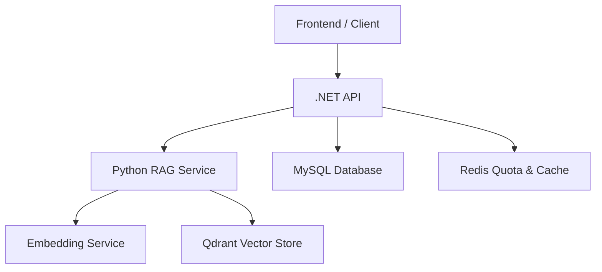
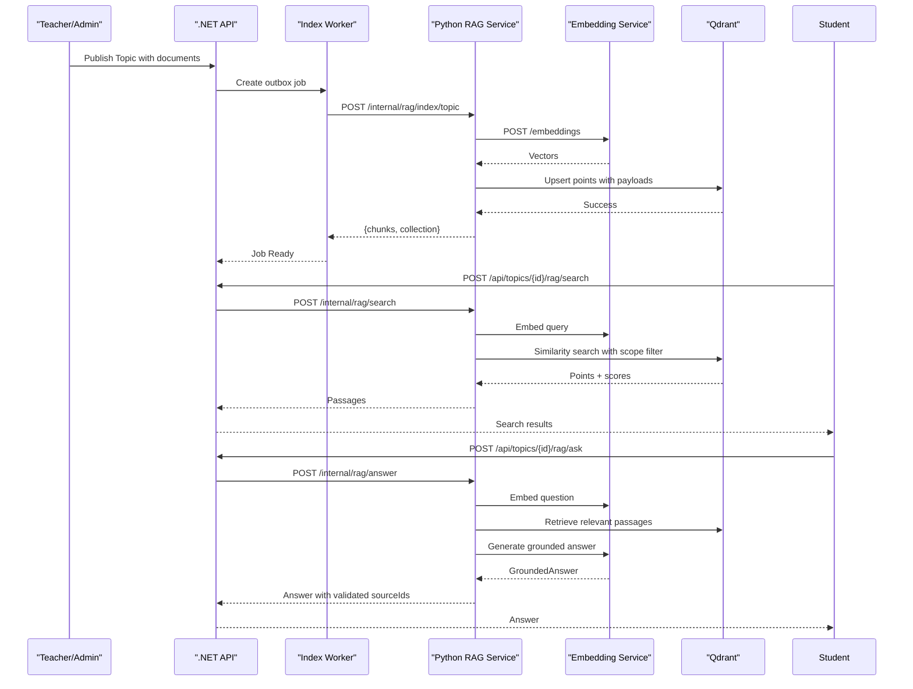
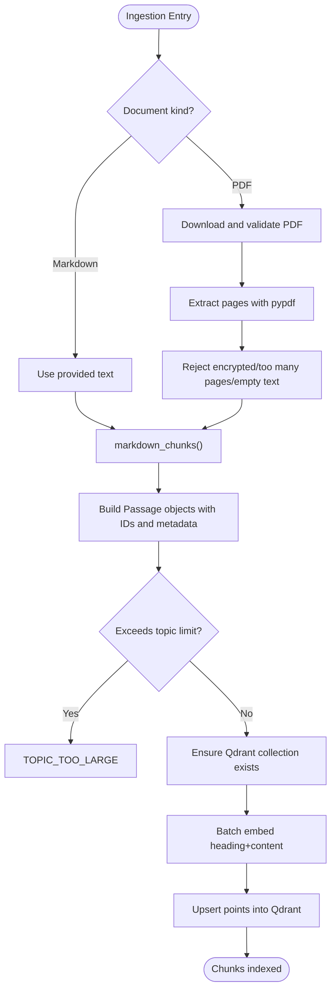
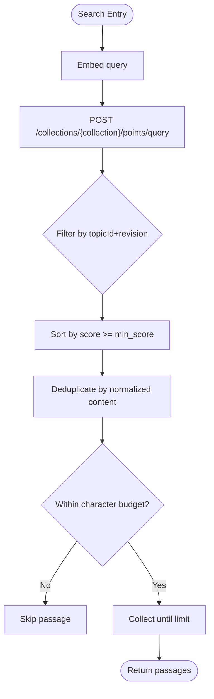
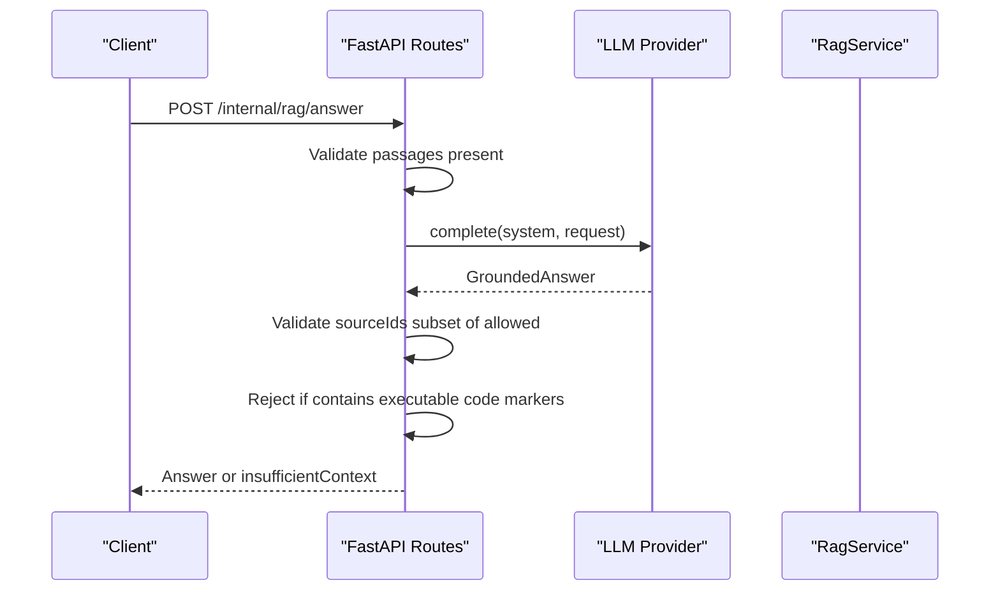
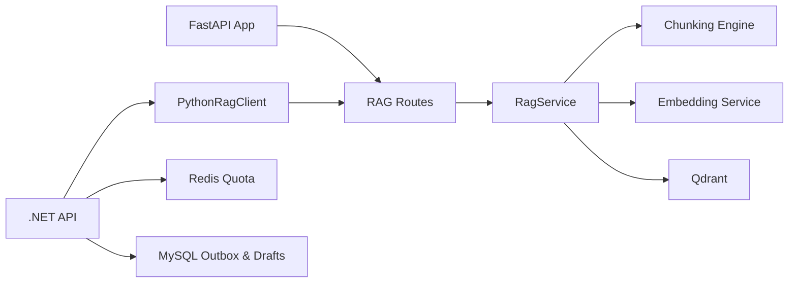

# RAG (Retrieval-Augmented Generation) System

<cite>
**Referenced Files in This Document**
- [service.py](file://ai-service/app/rag/service.py)
- [chunking.py](file://ai-service/app/rag/chunking.py)
- [routes.py](file://ai-service/app/rag/routes.py)
- [contracts.py](file://ai-service/app/rag/contracts.py)
- [main.py](file://ai-service/app/main.py)
- [RAG.md](file://api/docs/RAG.md)
- [PythonRagClient.cs](file://api/src/Infrastructure/CodePath.Infrastructure/Learning/PythonRagClient.cs)
- [RagContracts.cs](file://api/src/Application/CodePath.Application/Learning/RagContracts.cs)
- [RagService.cs](file://api/src/Infrastructure/CodePath.Infrastructure/Learning/RagService.cs)
</cite>

## Table of Contents
1. [Introduction](#introduction)
2. [Project Structure](#project-structure)
3. [Core Components](#core-components)
4. [Architecture Overview](#architecture-overview)
5. [Detailed Component Analysis](#detailed-component-analysis)
6. [Dependency Analysis](#dependency-analysis)
7. [Performance Considerations](#performance-considerations)
8. [Troubleshooting Guide](#troubleshooting-guide)
9. [Conclusion](#conclusion)
10. [Appendices](#appendices)

## Introduction
This document explains the Retrieval-Augmented Generation system implemented for the CodePath learning platform. It covers how learning content is ingested, chunked, embedded, stored in a vector database, searched semantically, and used to generate grounded answers or teaching drafts. It also documents the internal Python API, the .NET integration layer, configuration requirements, error handling, performance characteristics, and operational guidance for large knowledge bases.

The implementation consists of:
- A FastAPI-based Python service that manages indexing, semantic search, answer synthesis, and draft generation.
- A .NET application that exposes public endpoints, enforces authorization and quotas, coordinates asynchronous indexing jobs, and calls the Python service.
- External dependencies including Qdrant for vector storage and an embedding service for generating vectors.

**Section sources**
- [RAG.md:1-23](file://api/docs/RAG.md#L1-L23)
- [RAG.md:110-134](file://api/docs/RAG.md#L110-L134)

## Project Structure
The RAG feature spans two services:

- Python AI service (`ai-service`):
  - `app/rag`: RAG logic, contracts, routes, chunking, and service orchestration.
  - `app/main.py`: FastAPI application lifecycle, authentication, and router registration.

- .NET API (`api`):
  - Public endpoints and business logic for learning features.
  - Infrastructure client that calls the Python RAG service.
  - Application contracts defining RAG operations.

**Diagram sources**
- [main.py:17-84](file://ai-service/app/main.py#L17-L84)
- [routes.py:7-92](file://ai-service/app/rag/routes.py#L7-L92)
- [PythonRagClient.cs:7-45](file://api/src/Infrastructure/CodePath.Infrastructure/Learning/PythonRagClient.cs#L7-L45)

**Section sources**
- [main.py:17-84](file://ai-service/app/main.py#L17-L84)
- [routes.py:7-92](file://ai-service/app/rag/routes.py#L7-L92)
- [RAG.md:136-153](file://api/docs/RAG.md#L136-L153)

## Core Components
- Chunking engine: Converts Markdown into bounded chunks with headings and source positions; extracts text from PDFs with safety limits.
- Indexing service: Builds passages, generates embeddings, and upserts points into Qdrant with payload metadata.
- Search service: Embeds queries, performs vector similarity search with scope filters, deduplicates results, and caps context size.
- Answer synthesis: Calls the LLM with retrieved passages and validates citations against allowed sources.
- Draft generation: Generates exercises or quizzes for teachers with strict validation rules.
- Contracts: Pydantic models for requests, responses, scopes, and teaching drafts.

Key responsibilities:
- Safe asset downloading and format validation.
- Deterministic collection naming based on embedding configuration.
- Scope-aware retrieval using topic and revision pairs.
- Conservative policy for code output in student-facing answers.

**Section sources**
- [chunking.py:1-56](file://ai-service/app/rag/chunking.py#L1-L56)
- [service.py:13-144](file://ai-service/app/rag/service.py#L13-L144)
- [routes.py:7-92](file://ai-service/app/rag/routes.py#L7-L92)
- [contracts.py:7-68](file://ai-service/app/rag/contracts.py#L7-L68)

## Architecture Overview
The RAG pipeline integrates three main phases: ingestion, retrieval, and generation.

**Diagram sources**
- [routes.py:10-90](file://ai-service/app/rag/routes.py#L10-L90)
- [service.py:85-143](file://ai-service/app/rag/service.py#L85-L143)
- [PythonRagClient.cs:10-45](file://api/src/Infrastructure/CodePath.Infrastructure/Learning/PythonRagClient.cs#L10-L45)

**Section sources**
- [RAG.md:1-13](file://api/docs/RAG.md#L1-L13)
- [RAG.md:123-153](file://api/docs/RAG.md#L123-L153)

## Detailed Component Analysis

### Knowledge Base Management and Document Ingestion
The ingestion process supports Markdown and PDF documents:
- Markdown is split into chunks by headings and code fences, targeting around 1,800 characters with a hard ceiling of 6,000 characters per chunk.
- PDFs are extracted page-by-page, rejecting encrypted files, too many pages, oversized documents, and scanned-only PDFs requiring OCR.
- Each passage receives deterministic identifiers derived from topic, revision, document, block, page, and chunk index.
- Passages are batched and embedded before being upserted into Qdrant with rich payload metadata.

**Diagram sources**
- [chunking.py:8-33](file://ai-service/app/rag/chunking.py#L8-L33)
- [chunking.py:36-55](file://ai-service/app/rag/chunking.py#L36-L55)
- [service.py:85-109](file://ai-service/app/rag/service.py#L85-L109)

**Section sources**
- [chunking.py:1-56](file://ai-service/app/rag/chunking.py#L1-L56)
- [service.py:64-109](file://ai-service/app/rag/service.py#L64-L109)
- [RAG.md:121-128](file://api/docs/RAG.md#L121-L128)

### Vector Embedding Generation
Embeddings are generated via an external embedding service:
- The service posts `{model, input}` to `/embeddings`.
- Responses are sorted by index and validated for dimensionality and finite values.
- Collection identity includes the embedding endpoint, model name, dimensions, and chunker version to ensure consistent scoping across deployments.

Operational notes:
- Missing embedding configuration raises a clear runtime error.
- Invalid response structure or dimensions raise explicit validation errors.
- Qdrant collection is created with cosine distance and configured vector size.

**Section sources**
- [service.py:13-25](file://ai-service/app/rag/service.py#L13-L25)
- [service.py:49-62](file://ai-service/app/rag/service.py#L49-L62)
- [service.py:32-47](file://ai-service/app/rag/service.py#L32-L47)
- [RAG.md:18-23](file://api/docs/RAG.md#L18-L23)

### Semantic Search Capabilities
Search combines vector similarity with scope filtering:
- Query is embedded once and used to retrieve candidate points.
- Scope filter requires matching both `topicId` and `revision`, preventing cross-scope leakage.
- Results are deduplicated by normalized content fingerprint and capped at a maximum character budget.
- Minimum score threshold controls relevance cutoff.

**Diagram sources**
- [service.py:123-143](file://ai-service/app/rag/service.py#L123-L143)

**Section sources**
- [service.py:111-143](file://ai-service/app/rag/service.py#L111-L143)
- [RAG.md:123-134](file://api/docs/RAG.md#L123-L134)

### Answer Synthesis and Quality Scoring
Answer synthesis uses retrieved passages to generate grounded responses:
- If no passages are available, the system returns an insufficient-context response.
- The LLM is prompted to respond in Vietnamese, avoid executable solutions, and cite only valid chunk IDs.
- Returned answers are validated:
  - Source IDs must be a subset of allowed passage IDs.
  - Answers containing full code blocks or common program entry points are rejected.
- Quality scoring relies on:
  - Vector similarity score from Qdrant.
  - Minimum score threshold configuration.
  - Citation validation against retrieved passages.

**Diagram sources**
- [routes.py:39-63](file://ai-service/app/rag/routes.py#L39-L63)

**Section sources**
- [routes.py:39-63](file://ai-service/app/rag/routes.py#L39-L63)
- [contracts.py:36-45](file://ai-service/app/rag/contracts.py#L36-L45)

### Teaching Draft Generation
Draft generation supports two modes:
- Exercise: Produces one programming exercise with reference solution and 10–15 tests, including 1–2 sample tests.
- Quiz: Produces 3–5 multiple-choice questions with explanations.

Validation ensures:
- Source IDs are within allowed passages.
- Exercise mode has required fields and test counts.
- Quiz mode excludes tests and reference solution.

**Section sources**
- [routes.py:65-90](file://ai-service/app/rag/routes.py#L65-L90)
- [contracts.py:46-68](file://ai-service/app/rag/contracts.py#L46-L68)

### API Endpoints
Internal Python endpoints:
- `POST /internal/rag/index/topic`: Index documents for a topic.
- `POST /internal/rag/index/delete`: Delete a topic’s indexed data by scope.
- `POST /internal/rag/search`: Semantic search with scopes and limit.
- `POST /internal/rag/answer`: Generate grounded answer from passages.
- `POST /internal/rag/draft`: Generate teaching draft (exercise or quiz).

Public .NET endpoints:
- `GET /api/learning/classes`
- `POST /api/topics/{id}/rag/search`
- `POST /api/topics/{id}/rag/ask`
- `GET /api/topics/{id}/rag/sources/{blockId}?version=N`
- `GET /api/topics/{id}/rag/status`
- `POST /api/topics/{id}/rag/reindex`
- `GET/POST /api/topics/{id}/rag/drafts`
- `PUT /api/topics/{id}/rag/drafts/{draftId}`
- `POST .../drafts/{draftId}/verify`
- `POST .../drafts/{draftId}/review`

Authentication:
- Internal endpoints require `X-Service-Key`.
- Public endpoints go through .NET and enforce user authorization and quotas.

**Section sources**
- [routes.py:7-92](file://ai-service/app/rag/routes.py#L7-L92)
- [main.py:45-84](file://ai-service/app/main.py#L45-L84)
- [RAG.md:136-153](file://api/docs/RAG.md#L136-L153)

### Data Models and Contracts
Key Pydantic models:
- `Scope`: topic and revision pair.
- `Document`: document identifier, block identifier, title, kind, optional text or URL.
- `IndexRequest`: topic, class, revision, version, and list of documents.
- `SearchRequest`: query, scopes, and limit.
- `AnswerRequest`: question and passages.
- `GroundedAnswer`: answer, source IDs, and insufficient context flag.
- `TeachingDraft`: title, description, reference solution, tests, quiz items, and source IDs.
- `DraftRequest`: extends answer request with kind and language.

These models define input validation, length constraints, and allowed literals for robust processing.

**Section sources**
- [contracts.py:7-68](file://ai-service/app/rag/contracts.py#L7-L68)

## Dependency Analysis
The RAG system depends on several components:

Coupling and cohesion:
- `RagService` encapsulates Qdrant interaction, embedding calls, and collection management.
- `routes.py` isolates HTTP concerns and timeouts.
- `.NET` client abstracts network calls and deadlines.
- Chunking is independent and reusable.

External dependencies:
- Qdrant for vector storage.
- Embedding service for vector generation.
- Redis for quotas and caching.
- MySQL for outbox jobs and drafts.

Potential circular dependencies:
- None detected between core modules; FastAPI app includes router after state initialization.

**Diagram sources**
- [main.py:17-84](file://ai-service/app/main.py#L17-L84)
- [routes.py:7-92](file://ai-service/app/rag/routes.py#L7-L92)
- [service.py:13-144](file://ai-service/app/rag/service.py#L13-L144)
- [PythonRagClient.cs:7-45](file://api/src/Infrastructure/CodePath.Infrastructure/Learning/PythonRagClient.cs#L7-L45)

**Section sources**
- [main.py:17-84](file://ai-service/app/main.py#L17-L84)
- [routes.py:7-92](file://ai-service/app/rag/routes.py#L7-L92)
- [service.py:13-144](file://ai-service/app/rag/service.py#L13-L144)
- [PythonRagClient.cs:7-45](file://api/src/Infrastructure/CodePath.Infrastructure/Learning/PythonRagClient.cs#L7-L45)

## Performance Considerations
- Chunking strategy targets ~1,800 characters with a hard cap of 6,000 characters to balance embedding cost and retrieval quality.
- PDF extraction rejects encrypted files, >500 pages, >2 million characters total, and empty text requiring OCR.
- Topic-level limit prevents excessive indexing per topic.
- Embedding batches are processed in groups of 16 to reduce overhead.
- Search retrieves more candidates than requested (`limit * 3`) then deduplicates and caps context size at 16,000 characters.
- Minimum score threshold filters low-relevance results.
- Timeouts protect service stability:
  - Indexing: 240 seconds.
  - Search: 5 seconds.
  - Answer: 19 seconds.
  - Draft: 45 seconds.
- .NET client adds additional deadlines for search (6 seconds), answer (20 seconds), and draft (50 seconds).
- Redis quotas limit RAG operations to 5 requests per minute and 50 per day per user.

Optimization opportunities:
- Tune `RAG_MIN_SCORE` for relevance vs recall trade-offs.
- Adjust embedding model and dimensions to match performance and accuracy needs.
- Consider caching frequent queries if appropriate, while preserving authorization checks.
- Monitor Qdrant collection sizes and reindex when embedding configuration changes.

**Section sources**
- [chunking.py:4-33](file://ai-service/app/rag/chunking.py#L4-L33)
- [chunking.py:36-55](file://ai-service/app/rag/chunking.py#L36-L55)
- [service.py:99-109](file://ai-service/app/rag/service.py#L99-L109)
- [service.py:123-143](file://ai-service/app/rag/service.py#L123-L143)
- [routes.py:10-90](file://ai-service/app/rag/routes.py#L10-L90)
- [PythonRagClient.cs:29-45](file://api/src/Infrastructure/CodePath.Infrastructure/Learning/PythonRagClient.cs#L29-L45)
- [RagService.cs:25-37](file://api/src/Infrastructure/CodePath.Infrastructure/Learning/RagService.cs#L25-L37)

## Troubleshooting Guide
Common errors and their meanings:
- `PDF_NEEDS_OCR`: PDF contains no extractable text; requires OCR or transcript.
- `PDF_ENCRYPTED`: Encrypted PDF cannot be read.
- `PDF_TOO_MANY_PAGES`: PDF exceeds page limit.
- `DOCUMENT_TOO_LARGE`: PDF exceeds character limit.
- `CHUNK_TOO_LARGE`: Individual line or code block too long; author should split content.
- `PDF_TOO_LARGE`: Downloaded PDF exceeds size limit.
- `INVALID_PDF`: Content does not start with PDF header.
- `ASSET_HOST_NOT_ALLOWED`: URL host not allowlisted.
- `TOPIC_TOO_LARGE`: Too many chunks for a topic.
- `RETRIEVAL_SCOPE_MISMATCH`: Retrieved passage belongs to disallowed topic/revision.
- `INDEX_INVALID`: Generic indexing validation failure.
- `RAG_UNAVAILABLE`: Python service unavailable.
- `AI_UNAVAILABLE`: LLM provider unavailable.
- `INSUFFICIENT_CONTEXT`: No passages provided for draft generation.
- `Invalid sources` or `Invalid exercise`/`Invalid quiz`: Draft validation failed.

Operational checks:
- Verify `SERVICE_API_KEY` meets minimum length requirement.
- Confirm `QDRANT_URL`, `QDRANT_API_KEY`, `EMBEDDING_BASE_URL`, `EMBEDDING_MODEL`, `EMBEDDING_DIMENSIONS`, and `EMBEDDING_API_KEY` are set correctly.
- Ensure embedding service responds with expected schema and dimensions.
- Check Qdrant collection existence and index fields for `topicId` and `revision`.
- Review .NET configuration for `Ai__BaseUrl`, `Ai__ServiceKey`, and `Rag__IndexBaseUrl`.

**Section sources**
- [routes.py:10-90](file://ai-service/app/rag/routes.py#L10-L90)
- [service.py:49-83](file://ai-service/app/rag/service.py#L49-L83)
- [service.py:118-143](file://ai-service/app/rag/service.py#L118-L143)
- [main.py:17-25](file://ai-service/app/main.py#L17-L25)
- [RAG.md:47-67](file://api/docs/RAG.md#L47-L67)

## Conclusion
The RAG system provides a secure, scoped, and configurable retrieval-augmented generation pipeline for CodePath learning content. It emphasizes safe document ingestion, deterministic scoping, conservative answer policies, and strong validation throughout indexing, search, and generation. Operational guidance and error codes help maintain reliability, while configuration options allow tuning for performance and accuracy. For large knowledge bases, careful attention to chunking limits, embedding dimensions, minimum scores, and quota settings is essential to balance latency, recall, and cost.

[No sources needed since this section summarizes without analyzing specific files]

## Appendices

### Configuration Variables
- `SERVICE_API_KEY`: Internal service key for authenticating Python endpoints.
- `QDRANT_URL`: Qdrant service URL.
- `QDRANT_API_KEY`: Qdrant API key.
- `EMBEDDING_BASE_URL`: Embedding service base URL ending with `/v1`.
- `EMBEDDING_MODEL`: Model name for embeddings.
- `EMBEDDING_DIMENSIONS`: Expected vector dimensionality.
- `EMBEDDING_API_KEY`: Optional embedding service API key.
- `RAG_MIN_SCORE`: Minimum similarity score threshold.
- `REDIS_URL`: Redis connection string for caching and quotas.
- `LLM_PROVIDER`, `LLM_MODEL`, `LLM_API_KEY`: LLM provider configuration.

**Section sources**
- [RAG.md:54-67](file://api/docs/RAG.md#L54-L67)
- [service.py:16-25](file://ai-service/app/rag/service.py#L16-L25)

### Example Workflows

- Document ingestion:
  - Teacher publishes a Topic with Markdown or PDF.
  - .NET creates an outbox job; worker calls Python `/internal/rag/index/topic`.
  - Python chunks content, embeds, and upserts into Qdrant.
  - Job status becomes Ready.

- Search query:
  - Student sends a question to `/api/topics/{id}/rag/search`.
  - .NET validates authorization and quotas, then calls Python `/internal/rag/search`.
  - Python embeds query, searches Qdrant with scope filter, and returns passages.

- Answer synthesis:
  - Student asks a question via `/api/topics/{id}/rag/ask`.
  - .NET calls Python `/internal/rag/answer` with retrieved passages.
  - Python validates citations and rejects executable code outputs.
  - Response includes answer and validated source IDs or indicates insufficient context.

- Draft generation:
  - Teacher requests an exercise or quiz draft.
  - Python validates passage sources and draft structure.
  - Result includes structured content and source IDs for review.

**Section sources**
- [RAG.md:110-153](file://api/docs/RAG.md#L110-L153)
- [routes.py:10-90](file://ai-service/app/rag/routes.py#L10-L90)
- [PythonRagClient.cs:10-45](file://api/src/Infrastructure/CodePath.Infrastructure/Learning/PythonRagClient.cs#L10-L45)