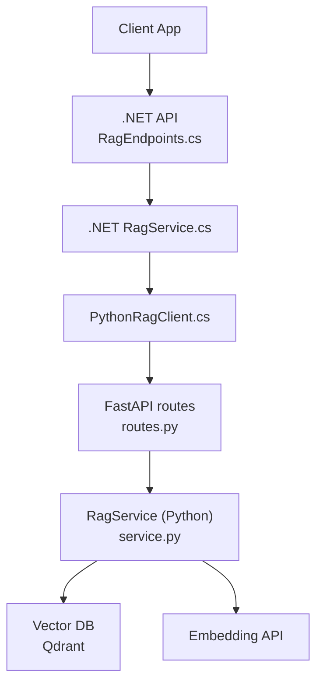
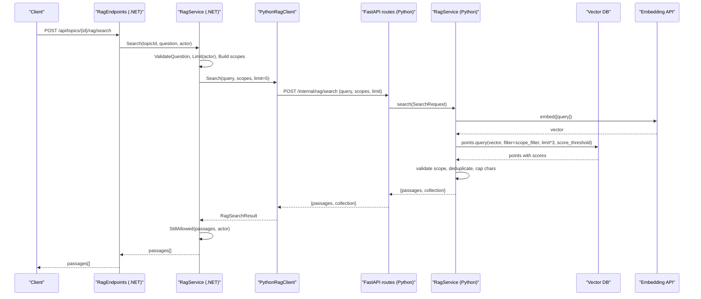
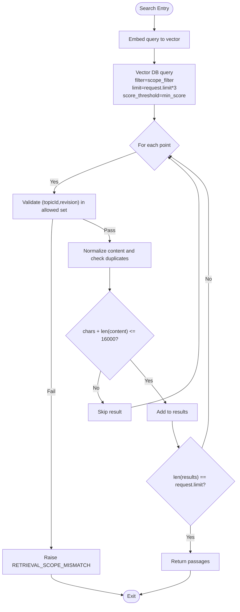
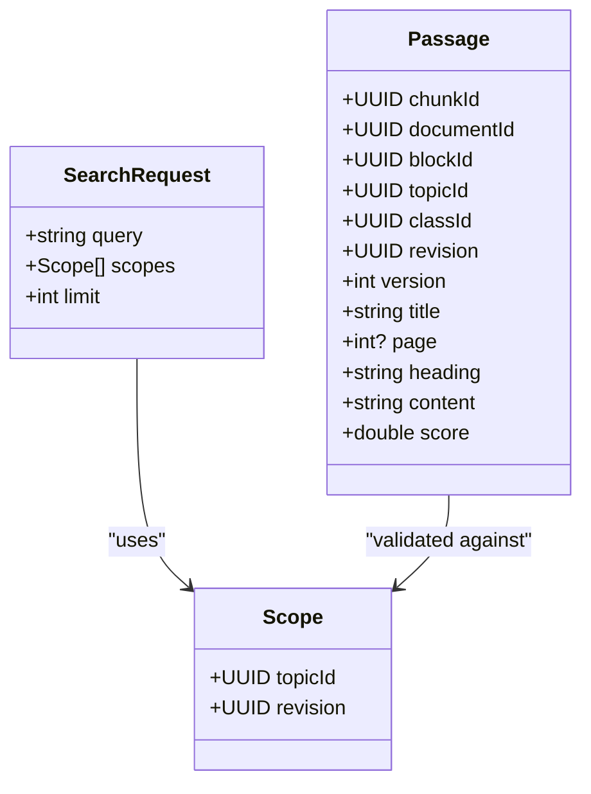
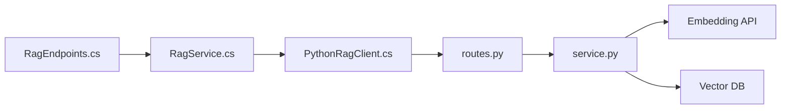

# Retrieval & Search System

<cite>
**Referenced Files in This Document**
- [service.py](file://ai-service/app/rag/service.py)
- [routes.py](file://ai-service/app/rag/routes.py)
- [contracts.py](file://ai-service/app/rag/contracts.py)
- [RagService.cs](file://api/src/Infrastructure/CodePath.Infrastructure/Learning/RagService.cs)
- [PythonRagClient.cs](file://api/src/Infrastructure/CodePath.Infrastructure/Learning/PythonRagClient.cs)
- [RagContracts.cs](file://api/src/Application/CodePath.Application/Learning/RagContracts.cs)
- [RagEndpoints.cs](file://api/src/Api/CodePath.Api/Endpoints/RagEndpoints.cs)
- [test_rag.py](file://ai-service/tests/test_rag.py)
</cite>

## Table of Contents
1. [Introduction](#introduction)
2. [Project Structure](#project-structure)
3. [Core Components](#core-components)
4. [Architecture Overview](#architecture-overview)
5. [Detailed Component Analysis](#detailed-component-analysis)
6. [Dependency Analysis](#dependency-analysis)
7. [Performance Considerations](#performance-considerations)
8. [Troubleshooting Guide](#troubleshooting-guide)
9. [Conclusion](#conclusion)

## Introduction
This document explains the retrieval and search functionality that powers semantic search over learning materials. It covers how queries are embedded into vectors, how vector similarity matching is performed, and how results are filtered by scope (topicId and revision pairs). It also documents scoring thresholds, result deduplication, authorization-aware scope filtering, performance optimizations such as limit scaling and character limits, and caching strategies for frequent queries.

## Project Structure
The retrieval and search system spans two services:
- Python AI service: implements embedding, vector indexing, and semantic search against a vector database.
- .NET API: orchestrates access control, rate limiting, topic scoping, and calls into the Python service.

**Diagram sources**
- [RagEndpoints.cs:17-31](file://api/src/Api/CodePath.Api/Endpoints/RagEndpoints.cs#L17-L31)
- [RagService.cs:57-85](file://api/src/Infrastructure/CodePath.Infrastructure/Learning/RagService.cs#L57-L85)
- [PythonRagClient.cs:29-35](file://api/src/Infrastructure/CodePath.Infrastructure/Learning/PythonRagClient.cs#L29-L35)
- [routes.py:31-37](file://ai-service/app/rag/routes.py#L31-L37)
- [service.py:123-143](file://ai-service/app/rag/service.py#L123-L143)

**Section sources**
- [RagEndpoints.cs:17-31](file://api/src/Api/CodePath.Api/Endpoints/RagEndpoints.cs#L17-L31)
- [RagService.cs:57-85](file://api/src/Infrastructure/CodePath.Infrastructure/Learning/RagService.cs#L57-L85)
- [PythonRagClient.cs:29-35](file://api/src/Infrastructure/CodePath.Infrastructure/Learning/PythonRagClient.cs#L29-L35)
- [routes.py:31-37](file://ai-service/app/rag/routes.py#L31-L37)
- [service.py:123-143](file://ai-service/app/rag/service.py#L123-L143)

## Core Components
- Python RagService: handles embedding generation, vector query execution, scope filters, scoring thresholding, and result deduplication.
- FastAPI routes: expose internal endpoints for search and answer with timeouts and error mapping.
- .NET RagService: enforces business rules, builds authorized scopes, applies rate limits, validates responses, and revalidates content before returning results.
- PythonRagClient: HTTP client to call internal search and answer endpoints with deadlines.
- Contracts: define request/response shapes including query length, scope count, and result limits.

Key responsibilities:
- Query embedding: convert natural language query to a vector using an external embedding API.
- Vector similarity matching: perform cosine similarity search in the vector database.
- Scope filtering: restrict matches to allowed (topicId, revision) pairs.
- Scoring and thresholds: apply minimum score thresholds and rank results.
- Deduplication: remove duplicate content and cap total output size.
- Authorization: ensure only authorized topics and revisions are returned.

**Section sources**
- [service.py:13-25](file://ai-service/app/rag/service.py#L13-L25)
- [service.py:49-62](file://ai-service/app/rag/service.py#L49-L62)
- [service.py:111-143](file://ai-service/app/rag/service.py#L111-L143)
- [routes.py:31-37](file://ai-service/app/rag/routes.py#L31-L37)
- [RagService.cs:20-37](file://api/src/Infrastructure/CodePath.Infrastructure/Learning/RagService.cs#L20-L37)
- [RagService.cs:57-85](file://api/src/Infrastructure/CodePath.Infrastructure/Learning/RagService.cs#L57-L85)
- [PythonRagClient.cs:29-35](file://api/src/Infrastructure/CodePath.Infrastructure/Learning/PythonRagClient.cs#L29-L35)
- [contracts.py:30-33](file://ai-service/app/rag/contracts.py#L30-L33)

## Architecture Overview
The end-to-end flow for a search request:

**Diagram sources**
- [RagEndpoints.cs:24-25](file://api/src/Api/CodePath.Api/Endpoints/RagEndpoints.cs#L24-L25)
- [RagService.cs:108-117](file://api/src/Infrastructure/CodePath.Infrastructure/Learning/RagService.cs#L108-L117)
- [PythonRagClient.cs:29-35](file://api/src/Infrastructure/CodePath.Infrastructure/Learning/PythonRagClient.cs#L29-L35)
- [routes.py:31-37](file://ai-service/app/rag/routes.py#L31-L37)
- [service.py:123-143](file://ai-service/app/rag/service.py#L123-L143)

## Detailed Component Analysis

### Semantic Search Process
- Query embedding: The Python service converts the user’s query into a vector via an external embedding API. It validates model configuration, response ordering, dimensionality, and finiteness.
- Vector similarity matching: The service performs a vector query against the vector database using cosine distance. A minimum score threshold is applied to filter low-quality matches.
- Scope filtering: Results are restricted to authorized (topicId, revision) pairs using a filter that requires both fields to match per scope pair. Multiple scopes are combined with OR logic across pairs.
- Result processing: After retrieval, the service validates that each result belongs to an allowed scope, removes duplicates based on normalized content, caps total characters, and stops once the requested limit is reached.

**Diagram sources**
- [service.py:123-143](file://ai-service/app/rag/service.py#L123-L143)
- [service.py:111-116](file://ai-service/app/rag/service.py#L111-L116)

**Section sources**
- [service.py:49-62](file://ai-service/app/rag/service.py#L49-L62)
- [service.py:111-143](file://ai-service/app/rag/service.py#L111-L143)

### Scoring Mechanism and Thresholds
- Minimum score threshold: Configured via environment variable; used to filter out low-similarity results at the vector database layer.
- Ranking: Results are returned ordered by similarity score from the vector database. The .NET side enforces additional constraints on result count and content size.

Configuration and enforcement:
- Python min_score: read from environment and applied to vector query.
- .NET validation: rejects empty or oversized results and ensures passage content length is within bounds.

**Section sources**
- [service.py:25](file://ai-service/app/rag/service.py#L25)
- [service.py:126-128](file://ai-service/app/rag/service.py#L126-L128)
- [RagService.cs:65-67](file://api/src/Infrastructure/CodePath.Infrastructure/Learning/RagService.cs#L65-L67)

### Result Deduplication Strategies
- Content normalization: Whitespace is collapsed and trimmed to create a stable fingerprint.
- Duplicate detection: Fingerprinted content is tracked in a set; duplicates are skipped.
- Character budget: Total accumulated content length is capped to prevent excessive payload sizes.
- Early exit: Once the requested number of unique results is collected, iteration stops.

**Section sources**
- [service.py:129-143](file://ai-service/app/rag/service.py#L129-L143)

### Scope Filtering System
- Filter construction: Each scope pairs topicId and revision; multiple scopes are combined with OR logic so any matching pair qualifies.
- Authorization enforcement:
  - Python side: after retrieval, verifies each result’s (topicId, revision) is in the allowed set; raises a mismatch error otherwise.
  - .NET side: constructs scopes only for topics whose index job status is Ready; further validates passage metadata and content blocks to ensure they belong to the current topic revision and class.

**Diagram sources**
- [contracts.py:7-10](file://ai-service/app/rag/contracts.py#L7-L10)
- [contracts.py:30-33](file://ai-service/app/rag/contracts.py#L30-L33)
- [RagContracts.cs:4-7](file://api/src/Application/CodePath.Application/Learning/RagContracts.cs#L4-L7)

**Section sources**
- [service.py:111-116](file://ai-service/app/rag/service.py#L111-L116)
- [service.py:129-134](file://ai-service/app/rag/service.py#L129-L134)
- [RagService.cs:57-68](file://api/src/Infrastructure/CodePath.Infrastructure/Learning/RagService.cs#L57-L68)

### Examples

- Example search query:
  - Request body: {"query": "Explain arrays and indices", "scopes": [{"topicId": "...", "revision": "..."}], "limit": 5}
  - Behavior: The query is embedded, matched against indexed chunks, filtered by the provided scope pair, scored, deduplicated, and limited to five results.

- Filter configurations:
  - Single scope: restricts results to one topic and its specific revision.
  - Multiple scopes: allows cross-pair matching across different topic-revision pairs.

- Result interpretation:
  - Passages include chunk identifiers, source metadata, headings, content snippets, and similarity scores.
  - The .NET layer may further validate passage content and block types before returning them to clients.

**Section sources**
- [contracts.py:30-33](file://ai-service/app/rag/contracts.py#L30-L33)
- [RagContracts.cs:6-7](file://api/src/Application/CodePath.Application/Learning/RagContracts.cs#L6-L7)
- [RagService.cs:65-68](file://api/src/Infrastructure/CodePath.Infrastructure/Learning/RagService.cs#L65-L68)

### Performance Optimization Techniques
- Limit scaling: The Python service requests three times the user’s requested limit from the vector database to allow room for filtering and deduplication before truncating to the final limit.
- Character limits:
  - Query length: enforced by contracts and .NET validation.
  - Output size: total content length is capped to a fixed budget during deduplication.
- Rate limiting:
  - Per-user daily and minute-based counters stored in Redis to throttle frequent searches.
- Timeouts and deadlines:
  - Internal endpoints enforce timeouts for search and answer operations.
  - HTTP client uses deadlines to avoid long-running calls.
- Caching strategies:
  - Redis is used for rate limiting counters.
  - No explicit result caching is implemented in the analyzed code; repeated identical queries will incur embedding and vector lookup costs unless upstream caches are introduced.

**Section sources**
- [service.py:126-128](file://ai-service/app/rag/service.py#L126-L128)
- [service.py:135-143](file://ai-service/app/rag/service.py#L135-L143)
- [RagService.cs:25-37](file://api/src/Infrastructure/CodePath.Infrastructure/Learning/RagService.cs#L25-L37)
- [RagService.cs:108-117](file://api/src/Infrastructure/CodePath.Infrastructure/Learning/RagService.cs#L108-L117)
- [PythonRagClient.cs:29-35](file://api/src/Infrastructure/CodePath.Infrastructure/Learning/PythonRagClient.cs#L29-L35)
- [routes.py:31-37](file://ai-service/app/rag/routes.py#L31-L37)

## Dependency Analysis
The retrieval pipeline depends on several components:
- .NET API endpoints expose public APIs and delegate to application services.
- .NET RagService enforces policy, builds scopes, and validates results.
- PythonRagClient communicates with the Python service over HTTP.
- FastAPI routes wrap Python RagService with timeouts and error handling.
- Python RagService interacts with the embedding API and vector database.

**Diagram sources**
- [RagEndpoints.cs:17-31](file://api/src/Api/CodePath.Api/Endpoints/RagEndpoints.cs#L17-L31)
- [RagService.cs:57-85](file://api/src/Infrastructure/CodePath.Infrastructure/Learning/RagService.cs#L57-L85)
- [PythonRagClient.cs:29-35](file://api/src/Infrastructure/CodePath.Infrastructure/Learning/PythonRagClient.cs#L29-L35)
- [routes.py:31-37](file://ai-service/app/rag/routes.py#L31-L37)
- [service.py:123-143](file://ai-service/app/rag/service.py#L123-L143)

**Section sources**
- [RagEndpoints.cs:17-31](file://api/src/Api/CodePath.Api/Endpoints/RagEndpoints.cs#L17-L31)
- [RagService.cs:57-85](file://api/src/Infrastructure/CodePath.Infrastructure/Learning/RagService.cs#L57-L85)
- [PythonRagClient.cs:29-35](file://api/src/Infrastructure/CodePath.Infrastructure/Learning/PythonRagClient.cs#L29-L35)
- [routes.py:31-37](file://ai-service/app/rag/routes.py#L31-L37)
- [service.py:123-143](file://ai-service/app/rag/service.py#L123-L143)

## Performance Considerations
- Use appropriate limits: Keep request.limit small to reduce payload and processing time; the system scales the internal limit by three to accommodate filtering.
- Enforce query length: Ensure queries stay within configured maximum lengths to avoid unnecessary embedding overhead.
- Monitor rate limits: Frequent queries are throttled; consider batching or caching at higher layers if needed.
- Avoid large outputs: The system caps total content length; design UI to display concise excerpts.
- Leverage timeouts: Respect endpoint timeouts to fail fast when downstream services are slow.

[No sources needed since this section provides general guidance]

## Troubleshooting Guide
Common issues and their causes:
- RETRIEVAL_SCOPE_MISMATCH: Returned when a result’s (topicId, revision) does not match the allowed scopes. Verify that the scopes passed to the search correspond to the indexed topic revisions.
- Invalid retrieval scope: .NET rejects results with missing content, oversized content, or unauthorized scopes. Check passage content length and scope validity.
- RAG_DISABLED: The feature flag is off; enable it in configuration.
- RATE_LIMIT: Too many queries per user; wait or reduce frequency.
- RAG_UNAVAILABLE: Downstream Python service or vector/embedding APIs are unavailable; check health and connectivity.

Validation references:
- Python scope mismatch error raised after retrieval.
- .NET validation of result count, content length, and scope membership.
- Rate limiter enforcing daily and minute quotas.

**Section sources**
- [service.py:129-134](file://ai-service/app/rag/service.py#L129-L134)
- [RagService.cs:65-67](file://api/src/Infrastructure/CodePath.Infrastructure/Learning/RagService.cs#L65-L67)
- [RagService.cs:25-37](file://api/src/Infrastructure/CodePath.Infrastructure/Learning/RagService.cs#L25-L37)
- [RagService.cs:108-117](file://api/src/Infrastructure/CodePath.Infrastructure/Learning/RagService.cs#L108-L117)
- [test_rag.py:64-82](file://ai-service/tests/test_rag.py#L64-L82)

## Conclusion
The retrieval and search system combines semantic embeddings with vector similarity search and strict scope filtering to deliver relevant, authorized results. Scoring thresholds, result deduplication, and character budgets ensure quality and efficiency. Authorization checks at both Python and .NET layers protect data integrity. Performance is optimized through limit scaling, query and output size controls, rate limiting, and timeouts. For high-frequency scenarios, consider adding result caching at the API layer while preserving scope and authorization semantics.

[No sources needed since this section summarizes without analyzing specific files]