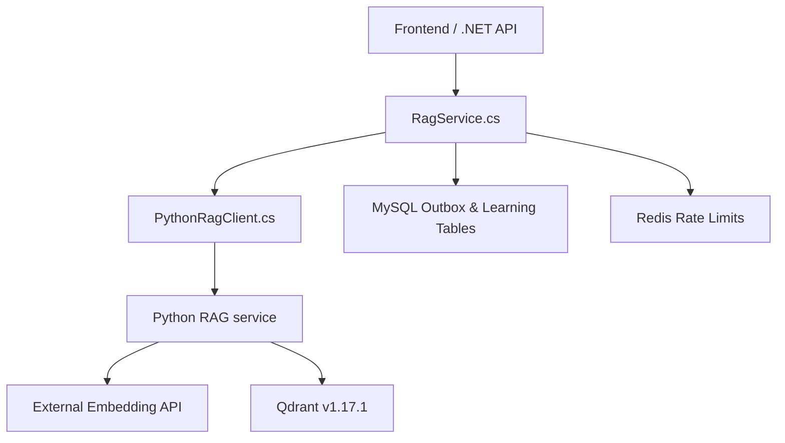
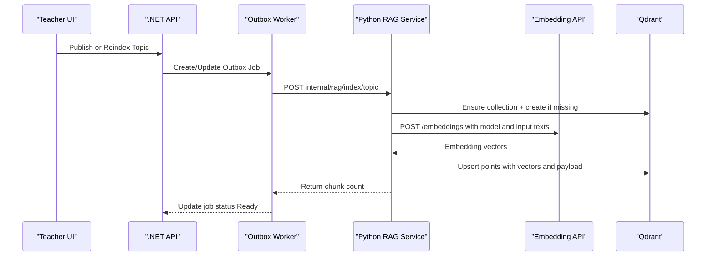
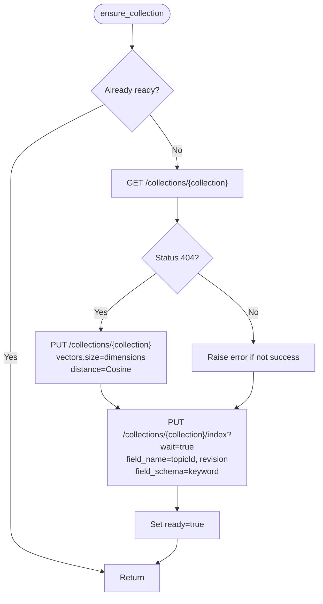
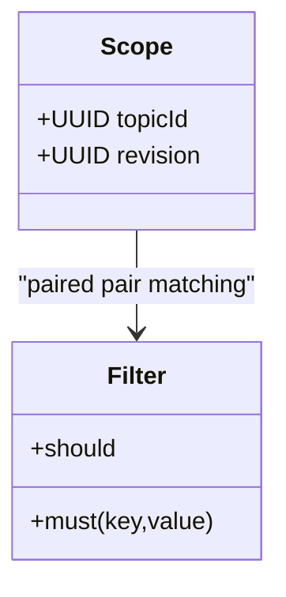
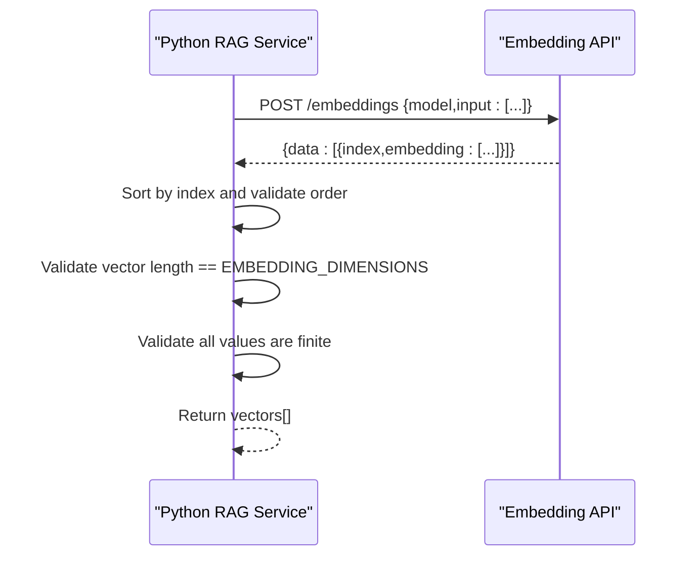
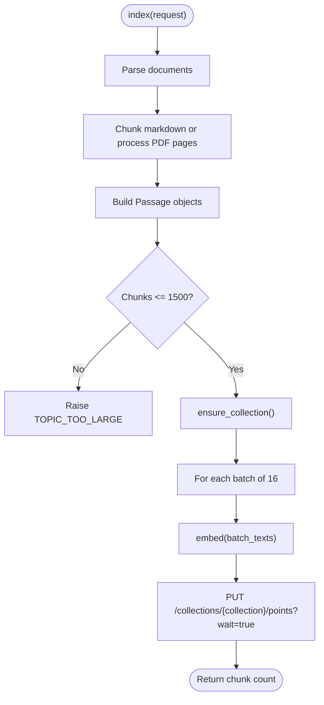
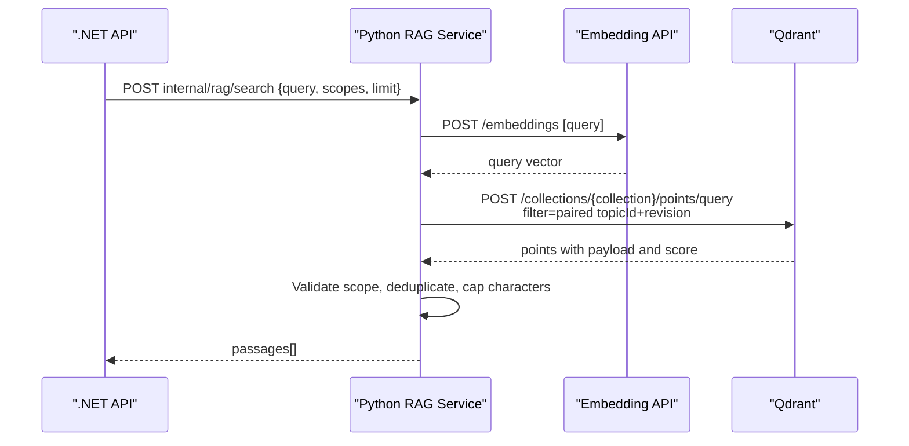
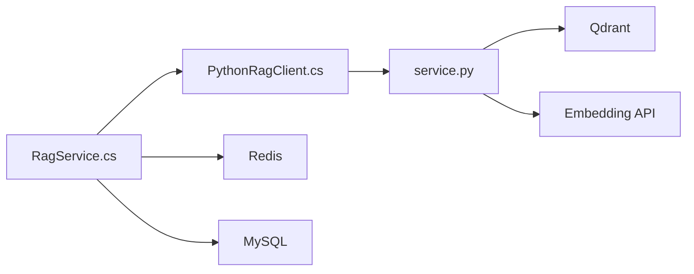

# Vector Storage & Indexing

<cite>
**Referenced Files in This Document**
- [service.py](file://ai-service/app/rag/service.py)
- [contracts.py](file://ai-service/app/rag/contracts.py)
- [RAG.md](file://api/docs/RAG.md)
- [docker-compose.yml](file://api/docker-compose.yml)
- [docker-compose.production.yml](file://api/docker-compose.production.yml)
- [RagService.cs](file://api/src/Infrastructure/CodePath.Infrastructure/Learning/RagService.cs)
- [PythonRagClient.cs](file://api/src/Infrastructure/CodePath.Infrastructure/Learning/PythonRagClient.cs)
- [rag-migration.sql](file://api/database/rag-migration.sql)
</cite>

## Table of Contents
1. [Introduction](#introduction)
2. [Project Structure](#project-structure)
3. [Core Components](#core-components)
4. [Architecture Overview](#architecture-overview)
5. [Detailed Component Analysis](#detailed-component-analysis)
6. [Dependency Analysis](#dependency-analysis)
7. [Performance Considerations](#performance-considerations)
8. [Troubleshooting Guide](#troubleshooting-guide)
9. [Conclusion](#conclusion)

## Introduction
This document explains the vector storage and indexing system built around Qdrant for CodePath’s learning material retrieval. It covers how collections are created automatically, how vectors and payloads are structured, how embeddings are generated through an external embedding service, and how points are inserted and searched with scope-based filtering. It also documents configuration parameters, batch processing behavior, validation rules, index optimization strategies, and operational considerations for large-scale indexing and memory management.

The implementation is split between:
- A Python RAG service that talks directly to Qdrant and an external embedding API.
- A .NET application layer that orchestrates jobs, enforces permissions, and calls the Python indexer/search endpoints.

## Project Structure
The relevant parts of the repository are organized into two main layers:

- Python AI service (`ai-service`):
  - `app/rag/service.py`: Qdrant collection lifecycle, embedding calls, chunk indexing, deletion, and search.
  - `app/rag/contracts.py`: Pydantic models for requests, passages, scopes, and teaching drafts.

- .NET API (`api`):
  - `src/Infrastructure/CodePath.Infrastructure/Learning/RagService.cs`: Business logic, permission checks, rate limiting, job status, and orchestration.
  - `src/Infrastructure/CodePath.Infrastructure/Learning/PythonRagClient.cs`: HTTP client to the Python indexer/search endpoints.
  - `database/rag-migration.sql`: MySQL schema for outbox jobs and teaching drafts.
  - `docs/RAG.md`: Operational documentation, environment variables, Compose setup, and usage guidance.
  - `docker-compose.yml` and `docker-compose.production.yml`: Service definitions for Redis, AI, indexer, and Qdrant.

**Diagram sources**
- [RagService.cs:14-146](file://api/src/Infrastructure/CodePath.Infrastructure/Learning/RagService.cs#L14-L146)
- [PythonRagClient.cs:7-50](file://api/src/Infrastructure/CodePath.Infrastructure/Learning/PythonRagClient.cs#L7-L50)
- [service.py:13-143](file://ai-service/app/rag/service.py#L13-L143)
- [docker-compose.yml:60-106](file://api/docker-compose.yml#L60-L106)
- [docker-compose.production.yml:144-210](file://api/docker-compose.production.yml#L144-L210)

**Section sources**
- [service.py:1-144](file://ai-service/app/rag/service.py#L1-L144)
- [contracts.py:1-68](file://ai-service/app/rag/contracts.py#L1-L68)
- [RAG.md:1-186](file://api/docs/RAG.md#L1-L186)
- [docker-compose.yml:1-112](file://api/docker-compose.yml#L1-L112)
- [docker-compose.production.yml:1-241](file://api/docker-compose.production.yml#L1-L241)
- [RagService.cs:1-146](file://api/src/Infrastructure/CodePath.Infrastructure/Learning/RagService.cs#L1-L146)
- [PythonRagClient.cs:1-51](file://api/src/Infrastructure/CodePath.Infrastructure/Learning/PythonRagClient.cs#L1-L51)
- [rag-migration.sql:1-55](file://api/database/rag-migration.sql#L1-L55)

## Core Components
- **RagService (Python)**: Manages Qdrant collection creation, field indexing, embedding generation, point insertion, deletion, and semantic search.
- **Contracts**: Defines request/response shapes such as `IndexRequest`, `SearchRequest`, `Document`, `Scope`, and `Passage`.
- **.NET RagService**: Validates user access, manages outbox jobs, enforces rate limits, and coordinates with the Python indexer.
- **PythonRagClient**: Calls internal Python endpoints for indexing, search, answer generation, and draft operations.
- **Compose Configuration**: Runs Qdrant, Redis, AI service, and indexer with appropriate environment variables and resource limits.

Key responsibilities:
- Automatic collection creation with cosine distance and keyword indexes on `topicId` and `revision`.
- Embedding generation via a configured external API with dimension validation.
- Batched point upserts with payload containing topic metadata.
- Scope-aware search using paired `topicId` and `revision` filters.

**Section sources**
- [service.py:13-143](file://ai-service/app/rag/service.py#L13-L143)
- [contracts.py:7-34](file://ai-service/app/rag/contracts.py#L7-L34)
- [RagService.cs:14-146](file://api/src/Infrastructure/CodePath.Infrastructure/Learning/RagService.cs#L14-L146)
- [PythonRagClient.cs:7-50](file://api/src/Infrastructure/CodePath.Infrastructure/Learning/PythonRagClient.cs#L7-L50)

## Architecture Overview
The end-to-end flow starts when a teacher publishes or reindexes learning materials. The .NET layer creates or updates an outbox job, then invokes the Python indexer. The Python service:
1. Ensures the Qdrant collection exists.
2. Generates embeddings for chunks by calling the external embedding API.
3. Inserts points with vectors and payloads into Qdrant.
4. Exposes search endpoints that embed queries and retrieve scoped results.

**Diagram sources**
- [RagService.cs:45-55](file://api/src/Infrastructure/CodePath.Infrastructure/Learning/RagService.cs#L45-L55)
- [PythonRagClient.cs:10-23](file://api/src/Infrastructure/CodePath.Infrastructure/Learning/PythonRagClient.cs#L10-L23)
- [service.py:85-109](file://ai-service/app/rag/service.py#L85-L109)
- [service.py:32-47](file://ai-service/app/rag/service.py#L32-L47)
- [service.py:49-62](file://ai-service/app/rag/service.py#L49-L62)

## Detailed Component Analysis

### Collection Management and Schema
The Python service ensures a Qdrant collection exists before any write or search operation. If the collection does not exist, it creates one with:
- Vector size from `EMBEDDING_DIMENSIONS`.
- Distance metric set to `Cosine`.
- Keyword indexes on `topicId` and `revision` for efficient filtering.

Collection identity includes the embedding endpoint URL, model name, dimensions, and chunker version, so different configurations produce separate collections.

**Diagram sources**
- [service.py:32-47](file://ai-service/app/rag/service.py#L32-L47)

**Section sources**
- [service.py:13-25](file://ai-service/app/rag/service.py#L13-L25)
- [service.py:32-47](file://ai-service/app/rag/service.py#L32-L47)

### Field Indexing for `topicId` and `revision`
Field indexes are applied after collection creation or reuse. Both fields use the `keyword` schema, enabling exact-match filtering. The filter used during search pairs `topicId` and `revision` together, ensuring correct scoping across topics and revisions.

**Diagram sources**
- [contracts.py:7-10](file://ai-service/app/rag/contracts.py#L7-L10)
- [service.py:111-116](file://ai-service/app/rag/service.py#L111-L116)

**Section sources**
- [service.py:45-46](file://ai-service/app/rag/service.py#L45-L46)
- [service.py:111-116](file://ai-service/app/rag/service.py#L111-L116)

### Embedding Generation Process
Embeddings are produced by an external service exposed at `EMBEDDING_BASE_URL/embeddings`. Required configuration includes:
- `EMBEDDING_BASE_URL`: Base URL ending with `/v1` or compatible path.
- `EMBEDDING_MODEL`: Model identifier supported by the embedding service.
- `EMBEDDING_DIMENSIONS`: Expected vector dimension; must match the actual model output.
- `EMBEDDING_API_KEY`: Optional bearer token for the embedding service.

Validation steps:
- Response data rows are sorted by `index` and checked against expected indices.
- Each embedding vector length is validated against `EMBEDDING_DIMENSIONS`.
- All values in each vector must be finite numbers.

**Diagram sources**
- [service.py:49-62](file://ai-service/app/rag/service.py#L49-L62)

**Section sources**
- [service.py:17-25](file://ai-service/app/rag/service.py#L17-L25)
- [service.py:49-62](file://ai-service/app/rag/service.py#L49-L62)
- [RAG.md:14-24](file://api/docs/RAG.md#L14-L24)

### Point Insertion Workflow and Payload Structure
The indexing workflow processes documents into chunks, generates embeddings per batch, and inserts points into Qdrant. Key behaviors:
- Markdown content is chunked by headings and paragraphs.
- PDFs are downloaded from allowlisted hosts, validated as PDFs, and processed page-by-page.
- Chunks are limited per topic to prevent oversized collections.
- Points are inserted in batches of 16.
- Each point contains:
  - `id`: deterministic chunk ID.
  - `vector`: embedding vector.
  - `payload`: passage metadata including `topicId`, `revision`, `documentId`, `blockId`, `classId`, `version`, `title`, `page`, `heading`, and `content`.

**Diagram sources**
- [service.py:85-109](file://ai-service/app/rag/service.py#L85-L109)

**Section sources**
- [service.py:64-109](file://ai-service/app/rag/service.py#L64-L109)
- [contracts.py:12-28](file://ai-service/app/rag/contracts.py#L12-L28)

### Search and Deletion Workflows
Search embeds the query and retrieves points filtered by paired `topicId` and `revision` scopes. Results are post-validated to ensure they belong to allowed scopes, deduplicated by normalized content fingerprint, and capped by character budget and limit. Deletion uses the same scope filter to remove points belonging to a specific topic-revision pair.

**Diagram sources**
- [PythonRagClient.cs:29-35](file://api/src/Infrastructure/CodePath.Infrastructure/Learning/PythonRagClient.cs#L29-L35)
- [service.py:123-143](file://ai-service/app/rag/service.py#L123-L143)

**Section sources**
- [service.py:111-143](file://ai-service/app/rag/service.py#L111-L143)
- [PythonRagClient.cs:29-35](file://api/src/Infrastructure/CodePath.Infrastructure/Learning/PythonRagClient.cs#L29-L35)

### Configuration Parameters
Important environment variables include:
- `QDRANT_URL`: Qdrant service URL.
- `QDRANT_API_KEY`: Qdrant API key.
- `EMBEDDING_BASE_URL`: External embedding service base URL.
- `EMBEDDING_MODEL`: Embedding model identifier.
- `EMBEDDING_DIMENSIONS`: Expected vector dimension.
- `EMBEDDING_API_KEY`: Bearer token for embedding service.
- `RAG_MIN_SCORE`: Minimum similarity threshold for search results.
- `RAG_ASSET_HOSTS`: Allowlisted hosts for PDF downloads.

These are defined in Compose files and documented in the RAG guide.

**Section sources**
- [service.py:16-25](file://ai-service/app/rag/service.py#L16-L25)
- [docker-compose.yml:6-14](file://api/docker-compose.yml#L6-L14)
- [docker-compose.production.yml:4-12](file://api/docker-compose.production.yml#L4-L12)
- [RAG.md:43-67](file://api/docs/RAG.md#L43-L67)

### Examples of Collection Setup and Embedding API Usage
- Collection setup:
  - GET `/collections/{collection}` to check existence.
  - PUT `/collections/{collection}` with vector size and cosine distance if missing.
  - PUT `/collections/{collection}/index?wait=true` for `topicId` and `revision` keyword indexes.

- Embedding API call:
  - POST `<EMBEDDING_BASE_URL>/embeddings` with `{model, input:[texts]}`.
  - Response shape: `{data:[{index, embedding:[...]}]}`.

These patterns are implemented in the Python service and described in the RAG documentation.

**Section sources**
- [service.py:32-47](file://ai-service/app/rag/service.py#L32-L47)
- [service.py:49-62](file://ai-service/app/rag/service.py#L49-L62)
- [RAG.md:14-24](file://api/docs/RAG.md#L14-L24)

### Index Optimization Strategies
- Use keyword indexes on `topicId` and `revision` for fast scoped filtering.
- Keep batch size small (16 points per upsert) to balance throughput and latency.
- Apply a minimum score threshold to reduce irrelevant results.
- Deduplicate and cap result content size to avoid excessive payload handling.
- Separate indexing workload into a dedicated indexer process to isolate PDF parsing and embedding calls from interactive services.

**Section sources**
- [service.py:45-46](file://ai-service/app/rag/service.py#L45-L46)
- [service.py:103-108](file://ai-service/app/rag/service.py#L103-L108)
- [service.py:126-143](file://ai-service/app/rag/service.py#L126-L143)
- [docker-compose.yml:81-92](file://api/docker-compose.yml#L81-L92)

## Dependency Analysis
The system has clear boundaries:
- `.NET` owns business logic, authorization, and job orchestration.
- `Python RAG service` owns vector storage, embedding integration, and search.
- `Qdrant` stores vectors and supports payload filtering.
- `Redis` provides rate limiting and caching support.
- `MySQL` persists outbox jobs and learning-related entities.

**Diagram sources**
- [RagService.cs:14-146](file://api/src/Infrastructure/CodePath.Infrastructure/Learning/RagService.cs#L14-L146)
- [PythonRagClient.cs:7-50](file://api/src/Infrastructure/CodePath.Infrastructure/Learning/PythonRagClient.cs#L7-L50)
- [service.py:13-143](file://ai-service/app/rag/service.py#L13-L143)

**Section sources**
- [RagService.cs:14-146](file://api/src/Infrastructure/CodePath.Infrastructure/Learning/RagService.cs#L14-L146)
- [PythonRagClient.cs:7-50](file://api/src/Infrastructure/CodePath.Infrastructure/Learning/PythonRagClient.cs#L7-L50)
- [service.py:13-143](file://ai-service/app/rag/service.py#L13-L143)

## Performance Considerations
- **Embedding service latency**: Embedding calls have a timeout and should be offloaded to the indexer process. The production indexer runs with limited concurrency to protect resources.
- **Memory limits**: Python services run with CPU and memory caps in Compose to prevent unbounded growth.
- **Batching**: Upserts are performed in batches of 16 to reduce network overhead and improve throughput.
- **Result capping**: Search returns more candidates internally but applies deduplication and character limits to control response size.
- **Collection isolation**: Collections are named deterministically based on embedding configuration, preventing accidental cross-contamination and simplifying cleanup when models change.
- **Rate limiting**: Redis-based rate limiting protects downstream services from abuse.

Operational notes:
- Do not expose Qdrant ports in production; only the web server is published externally.
- Use separate indexer and AI service containers to isolate heavy workloads.
- When changing embedding models or endpoints, reindex topics because collection identity changes.

**Section sources**
- [docker-compose.yml:60-92](file://api/docker-compose.yml#L60-L92)
- [docker-compose.production.yml:144-193](file://api/docker-compose.production.yml#L144-L193)
- [service.py:103-108](file://ai-service/app/rag/service.py#L103-L108)
- [service.py:126-143](file://ai-service/app/rag/service.py#L126-L143)
- [RAG.md:96-108](file://api/docs/RAG.md#L96-L108)

## Troubleshooting Guide
Common issues and their indicators:
- **Embedding not configured**: Raised when embedding URL or model is missing.
- **Invalid embedding response**: Raised when returned indices do not match expected order.
- **Invalid embedding dimensions**: Raised when vector lengths differ from configured dimensions or contain non-finite values.
- **Asset host not allowed**: Raised when PDF URLs are outside the allowlist or use unsupported schemes/ports.
- **PDF too large or invalid**: Raised when downloaded content exceeds size limits or is not a valid PDF.
- **Topic too large**: Raised when chunk count exceeds the per-topic limit.
- **Retrieval scope mismatch**: Raised when returned passages do not match allowed scopes.

Resolution steps:
- Verify `EMBEDDING_BASE_URL`, `EMBEDDING_MODEL`, and `EMBEDDING_DIMENSIONS` match the embedding provider.
- Confirm `QDRANT_URL` and `QDRANT_API_KEY` are correct and reachable.
- Ensure PDF assets come from allowlisted hosts and are under size limits.
- Reindex topics after changing embedding configuration.
- Check outbox job status and errors in MySQL for failed indexing attempts.

**Section sources**
- [service.py:49-83](file://ai-service/app/rag/service.py#L49-L83)
- [service.py:99-109](file://ai-service/app/rag/service.py#L99-L109)
- [service.py:131-134](file://ai-service/app/rag/service.py#L131-L134)
- [rag-migration.sql:1-26](file://api/database/rag-migration.sql#L1-L26)

## Conclusion
The vector storage and indexing system combines a Python RAG service with Qdrant and an external embedding API to provide semantic search over learning materials. Collections are created automatically with cosine distance and keyword indexes on `topicId` and `revision`. Embeddings are validated for order, dimension, and finiteness before points are inserted in batches. Searches are scoped and post-validated to enforce security and relevance. Operational design separates indexing workloads, enforces rate limits, and isolates resources through Docker Compose profiles and container limits. For large-scale indexing, focus on correct embedding configuration, controlled batching, scoped filtering, and careful cleanup of old collections when embedding models change.