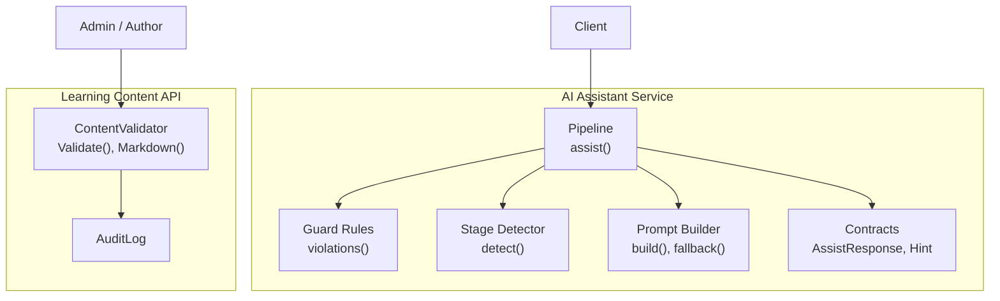
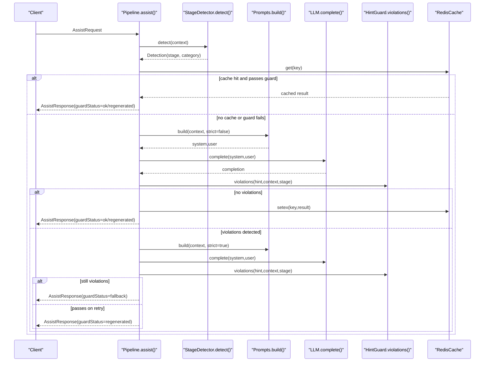
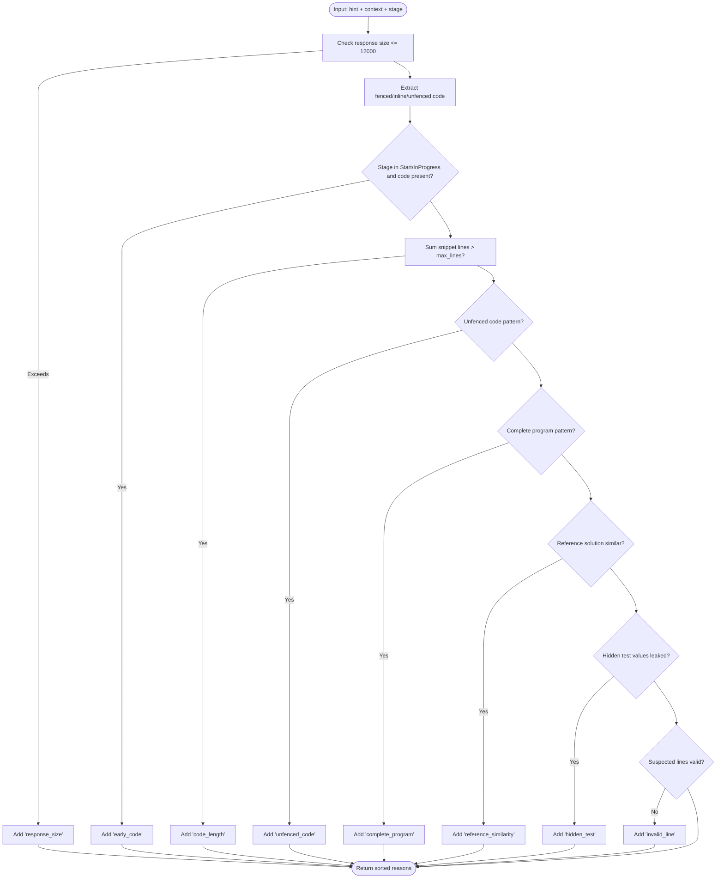
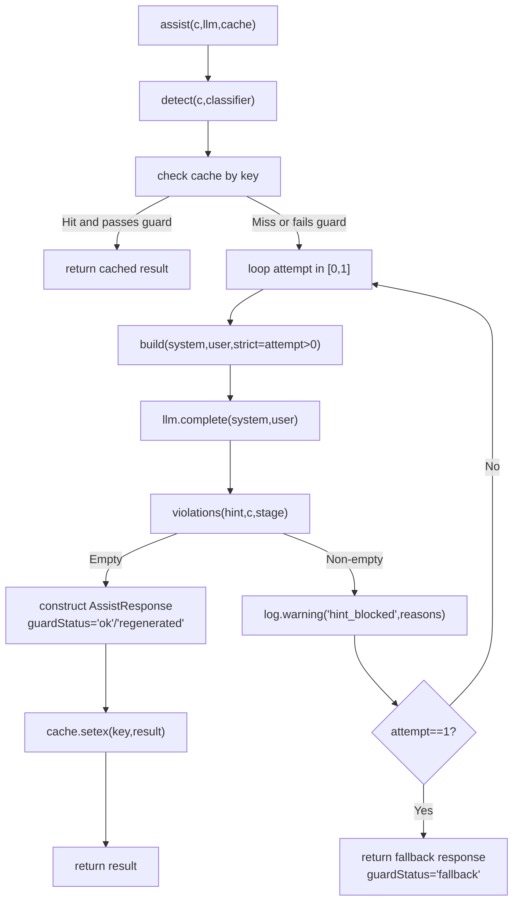
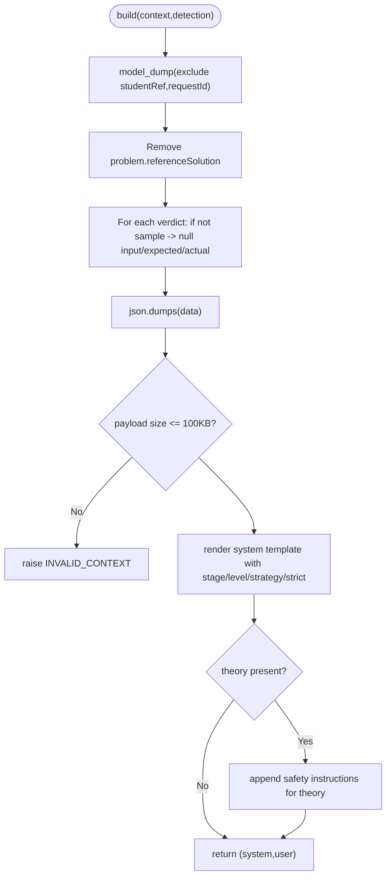
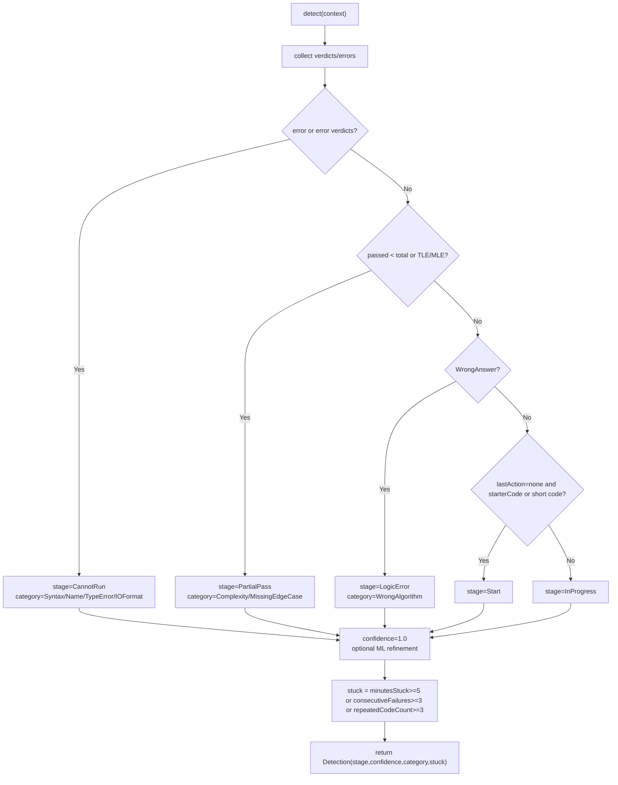
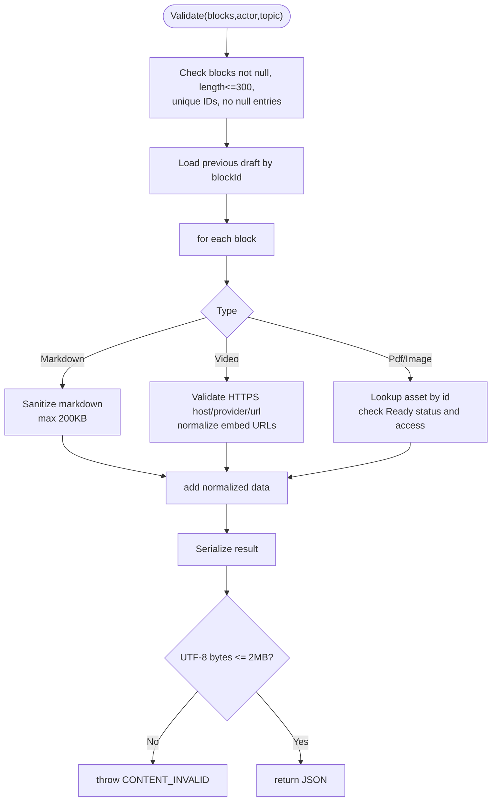
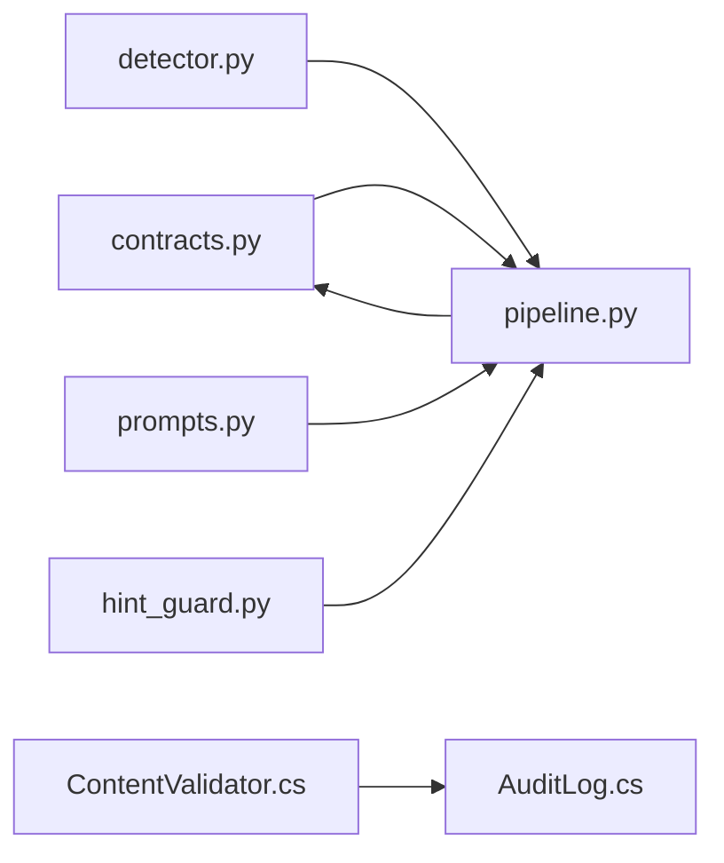

# Safety Guard Rails & Quality Control

<cite>
**Referenced Files in This Document**
- [hint_guard.py](file://ai-service/app/guard/hint_guard.py)
- [pipeline.py](file://ai-service/app/api/pipeline.py)
- [contracts.py](file://ai-service/app/contracts.py)
- [prompts.py](file://ai-service/app/hints/prompts.py)
- [detector.py](file://ai-service/app/stage/detector.py)
- [ContentValidator.cs](file://api/src/Infrastructure/CodePath.Infrastructure/Learning/ContentValidator.cs)
- [LearningRulesTests.cs](file://api/tests/CodePath.Unit.Tests/Learning/LearningRulesTests.cs)
- [CurriculumTests.cs](file://api/tests/CodePath.Unit.Tests/Learning/CurriculumTests.cs)
- [test_guard.py](file://ai-service/tests/test_guard.py)
- [run.py](file://ai-service/eval/run.py)
- [AuditLog.cs](file://api/src/Domain/CodePath.Domain/Auditing/Entities/AuditLog.cs)
</cite>

## Table of Contents
1. [Introduction](#introduction)
2. [Project Structure](#project-structure)
3. [Core Components](#core-components)
4. [Architecture Overview](#architecture-overview)
5. [Detailed Component Analysis](#detailed-component-analysis)
6. [Dependency Analysis](#dependency-analysis)
7. [Performance Considerations](#performance-considerations)
8. [Troubleshooting Guide](#troubleshooting-guide)
9. [Conclusion](#conclusion)

## Introduction
This document explains the safety guard rails and quality control mechanisms across two services:
- AI Assistant service (Python): generates hints with strict content filters, leakage prevention, and fallback behavior.
- Learning Content API (.NET): validates and sanitizes learning content blocks to ensure educational appropriateness and security.

The system enforces:
- Inappropriate response detection for AI-generated hints.
- Educational appropriateness validation for content blocks.
- Fallback mechanisms when validation fails.
- Logging and monitoring of guard rail triggers.
- Audit trails for safety violations.
- Reporting capabilities for evaluation and continuous improvement.

## Project Structure
Safety-related code is split between:
- ai-service: hint generation pipeline, guard rules, prompt construction, stage detection, and evaluation reporting.
- api: learning content validation, HTML sanitization, asset access control, and audit logging.

**Diagram sources**
- [pipeline.py:10-41](file://ai-service/app/api/pipeline.py#L10-L41)
- [hint_guard.py:22-47](file://ai-service/app/guard/hint_guard.py#L22-L47)
- [detector.py:11-38](file://ai-service/app/stage/detector.py#L11-L38)
- [prompts.py:13-40](file://ai-service/app/hints/prompts.py#L13-L40)
- [contracts.py:82-101](file://ai-service/app/contracts.py#L82-L101)
- [ContentValidator.cs:12-85](file://api/src/Infrastructure/CodePath.Infrastructure/Learning/ContentValidator.cs#L12-L85)
- [AuditLog.cs:7-47](file://api/src/Domain/CodePath.Domain/Auditing/Entities/AuditLog.cs#L7-L47)

**Section sources**
- [pipeline.py:1-41](file://ai-service/app/api/pipeline.py#L1-41)
- [ContentValidator.cs:1-90](file://api/src/Infrastructure/CodePath.Infrastructure/Learning/ContentValidator.cs#L1-L90)

## Core Components
- AI hint guard rules: detect early code exposure, excessive code length, unfenced code, complete programs, reference solution similarity, hidden test data leaks, invalid line numbers, and oversized responses.
- Pipeline orchestration: caches guarded results, retries with stricter prompts, logs blocked attempts, and returns a safe fallback when necessary.
- Prompt builder: strips sensitive fields from prompts and redacts non-sample verdicts before sending to the model.
- Stage detector: classifies student state into stages/categories to tailor guidance.
- Learning content validator: sanitizes markdown, validates video URLs and assets, enforces size limits, and ensures educational appropriateness.
- Contracts: define request/response schemas including guard status and token usage metrics.
- Evaluation runner: aggregates guard intervention rates and automated leakage detection for reporting.
- Audit log entity: provides a foundation for compliance and violation tracking.

**Section sources**
- [hint_guard.py:6-47](file://ai-service/app/guard/hint_guard.py#L6-L47)
- [pipeline.py:10-41](file://ai-service/app/api/pipeline.py#L10-L41)
- [prompts.py:13-40](file://ai-service/app/hints/prompts.py#L13-L40)
- [detector.py:11-38](file://ai-service/app/stage/detector.py#L11-L38)
- [ContentValidator.cs:14-85](file://api/src/Infrastructure/CodePath.Infrastructure/Learning/ContentValidator.cs#L14-L85)
- [contracts.py:82-101](file://ai-service/app/contracts.py#L82-L101)
- [run.py:34-49](file://ai-service/eval/run.py#L34-L49)
- [AuditLog.cs:7-47](file://api/src/Domain/CodePath.Domain/Auditing/Entities/AuditLog.cs#L7-L47)

## Architecture Overview
The AI assistant flow applies multiple layers of safety:
- Stage detection informs strategy selection.
- Prompt builder removes sensitive context.
- LLM completion is generated.
- Guard rules evaluate the output.
- If violations are found, the pipeline retries once with stricter prompting; otherwise it caches and returns the result.
- On repeated failures, a rule-based fallback message is returned.

**Diagram sources**
- [pipeline.py:10-41](file://ai-service/app/api/pipeline.py#L10-L41)
- [detector.py:11-38](file://ai-service/app/stage/detector.py#L11-L38)
- [prompts.py:13-29](file://ai-service/app/hints/prompts.py#L13-L29)
- [contracts.py:82-101](file://ai-service/app/contracts.py#L82-L101)

## Detailed Component Analysis

### AI Hint Guard Rules
The guard evaluates both fenced and inline code snippets, unfenced code-like patterns, and contextual signals such as reference solutions and hidden test cases. It also checks structural similarity using AST normalization to prevent leaking canonical solutions even when identifiers are renamed.

Key validations:
- Response size limit.
- Early-stage code exposure.
- Code length thresholds.
- Unfenced code presence.
- Complete program patterns.
- Reference solution similarity.
- Hidden test data leakage.
- Invalid suspected lines.

**Diagram sources**
- [hint_guard.py:6-47](file://ai-service/app/guard/hint_guard.py#L6-L47)

**Section sources**
- [hint_guard.py:6-47](file://ai-service/app/guard/hint_guard.py#L6-L47)
- [test_guard.py:9-31](file://ai-service/tests/test_guard.py#L9-L31)

### Pipeline Orchestration and Fallback
The pipeline:
- Detects the current stage.
- Attempts to serve a cached guarded result.
- Calls the LLM with a constructed prompt.
- Applies guard rules.
- Retries once with stricter prompting if needed.
- Logs blocked attempts.
- Returns a safe fallback when all attempts fail.

**Diagram sources**
- [pipeline.py:10-41](file://ai-service/app/api/pipeline.py#L10-L41)
- [prompts.py:13-40](file://ai-service/app/hints/prompts.py#L13-L40)
- [contracts.py:82-101](file://ai-service/app/contracts.py#L82-L101)

**Section sources**
- [pipeline.py:10-41](file://ai-service/app/api/pipeline.py#L10-L41)
- [prompts.py:13-40](file://ai-service/app/hints/prompts.py#L13-L40)
- [contracts.py:82-101](file://ai-service/app/contracts.py#L82-L101)

### Prompt Construction and Sensitive Data Handling
The prompt builder:
- Excludes sensitive identifiers from the payload.
- Removes the reference solution from prompts.
- Redacts non-sample verdict inputs/expected/actual.
- Enforces a maximum payload size.
- Renders strategy templates based on stage and level.
- Adds instructions to ignore instructional text in retrieved theory passages.

**Diagram sources**
- [prompts.py:13-29](file://ai-service/app/hints/prompts.py#L13-L29)

**Section sources**
- [prompts.py:13-29](file://ai-service/app/hints/prompts.py#L13-L29)

### Stage Detection
The detector classifies the student’s state into stages and categories:
- CannotRun: compile/runtime/syntax errors.
- PartialPass: partial correctness or resource limits.
- LogicError: wrong algorithm.
- Start: initial state.
- InProgress: active development.

It also computes confidence and a stuck flag based on history.

**Diagram sources**
- [detector.py:11-38](file://ai-service/app/stage/detector.py#L11-L38)

**Section sources**
- [detector.py:11-38](file://ai-service/app/stage/detector.py#L11-L38)

### Learning Content Validation and Sanitization
The content validator ensures:
- Block count and ID uniqueness constraints.
- Type immutability for existing blocks.
- Markdown sanitization with allowed tags and attributes.
- Video URL validation (HTTPS, allowed hosts, provider/host matching).
- Asset readiness and access control.
- PDF page count validation.
- Output size limits.

**Diagram sources**
- [ContentValidator.cs:30-85](file://api/src/Infrastructure/CodePath.Infrastructure/Learning/ContentValidator.cs#L30-L85)

**Section sources**
- [ContentValidator.cs:14-85](file://api/src/Infrastructure/CodePath.Infrastructure/Learning/ContentValidator.cs#L14-L85)
- [LearningRulesTests.cs:92-103](file://api/tests/CodePath.Unit.Tests/Learning/LearningRulesTests.cs#L92-L103)
- [CurriculumTests.cs:49-63](file://api/tests/CodePath.Unit.Tests/Learning/CurriculumTests.cs#L49-L63)

### Contracts and Guard Status
The contracts define:
- Hint structure and metadata.
- AssistResponse including guardStatus values: ok, regenerated, fallback.
- ErrorResponse codes including GUARD_FALLBACK.

These enable clients to interpret safety interventions and adjust UI accordingly.

**Section sources**
- [contracts.py:82-101](file://ai-service/app/contracts.py#L82-L101)

### Evaluation and Reporting
The evaluation runner:
- Computes guard intervention rate.
- Tracks automated leakage detection.
- Records latency percentiles.
- Aggregates manual review completion.

This supports continuous improvement and compliance reporting.

**Section sources**
- [run.py:34-49](file://ai-service/eval/run.py#L34-L49)

### Audit Trails and Compliance
The domain includes an AuditLog entity that records actor, action, target user, timestamp, IP address, and structured data. While guard-specific events are primarily logged via Python logging, the .NET audit model provides a foundation for storing safety violations and admin actions.

**Section sources**
- [AuditLog.cs:7-47](file://api/src/Domain/CodePath.Domain/Auditing/Entities/AuditLog.cs#L7-L47)

## Dependency Analysis

**Diagram sources**
- [contracts.py:82-101](file://ai-service/app/contracts.py#L82-L101)
- [pipeline.py:1-41](file://ai-service/app/api/pipeline.py#L1-41)
- [detector.py:1-38](file://ai-service/app/stage/detector.py#L1-38)
- [prompts.py:1-41](file://ai-service/app/hints/prompts.py#L1-41)
- [hint_guard.py:1-48](file://ai-service/app/guard/hint_guard.py#L1-L48)
- [ContentValidator.cs:1-90](file://api/src/Infrastructure/CodePath.Infrastructure/Learning/ContentValidator.cs#L1-L90)
- [AuditLog.cs:1-47](file://api/src/Domain/CodePath.Domain/Auditing/Entities/AuditLog.cs#L1-L47)

**Section sources**
- [pipeline.py:1-41](file://ai-service/app/api/pipeline.py#L1-41)
- [ContentValidator.cs:1-90](file://api/src/Infrastructure/CodePath.Infrastructure/Learning/ContentValidator.cs#L1-L90)

## Performance Considerations
- Guard rules operate on normalized representations and bounded sizes to avoid heavy computation.
- Prompt payloads are capped at 100KB to prevent large context processing.
- Content validation enforces strict size limits (markdown 200KB, serialized output 2MB).
- Pipeline caching reduces redundant LLM calls when guarded results are stable.
- Stage detection uses simple heuristics to minimize overhead.

[No sources needed since this section provides general guidance]

## Troubleshooting Guide
Common issues and resolutions:
- Guard blocks hint due to early code exposure: reduce code snippets in early stages or rephrase guidance.
- Reference solution similarity flagged: ensure hints do not mirror canonical solutions; use abstract explanations.
- Hidden test data leak: verify that non-sample verdicts are not included in outputs.
- Video host not allowed: configure allowed hosts or use supported providers.
- Asset not ready or access denied: ensure assets are published and accessible to the requesting actor.
- Fallback triggered repeatedly: inspect guard reasons and adjust prompts or thresholds.

Logging and monitoring:
- The pipeline logs blocked hints with reasons and attempt counts.
- Evaluation reports provide guard intervention rates and automated leakage metrics.
- Audit entities can be extended to persist guard violations for compliance.

**Section sources**
- [pipeline.py:37-40](file://ai-service/app/api/pipeline.py#L37-L40)
- [run.py:43-49](file://ai-service/eval/run.py#L43-L49)
- [ContentValidator.cs:30-85](file://api/src/Infrastructure/CodePath.Infrastructure/Learning/ContentValidator.cs#L30-L85)

## Conclusion
The system implements robust safety guard rails and quality controls:
- AI hints are filtered against multiple risk categories, with caching, retries, and safe fallbacks.
- Learning content is sanitized and validated for educational appropriateness and security.
- Evaluation and audit facilities support compliance, transparency, and continuous improvement.
- Teams can extend guard rules, tune thresholds, and integrate additional validators to meet evolving requirements.

[No sources needed since this section summarizes without analyzing specific files]