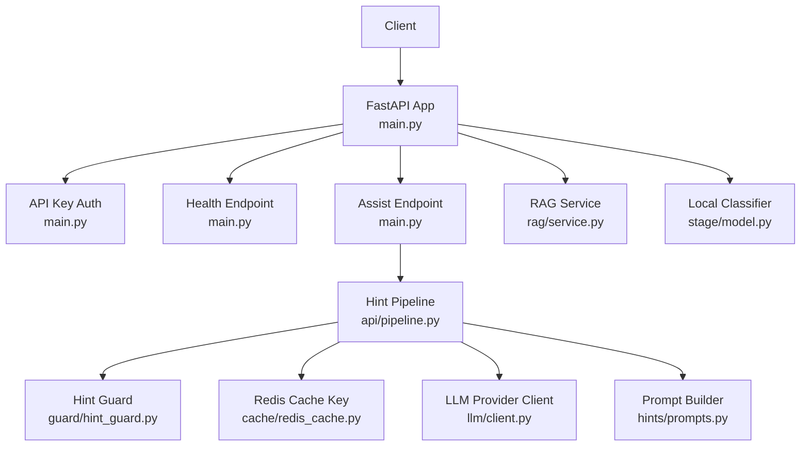
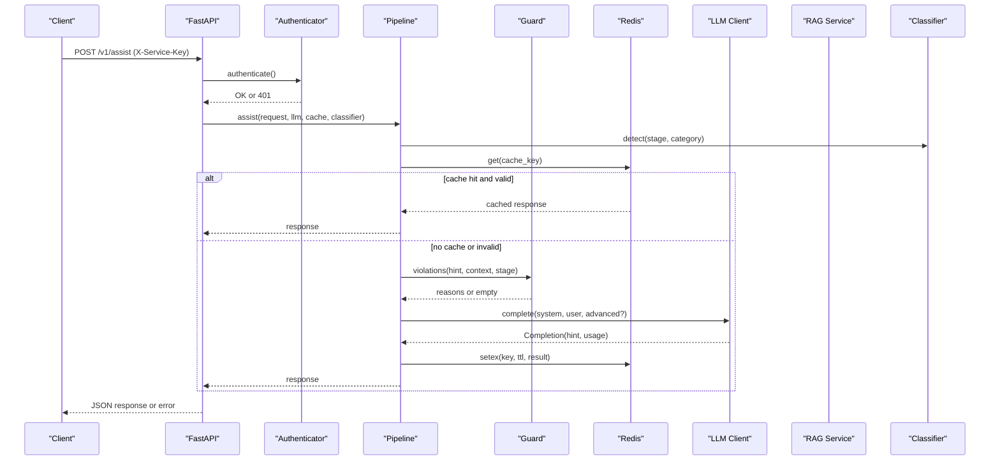
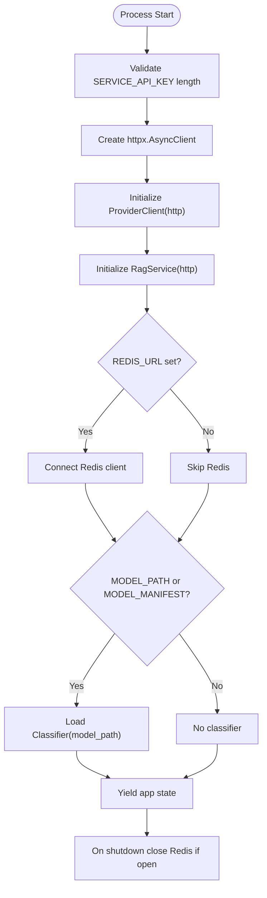
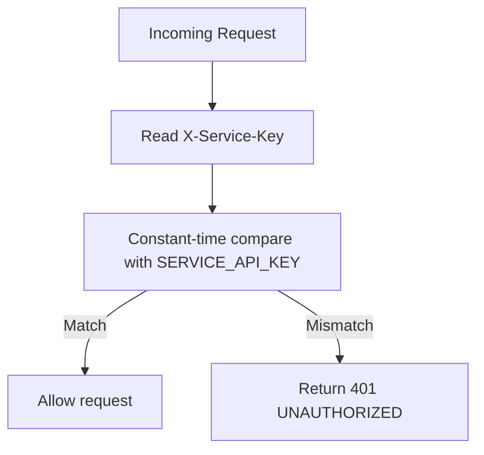
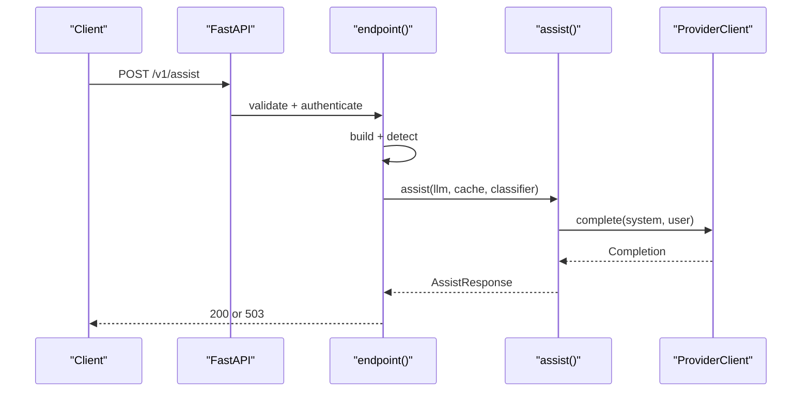
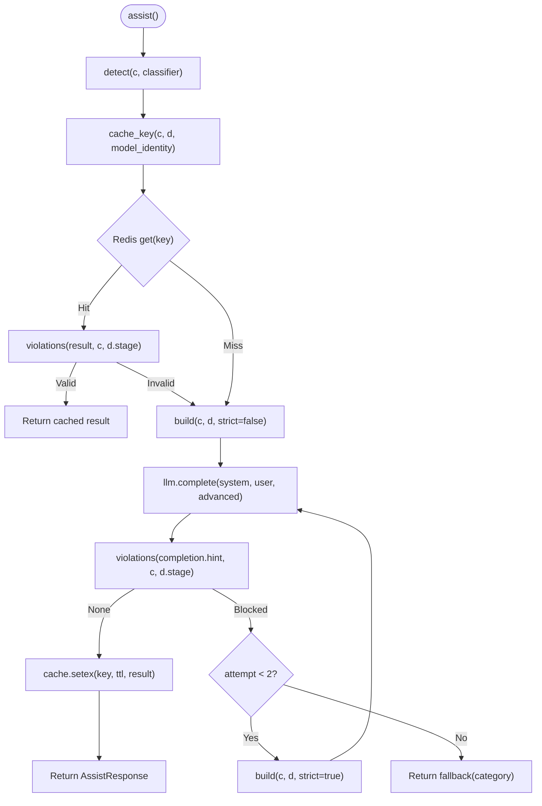
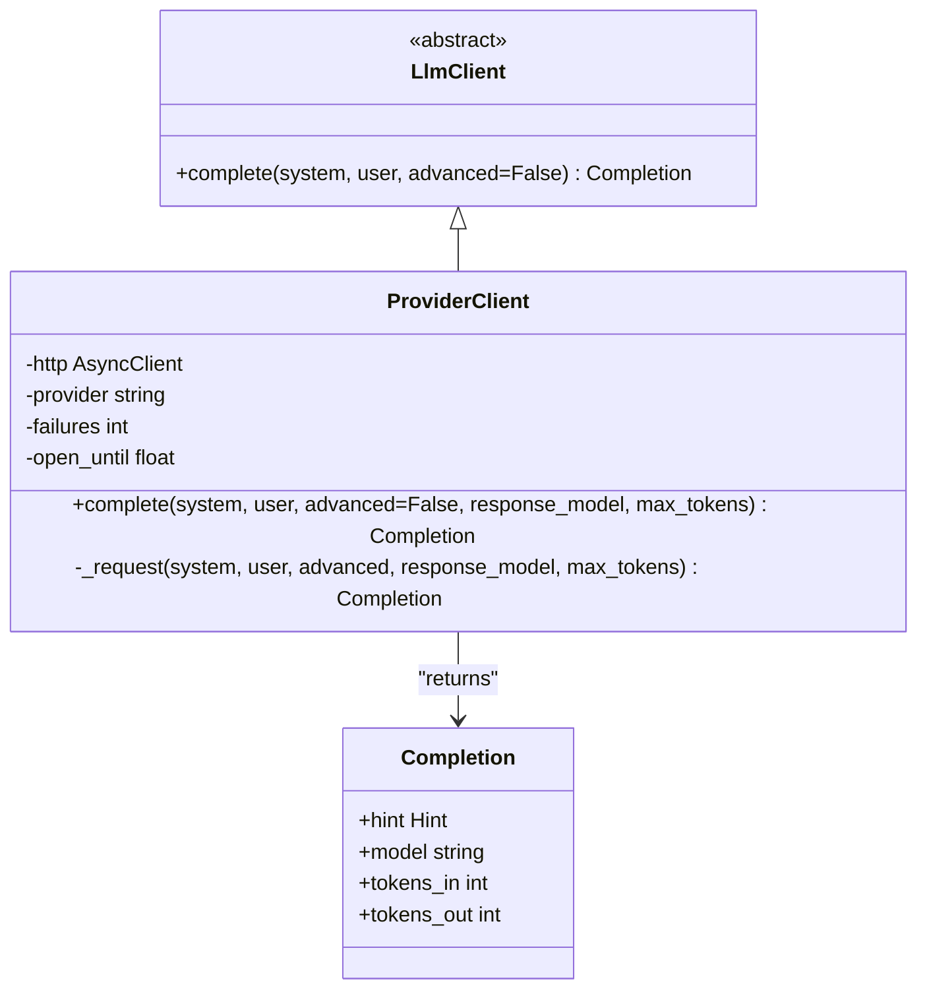
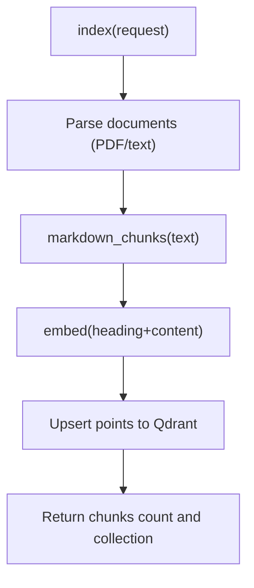
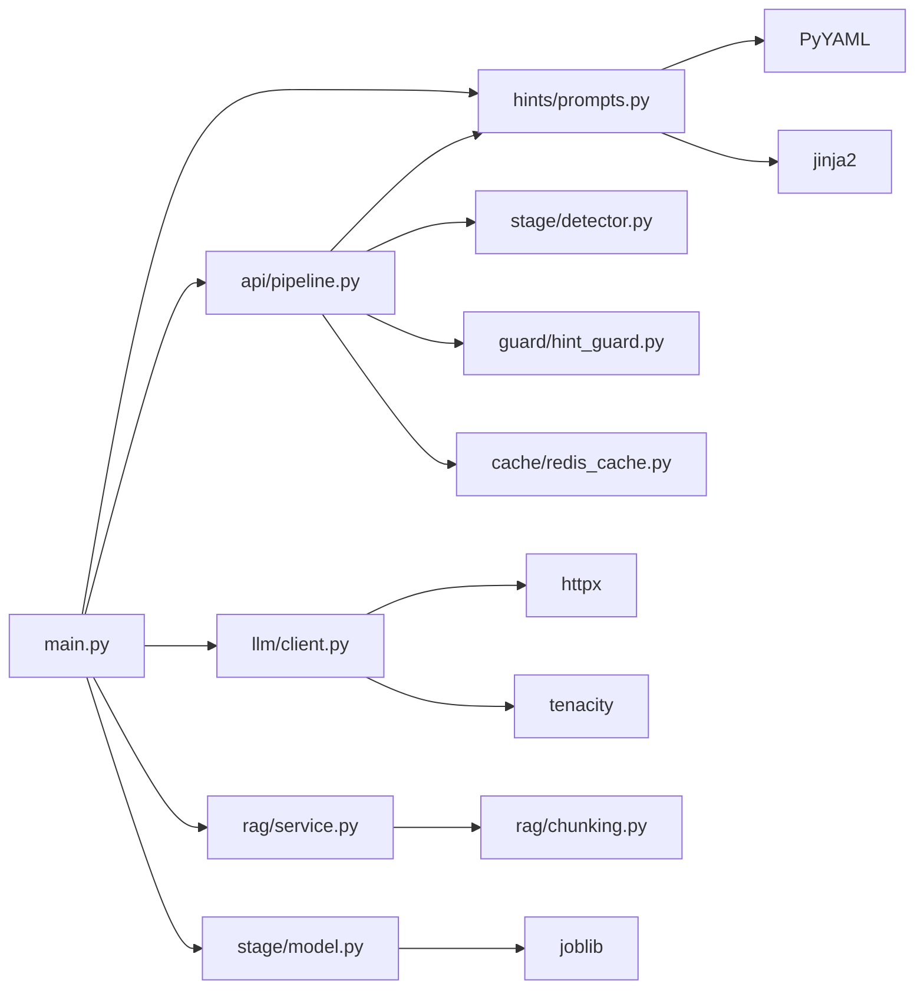

# Service Architecture & Lifecycle

<cite>
**Referenced Files in This Document**
- [main.py](file://ai-service/app/main.py)
- [pipeline.py](file://ai-service/app/api/pipeline.py)
- [client.py](file://ai-service/app/llm/client.py)
- [redis_cache.py](file://ai-service/app/cache/redis_cache.py)
- [service.py](file://ai-service/app/rag/service.py)
- [model.py](file://ai-service/app/stage/model.py)
- [prompts.py](file://ai-service/app/hints/prompts.py)
- [hint_guard.py](file://ai-service/app/guard/hint_guard.py)
- [contracts.py](file://ai-service/app/contracts.py)
- [pyproject.toml](file://ai-service/pyproject.toml)
</cite>

## Table of Contents
1. [Introduction](#introduction)
2. [Project Structure](#project-structure)
3. [Core Components](#core-components)
4. [Architecture Overview](#architecture-overview)
5. [Detailed Component Analysis](#detailed-component-analysis)
6. [Dependency Analysis](#dependency-analysis)
7. [Performance Considerations](#performance-considerations)
8. [Troubleshooting Guide](#troubleshooting-guide)
9. [Conclusion](#conclusion)

## Introduction
This document explains the AI service architecture and lifecycle management for the FastAPI-based assistant endpoint. It covers application startup, lifespan resource initialization, dependency injection patterns, API key authentication, health checks, error handling, configuration via environment variables, Redis caching, LLM client abstraction, RAG indexing and retrieval, model classification, prompt construction, hint guarding, and operational concerns such as security, rate limiting, monitoring, and performance optimization.

## Project Structure
The AI service is a Python FastAPI application under `ai-service/app`. Key modules:
- Application entry point and HTTP layer: `app/main.py`
- Hint generation pipeline: `app/api/pipeline.py`
- LLM provider client abstraction: `app/llm/client.py`
- Redis cache helpers: `app/cache/redis_cache.py`
- RAG indexing and search: `app/rag/service.py`
- Local classifier model loader: `app/stage/model.py`
- Prompt building and strategy config: `app/hints/prompts.py`
- Hint guard validation: `app/guard/hint_guard.py`
- Shared request/response contracts: `app/contracts.py`
- Dependencies and tooling: `pyproject.toml`

**Diagram sources**
- [main.py:17-84](file://ai-service/app/main.py#L17-L84)
- [pipeline.py:10-40](file://ai-service/app/api/pipeline.py#L10-L40)
- [client.py:22-82](file://ai-service/app/llm/client.py#L22-L82)
- [redis_cache.py:5-10](file://ai-service/app/cache/redis_cache.py#L5-L10)
- [service.py:13-143](file://ai-service/app/rag/service.py#L13-L143)
- [model.py:6-30](file://ai-service/app/stage/model.py#L6-L30)
- [prompts.py:13-29](file://ai-service/app/hints/prompts.py#L13-L29)
- [hint_guard.py:22-47](file://ai-service/app/guard/hint_guard.py#L22-L47)

**Section sources**
- [main.py:17-84](file://ai-service/app/main.py#L17-L84)
- [pyproject.toml:1-19](file://ai-service/pyproject.toml#L1-L19)

## Core Components
- FastAPI application with lifespan context manager for resource initialization and cleanup.
- API key authentication using `X-Service-Key` header with constant-time comparison.
- Health check endpoint `/health`.
- Primary assist endpoint `/v1/assist` with request validation, timeout, and structured error responses.
- Hint pipeline that detects stage/category, builds prompts, calls LLM, validates hints, caches results, and applies fallback logic.
- LLM provider client supporting OpenAI-compatible, Gemini, and Anthropic backends with retry and circuit breaker behavior.
- Redis-backed caching for generated hints keyed by semantic inputs and model identity.
- RAG service for vector indexing and retrieval against Qdrant with embedding service integration.
- Local scikit-learn classifier for error category and stage confidence.
- Prompt builder loading YAML strategies and Jinja system template with versioning.
- Hint guard enforcing safety rules to prevent leaking solutions or test data.

**Section sources**
- [main.py:17-84](file://ai-service/app/main.py#L17-L84)
- [pipeline.py:10-40](file://ai-service/app/api/pipeline.py#L10-L40)
- [client.py:22-82](file://ai-service/app/llm/client.py#L22-L82)
- [redis_cache.py:5-10](file://ai-service/app/cache/redis_cache.py#L5-L10)
- [service.py:13-143](file://ai-service/app/rag/service.py#L13-L143)
- [model.py:6-30](file://ai-service/app/stage/model.py#L6-L30)
- [prompts.py:13-29](file://ai-service/app/hints/prompts.py#L13-L29)
- [hint_guard.py:22-47](file://ai-service/app/guard/hint_guard.py#22-L47)
- [contracts.py:72-100](file://ai-service/app/contracts.py#L72-L100)

## Architecture Overview
The service exposes a guarded hint-generation API backed by an LLM provider, optional local classifier, and RAG retrieval. Requests are authenticated via API key, validated against Pydantic models, processed through a pipeline that constructs prompts and enforces guard constraints, and optionally cached in Redis. The lifespan manager initializes shared resources like HTTP client, LLM client, RAG service, Redis connection, and optional classifier.

**Diagram sources**
- [main.py:56-81](file://ai-service/app/main.py#L56-L81)
- [pipeline.py:10-40](file://ai-service/app/api/pipeline.py#L10-L40)
- [client.py:31-82](file://ai-service/app/llm/client.py#L31-L82)
- [redis_cache.py:5-10](file://ai-service/app/cache/redis_cache.py#L5-L10)
- [service.py:13-143](file://ai-service/app/rag/service.py#L13-L143)
- [model.py:6-30](file://ai-service/app/stage/model.py#L6-L30)
- [hint_guard.py:22-47](file://ai-service/app/guard/hint_guard.py#L22-L47)

## Detailed Component Analysis

### FastAPI Application and Lifespan
- Lifespan validates required environment variables, creates an `httpx.AsyncClient`, initializes `ProviderClient`, `RagService`, optional Redis client, and optional local `Classifier`.
- Resources are stored on `app.state` for dependency-free access across handlers.
- On shutdown, Redis connection is closed if present.
- Documentation endpoints are enabled only in development environments.

**Diagram sources**
- [main.py:17-34](file://ai-service/app/main.py#L17-L34)

**Section sources**
- [main.py:17-44](file://ai-service/app/main.py#L17-L44)

### Authentication and Security
- API key authentication uses header `X-Service-Key`.
- Constant-time comparison prevents timing attacks.
- Missing or mismatched key returns 401 with structured error code.
- Documentation URLs disabled in production to reduce attack surface.

**Diagram sources**
- [main.py:45-59](file://ai-service/app/main.py#L45-L59)

**Section sources**
- [main.py:45-59](file://ai-service/app/main.py#L45-L59)

### Health Check Endpoint
- Simple GET `/health` returning status object.

**Section sources**
- [main.py:61-62](file://ai-service/app/main.py#L61-L62)

### Assist Endpoint and Error Handling
- Validates request body using Pydantic model `AssistRequest`.
- Builds prompts and runs detection before calling pipeline.
- Enforces per-request timeout to protect upstream LLM latency.
- Sets response header `X-AI-Code=GUARD_FALLBACK` when guard fallback occurs.
- Global exception handler maps unhandled exceptions to 503 with code `AI_UNAVAILABLE`.
- Validation errors mapped to 422 with code `INVALID_CONTEXT`.

**Diagram sources**
- [main.py:64-81](file://ai-service/app/main.py#L64-L81)
- [pipeline.py:10-40](file://ai-service/app/api/pipeline.py#L10-L40)
- [client.py:31-82](file://ai-service/app/llm/client.py#L31-L82)

**Section sources**
- [main.py:48-81](file://ai-service/app/main.py#L48-L81)

### Hint Generation Pipeline
- Detects stage and category using local classifier if available.
- Generates cache key from semantic inputs and model identity.
- Attempts to read cached hint; validates with guard before reuse.
- Calls LLM up to two attempts; rebuilds prompt with stricter mode on second attempt.
- Applies guard violations; regenerates if needed.
- Writes successful hint to Redis with TTL.
- Returns fallback message when guard repeatedly blocks output.

**Diagram sources**
- [pipeline.py:10-40](file://ai-service/app/api/pipeline.py#L10-L40)
- [redis_cache.py:5-10](file://ai-service/app/cache/redis_cache.py#L5-L10)
- [hint_guard.py:22-47](file://ai-service/app/guard/hint_guard.py#L22-L47)

**Section sources**
- [pipeline.py:10-40](file://ai-service/app/api/pipeline.py#L10-L40)

### LLM Provider Client
- Supports providers: OpenAI-compatible, Gemini, Anthropic.
- Uses environment variables for base URL, model names, and API keys.
- Implements retry policy for transient transport/provider errors.
- Circuit breaker opens after repeated failures to avoid cascading load.
- Parses provider-specific response formats and extracts token usage.

**Diagram sources**
- [client.py:9-82](file://ai-service/app/llm/client.py#L9-L82)

**Section sources**
- [client.py:22-82](file://ai-service/app/llm/client.py#L22-L82)

### Redis Caching
- Cache key includes prompt version, model identity, detected stage/category, request level, and normalized source code.
- Excludes sensitive fields like `requestId` and `studentRef`.
- Stores serialized `AssistResponse` with TTL.

**Section sources**
- [redis_cache.py:5-10](file://ai-service/app/cache/redis_cache.py#L5-L10)
- [pipeline.py:12-35](file://ai-service/app/api/pipeline.py#L12-L35)

### RAG Service
- Manages Qdrant collection lifecycle and indexing.
- Embeddings fetched from configured embedding service.
- PDF assets downloaded from allowed hosts with size limits.
- Search filters by topic and revision scopes and deduplicates content.

**Diagram sources**
- [service.py:85-109](file://ai-service/app/rag/service.py#L85-L109)

**Section sources**
- [service.py:13-143](file://ai-service/app/rag/service.py#L13-L143)

### Local Classifier
- Loads trusted joblib model artifacts with SHA-256 verification.
- Predicts error category and stage probabilities.
- Used to guide prompt construction and hint generation.

**Section sources**
- [model.py:6-30](file://ai-service/app/stage/model.py#L6-L30)
- [main.py:27-32](file://ai-service/app/main.py#L27-L32)

### Prompt Builder
- Loads YAML strategies and Jinja system template.
- Computes prompt version based on config and template hash.
- Sanitizes payload by removing reference solution and sample test data.
- Enforces maximum payload size.

**Section sources**
- [prompts.py:7-29](file://ai-service/app/hints/prompts.py#L7-L29)

### Hint Guard
- Normalizes and structures code snippets to detect similarity with reference solutions.
- Prevents early full-code answers, excessive code length, unfenced code, complete program templates, hidden test leakage, and invalid line numbers.
- Returns list of violation reasons used to regenerate or fallback.

**Section sources**
- [hint_guard.py:6-47](file://ai-service/app/guard/hint_guard.py#L6-L47)

### Data Contracts
- Pydantic models define request/response schemas with validation rules and constraints.
- `AssistRequest` encapsulates problem context, run state, history, and optional theory passages.
- `AssistResponse` extends `Hint` with metadata about stage, confidence, guard status, model and prompt versions, and token usage.

**Section sources**
- [contracts.py:72-100](file://ai-service/app/contracts.py#L72-L100)

## Dependency Analysis
- `main.py` depends on `api.pipeline`, `llm.client`, `rag.service`, `stage.model`, and `hints.prompts`.
- `pipeline.py` depends on `stage.detector`, `hints.prompts`, `guard.hint_guard`, and `cache.redis_cache`.
- `llm.client` depends on `httpx`, `tenacity`, and environment configuration.
- `rag.service` depends on `httpx`, `chunking`, and external services (Qdrant, embedding service).
- `stage.model` depends on `joblib` and local model artifacts.
- `hints.prompts` depends on `yaml`, `jinja2`, and static prompt files.
- `cache.redis_cache` depends on `hashlib`, `json`, and prompt version.

**Diagram sources**
- [main.py:14-32](file://ai-service/app/main.py#L14-L32)
- [pipeline.py:1-6](file://ai-service/app/api/pipeline.py#L1-L6)
- [client.py:5-7](file://ai-service/app/llm/client.py#L5-L7)
- [service.py:8-10](file://ai-service/app/rag/service.py#L8-L10)
- [model.py:4-16](file://ai-service/app/stage/model.py#L4-L16)
- [prompts.py:3-11](file://ai-service/app/hints/prompts.py#L3-L11)
- [redis_cache.py:1-3](file://ai-service/app/cache/redis_cache.py#L1-L3)

**Section sources**
- [main.py:14-32](file://ai-service/app/main.py#L14-L32)
- [pipeline.py:1-6](file://ai-service/app/api/pipeline.py#L1-L6)
- [client.py:5-7](file://ai-service/app/llm/client.py#L5-L7)
- [service.py:8-10](file://ai-service/app/rag/service.py#L8-L10)
- [model.py:4-16](file://ai-service/app/stage/model.py#L4-L16)
- [prompts.py:3-11](file://ai-service/app/hints/prompts.py#L3-L11)
- [redis_cache.py:1-3](file://ai-service/app/cache/redis_cache.py#L1-L3)

## Performance Considerations
- Connection pooling: `httpx.AsyncClient` created once at startup with explicit limits to control concurrency and connection reuse.
- Timeout enforcement: Per-request timeout protects against slow LLM providers; LLM requests have provider-specific timeouts.
- Retry and circuit breaker: Transient provider errors trigger retries; repeated failures open a short-lived circuit breaker window.
- Caching: Redis stores successful hints keyed by semantic inputs; TTL reduces redundant LLM calls.
- Prompt size limits: Payload size capped to avoid oversized contexts.
- RAG batching: Embedding and upsert operations batched to reduce network overhead.
- Model integrity: Local classifier verifies artifact hashes to ensure safe deployment.

[No sources needed since this section provides general guidance]

## Troubleshooting Guide
- 401 Unauthorized: Ensure `SERVICE_API_KEY` is set and matches `X-Service-Key` header.
- 422 Invalid Context: Request payload exceeds limits or contains forbidden fields; verify contract constraints.
- 503 AI Unavailable: Upstream LLM provider errors or circuit breaker active; check `LLM_PROVIDER`, `LLM_MODEL`, and `LLM_API_KEY`.
- Cache miss or stale hints: Verify Redis connectivity and key composition; ensure prompt version changes when strategies/templates change.
- RAG indexing failures: Confirm Qdrant availability, embedding service configuration, and asset host allowlist.
- Classifier errors: Validate model path and manifest; ensure SHA-256 matches metadata.

**Section sources**
- [main.py:48-59](file://ai-service/app/main.py#L48-L59)
- [client.py:31-41](file://ai-service/app/llm/client.py#L31-L41)
- [service.py:49-62](file://ai-service/app/rag/service.py#L49-L62)
- [model.py:7-16](file://ai-service/app/stage/model.py#L7-L16)

## Conclusion
The AI service implements a robust, secure, and extensible architecture for generating contextual hints. It combines FastAPI’s lifespan-based resource management, API key authentication, structured error handling, Redis caching, provider-agnostic LLM client, RAG retrieval, and local classification. Operational best practices include strict environment configuration, input validation, guardrails against solution leakage, and performance optimizations via connection pooling, timeouts, retries, and caching. Monitoring should track health, latency, error rates, cache hit ratios, and provider availability to maintain reliability and responsiveness.