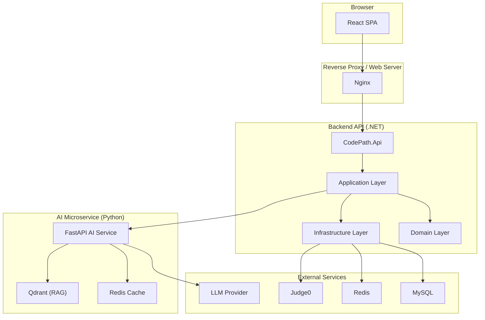
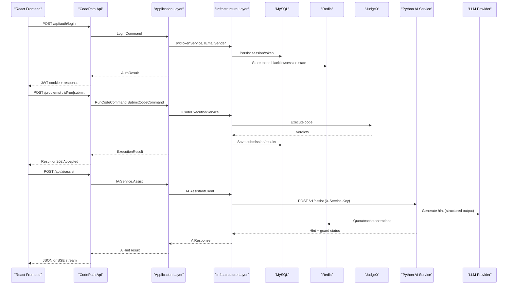
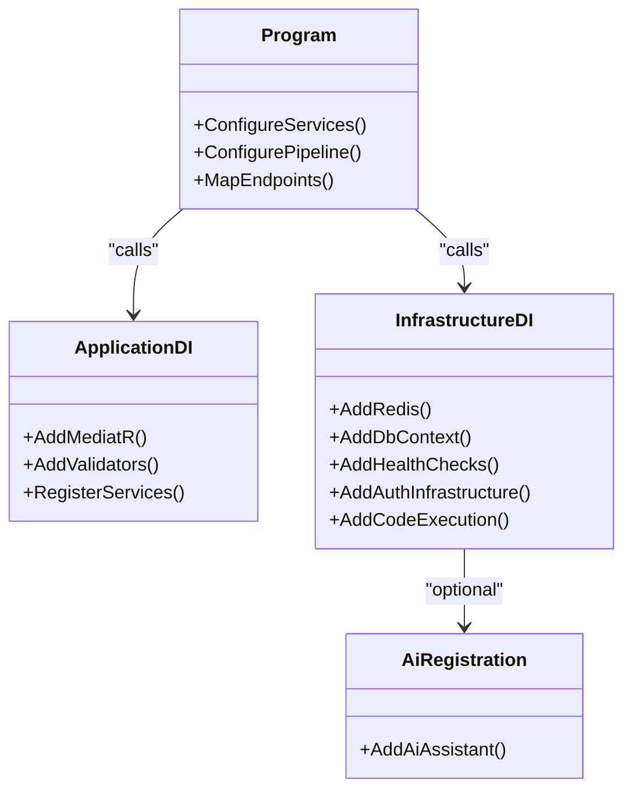
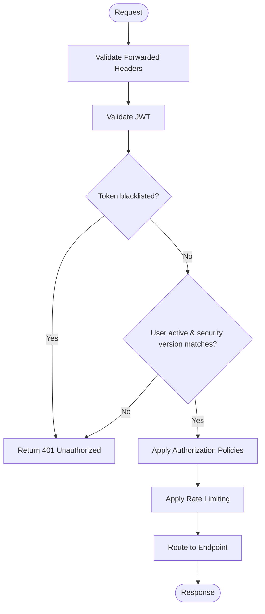
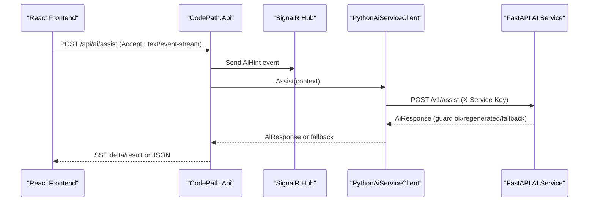
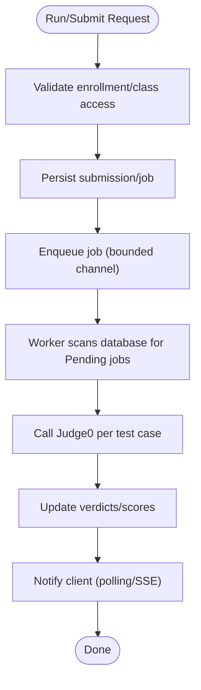
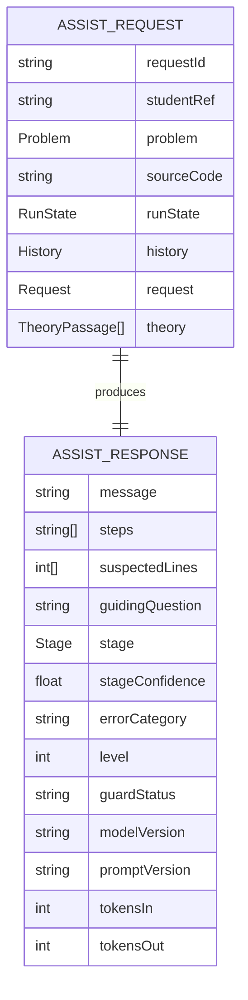
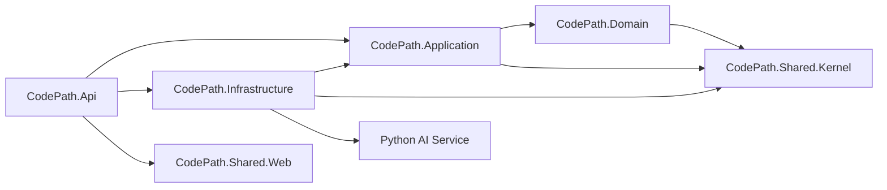

# Architecture Documentation

<cite>
**Referenced Files in This Document**
- [ARCHITECTURE.md](file://api/docs/ARCHITECTURE.md)
- [Program.cs](file://api/src/Api/CodePath.Api/Program.cs)
- [AiEndpoints.cs](file://api/src/Api/CodePath.Api/Endpoints/AiEndpoints.cs)
- [DependencyInjection.cs](file://api/src/Application/CodePath.Application/DependencyInjection.cs)
- [Infrastructure DependencyInjection.cs](file://api/src/Infrastructure/CodePath.Infrastructure/DependencyInjection.cs)
- [AiRegistration.cs](file://api/src/Infrastructure/CodePath.Infrastructure/Ai/AiRegistration.cs)
- [PythonAiServiceClient.cs](file://api/src/Infrastructure/CodePath.Infrastructure/Ai/PythonAiServiceClient.cs)
- [main.py](file://ai-service/app/main.py)
- [contracts.py](file://ai-service/app/contracts.py)
- [docker-compose.yml](file://api/docker-compose.yml)
- [docker-compose.production.yml](file://api/docker-compose.production.yml)
- [Dockerfile (AI)](file://ai-service/Dockerfile)
- [Dockerfile (Frontend)](file://frontend/Dockerfile)
</cite>

## Table of Contents
1. [Introduction](#introduction)
2. [Project Structure](#project-structure)
3. [Core Components](#core-components)
4. [Architecture Overview](#architecture-overview)
5. [Detailed Component Analysis](#detailed-component-analysis)
6. [Dependency Analysis](#dependency-analysis)
7. [Performance Considerations](#performance-considerations)
8. [Troubleshooting Guide](#troubleshooting-guide)
9. [Conclusion](#conclusion)

## Introduction
This document describes CodePart’s system architecture, focusing on the .NET backend Clean Architecture, the Python AI microservice, and their interactions with the React frontend, external code execution service Judge0, Redis, MySQL, and optional RAG components. It explains how user requests flow through authentication, business logic, AI integration, and code execution, while addressing infrastructure requirements, scalability, deployment topology, security, monitoring, and error handling.

## Project Structure
The repository is organized into three main application areas:
- Frontend: React + TypeScript application served by Nginx.
- Backend API: ASP.NET Core 8 application following Clean Architecture with Domain, Application, Infrastructure, and Api layers.
- AI Service: Python FastAPI microservice providing AI-assisted hints, guard validation, caching, and optional RAG indexing.

**Diagram sources**
- [Program.cs:28-376](file://api/src/Api/CodePath.Api/Program.cs#L28-L376)
- [main.py:36-84](file://ai-service/app/main.py#L36-L84)
- [docker-compose.production.yml:64-126](file://api/docker-compose.production.yml#L64-L126)
- [docker-compose.production.yml:144-210](file://api/docker-compose.production.yml#L144-L210)

**Section sources**
- [ARCHITECTURE.md:5-20](file://api/docs/ARCHITECTURE.md#L5-L20)

## Core Components
- Frontend (React): User interface for learning, exercises, teacher portal, admin tools, and AI assistant panel. Built with Vite and Tailwind CSS; served via Nginx.
- Backend API (.NET): REST endpoints, JWT authentication, authorization policies, rate limiting, health checks, MediatR command/query pipeline, EF Core persistence to MySQL, Redis-backed sessions and caches, and integrations with Judge0 and AI service.
- AI Service (Python FastAPI): Secure internal API for hint generation, stage detection, prompt building, guard validation, quota management, and optional RAG retrieval. Communicates with LLM providers and Redis cache.
- External Services:
  - Judge0: Executes student code safely outside the API process.
  - Redis: Sessions, tokens, rate limits, quotas, caching, and distributed locks.
  - MySQL: Persistent data for users, classes, exercises, submissions, and audit logs.
  - Qdrant: Optional vector store for RAG content indexing.

**Section sources**
- [ARCHITECTURE.md:5-20](file://api/docs/ARCHITECTURE.md#L5-L20)
- [ARCHITECTURE.md:44-66](file://api/docs/ARCHITECTURE.md#L44-L66)
- [ARCHITECTURE.md:67-79](file://api/docs/ARCHITECTURE.md#L67-L79)
- [main.py:36-84](file://ai-service/app/main.py#L36-L84)

## Architecture Overview
The system follows a layered Clean Architecture pattern within the .NET backend:
- Api: HTTP endpoints, middleware, configuration, and cross-cutting concerns.
- Application: Commands, queries, DTOs, and orchestration logic.
- Domain: Entities, enums, domain rules, and exceptions.
- Infrastructure: Persistence (EF Core + MySQL), Redis, email, JWT, Judge0 client, AI client, health checks, and background workers.

The AI service is a separate microservice that the backend calls over HTTP with an internal service key. The frontend communicates only with the backend API; it does not call the AI service directly.

**Diagram sources**
- [Program.cs:71-158](file://api/src/Api/CodePath.Api/Program.cs#L71-L158)
- [Program.cs:386-423](file://api/src/Api/CodePath.Api/Program.cs#L386-L423)
- [AiEndpoints.cs:12-43](file://api/src/Api/CodePath.Api/Endpoints/AiEndpoints.cs#L12-L43)
- [PythonAiServiceClient.cs:8-39](file://api/src/Infrastructure/CodePath.Infrastructure/Ai/PythonAiServiceClient.cs#L8-L39)
- [main.py:64-81](file://ai-service/app/main.py#L64-L81)

## Detailed Component Analysis

### Backend Clean Architecture Layers
- Api Layer:
  - Configures Kestrel, CORS, JWT, authorization policies, rate limiting, forwarded headers, health checks, and endpoint mapping.
  - Registers AI endpoints conditionally when AI is enabled.
- Application Layer:
  - Uses MediatR with logging and validation behaviors.
  - Defines commands, queries, DTOs, and services for auth, classes, exercises, teaching, admin, and AI orchestration.
- Domain Layer:
  - Contains entities, enums, domain exceptions, and business rules for users, classes, exercises, submissions, auditing, and learning.
- Infrastructure Layer:
  - Registers Redis, MySQL (EF Core), health checks, Judge0 client, AI client, auth infrastructure (JWT, OTP, email, login protection), and background services.

**Diagram sources**
- [Program.cs:28-376](file://api/src/Api/CodePath.Api/Program.cs#L28-L376)
- [DependencyInjection.cs:10-25](file://api/src/Application/CodePath.Application/DependencyInjection.cs#L10-L25)
- [Infrastructure DependencyInjection.cs:27-130](file://api/src/Infrastructure/CodePath.Infrastructure/DependencyInjection.cs#L27-L130)
- [AiRegistration.cs:9-24](file://api/src/Infrastructure/CodePath.Infrastructure/Ai/AiRegistration.cs#L9-L24)

**Section sources**
- [ARCHITECTURE.md:5-20](file://api/docs/ARCHITECTURE.md#L5-L20)
- [DependencyInjection.cs:10-25](file://api/src/Application/CodePath.Application/DependencyInjection.cs#L10-L25)
- [Infrastructure DependencyInjection.cs:27-130](file://api/src/Infrastructure/CodePath.Infrastructure/DependencyInjection.cs#L27-L130)

### Authentication and Authorization Flow
- JWT Bearer authentication validates issuer, audience, signing key, lifetime, and signature.
- Token validation checks revocation via Redis blacklist and verifies active user status plus security version.
- Authorization policies enforce roles and active user requirements.
- Rate limiting protects auth endpoints and code execution endpoints.
- Forwarded headers are restricted to configured proxies/networks.

**Diagram sources**
- [Program.cs:71-158](file://api/src/Api/CodePath.Api/Program.cs#L71-L158)
- [Program.cs:220-243](file://api/src/Api/CodePath.Api/Program.cs#L220-L243)
- [Program.cs:251-359](file://api/src/Api/CodePath.Api/Program.cs#L251-L359)

**Section sources**
- [Program.cs:71-158](file://api/src/Api/CodePath.Api/Program.cs#L71-L158)
- [Program.cs:220-243](file://api/src/Api/CodePath.Api/Program.cs#L220-L243)
- [Program.cs:251-359](file://api/src/Api/CodePath.Api/Program.cs#L251-L359)

### AI Assistant Integration
- Backend exposes `/api/ai/assist` requiring ActiveStudent authorization.
- Supports both JSON and SSE streaming responses after guard passes.
- SignalR hub `/api/ai/hub` pushes `AiHint` events to authenticated users.
- AI client uses HttpClient with base address, service key header, timeout, circuit breaker, and retry for transient errors.
- Python service authenticates via `X-Service-Key`, enforces request contract, applies guard heuristics, and returns structured hints with metadata.

**Diagram sources**
- [AiEndpoints.cs:12-43](file://api/src/Api/CodePath.Api/Endpoints/AiEndpoints.cs#L12-L43)
- [AiRegistration.cs:9-24](file://api/src/Infrastructure/CodePath.Infrastructure/Ai/AiRegistration.cs#L9-L24)
- [PythonAiServiceClient.cs:8-39](file://api/src/Infrastructure/CodePath.Infrastructure/Ai/PythonAiServiceClient.cs#L8-L39)
- [main.py:64-81](file://ai-service/app/main.py#L64-L81)

**Section sources**
- [AiEndpoints.cs:12-43](file://api/src/Api/CodePath.Api/Endpoints/AiEndpoints.cs#L12-L43)
- [AiRegistration.cs:9-24](file://api/src/Infrastructure/CodePath.Infrastructure/Ai/AiRegistration.cs#L9-L24)
- [PythonAiServiceClient.cs:8-39](file://api/src/Infrastructure/CodePath.Infrastructure/Ai/PythonAiServiceClient.cs#L8-L39)
- [main.py:64-81](file://ai-service/app/main.py#L64-L81)

### Code Execution with Judge0
- Code execution is delegated to Judge0; the API never executes student code directly.
- Run/Submit flows persist submissions and results, handle pending/running states, and apply retries for temporary failures.
- Rate limiting and bounded channels protect against abuse and overload.

**Diagram sources**
- [ARCHITECTURE.md:55-66](file://api/docs/ARCHITECTURE.md#L55-L66)
- [ARCHITECTURE.md:67-79](file://api/docs/ARCHITECTURE.md#L67-L79)

**Section sources**
- [ARCHITECTURE.md:55-66](file://api/docs/ARCHITECTURE.md#L55-L66)
- [ARCHITECTURE.md:67-79](file://api/docs/ARCHITECTURE.md#L67-L79)

### Data Models and Contracts
- AI service contracts define problem context, run state, history, request type, and response structure including stage, level, guard status, and model/prompt versions.
- Backend validates AI responses for message length, stage values, level bounds, steps count, suspected lines, confidence range, and consistency with input request level.

**Diagram sources**
- [contracts.py:72-97](file://ai-service/app/contracts.py#L72-L97)
- [PythonAiServiceClient.cs:17-23](file://api/src/Infrastructure/CodePath.Infrastructure/Ai/PythonAiServiceClient.cs#L17-L23)

**Section sources**
- [contracts.py:72-97](file://ai-service/app/contracts.py#L72-L97)
- [PythonAiServiceClient.cs:17-23](file://api/src/Infrastructure/CodePath.Infrastructure/Ai/PythonAiServiceClient.cs#L17-L23)

## Dependency Analysis
- Api depends on Application, Infrastructure, and Shared.Web.
- Infrastructure depends on Application abstractions and shared kernel types.
- Application depends on Domain and Shared.Kernel.
- Domain depends only on Shared.Kernel.
- AI service is independent and called by Infrastructure via HttpClient with Polly resilience.

**Diagram sources**
- [ARCHITECTURE.md:9-20](file://api/docs/ARCHITECTURE.md#L9-L20)
- [AiRegistration.cs:9-24](file://api/src/Infrastructure/CodePath.Infrastructure/Ai/AiRegistration.cs#L9-L24)

**Section sources**
- [ARCHITECTURE.md:9-20](file://api/docs/ARCHITECTURE.md#L9-L20)

## Performance Considerations
- Connection pooling and timeouts:
  - MySQL connection pool options validated at startup; EF Core configured with retry-on-failure.
  - HttpClient for Judge0 and AI service set explicit timeouts and max response sizes.
- Rate limiting:
  - Multiple policies for auth, password reset, public reads, code execution, judge run/submit, and learning heartbeat/write.
- Caching and quotas:
  - Redis used for sessions, token blacklist, login attempts, password reset rate limiter, and AI quotas/caches.
- Resilience:
  - Circuit breaker and retry for AI service HTTP calls; fallback rule-based hints when AI unavailable.
- Streaming:
  - SSE streaming for AI hints after guard passes; SignalR hub for real-time updates.

[No sources needed since this section provides general guidance]

## Troubleshooting Guide
- Health checks:
  - `/health` reports readiness of MySQL and Redis.
  - `/health/live` is a liveness probe.
  - `/health/redis` performs a round-trip check and returns detailed latency/status.
- Common errors:
  - Authentication failures return 401 with standardized ProblemDetails.
  - Authorization failures return 403 with standardized ProblemDetails.
  - Rate limit exceeded returns 429 with Retry-After header where applicable.
  - AI service unavailability returns 503 from Python; backend converts to fallback hint and sets appropriate code.
  - Invalid AI context returns 422 from Python; backend maps to 400 for invalid input.
- Configuration validation:
  - JWT signing key must be present and sufficiently long.
  - AI service keys require minimum length.
  - SMTP and auth frontend base URL validations ensure production readiness.

**Section sources**
- [Program.cs:424-500](file://api/src/Api/CodePath.Api/Program.cs#L424-L500)
- [Program.cs:63-67](file://api/src/Api/CodePath.Api/Program.cs#L63-L67)
- [AiRegistration.cs:11-13](file://api/src/Infrastructure/CodePath.Infrastructure/Ai/AiRegistration.cs#L11-L13)
- [Infrastructure DependencyInjection.cs:138-186](file://api/src/Infrastructure/CodePath.Infrastructure/DependencyInjection.cs#L138-L186)
- [main.py:48-54](file://ai-service/app/main.py#L48-L54)

## Conclusion
CodePart implements a robust, scalable system using Clean Architecture in .NET, a dedicated Python AI microservice, and external services for code execution and storage. Security is enforced through JWT, role-based policies, rate limiting, and secure proxy configuration. Observability and resilience are provided via health checks, correlation IDs, circuit breakers, and retries. Deployment supports development and production Compose stacks with optional AI/RAG profiles, ensuring clear separation of concerns and operational safety.