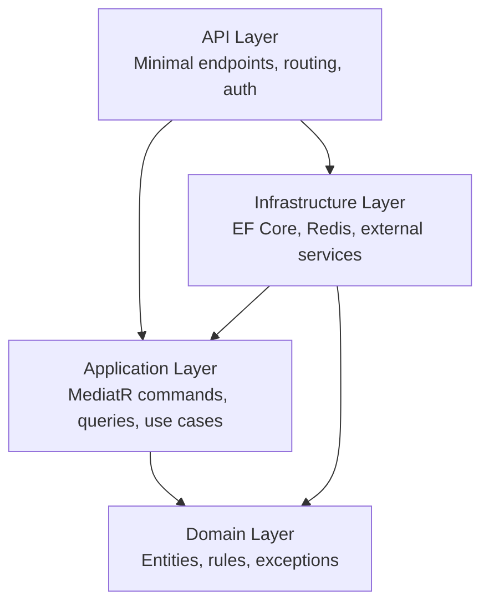
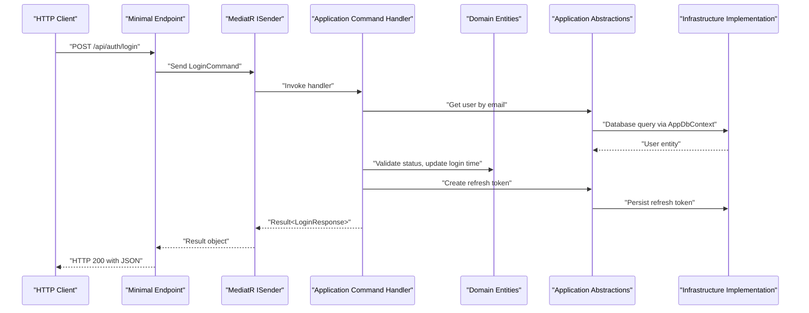
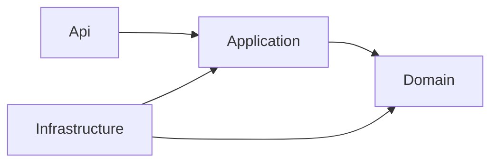
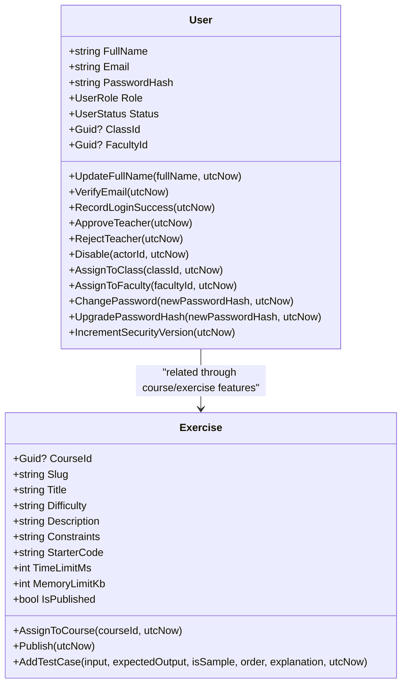
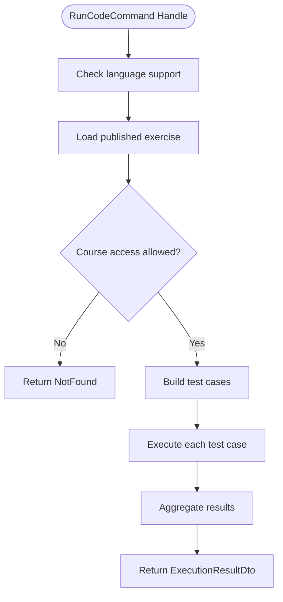
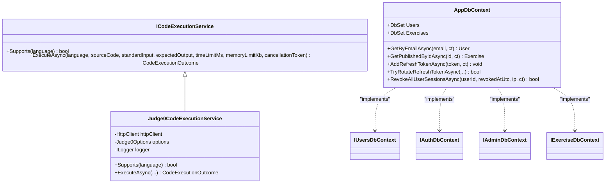
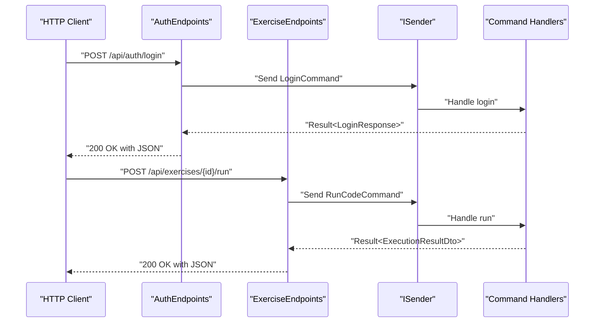
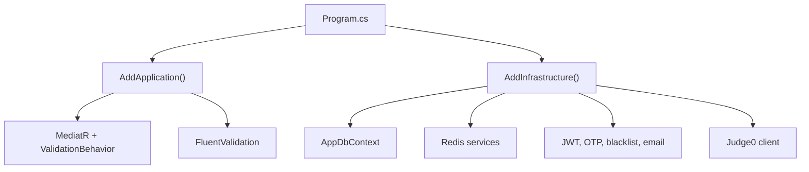

# Clean Architecture Layers

<cite>
**Referenced Files in This Document**
- [Program.cs](file://api/src/Api/CodePath.Api/Program.cs)
- [AuthEndpoints.cs](file://api/src/Api/CodePath.Api/Endpoints/AuthEndpoints.cs)
- [ExerciseEndpoints.cs](file://api/src/Api/CodePath.Api/Endpoints/ExerciseEndpoints.cs)
- [DependencyInjection.cs (Application)](file://api/src/Application/CodePath.Application/DependencyInjection.cs)
- [LoginCommand.cs](file://api/src/Application/CodePath.Application/Auth/Commands/LoginCommand.cs)
- [RunCodeCommand.cs](file://api/src/Application/CodePath.Application/Exercises/Commands/RunCodeCommand.cs)
- [ICodeExecutionService.cs](file://api/src/Application/CodePath.Application/Exercises/Abstractions/ICodeExecutionService.cs)
- [User.cs](file://api/src/Domain/CodePath.Domain/Users/Entities/User.cs)
- [Exercise.cs](file://api/src/Domain/CodePath.Domain/Exercises/Entities/Exercise.cs)
- [AppDbContext.cs](file://api/src/Infrastructure/CodePath.Infrastructure/Persistence/AppDbContext.cs)
- [DependencyInjection.cs (Infrastructure)](file://api/src/Infrastructure/CodePath.Infrastructure/DependencyInjection.cs)
- [Judge0CodeExecutionService.cs](file://api/src/Infrastructure/CodeExecution/Judge0CodeExecutionService.cs)
</cite>

## Table of Contents
1. [Introduction](#introduction)
2. [Project Structure](#project-structure)
3. [Core Components](#core-components)
4. [Architecture Overview](#architecture-overview)
5. [Detailed Component Analysis](#detailed-component-analysis)
6. [Dependency Analysis](#dependency-analysis)
7. [Performance Considerations](#performance-considerations)
8. [Troubleshooting Guide](#troubleshooting-guide)
9. [Conclusion](#conclusion)

## Introduction
This document explains CodePart’s Clean Architecture implementation across four layers: Domain, Application, Infrastructure, and API. The system enforces strict dependency direction: API depends on Application; Application depends on Domain and its own abstractions; Infrastructure implements those abstractions and depends on both Application interfaces and Domain entities. This separation isolates business rules from HTTP concerns, external services, and persistence details, improving testability, maintainability, and scalability.

The application uses ASP.NET Minimal APIs for the API layer, MediatR for command/query handling in the Application layer, domain entities with rich behavior in the Domain layer, and Entity Framework Core with MySQL in the Infrastructure layer. Dependency injection is configured centrally so that endpoints only know about commands and queries, not about databases or external services.

## Project Structure
The relevant backend code lives under `api/src` and is organized into clear project boundaries:

- `Api`: HTTP endpoints, authorization policies, middleware, and request/response contracts.
- `Application`: Use cases, command/query handlers, validators, and cross-cutting orchestration.
- `Domain`: Business entities, enums, exceptions, and domain rules.
- `Infrastructure`: Persistence, Redis, email, authentication helpers, code execution, health checks, and external service clients.
- `Shared`: Kernel primitives such as base entities, common types, shared web utilities, and behaviors.

**Diagram sources**
- [Program.cs:28-374](file://api/src/Api/CodePath.Api/Program.cs#L28-L374)
- [DependencyInjection.cs (Application):10-25](file://api/src/Application/CodePath.Application/DependencyInjection.cs#L10-L25)
- [DependencyInjection.cs (Infrastructure):27-130](file://api/src/Infrastructure/CodePath.Infrastructure/DependencyInjection.cs#L27-L130)

**Section sources**
- [Program.cs:28-374](file://api/src/Api/CodePath.Api/Program.cs#L28-L374)
- [DependencyInjection.cs (Application):10-25](file://api/src/Application/CodePath.Application/DependencyInjection.cs#L10-L25)
- [DependencyInjection.cs (Infrastructure):27-130](file://api/src/Infrastructure/CodePath.Infrastructure/DependencyInjection.cs#L27-L130)

## Core Components
The core components follow a layered pattern:

- **Domain**: Pure business models and rules. Examples include `User` and `Exercise`. These classes encapsulate validation, state transitions, and invariant enforcement without knowing how they are persisted.
- **Application**: Use cases expressed as MediatR commands and queries. For example, `LoginCommand` orchestrates login security, password verification, token issuance, refresh token creation, and attempt tracking. `RunCodeCommand` orchestrates exercise access checks and code execution.
- **Infrastructure**: Concrete implementations of abstractions defined in Application and Domain. Examples include `AppDbContext` implementing repository-style database operations, and `Judge0CodeExecutionService` implementing `ICodeExecutionService` to call an external code judge.
- **API**: Thin HTTP endpoints that validate requests at the boundary, send commands/queries through MediatR, and convert results to HTTP responses.

Key responsibilities:
- Domain owns business invariants and lifecycle methods.
- Application composes domain objects with infrastructure abstractions.
- Infrastructure wires real implementations to DI containers.
- API focuses on routing, authorization, rate limiting, and response shaping.

**Section sources**
- [User.cs:8-386](file://api/src/Domain/CodePath.Domain/Users/Entities/User.cs#L8-L386)
- [Exercise.cs:6-92](file://api/src/Domain/CodePath.Domain/Exercises/Entities/Exercise.cs#L6-L92)
- [LoginCommand.cs:44-214](file://api/src/Application/CodePath.Application/Auth/Commands/LoginCommand.cs#L44-L214)
- [RunCodeCommand.cs:10-76](file://api/src/Application/CodePath.Application/Exercises/Commands/RunCodeCommand.cs#L10-L76)
- [AppDbContext.cs:17-382](file://api/src/Infrastructure/CodePath.Infrastructure/Persistence/AppDbContext.cs#L17-L382)
- [Judge0CodeExecutionService.cs:12-153](file://api/src/Infrastructure/CodeExecution/Judge0CodeExecutionService.cs#L12-L153)

## Architecture Overview
The runtime architecture maps HTTP requests to use cases and then to domain logic and infrastructure.

**Diagram sources**
- [AuthEndpoints.cs:132-156](file://api/src/Api/CodePath.Api/Endpoints/AuthEndpoints.cs#L132-L156)
- [LoginCommand.cs:55-190](file://api/src/Application/CodePath.Application/Auth/Commands/LoginCommand.cs#L55-L190)
- [AppDbContext.cs:42-83](file://api/src/Infrastructure/CodePath.Infrastructure/Persistence/AppDbContext.cs#L42-L83)

### Dependency Direction
- API depends on Application commands/queries and shared result extensions.
- Application depends on Domain entities and Application-defined abstractions.
- Infrastructure implements Application abstractions and persists Domain entities.
- Domain has no dependencies on API, Application, or Infrastructure.

**Diagram sources**
- [Program.cs:364-374](file://api/src/Api/CodePath.Api/Program.cs#L364-L374)
- [DependencyInjection.cs (Application):10-25](file://api/src/Application/CodePath.Application/DependencyInjection.cs#L10-L25)
- [DependencyInjection.cs (Infrastructure):27-130](file://api/src/Infrastructure/CodePath.Infrastructure/DependencyInjection.cs#L27-L130)

## Detailed Component Analysis

### Domain Layer: Business Entities and Rules
The Domain layer contains pure business entities and rules. `User` encapsulates student, teacher, and admin roles, account lifecycle transitions, profile updates, class/faculty assignments, and security versioning. `Exercise` encapsulates publishing rules, test case management, and resource limits.

**Diagram sources**
- [User.cs:8-386](file://api/src/Domain/CodePath.Domain/Users/Entities/User.cs#L8-L386)
- [Exercise.cs:6-92](file://api/src/Domain/CodePath.Domain/Exercises/Entities/Exercise.cs#L6-L92)

**Section sources**
- [User.cs:8-386](file://api/src/Domain/CodePath.Domain/Users/Entities/User.cs#L8-L386)
- [Exercise.cs:6-92](file://api/src/Domain/CodePath.Domain/Exercises/Entities/Exercise.cs#L6-L92)

### Application Layer: Use Cases and Handlers
The Application layer defines commands and handlers that coordinate domain logic with infrastructure abstractions.

- `LoginCommand` validates input, checks login attempts, verifies passwords, enforces account status, generates JWT tokens, creates refresh tokens, and records successful login activity.
- `RunCodeCommand` validates language support, loads published exercises, checks course access, executes sample or custom test cases, and aggregates execution results.

**Diagram sources**
- [RunCodeCommand.cs:27-76](file://api/src/Application/CodePath.Application/Exercises/Commands/RunCodeCommand.cs#L27-L76)

**Section sources**
- [LoginCommand.cs:44-214](file://api/src/Application/CodePath.Application/Auth/Commands/LoginCommand.cs#L44-L214)
- [RunCodeCommand.cs:10-76](file://api/src/Application/CodePath.Application/Exercises/Commands/RunCodeCommand.cs#L10-L76)

### Infrastructure Layer: Persistence and External Services
Infrastructure provides concrete implementations for Application abstractions and integrates external systems.

- `AppDbContext` implements multiple repository-style interfaces (`IUsersDbContext`, `IAuthDbContext`, `IAdminDbContext`, `IExerciseDbContext`) and exposes EF Core queries over Domain entities. It also handles retryable transactions, conflict mapping, and change tracking hooks.
- `Judge0CodeExecutionService` implements `ICodeExecutionService` to submit code to an external Judge0 service, map statuses, sanitize output, and handle timeouts and connection errors.

**Diagram sources**
- [ICodeExecutionService.cs:5-24](file://api/src/Application/CodePath.Application/Exercises/Abstractions/ICodeExecutionService.cs#L5-L24)
- [Judge0CodeExecutionService.cs:12-153](file://api/src/Infrastructure/CodeExecution/Judge0CodeExecutionService.cs#L12-L153)
- [AppDbContext.cs:17-382](file://api/src/Infrastructure/CodePath.Infrastructure/Persistence/AppDbContext.cs#L17-L382)

**Section sources**
- [AppDbContext.cs:17-382](file://api/src/Infrastructure/CodePath.Infrastructure/Persistence/AppDbContext.cs#L17-L382)
- [Judge0CodeExecutionService.cs:12-153](file://api/src/Infrastructure/CodeExecution/Judge0CodeExecutionService.cs#L12-L153)

### API Layer: HTTP Endpoints
The API layer registers minimal endpoints and delegates work to Application commands/queries.

- `AuthEndpoints` maps `/api/auth` routes, sets cookies for refresh tokens, applies rate limiting, and converts MediatR results to HTTP responses.
- `ExerciseEndpoints` maps `/api/exercises` routes, enforces role-based authorization, applies per-endpoint rate limits, and documents HTTP status codes.

**Diagram sources**
- [AuthEndpoints.cs:104-156](file://api/src/Api/CodePath.Api/Endpoints/AuthEndpoints.cs#L104-L156)
- [ExerciseEndpoints.cs:15-73](file://api/src/Api/CodePath.Api/Endpoints/ExerciseEndpoints.cs#L15-L73)

**Section sources**
- [AuthEndpoints.cs:104-294](file://api/src/Api/CodePath.Api/Endpoints/AuthEndpoints.cs#L104-L294)
- [ExerciseEndpoints.cs:15-73](file://api/src/Api/CodePath.Api/Endpoints/ExerciseEndpoints.cs#L15-L73)

## Dependency Analysis
Dependency injection is configured in two main places:

- Application registration adds MediatR, FluentValidation, logging/validation behaviors, and specific services like `AdminStatusChangeService`, `JoinCodeGenerator`, and `SessionActivityService`.
- Infrastructure registration configures Redis, MySQL, EF Core contexts, health checks, external HTTP clients, authentication services, OTP, token blacklisting, email sending, and background cleanup.

**Diagram sources**
- [Program.cs:364-374](file://api/src/Api/CodePath.Api/Program.cs#L364-L374)
- [DependencyInjection.cs (Application):10-25](file://api/src/Application/CodePath.Application/DependencyInjection.cs#L10-L25)
- [DependencyInjection.cs (Infrastructure):27-130](file://api/src/Infrastructure/CodePath.Infrastructure/DependencyInjection.cs#L27-L130)

**Section sources**
- [Program.cs:364-374](file://api/src/Api/CodePath.Api/Program.cs#L364-L374)
- [DependencyInjection.cs (Application):10-25](file://api/src/Application/CodePath.Application/DependencyInjection.cs#L10-L25)
- [DependencyInjection.cs (Infrastructure):27-217](file://api/src/Infrastructure/CodePath.Infrastructure/DependencyInjection.cs#L27-L217)

## Performance Considerations
- Rate limiting is applied at the API level for authentication, login, password reset, public reads, code execution, and health checks. This protects downstream use cases and infrastructure.
- Database operations use EF Core with retry strategies and transaction isolation levels where necessary. Conflict exceptions are mapped to domain-level conflicts.
- External code execution calls are wrapped with timeout handling and error mapping to avoid blocking the request pipeline.
- Refresh token rotation and session revocation use bulk updates to reduce round trips and improve consistency.

[No sources needed since this section provides general guidance]

## Troubleshooting Guide
Common issues and their architectural context:

- **Authentication failures**: The endpoint returns standardized problem responses. Token validation includes blacklist checks and session revocation based on user security version.
- **Rate limit exceeded**: Requests receive 429 responses with retry metadata. Policies are configurable and validated at startup.
- **Database conflicts**: Duplicate key errors are converted to domain conflict exceptions, which bubble up as consistent HTTP problem responses.
- **External service unavailability**: Code execution returns system error outcomes when the judge service is down or times out.

**Section sources**
- [Program.cs:71-158](file://api/src/Api/CodePath.Api/Program.cs#L71-L158)
- [Program.cs:251-359](file://api/src/Api/CodePath.Api/Program.cs#L251-L359)
- [AppDbContext.cs:342-354](file://api/src/Infrastructure/CodePath.Infrastructure/Persistence/AppDbContext.cs#L342-L354)
- [Judge0CodeExecutionService.cs:76-107](file://api/src/Infrastructure/CodeExecution/Judge0CodeExecutionService.cs#L76-L107)

## Conclusion
CodePart’s Clean Architecture cleanly separates concerns:

- Domain encapsulates business rules and invariants.
- Application orchestrates use cases using commands and queries.
- Infrastructure implements persistence and external integrations behind Application abstractions.
- API focuses on HTTP routing, authorization, rate limiting, and response formatting.

This structure enables strong testability through interface-based abstractions, maintainability through clear layer boundaries, and scalability through isolated concerns and configurable infrastructure. Dependency injection centralizes wiring, while MediatR keeps use cases explicit and testable.

[No sources needed since this section summarizes without analyzing specific files]