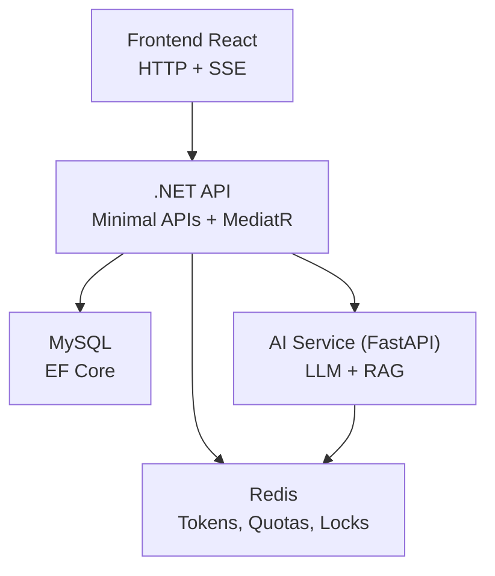
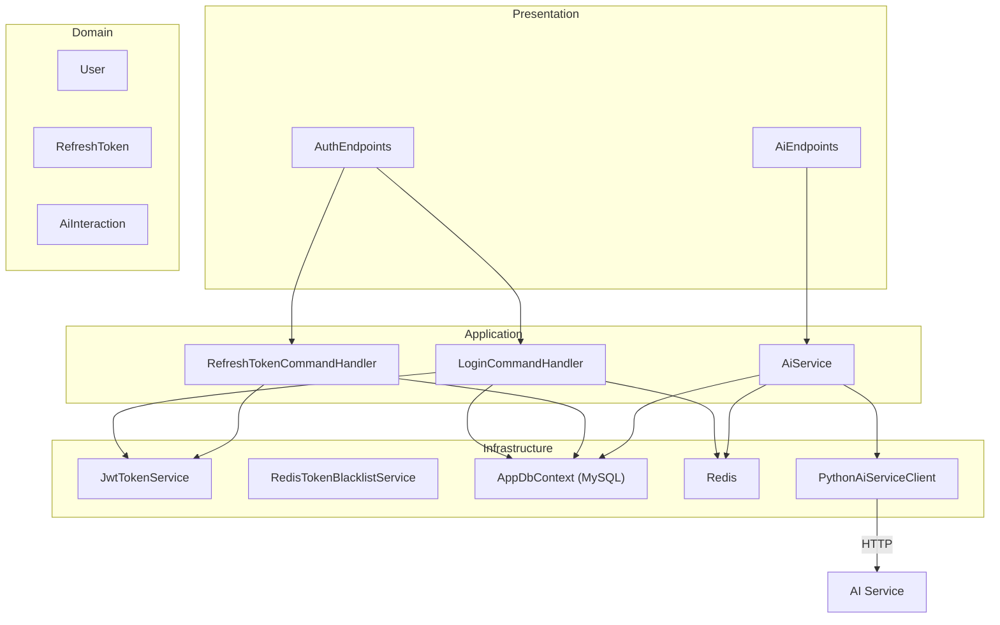
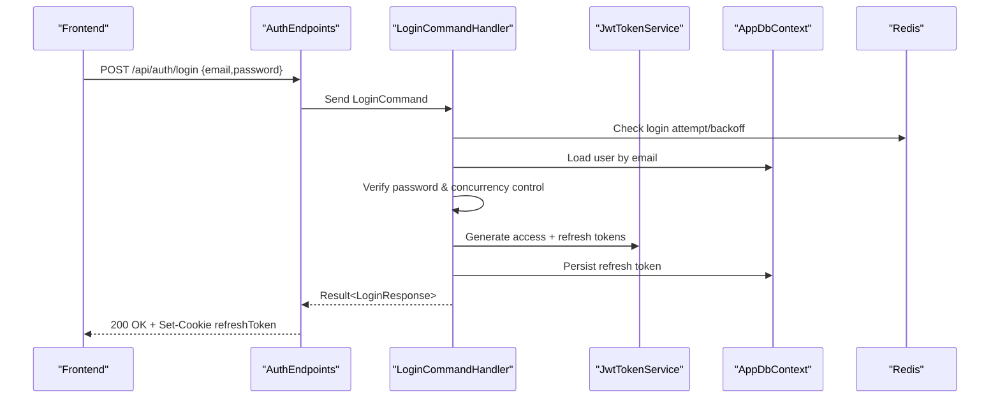
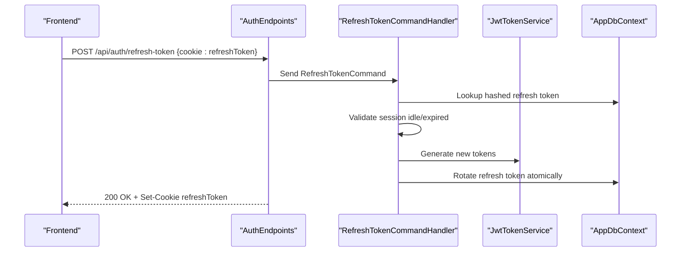
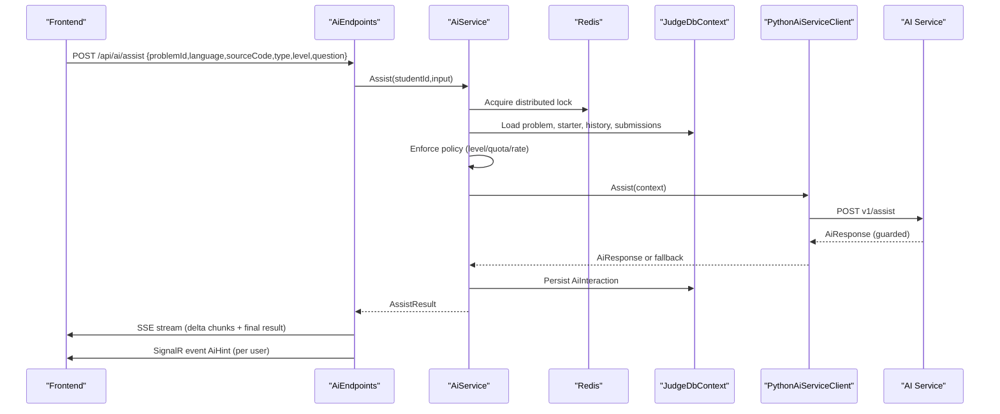
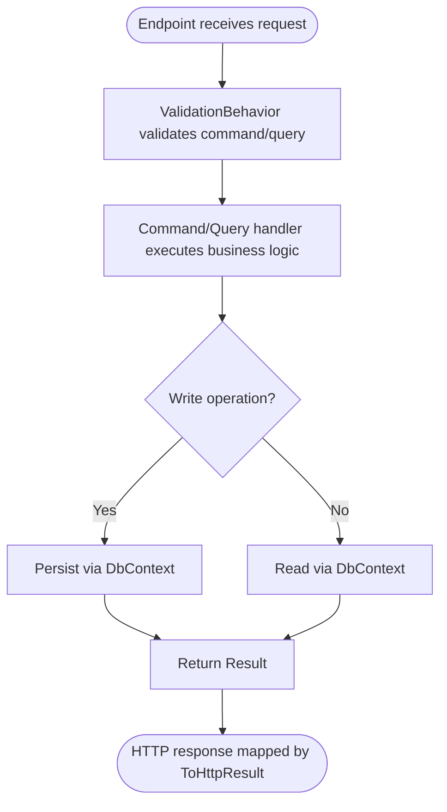
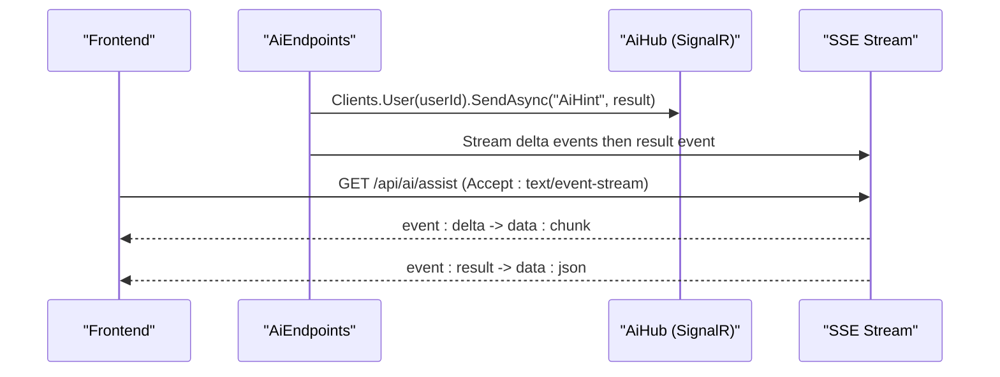
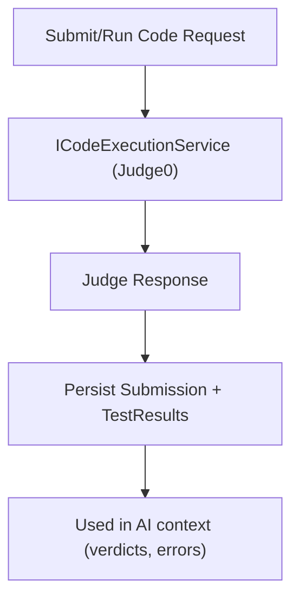
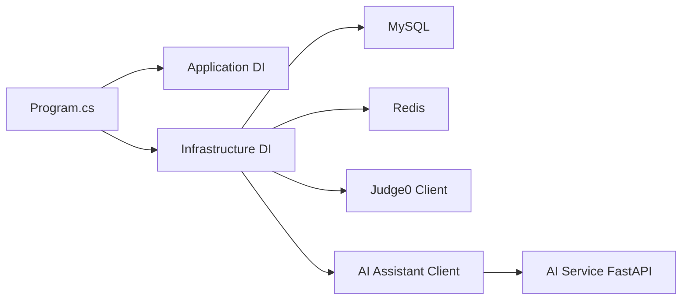

# Data Flow Patterns

<cite>
**Referenced Files in This Document**
- [Program.cs](file://api/src/Api/CodePath.Api/Program.cs)
- [DependencyInjection.cs (Application)](file://api/src/Application/CodePath.Application/DependencyInjection.cs)
- [DependencyInjection.cs (Infrastructure)](file://api/src/Infrastructure/CodePath.Infrastructure/DependencyInjection.cs)
- [AuthEndpoints.cs](file://api/src/Api/CodePath.Api/Endpoints/AuthEndpoints.cs)
- [AiEndpoints.cs](file://api/src/Api/CodePath.Api/Endpoints/AiEndpoints.cs)
- [LoginCommand.cs](file://api/src/Application/CodePath.Application/Auth/Commands/LoginCommand.cs)
- [RefreshTokenCommand.cs](file://api/src/Application/CodePath.Application/Auth/Commands/RefreshTokenCommand.cs)
- [JwtTokenService.cs](file://api/src/Infrastructure/CodePath.Infrastructure/Auth/Services/Tokens/JwtTokenService.cs)
- [RedisTokenBlacklistService.cs](file://api/src/Infrastructure/CodePath.Infrastructure/Auth/Services/Tokens/RedisTokenBlacklistService.cs)
- [AiService.cs](file://api/src/Infrastructure/CodePath.Infrastructure/Ai/AiService.cs)
- [PythonAiServiceClient.cs](file://api/src/Infrastructure/CodePath.Infrastructure/Ai/PythonAiServiceClient.cs)
- [main.py (AI Service)](file://ai-service/app/main.py)
- [stream.ts](file://frontend/src/features/ai-assistant/stream.ts)
</cite>

## Table of Contents
1. [Introduction](#introduction)
2. [Project Structure](#project-structure)
3. [Core Components](#core-components)
4. [Architecture Overview](#architecture-overview)
5. [Detailed Component Analysis](#detailed-component-analysis)
6. [Dependency Analysis](#dependency-analysis)
7. [Performance Considerations](#performance-considerations)
8. [Troubleshooting Guide](#troubleshooting-guide)
9. [Conclusion](#conclusion)

## Introduction
This document explains the end-to-end data flow patterns across CodePart’s frontend, .NET API, AI service, and database layers. It focuses on:
- The complete request lifecycle from React components to persistence.
- Command/query separation using MediatR for read/write operations.
- Real-time streaming of AI hints via Server-Sent Events and SignalR.
- Caching and rate limiting with Redis.
- Authentication flows, code execution workflows, and AI-assisted learning interactions.
- Error handling and retry mechanisms across the pipeline.

## Project Structure
The system is composed of:
- Frontend (React + TypeScript): UI, HTTP client, and SSE consumer for AI streaming.
- .NET API (Minimal APIs + MediatR): Endpoints, application commands/queries, infrastructure wiring, and middleware.
- AI Service (Python FastAPI): Guarded LLM orchestration, RAG integration, and Redis-backed caching.
- Databases and caches: MySQL for persistence, Redis for tokens, quotas, locks, and health probes.

**Diagram sources**
- [Program.cs:364-374](file://api/src/Api/CodePath.Api/Program.cs#L364-L374)
- [DependencyInjection.cs (Infrastructure):34-106](file://api/src/Infrastructure/CodePath.Infrastructure/DependencyInjection.cs#L34-L106)
- [main.py (AI Service):17-84](file://ai-service/app/main.py#L17-L84)

**Section sources**
- [Program.cs:28-40](file://api/src/Api/CodePath.Api/Program.cs#L28-L40)
- [DependencyInjection.cs (Application):10-25](file://api/src/Application/CodePath.Application/DependencyInjection.cs#L10-L25)
- [DependencyInjection.cs (Infrastructure):34-134](file://api/src/Infrastructure/CodePath.Infrastructure/DependencyInjection.cs#L34-L134)

## Core Components
- API entrypoint and middleware: JWT authentication, CORS, rate limiting, health checks, endpoint mapping, and optional AI/SignalR activation.
- Application layer: MediatR pipeline with logging and validation behaviors; command/query handlers for auth, exercises, learning, and admin features.
- Infrastructure layer: EF Core with MySQL, Redis integration, health checks, external clients (Judge0, AI), and token services.
- AI service: FastAPI app with authenticated /v1/assist endpoint, LLM provider client, RAG, and Redis cache.

Key responsibilities:
- Auth endpoints expose register/login/refresh/logout and map to MediatR commands.
- AI endpoints stream hints via SSE and push events via SignalR.
- AI service enforces guardrails and returns structured hints with stage, level, steps, and references.

**Section sources**
- [Program.cs:71-158](file://api/src/Api/CodePath.Api/Program.cs#L71-L158)
- [Program.cs:251-359](file://api/src/Api/CodePath.Api/Program.cs#L251-L359)
- [Program.cs:419-509](file://api/src/Api/CodePath.Api/Program.cs#L419-L509)
- [DependencyInjection.cs (Application):10-25](file://api/src/Application/CodePath.Application/DependencyInjection.cs#L10-L25)
- [DependencyInjection.cs (Infrastructure):97-134](file://api/src/Infrastructure/CodePath.Infrastructure/DependencyInjection.cs#L97-L134)
- [main.py (AI Service):45-84](file://ai-service/app/main.py#L45-L84)

## Architecture Overview
The API uses a layered architecture:
- Presentation: Minimal API endpoints.
- Application: Commands/Queries via MediatR.
- Domain: Entities and rules.
- Infrastructure: Persistence, Redis, external services.

**Diagram sources**
- [AuthEndpoints.cs:104-291](file://api/src/Api/CodePath.Api/Endpoints/AuthEndpoints.cs#L104-L291)
- [AiEndpoints.cs:12-43](file://api/src/Api/CodePath.Api/Endpoints/AiEndpoints.cs#L12-L43)
- [LoginCommand.cs:55-214](file://api/src/Application/CodePath.Application/Auth/Commands/LoginCommand.cs#L55-L214)
- [RefreshTokenCommand.cs:19-123](file://api/src/Application/CodePath.Application/Auth/Commands/RefreshTokenCommand.cs#L19-L123)
- [AiService.cs:18-124](file://api/src/Infrastructure/CodePath.Infrastructure/Ai/AiService.cs#L18-L124)
- [JwtTokenService.cs:13-77](file://api/src/Infrastructure/CodePath.Infrastructure/Auth/Services/Tokens/JwtTokenService.cs#L13-L77)
- [RedisTokenBlacklistService.cs:6-19](file://api/src/Infrastructure/CodePath.Infrastructure/Auth/Services/Tokens/RedisTokenBlacklistService.cs#L6-L19)
- [PythonAiServiceClient.cs:6-40](file://api/src/Infrastructure/CodePath.Infrastructure/Ai/PythonAiServiceClient.cs#L6-L40)
- [main.py (AI Service):64-81](file://ai-service/app/main.py#L64-L81)

## Detailed Component Analysis

### Authentication Flow (Register, Login, Refresh, Logout)
End-to-end sequence from frontend to persistence and back:

Key behaviors:
- Rate limiting per IP and token bucket for login.
- Backoff and concurrency controls to mitigate brute force.
- Secure cookie for refresh token with SameSite policy.
- Access token validated against Redis blacklist and session state.

**Diagram sources**
- [AuthEndpoints.cs:132-156](file://api/src/Api/CodePath.Api/Endpoints/AuthEndpoints.cs#L132-L156)
- [LoginCommand.cs:88-190](file://api/src/Application/CodePath.Application/Auth/Commands/LoginCommand.cs#L88-L190)
- [JwtTokenService.cs:24-68](file://api/src/Infrastructure/CodePath.Infrastructure/Auth/Services/Tokens/JwtTokenService.cs#L24-L68)
- [Program.cs:71-158](file://api/src/Api/CodePath.Api/Program.cs#L71-L158)

**Section sources**
- [AuthEndpoints.cs:104-291](file://api/src/Api/CodePath.Api/Endpoints/AuthEndpoints.cs#L104-L291)
- [LoginCommand.cs:44-214](file://api/src/Application/CodePath.Application/Auth/Commands/LoginCommand.cs#L44-L214)
- [JwtTokenService.cs:13-77](file://api/src/Infrastructure/CodePath.Infrastructure/Auth/Services/Tokens/JwtTokenService.cs#L13-L77)
- [RedisTokenBlacklistService.cs:6-19](file://api/src/Infrastructure/CodePath.Infrastructure/Auth/Services/Tokens/RedisTokenBlacklistService.cs#L6-L19)
- [Program.cs:245-359](file://api/src/Api/CodePath.Api/Program.cs#L245-L359)

### Token Refresh Flow

Notes:
- Atomic rotation prevents concurrent reuse.
- Session activity policies enforce idle timeouts.

**Diagram sources**
- [AuthEndpoints.cs:185-218](file://api/src/Api/CodePath.Api/Endpoints/AuthEndpoints.cs#L185-L218)
- [RefreshTokenCommand.cs:41-110](file://api/src/Application/CodePath.Application/Auth/Commands/RefreshTokenCommand.cs#L41-L110)

**Section sources**
- [RefreshTokenCommand.cs:12-123](file://api/src/Application/CodePath.Application/Auth/Commands/RefreshTokenCommand.cs#L12-L123)
- [AuthEndpoints.cs:185-218](file://api/src/Api/CodePath.Api/Endpoints/AuthEndpoints.cs#L185-L218)

### AI-Assisted Learning Interaction (SSE Streaming)

Key points:
- Distributed lock prevents concurrent AI calls per student.
- Daily quota and minute-level rate limits enforced atomically via Redis script.
- SSE streams incremental hint text; final JSON result delivered as last event.
- SignalR pushes the full result to the user’s hub connection.

**Diagram sources**
- [AiEndpoints.cs:15-42](file://api/src/Api/CodePath.Api/Endpoints/AiEndpoints.cs#L15-L42)
- [AiService.cs:22-119](file://api/src/Infrastructure/CodePath.Infrastructure/Ai/AiService.cs#L22-L119)
- [PythonAiServiceClient.cs:8-39](file://api/src/Infrastructure/CodePath.Infrastructure/Ai/PythonAiServiceClient.cs#L8-L39)
- [main.py (AI Service):64-81](file://ai-service/app/main.py#L64-L81)

**Section sources**
- [AiEndpoints.cs:12-43](file://api/src/Api/CodePath.Api/Endpoints/AiEndpoints.cs#L12-L43)
- [AiService.cs:18-124](file://api/src/Infrastructure/CodePath.Infrastructure/Ai/AiService.cs#L18-L124)
- [PythonAiServiceClient.cs:6-40](file://api/src/Infrastructure/CodePath.Infrastructure/Ai/PythonAiServiceClient.cs#L6-L40)
- [main.py (AI Service):45-84](file://ai-service/app/main.py#L45-L84)

### Command/Query Pattern Implementation
- Commands (write operations): Register, Login, RefreshToken, Logout, UpdateProfile, etc., implemented as MediatR IRequest handlers.
- Queries (read operations): GetCurrentUser and other read-only handlers are similarly modeled.
- ValidationBehavior and LoggingBehavior wrap all requests for cross-cutting concerns.

**Diagram sources**
- [DependencyInjection.cs (Application):10-25](file://api/src/Application/CodePath.Application/DependencyInjection.cs#L10-L25)
- [AuthEndpoints.cs:108-289](file://api/src/Api/CodePath.Api/Endpoints/AuthEndpoints.cs#L108-L289)

**Section sources**
- [DependencyInjection.cs (Application):10-25](file://api/src/Application/CodePath.Application/DependencyInjection.cs#L10-L25)

### Real-Time Data Streaming (SSE + SignalR)
- SSE: The AI endpoint streams incremental hint text as “delta” events and a final “result” event.
- SignalR: The same result is pushed to the authenticated user’s hub connection for real-time UI updates.
- Frontend: Consumes the SSE stream, decodes UTF-8 boundaries, and renders deltas incrementally.

**Diagram sources**
- [AiEndpoints.cs:15-39](file://api/src/Api/CodePath.Api/Endpoints/AiEndpoints.cs#L15-L39)
- [stream.ts:1-24](file://frontend/src/features/ai-assistant/stream.ts#L1-L24)

**Section sources**
- [AiEndpoints.cs:15-42](file://api/src/Api/CodePath.Api/Endpoints/AiEndpoints.cs#L15-L42)
- [stream.ts:1-24](file://frontend/src/features/ai-assistant/stream.ts#L1-L24)

### Code Execution Workflow (Online Judge Integration)
- The API integrates with an external judge service through ICodeExecutionService and Judge0Options.
- Requests are rate-limited and time-bounded via HttpClient configuration.
- Results are persisted and used as context for AI assistance.

**Diagram sources**
- [DependencyInjection.cs (Infrastructure):121-131](file://api/src/Infrastructure/CodePath.Infrastructure/DependencyInjection.cs#L121-L131)
- [AiService.cs:41-88](file://api/src/Infrastructure/CodePath.Infrastructure/Ai/AiService.cs#L41-L88)

**Section sources**
- [DependencyInjection.cs (Infrastructure):121-131](file://api/src/Infrastructure/CodePath.Infrastructure/DependencyInjection.cs#L121-L131)
- [AiService.cs:41-88](file://api/src/Infrastructure/CodePath.Infrastructure/Ai/AiService.cs#L41-L88)

## Dependency Analysis
- API depends on:
  - Application layer for MediatR commands/queries.
  - Infrastructure for DB, Redis, external clients, and auth services.
- AI service depends on:
  - LLM provider client and RAG service.
  - Redis for caching and optional classifier model loading.

**Diagram sources**
- [Program.cs:364-374](file://api/src/Api/CodePath.Api/Program.cs#L364-L374)
- [DependencyInjection.cs (Infrastructure):34-134](file://api/src/Infrastructure/CodePath.Infrastructure/DependencyInjection.cs#L34-L134)
- [main.py (AI Service):17-84](file://ai-service/app/main.py#L17-L84)

**Section sources**
- [Program.cs:364-374](file://api/src/Api/CodePath.Api/Program.cs#L364-L374)
- [DependencyInjection.cs (Infrastructure):34-134](file://api/src/Infrastructure/CodePath.Infrastructure/DependencyInjection.cs#L34-L134)

## Performance Considerations
- Database:
  - Connection pooling configured via MySQL options.
  - Retry-on-failure enabled at EF Core provider level.
- Redis:
  - Used for token blacklisting, login attempts, password reset rate limiting, AI quotas/rates, and distributed locks.
  - Health probe endpoint exposes connectivity and latency.
- External clients:
  - Timeouts and buffer sizes configured for Judge0 and AI service calls.
- Rate limiting:
  - Multiple policies for auth, login, password reset, health, public reads, code execution, and learning heartbeats.

Recommendations:
- Monitor Redis latency and round-trip success via health endpoints.
- Tune pool sizes based on workload and database capacity.
- Keep AI client deadlines conservative to avoid long-running requests.

**Section sources**
- [DependencyInjection.cs (Infrastructure):63-106](file://api/src/Infrastructure/CodePath.Infrastructure/DependencyInjection.cs#L63-L106)
- [Program.cs:455-500](file://api/src/Api/CodePath.Api/Program.cs#L455-L500)
- [Program.cs:251-359](file://api/src/Api/CodePath.Api/Program.cs#L251-L359)
- [DependencyInjection.cs (Infrastructure):121-131](file://api/src/Infrastructure/CodePath.Infrastructure/DependencyInjection.cs#L121-L131)

## Troubleshooting Guide
Common issues and diagnostics:
- Unauthorized/Forbidden responses:
  - JWT validation failures due to revoked tokens or invalid session claims.
  - Missing or invalid refresh token cookies.
- Too Many Requests:
  - Rate limiters triggered for auth, login, password reset, code execution, and learning endpoints.
- AI unavailability:
  - Python AI service returns 503 when unavailable; fallback hints may be returned by the .NET client.
- Redis connectivity:
  - Health endpoint reports connection status and round-trip success.

Actions:
- Inspect ProblemDetails responses for error codes and trace IDs.
- Check Redis health endpoint and logs for connectivity issues.
- Review AI service logs for INVALID_CONTEXT or UNAUTHORIZED errors.

**Section sources**
- [Program.cs:120-158](file://api/src/Api/CodePath.Api/Program.cs#L120-L158)
- [Program.cs:257-281](file://api/src/Api/CodePath.Api/Program.cs#L257-L281)
- [PythonAiServiceClient.cs:25-39](file://api/src/Infrastructure/CodePath.Infrastructure/Ai/PythonAiServiceClient.cs#L25-L39)
- [Program.cs:455-500](file://api/src/Api/CodePath.Api/Program.cs#L455-L500)

## Conclusion
CodePart implements a robust, layered architecture that separates read and write operations through MediatR, secures authentication with JWT and Redis-backed sessions, and delivers real-time AI assistance via SSE and SignalR. Redis provides critical performance and safety guarantees for quotas, rate limits, and distributed locks. The AI service adds guarded LLM capabilities with fallback behavior, ensuring resilience under failure conditions. Proper configuration of rate limits, timeouts, and health checks ensures reliability and observability across the entire data pipeline.