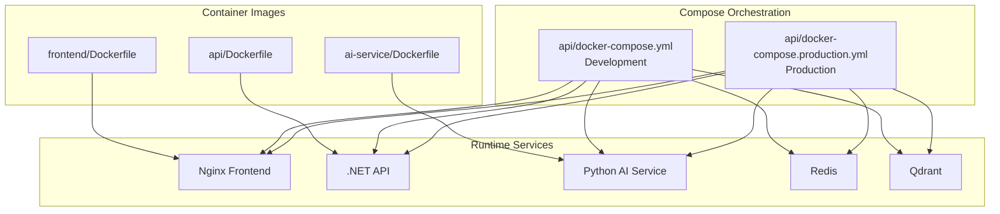
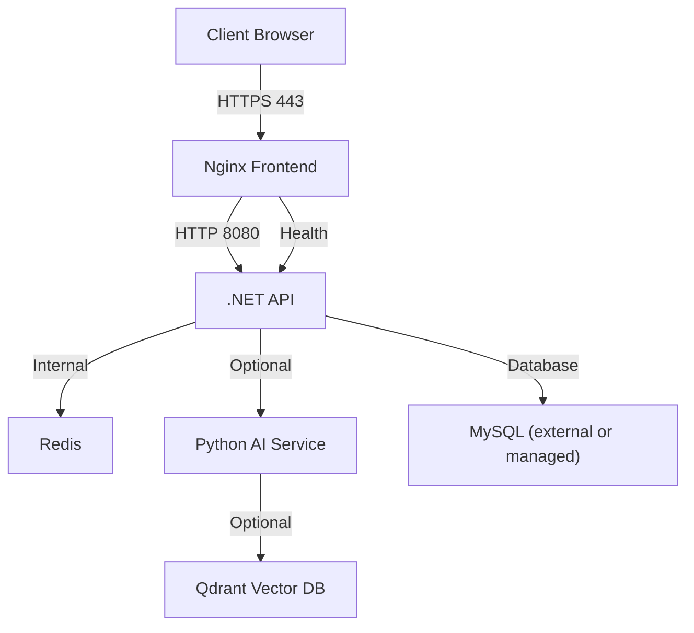
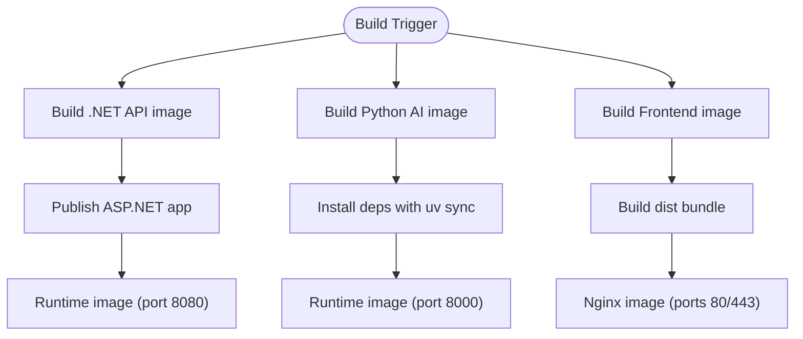
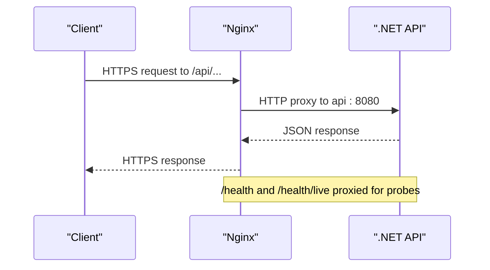
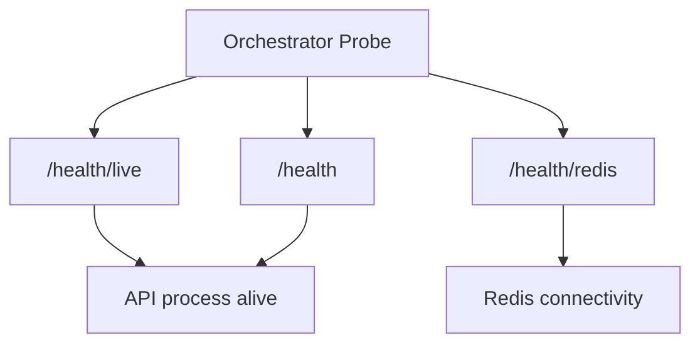
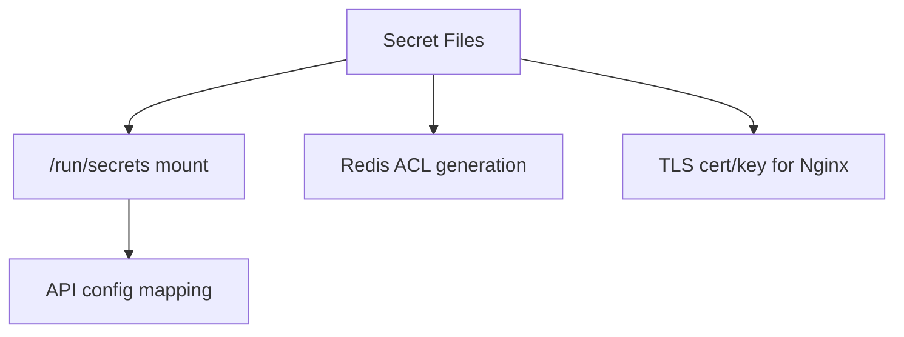
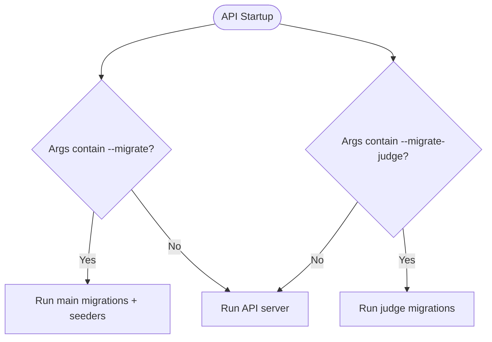
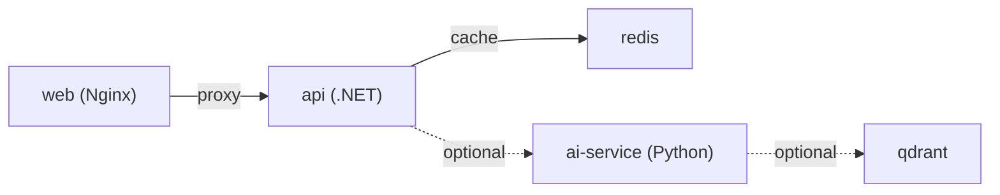

# Deployment Architecture

<cite>
**Referenced Files in This Document**
- [api/Dockerfile](file://api/Dockerfile)
- [ai-service/Dockerfile](file://ai-service/Dockerfile)
- [frontend/Dockerfile](file://frontend/Dockerfile)
- [api/docker-compose.yml](file://api/docker-compose.yml)
- [api/docker-compose.production.yml](file://api/docker-compose.production.yml)
- [frontend/nginx/default.conf](file://frontend/nginx/default.conf)
- [api/src/Api/CodePath.Api/Program.cs](file://api/src/Api/CodePath.Api/Program.cs)
- [ai-service/app/main.py](file://ai-service/app/main.py)
- [api/src/Api/CodePath.Api/Extensions\DatabaseMigrationExtensions.cs](file://api/src/Api/CodePath.Api/Extensions\DatabaseMigrationExtensions.cs)
- [api/src/Infrastructure/CodePath.Infrastructure/Persistence/AppDbContext.cs](file://api/src/Infrastructure/CodePath.Infrastructure/Persistence/AppDbContext.cs)
</cite>

## Table of Contents
1. Introduction
2. Project Structure
3. Core Components
4. Architecture Overview
5. Detailed Component Analysis
6. Dependency Analysis
7. Performance Considerations
8. Troubleshooting Guide
9. Conclusion

## Introduction
This document describes the deployment architecture for CodePart, covering containerized builds and runtime topology for the .NET API, Python AI service, and React frontend. It explains production networking with a reverse proxy, load balancing, health checks, environment configuration, secrets management, database migrations, CI/CD considerations, monitoring and logging guidance, disaster recovery, scaling strategies, and cloud deployment options.

## Project Structure
The project ships three containerized services:
- .NET API (ASP.NET Core)
- Python AI service (FastAPI)
- React frontend served by Nginx

Each service has its own Dockerfile and is orchestrated via Compose files for development and production.

**Diagram sources**
- [api/Dockerfile:1-29](file://api/Dockerfile#L1-L29)
- [ai-service/Dockerfile:1-11](file://ai-service/Dockerfile#L1-L11)
- [frontend/Dockerfile:1-13](file://frontend/Dockerfile#L1-L13)
- [api/docker-compose.yml:1-112](file://api/docker-compose.yml#L1-L112)
- [api/docker-compose.production.yml:1-241](file://api/docker-compose.production.yml#L1-L241)

**Section sources**
- [api/Dockerfile:1-29](file://api/Dockerfile#L1-L29)
- [ai-service/Dockerfile:1-11](file://ai-service/Dockerfile#L1-L11)
- [frontend/Dockerfile:1-13](file://frontend/Dockerfile#L1-L13)
- [api/docker-compose.yml:1-112](file://api/docker-compose.yml#L1-L112)
- [api/docker-compose.production.yml:1-241](file://api/docker-compose.production.yml#L1-L241)

## Core Components
- .NET API
  - Multi-stage build producing a minimal ASP.NET runtime image.
  - Listens on port 8080 inside the container.
  - Exposes health endpoints and application routes.
- Python AI Service
  - FastAPI app running Uvicorn with concurrency limits.
  - Health endpoint at /health; protected internal API.
- React Frontend
  - Built with Node and served by Nginx.
  - Nginx terminates TLS, proxies /api to the API, and serves static assets.

Key runtime characteristics:
- Non-root users in containers.
- Read-only filesystems where applicable.
- Resource constraints and security hardening in production compose.

**Section sources**
- [api/Dockerfile:21-29](file://api/Dockerfile#L21-L29)
- [ai-service/Dockerfile:1-11](file://ai-service/Dockerfile#L1-L11)
- [frontend/Dockerfile:1-13](file://frontend/Dockerfile#L1-L13)
- [api/src/Api/CodePath.Api/Program.cs:425-514](file://api/src/Api/CodePath.Api/Program.cs#L425-L514)
- [ai-service/app/main.py:61-84](file://ai-service/app/main.py#L61-L84)

## Architecture Overview
Production topology uses Nginx as the public-facing reverse proxy. The API and AI services run on an internal network. Redis and Qdrant are internal dependencies. Secrets are mounted into containers and consumed by applications.

**Diagram sources**
- [frontend/nginx/default.conf:1-89](file://frontend/nginx/default.conf#L1-L89)
- [api/docker-compose.production.yml:64-143](file://api/docker-compose.production.yml#L64-L143)
- [api/docker-compose.production.yml:144-210](file://api/docker-compose.production.yml#L144-L210)

## Detailed Component Analysis

### Container Build Strategy
- .NET API
  - Build stage restores packages and publishes a self-contained artifact.
  - Runtime stage runs the published DLL with non-root user.
- Python AI Service
  - Uses uv to install dependencies from lockfile.
  - Runs Uvicorn with concurrency limit and non-root user.
- Frontend
  - Builds static assets with Node and serves them via Nginx.

**Diagram sources**
- [api/Dockerfile:1-29](file://api/Dockerfile#L1-L29)
- [ai-service/Dockerfile:1-11](file://ai-service/Dockerfile#L1-L11)
- [frontend/Dockerfile:1-13](file://frontend/Dockerfile#L1-L13)

**Section sources**
- [api/Dockerfile:1-29](file://api/Dockerfile#L1-L29)
- [ai-service/Dockerfile:1-11](file://ai-service/Dockerfile#L1-L11)
- [frontend/Dockerfile:1-13](file://frontend/Dockerfile#L1-L13)

### Production Networking and Reverse Proxy
- Nginx listens on 80 and 443, enforces HTTPS redirect, and proxies /api to the API upstream.
- Static assets are cached aggressively; HTML is not cached.
- Security headers and CSP/HSTS are configured.
- Health endpoints are proxied for readiness/liveness probes.

**Diagram sources**
- [frontend/nginx/default.conf:1-89](file://frontend/nginx/default.conf#L1-L89)

**Section sources**
- [frontend/nginx/default.conf:1-89](file://frontend/nginx/default.conf#L1-L89)

### Health Checks and Liveness/Readiness
- API exposes:
  - /health for readiness (tags-based predicate).
  - /health/live for liveness.
  - /health/redis for Redis connectivity check.
- AI service exposes /health.
- Compose defines healthchecks for Redis and AI service.

**Diagram sources**
- [api/src/Api/CodePath.Api/Program.cs:425-501](file://api/src/Api/CodePath.Api/Program.cs#L425-L501)
- [ai-service/app/main.py:61-62](file://ai-service/app/main.py#L61-L62)
- [api/docker-compose.yml:30-35](file://api/docker-compose.yml#L30-L35)
- [api/docker-compose.production.yml:55-62](file://api/docker-compose.production.yml#L55-L62)

**Section sources**
- [api/src/Api/CodePath.Api/Program.cs:425-501](file://api/src/Api/CodePath.Api/Program.cs#L425-L501)
- [ai-service/app/main.py:61-62](file://ai-service/app/main.py#L61-L62)
- [api/docker-compose.yml:30-35](file://api/docker-compose.yml#L30-L35)
- [api/docker-compose.production.yml:55-62](file://api/docker-compose.production.yml#L55-L62)

### Environment-Specific Configuration
- Development Compose
  - Exposes Redis, AI, and Qdrant ports locally.
  - Uses local data volumes.
- Production Compose
  - No internal ports exposed except web (80/443).
  - All other services on internal backend network.
  - Validates required variables and secrets at startup.

Configuration highlights:
- API reads ASPNETCORE_URLS, AllowedHosts, CORS origins, JWT settings, email SMTP, Judge0/AI/RAG toggles.
- AI service requires SERVICE_API_KEY, REDIS_URL, LLM_MODEL, LLM_ADVANCED_MODEL.
- Qdrant requires QDRANT_API_KEY.

**Section sources**
- [api/docker-compose.yml:1-112](file://api/docker-compose.yml#L1-L112)
- [api/docker-compose.production.yml:64-143](file://api/docker-compose.production.yml#L64-L143)
- [api/docker-compose.production.yml:144-210](file://api/docker-compose.production.yml#L144-L210)

### Secrets Management
- API consumes secrets mounted under /run/secrets and maps them to configuration keys.
- Production Compose declares secrets for database password, Redis password, JWT signing key, SMTP password, admin passwords, and TLS certificates.
- Redis ACL file is generated at runtime using a secret.

**Diagram sources**
- [api/src/Api/CodePath.Api/Program.cs:47-58](file://api/src/Api/CodePath.Api/Program.cs#L47-L58)
- [api/docker-compose.production.yml:51-52](file://api/docker-compose.production.yml#L51-L52)
- [api/docker-compose.production.yml:102-114](file://api/docker-compose.production.yml#L102-L114)
- [api/docker-compose.production.yml:224-241](file://api/docker-compose.production.yml#L224-L241)

**Section sources**
- [api/src/Api/CodePath.Api/Program.cs:47-58](file://api/src/Api/CodePath.Api/Program.cs#L47-L58)
- [api/docker-compose.production.yml:51-52](file://api/docker-compose.production.yml#L51-L52)
- [api/docker-compose.production.yml:102-114](file://api/docker-compose.production.yml#L102-L114)
- [api/docker-compose.production.yml:224-241](file://api/docker-compose.production.yml#L224-L241)

### Database Migration Strategy
- API supports two migration modes:
  - --migrate applies main application migrations and seeds initial data.
  - --migrate-judge applies judge-specific migrations.
- Migrations are EF Core migrations against MySQL.
- AppDbContext configures charset/collation and entity configurations.

**Diagram sources**
- [api/src/Api/CodePath.Api/Program.cs:378-385](file://api/src/Api/CodePath.Api/Program.cs#L378-L385)
- [api/src/Api/CodePath.Api/Extensions\DatabaseMigrationExtensions.cs:13-42](file://api/src/Api/CodePath.Api/Extensions\DatabaseMigrationExtensions.cs#L13-L42)
- [api/src/Infrastructure/CodePath.Infrastructure/Persistence/AppDbContext.cs:357-363](file://api/src/Infrastructure/CodePath.Infrastructure/Persistence/AppDbContext.cs#L357-L363)

**Section sources**
- [api/src/Api/CodePath.Api/Program.cs:378-385](file://api/src/Api/CodePath.Api/Program.cs#L378-L385)
- [api/src/Api/CodePath.Api/Extensions\DatabaseMigrationExtensions.cs:13-42](file://api/src/Api/CodePath.Api/Extensions\DatabaseMigrationExtensions.cs#L13-L42)
- [api/src/Infrastructure/CodePath.Infrastructure/Persistence/AppDbContext.cs:357-363](file://api/src/Infrastructure/CodePath.Infrastructure/Persistence/AppDbContext.cs#L357-L363)

### CI/CD Pipeline Considerations
Recommended pipeline stages:
- Build images for all three services using their Dockerfiles.
- Tag images with commit SHA and semantic version.
- Push to a container registry.
- Deploy production stack using docker-compose.production.yml with an environment file and pre-provisioned secrets.
- Run integration tests against ephemeral infrastructure.
- Promote artifacts across environments by changing only deployment manifests and secrets.

Operational notes:
- Use separate env files per environment.
- Validate required variables before deploy.
- Run migrations explicitly during deployment if needed (--migrate or --migrate-judge).

[No sources needed since this section provides general guidance]

### Monitoring and Logging Setup
- Health endpoints:
  - API: /health, /health/live, /health/redis.
  - AI: /health.
- Metrics and structured logs should be collected by your platform’s agent or sidecar.
- Correlation IDs and trace identifiers are included in error responses for observability.

[No sources needed since this section provides general guidance]

### Disaster Recovery Procedures
- Backups
  - Schedule regular backups of MySQL (primary data), Redis (if used persistently), and Qdrant storage.
  - Encrypt backups and store offsite.
- Restore
  - Restore database first, then run migrations to ensure schema consistency.
  - Restart services after restore.
- Failover
  - For stateless services (API, AI, Nginx), scale out replicas behind a load balancer.
  - For stateful services (MySQL, Redis, Qdrant), use managed HA offerings or cluster topologies with automated failover.

[No sources needed since this section provides general guidance]

### Scaling Strategies
- Horizontal scaling
  - API and AI services are stateless and can be scaled horizontally behind Nginx or an ingress controller.
  - Keep sessions and caches externalized (Redis).
- Vertical scaling
  - Increase CPU/memory for AI service when model workloads increase.
  - Scale MySQL vertically or move to a managed tier with read replicas.
- Concurrency tuning
  - AI service concurrency is limited via Uvicorn flags.
  - API connection pooling and rate limiting are configurable.

**Section sources**
- [ai-service/Dockerfile:10-10](file://ai-service/Dockerfile#L10-L10)
- [api/docker-compose.production.yml:144-177](file://api/docker-compose.production.yml#L144-L177)

### Cloud Deployment Options and Infrastructure-as-Code
- Containers-first deployments
  - Kubernetes: Convert Compose to K8s manifests (Deployments, Services, ConfigMaps, Secrets, Ingress/TLS).
  - Managed orchestration: ECS, AKS, GKE, or Pivotal Application Service.
- Secrets
  - Use platform-native secret managers (AWS Secrets Manager, Azure Key Vault, GCP Secret Manager) and inject into pods.
- Networking
  - Use Ingress controllers with TLS termination and WAF.
- Data
  - Use managed MySQL, Redis, and vector databases.
- IaC
  - Define clusters, networks, and workloads with Terraform/Bicep/ARM.
  - Store Compose or Helm charts in version control and promote via CI/CD.

[No sources needed since this section provides general guidance]

## Dependency Analysis
Production Compose defines a backend network isolating services. Only the web service exposes ports externally. Dependencies include Redis for caching/sessions and optional Qdrant for RAG.

**Diagram sources**
- [api/docker-compose.production.yml:217-223](file://api/docker-compose.production.yml#L217-L223)
- [api/docker-compose.production.yml:64-143](file://api/docker-compose.production.yml#L64-L143)
- [api/docker-compose.production.yml:144-210](file://api/docker-compose.production.yml#L144-L210)

**Section sources**
- [api/docker-compose.production.yml:217-223](file://api/docker-compose.production.yml#L217-L223)
- [api/docker-compose.production.yml:64-143](file://api/docker-compose.production.yml#L64-L143)
- [api/docker-compose.production.yml:144-210](file://api/docker-compose.production.yml#L144-L210)

## Performance Considerations
- Nginx gzip compression and long-lived connections to API.
- API request size limits and rate limiting protect resources.
- AI service concurrency limits prevent overload.
- Externalize session/cache to Redis to enable horizontal scaling.
- Tune database connection pools and query patterns based on workload.

**Section sources**
- [frontend/nginx/default.conf:36-41](file://frontend/nginx/default.conf#L36-L41)
- [api/src/Api/CodePath.Api/Program.cs:251-359](file://api/src/Api/CodePath.Api/Program.cs#L251-L359)
- [ai-service/Dockerfile:10-10](file://ai-service/Dockerfile#L10-L10)

## Troubleshooting Guide
Common issues and resolutions:
- Missing or invalid secrets
  - Ensure all required secrets are present and correctly mapped.
  - Verify /run/secrets contents and file permissions.
- Database migration failures
  - Run migrations explicitly with --migrate or --migrate-judge.
  - Check connection strings and credentials.
- AI service unavailable
  - Confirm SERVICE_API_KEY, REDIS_URL, and LLM_MODEL are set.
  - Check /health endpoint and upstream dependencies.
- Redis connectivity errors
  - Validate Redis host/port and authentication.
  - Use /health/redis to diagnose latency and reachability.

**Section sources**
- [api/src/Api/CodePath.Api/Program.cs:47-58](file://api/src/Api/CodePath.Api/Program.cs#L47-L58)
- [api/src/Api/CodePath.Api/Program.cs:378-385](file://api/src/Api/CodePath.Api/Program.cs#L378-L385)
- [ai-service/app/main.py:17-34](file://ai-service/app/main.py#L17-L34)
- [api/src/Api/CodePath.Api/Program.cs:456-501](file://api/src/Api/CodePath.Api/Program.cs#L456-L501)

## Conclusion
CodePart’s deployment architecture centers on containerized services orchestrated by Compose, with Nginx as the secure entry point. Production emphasizes least privilege, isolated networking, explicit secrets, and robust health checks. Scaling is achieved by horizontally replicating stateless services while vertical scaling is applied to stateful components. CI/CD should automate image builds, secret provisioning, and safe migrations, enabling reliable multi-environment rollouts.