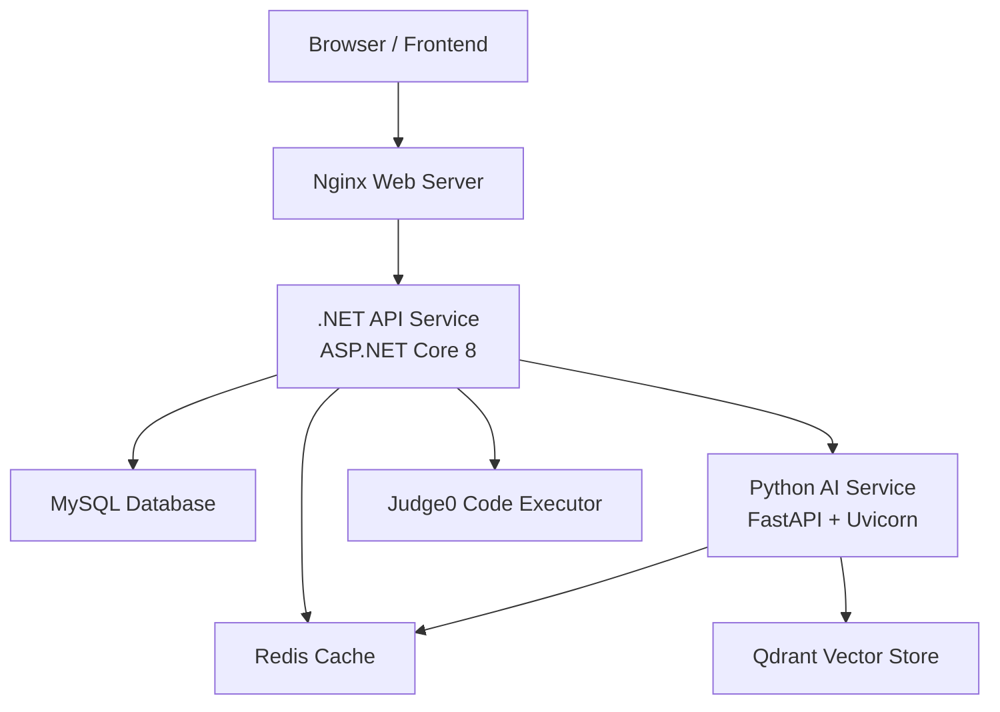
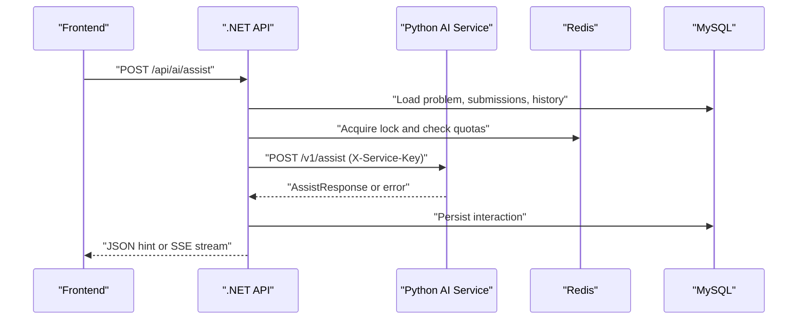
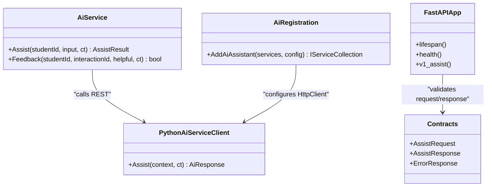
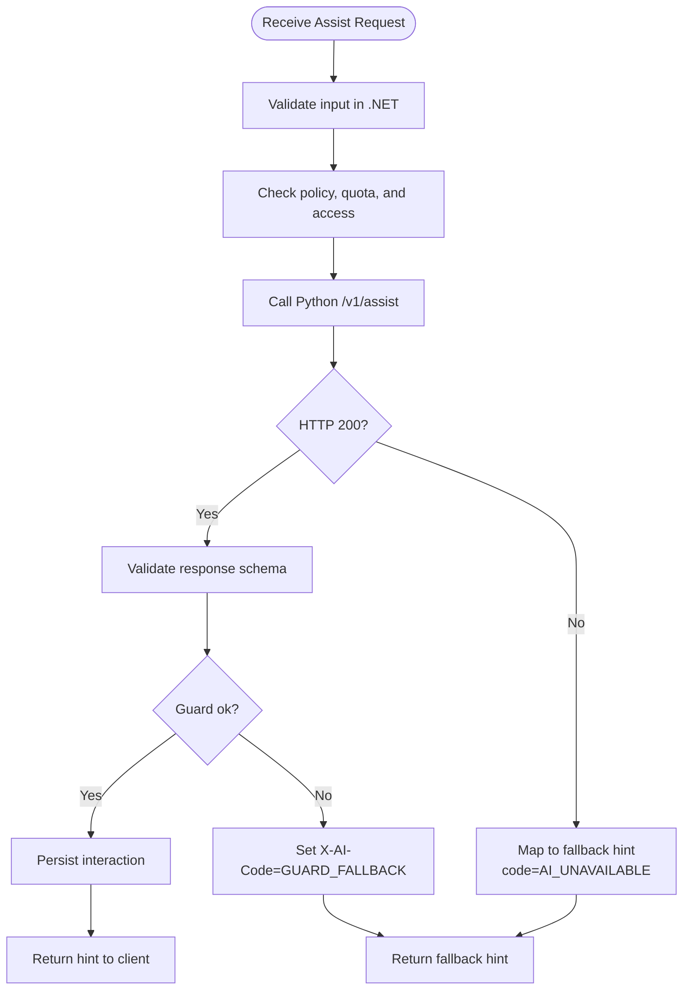
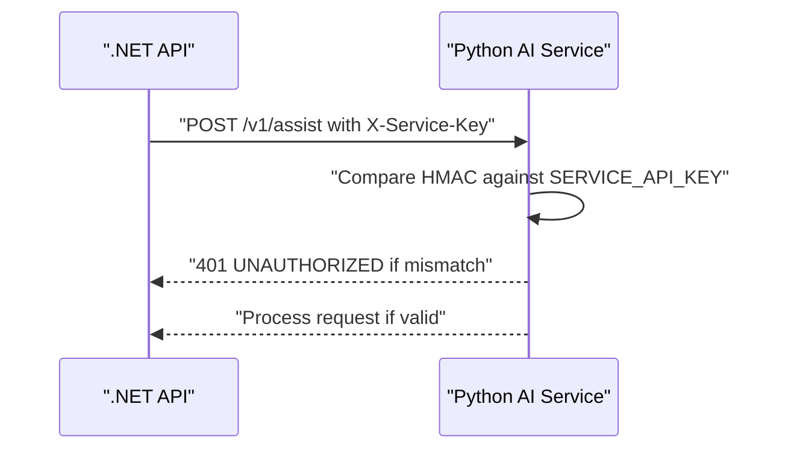
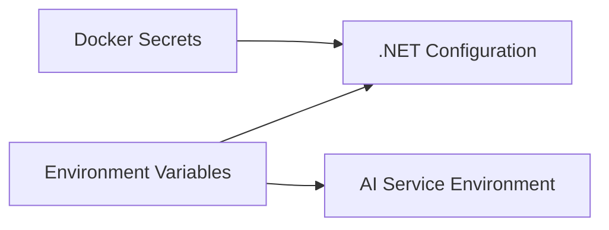
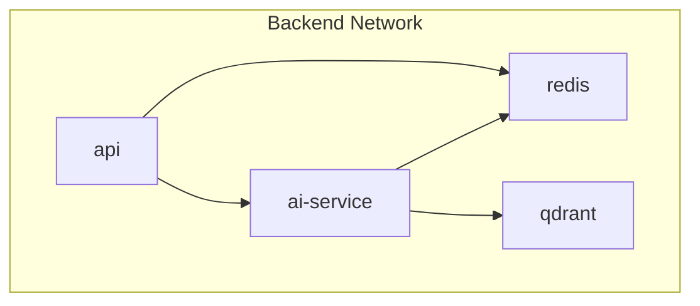
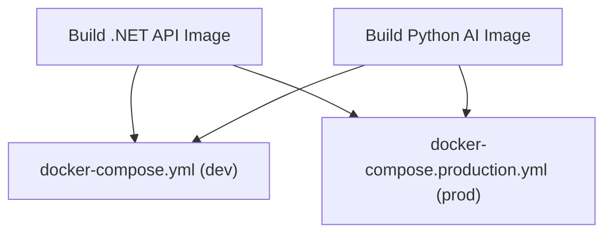
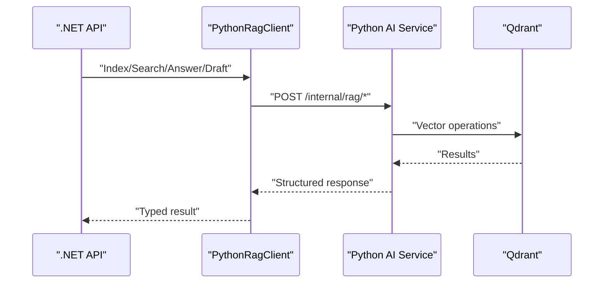
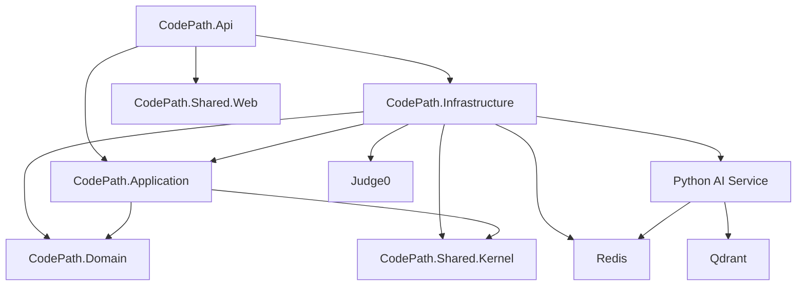

# Microservices Architecture

<cite>
**Referenced Files in This Document**
- [ai-service/Dockerfile](file://ai-service/Dockerfile)
- [api/Dockerfile](file://api/Dockerfile)
- [api/docker-compose.yml](file://api/docker-compose.yml)
- [api/docker-compose.production.yml](file://api/docker-compose.production.yml)
- [api/docs/ARCHITECTURE.md](file://api/docs/ARCHITECTURE.md)
- [ai-service/app/main.py](file://ai-service/app/main.py)
- [ai-service/app/contracts.py](file://ai-service/app/contracts.py)
- [ai-service/openapi.json](file://ai-service/openapi.json)
- [ai-service/app/rag/routes.py](file://ai-service/app/rag/routes.py)
- [ai-service/app/rag/service.py](file://ai-service/app/rag/service.py)
- [ai-service/README.md](file://ai-service/README.md)
- [api/src/Infrastructure/CodePath.Infrastructure/Ai/AiRegistration.cs](file://api/src/Infrastructure/CodePath.Infrastructure/Ai/AiRegistration.cs)
- [api/src/Infrastructure/CodePath.Infrastructure/Ai/PythonAiServiceClient.cs](file://api/src/Infrastructure/CodePath.Infrastructure/Ai/PythonAiServiceClient.cs)
- [api/src/Infrastructure/CodePath.Infrastructure/Ai/AiService.cs](file://api/src/Infrastructure/CodePath.Infrastructure/Ai/AiService.cs)
- [api/src/Infrastructure/CodePath.Infrastructure/Learning/PythonRagClient.cs](file://api/src/Infrastructure/CodePath.Infrastructure/Learning/PythonRagClient.cs)
- [api/src/Application/CodePath.Application/Learning/RagContracts.cs](file://api/src/Application/CodePath.Application/Learning/RagContracts.cs)
</cite>

## Table of Contents
1. [Introduction](#introduction)
2. [Project Structure](#project-structure)
3. [Core Components](#core-components)
4. [Architecture Overview](#architecture-overview)
5. [Detailed Component Analysis](#detailed-component-analysis)
6. [Dependency Analysis](#dependency-analysis)
7. [Performance Considerations](#performance-considerations)
8. [Troubleshooting Guide](#troubleshooting-guide)
9. [Conclusion](#conclusion)

## Introduction
This document explains CodePart’s microservices architecture, focusing on the separation between the main .NET API service and the Python AI service. It covers why this split was chosen, how the services communicate through REST APIs, how errors propagate, and how Docker and docker-compose containerize and orchestrate the system. It also documents inter-service authentication, configuration management, deployment considerations, scaling strategies, and monitoring approaches for the distributed system.

The .NET API owns user identity, authorization, domain logic, persistence, code execution coordination, and public HTTP endpoints. The Python service owns AI hint generation, prompt construction, LLM provider integration, RAG indexing/search, and model-based classification. This separation isolates AI runtime characteristics, dependency lifecycles, and failure modes from the core application while keeping a stable, strongly typed contract.

## Project Structure
At a high level, the repository contains:
- A .NET API project under `api` with Clean Architecture layers: Api, Application, Domain, Infrastructure, and Shared projects.
- A Python AI service under `ai-service` exposing FastAPI endpoints for assist and internal RAG operations.
- Frontend assets under `frontend`.
- Container definitions for development and production under `api/docker-compose*.yml`, plus per-service Dockerfiles.

**Diagram sources**
- [api/Dockerfile:1-29](file://api/Dockerfile#L1-L29)
- [ai-service/Dockerfile:1-11](file://ai-service/Dockerfile#L1-L11)
- [api/docker-compose.production.yml:64-126](file://api/docker-compose.production.yml#L64-L126)
- [api/docker-compose.production.yml:144-210](file://api/docker-compose.production.yml#L144-L210)

**Section sources**
- [api/docs/ARCHITECTURE.md:5-20](file://api/docs/ARCHITECTURE.md#L5-L20)
- [api/docs/ARCHITECTURE.md:42-43](file://api/docs/ARCHITECTURE.md#L42-L43)

## Core Components
- .NET API service: ASP.NET Core 8 application implementing Clean Architecture, JWT authentication, rate limiting, health checks, and external integrations including the Python AI service and optional Judge0 executor.
- Python AI service: FastAPI application providing guarded AI hints, LLM provider abstraction, RAG indexing/search, and Redis-backed caching.
- Shared infrastructure: Redis for caching, quotas, and locking; MySQL for relational data; Qdrant for vector search used by RAG.

Key responsibilities:
- .NET API enforces business rules, user permissions, quota policies, and orchestrates calls to AI and code execution services.
- Python AI validates input contracts, builds prompts, runs guard heuristics, calls LLM providers, and returns structured hints or fallback responses.

**Section sources**
- [api/docs/ARCHITECTURE.md:5-20](file://api/docs/ARCHITECTURE.md#L5-L20)
- [ai-service/README.md:1-5](file://ai-service/README.md#L1-L5)

## Architecture Overview
The system uses synchronous REST communication between services. The .NET API is the public-facing boundary; the Python AI service is an internal service accessed over the backend network. Authentication between services uses a shared secret header. Configuration is provided via environment variables and Docker secrets. Health endpoints are exposed for orchestration and readiness checks.

**Diagram sources**
- [api/src/Infrastructure/CodePath.Infrastructure/Ai/AiService.cs:22-113](file://api/src/Infrastructure/CodePath.Infrastructure/Ai/AiService.cs#L22-L113)
- [api/src/Infrastructure/CodePath.Infrastructure/Ai/PythonAiServiceClient.cs:8-39](file://api/src/Infrastructure/CodePath.Infrastructure/Ai/PythonAiServiceClient.cs#L8-L39)
- [ai-service/app/main.py:56-81](file://ai-service/app/main.py#L56-L81)

## Detailed Component Analysis

### Separation Between .NET API and Python AI Service
The .NET API focuses on user management, authorization, domain entities, database persistence, code execution orchestration, and public HTTP/SSE endpoints. The Python AI service focuses on text analysis, prompt engineering, LLM provider integration, guard heuristics, and RAG retrieval. This separation provides:
- Isolation of AI dependencies and runtime behavior.
- Independent scaling and resource limits for AI workloads.
- Clear boundaries for security and data minimization.
- Stable contracts via OpenAPI and Pydantic models.

**Diagram sources**
- [api/src/Infrastructure/CodePath.Infrastructure/Ai/AiService.cs:18-124](file://api/src/Infrastructure/CodePath.Infrastructure/Ai/AiService.cs#L18-L124)
- [api/src/Infrastructure/CodePath.Infrastructure/Ai/PythonAiServiceClient.cs:6-40](file://api/src/Infrastructure/CodePath.Infrastructure/Ai/PythonAiServiceClient.cs#L6-L40)
- [api/src/Infrastructure/CodePath.Infrastructure/Ai/AiRegistration.cs:7-24](file://api/src/Infrastructure/CodePath.Infrastructure/Ai/AiRegistration.cs#L7-L24)
- [ai-service/app/main.py:17-84](file://ai-service/app/main.py#L17-L84)
- [ai-service/app/contracts.py:72-100](file://ai-service/app/contracts.py#L72-L100)

**Section sources**
- [api/docs/ARCHITECTURE.md:5-20](file://api/docs/ARCHITECTURE.md#L5-L20)
- [ai-service/README.md:39-50](file://ai-service/README.md#L39-L50)

### Communication Patterns: REST APIs, Request/Response, Error Propagation
- Public endpoint: `.NET API` exposes `/api/ai/assist` and related endpoints for clients.
- Internal endpoint: `Python AI Service` exposes `/v1/assist` and internal RAG routes under `/internal/rag/*`.
- Authentication: Both sides validate a shared secret header `X-Service-Key`.
- Contract: Strongly typed via Pydantic models in Python and JSON schema in OpenAPI.
- Error propagation:
  - Python returns `INVALID_CONTEXT` (422) and `AI_UNAVAILABLE` (503).
  - .NET maps unavailable or malformed responses to a rule-based fallback hint and sets `code=AI_UNAVAILABLE`.
  - Guard failures return `guardStatus=fallback` and header `X-AI-Code=GUARD_FALLBACK`; .NET surfaces `code=GUARD_FALLBACK`.

**Diagram sources**
- [api/src/Infrastructure/CodePath.Infrastructure/Ai/AiService.cs:22-113](file://api/src/Infrastructure/CodePath.Infrastructure/Ai/AiService.cs#L22-L113)
- [api/src/Infrastructure/CodePath.Infrastructure/Ai/PythonAiServiceClient.cs:8-39](file://api/src/Infrastructure/CodePath.Infrastructure/Ai/PythonAiServiceClient.cs#L8-L39)
- [ai-service/app/main.py:48-81](file://ai-service/app/main.py#L48-L81)

**Section sources**
- [ai-service/README.md:39-50](file://ai-service/README.md#L39-L50)
- [ai-service/openapi.json:24-75](file://ai-service/openapi.json#L24-L75)

### Inter-Service Authentication Mechanism
- Header-based authentication using `X-Service-Key`.
- Python validates the key at startup and on each request; missing or invalid keys result in `UNAUTHORIZED`.
- .NET configures a named `HttpClient` with base address and default header for AI calls.
- Secrets are injected via environment variables and Docker secrets in production.

**Diagram sources**
- [ai-service/app/main.py:45-59](file://ai-service/app/main.py#L45-L59)
- [api/src/Infrastructure/CodePath.Infrastructure/Ai/AiRegistration.cs:15-18](file://api/src/Infrastructure/CodePath.Infrastructure/Ai/AiRegistration.cs#L15-L18)

**Section sources**
- [ai-service/app/main.py:45-59](file://ai-service/app/main.py#L45-L59)
- [api/src/Infrastructure/CodePath.Infrastructure/Ai/AiRegistration.cs:9-24](file://api/src/Infrastructure/CodePath.Infrastructure/Ai/AiRegistration.cs#L9-L24)

### Configuration Management
- Environment variables drive service behavior:
  - AI service: `SERVICE_API_KEY`, `LLM_PROVIDER`, `LLM_MODEL`, `LLM_ADVANCED_MODEL`, `LLM_BASE_URL`, `REDIS_URL`, embedding/Qdrant settings.
  - .NET API: `Ai__BaseUrl`, `Ai__ServiceKey`, `Ai__AnonymizationKey`, `Jwt_*`, `Database_*`, `Cors_*`, `ReverseProxy_*`, email and Judge0 settings.
- Production secrets are mounted as files under `/run/secrets` and normalized into configuration.
- Compose files define profiles (`ai`, `rag`) and required environment variables.

**Diagram sources**
- [api/src/Infrastructure/CodePath.Infrastructure/Ai/AiRegistration.cs:11-13](file://api/src/Infrastructure/CodePath.Infrastructure/Ai/AiRegistration.cs#L11-L13)
- [api/docker-compose.production.yml:69-126](file://api/docker-compose.production.yml#L69-L126)
- [api/docker-compose.production.yml:159-168](file://api/docker-compose.production.yml#L159-L168)

**Section sources**
- [api/src/Infrastructure/CodePath.Infrastructure/Ai/AiRegistration.cs:9-24](file://api/src/Infrastructure/CodePath.Infrastructure/Ai/AiRegistration.cs#L9-L24)
- [api/docker-compose.production.yml:64-126](file://api/docker-compose.production.yml#L64-L126)
- [api/docker-compose.production.yml:144-193](file://api/docker-compose.production.yml#L144-L193)

### Service Discovery and Networking
- Services communicate over a private Docker network named `backend`.
- DNS names resolve within the compose network: `ai-service`, `redis`, `qdrant`.
- Development compose exposes ports locally for debugging; production does not publish internal service ports.

**Diagram sources**
- [api/docker-compose.production.yml:217-223](file://api/docker-compose.production.yml#L217-L223)
- [api/docker-compose.production.yml:64-126](file://api/docker-compose.production.yml#L64-L126)
- [api/docker-compose.production.yml:144-210](file://api/docker-compose.production.yml#L144-L210)

**Section sources**
- [api/docker-compose.production.yml:217-223](file://api/docker-compose.production.yml#L217-L223)

### Containerization Strategy and Orchestration
- .NET API Dockerfile builds a multi-stage image and runs ASP.NET Core on port 8080.
- Python AI Dockerfile installs dependencies with `uv`, runs non-root, and starts Uvicorn on port 8000.
- Development compose includes Redis and optional AI/RAG profiles; production compose is standalone and includes web proxy, API, Redis, AI, indexer, and Qdrant.

**Diagram sources**
- [api/Dockerfile:1-29](file://api/Dockerfile#L1-L29)
- [ai-service/Dockerfile:1-11](file://ai-service/Dockerfile#L1-L11)
- [api/docker-compose.yml:1-112](file://api/docker-compose.yml#L1-L112)
- [api/docker-compose.production.yml:1-241](file://api/docker-compose.production.yml#L1-L241)

**Section sources**
- [api/Dockerfile:1-29](file://api/Dockerfile#L1-L29)
- [ai-service/Dockerfile:1-11](file://ai-service/Dockerfile#L1-L11)
- [api/docker-compose.yml:1-112](file://api/docker-compose.yml#L1-L112)
- [api/docker-compose.production.yml:1-241](file://api/docker-compose.production.yml#L1-L241)

### RAG Integration and Indexing
- .NET API uses `IRagClient` implemented by `PythonRagClient` to call internal RAG endpoints for indexing, deletion, search, answer, and draft generation.
- Python RAG routes authenticate requests, enforce timeouts, and delegate to `RagService`, which interacts with Qdrant and embedding providers.

**Diagram sources**
- [api/src/Infrastructure/CodePath.Infrastructure/Learning/PythonRagClient.cs:7-49](file://api/src/Infrastructure/CodePath.Infrastructure/Learning/PythonRagClient.cs#L7-L49)
- [ai-service/app/rag/routes.py:7-37](file://ai-service/app/rag/routes.py#L7-L37)
- [ai-service/app/rag/service.py:13-36](file://ai-service/app/rag/service.py#L13-L36)

**Section sources**
- [api/src/Application/CodePath.Application/Learning/RagContracts.cs:23-40](file://api/src/Application/CodePath.Application/Learning/RagContracts.cs#L23-L40)
- [api/src/Infrastructure/CodePath.Infrastructure/Learning/PythonRagClient.cs:7-49](file://api/src/Infrastructure/CodePath.Infrastructure/Learning/PythonRagClient.cs#L7-L49)
- [ai-service/app/rag/routes.py:7-37](file://ai-service/app/rag/routes.py#L7-L37)
- [ai-service/app/rag/service.py:13-36](file://ai-service/app/rag/service.py#L13-L36)

## Dependency Analysis
The .NET API depends on:
- Application layer for commands, queries, DTOs, and interfaces.
- Infrastructure layer for persistence, Redis, JWT, and external clients.
- Python AI service via `IAiAssistantClient` configured with Polly circuit breaker and retry.
- Optional Judge0 for code execution.

The Python AI service depends on:
- LLM providers via abstracted client.
- Redis for caching and optional classifier/model loading.
- Qdrant for vector storage when RAG is enabled.

**Diagram sources**
- [api/docs/ARCHITECTURE.md:5-20](file://api/docs/ARCHITECTURE.md#L5-L20)
- [api/src/Infrastructure/CodePath.Infrastructure/Ai/AiRegistration.cs:15-22](file://api/src/Infrastructure/CodePath.Infrastructure/Ai/AiRegistration.cs#L15-L22)
- [api/docker-compose.production.yml:64-126](file://api/docker-compose.production.yml#L64-L126)
- [api/docker-compose.production.yml:144-210](file://api/docker-compose.production.yml#L144-L210)

**Section sources**
- [api/docs/ARCHITECTURE.md:5-20](file://api/docs/ARCHITECTURE.md#L5-L20)
- [api/src/Infrastructure/CodePath.Infrastructure/Ai/AiRegistration.cs:7-24](file://api/src/Infrastructure/CodePath.Infrastructure/Ai/AiRegistration.cs#L7-L24)

## Performance Considerations
- Concurrency and timeouts:
  - Python AI service limits concurrency and enforces a 19-second deadline per assist request.
  - .NET API sets a 20-second HttpClient timeout and applies circuit breaker and retry policies for transient failures.
- Resource constraints:
  - AI service containers are limited to 1 CPU and 768 MB memory; indexer has 1 GB memory.
  - Read-only filesystems, dropped capabilities, and non-root users reduce attack surface.
- Caching and quotas:
  - Redis-backed atomic scripts enforce daily and per-minute quotas and per-user locks.
  - Hint cache reduces repeated LLM calls with guard revalidation.
- External service resilience:
  - Circuit breaker protects against cascading failures when AI is unavailable.
  - Rule-based fallback ensures user experience even when AI fails.

[No sources needed since this section provides general guidance]

## Troubleshooting Guide
Common issues and diagnostics:
- Unauthorized AI calls:
  - Ensure `SERVICE_API_KEY` matches across services and headers include `X-Service-Key`.
- AI service unhealthy:
  - Check `/health` endpoint and container logs; verify Redis connectivity and LLM provider credentials.
- Quota exceeded or rate-limited:
  - Inspect Redis keys for daily and per-minute counters; adjust policy thresholds if necessary.
- RAG indexing errors:
  - Review allowed error codes and payload sizes; ensure Qdrant API key and embedding settings are correct.
- .NET API health:
  - Use `/health` and `/health/live`; verify Redis health endpoint and forwarded headers configuration.

**Section sources**
- [ai-service/app/main.py:48-62](file://ai-service/app/main.py#L48-L62)
- [api/src/Infrastructure/CodePath.Infrastructure/Ai/PythonAiServiceClient.cs:8-39](file://api/src/Infrastructure/CodePath.Infrastructure/Ai/PythonAiServiceClient.cs#L8-L39)
- [api/src/Infrastructure/CodePath.Infrastructure/Ai/AiService.cs:34-63](file://api/src/Infrastructure/CodePath.Infrastructure/Ai/AiService.cs#L34-L63)
- [ai-service/app/rag/routes.py:10-37](file://ai-service/app/rag/routes.py#L10-L37)

## Conclusion
CodePart’s microservices design separates the .NET API and Python AI service to isolate concerns, improve reliability, and enable independent scaling. Communication occurs over secure REST APIs with explicit contracts, strong validation, and robust error handling. Docker and docker-compose provide consistent environments and profiles for development and production. Configuration is centralized via environment variables and secrets, and inter-service authentication relies on a shared secret header. Monitoring and resilience are achieved through health endpoints, timeouts, retries, circuit breakers, and rule-based fallbacks.

[No sources needed since this section summarizes without analyzing specific files]