# Security Architecture

<cite>
**Referenced Files in This Document**
- [Program.cs](file://api/src/Api/CodePath.Api/Program.cs)
- [ActiveUserAuthorization.cs](file://api/src/Api/CodePath.Api/Authorization/ActiveUserAuthorization.cs)
- [AuthEndpoints.cs](file://api/src/Api/CodePath.Api/Endpoints/AuthEndpoints.cs)
- [DependencyInjection.cs](file://api/src/Application/CodePath.Application/DependencyInjection.cs)
- [SessionActivityService.cs](file://api/src/Application/CodePath.Application/Auth/Services/SessionActivityService.cs)
- [DependencyInjection.cs](file://api/src/Infrastructure/CodePath.Infrastructure/DependencyInjection.cs)
- [JwtOptions.cs](file://api/src/Infrastructure/CodePath.Infrastructure/Auth/Options/JwtOptions.cs)
- [PasswordHashingOptions.cs](file://api/src/Infrastructure/CodePath.Infrastructure/Auth/Options/PasswordHashingOptions.cs)
- [LoginSecurityOptions.cs](file://api/src/Infrastructure/CodePath.Infrastructure/Auth/Options/LoginSecurityOptions.cs)
- [BCryptPasswordHasher.cs](file://api/src/Infrastructure/CodePath.Infrastructure/Auth/Services/Passwords/BCryptPasswordHasher.cs)
- [RedisOtpService.cs](file://api/src/Infrastructure/CodePath.Infrastructure/Auth/Services/Otp/RedisOtpService.cs)
- [RedisLoginAttemptService.cs](file://api/src/Infrastructure/CodePath.Infrastructure/Auth/Services/LoginProtection/RedisLoginAttemptService.cs)
- [InMemoryLoginAttemptService.cs](file://api/src/Infrastructure/CodePath.Infrastructure/Auth/Services/LoginProtection/InMemoryLoginAttemptService.cs)
- [JwtTokenService.cs](file://api/src/Infrastructure/CodePath.Infrastructure/Auth/Services/Tokens/JwtTokenService.cs)
- [AuditLog.cs](file://api/src/Domain/CodePath.Domain/Auditing/Entities/AuditLog.cs)
- [AuditLogConfiguration.cs](file://api/src/Infrastructure/CodePath.Infrastructure/Persistence/Configurations/AuditLogConfiguration.cs)
- [ListAuditLogsQuery.cs](file://api/src/Application/CodePath.Application/Admin/Queries/ListAuditLogsQuery.cs)
- [default.conf](file://frontend/nginx/default.conf)
</cite>

## Table of Contents
1. [Introduction](#introduction)
2. [Project Structure](#project-structure)
3. [Core Components](#core-components)
4. [Architecture Overview](#architecture-overview)
5. [Detailed Component Analysis](#detailed-component-analysis)
6. [Dependency Analysis](#dependency-analysis)
7. [Performance Considerations](#performance-considerations)
8. [Troubleshooting Guide](#troubleshooting-guide)
9. [Conclusion](#conclusion)
10. [Appendices](#appendices)

## Introduction
This document describes the multi-layered security architecture for CodePart, focusing on authentication, authorization, session management, input validation, rate limiting, secure communication, and auditability. The system uses JWT-based access tokens with server-side session enforcement, role-based policies, BCrypt password hashing, OTP verification via Redis, login attempt protection with exponential backoff, strict CORS configuration, HTTP security headers at the reverse proxy, and structured audit logging.

## Project Structure
The security-relevant code is primarily in the API layer:
- Program.cs configures authentication, authorization, CORS, forwarded headers, HTTPS redirection, HSTS, and global rate limiting.
- Application layer contains MediatR pipelines, validators, and session activity logic.
- Infrastructure layer provides implementations for password hashing, OTP, login protection, token generation, and persistence.
- Domain defines audit entities and enums.
- Frontend Nginx reverse proxy enforces TLS, security headers, and CSP.

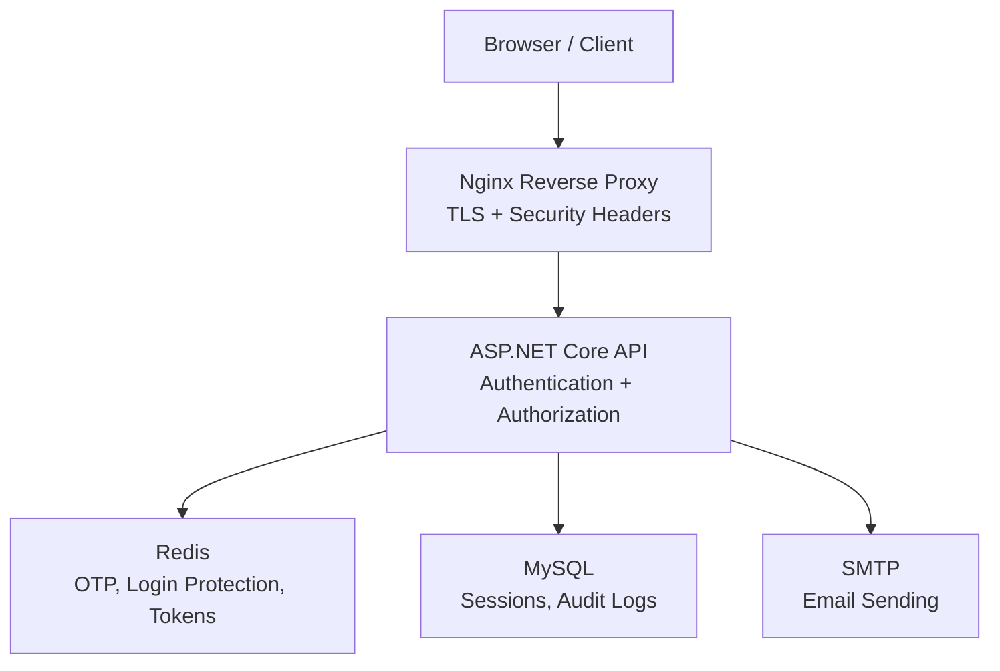

**Diagram sources**
- [Program.cs:71-158](file://api/src/Api/CodePath.Api/Program.cs#L71-L158)
- [Program.cs:160-182](file://api/src/Api/CodePath.Api/Program.cs#L160-L182)
- [Program.cs:224-243](file://api/src/Api/CodePath.Api/Program.cs#L224-L243)
- [Program.cs:251-359](file://api/src/Api/CodePath.Api/Program.cs#L251-L359)
- [DependencyInjection.cs:137-217](file://api/src/Infrastructure/CodePath.Infrastructure/DependencyInjection.cs#L137-L217)
- [default.conf:18-48](file://frontend/nginx/default.conf#L18-L48)

**Section sources**
- [Program.cs:28-158](file://api/src/Api/CodePath.Api/Program.cs#L28-L158)
- [Program.cs:160-243](file://api/src/Api/CodePath.Api/Program.cs#L160-L243)
- [Program.cs:251-359](file://api/src/Api/CodePath.Api/Program.cs#L251-L359)
- [DependencyInjection.cs:137-217](file://api/src/Infrastructure/CodePath.Infrastructure/DependencyInjection.cs#L137-L217)
- [default.conf:18-48](file://frontend/nginx/default.conf#L18-L48)

## Core Components
- JWT Authentication: Validates issuer, audience, signature algorithm, lifetime, and revocation state; integrates with a token blacklist and user session version check.
- Role-Based Authorization: Policies enforce roles and active user status without redundant database queries per request.
- Session Management: Refresh tokens are stored hashed; sessions have absolute and rolling expiry, idle timeout, and activity throttling.
- Password Hashing: BCrypt with configurable work factor and rehash detection.
- OTP Verification: Atomic issuance and verification using Redis Lua scripts with attempt limits, cooldowns, and hourly quotas.
- Login Attempt Protection: Per email+IP failure counters with exponential backoff and Redis fallback to in-memory.
- Rate Limiting: Global and endpoint-specific policies (auth, login, password reset, health, public read, code execution).
- Secure Communication: TLS termination at Nginx, HSTS, strict forwarded headers, and CORS allowlists.
- Input Validation: FluentValidation rules applied through MediatR behaviors.
- SQL Injection Prevention: Parameterized EF Core queries and typed configurations.
- Audit Logging: Structured domain entity persisted with indexes and admin query support.

**Section sources**
- [Program.cs:71-158](file://api/src/Api/CodePath.Api/Program.cs#L71-L158)
- [Program.cs:184-199](file://api/src/Api/CodePath.Api/Program.cs#L184-L199)
- [SessionActivityService.cs:6-38](file://api/src/Application/CodePath.Application/Auth/Services/SessionActivityService.cs#L6-L38)
- [BCryptPasswordHasher.cs:7-31](file://api/src/Infrastructure/CodePath.Infrastructure/Auth/Services/Passwords/BCryptPasswordHasher.cs#L7-L31)
- [RedisOtpService.cs:7-152](file://api/src/Infrastructure/CodePath.Infrastructure/Auth/Services/Otp/RedisOtpService.cs#L7-L152)
- [RedisLoginAttemptService.cs:9-155](file://api/src/Infrastructure/CodePath.Infrastructure/Auth/Services/LoginProtection/RedisLoginAttemptService.cs#L9-L155)
- [Program.cs:251-359](file://api/src/Api/CodePath.Api/Program.cs#L251-L359)
- [Program.cs:160-182](file://api/src/Api/CodePath.Api/Program.cs#L160-L182)
- [Program.cs:224-243](file://api/src/Api/CodePath.Api/Program.cs#L224-L243)
- [DependencyInjection.cs:13-18](file://api/src/Application/CodePath.Application/DependencyInjection.cs#L13-L18)
- [DependencyInjection.cs:97-106](file://api/src/Infrastructure/CodePath.Infrastructure/DependencyInjection.cs#L97-L106)
- [AuditLog.cs:7-47](file://api/src/Domain/CodePath.Domain/Auditing/Entities/AuditLog.cs#L7-L47)

## Architecture Overview
The API enforces authentication before authorization, applies rate limiting, and tracks session activity. Nginx terminates TLS and adds security headers. Redis provides distributed state for OTP, login protection, and token blacklisting. MySQL stores sessions and audit logs.

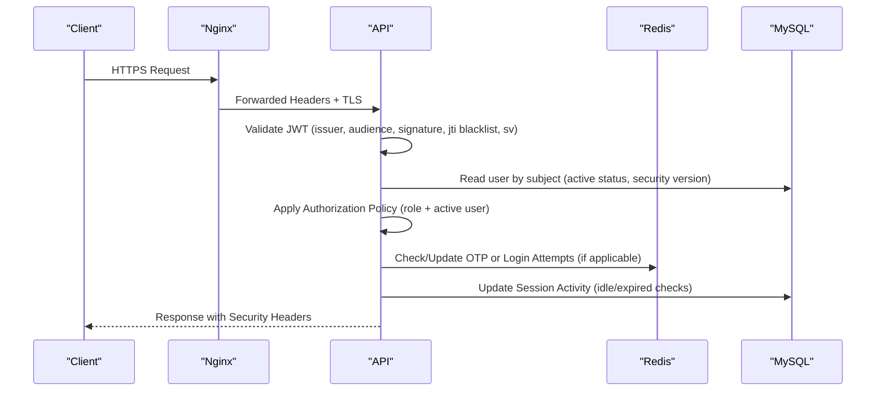

**Diagram sources**
- [Program.cs:71-158](file://api/src/Api/CodePath.Api/Program.cs#L71-L158)
- [Program.cs:387-423](file://api/src/Api/CodePath.Api/Program.cs#L387-L423)
- [SessionActivityService.cs:18-37](file://api/src/Application/CodePath.Application/Auth/Services/SessionActivityService.cs#L18-L37)
- [RedisOtpService.cs:85-152](file://api/src/Infrastructure/CodePath.Infrastructure/Auth/Services/Otp/RedisOtpService.cs#L85-L152)
- [RedisLoginAttemptService.cs:51-88](file://api/src/Infrastructure/CodePath.Infrastructure/Auth/Services/LoginProtection/RedisLoginAttemptService.cs#L51-L88)

## Detailed Component Analysis

### JWT Authentication and Token Lifecycle
- Configuration validates minimum signing key length and required fields.
- JWT validation enforces issuer, audience, algorithm, lifetime, and signed tokens.
- On token validation, the service checks JTI against a blacklist and verifies user status and security version.
- Access tokens include role, status, security version, and optional session ID; refresh tokens are generated and hashed before storage.

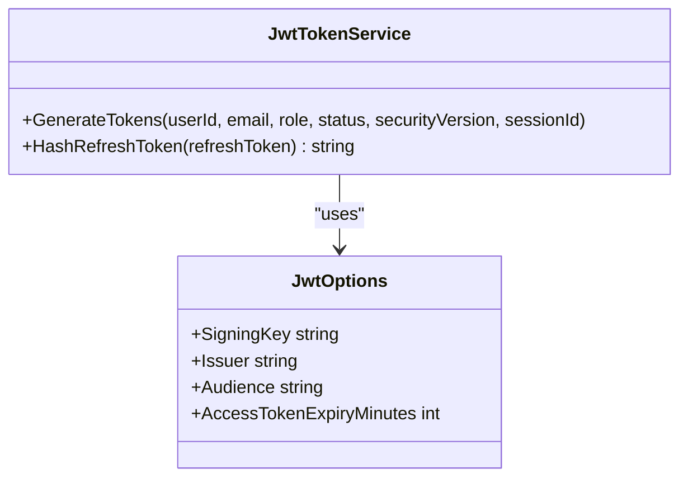

**Diagram sources**
- [JwtTokenService.cs:13-78](file://api/src/Infrastructure/CodePath.Infrastructure/Auth/Services/Tokens/JwtTokenService.cs#L13-L78)
- [JwtOptions.cs:8-24](file://api/src/Infrastructure/CodePath.Infrastructure/Auth/Options/JwtOptions.cs#L8-L24)

**Section sources**
- [Program.cs:63-118](file://api/src/Api/CodePath.Api/Program.cs#L63-L118)
- [JwtTokenService.cs:24-76](file://api/src/Infrastructure/CodePath.Infrastructure/Auth/Services/Tokens/JwtTokenService.cs#L24-L76)
- [JwtOptions.cs:8-24](file://api/src/Infrastructure/CodePath.Infrastructure/Auth/Options/JwtOptions.cs#L8-L24)

### Role-Based Authorization and Active User Enforcement
- Policies require authenticated users and optionally specific roles.
- ActiveUserRequirement ensures the user is active and matches the required role when specified.
- The handler avoids extra DB calls by relying on authentication-time validations.

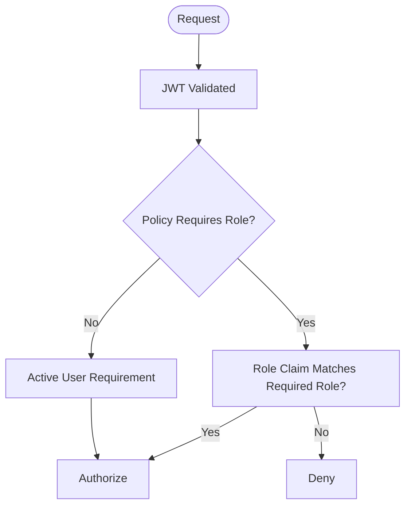

**Diagram sources**
- [Program.cs:184-199](file://api/src/Api/CodePath.Api/Program.cs#L184-L199)
- [ActiveUserAuthorization.cs:6-35](file://api/src/Api/CodePath.Api/Authorization/ActiveUserAuthorization.cs#L6-L35)

**Section sources**
- [Program.cs:184-199](file://api/src/Api/CodePath.Api/Program.cs#L184-L199)
- [ActiveUserAuthorization.cs:6-35](file://api/src/Api/CodePath.Api/Authorization/ActiveUserAuthorization.cs#L6-L35)

### Session Management and Idle Timeout
- Sessions track absolute and rolling expiration, revocation, and last activity.
- SessionActivityService validates tokens, revokes expired/idle sessions, and throttles activity updates.
- Cookie options enforce HttpOnly, Secure, and SameSite based on configuration.

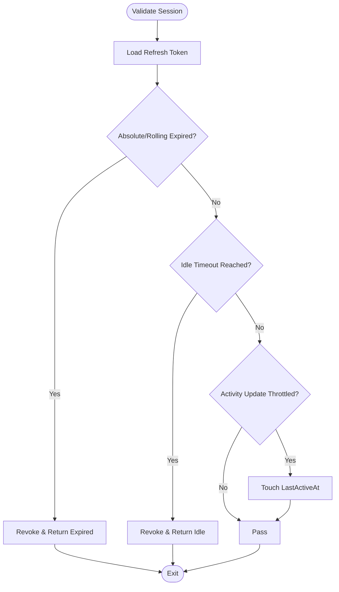

**Diagram sources**
- [SessionActivityService.cs:6-38](file://api/src/Application/CodePath.Application/Auth/Services/SessionActivityService.cs#L6-L38)
- [AuthEndpoints.cs:63-87](file://api/src/Api/CodePath.Api/Endpoints/AuthEndpoints.cs#L63-L87)

**Section sources**
- [SessionActivityService.cs:6-38](file://api/src/Application/CodePath.Application/Auth/Services/SessionActivityService.cs#L6-L38)
- [AuthEndpoints.cs:63-87](file://api/src/Api/CodePath.Api/Endpoints/AuthEndpoints.cs#L63-L87)

### Password Hashing with BCrypt
- Work factor is configurable and validated at startup.
- Provides hash, verify, needs-rehash, and constant-time dummy verification to mitigate timing attacks.

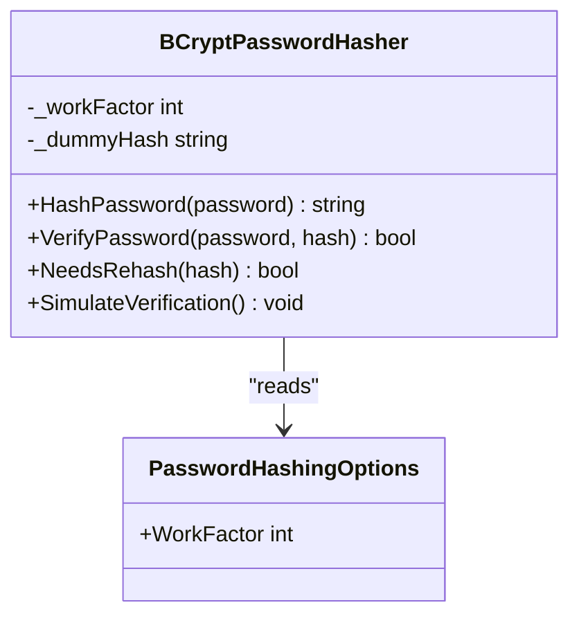

**Diagram sources**
- [BCryptPasswordHasher.cs:7-31](file://api/src/Infrastructure/CodePath.Infrastructure/Auth/Services/Passwords/BCryptPasswordHasher.cs#L7-L31)
- [PasswordHashingOptions.cs:3-8](file://api/src/Infrastructure/CodePath.Infrastructure/Auth/Options/PasswordHashingOptions.cs#L3-L8)

**Section sources**
- [BCryptPasswordHasher.cs:7-31](file://api/src/Infrastructure/CodePath.Infrastructure/Auth/Services/Passwords/BCryptPasswordHasher.cs#L7-L31)
- [PasswordHashingOptions.cs:3-8](file://api/src/Infrastructure/CodePath.Infrastructure/Auth/Options/PasswordHashingOptions.cs#L3-L8)

### OTP Verification Flow
- Issues OTPs atomically with TTL, attempt limits, cooldown, and hourly quota enforced by Redis Lua scripts.
- Verifies OTPs with attempt decrement and clear-on-success semantics.

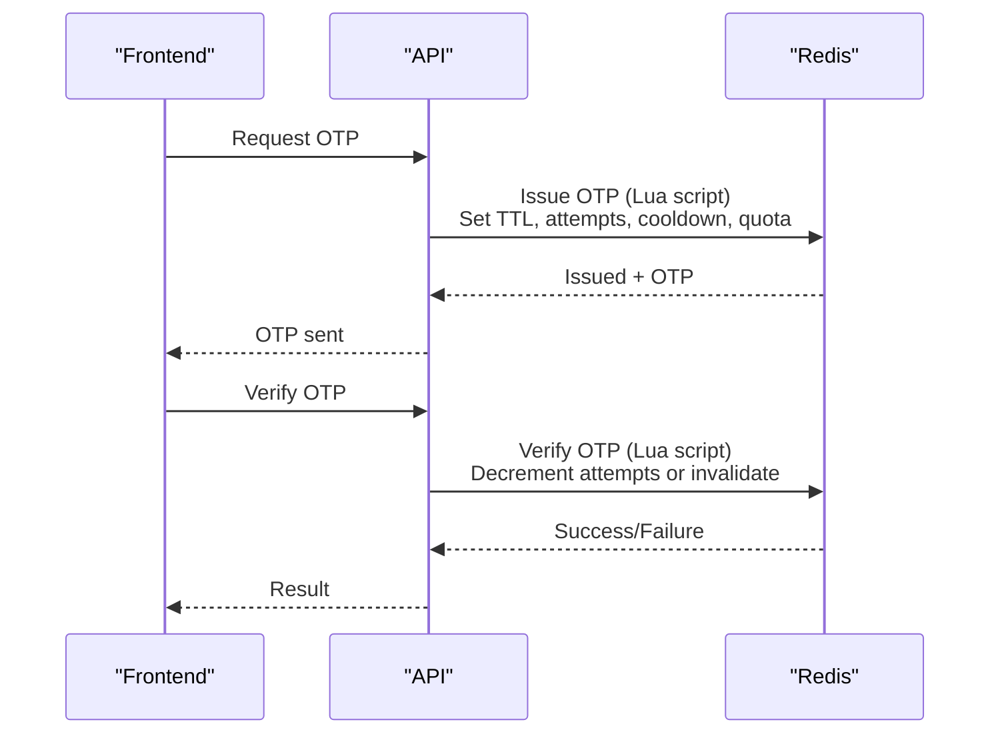

**Diagram sources**
- [RedisOtpService.cs:15-81](file://api/src/Infrastructure/CodePath.Infrastructure/Auth/Services/Otp/RedisOtpService.cs#L15-L81)
- [RedisOtpService.cs:85-152](file://api/src/Infrastructure/CodePath.Infrastructure/Auth/Services/Otp/RedisOtpService.cs#L85-L152)

**Section sources**
- [RedisOtpService.cs:7-152](file://api/src/Infrastructure/CodePath.Infrastructure/Auth/Services/Otp/RedisOtpService.cs#L7-L152)

### Login Attempt Protection Against Brute Force
- Tracks failures per normalized email and IP with exponential backoff.
- Uses Redis Lua scripts for atomicity; falls back to in-memory if Redis is unavailable.

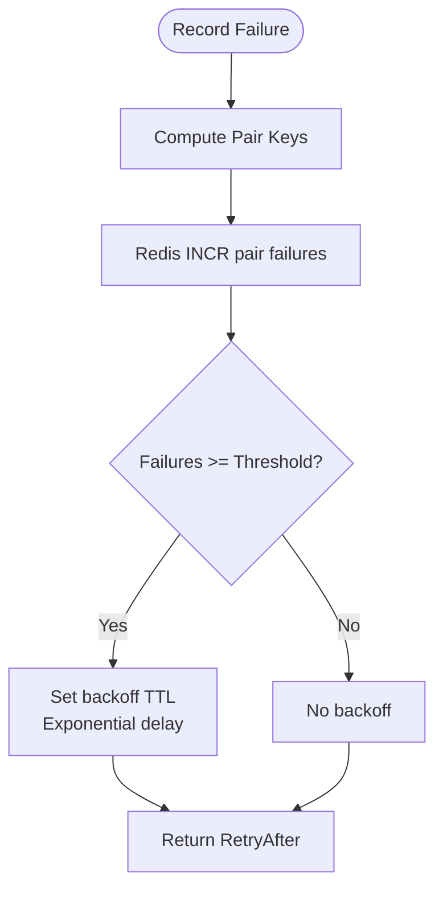

**Diagram sources**
- [RedisLoginAttemptService.cs:20-37](file://api/src/Infrastructure/CodePath.Infrastructure/Auth/Services/LoginProtection/RedisLoginAttemptService.cs#L20-L37)
- [RedisLoginAttemptService.cs:68-88](file://api/src/Infrastructure/CodePath.Infrastructure/Auth/Services/LoginProtection/RedisLoginAttemptService.cs#L68-L88)
- [InMemoryLoginAttemptService.cs:7-37](file://api/src/Infrastructure/CodePath.Infrastructure/Auth/Services/LoginProtection/InMemoryLoginAttemptService.cs#L7-L37)

**Section sources**
- [RedisLoginAttemptService.cs:9-155](file://api/src/Infrastructure/CodePath.Infrastructure/Auth/Services/LoginProtection/RedisLoginAttemptService.cs#L9-L155)
- [InMemoryLoginAttemptService.cs:7-37](file://api/src/Infrastructure/CodePath.Infrastructure/Auth/Services/LoginProtection/InMemoryLoginAttemptService.cs#L7-L37)
- [LoginSecurityOptions.cs:3-11](file://api/src/Infrastructure/CodePath.Infrastructure/Auth/Options/LoginSecurityOptions.cs#L3-L11)

### CORS Policies and Forwarded Headers
- CORS default policy reads allowed origins from configuration; development allows all origins.
- ForwardedHeaders middleware restricts spoofing by configuring known networks/proxies and forward limit.

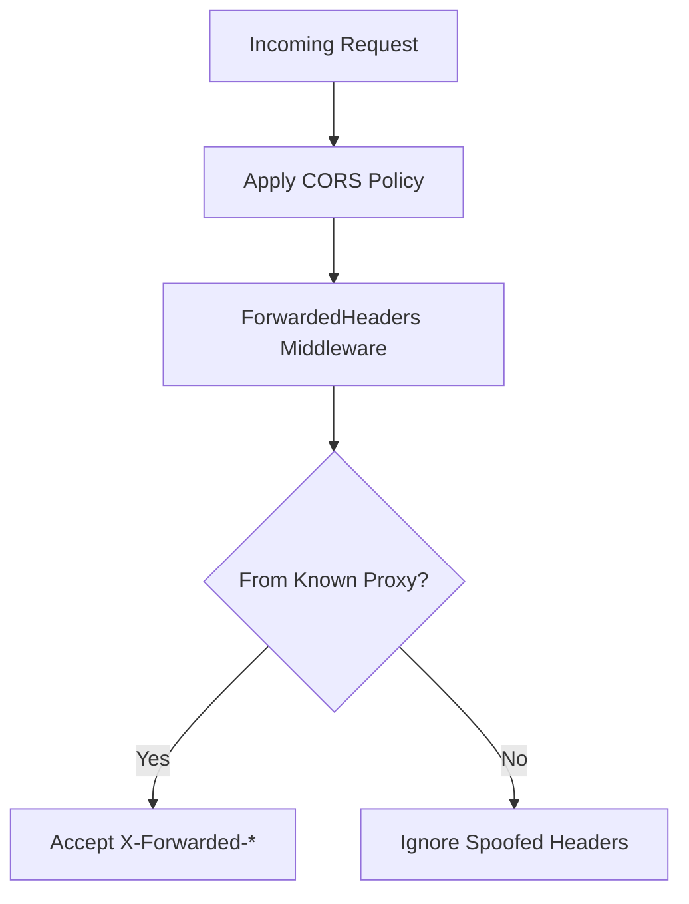

**Diagram sources**
- [Program.cs:160-182](file://api/src/Api/CodePath.Api/Program.cs#L160-L182)
- [Program.cs:224-243](file://api/src/Api/CodePath.Api/Program.cs#L224-L243)

**Section sources**
- [Program.cs:160-182](file://api/src/Api/CodePath.Api/Program.cs#L160-L182)
- [Program.cs:224-243](file://api/src/Api/CodePath.Api/Program.cs#L224-L243)

### Input Validation and SQL Injection Prevention
- FluentValidation rules are registered and executed via MediatR behaviors.
- EF Core configured with parameterized queries and typed mappings prevents SQL injection.

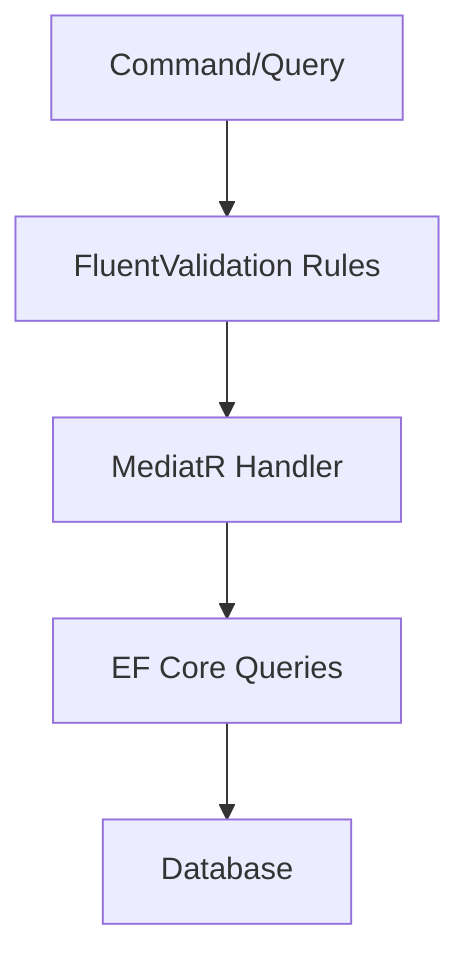

**Diagram sources**
- [DependencyInjection.cs:13-18](file://api/src/Application/CodePath.Application/DependencyInjection.cs#L13-L18)
- [DependencyInjection.cs:97-106](file://api/src/Infrastructure/CodePath.Infrastructure/DependencyInjection.cs#L97-L106)

**Section sources**
- [DependencyInjection.cs:13-18](file://api/src/Application/CodePath.Application/DependencyInjection.cs#L13-L18)
- [DependencyInjection.cs:97-106](file://api/src/Infrastructure/CodePath.Infrastructure/DependencyInjection.cs#L97-L106)

### Secure Communication Between Microservices
- API-to-Judge and AI services use HttpClient with base address and timeouts configured via strongly-typed options.
- Health checks validate external dependencies.

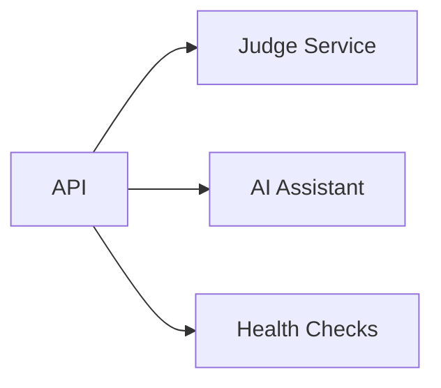

**Diagram sources**
- [DependencyInjection.cs:121-131](file://api/src/Infrastructure/CodePath.Infrastructure/DependencyInjection.cs#L121-L131)
- [DependencyInjection.cs:117-119](file://api/src/Infrastructure/CodePath.Infrastructure/DependencyInjection.cs#L117-L119)

**Section sources**
- [DependencyInjection.cs:121-131](file://api/src/Infrastructure/CodePath.Infrastructure/DependencyInjection.cs#L121-L131)
- [DependencyInjection.cs:117-119](file://api/src/Infrastructure/CodePath.Infrastructure/DependencyInjection.cs#L117-L119)

### Rate Limiting Strategies
- Global rate limiter defines policies for auth endpoints, login attempts, password resets, health checks, public reads, and code execution.
- Rejection responses include Retry-After and problem details.

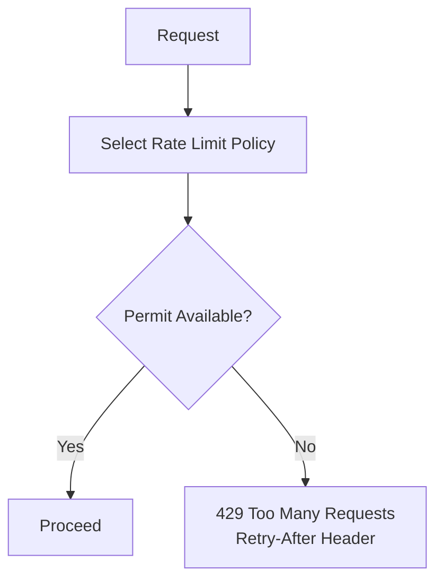

**Diagram sources**
- [Program.cs:251-359](file://api/src/Api/CodePath.Api/Program.cs#L251-L359)

**Section sources**
- [Program.cs:251-359](file://api/src/Api/CodePath.Api/Program.cs#L251-L359)

### Audit Logging for Compliance
- AuditLog entity captures actor, action, target user, timestamp, IP, and JSON payload.
- Configuration defines table schema, indexes, and relationships.
- Admin query supports cursor-based pagination over audit logs.

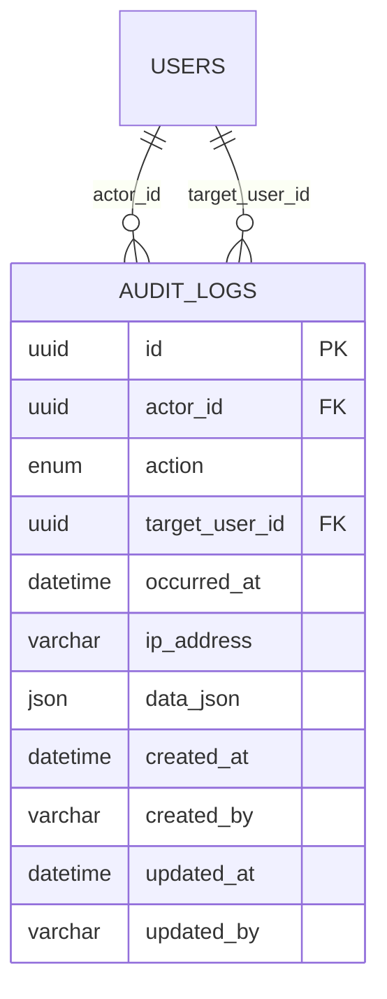

**Diagram sources**
- [AuditLog.cs:7-47](file://api/src/Domain/CodePath.Domain/Auditing/Entities/AuditLog.cs#L7-L47)
- [AuditLogConfiguration.cs:8-61](file://api/src/Infrastructure/CodePath.Infrastructure/Persistence/Configurations/AuditLogConfiguration.cs#L8-L61)

**Section sources**
- [AuditLog.cs:7-47](file://api/src/Domain/CodePath.Domain/Auditing/Entities/AuditLog.cs#L7-L47)
- [AuditLogConfiguration.cs:8-61](file://api/src/Infrastructure/CodePath.Infrastructure/Persistence/Configurations/AuditLogConfiguration.cs#L8-L61)
- [ListAuditLogsQuery.cs:10-70](file://api/src/Application/CodePath.Application/Admin/Queries/ListAuditLogsQuery.cs#L10-L70)

### Security Headers, XSS Protection, and CSRF Mitigation
- Nginx sets HSTS, X-Content-Type-Options, X-Frame-Options, Referrer-Policy, Permissions-Policy, and CSP.
- API sets no-store and nosniff headers for auth endpoints.
- CSRF mitigation relies on cookie SameSite settings and origin checks for cookie-based refresh flows.

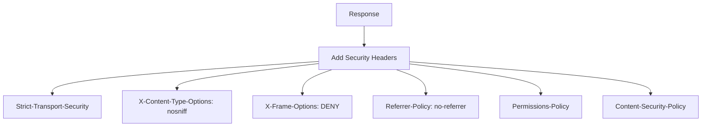

**Diagram sources**
- [default.conf:43-48](file://frontend/nginx/default.conf#L43-L48)
- [Program.cs:395-406](file://api/src/Api/CodePath.Api/Program.cs#L395-L406)
- [AuthEndpoints.cs:84-99](file://api/src/Api/CodePath.Api/Endpoints/AuthEndpoints.cs#L84-L99)

**Section sources**
- [default.conf:43-48](file://frontend/nginx/default.conf#L43-L48)
- [Program.cs:395-406](file://api/src/Api/CodePath.Api/Program.cs#L395-L406)
- [AuthEndpoints.cs:84-99](file://api/src/Api/CodePath.Api/Endpoints/AuthEndpoints.cs#L84-L99)

### Data Encryption at Rest and in Transit
- In transit: TLS termination at Nginx with strong protocols and session cache; API enforces HTTPS redirection and HSTS in non-development environments.
- At rest: Database credentials and secrets loaded from environment variables or mounted files; refresh tokens hashed before storage.

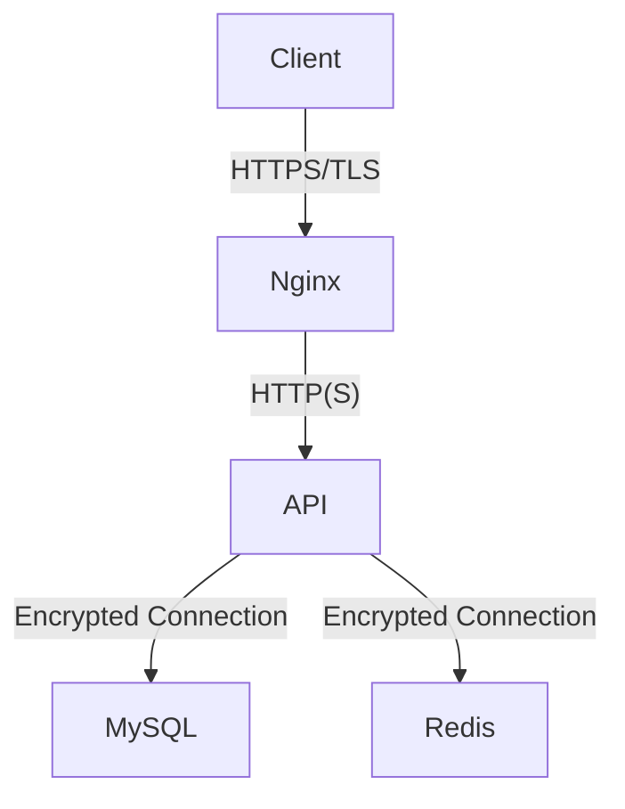

**Diagram sources**
- [default.conf:18-30](file://frontend/nginx/default.conf#L18-L30)
- [Program.cs:408-418](file://api/src/Api/CodePath.Api/Program.cs#L408-L418)
- [DependencyInjection.cs:41-61](file://api/src/Infrastructure/CodePath.Infrastructure/DependencyInjection.cs#L41-L61)
- [JwtTokenService.cs:71-76](file://api/src/Infrastructure/CodePath.Infrastructure/Auth/Services/Tokens/JwtTokenService.cs#L71-L76)

**Section sources**
- [default.conf:18-30](file://frontend/nginx/default.conf#L18-L30)
- [Program.cs:408-418](file://api/src/Api/CodePath.Api/Program.cs#L408-L418)
- [DependencyInjection.cs:41-61](file://api/src/Infrastructure/CodePath.Infrastructure/DependencyInjection.cs#L41-L61)
- [JwtTokenService.cs:71-76](file://api/src/Infrastructure/CodePath.Infrastructure/Auth/Services/Tokens/JwtTokenService.cs#L71-L76)

## Dependency Analysis
- Program.cs wires authentication, authorization, CORS, forwarded headers, rate limiting, and health checks.
- Infrastructure DI registers Redis, EF Core, health checks, and auth services (password hashing, OTP, login protection, token services).
- Application DI registers MediatR behaviors and services like SessionActivityService.

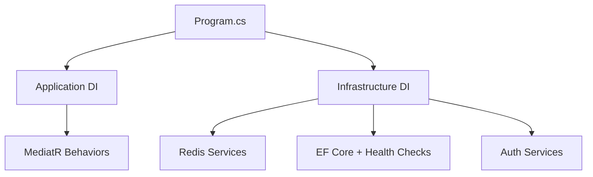

**Diagram sources**
- [Program.cs:60-61](file://api/src/Api/CodePath.Api/Program.cs#L60-L61)
- [Program.cs:365-367](file://api/src/Api/CodePath.Api/Program.cs#L365-L367)
- [DependencyInjection.cs:29-134](file://api/src/Infrastructure/CodePath.Infrastructure/DependencyInjection.cs#L29-L134)
- [DependencyInjection.cs:137-217](file://api/src/Infrastructure/CodePath.Infrastructure/DependencyInjection.cs#L137-L217)
- [DependencyInjection.cs:10-25](file://api/src/Application/CodePath.Application/DependencyInjection.cs#L10-L25)

**Section sources**
- [Program.cs:60-61](file://api/src/Api/CodePath.Api/Program.cs#L60-L61)
- [Program.cs:365-367](file://api/src/Api/CodePath.Api/Program.cs#L365-L367)
- [DependencyInjection.cs:29-134](file://api/src/Infrastructure/CodePath.Infrastructure/DependencyInjection.cs#L29-L134)
- [DependencyInjection.cs:137-217](file://api/src/Infrastructure/CodePath.Infrastructure/DependencyInjection.cs#L137-L217)
- [DependencyInjection.cs:10-25](file://api/src/Application/CodePath.Application/DependencyInjection.cs#L10-L25)

## Performance Considerations
- Use sliding window and token bucket rate limiters where appropriate to balance burst control and fairness.
- Keep Redis Lua scripts minimal and avoid unnecessary round trips; rely on fallback mechanisms for resilience.
- Configure EF Core pool sizes and idle lifetimes according to workload characteristics.
- Avoid excessive session activity writes by throttling updates.

[No sources needed since this section provides general guidance]

## Troubleshooting Guide
- If JWT validation fails due to blacklist or invalid claims, inspect token JTI and security version; ensure token revocation flow updates the blacklist and user security version.
- For OTP issues, verify Redis keys for OTP, attempts, cooldown, and quota; confirm Lua scripts execute successfully.
- For login protection, check Redis availability; if unavailable, the in-memory fallback will be used, which may not protect across nodes.
- For CORS errors, ensure allowed origins are configured and that credentials are enabled only for trusted origins.
- For forwarded header spoofing, validate known proxies and networks; untrusted clients should not be able to set X-Forwarded-For.

**Section sources**
- [Program.cs:91-118](file://api/src/Api/CodePath.Api/Program.cs#L91-L118)
- [RedisOtpService.cs:85-152](file://api/src/Infrastructure/CodePath.Infrastructure/Auth/Services/Otp/RedisOtpService.cs#L85-L152)
- [RedisLoginAttemptService.cs:111-132](file://api/src/Infrastructure/CodePath.Infrastructure/Auth/Services/LoginProtection/RedisLoginAttemptService.cs#L111-L132)
- [Program.cs:160-182](file://api/src/Api/CodePath.Api/Program.cs#L160-L182)
- [Program.cs:224-243](file://api/src/Api/CodePath.Api/Program.cs#L224-L243)

## Conclusion
CodePart implements a robust, multi-layered security model combining JWT authentication, role-based authorization, session lifecycle controls, BCrypt password hashing, OTP verification, login attempt protection, comprehensive rate limiting, strict CORS and forwarded headers handling, security headers at the reverse proxy, and structured audit logging. These measures collectively defend against common threats such as brute force, replay, CSRF, XSS, and unauthorized access while maintaining operational resilience and compliance.

[No sources needed since this section summarizes without analyzing specific files]

## Appendices
- Production Deployment Best Practices
  - Enforce HTTPS-only connections and HSTS.
  - Store secrets via environment variables or mounted files; never hardcode sensitive values.
  - Restrict CORS to explicit origins and enable credentials only when necessary.
  - Configure known proxies/networks for forwarded headers to prevent IP spoofing.
  - Tune rate limits and backoff thresholds based on observed traffic patterns.
  - Monitor Redis and database health via dedicated endpoints.
  - Regularly rotate JWT signing keys and refresh tokens; enforce security version changes on sensitive operations.

[No sources needed since this section provides general guidance]