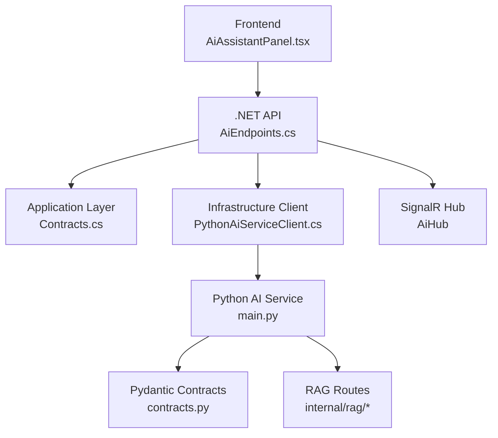
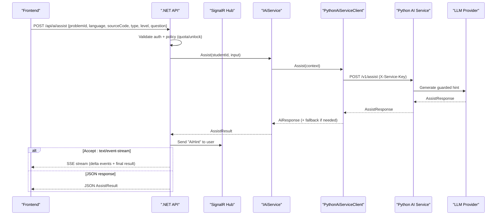
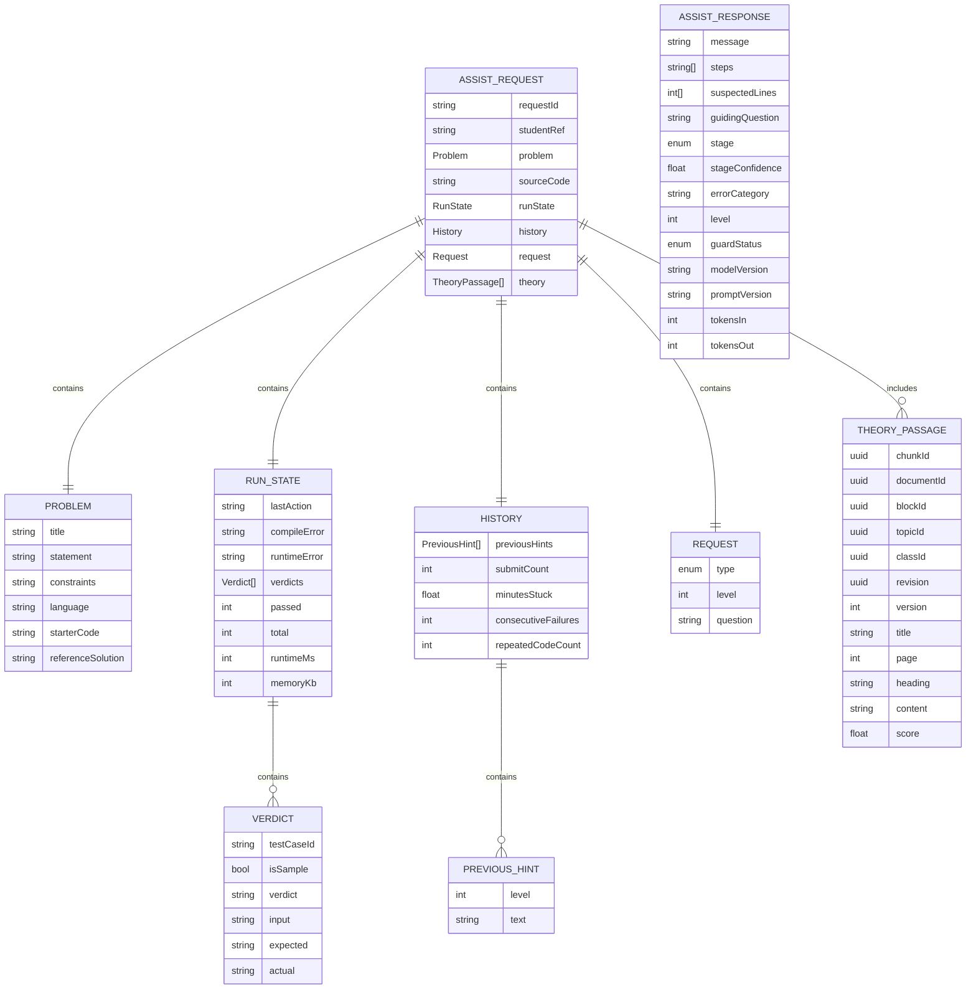
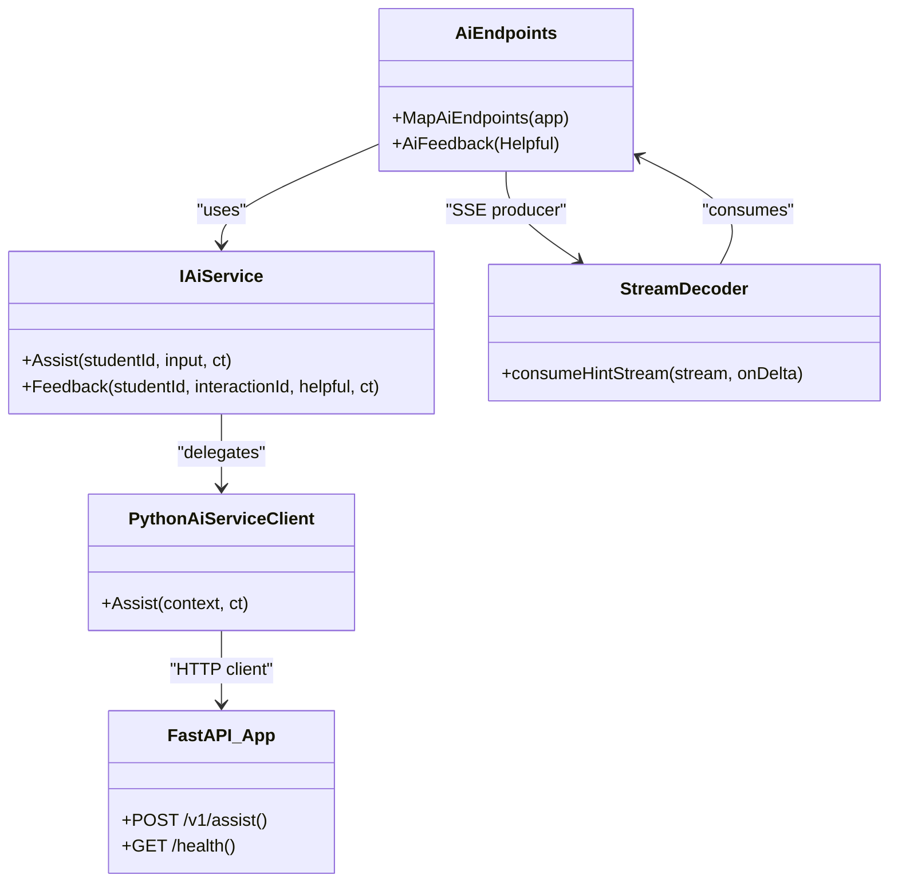

# AI Assistant API

<cite>
**Referenced Files in This Document**
- [AiEndpoints.cs](file://api/src/Api/CodePath.Api/Endpoints/AiEndpoints.cs)
- [Contracts.cs](file://api/src/Application/CodePath.Application/Ai/Contracts.cs)
- [PythonAiServiceClient.cs](file://api/src/Infrastructure/CodePath.Infrastructure/Ai/PythonAiServiceClient.cs)
- [main.py](file://ai-service/app/main.py)
- [contracts.py](file://ai-service/app/contracts.py)
- [openapi.json](file://ai-service/openapi.json)
- [stream.ts](file://frontend/src/features/ai-assistant/stream.ts)
- [AiAssistantPanel.tsx](file://frontend/src/features/ai-assistant/AiAssistantPanel.tsx)
- [AI_ASSISTANT.md](file://api/docs/AI_ASSISTANT.md)
</cite>

## Table of Contents
1. [Introduction](#introduction)
2. [Project Structure](#project-structure)
3. [Core Components](#core-components)
4. [Architecture Overview](#architecture-overview)
5. [Detailed Component Analysis](#detailed-component-analysis)
6. [Dependency Analysis](#dependency-analysis)
7. [Performance Considerations](#performance-considerations)
8. [Troubleshooting Guide](#troubleshooting-guide)
9. [Conclusion](#conclusion)

## Introduction
This document describes the CodePart AI assistant APIs exposed by the .NET API and the Python AI service. It covers:
- HTTP endpoints for hint generation, feedback, and RAG operations
- Request/response schemas for context-aware assistance
- Streaming responses using Server-Sent Events (SSE)
- Real-time updates via SignalR
- Integration between the .NET API and the Python AI service
- Security, rate limiting, quota, fallback behavior, and best practices

The system provides a guarded, stage-aware tutoring flow that adapts hints to student progress, run results, and optional theory passages retrieved through RAG.

## Project Structure
The AI assistant spans three layers:
- Frontend: UI panel and SSE decoder
- .NET API: Authorization, policy enforcement, persistence, SignalR broadcasting, and SSE streaming
- Python AI service: Strict schema validation, LLM orchestration, guard logic, caching, and RAG

**Diagram sources**
- [AiEndpoints.cs:10-43](file://api/src/Api/CodePath.Api/Endpoints/AiEndpoints.cs#L10-L43)
- [Contracts.cs:4-18](file://api/src/Application/CodePath.Application/Ai/Contracts.cs#L4-L18)
- [PythonAiServiceClient.cs:6-39](file://api/src/Infrastructure/CodePath.Infrastructure/Ai/PythonAiServiceClient.cs#L6-L39)
- [main.py:64-84](file://ai-service/app/main.py#L64-L84)
- [contracts.py:72-97](file://ai-service/app/contracts.py#L72-L97)

**Section sources**
- [AiEndpoints.cs:10-43](file://api/src/Api/CodePath.Api/Endpoints/AiEndpoints.cs#L10-L43)
- [Contracts.cs:4-18](file://api/src/Application/CodePath.Application/Ai/Contracts.cs#L4-L18)
- [PythonAiServiceClient.cs:6-39](file://api/src/Infrastructure/CodePath.Infrastructure/Ai/PythonAiServiceClient.cs#L6-L39)
- [main.py:64-84](file://ai-service/app/main.py#L64-L84)
- [contracts.py:72-97](file://ai-service/app/contracts.py#L72-L97)

## Core Components
- .NET API endpoints:
  - POST /api/ai/assist: Accepts an assist request, enforces authorization and policy, calls the AI service, streams SSE when requested, and broadcasts via SignalR.
  - POST /api/ai/{id}/feedback: Records helpfulness feedback for an interaction.
  - SignalR hub at /api/ai/hub: Pushes AiHint events to the authenticated user.
- Application contracts:
  - AssistInput, AiResponse, AssistResult, IAiService, IAiAssistantClient, AiPolicy (quota/unlock rules).
- Python AI service:
  - POST /v1/assist: Validates input, builds prompts, runs guard, calls LLM providers, returns AssistResponse with guard status and telemetry.
  - Internal RAG routes: indexing, search, answer, draft.
- Frontend:
  - SSE consumer that decodes delta and result events and renders incremental hints safely.

**Section sources**
- [AiEndpoints.cs:10-43](file://api/src/Api/CodePath.Api/Endpoints/AiEndpoints.cs#L10-L43)
- [Contracts.cs:4-31](file://api/src/Application/CodePath.Application/Ai/Contracts.cs#L4-L31)
- [main.py:64-84](file://ai-service/app/main.py#L64-L84)
- [openapi.json:24-75](file://ai-service/openapi.json#L24-L75)
- [stream.ts:1-24](file://frontend/src/features/ai-assistant/stream.ts#L1-L24)

## Architecture Overview
The end-to-end flow for hint generation is:

**Diagram sources**
- [AiEndpoints.cs:15-36](file://api/src/Api/CodePath.Api/Endpoints/AiEndpoints.cs#L15-L36)
- [PythonAiServiceClient.cs:8-39](file://api/src/Infrastructure/CodePath.Infrastructure/Ai/PythonAiServiceClient.cs#L8-L39)
- [main.py:64-81](file://ai-service/app/main.py#L64-L81)

## Detailed Component Analysis

### REST Endpoints

#### POST /api/ai/assist
- Purpose: Generate a guarded, stage-aware hint for a student’s code.
- Authentication: Requires ActiveStudent authorization.
- Request body:
  - problemId: string (GUID)
  - language: string
  - sourceCode: string
  - type: string; allowed values include AutoHint, Hint, TraceTestCase, ExplainError, Ask; default Hint
  - level: integer; 1–3; default 1
  - question: string or null; optional student question
- Response:
  - JSON: AssistResult containing InteractionId, Hint, Remaining, UnlockedLevel, and optional Code
  - SSE: If Accept includes text/event-stream, the server streams delta events followed by a final result event
- Error handling:
  - Policy violations return a structured failure with a safe error code
  - Network/provider failures are handled gracefully with fallback hints

Example request fields:
- problemId: GUID identifying the exercise
- language: programming language identifier
- sourceCode: current student code
- type: Hint or other supported intent
- level: 1, 2, or 3
- question: optional free-text question

Example response fields:
- InteractionId: unique ID for this interaction
- Hint: message, steps, suspectedLines, guidingQuestion, stage, stageConfidence, errorCategory, level, guardStatus, modelVersion, promptVersion, tokensIn, tokensOut
- Remaining: remaining daily quota
- UnlockedLevel: highest level unlocked for the student
- Code: optional additional code snippet

Streaming behavior:
- The server buffers the entire hint until the guard passes, then emits rune-chunked delta events and a final result event.
- Clients should decode UTF-8 across chunk boundaries and only render after receiving the result event.

**Section sources**
- [AiEndpoints.cs:15-36](file://api/src/Api/CodePath.Api/Endpoints/AiEndpoints.cs#L15-L36)
- [Contracts.cs:4-13](file://api/src/Application/CodePath.Application/Ai/Contracts.cs#L4-L13)

#### POST /api/ai/{id}/feedback
- Purpose: Record whether a hint was helpful.
- Path parameter: id (GUID) referencing an interaction.
- Request body:
  - helpful: boolean
- Response:
  - 204 No Content on success
  - 404 Not Found if the interaction does not belong to the caller or cannot be updated

**Section sources**
- [AiEndpoints.cs:40-41](file://api/src/Api/CodePath.Api/Endpoints/AiEndpoints.cs#L40-L41)

#### SignalR Hub
- Endpoint: /api/ai/hub
- Event: AiHint
- Audience: Only the authenticated user identified by their user ID
- Use case: Real-time delivery of generated hints alongside SSE

**Section sources**
- [AiEndpoints.cs:8-8](file://api/src/Api/CodePath.Api/Endpoints/AiEndpoints.cs#L8-L8)
- [AiEndpoints.cs:19-19](file://api/src/Api/CodePath.Api/Endpoints/AiEndpoints.cs#L19-L19)
- [AiEndpoints.cs:42-42](file://api/src/Api/CodePath.Api/Endpoints/AiEndpoints.cs#L42-L42)

### Python AI Service Endpoints

#### POST /v1/assist
- Purpose: Generate a guarded hint given rich context including problem statement, source code, run state, history, and optional theory passages.
- Authentication: Header X-Service-Key must match SERVICE_API_KEY.
- Request body: AssistRequest defined by Pydantic models.
- Response: AssistResponse with guard metadata and token usage.
- Status codes:
  - 200: Success; may include header X-AI-Code=GUARD_FALLBACK when guardStatus=fallback
  - 422: INVALID_CONTEXT due to validation errors
  - 503: AI_UNAVAILABLE for provider/service failures

Key request fields:
- requestId: string up to 100 characters
- studentRef: string up to 128 characters
- problem: Problem object (title, statement, constraints, language, starterCode, referenceSolution)
- sourceCode: string
- runState: RunState (lastAction, compileError, runtimeError, verdicts, passed, total, runtimeMs, memoryKb)
- history: History (previousHints, submitCount, minutesStuck, consecutiveFailures, repeatedCodeCount)
- request: Request (type, level, question)
- theory: list of TheoryPassage (up to 8)

Key response fields:
- message: hint text (1–6000 chars)
- steps: array of strings (max 8)
- suspectedLines: array of integers (max 10)
- guidingQuestion: string or null
- stage: Start | InProgress | LogicError | CannotRun | PartialPass
- stageConfidence: float 0–1
- errorCategory: string
- level: integer 1–3
- guardStatus: ok | regenerated | fallback
- modelVersion, promptVersion: strings
- tokensIn, tokensOut: integers

**Section sources**
- [main.py:64-81](file://ai-service/app/main.py#L64-L81)
- [contracts.py:72-97](file://ai-service/app/contracts.py#L72-L97)
- [openapi.json:24-75](file://ai-service/openapi.json#L24-L75)

#### RAG Endpoints (Internal)
- POST /internal/rag/index/topic
- POST /internal/rag/index/delete
- POST /internal/rag/search
- POST /internal/rag/answer
- POST /internal/rag/draft
- Authentication: X-Service-Key required
- Purpose: Index course materials, delete topics, search relevant passages, generate answers, and create drafts based on retrieved context

**Section sources**
- [openapi.json:77-281](file://ai-service/openapi.json#L77-L281)

### Streaming Responses (SSE)
- Trigger: Include Accept: text/event-stream in the request to /api/ai/assist.
- Format:
  - event: delta
  - data: JSON-encoded fragment of the hint message
  - event: result
  - data: JSON-encoded full AssistResult
- Safety: The server buffers the complete hint before streaming to ensure all content has passed the guard.
- Client decoding:
  - Decode UTF-8 across arbitrary network chunks
  - Accumulate delta fragments into a buffer
  - Render only after receiving the final result event
  - Treat missing result event as incomplete and surface an error

**Section sources**
- [AiEndpoints.cs:20-34](file://api/src/Api/CodePath.Api/Endpoints/AiEndpoints.cs#L20-L34)
- [stream.ts:1-24](file://frontend/src/features/ai-assistant/stream.ts#L1-L24)

### Context-Aware Assistance and Guarding
- Stage detection:
  - Start: no meaningful code yet
  - InProgress: partial implementation
  - LogicError: wrong answer without runtime errors
  - CannotRun: compilation/runtime errors
  - PartialPass: some tests pass or TLE/MLE
- Guarding:
  - LLM outputs are validated and constrained
  - If guard fails, the service regenerates once; otherwise returns fallback
  - Fallback hints are rule-based and safe
- Level progression:
  - Levels 1–3 controlled by policy based on previous levels, failures since last hint, and time spent stuck

**Section sources**
- [PythonAiServiceClient.cs:17-37](file://api/src/Infrastructure/CodePath.Infrastructure/Ai/PythonAiServiceClient.cs#L17-L37)
- [Contracts.cs:24-31](file://api/src/Application/CodePath.Application/Ai/Contracts.cs#L24-L31)
- [AI_ASSISTANT.md:49-73](file://api/docs/AI_ASSISTANT.md#L49-L73)

### Data Models

**Diagram sources**
- [contracts.py:10-97](file://ai-service/app/contracts.py#L10-L97)
- [openapi.json:310-470](file://ai-service/openapi.json#L310-L470)

## Dependency Analysis

**Diagram sources**
- [AiEndpoints.cs:10-43](file://api/src/Api/CodePath.Api/Endpoints/AiEndpoints.cs#L10-L43)
- [Contracts.cs:9-18](file://api/src/Application/CodePath.Application/Ai/Contracts.cs#L9-L18)
- [PythonAiServiceClient.cs:6-39](file://api/src/Infrastructure/CodePath.Infrastructure/Ai/PythonAiServiceClient.cs#L6-L39)
- [main.py:64-84](file://ai-service/app/main.py#L64-L84)
- [stream.ts:1-24](file://frontend/src/features/ai-assistant/stream.ts#L1-L24)

**Section sources**
- [AiEndpoints.cs:10-43](file://api/src/Api/CodePath.Api/Endpoints/AiEndpoints.cs#L10-L43)
- [PythonAiServiceClient.cs:6-39](file://api/src/Infrastructure/CodePath.Infrastructure/Ai/PythonAiServiceClient.cs#L6-L39)
- [main.py:64-84](file://ai-service/app/main.py#L64-L84)
- [stream.ts:1-24](file://frontend/src/features/ai-assistant/stream.ts#L1-L24)

## Performance Considerations
- Timeouts and deadlines:
  - .NET client sets a 20-second deadline for calls to the Python service.
  - Python service uses a ~19-second timeout around the assist pipeline.
- Rate limiting and quotas:
  - Daily quota enforced at the application layer.
  - Additional per-minute limits are documented in internal checklists.
- Caching:
  - Optional Redis cache in the Python service can reduce repeated work.
- Streaming efficiency:
  - SSE chunks are small rune slices to balance responsiveness and overhead.
  - Buffering ensures guard safety before streaming.
- Provider resilience:
  - Transient provider errors map to fallback hints to keep the UX responsive.

Best practices:
- Always send Accept: text/event-stream when you want incremental rendering.
- Debounce rapid re-requests while streaming to avoid redundant work.
- Respect X-AI-Code header when present to handle guard fallback scenarios.
- Avoid sending sensitive identifiers in request bodies; use server-side context where possible.

[No sources needed since this section provides general guidance]

## Troubleshooting Guide
Common issues and resolutions:
- INVALID_CONTEXT (422):
  - Cause: Malformed or out-of-range fields in AssistRequest.
  - Action: Validate requestId, studentRef lengths; ensure runState.passed ≤ total; verify enums and arrays meet limits.
- AI_UNAVAILABLE (503):
  - Cause: Provider outage, timeout, or unexpected response.
  - Action: Retry with backoff; rely on fallback hints; monitor health endpoint.
- GUARD_FALLBACK:
  - Cause: LLM output failed guard checks twice.
  - Action: Inspect X-AI-Code header; treat as safe fallback; consider adjusting prompts or context.
- SSE incomplete:
  - Cause: Network interruption before result event.
  - Action: Detect missing result event and prompt retry; do not assume partial hint is complete.
- SignalR mismatch:
  - Cause: Wrong user subscription.
  - Action: Ensure hub connections are scoped to the authenticated user ID.

Operational notes:
- Health check: GET /health returns service status.
- Quota boundary and unlock rules are enforced by application policy.
- Feedback endpoint requires ownership of the interaction ID.

**Section sources**
- [main.py:48-54](file://ai-service/app/main.py#L48-L54)
- [main.py:61-62](file://ai-service/app/main.py#L61-L62)
- [Contracts.cs:24-31](file://api/src/Application/CodePath.Application/Ai/Contracts.cs#L24-L31)
- [AiEndpoints.cs:38-41](file://api/src/Api/CodePath.Api/Endpoints/AiEndpoints.cs#L38-L41)
- [stream.ts:22-23](file://frontend/src/features/ai-assistant/stream.ts#L22-L23)

## Conclusion
The CodePart AI assistant integrates a secure .NET API with a Python-backed LLM pipeline to deliver staged, guarded, and context-aware hints. The API supports both JSON and real-time SSE responses, with SignalR providing live updates. Robust validation, guard mechanisms, fallback strategies, and clear error codes help maintain reliability and safety. For production deployments, follow the recommended streaming patterns, respect quotas and rate limits, and monitor health and error signals to ensure a responsive and trustworthy coding assistance experience.

[No sources needed since this section summarizes without analyzing specific files]