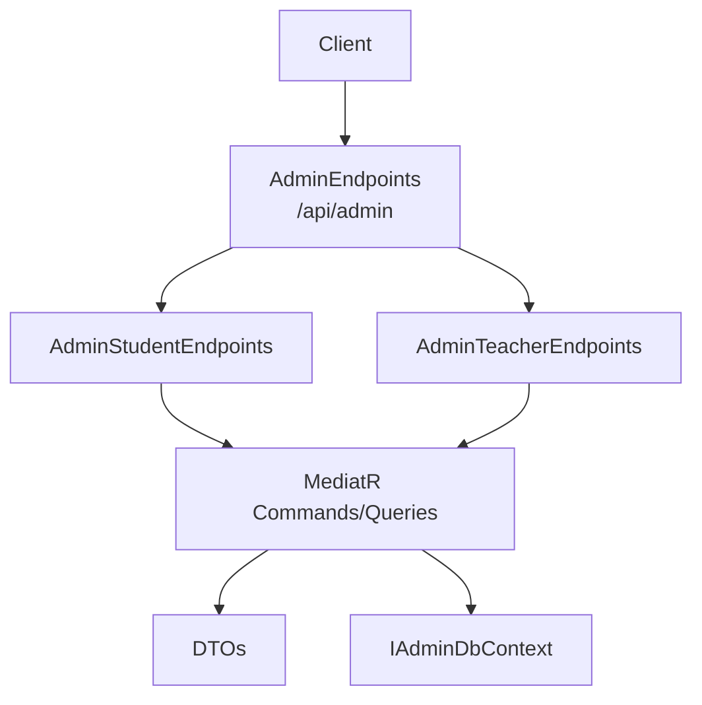
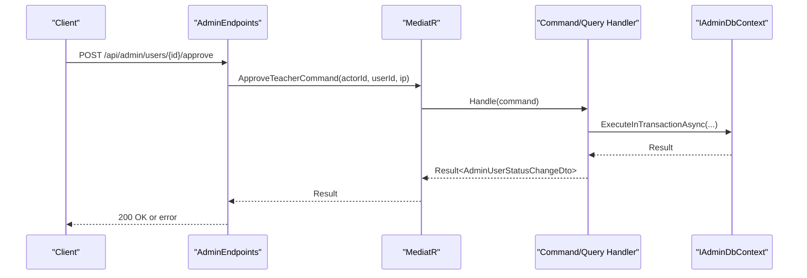
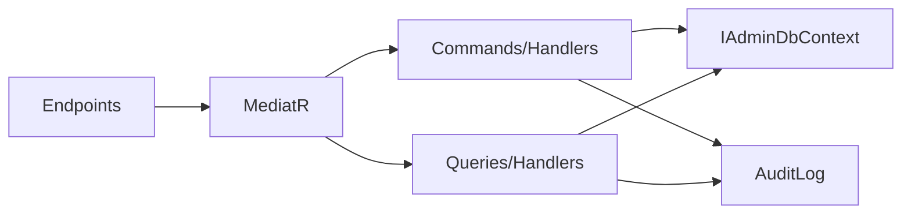

# Administrative API

<cite>
**Referenced Files in This Document**
- [AdminEndpoints.cs](file://api/src/Api/CodePath.Api/Endpoints/AdminEndpoints.cs)
- [AdminStudentEndpoints.cs](file://api/src/Api/CodePath.Api/Endpoints/AdminStudentEndpoints.cs)
- [AdminTeacherEndpoints.cs](file://api/src/Api/CodePath.Api/Endpoints/AdminTeacherEndpoints.cs)
- [AdminDtos.cs](file://api/src/Application/CodePath.Application/Admin/Dtos/AdminDtos.cs)
- [StudentDtos.cs](file://api/src/Application/CodePath.Application/Admin/Dtos/StudentDtos.cs)
- [TeacherDtos.cs](file://api/src/Application/CodePath.Application/Admin/Dtos/TeacherDtos.cs)
- [AdminStatusCommands.cs](file://api/src/Application/CodePath.Application/Admin/Commands/AdminStatusCommands.cs)
- [ListAuditLogsQuery.cs](file://api/src/Application/CodePath.Application/Admin/Queries/ListAuditLogsQuery.cs)
- [StudentCommands.cs](file://api/src/Application/CodePath.Application/Admin/Commands/StudentCommands.cs)
- [TeacherCommands.cs](file://api/src/Application/CodePath.Application/Admin/Commands/TeacherCommands.cs)
- [ExportStudentsQuery.cs](file://api/src/Application/CodePath.Application/Admin/Queries/ExportStudentsQuery.cs)
- [ExportTeachersQuery.cs](file://api/src/Application/CodePath.Application/Admin/Queries/ExportTeachersQuery.cs)
- [IAdminDbContext.cs](file://api/src/Application/CodePath.Application/Admin/Abstractions/IAdminDbContext.cs)
</cite>

## Table of Contents
1. Introduction
2. Project Structure
3. Core Components
4. Architecture Overview
5. Detailed Component Analysis
6. Dependency Analysis
7. Performance Considerations
8. Troubleshooting Guide
9. Conclusion

## Introduction
This document provides comprehensive API documentation for CodePart’s administrative endpoints. It covers HTTP methods, URL patterns, request/response schemas, and workflows for user management (students and teachers), system administration (approvals, enable/disable/delete), audit logging, bulk operations, export capabilities, and reporting. It also addresses security considerations, role-based access control, and audit trail requirements for administrative actions.

## Project Structure
Administrative functionality is exposed via ASP.NET Minimal APIs grouped under /api/admin with an AdminOnly authorization policy. Business logic is implemented using MediatR commands and queries, DTOs define request/response shapes, and IAdminDbContext abstracts persistence.

**Diagram sources**
- [AdminEndpoints.cs:17-24](file://api/src/Api/CodePath.Api/Endpoints/AdminEndpoints.cs#L17-L24)
- [AdminStudentEndpoints.cs:19-94](file://api/src/Api/CodePath.Api/Endpoints/AdminStudentEndpoints.cs#L19-L94)
- [AdminTeacherEndpoints.cs:19-83](file://api/src/Api/CodePath.Api/Endpoints/AdminTeacherEndpoints.cs#L19-L83)
- [IAdminDbContext.cs:9-40](file://api/src/Application/CodePath.Application/Admin/Abstractions/IAdminDbContext.cs#L9-L40)

**Section sources**
- [AdminEndpoints.cs:17-24](file://api/src/Api/CodePath.Api/Endpoints/AdminEndpoints.cs#L17-L24)
- [AdminStudentEndpoints.cs:19-94](file://api/src/Api/CodePath.Api/Endpoints/AdminStudentEndpoints.cs#L19-L94)
- [AdminTeacherEndpoints.cs:19-83](file://api/src/Api/CodePath.Api/Endpoints/AdminTeacherEndpoints.cs#L19-L83)

## Core Components
- Authorization: All admin routes are protected by the AdminOnly policy.
- Routing: Grouped under /api/admin with subgroups for students and teachers.
- Commands/Queries: MediatR handlers encapsulate business rules, validation, and persistence.
- DTOs: Strongly typed request/response models for filtering, pagination, details, stats, and exports.
- Audit Trail: All status changes and deletions are recorded with actor, IP, timestamp, and metadata.

Key responsibilities:
- User lifecycle: create, update, delete, approve/reject, enable/disable.
- Bulk operations: approve/disable/delete multiple users efficiently.
- Reporting: stats endpoints and CSV export.
- Audit logs: cursor-paginated listing with optional target filter.

**Section sources**
- [AdminEndpoints.cs:17-24](file://api/src/Api/CodePath.Api/Endpoints/AdminEndpoints.cs#L17-L24)
- [AdminStudentEndpoints.cs:19-94](file://api/src/Api/CodePath.Api/Endpoints/AdminStudentEndpoints.cs#L19-L94)
- [AdminTeacherEndpoints.cs:19-83](file://api/src/Api/CodePath.Api/Endpoints/AdminTeacherEndpoints.cs#L19-L83)
- [AdminDtos.cs:5-29](file://api/src/Application/CodePath.Application/Admin/Dtos/AdminDtos.cs#L5-L29)
- [StudentDtos.cs:5-27](file://api/src/Application/CodePath.Application/Admin/Dtos/StudentDtos.cs#L5-L27)
- [TeacherDtos.cs:5-23](file://api/src/Application/CodePath.Application/Admin/Dtos/TeacherDtos.cs#L5-L23)

## Architecture Overview
The admin API follows a layered approach:
- Presentation layer: Minimal API endpoints map HTTP to commands/queries.
- Application layer: MediatR handlers implement use cases with validation and orchestration.
- Domain layer: Entities and enums model state and behavior.
- Infrastructure layer: IAdminDbContext abstracts data access and transactions.

**Diagram sources**
- [AdminEndpoints.cs:54-67](file://api/src/Api/CodePath.Api/Endpoints/AdminEndpoints.cs#L54-L67)
- [AdminStatusCommands.cs:9-17](file://api/src/Application/CodePath.Application/Admin/Commands/AdminStatusCommands.cs#L9-L17)
- [AdminStatusCommands.cs:70-86](file://api/src/Application/CodePath.Application/Admin/Commands/AdminStatusCommands.cs#L70-L86)
- [IAdminDbContext.cs:21-23](file://api/src/Application/CodePath.Application/Admin/Abstractions/IAdminDbContext.cs#L21-L23)

## Detailed Component Analysis

### Authentication and Authorization
- Policy: AdminOnly required for all /api/admin routes.
- Actor identity: Endpoints extract actor ID from the authenticated user context.
- IP capture: Remote IP is captured and passed into commands for audit trails.

Security notes:
- Enforce AdminOnly at group level.
- Validate actor presence before invoking commands.
- Log client IP for auditability.

**Section sources**
- [AdminEndpoints.cs:17-24](file://api/src/Api/CodePath.Api/Endpoints/AdminEndpoints.cs#L17-L24)
- [AdminEndpoints.cs:54-67](file://api/src/Api/CodePath.Api/Endpoints/AdminEndpoints.cs#L54-L67)
- [AdminEndpoints.cs:157-158](file://api/src/Api/CodePath.Api/Endpoints/AdminEndpoints.cs#L157-L158)

### Teachers Management

#### List Teachers
- GET /api/admin/teachers
- Query parameters: status, cursor, limit, page, pageSize, search, facultyId, sortBy
- Behavior:
  - If no cursor provided, uses offset pagination with filters.
  - If cursor provided, uses cursor pagination; mixing cursor with filters is rejected.
- Responses: CursorPage<TeacherSummaryDto> or OffsetPage<TeacherDto> depending on mode.

Request schema:
- status: string enum
- cursor: string (when using cursor pagination)
- limit: integer (cursor mode)
- page: integer (offset mode)
- pageSize: integer (offset mode)
- search: string
- facultyId: GUID
- sortBy: string

Response schema:
- CursorPage<TeacherSummaryDto>: items[], nextCursor?
- OffsetPage<TeacherDto>: items[], page, pageSize, totalCount, totalPages

Error responses:
- 400 when mixing cursor with filters.
- 401/403 for unauthorized/forbidden.

**Section sources**
- [AdminEndpoints.cs:26-52](file://api/src/Api/CodePath.Api/Endpoints/AdminEndpoints.cs#L26-L52)
- [AdminDtos.cs:5-12](file://api/src/Application/CodePath.Application/Admin/Dtos/AdminDtos.cs#L5-L12)
- [TeacherDtos.cs:5-7](file://api/src/Application/CodePath.Application/Admin/Dtos/TeacherDtos.cs#L5-L7)

#### Get Teacher Stats
- GET /api/admin/teachers/stats
- Response: TeacherStatsDto { totalTeachers, activeTeachers, pendingApprovals, disabledTeachers, rejectedTeachers }

**Section sources**
- [AdminTeacherEndpoints.cs:21-22](file://api/src/Api/CodePath.Api/Endpoints/AdminTeacherEndpoints.cs#L21-L22)
- [TeacherDtos.cs:11-12](file://api/src/Application/CodePath.Application/Admin/Dtos/TeacherDtos.cs#L11-L12)

#### Get Faculties
- GET /api/admin/faculties
- Response: FacultyDto[] { id, name, code, teacherCount }

**Section sources**
- [AdminTeacherEndpoints.cs:23-24](file://api/src/Api/CodePath.Api/Endpoints/AdminTeacherEndpoints.cs#L23-L24)
- [TeacherDtos.cs:18](file://api/src/Application/CodePath.Application/Admin/Dtos/TeacherDtos.cs#L18)

#### Get Teacher Detail
- GET /api/admin/teachers/{id}
- Response: { profile, managedClasses, teachingCourses }
- Profile fields include Id, TeacherId, FullName, Email, Phone, Bio, FacultyId, FacultyName, Status, ClassesCount, CoursesCount, EmailVerifiedAt, CreatedAt, LastLoginAt.

**Section sources**
- [AdminTeacherEndpoints.cs:25-34](file://api/src/Api/CodePath.Api/Endpoints/AdminTeacherEndpoints.cs#L25-L34)
- [TeacherDtos.cs:8-17](file://api/src/Application/CodePath.Application/Admin/Dtos/TeacherDtos.cs#L8-L17)

#### Create Teacher
- POST /api/admin/teachers
- Request: CreateTeacherInput { FullName, Email, TeacherId?, FacultyId?, Phone?, Bio?, TemporaryPassword, Status }
- Validation:
  - Email must be valid and end with @hanu.edu.vn.
  - TemporaryPassword must meet complexity policy.
  - Status must be Active or Pending.
- Response: 201 Created with { id }.

**Section sources**
- [AdminTeacherEndpoints.cs:35-41](file://api/src/Api/CodePath.Api/Endpoints/AdminTeacherEndpoints.cs#L35-L41)
- [TeacherDtos.cs:20-23](file://api/src/Application/CodePath.Application/Admin/Dtos/TeacherDtos.cs#L20-L23)
- [TeacherCommands.cs:35-52](file://api/src/Application/CodePath.Application/Admin/Commands/TeacherCommands.cs#L35-L52)

#### Update Teacher
- PUT /api/admin/teachers/{id}
- Request: TeacherProfileInput { FullName, TeacherId?, FacultyId?, Phone?, Bio? }
- Validation: Full name length, optional TeacherId length, non-empty FacultyId, phone format, bio length.

**Section sources**
- [AdminTeacherEndpoints.cs:42-47](file://api/src/Api/CodePath.Api/Endpoints/AdminTeacherEndpoints.cs#L42-L47)
- [TeacherDtos.cs:19](file://api/src/Application/CodePath.Application/Admin/Dtos/TeacherDtos.cs#L19)
- [TeacherCommands.cs:53-61](file://api/src/Application/CodePath.Application/Admin/Commands/TeacherCommands.cs#L53-L61)

#### Delete Teacher
- DELETE /api/admin/teachers/{id}
- Response: boolean success.

**Section sources**
- [AdminTeacherEndpoints.cs:48-53](file://api/src/Api/CodePath.Api/Endpoints/AdminTeacherEndpoints.cs#L48-L53)
- [TeacherCommands.cs:179-180](file://api/src/Application/CodePath.Application/Admin/Commands/TeacherCommands.cs#L179-L180)

#### Enable Teacher
- POST /api/admin/users/{id}/enable
- Response: AdminUserStatusChangeDto { UserId, Status, RevokedSessionCount, AuditLogId }

**Section sources**
- [AdminTeacherEndpoints.cs:62-67](file://api/src/Api/CodePath.Api/Endpoints/AdminTeacherEndpoints.cs#L62-L67)
- [AdminStatusCommands.cs:18-18](file://api/src/Application/CodePath.Application/Admin/Commands/AdminStatusCommands.cs#L18-L18)
- [AdminDtos.cs:25-29](file://api/src/Application/CodePath.Application/Admin/Dtos/AdminDtos.cs#L25-L29)

#### Approve/Reject Teacher
- POST /api/admin/users/{id}/approve
- POST /api/admin/users/{id}/reject
- Response: AdminUserStatusChangeDto

**Section sources**
- [AdminEndpoints.cs:54-92](file://api/src/Api/CodePath.Api/Endpoints/AdminEndpoints.cs#L54-L92)
- [AdminStatusCommands.cs:9-17](file://api/src/Application/CodePath.Application/Admin/Commands/AdminStatusCommands.cs#L9-L17)

#### Bulk Operations (Teachers)
- POST /api/admin/teachers/bulk-delete
- POST /api/admin/teachers/bulk-approve
- POST /api/admin/teachers/bulk-disable
- Request: BulkTeacherRequest { UserIds[] }
- Validation: 1–100 distinct IDs.

**Section sources**
- [AdminTeacherEndpoints.cs:55-77](file://api/src/Api/CodePath.Api/Endpoints/AdminTeacherEndpoints.cs#L55-L77)
- [TeacherCommands.cs:70-79](file://api/src/Application/CodePath.Application/Admin/Commands/TeacherCommands.cs#L70-L79)

#### Export Teachers
- GET /api/admin/teachers/export
- Query: search, facultyId, status, sortBy
- Response: text/csv file named teachers.csv

**Section sources**
- [AdminTeacherEndpoints.cs:78-83](file://api/src/Api/CodePath.Api/Endpoints/AdminTeacherEndpoints.cs#L78-L83)
- [ExportTeachersQuery.cs:10-39](file://api/src/Application/CodePath.Application/Admin/Queries/ExportTeachersQuery.cs#L10-L39)

### Students Management

#### List Students
- GET /api/admin/students
- Query: page, pageSize, search, facultyId, status, sortBy
- Response: OffsetPage<StudentDto>

**Section sources**
- [AdminStudentEndpoints.cs:24-36](file://api/src/Api/CodePath.Api/Endpoints/AdminStudentEndpoints.cs#L24-L36)
- [StudentDtos.cs:5-10](file://api/src/Application/CodePath.Application/Admin/Dtos/StudentDtos.cs#L5-L10)

#### Get Student Stats
- GET /api/admin/students/stats
- Response: StudentStatsDto { totalStudents, activeStudents, pendingApprovals, disabledStudents, rejectedStudents }

**Section sources**
- [AdminStudentEndpoints.cs:21-22](file://api/src/Api/CodePath.Api/Endpoints/AdminStudentEndpoints.cs#L21-L22)
- [StudentDtos.cs:12-13](file://api/src/Application/CodePath.Application/Admin/Dtos/StudentDtos.cs#L12-L13)

#### Get Student Detail
- GET /api/admin/students/{id}
- Response: { profile, enrolledClasses, enrolledCourses }
- Profile fields include Id, StudentId, FullName, Email, Phone, Bio, FacultyId, FacultyName, Status, ClassesCount, CoursesCount, EmailVerifiedAt, CreatedAt, LastLoginAt.

**Section sources**
- [AdminStudentEndpoints.cs:38-47](file://api/src/Api/CodePath.Api/Endpoints/AdminStudentEndpoints.cs#L38-L47)
- [StudentDtos.cs:8-20](file://api/src/Application/CodePath.Application/Admin/Dtos/StudentDtos.cs#L8-L20)

#### Create Student
- POST /api/admin/students
- Request: CreateStudentInput { FullName, Email, StudentId, FacultyId?, Phone?, Bio?, TemporaryPassword, Status }
- Validation:
  - Email must be valid and end with @hanu.edu.vn.
  - TemporaryPassword must meet complexity policy.
  - Status must be Active or Pending.
- Response: 201 Created with { id }.

**Section sources**
- [AdminStudentEndpoints.cs:49-55](file://api/src/Api/CodePath.Api/Endpoints/AdminStudentEndpoints.cs#L49-L55)
- [StudentDtos.cs:24-27](file://api/src/Application/CodePath.Application/Admin/Dtos/StudentDtos.cs#L24-L27)
- [StudentCommands.cs:36-53](file://api/src/Application/CodePath.Application/Admin/Commands/StudentCommands.cs#L36-L53)

#### Update Student
- PUT /api/admin/students/{id}
- Request: StudentProfileInput { FullName, StudentId, FacultyId?, Phone?, Bio? }
- Validation: Full name length, StudentId length, non-empty FacultyId, phone format, bio length.

**Section sources**
- [AdminStudentEndpoints.cs:57-62](file://api/src/Api/CodePath.Api/Endpoints/AdminStudentEndpoints.cs#L57-L62)
- [StudentDtos.cs:22](file://api/src/Application/CodePath.Application/Admin/Dtos/StudentDtos.cs#L22)
- [StudentCommands.cs:55-63](file://api/src/Application/CodePath.Application/Admin/Commands/StudentCommands.cs#L55-L63)

#### Delete Student
- DELETE /api/admin/students/{id}
- Response: boolean success.

**Section sources**
- [AdminStudentEndpoints.cs:64-69](file://api/src/Api/CodePath.Api/Endpoints/AdminStudentEndpoints.cs#L64-L69)
- [StudentCommands.cs:169-170](file://api/src/Application/CodePath.Application/Admin/Commands/StudentCommands.cs#L169-L170)

#### Bulk Operations (Students)
- POST /api/admin/students/bulk-delete
- POST /api/admin/students/bulk-approve
- POST /api/admin/students/bulk-disable
- Request: BulkStudentRequest { UserIds[] }
- Validation: 1–100 distinct IDs.

**Section sources**
- [AdminStudentEndpoints.cs:71-87](file://api/src/Api/CodePath.Api/Endpoints/AdminStudentEndpoints.cs#L71-L87)
- [StudentCommands.cs:65-74](file://api/src/Application/CodePath.Application/Admin/Commands/StudentCommands.cs#L65-L74)

#### Export Students
- GET /api/admin/students/export
- Query: search, facultyId, status, sortBy
- Response: text/csv file named students.csv

**Section sources**
- [AdminStudentEndpoints.cs:89-94](file://api/src/Api/CodePath.Api/Endpoints/AdminStudentEndpoints.cs#L89-L94)
- [ExportStudentsQuery.cs:10-41](file://api/src/Application/CodePath.Application/Admin/Queries/ExportStudentsQuery.cs#L10-L41)

### System Administration

#### Disable User
- POST /api/admin/users/{id}/disable
- Response: AdminUserStatusChangeDto

**Section sources**
- [AdminEndpoints.cs:94-113](file://api/src/Api/CodePath.Api/Endpoints/AdminEndpoints.cs#L94-L113)
- [AdminStatusCommands.cs:19-22](file://api/src/Application/CodePath.Application/Admin/Commands/AdminStatusCommands.cs#L19-L22)

#### Delete User
- DELETE /api/admin/users/{id}
- Response: boolean success.

**Section sources**
- [AdminEndpoints.cs:115-134](file://api/src/Api/CodePath.Api/Endpoints/AdminEndpoints.cs#L115-L134)
- [AdminStatusCommands.cs:24-27](file://api/src/Application/CodePath.Application/Admin/Commands/AdminStatusCommands.cs#L24-L27)

### Audit Logging

#### List Audit Logs
- GET /api/admin/audit-logs
- Query: targetUserId?, cursor?, limit?
- Response: CursorPage<AuditLogDto> { items[], nextCursor? }
- AuditLogDto fields: Id, ActorId, Action, TargetUserId, OccurredAt, IpAddress?, Data (JSON).

Behavior:
- Cursor decoding validated; invalid cursor returns 400.
- Limit enforced between 1 and 100.
- Next cursor provided only if more items exist.

**Section sources**
- [AdminEndpoints.cs:136-150](file://api/src/Api/CodePath.Api/Endpoints/AdminEndpoints.cs#L136-L150)
- [ListAuditLogsQuery.cs:10-69](file://api/src/Application/CodePath.Application/Admin/Queries/ListAuditLogsQuery.cs#L10-L69)
- [AdminDtos.cs:14-23](file://api/src/Application/CodePath.Application/Admin/Dtos/AdminDtos.cs#L14-L23)

### Data Models and Schemas

```mermaid
classDiagram
class StudentFilter {
+int Page
+int PageSize
+string Search
+Guid FacultyId
+UserStatus Status
+string SortBy
}
class StudentDto {
+Guid Id
+string StudentId
+string FullName
+string Email
+string Phone
+string Bio
+Guid FacultyId
+string FacultyName
+string Status
+int ClassesCount
+int CoursesCount
+DateTime EmailVerifiedAt
+DateTime CreatedAt
+DateTime LastLoginAt
}
class StudentDetailDto {
+StudentDto Profile
+EnrolledClassDto[] EnrolledClasses
+EnrolledCourseDto[] EnrolledCourses
}
class CreateStudentInput {
+string FullName
+string Email
+string StudentId
+Guid FacultyId
+string Phone
+string Bio
+string TemporaryPassword
+UserStatus Status
}
class TeacherFilter {
+int Page
+int PageSize
+string Search
+Guid FacultyId
+UserStatus Status
+string SortBy
}
class TeacherDto {
+Guid Id
+string TeacherId
+string FullName
+string Email
+string Phone
+string Bio
+Guid FacultyId
+string FacultyName
+string Status
+int ClassesCount
+int CoursesCount
+DateTime EmailVerifiedAt
+DateTime CreatedAt
+DateTime LastLoginAt
}
class TeacherDetailDto {
+TeacherDto Profile
+ManagedClassDto[] ManagedClasses
+TeachingCourseDto[] TeachingCourses
}
class CreateTeacherInput {
+string FullName
+string Email
+string TeacherId
+Guid FacultyId
+string Phone
+string Bio
+string TemporaryPassword
+UserStatus Status
}
class AuditLogDto {
+Guid Id
+Guid ActorId
+string Action
+Guid TargetUserId
+DateTime OccurredAt
+string IpAddress
+JsonElement Data
}
class AdminUserStatusChangeDto {
+Guid UserId
+string Status
+int RevokedSessionCount
+Guid AuditLogId
}
```

**Diagram sources**
- [StudentDtos.cs:5-27](file://api/src/Application/CodePath.Application/Admin/Dtos/StudentDtos.cs#L5-L27)
- [TeacherDtos.cs:5-23](file://api/src/Application/CodePath.Application/Admin/Dtos/TeacherDtos.cs#L5-L23)
- [AdminDtos.cs:14-29](file://api/src/Application/CodePath.Application/Admin/Dtos/AdminDtos.cs#L14-L29)

## Dependency Analysis
- Endpoints depend on MediatR ISender to dispatch commands/queries.
- Handlers depend on IAdminDbContext for persistence and transaction boundaries.
- DTOs are used across endpoints and handlers for consistent contracts.
- Audit logging is integrated into command handlers and status change service.

**Diagram sources**
- [AdminEndpoints.cs:17-24](file://api/src/Api/CodePath.Api/Endpoints/AdminEndpoints.cs#L17-L24)
- [StudentCommands.cs:96-103](file://api/src/Application/CodePath.Application/Admin/Commands/StudentCommands.cs#L96-L103)
- [TeacherCommands.cs:101-108](file://api/src/Application/CodePath.Application/Admin/Commands/TeacherCommands.cs#L101-L108)
- [ListAuditLogsQuery.cs:21-26](file://api/src/Application/CodePath.Application/Admin/Queries/ListAuditLogsQuery.cs#L21-L26)
- [IAdminDbContext.cs:21-40](file://api/src/Application/CodePath.Application/Admin/Abstractions/IAdminDbContext.cs#L21-L40)

**Section sources**
- [AdminEndpoints.cs:17-24](file://api/src/Api/CodePath.Api/Endpoints/AdminEndpoints.cs#L17-L24)
- [StudentCommands.cs:96-103](file://api/src/Application/CodePath.Application/Admin/Commands/StudentCommands.cs#L96-L103)
- [TeacherCommands.cs:101-108](file://api/src/Application/CodePath.Application/Admin/Commands/TeacherCommands.cs#L101-L108)
- [ListAuditLogsQuery.cs:21-26](file://api/src/Application/CodePath.Application/Admin/Queries/ListAuditLogsQuery.cs#L21-L26)
- [IAdminDbContext.cs:21-40](file://api/src/Application/CodePath.Application/Admin/Abstractions/IAdminDbContext.cs#L21-L40)

## Performance Considerations
- Pagination:
  - Teachers list supports both offset and cursor pagination; avoid mixing them.
  - Students list uses offset pagination with default page size 20.
- Exports:
  - CSV exports stream data in pages of 100 rows to reduce memory usage.
- Bulk operations:
  - Limited to 100 distinct IDs per request to prevent abuse.
- Transactions:
  - All write operations execute within database transactions to ensure consistency.

[No sources needed since this section provides general guidance]

## Troubleshooting Guide
Common errors and resolutions:
- Mixing cursor and filters on teachers list:
  - Cause: Using cursor with page/pageSize/search/facultyId/sortBy.
  - Resolution: Use either cursor-based or offset-based pagination exclusively.
- Invalid cursor:
  - Cause: Malformed cursor parameter.
  - Resolution: Use the nextCursor value returned from previous requests.
- Unauthorized/Forbidden:
  - Cause: Missing or invalid AdminOnly authorization.
  - Resolution: Ensure the caller has admin privileges and proper tokens.
- Conflict during creation:
  - Cause: Duplicate email or student/teacher ID.
  - Resolution: Use unique identifiers and emails ending with @hanu.edu.vn.
- Password policy violation:
  - Cause: TemporaryPassword does not meet complexity requirements.
  - Resolution: Provide a password with 8–128 characters including uppercase, lowercase, digit, and symbol.
- Eligibility errors in bulk operations:
  - Cause: Target user not in expected status or missing prerequisites (e.g., unverified email for teacher approval).
  - Resolution: Verify current status and prerequisites before bulk actions.

**Section sources**
- [AdminEndpoints.cs:38-46](file://api/src/Api/CodePath.Api/Endpoints/AdminEndpoints.cs#L38-L46)
- [ListAuditLogsQuery.cs:32-38](file://api/src/Application/CodePath.Application/Admin/Queries/ListAuditLogsQuery.cs#L32-L38)
- [StudentCommands.cs:36-53](file://api/src/Application/CodePath.Application/Admin/Commands/StudentCommands.cs#L36-L53)
- [TeacherCommands.cs:35-52](file://api/src/Application/CodePath.Application/Admin/Commands/TeacherCommands.cs#L35-L52)
- [StudentCommands.cs:137-167](file://api/src/Application/CodePath.Application/Admin/Commands/StudentCommands.cs#L137-L167)
- [TeacherCommands.cs:147-177](file://api/src/Application/CodePath.Application/Admin/Commands/TeacherCommands.cs#L147-L177)

## Conclusion
The CodePart Administrative API provides secure, well-structured endpoints for managing students and teachers, performing bulk operations, exporting data, and auditing administrative actions. It enforces strong validation, role-based access control, and comprehensive audit trails. By following the documented schemas and workflows, administrators can efficiently manage users and maintain compliance through detailed logging and reporting.

[No sources needed since this section summarizes without analyzing specific files]