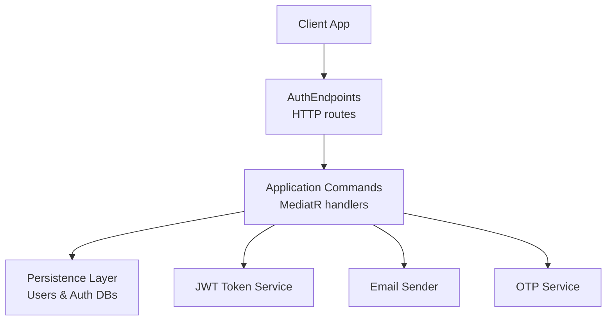
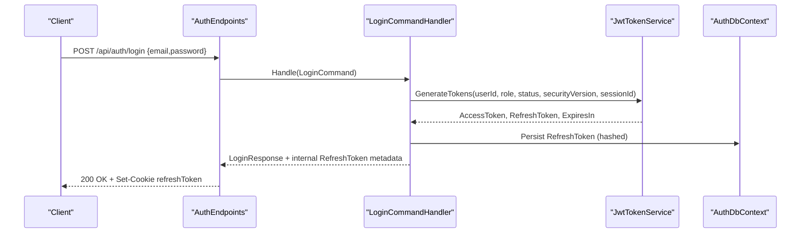
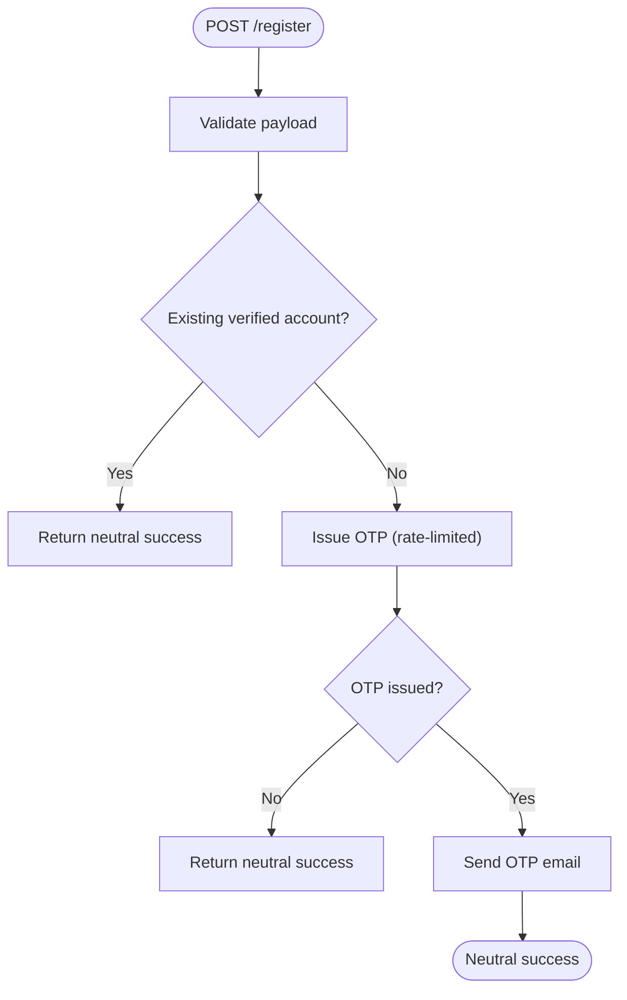
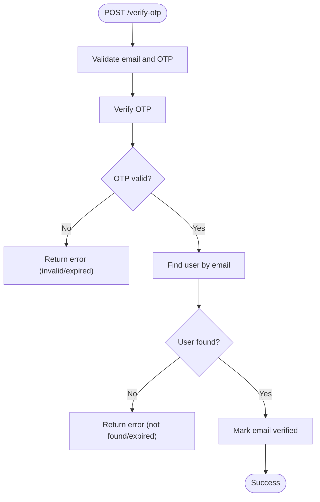
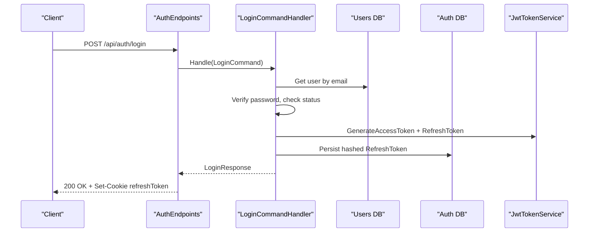
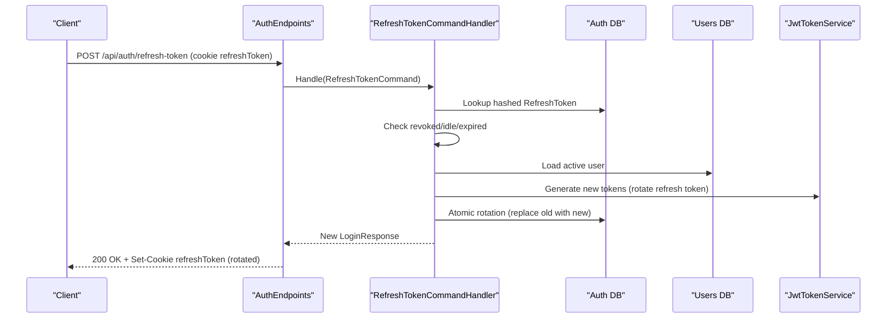
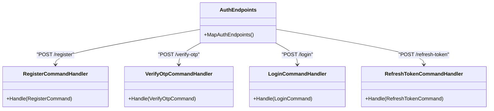

# Authentication & Authorization API

<cite>
**Referenced Files in This Document**
- [AuthEndpoints.cs](file://api/src/Api/CodePath.Api/Endpoints/AuthEndpoints.cs)
- [AuthRequests.cs](file://api/src/Api/CodePath.Api/Contracts/AuthRequests.cs)
- [LoginCommand.cs](file://api/src/Application/CodePath.Application/Auth/Commands/LoginCommand.cs)
- [RegisterCommand.cs](file://api/src/Application/CodePath.Application/Auth/Commands/RegisterCommand.cs)
- [VerifyOtpCommand.cs](file://api/src/Application/CodePath.Application/Auth/Commands/VerifyOtpCommand.cs)
- [RefreshTokenCommand.cs](file://api/src/Application/CodePath.Application/Auth/Commands/RefreshTokenCommand.cs)
</cite>

## Table of Contents
1. Introduction
2. Project Structure
3. Core Components
4. Architecture Overview
5. Detailed Component Analysis
6. Dependency Analysis
7. Performance Considerations
8. Troubleshooting Guide
9. Conclusion

## Introduction
This document provides comprehensive API documentation for CodePart’s authentication and authorization endpoints. It covers HTTP methods, URL patterns, request/response schemas, JWT-based authentication flows, OTP verification, password reset operations, profile updates, and session management. It also includes rate limiting behavior, security considerations, practical client implementation examples, and troubleshooting guidance.

## Project Structure
The authentication feature is implemented as a set of minimal API endpoints that delegate business logic to application commands via MediatR. Request contracts are defined in a dedicated contracts file, while command handlers encapsulate validation, domain rules, persistence, token issuance, and session management.

**Diagram sources**
- [AuthEndpoints.cs:104-291](file://api/src/Api/CodePath.Api/Endpoints/AuthEndpoints.cs#L104-L291)
- [LoginCommand.cs:55-191](file://api/src/Application/CodePath.Application/Auth/Commands/LoginCommand.cs#L55-L191)
- [RegisterCommand.cs:38-155](file://api/src/Application/CodePath.Application/Auth/Commands/RegisterCommand.cs#L38-L155)
- [VerifyOtpCommand.cs:24-55](file://api/src/Application/CodePath.Application/Auth/Commands/VerifyOtpCommand.cs#L24-L55)
- [RefreshTokenCommand.cs:19-121](file://api/src/Application/CodePath.Application/Auth/Commands/RefreshTokenCommand.cs#L19-L121)

**Section sources**
- [AuthEndpoints.cs:104-291](file://api/src/Api/CodePath.Api/Endpoints/AuthEndpoints.cs#L104-L291)

## Core Components
- Endpoint layer: Defines HTTP routes under /api/auth and maps them to application commands.
- Contracts: Strongly typed request models for registration, OTP verification, login, and password reset.
- Application commands: Encapsulate validation, business rules, persistence, token generation, and session handling.

Key responsibilities:
- Registration with OTP email delivery and neutral responses to prevent enumeration.
- OTP verification to mark user email as verified.
- Login with concurrent protection, attempt throttling, refresh token rotation, and cookie management.
- Refresh token flow with family rotation and idle/expired session detection.
- Logout and logout-all with JTI revocation and cookie cleanup.
- Profile retrieval and update for authenticated users.

**Section sources**
- [AuthEndpoints.cs:104-291](file://api/src/Api/CodePath.Api/Endpoints/AuthEndpoints.cs#L104-L291)
- [AuthRequests.cs:1-9](file://api/src/Api/CodePath.Api/Contracts/AuthRequests.cs#L1-L9)
- [LoginCommand.cs:14-42](file://api/src/Application/CodePath.Application/Auth/Commands/LoginCommand.cs#L14-L42)
- [RegisterCommand.cs:15-35](file://api/src/Application/CodePath.Application/Auth/Commands/RegisterCommand.cs#L15-L35)
- [VerifyOtpCommand.cs:9-21](file://api/src/Application/CodePath.Application/Auth/Commands/VerifyOtpCommand.cs#L9-L21)
- [RefreshTokenCommand.cs:12-17](file://api/src/Application/CodePath.Application/Auth/Commands/RefreshTokenCommand.cs#L12-L17)

## Architecture Overview
The authentication flow uses short-lived access tokens (JWT Bearer) and long-lived refresh tokens stored securely in HttpOnly cookies. The refresh endpoint rotates tokens atomically and enforces session policies such as idle timeout and absolute lifetime.

**Diagram sources**
- [AuthEndpoints.cs:132-156](file://api/src/Api/CodePath.Api/Endpoints/AuthEndpoints.cs#L132-L156)
- [LoginCommand.cs:158-190](file://api/src/Application/CodePath.Application/Auth/Commands/LoginCommand.cs#L158-L190)

## Detailed Component Analysis

### Authentication Endpoints Overview
Base path: /api/auth

| Method | Path | Description | Auth Required | Rate Limiting | Notes |
|--------|------|-------------|---------------|---------------|-------|
| POST | /register | Create account and send OTP email | No | auth-rate-limit | Neutral response if account exists or OTP quota exhausted |
| POST | /verify-otp | Verify OTP and mark email verified | No | auth-rate-limit | Requires valid 6-digit OTP |
| POST | /resend-otp | Resend OTP email | No | auth-rate-limit | Neutral response if OTP not issued due to limits |
| POST | /login | Authenticate and issue tokens | No | login-rate-limit | Sets HttpOnly Secure SameSite refresh token cookie |
| POST | /forgot-password | Send password reset link/email | No | password-reset-rate-limit | Neutral response to avoid enumeration |
| POST | /reset-password | Reset password using token | No | password-reset-rate-limit | Validates token and new password policy |
| POST | /refresh-token | Exchange refresh token for new tokens | Cookie required | auth-rate-limit | Rotates refresh token; validates origin when SameSite=None |
| POST | /refresh | Alias for /refresh-token | Cookie required | auth-rate-limit | Same behavior as /refresh-token |
| POST | /logout | Revoke current session and clear cookie | Cookie required | auth-rate-limit | Uses JTI and token expiry from context |
| POST | /refresh-token/logout | Logout alias scoped to refresh cookie | Cookie required | auth-rate-limit | Supports logout after access token expires |
| POST | /logout-all | Revoke all sessions for the user | ActiveUser policy | auth-rate-limit | Requires authenticated user |
| GET | /me | Get current user profile | ActiveUser policy | None | Returns user details |
| PUT | /me | Update current user profile (full name) | ActiveUser policy | None | Updates FullName only |

Security notes:
- Refresh token cookie is HttpOnly, Secure, and SameSite configured by settings.
- Cross-origin refresh/logout requires allowed origins when SameSite=None.
- All sensitive endpoints use appropriate rate limiters.

**Section sources**
- [AuthEndpoints.cs:50-103](file://api/src/Api/CodePath.Api/Endpoints/AuthEndpoints.cs#L50-L103)
- [AuthEndpoints.cs:104-291](file://api/src/Api/CodePath.Api/Endpoints/AuthEndpoints.cs#L104-L291)

### Request Schemas
- RegisterRequest: fields full_name, email, password
- VerifyOtpRequest: fields email, otp
- ResendOtpRequest: field email
- LoginRequest: fields email, password
- ForgotPasswordRequest: field email
- ResetPasswordRequest: fields token, new_password

Validation highlights:
- Registration accepts only @hanu.edu.vn emails; student vs teacher role inferred from email pattern.
- Password must meet complexity policy.
- OTP must be exactly six digits.

**Section sources**
- [AuthRequests.cs:1-9](file://api/src/Api/CodePath.Api/Contracts/AuthRequests.cs#L1-L9)
- [RegisterCommand.cs:17-35](file://api/src/Application/CodePath.Application/Auth/Commands/RegisterCommand.cs#L17-L35)
- [VerifyOtpCommand.cs:11-21](file://api/src/Application/CodePath.Application/Auth/Commands/VerifyOtpCommand.cs#L11-L21)

### Response Schemas

#### Login Response
- access_token: string
- expires_in: integer seconds
- token_type: string (Bearer)
- user: object
  - id: string (GUID)
  - email: string
  - full_name: string
  - role: string
  - status: string
  - email_verified_at: datetime?

Note: The refresh token is returned in the response body during login but is primarily consumed via the secure cookie.

**Section sources**
- [LoginCommand.cs:14-42](file://api/src/Application/CodePath.Application/Auth/Commands/LoginCommand.cs#L14-L42)

#### Current User Response (/me)
- id: string (GUID)
- email: string
- full_name: string
- role: string
- status: string
- email_verified_at: datetime?

**Section sources**
- [LoginCommand.cs:14-29](file://api/src/Application/CodePath.Application/Auth/Commands/LoginCommand.cs#L14-L29)
- [AuthEndpoints.cs:268-279](file://api/src/Api/CodePath.Api/Endpoints/AuthEndpoints.cs#L268-L279)

### Authentication Flows

#### Registration with OTP Verification

Behavior:
- If an existing account is already verified, returns a neutral success message.
- For unverified accounts or new accounts, attempts to issue an OTP; if OTP issuance fails due to rate limits or quotas, still returns neutral success to avoid enumeration.
- On successful email delivery, returns neutral success.

**Diagram sources**
- [RegisterCommand.cs:70-155](file://api/src/Application/CodePath.Application/Auth/Commands/RegisterCommand.cs#L70-L155)

**Section sources**
- [RegisterCommand.cs:38-155](file://api/src/Application/CodePath.Application/Auth/Commands/RegisterCommand.cs#L38-L155)

#### OTP Verification

**Diagram sources**
- [VerifyOtpCommand.cs:40-55](file://api/src/Application/CodePath.Application/Auth/Commands/VerifyOtpCommand.cs#L40-L55)

**Section sources**
- [VerifyOtpCommand.cs:24-55](file://api/src/Application/CodePath.Application/Auth/Commands/VerifyOtpCommand.cs#L24-L55)

#### Login Flow

Error handling:
- Account unverified: returns specific error code indicating OTP verification required.
- Account pending/rejected/disabled: returns corresponding error codes.
- Too many failed attempts: returns retry-after guidance.

**Diagram sources**
- [AuthEndpoints.cs:132-156](file://api/src/Api/CodePath.Api/Endpoints/AuthEndpoints.cs#L132-L156)
- [LoginCommand.cs:88-190](file://api/src/Application/CodePath.Application/Auth/Commands/LoginCommand.cs#L88-L190)

**Section sources**
- [LoginCommand.cs:55-215](file://api/src/Application/CodePath.Application/Auth/Commands/LoginCommand.cs#L55-L215)

#### Refresh Token Flow

Notes:
- Origin validation applies when SameSite=None.
- Idle/expired sessions return specific error codes to guide client behavior.

**Diagram sources**
- [AuthEndpoints.cs:185-218](file://api/src/Api/CodePath.Api/Endpoints/AuthEndpoints.cs#L185-L218)
- [RefreshTokenCommand.cs:41-111](file://api/src/Application/CodePath.Application/Auth/Commands/RefreshTokenCommand.cs#L41-L111)

**Section sources**
- [RefreshTokenCommand.cs:19-124](file://api/src/Application/CodePath.Application/Auth/Commands/RefreshTokenCommand.cs#L19-L124)

#### Logout and Logout-All
- Logout: Revokes current session using JTI and token expiry, clears refresh token cookie.
- Logout-All: Requires ActiveUser policy; revokes all sessions for the user and clears refresh token cookie.

**Section sources**
- [AuthEndpoints.cs:220-266](file://api/src/Api/CodePath.Api/Endpoints/AuthEndpoints.cs#L220-L266)

#### Profile Management
- GET /me: Returns current user profile for authenticated users.
- PUT /me: Updates full name for authenticated users.

**Section sources**
- [AuthEndpoints.cs:268-289](file://api/src/Api/CodePath.Api/Endpoints/AuthEndpoints.cs#L268-L289)

## Dependency Analysis

**Diagram sources**
- [AuthEndpoints.cs:104-291](file://api/src/Api/CodePath.Api/Endpoints/AuthEndpoints.cs#L104-L291)
- [RegisterCommand.cs:38-155](file://api/src/Application/CodePath.Application/Auth/Commands/RegisterCommand.cs#L38-L155)
- [VerifyOtpCommand.cs:24-55](file://api/src/Application/CodePath.Application/Auth/Commands/VerifyOtpCommand.cs#L24-L55)
- [LoginCommand.cs:55-215](file://api/src/Application/CodePath.Application/Auth/Commands/LoginCommand.cs#L55-L215)
- [RefreshTokenCommand.cs:19-124](file://api/src/Application/CodePath.Application/Auth/Commands/RefreshTokenCommand.cs#L19-L124)

**Section sources**
- [AuthEndpoints.cs:104-291](file://api/src/Api/CodePath.Api/Endpoints/AuthEndpoints.cs#L104-L291)

## Performance Considerations
- Concurrency control on login prevents race conditions and protects database writes.
- Atomic refresh token rotation avoids duplicate usage and ensures consistent state.
- Neutral responses on registration/OTP resend mitigate enumeration attacks without exposing system internals.
- Rate limiting is applied per endpoint group to protect against brute-force and abuse.

[No sources needed since this section provides general guidance]

## Troubleshooting Guide
Common issues and resolutions:
- Account unverified: Complete OTP verification before login.
- Too many failed login attempts: Respect Retry-After header and back off.
- Session expired or idle timeout: Re-authenticate; handle specific error codes to differentiate idle vs expired.
- Forbidden on refresh/logout: Ensure SameSite configuration and allowed origins match your frontend.
- Neutral success on registration: Indicates either existing verified account or OTP not issued due to rate limits; do not infer exact cause from response.

**Section sources**
- [LoginCommand.cs:137-156](file://api/src/Application/CodePath.Application/Auth/Commands/LoginCommand.cs#L137-L156)
- [RefreshTokenCommand.cs:52-76](file://api/src/Application/CodePath.Application/Auth/Commands/RefreshTokenCommand.cs#L52-L76)
- [AuthEndpoints.cs:185-218](file://api/src/Api/CodePath.Api/Endpoints/AuthEndpoints.cs#L185-L218)

## Practical Client Implementation Examples

### End-to-End Flow: Registration to Token Refresh
1. Register
   - POST /api/auth/register with {full_name, email, password}
   - Expect neutral success even if account exists or OTP not sent due to limits
2. Verify OTP
   - POST /api/auth/verify-otp with {email, otp}
   - Expect success once OTP is valid
3. Login
   - POST /api/auth/login with {email, password}
   - Receive access token in Authorization header and refresh token in HttpOnly cookie
4. Use Access Token
   - Include Authorization: Bearer <access_token> on protected endpoints
5. Refresh Token
   - POST /api/auth/refresh-token (cookie refreshToken)
   - Receive new access token and rotated refresh token cookie
6. Logout
   - POST /api/auth/logout (cookie refreshToken)
   - Server clears refresh token cookie

Rate limiting headers:
- Some endpoints may include Retry-After on 429-like responses; honor it to avoid further throttling.

Security best practices:
- Store access tokens in memory only; never persist them.
- Do not send refresh tokens in Authorization headers; rely on secure cookies.
- Validate CORS and SameSite settings for cross-origin scenarios.
- Implement idle timeout detection and prompt re-login when necessary.

[No sources needed since this section provides general guidance]

## Security Considerations
- Password hashing and optional rehashing on login improve security over time.
- Refresh tokens are hashed at rest and rotated atomically to prevent replay.
- Session policies enforce idle timeouts and absolute lifetimes.
- Origin checks restrict refresh/logout when SameSite=None.
- Neutral responses prevent user enumeration on registration and password reset.

**Section sources**
- [LoginCommand.cs:113-164](file://api/src/Application/CodePath.Application/Auth/Commands/LoginCommand.cs#L113-L164)
- [RefreshTokenCommand.cs:41-111](file://api/src/Application/CodePath.Application/Auth/Commands/RefreshTokenCommand.cs#L41-L111)
- [AuthEndpoints.cs:84-99](file://api/src/Api/CodePath.Api/Endpoints/AuthEndpoints.cs#L84-L99)

## Conclusion
CodePart’s authentication and authorization subsystem provides a robust, secure, and scalable foundation for user identity and session management. It combines OTP-based email verification, strict password policies, atomic refresh token rotation, and granular rate limiting to protect against common threats while offering a smooth developer experience through clear APIs and predictable error behaviors.