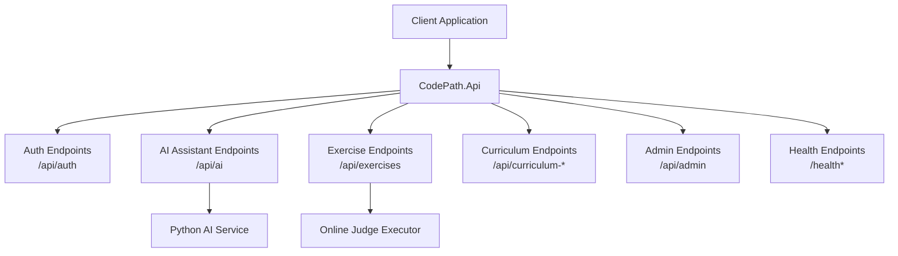
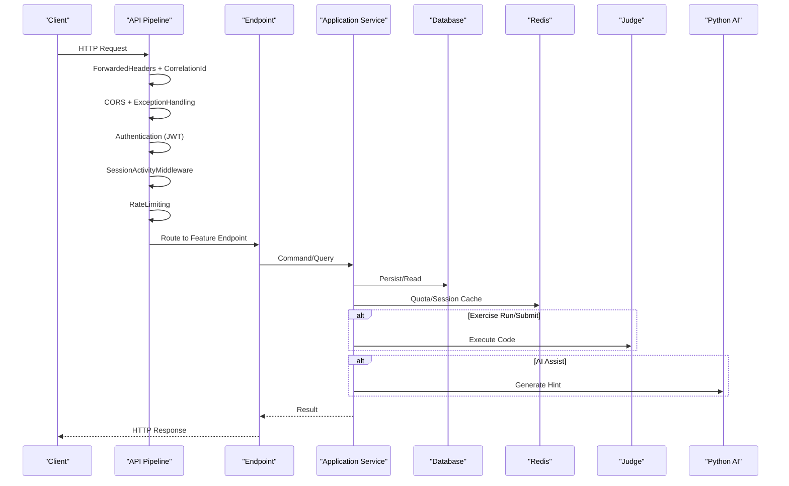
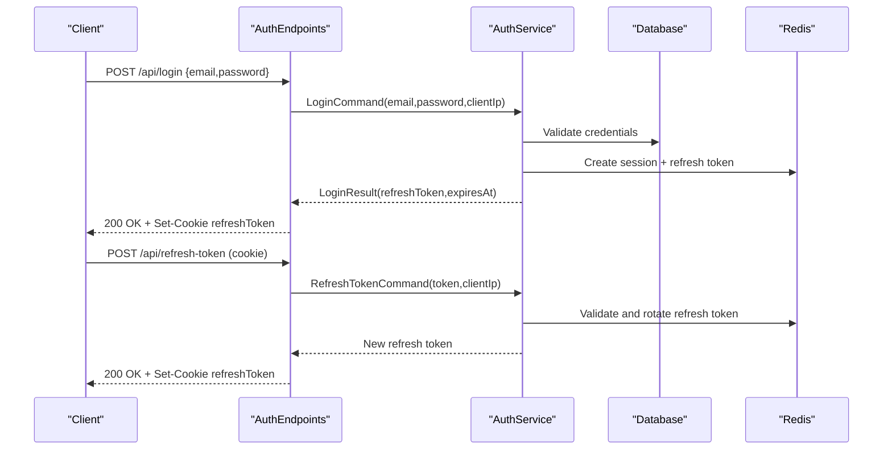
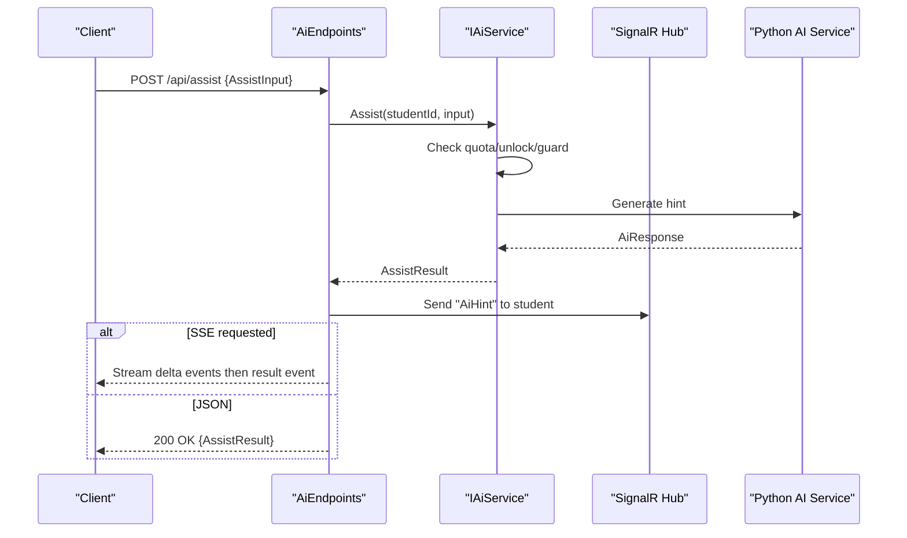
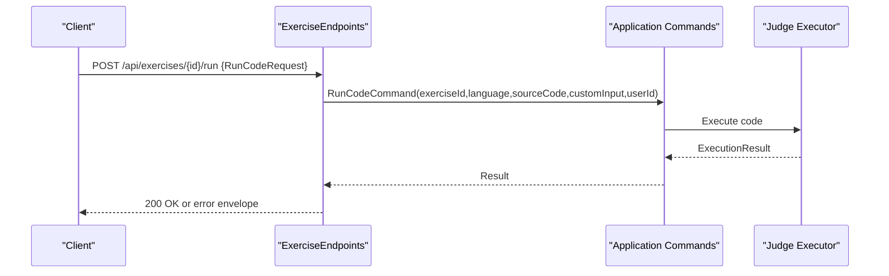
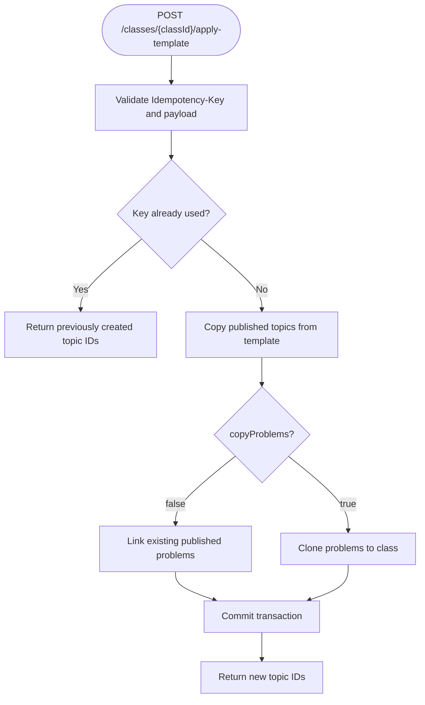
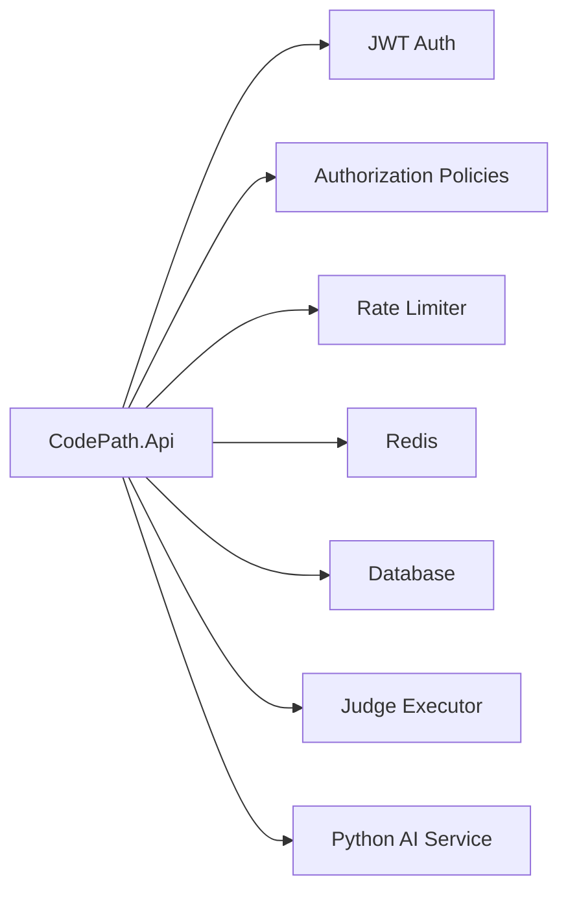

# Backend API Documentation

<cite>
**Referenced Files in This Document**
- [Program.cs](file://api/src/Api/CodePath.Api/Program.cs)
- [AuthEndpoints.cs](file://api/src/Api/CodePath.Api/Endpoints/AuthEndpoints.cs)
- [AiEndpoints.cs](file://api/src/Api/CodePath.Api/Endpoints/AiEndpoints.cs)
- [ExerciseEndpoints.cs](file://api/src/Api/CodePath.Api/Endpoints/ExerciseEndpoints.cs)
- [CurriculumEndpoints.cs](file://api/src/Api/CodePath.Api/Endpoints/CurriculumEndpoints.cs)
- [AdminEndpoints.cs](file://api/src/Api/CodePath.Api/Endpoints/AdminEndpoints.cs)
- [AuthRequests.cs](file://api/src/Api/CodePath.Api/Contracts/AuthRequests.cs)
- [ExerciseRequests.cs](file://api/src/Api/CodePath.Api/Contracts/ExerciseRequests.cs)
- [Contracts.cs](file://api/src/Application/CodePath.Application/Ai/Contracts.cs)
- [CurriculumContracts.cs](file://api/src/Application/CodePath.Application/Learning/CurriculumContracts.cs)
- [AI_ASSISTANT.md](file://api/docs/AI_ASSISTANT.md)
- [CURRICULUM.md](file://api/docs/CURRICULUM.md)
</cite>

## Table of Contents
1. [Introduction](#introduction)
2. [Project Structure](#project-structure)
3. [Core Components](#core-components)
4. [Architecture Overview](#architecture-overview)
5. [Detailed Component Analysis](#detailed-component-analysis)
6. [Dependency Analysis](#dependency-analysis)
7. [Performance Considerations](#performance-considerations)
8. [Troubleshooting Guide](#troubleshooting-guide)
9. [Conclusion](#conclusion)

## Introduction
This document describes the CodePart .NET backend RESTful APIs exposed by the `CodePath.Api` project. It covers authentication, AI-assisted hint generation, exercise code execution, curriculum and learning management, and administrative user management. For each endpoint group, it specifies HTTP methods, URL patterns, request and response schemas, authentication requirements, error responses, rate limits, security considerations, and practical client usage guidance.

The backend uses ASP.NET Minimal APIs with MediatR for command/query handling, JWT bearer authentication, Redis-backed session and quota features, and optional integration with a Python-based AI assistant service and an online judge executor.

## Project Structure
The API surface is organized into feature-specific endpoint groups under `/api`:
- Authentication: `/api/auth`
- AI Assistant: `/api/ai`
- Exercises: `/api/exercises`
- Curriculum and Learning: `/api/curriculum-*`, `/api/classes/*`, `/api/assets/*`
- Admin: `/api/admin`
- Health and infrastructure endpoints are also available.

**Diagram sources**
- [Program.cs:402-510](file://api/src/Api/CodePath.Api/Program.cs#L402-L510)
- [AuthEndpoints.cs:104-291](file://api/src/Api/CodePath.Api/Endpoints/AuthEndpoints.cs#L104-L291)
- [AiEndpoints.cs:12-43](file://api/src/Api/CodePath.Api/Endpoints/AiEndpoints.cs#L12-L43)
- [ExerciseEndpoints.cs:15-73](file://api/src/Api/CodePath.Api/Endpoints/ExerciseEndpoints.cs#L15-L73)
- [CurriculumEndpoints.cs:10-32](file://api/src/Api/CodePath.Api/Endpoints/CurriculumEndpoints.cs#L10-L32)
- [AdminEndpoints.cs:17-152](file://api/src/Api/CodePath.Api/Endpoints/AdminEndpoints.cs#L17-L152)

**Section sources**
- [Program.cs:28-514](file://api/src/Api/CodePath.Api/Program.cs#L28-L514)

## Core Components
- Authentication component provides registration, OTP verification, login, password reset, refresh token rotation, logout, current user profile retrieval and update.
- AI Assistant component provides hint generation via streaming SSE or JSON, feedback submission, and SignalR hub for real-time updates.
- Exercise component provides code run and submit operations with rate limiting and optional online judge integration.
- Curriculum component supports template management, class topic creation, problem search, and idempotent template application.
- Admin component supports teacher/student lifecycle operations, audit log listing, and user status changes.

**Section sources**
- [AuthEndpoints.cs:104-291](file://api/src/Api/CodePath.Api/Endpoints/AuthEndpoints.cs#L104-L291)
- [AiEndpoints.cs:12-43](file://api/src/Api/CodePath.Api/Endpoints/AiEndpoints.cs#L12-L43)
- [ExerciseEndpoints.cs:15-73](file://api/src/Api/CodePath.Api/Endpoints/ExerciseEndpoints.cs#L15-L73)
- [CurriculumEndpoints.cs:10-32](file://api/src/Api/CodePath.Api/Endpoints/CurriculumEndpoints.cs#L10-L32)
- [AdminEndpoints.cs:17-152](file://api/src/Api/CodePath.Api/Endpoints/AdminEndpoints.cs#L17-L152)

## Architecture Overview
The API pipeline applies forwarded headers, correlation ID middleware, CORS, exception handling, authentication, session activity tracking, rate limiting, authorization, and finally routes to feature endpoints. Optional services (Judge, AI) are conditionally enabled through configuration.

**Diagram sources**
- [Program.cs:386-422](file://api/src/Api/CodePath.Api/Program.cs#L386-L422)
- [Program.cs:424-510](file://api/src/Api/CodePath.Api/Program.cs#L424-L510)

## Detailed Component Analysis

### Authentication API
Base path: `/api/auth`
Authentication scheme: Bearer JWT for protected endpoints; cookie-scoped refresh token for token rotation.

| Method | Route | Description | Authorization | Rate Limit | Request Body | Success Response | Error Responses |
| --- | --- | --- | --- | --- | --- | --- | --- |
| POST | `/register` | Register a new account | None | `auth-rate-limit` | `{ fullName, email, password }` | Standard result envelope | Validation errors, conflict |
| POST | `/verify-otp` | Verify OTP sent during registration | None | `auth-rate-limit` | `{ email, otp }` | Standard result envelope | Invalid OTP, expired |
| POST | `/resend-otp` | Resend OTP | None | `auth-rate-limit` | `{ email }` | Standard result envelope | Rate limited, invalid email |
| POST | `/login` | Authenticate and issue access token + refresh token cookie | None | `login-rate-limit` | `{ email, password }` | Standard result envelope with refresh token cookie | Unauthorized, locked account, rate limited |
| POST | `/forgot-password` | Send password reset link/email | None | `password-reset-rate-limit` | `{ email }` | Standard result envelope | Rate limited |
| POST | `/reset-password` | Reset password using token | None | `password-reset-rate-limit` | `{ token, newPassword }` | Standard result envelope | Invalid/expired token, validation error |
| POST | `/refresh-token` | Rotate refresh token from secure cookie | None | `auth-rate-limit` | Cookie-only | New refresh token cookie | Unauthorized, forbidden origin |
| POST | `/refresh` | Alias for `/refresh-token` | None | `auth-rate-limit` | Cookie-only | New refresh token cookie | Unauthorized, forbidden origin |
| POST | `/logout` | Invalidate session and clear refresh token cookie | None | `auth-rate-limit` | Cookie + active JWT | `{ message }` | Forbidden origin |
| POST | `/refresh-token/logout` | Logout alias scoped to refresh token cookie | None | `auth-rate-limit` | Cookie only | `{ message }` | Forbidden origin |
| POST | `/logout-all` | Revoke all sessions for current user | Active user | `auth-rate-limit` | None | `{ message }` | Unauthorized |
| GET | `/me` | Get current user profile | Active user | None | None | User profile object | Unauthorized |
| PUT | `/me` | Update current user profile | Active user | None | `{ fullName }` | Updated profile | Unauthorized |

Notes:
- Refresh token is stored in an HttpOnly, Secure cookie scoped to `/api/auth` and `/api/auth/refresh-token`.
- Origin validation is enforced for cookie-based refresh/logout flows.
- All successful responses use a standard result envelope produced by the shared extension.

Common error codes:
- `Unauthorized`: Missing or invalid token, revoked session.
- `Forbidden`: Insufficient permissions or disallowed origin.
- `BadRequest`: Invalid input or conflicting state.
- `TooManyRequests`: Rate limit exceeded.

Rate limiting details:
- `auth-rate-limit`: Fixed window per client IP.
- `login-rate-limit`: Token bucket per client IP with configurable burst/refill.
- `password-reset-rate-limit`: Fixed window per client IP.

Security considerations:
- JWT validation enforces issuer, audience, signature, lifetime, and blacklist check.
- Session revocation checks user status and security version.
- CSRF protection relies on SameSite cookie policy and origin checks.

Practical client example:
- Login returns a refresh token cookie; subsequent requests include the cookie for `/refresh-token`.
- After successful login, attach the access token as `Authorization: Bearer <token>` for protected endpoints.

**Section sources**
- [AuthEndpoints.cs:104-291](file://api/src/Api/CodePath.Api/Endpoints/AuthEndpoints.cs#L104-L291)
- [AuthRequests.cs:1-9](file://api/src/Api/CodePath.Api/Contracts/AuthRequests.cs#L1-L9)
- [Program.cs:71-158](file://api/src/Api/CodePath.Api/Program.cs#L71-L158)
- [Program.cs:245-358](file://api/src/Api/CodePath.Api/Program.cs#L245-L358)

#### Authentication Flow Sequence

**Diagram sources**
- [AuthEndpoints.cs:132-218](file://api/src/Api/CodePath.Api/Endpoints/AuthEndpoints.cs#L132-L218)

### AI Assistant API
Base path: `/api/ai`
Authorization: Active student role required.

| Method | Route | Description | Request Body | Response | Notes |
| --- | --- | --- | --- | --- | --- |
| POST | `/assist` | Generate guided hints for a problem | `{ problemId, language, sourceCode, type="Hint", level=1, question? }` | JSON hint result or SSE stream | Requires active student; respects quota and unlock rules |
| POST | `/{id}/feedback` | Mark hint as helpful or not | `{ helpful: boolean }` | 204 No Content or 404 Not Found | Uses interactionId |
| CONNECT | `/hub` | Real-time hint events via SignalR | N/A | N/A | Events delivered to authenticated student |

Request schema:
- `AssistInput`: `problemId`, `language`, `sourceCode`, optional `type`, `level`, `question`.
- `AiResponse`: `stage`, `stageConfidence`, `errorCategory`, `message`, `steps`, `suspectedLines`, `guidingQuestion`, `level`, `guardStatus`, `modelVersion`, `promptVersion`, `tokensIn`, `tokensOut`, optional `references`.

Response behavior:
- If `Accept: text/event-stream`, the server streams delta chunks followed by a final result event.
- Otherwise, returns the full JSON response.

Policy and quotas:
- Daily quota limit and level unlocking rules are enforced before calling the Python AI service.
- Policy exceptions return standardized error envelopes with safe messages.

Security and safety:
- LLM output passes a guard before streaming.
- Feedback is bound to the authenticated student’s interaction record.

Practical client example:
- Call `/api/ai/assist` with `Accept: text/event-stream` to receive incremental hint tokens.
- Handle `event: delta` and `event: result` frames.
- Submit feedback using the returned `interactionId`.

**Section sources**
- [AiEndpoints.cs:12-43](file://api/src/Api/CodePath.Api/Endpoints/AiEndpoints.cs#L12-L43)
- [Contracts.cs:1-32](file://api/src/Application/CodePath.Application/Ai/Contracts.cs#L1-L32)
- [AI_ASSISTANT.md:1-81](file://api/docs/AI_ASSISTANT.md#L1-L81)

#### AI Assist Flow Sequence

**Diagram sources**
- [AiEndpoints.cs:15-42](file://api/src/Api/CodePath.Api/Endpoints/AiEndpoints.cs#L15-L42)

### Exercise API
Base path: `/api/exercises`
Authorization: Active student role required for run/submit.

| Method | Route | Description | Request Body | Response | Errors |
| --- | --- | --- | --- | --- | --- |
| GET | `/{slug}` | Retrieve exercise metadata and public content | None | Exercise detail | 404 Not Found |
| POST | `/{exerciseId}/run` | Execute code in sandbox | `{ language, sourceCode, customInput? }` | Execution result | 400, 401, 429, 503 |
| POST | `/{exerciseId}/submit` | Submit code for grading | `{ language, sourceCode }` | Submission result | 400, 401, 429, 503 |

Request schemas:
- `RunCodeRequest`: `language`, `sourceCode`, optional `customInput`.
- `SubmitCodeRequest`: `language`, `sourceCode`.

Rate limiting:
- `code-execution-rate-limit`: Fixed window per user identity or client IP.

Error responses:
- 400 Bad Request: Invalid input or unsupported language.
- 401 Unauthorized: Missing or invalid token.
- 429 Too Many Requests: Exceeded execution rate limit.
- 503 Service Unavailable: Online judge executor unavailable.

Practical client example:
- Use `/run` for iterative testing with optional `customInput`.
- Use `/submit` for graded evaluation; handle asynchronous results if provided by the judge.

**Section sources**
- [ExerciseEndpoints.cs:15-73](file://api/src/Api/CodePath.Api/Endpoints/ExerciseEndpoints.cs#L15-L73)
- [ExerciseRequests.cs:1-5](file://api/src/Api/CodePath.Api/Contracts/ExerciseRequests.cs#L1-L5)
- [Program.cs:346-358](file://api/src/Api/CodePath.Api/Program.cs#L346-L358)

#### Exercise Run Sequence

**Diagram sources**
- [ExerciseEndpoints.cs:29-47](file://api/src/Api/CodePath.Api/Endpoints/ExerciseEndpoints.cs#L29-L47)

### Curriculum and Learning API
Base path: `/api`
Authorization: `CanManageClassContent` (Admin or Teacher with active user requirement).

| Method | Route | Description | Request Body | Response | Notes |
| --- | --- | --- | --- | --- | --- |
| GET | `/curriculum-templates` | List templates visible to actor | None | Template list | Shared and owned templates |
| POST | `/curriculum-templates` | Create a template | `{ name, description, thumbnail?, facultyId? }` | Created template | Admin-owned templates are shareable |
| GET | `/curriculum-templates/{id}` | Get template details | None | Template with chapters/topics | Read-only unless owner/Admin |
| PUT | `/curriculum-templates/{id}` | Update template metadata | `{ name, description, thumbnail?, facultyId? }` | Updated template | Owner/Admin only |
| DELETE | `/curriculum-templates/{id}` | Soft-delete template | Query `confirm=true` to confirm | Deleted template | Conflict if inherited topics exist |
| POST | `/classes/{classId}/apply-template` | Apply template to class | `{ templateId, chapterIds?, copyProblems=false, afterChapterId? }` | Array of created topic IDs | Requires `Idempotency-Key` header |
| POST | `/classes/{classId}/topics/complete` | Atomically create topic with lecture and exercises | Full topic payload | `{ id, rowVersion, status, publishedVersion }` | Validates assets, videos, deadlines |
| GET | `/classes/{classId}/available-problems` | Search problems | Query: `search`, `difficulty`, `page`, `pageSize` | `{ items, total, page, pageSize }` | Max `pageSize`=100 |

Additional endpoints referenced in documentation:
- Asset upload flow: `/api/assets/sign-upload`, `/api/assets/{id}/complete`.
- Class chapters: `/api/classes/{classId}/chapters` (readable by enrolled students).

Validation and constraints:
- Video URLs must be HTTPS with allowed provider/hostnames and duration between 1–86400 seconds.
- PDF documents must be Ready and within size limits.
- Topic completion rule fields are required; exercises array max 200 entries with unique IDs and points 0–10000.
- Idempotent template application requires a unique `Idempotency-Key` header.

**Section sources**
- [CurriculumEndpoints.cs:10-32](file://api/src/Api/CodePath.Api/Endpoints/CurriculumEndpoints.cs#L10-L32)
- [CurriculumContracts.cs:1-35](file://api/src/Application/CodePath.Application/Learning/CurriculumContracts.cs#L1-L35)
- [CURRICULUM.md:1-112](file://api/docs/CURRICULUM.md#L1-L112)

#### Curriculum Template Application Flowchart

**Diagram sources**
- [CurriculumEndpoints.cs:23-25](file://api/src/Api/CodePath.Api/Endpoints/CurriculumEndpoints.cs#L23-L25)
- [CURRICULUM.md:32-51](file://api/docs/CURRICULUM.md#L32-L51)

### Administrative API
Base path: `/api/admin`
Authorization: Admin role required (`AdminOnly`).

| Method | Route | Description | Parameters | Response | Errors |
| --- | --- | --- | --- | --- | --- |
| GET | `/teachers` | List teachers | Query: `status`, `cursor`, `limit`, `page`, `pageSize`, `search`, `facultyId`, `sortBy` | Paginated teacher list | 400, 401, 403 |
| POST | `/users/{id}/approve` | Approve teacher | Path `id` | Approval result | 404, 409 |
| POST | `/users/{id}/reject` | Reject teacher | Path `id` | Rejection result | 404, 409 |
| POST | `/users/{id}/disable` | Disable user | Path `id` | Status change result | 403, 404, 409 |
| DELETE | `/users/{id}` | Delete user | Path `id` | Deletion result | 401, 404, 409 |
| GET | `/audit-logs` | List audit logs | Query: `targetUserId`, `cursor`, `limit` | Cursor-pagated audit logs | 400 |

Pagination:
- Supports cursor-based pagination for admin queries; mixing cursor with filters like search/facultyId/sortBy is rejected.

Audit logging:
- Actions such as approve/reject/disable/delete are recorded with actor, target, timestamp, IP address, and data payload.

**Section sources**
- [AdminEndpoints.cs:17-152](file://api/src/Api/CodePath.Api/Endpoints/AdminEndpoints.cs#L17-L152)
- [AdminDtos.cs:1-30](file://api/src/Application/CodePath.Application/Admin/Dtos/AdminDtos.cs#L1-L30)

## Dependency Analysis
The API depends on several internal and external components:
- JWT authentication and authorization policies enforce roles and active user status.
- Rate limiting protects auth, code execution, health, and public read endpoints.
- Optional services:
  - Python AI assistant for hint generation.
  - Online judge executor for code execution.
- Redis is used for session activity, quotas, and cache probes.
- Database persistence for users, classes, curriculum, exercises, submissions, and audit logs.

**Diagram sources**
- [Program.cs:71-158](file://api/src/Api/CodePath.Api/Program.cs#L71-L158)
- [Program.cs:245-364](file://api/src/Api/CodePath.Api/Program.cs#L245-L364)
- [Program.cs:368-374](file://api/src/Api/CodePath.Api/Program.cs#L368-L374)

**Section sources**
- [Program.cs:71-158](file://api/src/Api/CodePath.Api/Program.cs#L71-L158)
- [Program.cs:245-364](file://api/src/Api/CodePath.Api/Program.cs#L245-L364)
- [Program.cs:368-374](file://api/src/Api/CodePath.Api/Program.cs#L368-L374)

## Performance Considerations
- Enable connection pooling and tune database pool options for high concurrency.
- Use Redis for session and quota caching to reduce database load.
- Prefer SSE streaming for AI hints to reduce latency and improve UX.
- Apply pagination and cursors for large admin lists.
- Configure rate limits according to expected traffic patterns; monitor 429 responses.
- Keep request bodies small; avoid sending binary payloads in JSON.
- Use health endpoints to detect Redis and database readiness before routing traffic.

[No sources needed since this section provides general guidance]

## Troubleshooting Guide
Common issues and resolutions:
- 401 Unauthorized:
  - Ensure JWT is present and valid; verify issuer, audience, and signing key configuration.
  - Check token blacklist and session validity.
- 403 Forbidden:
  - Confirm user role and active status; ensure correct authorization policy.
  - For cookie-based refresh/logout, verify allowed origins and SameSite settings.
- 429 Too Many Requests:
  - Respect retry-after headers; back off and throttle client requests.
- 503 Service Unavailable:
  - Online judge executor may be down; retry with exponential backoff.
- Redis health failures:
  - Use `/health/redis` to diagnose connectivity and round-trip success.

Operational tips:
- Log correlation IDs from middleware for request tracing.
- Monitor rate limiter rejections and adjust limits based on workload.
- Validate environment variables and secrets loading, especially in Docker/Kubernetes.

**Section sources**
- [Program.cs:120-158](file://api/src/Api/CodePath.Api/Program.cs#L120-L158)
- [Program.cs:251-358](file://api/src/Api/CodePath.Api/Program.cs#L251-L358)
- [Program.cs:455-500](file://api/src/Api/CodePath.Api/Program.cs#L455-L500)

## Conclusion
The CodePart backend exposes a comprehensive set of APIs for authentication, AI-assisted learning, code execution, curriculum management, and administration. Security is enforced through JWT, role-based policies, and strict session validation. Rate limiting and health checks protect system stability. Clients should implement robust error handling, respect rate limits, and leverage SSE streaming for AI hints. Proper configuration of secrets, CORS, and optional services ensures reliable operation across environments.

[No sources needed since this section summarizes without analyzing specific files]