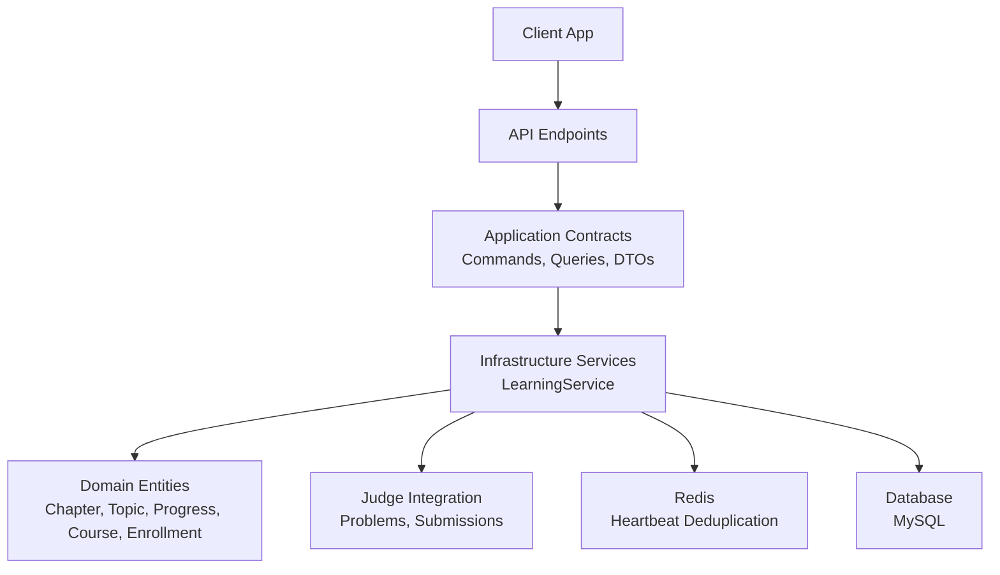
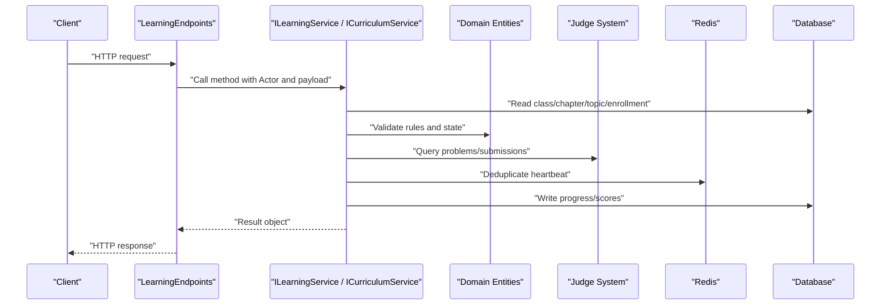
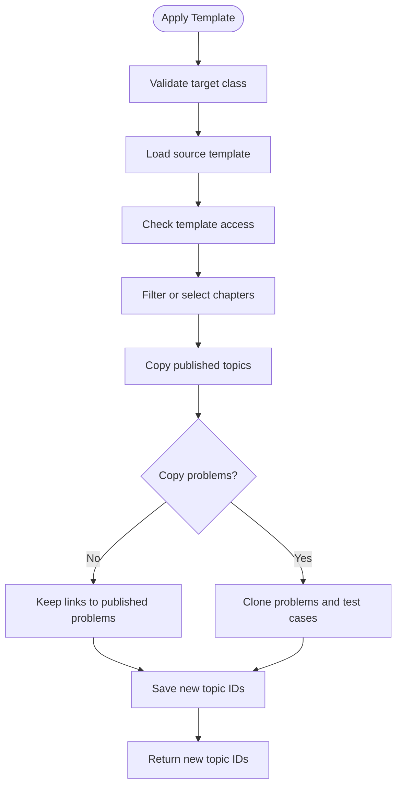
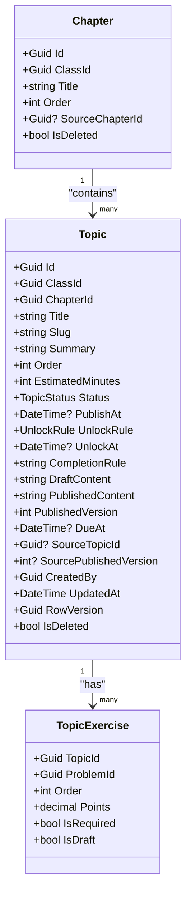
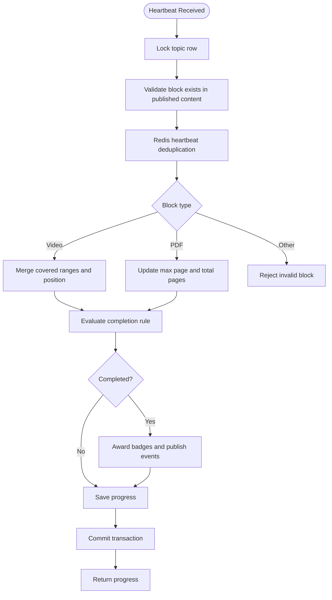
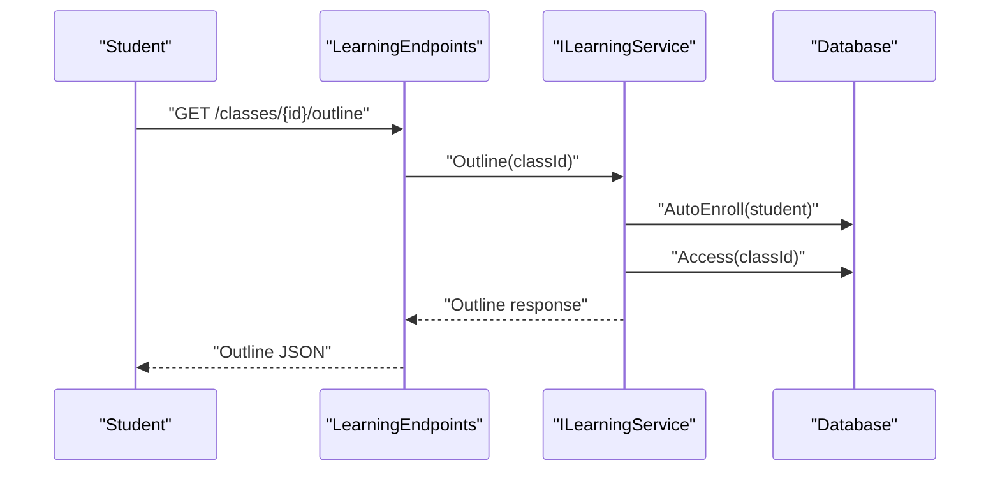
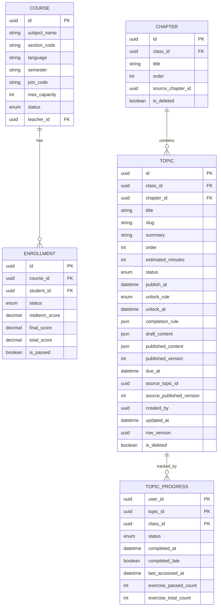
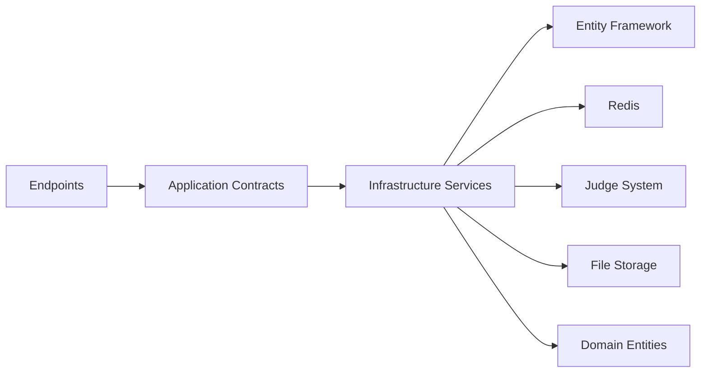

# Curriculum & Learning Management API

<cite>
**Referenced Files in This Document**
- [LearningEndpoints.cs](file://api/src/Api/CodePath.Api/Endpoints/LearningEndpoints.cs)
- [CurriculumEndpoints.cs](file://api/src/Api/CodePath.Api/Endpoints/CurriculumEndpoints.cs)
- [LearningContracts.cs](file://api/src/Application/CodePath.Application/Learning/LearningContracts.cs)
- [CurriculumContracts.cs](file://api/src/Application/CodePath.Application/Learning/CurriculumContracts.cs)
- [LearningService.Curriculum.cs](file://api/src/Infrastructure/CodePath.Infrastructure/Learning/LearningService.Curriculum.cs)
- [LearningService.Progress.cs](file://api/src/Infrastructure/CodePath.Infrastructure/Learning/LearningService.Progress.cs)
- [LearningEntities.cs](file://api/src/Domain/CodePath.Domain/Learning/LearningEntities.cs)
- [Course.cs](file://api/src/Domain/CodePath.Domain/Users/Entities/Course.cs)
- [Enrollment.cs](file://api/src/Domain/CodePath.Domain/Users/Entities/Enrollment.cs)
- [CURRICULUM.md](file://api/docs/CURRICULUM.md)
</cite>

## Table of Contents
1. [Introduction](#introduction)
2. [Project Structure](#project-structure)
3. [Core Components](#core-components)
4. [Architecture Overview](#architecture-overview)
5. [Detailed Component Analysis](#detailed-component-analysis)
6. [Dependency Analysis](#dependency-analysis)
7. [Performance Considerations](#performance-considerations)
8. [Troubleshooting Guide](#troubleshooting-guide)
9. [Conclusion](#conclusion)

## Introduction
This document describes the CodePart curriculum and learning management API. It covers HTTP endpoints for curriculum templates, chapter and topic administration, interactive learning content, student progress tracking, class enrollment context, and assessment workflows. The system separates:
- Curriculum authoring through shared or private templates.
- Class-level chapters and topics with draft, scheduled, and published states.
- Interactive learning blocks such as video, PDF, and markdown.
- Student progress tracking with heartbeats, completion rules, deadlines, and scoring.
- Enrollment-based access control for students reading lessons and submitting exercises.

The API is implemented in a layered ASP.NET Core application where endpoint files define routes, application contracts define request/response shapes, infrastructure services implement business logic, and domain entities model courses, enrollments, chapters, topics, and progress data.

## Project Structure
The relevant parts of the repository are organized by feature layer:
- API endpoints under `src/Api/CodePath.Api/Endpoints`.
- Application contracts under `src/Application/CodePath.Application/Learning`.
- Infrastructure service implementations under `src/Infrastructure/CodePath.Infrastructure/Learning`.
- Domain models under `src/Domain/CodePath.Domain/Learning` and `src/Domain/CodePath.Domain/Users/Entities`.
- Curriculum documentation under `api/docs/CURRICULUM.md`.

**Diagram sources**
- [LearningEndpoints.cs:14-49](file://api/src/Api/CodePath.Api/Endpoints/LearningEndpoints.cs#L14-L49)
- [CurriculumEndpoints.cs:10-32](file://api/src/Api/CodePath.Api/Endpoints/CurriculumEndpoints.cs#L10-L32)
- [LearningContracts.cs:8-35](file://api/src/Application/CodePath.Application/Learning/LearningContracts.cs#L8-L35)
- [CurriculumContracts.cs:8-25](file://api/src/Application/CodePath.Application/Learning/CurriculumContracts.cs#L8-L25)
- [LearningService.Curriculum.cs:14-156](file://api/src/Infrastructure/CodePath.Infrastructure/Learning/LearningService.Curriculum.cs#L14-L156)
- [LearningService.Progress.cs:13-206](file://api/src/Infrastructure/CodePath.Infrastructure/Learning/LearningService.Progress.cs#L13-L206)
- [LearningEntities.cs:12-123](file://api/src/Domain/CodePath.Domain/Learning/LearningEntities.cs#L12-L123)
- [Course.cs:7-88](file://api/src/Domain/CodePath.Domain/Users/Entities/Course.cs#L7-L88)
- [Enrollment.cs:7-88](file://api/src/Domain/CodePath.Domain/Users/Entities/Enrollment.cs#L7-L88)

**Section sources**
- [LearningEndpoints.cs:14-49](file://api/src/Api/CodePath.Api/Endpoints/LearningEndpoints.cs#L14-L49)
- [CurriculumEndpoints.cs:10-32](file://api/src/Api/CodePath.Api/Endpoints/CurriculumEndpoints.cs#L10-L32)
- [LearningContracts.cs:8-35](file://api/src/Application/CodePath.Application/Learning/LearningContracts.cs#L8-L35)
- [CurriculumContracts.cs:8-25](file://api/src/Application/CodePath.Application/Learning/CurriculumContracts.cs#L8-L25)
- [LearningService.Curriculum.cs:14-156](file://api/src/Infrastructure/CodePath.Infrastructure/Learning/LearningService.Curriculum.cs#L14-L156)
- [LearningService.Progress.cs:13-206](file://api/src/Infrastructure/CodePath.Infrastructure/Learning/LearningService.Progress.cs#L13-L206)
- [LearningEntities.cs:12-123](file://api/src/Domain/CodePath.Domain/Learning/LearningEntities.cs#L12-L123)
- [Course.cs:7-88](file://api/src/Domain/CodePath.Domain/Users/Entities/Course.cs#L7-L88)
- [Enrollment.cs:7-88](file://api/src/Domain/CodePath.Domain/Users/Entities/Enrollment.cs#L7-L88)

## Core Components
The curriculum and learning management features are built around these core components:

| Component | Responsibility | Key Files |
|---|---|---|
| API Endpoints | Define HTTP routes, authorization groups, tags, and parameter binding | [LearningEndpoints.cs](file://api/src/Api/CodePath.Api/Endpoints/LearningEndpoints.cs), [CurriculumEndpoints.cs](file://api/src/Api/CodePath.Api/Endpoints/CurriculumEndpoints.cs) |
| Application Contracts | Define input records, validators, commands, queries, and service interfaces | [LearningContracts.cs](file://api/src/Application/CodePath.Application/Learning/LearningContracts.cs), [CurriculumContracts.cs](file://api/src/Application/CodePath.Application/Learning/CurriculumContracts.cs) |
| Infrastructure Services | Implement curriculum template operations, chapter/topic CRUD, progress evaluation, reporting, and integration with judge and storage | [LearningService.Curriculum.cs](file://api/src/Infrastructure/CodePath.Infrastructure/Learning/LearningService.Curriculum.cs), [LearningService.Progress.cs](file://api/src/Infrastructure/CodePath.Infrastructure/Learning/LearningService.Progress.cs) |
| Domain Models | Represent chapters, topics, assets, progress, scores, course, and enrollment | [LearningEntities.cs](file://api/src/Domain/CodePath.Domain/Learning/LearningEntities.cs), [Course.cs](file://api/src/Domain/CodePath.Domain/Users/Entities/Course.cs), [Enrollment.cs](file://api/src/Domain/CodePath.Domain/Users/Entities/Enrollment.cs) |

Key concepts:
- A **class** can be a normal teaching class or a curriculum template. Templates are reusable chapter and topic structures.
- A **chapter** groups related topics within a class.
- A **topic** represents a lesson with metadata, unlock rules, due dates, draft/published content, and attached exercises.
- **Progress** tracks per-user status for topics and content blocks, including video playback ranges and PDF page coverage.
- **Enrollment** connects students to courses/classes and controls access to learning materials and assessments.

**Section sources**
- [LearningEndpoints.cs:14-49](file://api/src/Api/CodePath.Api/Endpoints/LearningEndpoints.cs#L14-L49)
- [CurriculumEndpoints.cs:10-32](file://api/src/Api/CodePath.Api/Endpoints/CurriculumEndpoints.cs#L10-L32)
- [LearningContracts.cs:8-35](file://api/src/Application/CodePath.Application/Learning/LearningContracts.cs#L8-L35)
- [CurriculumContracts.cs:8-25](file://api/src/Application/CodePath.Application/Learning/CurriculumContracts.cs#L8-L25)
- [LearningEntities.cs:12-123](file://api/src/Domain/CodePath.Domain/Learning/LearningEntities.cs#L12-L123)
- [Course.cs:7-88](file://api/src/Domain/CodePath.Domain/Users/Entities/Course.cs#L7-L88)
- [Enrollment.cs:7-88](file://api/src/Domain/CodePath.Domain/Users/Entities/Enrollment.cs#L7-L88)

## Architecture Overview
The API uses an endpoint-to-service pattern:
- Endpoints bind HTTP requests to MediatR commands/queries or directly to `ILearningService` and `ICurriculumService`.
- Service methods enforce access control, validate inputs, interact with persistence, and coordinate external systems like the judge and Redis.
- Domain entities encapsulate state transitions such as publishing topics, completing progress, and managing enrollments.

**Diagram sources**
- [LearningEndpoints.cs:14-49](file://api/src/Api/CodePath.Api/Endpoints/LearningEndpoints.cs#L14-L49)
- [CurriculumEndpoints.cs:10-32](file://api/src/Api/CodePath.Api/Endpoints/CurriculumEndpoints.cs#L10-L32)
- [LearningService.Curriculum.cs:14-156](file://api/src/Infrastructure/CodePath.Infrastructure/Learning/LearningService.Curriculum.cs#L14-L156)
- [LearningService.Progress.cs:13-206](file://api/src/Infrastructure/CodePath.Infrastructure/Learning/LearningService.Progress.cs#L13-L206)

## Detailed Component Analysis

### Curriculum Template Endpoints
These endpoints manage curriculum templates, which are reusable chapter and topic structures that teachers can apply to classes.

| Method | URL Pattern | Authorization | Request Body | Response Summary | Notes |
|---|---|---|---|---|---|
| GET | `/api/curriculum-templates` | `CanManageClassContent` | None | List of templates with metadata | Admins see shared templates; teachers see owned templates |
| POST | `/api/curriculum-templates` | `CanManageClassContent` | `CurriculumTemplateInput` | Created template metadata | Creates a template with optional thumbnail and faculty |
| GET | `/api/curriculum-templates/{id}` | `CanManageClassContent` | None | Template, chapters, topics | Topics include draft/published content and metadata |
| PUT | `/api/curriculum-templates/{id}` | `CanManageClassContent` | `CurriculumTemplateInput` | Updated template metadata | Requires ownership or admin role |
| DELETE | `/api/curriculum-templates/{id}?confirm=true` | `CanManageClassContent` | None | Deleted template metadata | Soft delete; requires confirmation if derived topics/chapters exist |
| POST | `/api/classes/{classId}/apply-template` | `CanManageClassContent` | `ApplyTemplateInput` | Array of new topic IDs | Requires `Idempotency-Key` header; copies published topics into class |
| POST | `/api/classes/{classId}/topics/complete` | `CanManageClassContent` | `CreateFullTopicInput` | New topic ID, version, status | Atomic creation of topic, lecture content, exercises, and optional publish |
| GET | `/api/classes/{classId}/available-problems` | `CanManageClassContent` | Query: `search`, `difficulty`, `page`, `pageSize` | Paginated problem list | Filters by class visibility, teacher-owned, or public published problems |

Request schemas:
- `CurriculumTemplateInput`: name, description, optional thumbnail, optional faculty ID.
- `ApplyTemplateInput`: template ID, optional chapter IDs, copy problems flag, optional after-chapter ID.
- `CreateFullTopicInput`: chapter ID, title, slug, summary, order, estimated minutes, lecture content, exercises array, completion rule, unlock rule, optional unlock date, optional due date, publish immediately flag.
- Problem search query parameters: search string up to 200 characters, difficulty from `Easy`, `Medium`, `Hard`, page number, page size up to 100.

Response patterns:
- Template listing returns template objects with identity, metadata, ownership, and timestamps.
- Template detail returns template plus ordered chapters and topics.
- Apply template returns new topic IDs; duplicate idempotency key with same payload returns previous result; different payload returns conflict.
- Create full topic returns topic identity, row version, status, and published version.
- Available problems returns items, total count, page, and page size.

Access rules:
- Only teachers or admins can manage templates.
- Teachers can read templates they own; admin-owned templates are shared.
- Applying a template requires write access to the target class.
- Copying problems preserves permissions; copying creates draft exercises when enabled.

**Diagram sources**
- [CurriculumEndpoints.cs:10-32](file://api/src/Api/CodePath.Api/Endpoints/CurriculumEndpoints.cs#L10-L32)
- [CurriculumContracts.cs:8-25](file://api/src/Application/CodePath.Application/Learning/CurriculumContracts.cs#L8-L25)
- [LearningService.Curriculum.cs:148-156](file://api/src/Infrastructure/CodePath.Infrastructure/Learning/LearningService.Curriculum.cs#L148-L156)

**Section sources**
- [CurriculumEndpoints.cs:10-32](file://api/src/Api/CodePath.Api/Endpoints/CurriculumEndpoints.cs#L10-L32)
- [CurriculumContracts.cs:8-25](file://api/src/Application/CodePath.Application/Learning/CurriculumContracts.cs#L8-L25)
- [LearningService.Curriculum.cs:31-75](file://api/src/Infrastructure/CodePath.Infrastructure/Learning/LearningService.Curriculum.cs#L31-L75)
- [LearningService.Curriculum.cs:97-109](file://api/src/Infrastructure/CodePath.Infrastructure/Learning/LearningService.Curriculum.cs#L97-L109)
- [LearningService.Curriculum.cs:111-146](file://api/src/Infrastructure/CodePath.Infrastructure/Learning/LearningService.Curriculum.cs#L111-L146)
- [CURRICULUM.md:17-51](file://api/docs/CURRICULUM.md#L17-L51)
- [CURRICULUM.md:62-100](file://api/docs/CURRICULUM.md#L62-L100)

### Chapter and Topic Management Endpoints
These endpoints manage chapters and topics within a class. Chapters group topics; topics contain interactive content and exercises.

| Method | URL Pattern | Authorization | Request Body | Response Summary | Notes |
|---|---|---|---|---|---|
| GET | `/api/classes/{classId}/chapters` | Active user enrolled or manager | None | Ordered chapters | Enrolled students can read; managers can modify |
| POST | `/api/classes/{classId}/chapters` | `CanManageClassContent` | `ChapterInput` | Created chapter | Title and order required |
| PUT | `/api/classes/{classId}/chapters/{id}` | `CanManageClassContent` | `ChapterInput` | Updated chapter | Updates metadata and order |
| DELETE | `/api/classes/{classId}/chapters/{id}` | `CanManageClassContent` | None | Deleted chapter | Soft delete |
| PATCH | `/api/classes/{classId}/chapters/reorder` | `CanManageClassContent` | `ReorderInput` | Reordered chapters | Order array with optional chapter scope |
| GET | `/api/classes/{classId}/topics` | Active user enrolled or manager | None | Topics list | Readable by enrolled users |
| POST | `/api/classes/{classId}/topics` | `CanManageClassContent` | `TopicInput` | Created topic | Draft topic with unlock rule and schedule |
| GET | `/api/classes/{classId}/topics/{id}` | `CanManageClassContent` | None | Topic metadata | Manager view |
| PUT | `/api/classes/{classId}/topics/{id}` | `CanManageClassContent` | `TopicInput` | Updated topic | Updates metadata |
| DELETE | `/api/classes/{classId}/topics/{id}` | `CanManageClassContent` | None | Deleted topic | Soft delete |
| POST | `/api/classes/{classId}/topics/{id}/duplicate` | `CanManageClassContent` | None | Duplicated topic | Copies metadata and structure |
| PATCH | `/api/classes/{classId}/topics/reorder` | `CanManageClassContent` | `ReorderInput` | Reordered topics | Order array |
| PUT | `/api/topics/{id}/draft` | `CanManageClassContent` | `DraftInput` | Updated draft | Content blocks with row version |
| POST | `/api/topics/{id}/publish` | `CanManageClassContent` | None | Published topic | Publishes draft content |
| POST | `/api/topics/{id}/unpublish` | `CanManageClassContent` | None | Unpublished topic | Removes published state |
| POST | `/api/topics/{id}/schedule` | `CanManageClassContent` | `ScheduleBody` | Scheduled topic | Sets publish time |
| PUT | `/api/topics/{id}/completion-rule` | `CanManageClassContent` | Completion rule | Updated rule | Video/document/exercise requirements |
| PUT | `/api/topics/{id}/due-date` | `CanManageClassContent` | `DateBody` | Updated due date | Optional deadline |
| PUT | `/api/topics/{id}/exercises` | `CanManageClassContent` | Exercise input array | Updated exercises | Max 200 exercises |

Request schemas:
- `ChapterInput`: title and order.
- `TopicInput`: chapter ID, title, slug, summary, order, estimated minutes, unlock rule, optional unlock date.
- `DraftInput`: row version and content blocks array.
- `ScheduleBody`: publish timestamp.
- Completion rule: video percent, document percent, exercise requirement mode, manual mark-read flag.
- `DateBody`: optional due date.
- Exercise input: problem ID, order, points, required flag.

Validation highlights:
- Slug must match lowercase alphanumeric segments.
- Unlock date required when unlock rule is after date.
- Due date must be UTC.
- Exercises limited to 200 entries, unique problem IDs, non-negative order, points between 0 and 10000.

**Diagram sources**
- [LearningEntities.cs:12-67](file://api/src/Domain/CodePath.Domain/Learning/LearningEntities.cs#L12-L67)

**Section sources**
- [LearningEndpoints.cs:28-45](file://api/src/Api/CodePath.Api/Endpoints/LearningEndpoints.cs#L28-L45)
- [LearningContracts.cs:8-17](file://api/src/Application/CodePath.Application/Learning/LearningContracts.cs#L8-L17)
- [LearningService.Curriculum.cs:111-146](file://api/src/Infrastructure/CodePath.Infrastructure/Learning/LearningService.Curriculum.cs#L111-L146)
- [LearningEntities.cs:12-67](file://api/src/Domain/CodePath.Domain/Learning/LearningEntities.cs#L12-L67)

### Interactive Learning Content Administration
Interactive content is modeled as content blocks inside topics:
- Markdown block for text.
- Video block with provider, URL, duration, and optional title.
- PDF block with asset ID and title.

Administration workflow:
- Upload assets via signing endpoint, upload to storage, then complete inspection.
- Attach asset IDs to lecture content when creating or editing topics.
- Validate content blocks during topic creation or draft updates.
- Publish topic to expose content to students.

Constraints:
- Video URLs must use HTTPS and valid provider/hostnames.
- Video duration must be between 1 and 86400 seconds.
- PDF assets must be ready and have server-validated metadata.
- Markdown is sanitized before storage.

**Section sources**
- [LearningService.Curriculum.cs:126-146](file://api/src/Infrastructure/CodePath.Infrastructure/Learning/LearningService.Curriculum.cs#L126-L146)
- [LearningContracts.cs:11-13](file://api/src/Application/CodePath.Application/Learning/LearningContracts.cs#L11-L13)
- [LearningEntities.cs:56-82](file://api/src/Domain/CodePath.Domain/Learning/LearningEntities.cs#L56-L82)
- [CURRICULUM.md:53-60](file://api/docs/CURRICULUM.md#L53-L60)

### Student Progress Tracking
Student progress is tracked per topic and per content block. Students send heartbeats while interacting with video or PDF content. The system evaluates completion based on:
- Video coverage percentage.
- PDF page coverage.
- Exercise pass status.
- Completion rule configuration.
- Manual mark-read allowance.

Endpoints:
- `POST /api/topics/{id}/progress/heartbeat`: sends block ID, optional position seconds, optional page and total pages.
- `POST /api/topics/{id}/complete`: marks topic completion manually when allowed.
- `GET /api/classes/{id}/my-progress`: personal progress report for one page.
- `GET /api/me/badges`: user badges.
- `GET /api/me/streak`: activity streak information.
- `GET /api/me/continue-learning`: recent classes and next topic.

Behavior:
- Heartbeats are deduplicated using Redis with a short TTL.
- Video heartbeats merge covered ranges and update last position.
- PDF heartbeats track maximum page viewed and total pages.
- Topic completion triggers activity logging, badge awards, and events for chapter/class completion.
- Late completion is recorded when due date has passed.

**Diagram sources**
- [LearningService.Progress.cs:63-101](file://api/src/Infrastructure/CodePath.Infrastructure/Learning/LearningService.Progress.cs#L63-L101)
- [LearningService.Progress.cs:102-130](file://api/src/Infrastructure/CodePath.Infrastructure/Learning/LearningService.Progress.cs#L102-L130)

**Section sources**
- [LearningEndpoints.cs:22-26](file://api/src/Api/CodePath.Api/Endpoints/LearningEndpoints.cs#L22-L26)
- [LearningService.Progress.cs:13-47](file://api/src/Infrastructure/CodePath.Infrastructure/Learning/LearningService.Progress.cs#L13-L47)
- [LearningService.Progress.cs:63-130](file://api/src/Infrastructure/CodePath.Infrastructure/Learning/LearningService.Progress.cs#L63-L130)
- [LearningEntities.cs:83-106](file://api/src/Domain/CodePath.Domain/Learning/LearningEntities.cs#L83-L106)

### Class Enrollment and Student Access
Enrollment determines whether a student can read topics, submit exercises, and receive scores. The system supports:
- Automatic enrollment when accessing protected class resources.
- Enrollment status checks for active learners.
- Submission context validation requiring active enrollment and attached exercises.
- Course enrollment entity with midterm/final scores and pass calculation.

Access flow:
- Reading outline or topic triggers auto-enrollment and access check.
- Submission context validates enrollment and exercise attachment.
- Report endpoints filter by active enrollment.

**Diagram sources**
- [LearningEndpoints.cs:19-24](file://api/src/Api/CodePath.Api/Endpoints/LearningEndpoints.cs#L19-L24)
- [LearningService.Progress.cs:13-16](file://api/src/Infrastructure/CodePath.Infrastructure/Learning/LearningService.Progress.cs#L13-L16)

**Section sources**
- [LearningService.Progress.cs:13-16](file://api/src/Infrastructure/CodePath.Infrastructure/Learning/LearningService.Progress.cs#L13-L16)
- [LearningService.Progress.cs:55-62](file://api/src/Infrastructure/CodePath.Infrastructure/Learning/LearningService.Progress.cs#L55-L62)
- [Enrollment.cs:7-88](file://api/src/Domain/CodePath.Domain/Users/Entities/Enrollment.cs#L7-L88)
- [Course.cs:7-88](file://api/src/Domain/CodePath.Domain/Users/Entities/Course.cs#L7-L88)

### Assessment Workflows
Assessments are exercises attached to topics. The workflow includes:
- Attaching published problems to topics.
- Submitting code through the judge system.
- Recording submissions and verdicts.
- Computing best score with late penalties.
- Storing effective points per exercise per topic.
- Evaluating topic completion based on required exercises.

Key behaviors:
- Only published problems are visible to students.
- Draft exercises are hidden from students.
- Score entries include base points, penalty percent, late minutes, and effective points.
- Managed class mode applies late policy and stores score snapshots.

**Section sources**
- [LearningService.Curriculum.cs:77-95](file://api/src/Infrastructure/CodePath.Infrastructure/Learning/LearningService.Curriculum.cs#L77-L95)
- [LearningService.Progress.cs:48-54](file://api/src/Infrastructure/CodePath.Infrastructure/Learning/LearningService.Progress.cs#L48-L54)
- [LearningService.Progress.cs:144-174](file://api/src/Infrastructure/CodePath.Infrastructure/Learning/LearningService.Progress.cs#L144-L174)
- [LearningEntities.cs:59-67](file://api/src/Domain/CodePath.Domain/Learning/LearningEntities.cs#L59-L67)
- [LearningEntities.cs:114-119](file://api/src/Domain/CodePath.Domain/Learning/LearningEntities.cs#L114-L119)

### Data Relationships Between Courses, Lessons, and Progress
The data model connects courses, classes, chapters, topics, and progress:
- A course represents a subject section with teacher and enrollment lifecycle.
- A class may be a teaching class or a curriculum template.
- Chapters belong to a class and order topics.
- Topics belong to a class and chapter, with draft/published content and exercises.
- Progress records connect user, topic, and class, including completion status and timing.
- Enrollment connects student and course with status and scores.

**Diagram sources**
- [Course.cs:7-88](file://api/src/Domain/CodePath.Domain/Users/Entities/Course.cs#L7-L88)
- [Enrollment.cs:7-88](file://api/src/Domain/CodePath.Domain/Users/Entities/Enrollment.cs#L7-L88)
- [LearningEntities.cs:12-106](file://api/src/Domain/CodePath.Domain/Learning/LearningEntities.cs#L12-L106)

**Section sources**
- [Course.cs:7-88](file://api/src/Domain/CodePath.Domain/Users/Entities/Course.cs#L7-L88)
- [Enrollment.cs:7-88](file://api/src/Domain/CodePath.Domain/Users/Entities/Enrollment.cs#L7-L88)
- [LearningEntities.cs:12-106](file://api/src/Domain/CodePath.Domain/Learning/LearningEntities.cs#L12-L106)

## Dependency Analysis
The API depends on several internal and external systems:
- MediatR for command/query handling.
- Entity Framework for database access.
- Redis for heartbeat deduplication and activity streak calculations.
- Judge system for problem visibility, submission execution, and verdicts.
- Storage system for assets (images and PDFs).

**Diagram sources**
- [LearningEndpoints.cs:14-49](file://api/src/Api/CodePath.Api/Endpoints/LearningEndpoints.cs#L14-L49)
- [CurriculumEndpoints.cs:10-32](file://api/src/Api/CodePath.Api/Endpoints/CurriculumEndpoints.cs#L10-L32)
- [LearningService.Curriculum.cs:14-156](file://api/src/Infrastructure/CodePath.Infrastructure/Learning/LearningService.Curriculum.cs#L14-L156)
- [LearningService.Progress.cs:13-206](file://api/src/Infrastructure/CodePath.Infrastructure/Learning/LearningService.Progress.cs#L13-L206)

**Section sources**
- [LearningEndpoints.cs:14-49](file://api/src/Api/CodePath.Api/Endpoints/LearningEndpoints.cs#L14-L49)
- [CurriculumEndpoints.cs:10-32](file://api/src/Api/CodePath.Api/Endpoints/CurriculumEndpoints.cs#L10-L32)
- [LearningService.Curriculum.cs:14-156](file://api/src/Infrastructure/CodePath.Infrastructure/Learning/LearningService.Curriculum.cs#L14-L156)
- [LearningService.Progress.cs:13-206](file://api/src/Infrastructure/CodePath.Infrastructure/Learning/LearningService.Progress.cs#L13-L206)

## Performance Considerations
- Heartbeat endpoint is rate-limited to prevent abuse.
- Redis deduplication prevents duplicate progress writes within a short window.
- Database row locking serializes concurrent progress updates and judge delivery.
- Pagination is applied to available problems and progress reports.
- Large exercise arrays are validated early to avoid expensive queries.
- No-tracking queries are used for read-heavy operations like outlines and reports.

[No sources needed since this section provides general guidance]

## Troubleshooting Guide
Common issues and resolutions:
- Forbidden access: ensure the actor has `CanManageClassContent` for management endpoints or is an enrolled active student for reading endpoints.
- Conflict on template deletion: soft delete requires confirmation when derived topics or chapters exist.
- Invalid heartbeat: verify block ID exists in published content and payload matches block type constraints.
- Deadline not allowed: templates and self-study classes cannot have due dates.
- Slug conflict: ensure topic slug is unique within the class.
- Problem not available: only published problems visible to the class or owned by the teacher can be attached.
- Enrollment required: submission context requires active enrollment.

Error codes observed in implementation:
- `FORBIDDEN`: insufficient permissions.
- `NOT_FOUND`: missing template, topic, or resource.
- `CONFLICT`: duplicate slug, derived template references, or idempotency mismatch.
- `CONTENT_INVALID`: malformed input, invalid block, or unsupported operation.
- `DEADLINE_NOT_ALLOWED`: inappropriate due date for template or class mode.

**Section sources**
- [LearningService.Curriculum.cs:47-75](file://api/src/Infrastructure/CodePath.Infrastructure/Learning/LearningService.Curriculum.cs#L47-L75)
- [LearningService.Curriculum.cs:97-109](file://api/src/Infrastructure/CodePath.Infrastructure/Learning/LearningService.Curriculum.cs#L97-L109)
- [LearningService.Curriculum.cs:111-146](file://api/src/Infrastructure/CodePath.Infrastructure/Learning/LearningService.Curriculum.cs#L111-L146)
- [LearningService.Progress.cs:63-101](file://api/src/Infrastructure/CodePath.Infrastructure/Learning/LearningService.Progress.cs#L63-L101)

## Conclusion
The CodePart curriculum and learning management API provides a comprehensive system for authoring reusable curriculum templates, organizing chapters and topics, administering interactive learning content, tracking student progress, and managing assessments. The design emphasizes clear separation of concerns, robust validation, secure access control, and scalable progress evaluation. Integrations with the judge system and storage services enable end-to-end learning workflows from content creation to assessment scoring.

[No sources needed since this section summarizes without analyzing specific files]