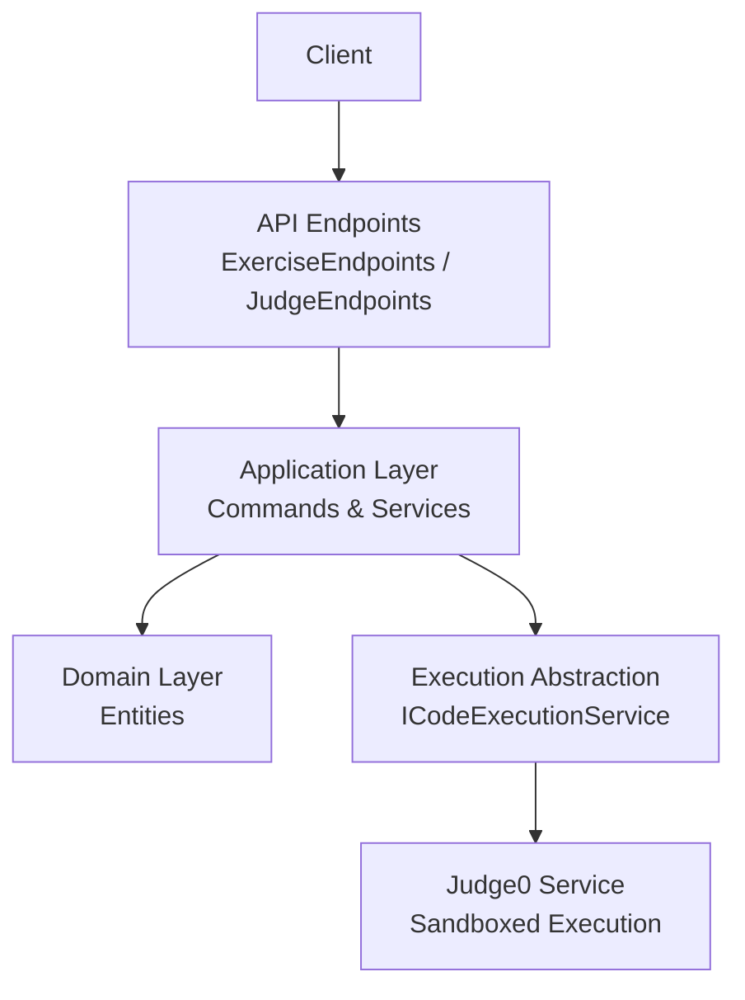
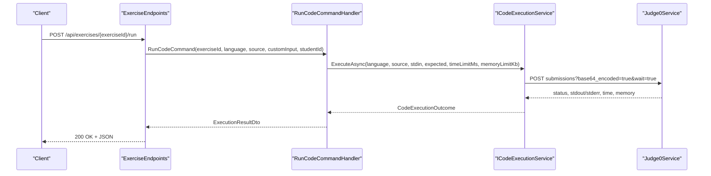
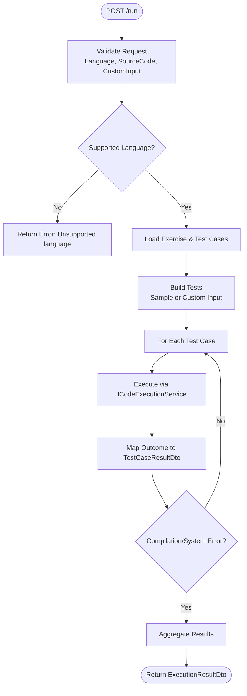
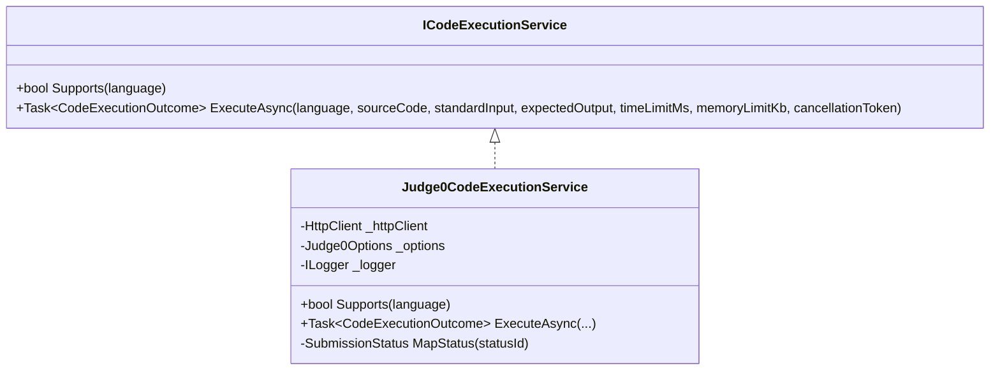
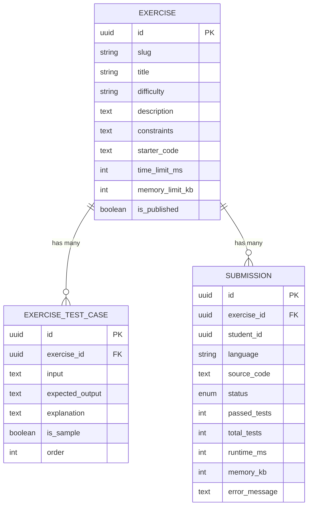
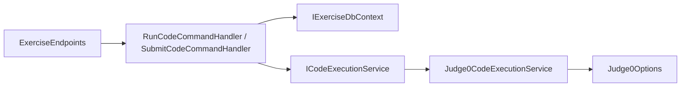

# Exercises & Code Execution API

<cite>
**Referenced Files in This Document**
- [ExerciseEndpoints.cs](file://api/src/Api/CodePath.Api/Endpoints/ExerciseEndpoints.cs)
- [JudgeEndpoints.cs](file://api/src/Api/CodePath.Api/Endpoints/JudgeEndpoints.cs)
- [ExerciseRequests.cs](file://api/src/Api/CodePath.Api/Contracts/ExerciseRequests.cs)
- [ExerciseDtos.cs](file://api/src/Application/CodePath.Application/Exercises/Dtos/ExerciseDtos.cs)
- [RunCodeCommand.cs](file://api/src/Application/CodePath.Application/Exercises/Commands/RunCodeCommand.cs)
- [SubmitCodeCommand.cs](file://api/src/Application/CodePath.Application/Exercises/Commands/SubmitCodeCommand.cs)
- [ICodeExecutionService.cs](file://api/src/Application/CodePath.Application/Exercises/Abstractions/ICodeExecutionService.cs)
- [Judge0CodeExecutionService.cs](file://api/src/Infrastructure/CodePath.Infrastructure/CodeExecution/Judge0CodeExecutionService.cs)
- [Judge0Options.cs](file://api/src/Infrastructure/CodePath.Infrastructure/CodeExecution/Judge0Options.cs)
- [Exercise.cs](file://api/src/Domain/CodePath.Domain/Exercises/Entities/Exercise.cs)
- [Submission.cs](file://api/src/Domain/CodePath.Domain/Exercises/Entities/Submission.cs)
- [ExerciseTestCase.cs](file://api/src/Domain/CodePath.Domain/Exercises/Entities/ExerciseTestCase.cs)
- [JudgeContracts.cs](file://api/src/Application/CodePath.Application/Judge/JudgeContracts.cs)
- [JudgeRules.cs](file://api/src/Application/CodePath.Application/Judge/JudgeRules.cs)
</cite>

## Table of Contents
1. Introduction
2. Project Structure
3. Core Components
4. Architecture Overview
5. Detailed Component Analysis
6. Dependency Analysis
7. Performance Considerations
8. Troubleshooting Guide
9. Conclusion
10. Appendices

## Introduction
This document provides comprehensive API documentation for CodePart’s exercise and code execution endpoints. It covers:
- HTTP methods, URL patterns, request/response schemas
- Creating exercises (via admin problem management), running code submissions, and managing test cases
- Integration with Judge0 for secure sandboxed execution
- Multi-language support: C++, Java, JavaScript, Python, C#
- Security considerations, performance optimization, and best practices for online coding challenges

The API is implemented as a .NET web application using MediatR commands, domain entities, and an infrastructure layer that integrates with an external Judge0 service for code execution.

## Project Structure
Key layers involved in this feature:
- API Layer: Endpoints define HTTP routes and map to application commands/services.
- Application Layer: Commands handle business logic, orchestrate execution, and return DTOs.
- Domain Layer: Entities model exercises, test cases, and submissions.
- Infrastructure Layer: Integrates with Judge0 for sandboxed execution.

**Diagram sources**
- [ExerciseEndpoints.cs:15-73](file://api/src/Api/CodePath.Api/Endpoints/ExerciseEndpoints.cs#L15-L73)
- [JudgeEndpoints.cs:11-49](file://api/src/Api/CodePath.Api/Endpoints/JudgeEndpoints.cs#L11-L49)
- [RunCodeCommand.cs:27-76](file://api/src/Application/CodePath.Application/Exercises/Commands/RunCodeCommand.cs#L27-L76)
- [SubmitCodeCommand.cs:28-107](file://api/src/Application/CodePath.Application/Exercises/Commands/SubmitCodeCommand.cs#L28-L107)
- [ICodeExecutionService.cs:5-24](file://api/src/Application/CodePath.Application/Exercises/Abstractions/ICodeExecutionService.cs#L5-L24)
- [Judge0CodeExecutionService.cs:12-153](file://api/src/Infrastructure/CodePath.Infrastructure/CodeExecution/Judge0CodeExecutionService.cs#L12-L153)

**Section sources**
- [ExerciseEndpoints.cs:15-73](file://api/src/Api/CodePath.Api/Endpoints/ExerciseEndpoints.cs#L15-L73)
- [JudgeEndpoints.cs:11-49](file://api/src/Api/CodePath.Api/Endpoints/JudgeEndpoints.cs#L11-L49)

## Core Components
- Exercise Endpoints: Provide read access to exercises by slug, run code for practice, and submit code for grading.
- Judge Endpoints: Provide problem listing, scopes, run/submit for problems, submission history, and admin CRUD for problems and tests.
- Execution Abstraction: ICodeExecutionService defines the contract for executing code; Judge0CodeExecutionService implements it.
- Domain Models: Exercise, ExerciseTestCase, Submission define the core data structures and rules.

**Section sources**
- [ExerciseEndpoints.cs:15-73](file://api/src/Api/CodePath.Api/Endpoints/ExerciseEndpoints.cs#L15-L73)
- [JudgeEndpoints.cs:11-49](file://api/src/Api/CodePath.Api/Endpoints/JudgeEndpoints.cs#L11-L49)
- [ICodeExecutionService.cs:5-24](file://api/src/Application/CodePath.Application/Exercises/Abstractions/ICodeExecutionService.cs#L5-L24)
- [Exercise.cs:6-91](file://api/src/Domain/CodePath.Domain/Exercises/Entities/Exercise.cs#L6-L91)
- [ExerciseTestCase.cs:6-47](file://api/src/Domain/CodePath.Domain/Exercises/Entities/ExerciseTestCase.cs#L6-L47)
- [Submission.cs:6-77](file://api/src/Domain/CodePath.Domain/Exercises/Entities/Submission.cs#L6-L77)

## Architecture Overview
The end-to-end flow for running or submitting code involves:
- Client sends HTTP requests to API endpoints.
- Endpoints validate and dispatch to application commands.
- Commands enforce validation, load exercise/test cases, and call ICodeExecutionService.
- Judge0CodeExecutionService encodes inputs, calls Judge0, decodes responses, maps statuses, and returns results.
- Results are transformed into DTOs and returned to the client.

**Diagram sources**
- [ExerciseEndpoints.cs:29-47](file://api/src/Api/CodePath.Api/Endpoints/ExerciseEndpoints.cs#L29-L47)
- [RunCodeCommand.cs:32-69](file://api/src/Application/CodePath.Application/Exercises/Commands/RunCodeCommand.cs#L32-L69)
- [Judge0CodeExecutionService.cs:39-107](file://api/src/Infrastructure/CodePath.Infrastructure/CodeExecution/Judge0CodeExecutionService.cs#L39-L107)

## Detailed Component Analysis

### Exercise Endpoints
- GET /api/exercises/{slug}
  - Purpose: Retrieve a published exercise by slug.
  - Auth: Public read rate-limited.
  - Response: ExerciseDto including supported languages and sample test cases.
  - Errors: 404 Not Found.

- POST /api/exercises/{exerciseId:guid}/run
  - Purpose: Execute code against sample test cases or custom input without persisting a graded submission.
  - Auth: Requires ActiveStudent role.
  - Rate Limit: code-execution-rate-limit.
  - Request Body: RunCodeRequest { Language, SourceCode, CustomInput }.
  - Response: ExecutionResultDto with per-test-case results and aggregated metrics.
  - Errors: 400 Bad Request, 401 Unauthorized, 429 Too Many Requests, 503 Service Unavailable.

- POST /api/exercises/{exerciseId:guid}/submit
  - Purpose: Submit code for grading; persists submission and test results.
  - Auth: Requires ActiveStudent role.
  - Rate Limit: code-execution-rate-limit.
  - Request Body: SubmitCodeRequest { Language, SourceCode }.
  - Response: ExecutionResultDto with persisted SubmissionId and full test results.
  - Errors: 400 Bad Request, 401 Unauthorized, 429 Too Many Requests, 503 Service Unavailable.

**Diagram sources**
- [RunCodeCommand.cs:32-69](file://api/src/Application/CodePath.Application/Exercises/Commands/RunCodeCommand.cs#L32-L69)

**Section sources**
- [ExerciseEndpoints.cs:15-73](file://api/src/Api/CodePath.Api/Endpoints/ExerciseEndpoints.cs#L15-L73)
- [ExerciseRequests.cs:1-4](file://api/src/Api/CodePath.Api/Contracts/ExerciseRequests.cs#L1-L4)
- [ExerciseDtos.cs:3-36](file://api/src/Application/CodePath.Application/Exercises/Dtos/ExerciseDtos.cs#L3-L36)
- [RunCodeCommand.cs:16-25](file://api/src/Application/CodePath.Application/Exercises/Commands/RunCodeCommand.cs#L16-L25)
- [SubmitCodeCommand.cs:17-25](file://api/src/Application/CodePath.Application/Exercises/Commands/SubmitCodeCommand.cs#L17-L25)

### Judge Endpoints (Problem Management and Submissions)
- Student-scoped:
  - GET /api/problems
  - GET /api/problems/scopes
  - GET /api/problems/{id:guid}
  - POST /api/problems/{id:guid}/run
  - POST /api/problems/{id:guid}/submit
  - GET /api/problems/{id:guid}/submissions
  - GET /api/submissions/{id:guid}

- Admin-scoped:
  - GET /api/admin/problems
  - GET /api/admin/problems/scopes
  - GET /api/admin/problems/{id:guid}
  - POST /api/admin/problems
  - PUT /api/admin/problems/{id:guid}
  - DELETE /api/admin/problems/{id:guid}
  - POST /api/admin/problems/{id:guid}/publish | unpublish
  - PUT /api/admin/problems/{id:guid}/tests
  - POST /api/admin/problems/{id:guid}/tests/import
  - GET /api/admin/submissions
  - GET /api/admin/submissions/{id:guid}

These endpoints use CodeRequest { Language, SourceCode, TestCaseIds?, CustomInput?, TopicId? } and ProblemWrite/TestWrite models for problem and test case management.

**Section sources**
- [JudgeEndpoints.cs:11-49](file://api/src/Api/CodePath.Api/Endpoints/JudgeEndpoints.cs#L11-L49)
- [JudgeContracts.cs:8-86](file://api/src/Application/CodePath.Application/Judge/JudgeContracts.cs#L8-L86)

### Execution Abstraction and Judge0 Integration
- ICodeExecutionService: Defines Supports and ExecuteAsync.
- Judge0CodeExecutionService: Implements execution via Judge0 HTTP API.
  - Supported Languages: csharp, cpp, java, javascript, python.
  - Encodes source_code and stdin as Base64; sets CPU/wall time limits and memory limit.
  - Decodes outputs and maps Judge0 status IDs to internal SubmissionStatus.
  - Sanitizes error messages before returning to clients.

**Diagram sources**
- [ICodeExecutionService.cs:5-24](file://api/src/Application/CodePath.Application/Exercises/Abstractions/ICodeExecutionService.cs#L5-L24)
- [Judge0CodeExecutionService.cs:12-153](file://api/src/Infrastructure/CodePath.Infrastructure/CodeExecution/Judge0CodeExecutionService.cs#L12-L153)

**Section sources**
- [ICodeExecutionService.cs:5-24](file://api/src/Application/CodePath.Application/Exercises/Abstractions/ICodeExecutionService.cs#L5-L24)
- [Judge0CodeExecutionService.cs:12-153](file://api/src/Infrastructure/CodePath.Infrastructure/CodeExecution/Judge0CodeExecutionService.cs#L12-L153)
- [Judge0Options.cs:5-17](file://api/src/Infrastructure/CodePath.Infrastructure/CodeExecution/Judge0Options.cs#L5-L17)

### Data Models and Validation Rules
- Exercise: Represents a problem with constraints, starter code, time/memory limits, and test cases. Enforces publishing rules and unique test case order.
- ExerciseTestCase: Stores input, expected output, explanation, sample flag, and order.
- Submission: Tracks student submissions, final status, runtime/memory, and per-test results. Includes teacher grading fields.

**Diagram sources**
- [Exercise.cs:6-91](file://api/src/Domain/CodePath.Domain/Exercises/Entities/Exercise.cs#L6-L91)
- [ExerciseTestCase.cs:6-47](file://api/src/Domain/CodePath.Domain/Exercises/Entities/ExerciseTestCase.cs#L6-L47)
- [Submission.cs:6-77](file://api/src/Domain/CodePath.Domain/Exercises/Entities/Submission.cs#L6-L77)

**Section sources**
- [Exercise.cs:6-91](file://api/src/Domain/CodePath.Domain/Exercises/Entities/Exercise.cs#L6-L91)
- [ExerciseTestCase.cs:6-47](file://api/src/Domain/CodePath.Domain/Exercises/Entities/ExerciseTestCase.cs#L6-L47)
- [Submission.cs:6-77](file://api/src/Domain/CodePath.Domain/Exercises/Entities/Submission.cs#L6-L77)

## Dependency Analysis
- Endpoints depend on MediatR ISender to dispatch commands.
- Commands depend on IExerciseDbContext for persistence and ICodeExecutionService for execution.
- ICodeExecutionService is implemented by Judge0CodeExecutionService, which depends on HttpClient and configuration options.
- Domain entities encapsulate validation and business rules.

**Diagram sources**
- [ExerciseEndpoints.cs:15-73](file://api/src/Api/CodePath.Api/Endpoints/ExerciseEndpoints.cs#L15-L73)
- [RunCodeCommand.cs:27-76](file://api/src/Application/CodePath.Application/Exercises/Commands/RunCodeCommand.cs#L27-L76)
- [SubmitCodeCommand.cs:28-107](file://api/src/Application/CodePath.Application/Exercises/Commands/SubmitCodeCommand.cs#L28-L107)
- [Judge0CodeExecutionService.cs:12-153](file://api/src/Infrastructure/CodePath.Infrastructure/CodeExecution/Judge0CodeExecutionService.cs#L12-L153)
- [Judge0Options.cs:5-17](file://api/src/Infrastructure/CodePath.Infrastructure/CodeExecution/Judge0Options.cs#L5-L17)

**Section sources**
- [ExerciseEndpoints.cs:15-73](file://api/src/Api/CodePath.Api/Endpoints/ExerciseEndpoints.cs#L15-L73)
- [RunCodeCommand.cs:27-76](file://api/src/Application/CodePath.Application/Exercises/Commands/RunCodeCommand.cs#L27-L76)
- [SubmitCodeCommand.cs:28-107](file://api/src/Application/CodePath.Application/Exercises/Commands/SubmitCodeCommand.cs#L28-L107)
- [Judge0CodeExecutionService.cs:12-153](file://api/src/Infrastructure/CodePath.Infrastructure/CodeExecution/Judge0CodeExecutionService.cs#L12-L153)

## Performance Considerations
- Time and Memory Limits:
  - Exercise-level limits are enforced when calling the execution service.
  - Judge0 integration sets both CPU and wall time limits and memory limits per execution.
- Output Truncation:
  - Responses truncate large outputs to prevent payload bloat.
- Rate Limiting:
  - Endpoints apply rate limiting policies for public reads and code execution.
- Judge0 Constraints:
  - Source size and I/O size limits are defined in JudgeRules for the judge subsystem.
- Batch Execution:
  - For submissions, test cases are executed sequentially until compilation/system errors occur to avoid unnecessary work.

[No sources needed since this section provides general guidance]

## Troubleshooting Guide
Common issues and handling:
- Unsupported Language:
  - The execution service checks supported languages; unsupported values return a failure response.
- Judge0 Unavailability:
  - Non-success HTTP responses from Judge0 result in system error outcomes.
  - Network failures and timeouts are caught and converted to system error outcomes.
- Invalid Judge0 Response:
  - Missing or malformed status fields lead to system error outcomes.
- Excessive Output:
  - Large outputs are truncated to configured maximum lengths.
- Validation Failures:
  - Command validators enforce field sizes and constraints; violations return bad request responses.

**Section sources**
- [Judge0CodeExecutionService.cs:39-107](file://api/src/Infrastructure/CodePath.Infrastructure/CodeExecution/Judge0CodeExecutionService.cs#L39-L107)
- [RunCodeCommand.cs:16-25](file://api/src/Application/CodePath.Application/Exercises/Commands/RunCodeCommand.cs#L16-L25)
- [SubmitCodeCommand.cs:17-25](file://api/src/Application/CodePath.Application/Exercises/Commands/SubmitCodeCommand.cs#L17-L25)

## Conclusion
CodePart’s exercise and code execution API provides a robust, secure, and scalable foundation for online coding challenges. It integrates with Judge0 for sandboxed execution, supports multiple languages, enforces strict validation and security controls, and offers clear APIs for creating exercises, running code, and managing test cases. Following the best practices outlined here will help ensure reliable and secure operation at scale.

[No sources needed since this section summarizes without analyzing specific files]

## Appendices

### API Schemas

- RunCodeRequest
  - Fields:
    - language: string (required)
    - source_code: string (required)
    - custom_input: string (optional)

- SubmitCodeRequest
  - Fields:
    - language: string (required)
    - source_code: string (required)

- ExecutionResultDto
  - Fields:
    - submission_id: guid? (nullable)
    - status: string
    - passed_tests: int
    - total_tests: int
    - runtime_ms: int?
    - memory_kb: int?
    - test_cases: array of TestCaseResultDto

- TestCaseResultDto
  - Fields:
    - test_case_id: guid?
    - order: int
    - status: string
    - input: string?
    - expected_output: string?
    - actual_output: string?
    - error_message: string?
    - runtime_ms: int?
    - memory_kb: int?

- CodeRequest (Judge subsystem)
  - Fields:
    - language: string (required)
    - source_code: string (required)
    - test_case_ids: guid[]? (optional, length 1–2, distinct)
    - custom_input: string? (mutually exclusive with test_case_ids)
    - topic_id: guid? (optional)

- ProblemWrite (Admin)
  - Fields:
    - title: string
    - description: string
    - difficulty: enum ("Easy", "Medium", "Hard")
    - time_limit_ms: int (100–15000)
    - memory_limit_mb: int (16–1024)
    - points: int (0–10000)
    - course_id: guid?
    - comparison_mode: enum
    - starter_codes: array of StarterDto (1–20 entries)
    - class_id: guid?
    - category: string ("general", "basics", "arrays", "strings", "math", "search-sort", "data-structures", "graphs", "dynamic-programming")

- TestWrite (Admin)
  - Fields:
    - input: string
    - expected_output: string
    - is_sample: bool
    - order: int (1–15)
    - weight: int (1–1000)

**Section sources**
- [ExerciseRequests.cs:1-4](file://api/src/Api/CodePath.Api/Contracts/ExerciseRequests.cs#L1-L4)
- [ExerciseDtos.cs:3-36](file://api/src/Application/CodePath.Application/Exercises/Dtos/ExerciseDtos.cs#L3-L36)
- [JudgeContracts.cs:8-54](file://api/src/Application/CodePath.Application/Judge/JudgeContracts.cs#L8-L54)

### Security Considerations
- Authentication and Authorization:
  - Code execution endpoints require ActiveStudent role.
  - Admin endpoints require JudgeManager role.
- Input Validation:
  - Strict validators enforce field sizes and constraints.
- Sandboxed Execution:
  - Judge0 runs code in isolated environments; network access is disabled.
- Output Sanitization:
  - Error messages are sanitized before being returned to clients.
- Rate Limiting:
  - Endpoints apply rate limiting to mitigate abuse.

**Section sources**
- [ExerciseEndpoints.cs:29-71](file://api/src/Api/CodePath.Api/Endpoints/ExerciseEndpoints.cs#L29-L71)
- [JudgeEndpoints.cs:11-49](file://api/src/Api/CodePath.Api/Endpoints/JudgeEndpoints.cs#L11-L49)
- [Judge0CodeExecutionService.cs:129-139](file://api/src/Infrastructure/CodePath.Infrastructure/CodeExecution/Judge0CodeExecutionService.cs#L129-L139)
- [JudgeRules.cs:5-37](file://api/src/Application/CodePath.Application/Judge/JudgeRules.cs#L5-L37)

### Best Practices for Online Coding Challenges
- Define Clear Exercise Boundaries:
  - Use time and memory limits appropriate for the problem complexity.
- Provide Sample Test Cases:
  - Include sample inputs/outputs to help students verify behavior early.
- Enforce Strict Validation:
  - Apply server-side validation for all inputs to prevent abuse.
- Handle Errors Gracefully:
  - Return meaningful error messages while sanitizing sensitive details.
- Monitor and Scale:
  - Use rate limiting and health checks; monitor Judge0 availability and latency.
- Optimize Execution:
  - Avoid unnecessary executions by short-circuiting on compilation/system errors.

[No sources needed since this section provides general guidance]