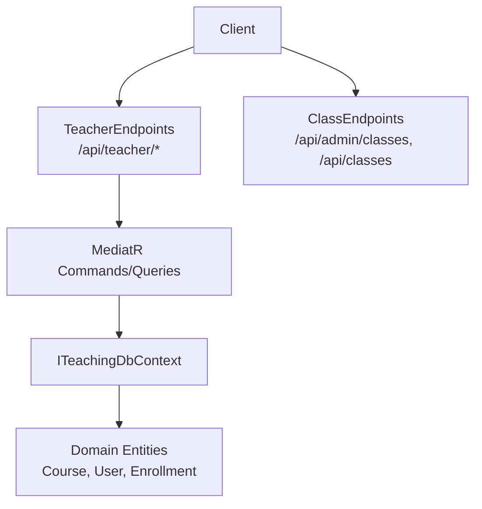
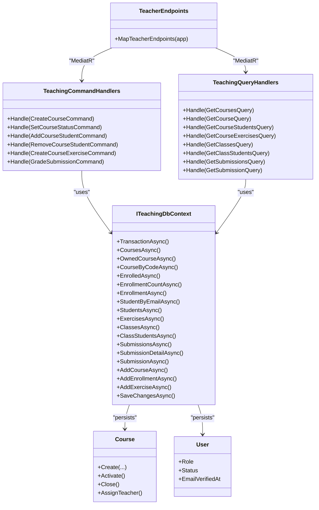
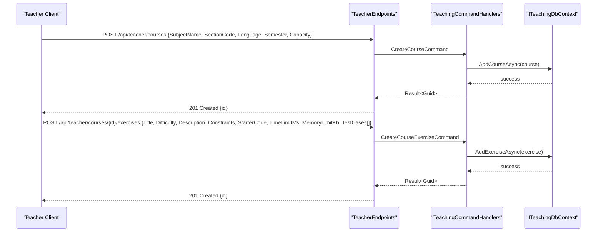
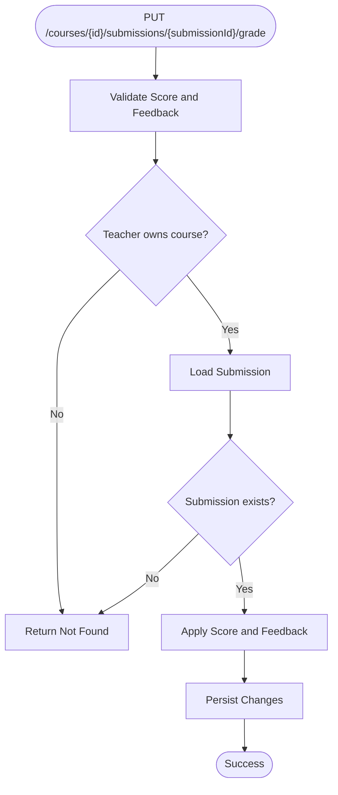
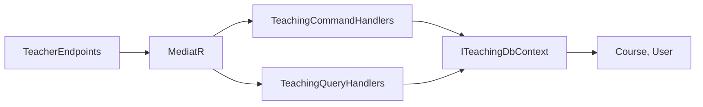

# Teacher Portal API

<cite>
**Referenced Files in This Document**
- [TeacherEndpoints.cs](file://api/src/Api/CodePath.Api/Endpoints/TeacherEndpoints.cs)
- [TeachingCommands.cs](file://api/src/Application/CodePath.Application/Teaching/Commands/TeachingCommands.cs)
- [TeachingQueries.cs](file://api/src/Application/CodePath.Application/Teaching/Queries/TeachingQueries.cs)
- [TeachingDtos.cs](file://api/src/Application/CodePath.Application/Teaching/Dtos/TeachingDtos.cs)
- [ITeachingDbContext.cs](file://api/src/Application/CodePath.Application/Teaching/Abstractions/ITeachingDbContext.cs)
- [Course.cs](file://api/src/Domain/CodePath.Domain/Users/Entities/Course.cs)
- [User.cs](file://api/src/Domain/CodePath.Domain/Users/En tities/User.cs)
- [CourseStatus.cs](file://api/src/Domain/CodePath.Domain/Users/Enums/CourseStatus.cs)
- [EnrollmentStatus.cs](file://api/src/Domain/CodePath.Domain/Users/Enums/EnrollmentStatus.cs)
- [ClassEndpoints.cs](file://api/src/Api/CodePath.Api/Endpoints/ClassEndpoints.cs)
- [ClassCommands.cs](file://api/src/Application/CodePath.Application/Classes/ClassCommands.cs)
- [ClassQueries.cs](file://api/src/Application/CodePath.Application/Classes/ClassQueries.cs)
- [ClassContracts.cs](file://api/src/Application/CodePath.Application/Classes/ClassContracts.cs)
</cite>

## Table of Contents
1. Introduction
2. Project Structure
3. Core Components
4. Architecture Overview
5. Detailed Component Analysis
6. Dependency Analysis
7. Performance Considerations
8. Troubleshooting Guide
9. Conclusion

## Introduction
This document provides comprehensive API documentation for the CodePart teacher portal endpoints. It covers HTTP methods, URL patterns, request/response schemas, and business rules for course creation, student monitoring, assignment management, grading, class management, student progress tracking, and teaching resources administration. It also includes role-specific permissions, data privacy considerations, and practical workflows for teachers and students.

## Project Structure
The teacher portal is implemented as a set of ASP.NET Minimal API endpoints that delegate to application-layer commands and queries using MediatR. The domain layer defines core entities such as Course and User, while DTOs define the public API contracts. Class management endpoints are provided separately under admin and student groups.

**Diagram sources**
- [TeacherEndpoints.cs:22-65](file://api/src/Api/CodePath.Api/Endpoints/TeacherEndpoints.cs#L22-L65)
- [TeachingCommands.cs:82-168](file://api/src/Application/CodePath.Application/Teaching/Commands/TeachingCommands.cs#L82-L168)
- [TeachingQueries.cs:26-78](file://api/src/Application/CodePath.Application/Teaching/Queries/TeachingQueries.cs#L26-L78)
- [ITeachingDbContext.cs:7-28](file://api/src/Application/CodePath.Application/Teaching/Abstractions/ITeachingDbContext.cs#L7-L28)
- [Course.cs:7-88](file://api/src/Domain/CodePath.Domain/Users/Entities/Course.cs#L7-L88)
- [User.cs:8-31](file://api/src/Domain/CodePath.Domain/Users/En tities/User.cs#L8-L31)

**Section sources**
- [TeacherEndpoints.cs:22-65](file://api/src/Api/CodePath.Api/Endpoints/TeacherEndpoints.cs#L22-L65)
- [ClassEndpoints.cs:16-82](file://api/src/Api/CodePath.Api/Endpoints/ClassEndpoints.cs#L16-L82)

## Core Components
- Teacher endpoints group:
  - Courses: list, create, get, update status, enroll/remove students, exercises, submissions, grading.
  - Classes: list classes, list class students.
  - Student courses (student role): list enrolled courses, join by code, list course exercises.
- Application layer:
  - Commands handle mutations with validation and domain rules.
  - Queries return read models and enforce ownership/enrollment checks.
- Data transfer objects:
  - CourseDto, StudentDto, ClassDto, CourseExerciseDto, SubmissionDto, SubmissionPage, SubmissionDetailDto, TestResultDto, CreateCourseInput, CreateExerciseInput, TestInput.

Key responsibilities:
- Authorization: Teacher endpoints require ActiveTeacher; student endpoints require ActiveStudent.
- Ownership: Teachers can only act on courses they own.
- Enrollments: Students must be active and verified; capacity limits enforced.
- Exercises: Only assignable when course is active; test cases validated.
- Grading: Scores constrained to 0–10 with two decimal places.

**Section sources**
- [TeacherEndpoints.cs:22-65](file://api/src/Api/CodePath.Api/Endpoints/TeacherEndpoints.cs#L22-L65)
- [TeachingCommands.cs:15-80](file://api/src/Application/CodePath.Application/Teaching/Commands/TeachingCommands.cs#L15-L80)
- [TeachingQueries.cs:10-25](file://api/src/Application/CodePath.Application/Teaching/Queries/TeachingQueries.cs#L10-L25)
- [TeachingDtos.cs:1-19](file://api/src/Application/CodePath.Application/Teaching/Dtos/TeachingDtos.cs#L1-L19)

## Architecture Overview
The teacher portal follows a layered architecture:
- API Layer: Minimal endpoints map HTTP routes to MediatR requests.
- Application Layer: Command/query handlers implement business logic and orchestrate domain operations.
- Domain Layer: Entities encapsulate business rules and state transitions.
- Abstraction Layer: ITeachingDbContext abstracts persistence and queries.

**Diagram sources**
- [TeacherEndpoints.cs:22-65](file://api/src/Api/CodePath.Api/Endpoints/TeacherEndpoints.cs#L22-L65)
- [TeachingCommands.cs:82-168](file://api/src/Application/CodePath.Application/Teaching/Commands/TeachingCommands.cs#L82-L168)
- [TeachingQueries.cs:26-78](file://api/src/Application/CodePath.Application/Teaching/Queries/TeachingQueries.cs#L26-L78)
- [ITeachingDbContext.cs:7-28](file://api/src/Application/CodePath.Application/Teaching/Abstractions/ITeachingDbContext.cs#L7-L28)
- [Course.cs:7-88](file://api/src/Domain/CodePath.Domain/Users/Entities/Course.cs#L7-L88)
- [User.cs:8-31](file://api/src/Domain/CodePath.Domain/Users/En tities/User.cs#L8-L31)

## Detailed Component Analysis

### Authentication and Authorization
- Teacher endpoints require authorization policy ActiveTeacher.
- Student endpoints require authorization policy ActiveStudent.
- Actor identity is extracted from the authenticated user context.

Permissions summary:
- ActiveTeacher: access to /api/teacher/* endpoints.
- ActiveStudent: access to /api/student/courses/* endpoints.

**Section sources**
- [TeacherEndpoints.cs:20-24](file://api/src/Api/CodePath.Api/Endpoints/TeacherEndpoints.cs#L20-L24)
- [TeacherEndpoints.cs:58-65](file://api/src/Api/CodePath.Api/Endpoints/TeacherEndpoints.cs#L58-L65)

### Course Management Endpoints
Base path: /api/teacher

- GET /api/teacher/courses
  - Purpose: List all courses visible to the current user (teachers see owned courses).
  - Response: Array of CourseDto.
  - Schema: CourseDto fields include Id, SubjectName, SectionCode, Language, Semester, JoinCode, Capacity, EnrolledCount, Status, ExerciseCount.

- POST /api/teacher/courses
  - Purpose: Create a new course.
  - Request body: CreateCourseInput fields include SubjectName, SectionCode, Language, Semester, Capacity (default 60).
  - Response: Created with location header and JSON { id }.
  - Validation: SubjectName, SectionCode, Semester non-empty; Language must be one of python, javascript, java, csharp, cpp; Capacity between 1 and 1000.

- GET /api/teacher/courses/{id}
  - Purpose: Get details of a specific course owned by the teacher.
  - Response: CourseDto.

- PUT /api/teacher/courses/{id}/status
  - Purpose: Set course status to Active or Closed.
  - Request body: StatusRequest field Status must be "Active" or "Closed".
  - Response: Success result.

- GET /api/teacher/courses/{id}/students
  - Purpose: List enrolled students for a course owned by the teacher.
  - Response: Array of StudentDto.

- POST /api/teacher/courses/{id}/students
  - Purpose: Enroll a student by email.
  - Request body: StudentRequest field Email must be valid and normalized.
  - Response: Success result.
  - Rules: Student must be active and verified; enrollment respects capacity.

- DELETE /api/teacher/courses/{id}/students/{studentId}
  - Purpose: Remove a student from the course (drop enrollment).
  - Response: Success result.

- GET /api/teacher/courses/{id}/exercises
  - Purpose: List exercises assigned to a course (teachers see all; students see published ones if enrolled).
  - Response: Array of CourseExerciseDto.

- POST /api/teacher/courses/{id}/exercises
  - Purpose: Create an exercise and assign it to the course.
  - Request body: CreateExerciseInput fields include Title, Difficulty, Description, Constraints, StarterCode, TimeLimitMs, MemoryLimitKb, TestCases[].
  - Response: Created with location header and JSON { id }.
  - Validation: Difficulty must be Easy, Medium, or Hard; at least one sample test case required; test cases count 1–50; time/memory limits within ranges.
  - Rules: Course must be active before assigning exercises.

- GET /api/teacher/courses/{id}/submissions
  - Purpose: Paginated list of submissions for a course.
  - Query parameters: page (default 1), pageSize (default 20).
  - Response: SubmissionPage containing Items array and pagination metadata.

- GET /api/teacher/courses/{id}/submissions/{submissionId}
  - Purpose: Get submission detail including source code and test results.
  - Response: SubmissionDetailDto with Summary, SourceCode, TestResults[].

- PUT /api/teacher/courses/{id}/submissions/{submissionId}/grade
  - Purpose: Grade a submission.
  - Request body: GradeRequest fields Score (0–10, two decimals) and Feedback (optional, max length).
  - Response: Success result.

- GET /api/teacher/classes
  - Purpose: List classes associated with the teacher.
  - Response: Array of ClassDto.

- GET /api/teacher/classes/{id}/students
  - Purpose: List students in a class managed by the teacher.
  - Response: Array of StudentDto.

Example workflow: Creating a course and assigning an exercise

**Diagram sources**
- [TeacherEndpoints.cs:27-46](file://api/src/Api/CodePath.Api/Endpoints/TeacherEndpoints.cs#L27-L46)
- [TeachingCommands.cs:95-159](file://api/src/Application/CodePath.Application/Teaching/Commands/TeachingCommands.cs#L95-L159)
- [ITeachingDbContext.cs:24-27](file://api/src/Application/CodePath.Application/Teaching/Abstractions/ITeachingDbContext.cs#L24-L27)

**Section sources**
- [TeacherEndpoints.cs:25-56](file://api/src/Api/CodePath.Api/Endpoints/TeacherEndpoints.cs#L25-L56)
- [TeachingCommands.cs:15-80](file://api/src/Application/CodePath.Application/Teaching/Commands/TeachingCommands.cs#L15-L80)
- [TeachingDtos.cs:1-19](file://api/src/Application/CodePath.Application/Teaching/Dtos/TeachingDtos.cs#L1-L19)

### Student Monitoring and Progress Tracking
- Course students listing returns StudentDto with Id, FullName, Email, StudentId, Status.
- Submissions listing returns SubmissionDto with Id, ExerciseId, ExerciseTitle, StudentId, StudentName, Language, Status, PassedTests, TotalTests, CreatedAt, TeacherScore, TeacherFeedback, GradedAt.
- Submission detail returns SubmissionDetailDto with Summary, SourceCode, TestResults[] where each TestResultDto has Order, Status, Input, ExpectedOutput, ActualOutput, ErrorMessage, RuntimeMs, MemoryKb.

Pagination:
- Page range: 1–1,000,000.
- PageSize range: 1–100.

Access control:
- Teachers must own the course to view submissions.

**Section sources**
- [TeachingQueries.cs:48-77](file://api/src/Application/CodePath.Application/Teaching/Queries/TeachingQueries.cs#L48-L77)
- [TeachingDtos.cs:5-14](file://api/src/Application/CodePath.Application/Teaching/Dtos/TeachingDtos.cs#L5-L14)

### Assignment Management
- Exercises are created per course with strict validation for difficulty, description, constraints, starter code, resource limits, and test cases.
- Exercises are published automatically upon creation and assigned to the course.
- Only active courses allow exercise assignment.

Validation highlights:
- Difficulty ∈ {Easy, Medium, Hard}.
- TestCases length 1–50, at least one IsSample true.
- TimeLimitMs ∈ [100, 15000], MemoryLimitKb ∈ [16384, 1048576].

**Section sources**
- [TeachingCommands.cs:50-72](file://api/src/Application/CodePath.Application/Teaching/Commands/TeachingCommands.cs#L50-L72)
- [TeachingCommands.cs:143-159](file://api/src/Application/CodePath.Application/Teaching/Commands/TeachingCommands.cs#L143-L159)

### Grading Functionality
- Grading endpoint updates submission grade with score and optional feedback.
- Score must be between 0 and 10 with two decimal places.
- Feedback max length applies.

Grading flow:

**Diagram sources**
- [TeacherEndpoints.cs:51-52](file://api/src/Api/CodePath.Api/Endpoints/TeacherEndpoints.cs#L51-L52)
- [TeachingCommands.cs:73-80](file://api/src/Application/CodePath.Application/Teaching/Commands/TeachingCommands.cs#L73-L80)
- [TeachingCommands.cs:160-167](file://api/src/Application/CodePath.Application/Teaching/Commands/TeachingCommands.cs#L160-L167)

**Section sources**
- [TeachingCommands.cs:73-80](file://api/src/Application/CodePath.Application/Teaching/Commands/TeachingCommands.cs#L73-L80)
- [TeachingCommands.cs:160-167](file://api/src/Application/CodePath.Application/Teaching/Commands/TeachingCommands.cs#L160-L167)

### Class Management Endpoints
Admin-only endpoints:
- Base path: /api/admin/classes
- Methods:
  - POST /api/admin/classes/thumbnail: Upload thumbnail image (PNG/JPEG/WebP, up to 5 MB). Returns URL.
  - GET /api/class-images/{filename}: Serve uploaded images anonymously.
  - GET /api/admin/classes: List classes with filters (page, pageSize, search, status, accessType, hasTeacher, teacherId, sort, desc, isTemplate).
  - GET /api/admin/classes/{id}: Get class detail.
  - POST /api/admin/classes: Create class.
  - PUT /api/admin/classes/{id}: Update class.
  - DELETE /api/admin/classes/{id}: Delete class (force and confirm flags).
  - PATCH /api/admin/classes/{id}/status: Change class status.
  - POST /api/admin/classes/{id}/teachers: Add teachers.
  - DELETE /api/admin/classes/{id}/teachers/{teacherId}: Remove teacher.
  - POST /api/admin/classes/{id}/join-code/regenerate: Regenerate join code with optional expiry.
  - DELETE /api/admin/classes/{id}/join-code: Revoke join code.
  - GET /api/admin/classes/{id}/students: List class students with filters.
  - DELETE /api/admin/classes/{id}/students/{studentId}: Remove student.

Student endpoints:
- Base path: /api/classes
- Methods:
  - GET /api/classes/public: Public class listing with filters.
  - POST /api/classes/{id}/join: Join class by ID.
  - POST /api/classes/join-by-code: Join class by code (rate-limited).
  - POST /api/classes/{id}/leave: Leave class.

Data contracts:
- ClassInput: Name, Description, Thumbnail, Status, AccessType, JoinCodeExpiresAt, MaxStudents, StartDate, EndDate, TeacherIds, RowVersion.
- ClassFilter: Pagination, search, status, accessType, sorting, template flag.
- ClassDto: Full class metadata including join code and teachers.
- PublicClassDto: Public-facing class info without join codes.
- ClassStudentDto: Student enrollment info.

Validation highlights:
- Name length 3–100; description max 5000; thumbnail allowed formats and sizes; status/accessType enums; maxStudents > 0; end date after start date; teacherIds ≤ 100.
- Join code format: 8 characters from allowed alphabet.

**Section sources**
- [ClassEndpoints.cs:16-82](file://api/src/Api/CodePath.Api/Endpoints/ClassEndpoints.cs#L16-L82)
- [ClassCommands.cs:9-64](file://api/src/Application/CodePath.Application/Classes/ClassCommands.cs#L9-L64)
- [ClassQueries.cs:7-27](file://api/src/Application/CodePath.Application/Classes/ClassQueries.cs#L7-L27)
- [ClassContracts.cs:6-23](file://api/src/Application/CodePath.Application/Classes/ClassContracts.cs#L6-L23)

### Student Self-Service (Joining Courses)
- GET /api/student/courses: List courses available to the student.
- POST /api/student/courses/join: Join a course by join code (rate-limited).
- GET /api/student/courses/{id}/exercises: List exercises for an enrolled course.

Rules:
- Join code must exist and course must be active.
- Enrollment duplicates are prevented unless rejoining dropped enrollment.
- Capacity limit enforced.

**Section sources**
- [TeacherEndpoints.cs:58-65](file://api/src/Api/CodePath.Api/Endpoints/TeacherEndpoints.cs#L58-L65)
- [TeachingCommands.cs:117-134](file://api/src/Application/CodePath.Application/Teaching/Commands/TeachingCommands.cs#L117-L134)

## Dependency Analysis
- TeacherEndpoints depends on MediatR ISender to dispatch commands and queries.
- TeachingCommandHandlers and TeachingQueryHandlers depend on ITeachingDbContext for persistence and queries.
- Domain entities Course and User encapsulate business rules and state transitions.
- ClassEndpoints depends on ClassCommands and ClassQueries via MediatR.

**Diagram sources**
- [TeacherEndpoints.cs:22-65](file://api/src/Api/CodePath.Api/Endpoints/TeacherEndpoints.cs#L22-L65)
- [TeachingCommands.cs:82-168](file://api/src/Application/CodePath.Application/Teaching/Commands/TeachingCommands.cs#L82-L168)
- [TeachingQueries.cs:26-78](file://api/src/Application/CodePath.Application/Teaching/Queries/TeachingQueries.cs#L26-L78)
- [ITeachingDbContext.cs:7-28](file://api/src/Application/CodePath.Application/Teaching/Abstractions/ITeachingDbContext.cs#L7-L28)
- [Course.cs:7-88](file://api/src/Domain/CodePath.Domain/Users/Entities/Course.cs#L7-L88)
- [User.cs:8-31](file://api/src/Domain/CodePath.Domain/Users/En tities/User.cs#L8-L31)

**Section sources**
- [TeacherEndpoints.cs:22-65](file://api/src/Api/CodePath.Api/Endpoints/TeacherEndpoints.cs#L22-L65)
- [TeachingCommands.cs:82-168](file://api/src/Application/CodePath.Application/Teaching/Commands/TeachingCommands.cs#L82-L168)
- [TeachingQueries.cs:26-78](file://api/src/Application/CodePath.Application/Teaching/Queries/TeachingQueries.cs#L26-L78)

## Performance Considerations
- Pagination: Use reasonable page sizes (up to 100) to avoid heavy payloads.
- Validation: Server-side validators prevent excessive payload sizes and invalid inputs.
- Transactions: Mutations use transactional boundaries to ensure consistency.
- Image uploads: Admin thumbnail upload enforces size limits and content type detection.

[No sources needed since this section provides general guidance]

## Troubleshooting Guide
Common errors and causes:
- UnauthorizedAppException: Missing or invalid authentication token.
- NotFoundException: Course, submission, or enrollment not found; student not active/verified.
- ConflictException: Course closed or at capacity; duplicate enrollment; attempting to assign exercises to inactive course.
- Validation failures: Invalid status values, out-of-range numeric fields, missing required fields, invalid test cases.

Recommendations:
- Ensure teacher owns the course before performing actions.
- Verify student account is active and email verified before enrollment.
- Activate course before assigning exercises.
- Keep scores within 0–10 with two decimal places.
- For class joins, ensure join code is valid and not expired.

**Section sources**
- [TeachingCommands.cs:92-167](file://api/src/Application/CodePath.Application/Teaching/Commands/TeachingCommands.cs#L92-L167)
- [TeachingQueries.cs:36-77](file://api/src/Application/CodePath.Application/Teaching/Queries/TeachingQueries.cs#L36-L77)
- [ClassCommands.cs:66-159](file://api/src/Application/CodePath.Application/Classes/ClassCommands.cs#L66-L159)

## Conclusion
The teacher portal API provides a robust set of endpoints for course administration, student enrollment, assignment management, and grading. It enforces strong validation, ownership checks, and role-based access controls. Class management endpoints complement the teacher portal by enabling administrators to manage classes and students. By following the documented schemas and rules, developers can build reliable integrations for teaching workflows and student assessment processes.

[No sources needed since this section summarizes without analyzing specific files]