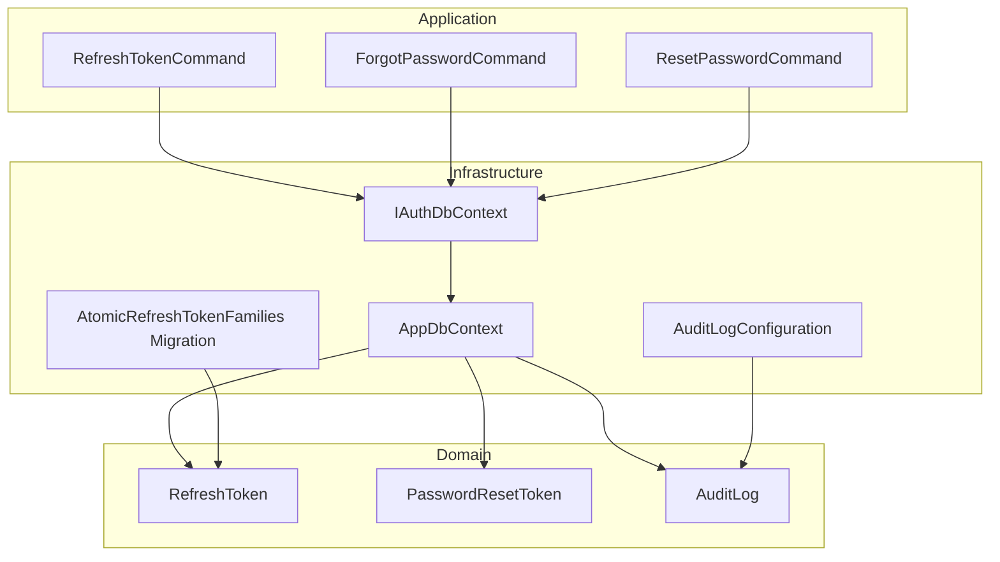
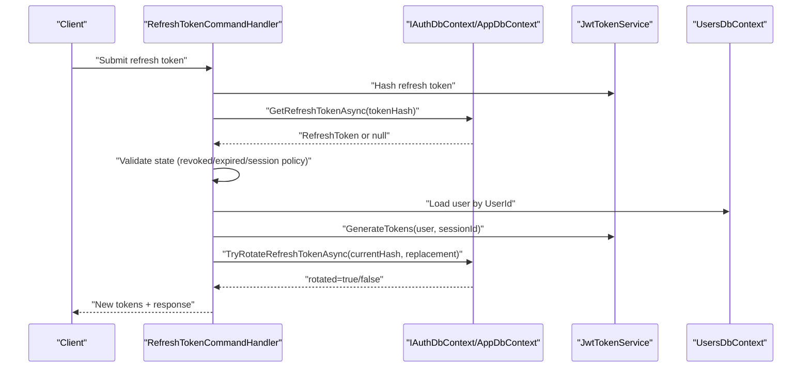
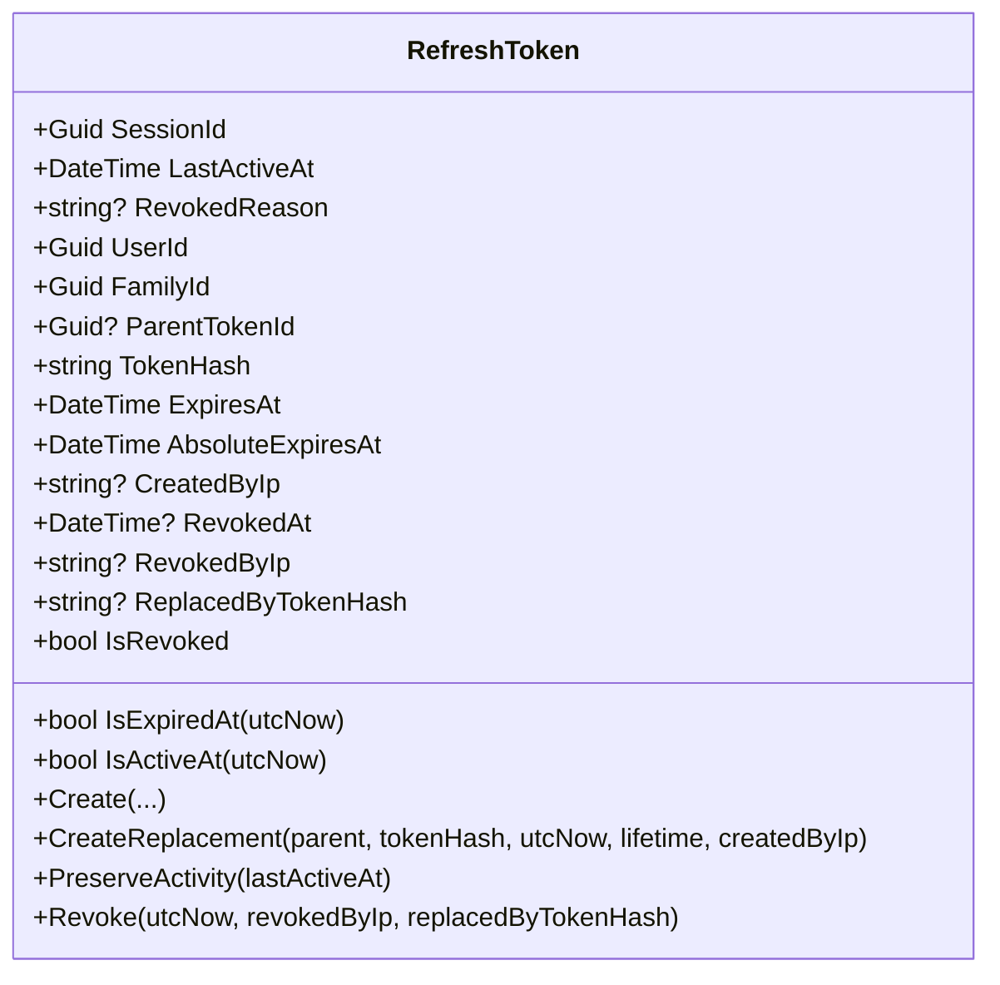
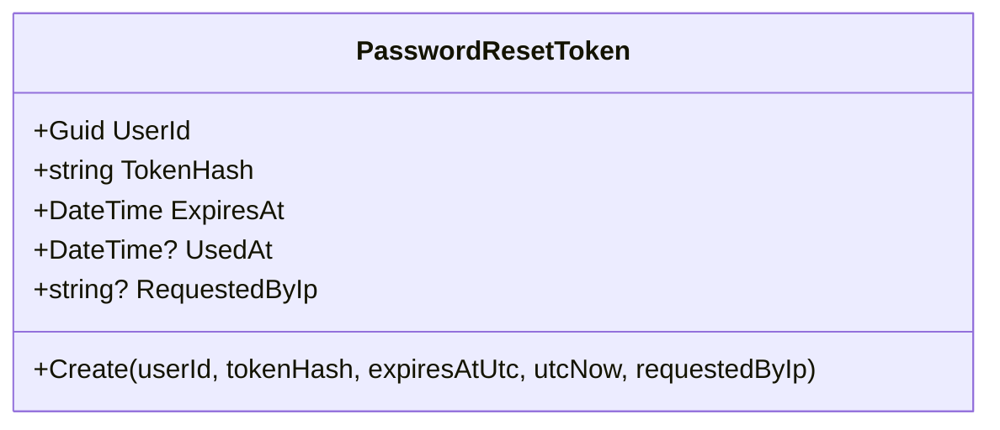
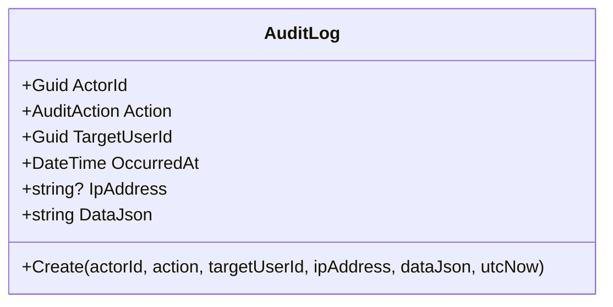
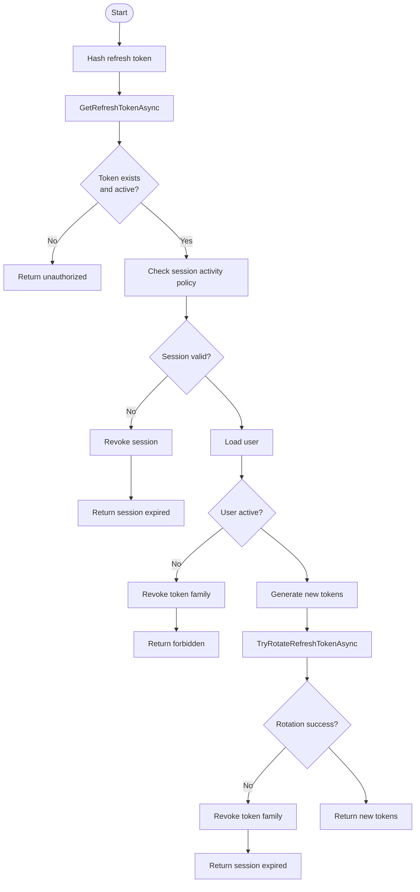
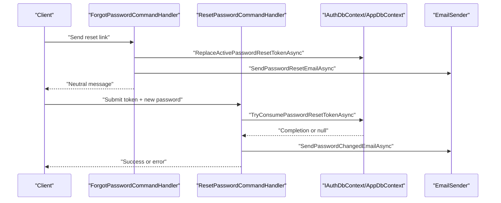
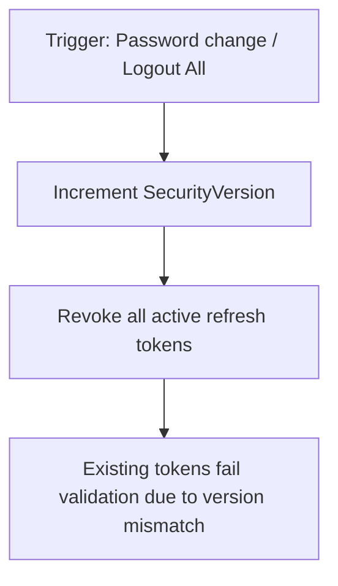
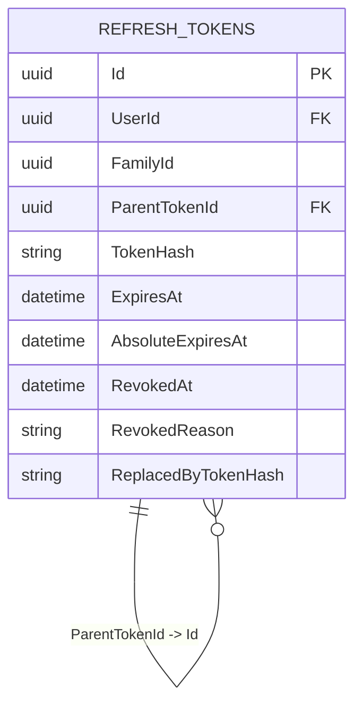
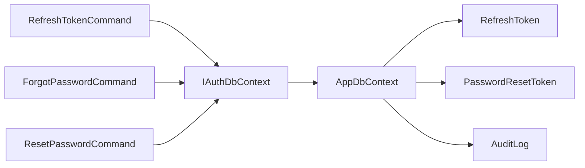

# Authentication & Security Entities

<cite>
**Referenced Files in This Document**
- [RefreshToken.cs](file://api/src/Domain/CodePath.Domain/Auth\Entities\RefreshToken.cs)
- [PasswordResetToken.cs](file://api/src/Domain/CodePath.Domain\Auth\Entities\PasswordResetToken.cs)
- [AuditLog.cs](file://api/src\Domain\CodePath.Domain\Auditing\Entities\AuditLog.cs)
- [IAuthDbContext.cs](file://api/src\Application\CodePath.Application\Auth\Abstractions\IAuthDbContext.cs)
- [AppDbContext.cs](file://api/src\Infrastructure\CodePath.Infrastructure\Persistence\AppDbContext.cs)
- [RefreshTokenCommand.cs](file://api/src\Application\CodePath.Application\Auth\Commands\RefreshTokenCommand.cs)
- [ForgotPasswordCommand.cs](file://api/src\Application\CodePath.Application\Auth\Commands\ForgotPasswordCommand.cs)
- [ResetPasswordCommand.cs](file://api/src\Application\CodePath.Application\Auth\Commands\ResetPasswordCommand.cs)
- [20260929140238_AtomicRefreshTokenFamilies.cs](file://api/database/migrations-archive\postgresql\20260929140238_AtomicRefreshTokenFamilies.cs)
- [AuditLogConfiguration.cs](file://api/src\Infrastructure\CodePath.Infrastructure\Persistence\Configurations\AuditLogConfiguration.cs)
</cite>

## Table of Contents
1. [Introduction](#introduction)
2. [Project Structure](#project-structure)
3. [Core Components](#core-components)
4. [Architecture Overview](#architecture-overview)
5. [Detailed Component Analysis](#detailed-component-analysis)
6. [Dependency Analysis](#dependency-analysis)
7. [Performance Considerations](#performance-considerations)
8. [Troubleshooting Guide](#troubleshooting-guide)
9. [Conclusion](#conclusion)

## Introduction
This document provides comprehensive data model documentation for authentication and security-related entities: RefreshToken, PasswordResetToken, and AuditLog. It explains token lifecycles, refresh token rotation, password reset workflows, audit trail tracking, security versioning, token family management, session revocation, retention policies, expiration handling, compliance requirements, and security considerations for sensitive data storage and access control.

## Project Structure
The authentication and security domain is implemented across Domain entities, Application commands/handlers, Infrastructure persistence, and database migrations/configurations. The key files involved are:
- Domain entities define the core models and invariants.
- Application commands implement business flows (refresh token rotation, forgot/reset password).
- Infrastructure DbContext implements atomic operations and transactional guarantees.
- Migrations and configurations define schema, indexes, and constraints.

**Diagram sources**
- [RefreshToken.cs:5-97](file://api/src/Domain/CodePath.Domain\Auth\Entities\RefreshToken.cs#L5-L97)
- [PasswordResetToken.cs:5-41](file://api/src/Domain/CodePath.Domain\Auth\Entities\PasswordResetToken.cs#L5-L41)
- [AuditLog.cs:7-47](file://api/src/Domain/CodePath.Domain\Auditing\Entities\AuditLog.cs#L7-L47)
- [RefreshTokenCommand.cs:19-124](file://api/src/Application/CodePath.Application\Auth\Commands\RefreshTokenCommand.cs#L19-L124)
- [ForgotPasswordCommand.cs:23-105](file://api/src/Application/CodePath.Application\Auth\Commands\ForgotPasswordCommand.cs#L23-L105)
- [ResetPasswordCommand.cs:31-80](file://api/src/Application/CodePath.Application\Auth\Commands\ResetPasswordCommand.cs#L31-L80)
- [IAuthDbContext.cs:9-26](file://api/src/Application/CodePath.Application\Auth\Abstractions\IAuthDbContext.cs#L9-L26)
- [AppDbContext.cs:49-239](file://api/src/Infrastructure/CodePath.Infrastructure\Persistence\AppDbContext.cs#L49-L239)
- [20260929140238_AtomicRefreshTokenFamilies.cs:12-75](file://api/database/migrations-archive\postgresql\20260929140238_AtomicRefreshTokenFamilies.cs#L12-L75)
- [AuditLogConfiguration.cs:8-38](file://api/src/Infrastructure/CodePath.Infrastructure\Persistence\Configurations\AuditLogConfiguration.cs#L8-L38)

**Section sources**
- [RefreshToken.cs:5-97](file://api/src/Domain/CodePath.Domain\Auth\Entities\RefreshToken.cs#L5-L97)
- [PasswordResetToken.cs:5-41](file://api/src/Domain/CodePath.Domain\Auth\Entities\PasswordResetToken.cs#L5-L41)
- [AuditLog.cs:7-47](file://api/src/Domain/CodePath.Domain\Auditing\Entities\AuditLog.cs#L7-L47)
- [IAuthDbContext.cs:9-26](file://api/src/Application/CodePath.Application\Auth\Abstractions\IAuthDbContext.cs#L9-L26)
- [AppDbContext.cs:49-239](file://api/src/Infrastructure/CodePath.Infrastructure\Persistence\AppDbContext.cs#L49-L239)
- [20260929140238_AtomicRefreshTokenFamilies.cs:12-75](file://api/database/migrations-archive\postgresql\20260929140238_AtomicRefreshTokenFamilies.cs#L12-L75)
- [AuditLogConfiguration.cs:8-38](file://api/src/Infrastructure/CodePath.Infrastructure\Persistence\Configurations\AuditLogConfiguration.cs#L8-L38)

## Core Components
- RefreshToken: Represents a refresh token with family scoping, parent-child relationships, activity tracking, and revocation metadata. Supports creation, replacement (rotation), activity preservation, and revocation.
- PasswordResetToken: Represents a one-time password reset token with hashing, expiry, usage tracking, and request IP.
- AuditLog: Immutable audit record capturing actor, action, target user, timestamp, optional IP, and structured JSON payload.

Key responsibilities:
- Enforce time-based validity and revocation states.
- Provide secure construction methods that validate inputs and ensure UTC timestamps.
- Support atomic operations via application services and repository abstractions.

**Section sources**
- [RefreshToken.cs:5-97](file://api/src/Domain/CodePath.Domain\Auth\Entities\RefreshToken.cs#L5-L97)
- [PasswordResetToken.cs:5-41](file://api/src/Domain/CodePath.Domain\Auth\Entities\PasswordResetToken.cs#L5-L41)
- [AuditLog.cs:7-47](file://api/src/Domain/CodePath.Domain\Auditing\Entities\AuditLog.cs#L7-L47)

## Architecture Overview
The system uses Clean Architecture layers:
- Domain entities encapsulate invariants and lifecycle methods.
- Application commands orchestrate flows using IAuthDbContext.
- Infrastructure implements persistence with EF Core, transactions, and bulk updates.
- Migrations and configurations enforce schema and indexing.

**Diagram sources**
- [RefreshTokenCommand.cs:41-111](file://api/src/Application/CodePath.Application\Auth\Commands\RefreshTokenCommand.cs#L41-L111)
- [AppDbContext.cs:49-84](file://api/src/Infrastructure/CodePath.Infrastructure\Persistence\AppDbContext.cs#L49-L84)

## Detailed Component Analysis

### RefreshToken Entity
- Purpose: Model refresh tokens with family scoping, parent-child chain, activity tracking, and revocation details.
- Key fields: SessionId, LastActiveAt, RevokedReason, UserId, FamilyId, ParentTokenId, TokenHash, ExpiresAt, AbsoluteExpiresAt, CreatedByIp, RevokedAt, RevokedByIp, ReplacedByTokenHash.
- Lifecycle:
  - Create: Validates inputs, enforces UTC times, sets absolute expiry cap, derives SessionId/FamilyId defaults.
  - CreateReplacement: Builds a child token preserving family and absolute expiry; links to parent via ParentTokenId.
  - PreserveActivity: Updates last active timestamp.
  - Revoke: Marks revoked with reason/IP and records replacement reference.
- State helpers: IsRevoked, IsExpiredAt, IsActiveAt.

**Diagram sources**
- [RefreshToken.cs:5-97](file://api/src/Domain/CodePath.Domain\Auth\Entities\RefreshToken.cs#L5-L97)

**Section sources**
- [RefreshToken.cs:5-97](file://api/src/Domain/CodePath.Domain\Auth\Entities\RefreshToken.cs#L5-L97)

### PasswordResetToken Entity
- Purpose: Represent one-time password reset tokens with hashing, expiry, usage tracking, and request IP.
- Key fields: UserId, TokenHash, ExpiresAt, UsedAt, RequestedByIp.
- Lifecycle:
  - Create: Validates non-empty hash, ensures UTC times, enforces future expiry, sets created timestamp.

**Diagram sources**
- [PasswordResetToken.cs:5-41](file://api/src/Domain/CodePath.Domain\Auth\Entities\PasswordResetToken.cs#L5-L41)

**Section sources**
- [PasswordResetToken.cs:5-41](file://api/src/Domain/CodePath.Domain\Auth\Entities\PasswordResetToken.cs#L5-L41)

### AuditLog Entity
- Purpose: Immutable audit trail for security-relevant events.
- Key fields: ActorId, Action, TargetUserId, OccurredAt, IpAddress, DataJson.
- Construction: Validates required fields, trims IP, ensures UTC timestamp, sets created metadata.

**Diagram sources**
- [AuditLog.cs:7-47](file://api/src/Domain/CodePath.Domain\Auditing\Entities\AuditLog.cs#L7-L47)

**Section sources**
- [AuditLog.cs:7-47](file://api/src/Domain/CodePath.Domain\Auditing\Entities\AuditLog.cs#L7-L47)

### Refresh Token Rotation Workflow
- Flow:
  - Hash incoming refresh token.
  - Retrieve token and validate not revoked/expired.
  - Check session activity policy (idle/expired).
  - Load user and verify status.
  - Generate new tokens including a new refresh token.
  - Atomically rotate: revoke current token and insert replacement within a transaction.
  - On failure, revoke entire token family to prevent reuse.

**Diagram sources**
- [RefreshTokenCommand.cs:41-124](file://api/src/Application/CodePath.Application\Auth\Commands\RefreshTokenCommand.cs#L41-L124)
- [AppDbContext.cs:49-84](file://api/src/Infrastructure/CodePath.Infrastructure\Persistence\AppDbContext.cs#L49-L84)

**Section sources**
- [RefreshTokenCommand.cs:41-124](file://api/src/Application/CodePath.Application\Auth\Commands\RefreshTokenCommand.cs#L41-L124)
- [AppDbContext.cs:49-84](file://api/src/Infrastructure/CodePath.Infrastructure\Persistence\AppDbContext.cs#L49-L84)

### Password Reset Workflow
- Forgot Password:
  - Rate-limit per email.
  - If user exists and verified, generate random token, compute hash, create PasswordResetToken with 30-minute lifetime.
  - Replace any active token atomically and send email.
  - Neutral response regardless of existence to avoid enumeration.
- Reset Password:
  - Validate token format and new password policy.
  - Hash token and new password.
  - Consume token atomically: mark used, update user password, increment security version, revoke all active refresh tokens for the user.
  - Send confirmation email (best-effort logging on failure).

**Diagram sources**
- [ForgotPasswordCommand.cs:37-105](file://api/src/Application/CodePath.Application\Auth\Commands\ForgotPasswordCommand.cs#L37-L105)
- [ResetPasswordCommand.cs:39-80](file://api/src/Application/CodePath.Application\Auth\Commands\ResetPasswordCommand.cs#L39-L80)
- [AppDbContext.cs:160-239](file://api/src/Infrastructure/CodePath.Infrastructure\Persistence\AppDbContext.cs#L160-L239)

**Section sources**
- [ForgotPasswordCommand.cs:37-105](file://api/src/Application/CodePath.Application\Auth\Commands\ForgotPasswordCommand.cs#L37-L105)
- [ResetPasswordCommand.cs:39-80](file://api/src/Application/CodePath.Application\Auth\Commands\ResetPasswordCommand.cs#L39-L80)
- [AppDbContext.cs:160-239](file://api/src/Infrastructure/CodePath.Infrastructure\Persistence\AppDbContext.cs#L160-L239)

### Security Versioning and Session Revocation
- SecurityVersion:
  - Incremented when password changes or when all sessions are revoked.
  - Included in generated tokens to invalidate existing tokens upon change.
- Session Revocation:
  - RevokeSessionAsync marks session inactive.
  - RevokeAllUserSessionsAsync increments SecurityVersion and revokes all active refresh tokens for the user.

**Diagram sources**
- [AppDbContext.cs:128-158](file://api/src/Infrastructure/CodePath.Infrastructure\Persistence\AppDbContext.cs#L128-L158)

**Section sources**
- [AppDbContext.cs:128-158](file://api/src/Infrastructure/CodePath.Infrastructure\Persistence\AppDbContext.cs#L128-L158)

### Token Family Management
- FamilyId groups related refresh tokens (e.g., rotations).
- ParentTokenId forms a chain from parent to replacement tokens.
- AtomicRefreshTokenFamilies migration adds FamilyId, AbsoluteExpiresAt, ParentTokenId, and indexes for efficient queries and cascading revocations.

**Diagram sources**
- [20260929140238_AtomicRefreshTokenFamilies.cs:12-75](file://api/database/migrations-archive\postgresql\20260929140238_AtomicRefreshTokenFamilies.cs#L12-L75)

**Section sources**
- [20260929140238_AtomicRefreshTokenFamilies.cs:12-75](file://api/database/migrations-archive\postgresql\20260929140238_AtomicRefreshTokenFamilies.cs#L12-L75)

## Dependency Analysis
- Application layer depends on IAuthDbContext abstraction to remain infrastructure-agnostic.
- Infrastructure implements IAuthDbContext with EF Core, providing atomic operations and bulk updates.
- Domain entities are immutable after creation except for controlled lifecycle methods.

**Diagram sources**
- [IAuthDbContext.cs:9-26](file://api/src/Application/CodePath.Application\Auth\Abstractions\IAuthDbContext.cs#L9-L26)
- [AppDbContext.cs:49-239](file://api/src/Infrastructure/CodePath.Infrastructure\Persistence\AppDbContext.cs#L49-L239)

**Section sources**
- [IAuthDbContext.cs:9-26](file://api/src/Application/CodePath.Application\Auth\Abstractions\IAuthDbContext.cs#L9-L26)
- [AppDbContext.cs:49-239](file://api/src/Infrastructure/CodePath.Infrastructure\Persistence\AppDbContext.cs#L49-L239)

## Performance Considerations
- Use of ExecuteUpdateAsync/ExecuteDeleteAsync enables server-side bulk operations without loading entities into memory.
- Indexes on FamilyId, active tokens filter, and ParentTokenId improve query performance for rotation and revocation.
- ReadCommitted isolation level with retry logic ensures safe concurrent rotations and resets.
- Avoids N+1 queries by operating directly on DbSet filters.

[No sources needed since this section provides general guidance]

## Troubleshooting Guide
Common issues and resolutions:
- Invalid or expired refresh token:
  - Ensure token is present, not revoked, and not expired.
  - If revoked due to IDLE_TIMEOUT or SESSION_EXPIRED, prompt re-authentication.
- Rotation failures:
  - On failed rotation, the handler revokes the entire token family to prevent replay attacks.
- Password reset token misuse:
  - Tokens are single-use; attempts to reuse will fail.
  - Expiry enforced at consumption time.
- Email delivery failures:
  - Non-fatal; logged and does not block flow.

Operational checks:
- Verify rate limiting for forgot password requests.
- Confirm neutral responses to avoid user enumeration.
- Monitor logs for email delivery errors.

**Section sources**
- [RefreshTokenCommand.cs:47-101](file://api/src/Application/CodePath.Application\Auth\Commands\RefreshTokenCommand.cs#L47-L101)
- [ForgotPasswordCommand.cs:44-105](file://api/src/Application/CodePath.Application\Auth\Commands\ForgotPasswordCommand.cs#L44-L105)
- [ResetPasswordCommand.cs:43-79](file://api/src/Application/CodePath.Application\Auth\Commands\ResetPasswordCommand.cs#L43-L79)

## Conclusion
The authentication and security data model centers around robust token management, strict lifecycle controls, and comprehensive auditing. Refresh tokens use family scoping and atomic rotation to maintain security while supporting seamless renewals. Password reset flows are hardened against timing attacks and enumeration, with single-use tokens and automatic session invalidation. Audit logs provide immutable, structured records for compliance and forensics. Together, these components deliver strong security posture, clear operational semantics, and scalable performance.

[No sources needed since this section summarizes without analyzing specific files]