# Core Entities

<cite>
**Referenced Files in This Document**
- [User.cs](file://api/src/Domain/CodePath.Domain/Users/Entities/User.cs)
- [Faculty.cs](file://api/src/Domain/CodePath.Domain/Users/Entities/Faculty.cs)
- [Class.cs](file://api/src/Domain/CodePath.Domain/Users/Entities/Class.cs)
- [Course.cs](file://api/src/Domain/CodePath.Domain/Users/Entities/Course.cs)
- [Enrollment.cs](file://api/src/Domain/CodePath.Domain/Users/Entities/Enrollment.cs)
- [CourseStatus.cs](file://api/src/Domain/CodePath.Domain/Users/Enums/CourseStatus.cs)
- [EnrollmentStatus.cs](file://api/src/Domain/CodePath.Domain/Users/Enums/EnrollmentStatus.cs)
- [UserConfiguration.cs](file://api/src/Infrastructure/CodePath.Infrastructure/Persistence/Configurations/UserConfiguration.cs)
- [FacultyConfiguration.cs](file://api/src/Infrastructure/CodePath.Infrastructure/Persistence/Configurations/FacultyConfiguration.cs)
- [ClassConfiguration.cs](file://api/src/Infrastructure/CodePath.Infrastructure/Persistence/Configurations/ClassConfiguration.cs)
- [CourseConfiguration.cs](file://api/src/Infrastructure/CodePath.Infrastructure/Persistence/Configurations/CourseConfiguration.cs)
- [EnrollmentConfiguration.cs](file://api/src/Infrastructure/CodePath.Infrastructure/Persistence/Configurations/EnrollmentConfiguration.cs)
</cite>

## Table of Contents
1. [Introduction](#introduction)
2. [Project Structure](#project-structure)
3. [Core Components](#core-components)
4. [Architecture Overview](#architecture-overview)
5. [Detailed Component Analysis](#detailed-component-analysis)
6. [Dependency Analysis](#dependency-analysis)
7. [Performance Considerations](#performance-considerations)
8. [Troubleshooting Guide](#troubleshooting-guide)
9. [Conclusion](#conclusion)

## Introduction
This document provides comprehensive data model documentation for CodePart’s core entities: User, Faculty, Class, Course, and Enrollment. It explains entity relationships, field definitions, data types, primary/foreign keys, constraints, user roles, status management, class enrollment workflows, course structure, faculty organization, validation rules, referential integrity, indexing strategies, and common query patterns.

## Project Structure
The domain models are defined under the Domain layer, while their database mapping (tables, columns, indexes, relationships) is configured in the Infrastructure layer using Entity Framework configurations. The following diagram maps the core entities to their configuration files.

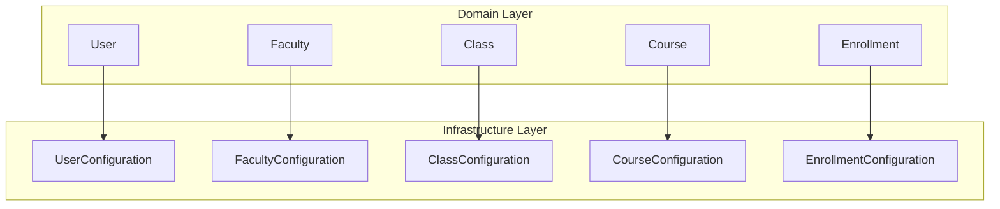

**Diagram sources**
- [User.cs](file://api/src/Domain/CodePath.Domain/Users/Entities/User.cs)
- [Faculty.cs](file://api/src/Domain/CodePath.Domain/Users/Entities/Faculty.cs)
- [Class.cs](file://api/src/Domain/CodePath.Domain/Users/Entities/Class.cs)
- [Course.cs](file://api/src/Domain/CodePath.Domain/Users/Entities/Course.cs)
- [Enrollment.cs](file://api/src/Domain/CodePath.Domain/Users/Entities/Enrollment.cs)
- [UserConfiguration.cs](file://api/src/Infrastructure/CodePath.Infrastructure/Persistence/Configurations/UserConfiguration.cs)
- [FacultyConfiguration.cs](file://api/src/Infrastructure/CodePath.Infrastructure/Persistence/Configurations/FacultyConfiguration.cs)
- [ClassConfiguration.cs](file://api/src/Infrastructure/CodePath.Infrastructure/Persistence/Configurations/ClassConfiguration.cs)
- [CourseConfiguration.cs](file://api/src/Infrastructure/CodePath.Infrastructure/Persistence/Configurations/CourseConfiguration.cs)
- [EnrollmentConfiguration.cs](file://api/src/Infrastructure/CodePath.Infrastructure/Persistence/Configurations/EnrollmentConfiguration.cs)

**Section sources**
- [User.cs](file://api/src/Domain/CodePath.Domain/Users/Entities/User.cs)
- [Faculty.cs](file://api/src/Domain/CodePath.Domain/Users/Entities/Faculty.cs)
- [Class.cs](file://api/src/Domain/CodePath.Domain/Users/Entities/Class.cs)
- [Course.cs](file://api/src/Domain/CodePath.Domain/Users/Entities/Course.cs)
- [Enrollment.cs](file://api/src/Domain/CodePath.Domain/Users/Entities/Enrollment.cs)
- [UserConfiguration.cs](file://api/src/Infrastructure/CodePath.Infrastructure/Persistence/Configurations/UserConfiguration.cs)
- [FacultyConfiguration.cs](file://api/src/Infrastructure/CodePath.Infrastructure/Persistence/Configurations/FacultyConfiguration.cs)
- [ClassConfiguration.cs](file://api/src/Infrastructure/CodePath.Infrastructure/Persistence/Configurations/ClassConfiguration.cs)
- [CourseConfiguration.cs](file://api/src/Infrastructure/CodePath.Infrastructure/Persistence/Configurations/CourseConfiguration.cs)
- [EnrollmentConfiguration.cs](file://api/src/Infrastructure/CodePath.Infrastructure/Persistence/Configurations/EnrollmentConfiguration.cs)

## Core Components
This section summarizes each core entity, its fields, types, constraints, and key behaviors.

- User
  - Purpose: Represents system users with role-based access (Admin, Teacher, Student). Includes profile attributes, authentication-related fields, and optional associations to a Class and Faculty.
  - Key fields: Id (Guid), FullName (string, required, max 200), Email (string, unique, max 256), PasswordHash (string, required), Role (string enum), Status (string enum), StudentId (string, unique, max 50), TeacherId (string, unique, max 50), PhoneNumber (string, max 20), Bio (string, max 1000), EmailVerifiedAt (datetime), LastLoginAt (datetime), SecurityVersion (long), ClassId (Guid, nullable), FacultyId (Guid, nullable).
  - Relationships: Optional Class (via ClassId), optional Faculty (via FacultyId), collections of ManagedClasses, TeachingCourses, Enrollments.
  - Constraints: Unique email; unique student ID; unique teacher ID; role/status stored as strings; soft delete not applied here; audit fields via BaseEntity.
  - Behaviors: Creation methods for Admin/Teacher/Student; profile updates; email verification; login tracking; teacher/student approval/rejection; disable/enable; assignment to Class or Faculty; password change/upgrade; security version increment.

- Faculty
  - Purpose: Organizational unit grouping classes and teachers.
  - Key fields: Id (Guid), Name (string, required, max 200), Code (string, unique, max 20).
  - Relationships: Many Classes; many Users (teachers assigned directly).
  - Constraints: Unique code; audit fields via BaseEntity.

- Class
  - Purpose: Academic class grouping students and linking to a Faculty and a Teacher.
  - Key fields: Id (Guid), Name (string, required, max 100), AcademicYear (string, required, max 20), FacultyId (nullable Guid), TeacherId (nullable Guid).
  - Relationships: Belongs to Faculty; belongs to Teacher; many Students (via User.ClassId).
  - Constraints: Unique composite index on (Name, AcademicYear, FacultyId); indexes on JoinCode, Status, AccessType; audit fields via BaseEntity.
  - Behaviors: Create with validations; update details; assign teacher.

- Course
  - Purpose: A teaching offering managed by a Teacher with enrollment control.
  - Key fields: Id (Guid), SubjectName (string, required, max 200), SectionCode (string, required, max 50), Language (string, required, max 50), Semester (string, required, max 50), JoinCode (string, unique, max 20), MaxCapacity (int, default 60), Status (enum: Draft/Active/Closed), TeacherId (Guid, required).
  - Relationships: One-to-many Enrollments; belongs to Teacher.
  - Constraints: Unique join code; status stored as integer; audit fields via BaseEntity.
  - Behaviors: Create with validations; activate/close; assign teacher.

- Enrollment
  - Purpose: Links a Student to a Course with grading and lifecycle state.
  - Key fields: Id (Guid), CourseId (Guid, required), StudentId (Guid, required), Status (enum: Active/Dropped/Completed), MidtermScore (decimal?), FinalScore (decimal?), TotalScore (decimal?), IsPassed (bool?).
  - Relationships: Belongs to Course; belongs to Student (User).
  - Constraints: Unique composite index on (CourseId, StudentId); scores precision 4,2; audit fields via BaseEntity.
  - Behaviors: Create; drop; rejoin; complete; update scores with weighted total and pass threshold.

**Section sources**
- [User.cs](file://api/src/Domain/CodePath.Domain/Users/Entities/User.cs)
- [Faculty.cs](file://api/src/Domain/CodePath.Domain/Users/Entities/Faculty.cs)
- [Class.cs](file://api/src/Domain/CodePath.Domain/Users/Entities/Class.cs)
- [Course.cs](file://api/src/Domain/CodePath.Domain/Users/Entities/Course.cs)
- [Enrollment.cs](file://api/src/Domain/CodePath.Domain/Users/Entities/Enrollment.cs)
- [CourseStatus.cs](file://api/src/Domain/CodePath.Domain/Users/Enums/CourseStatus.cs)
- [EnrollmentStatus.cs](file://api/src/Domain/CodePath.Domain/Users/Enums/EnrollmentStatus.cs)
- [UserConfiguration.cs](file://api/src/Infrastructure/CodePath.Infrastructure/Persistence/Configurations/UserConfiguration.cs)
- [FacultyConfiguration.cs](file://api/src/Infrastructure/CodePath.Infrastructure/Persistence/Configurations/FacultyConfiguration.cs)
- [ClassConfiguration.cs](file://api/src/Infrastructure/CodePath.Infrastructure/Persistence/Configurations/ClassConfiguration.cs)
- [CourseConfiguration.cs](file://api/src/Infrastructure/CodePath.Infrastructure/Persistence/Configurations/CourseConfiguration.cs)
- [EnrollmentConfiguration.cs](file://api/src/Infrastructure/CodePath.Infrastructure/Persistence/Configurations/EnrollmentConfiguration.cs)

## Architecture Overview
The data model centers around Users who can be Teachers or Students. Teachers manage Courses and Classes; Students enroll in Courses. Faculties organize both Classes and Teachers.

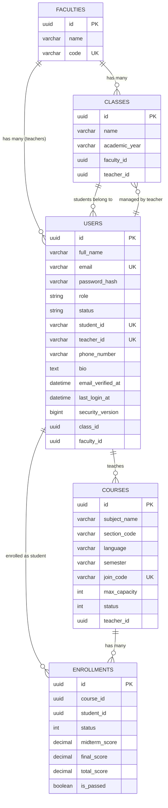

**Diagram sources**
- [User.cs](file://api/src/Domain/CodePath.Domain/Users/Entities/User.cs)
- [Faculty.cs](file://api/src/Domain/CodePath.Domain/Users/Entities/Faculty.cs)
- [Class.cs](file://api/src/Domain/CodePath.Domain/Users/Entities/Class.cs)
- [Course.cs](file://api/src/Domain/CodePath.Domain/Users/Entities/Course.cs)
- [Enrollment.cs](file://api/src/Domain/CodePath.Domain/Users/Entities/Enrollment.cs)
- [UserConfiguration.cs](file://api/src/Infrastructure/CodePath.Infrastructure/Persistence/Configurations/UserConfiguration.cs)
- [FacultyConfiguration.cs](file://api/src/Infrastructure/CodePath.Infrastructure/Persistence/Configurations/FacultyConfiguration.cs)
- [ClassConfiguration.cs](file://api/src/Infrastructure/CodePath.Infrastructure/Persistence/Configurations/ClassConfiguration.cs)
- [CourseConfiguration.cs](file://api/src/Infrastructure/CodePath.Infrastructure/Persistence/Configurations/CourseConfiguration.cs)
- [EnrollmentConfiguration.cs](file://api/src/Infrastructure/CodePath.Infrastructure/Persistence/Configurations/EnrollmentConfiguration.cs)

## Detailed Component Analysis

### User Entity
- Fields and types
  - Id: Guid (PK)
  - FullName: string, required, max 200
  - Email: string, required, unique, max 256
  - PasswordHash: string, required, max 256
  - Role: string enum (Admin, Teacher, Student)
  - Status: string enum (Active, Pending, Rejected, Disabled)
  - StudentId: string, unique, max 50
  - TeacherId: string, unique, max 50
  - PhoneNumber: string, max 20
  - Bio: string, max 1000
  - EmailVerifiedAt: datetime
  - LastLoginAt: datetime
  - SecurityVersion: long, default 1
  - ClassId: Guid (FK to Classes, nullable)
  - FacultyId: Guid (FK to Faculties, nullable)
- Relationships
  - Has one Class (optional)
  - Has one Faculty (optional)
  - Has many ManagedClasses (as Teacher)
  - Has many TeachingCourses (as Teacher)
  - Has many Enrollments (as Student)
- Constraints and indexes
  - Unique indexes: Email, StudentId, TeacherId
  - Indexes: Role, Status, ClassId, FacultyId
  - Delete behavior: Restrict on Class and Faculty FKs
- Business rules and validation
  - Role-specific profile updates (student vs teacher)
  - Approval/rejection flows for pending accounts
  - Disable/enable transitions
  - Assignment to Class (students only) and Faculty (teachers only)
  - Email verification and login timestamp updates
  - Password change and upgrade

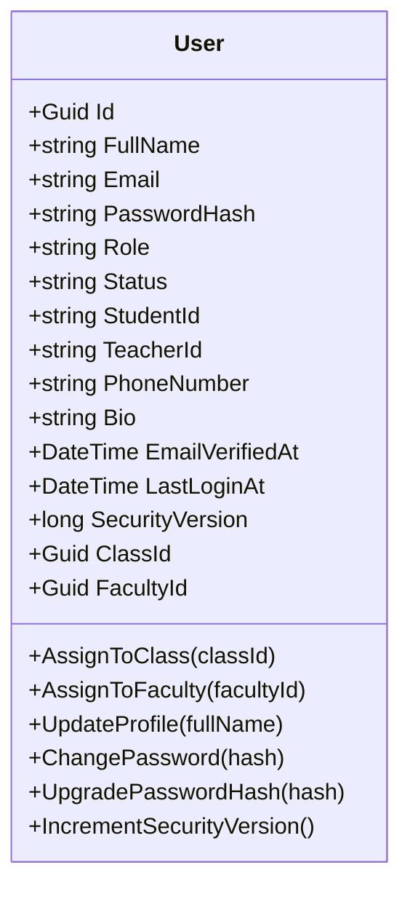

**Diagram sources**
- [User.cs](file://api/src/Domain/CodePath.Domain/Users/Entities/User.cs)
- [UserConfiguration.cs](file://api/src/Infrastructure/CodePath.Infrastructure/Persistence/Configurations/UserConfiguration.cs)

**Section sources**
- [User.cs](file://api/src/Domain/CodePath.Domain/Users/Entities/User.cs)
- [UserConfiguration.cs](file://api/src/Infrastructure/CodePath.Infrastructure/Persistence/Configurations/UserConfiguration.cs)

### Faculty Entity
- Fields and types
  - Id: Guid (PK)
  - Name: string, required, max 200
  - Code: string, required, unique, max 20
- Relationships
  - Has many Classes
  - Has many Users (teachers)
- Constraints and indexes
  - Unique index on Code
- Business rules
  - Creation and update require non-empty name and code

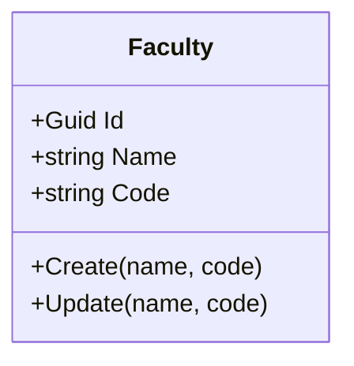

**Diagram sources**
- [Faculty.cs](file://api/src/Domain/CodePath.Domain/Users/Entities/Faculty.cs)
- [FacultyConfiguration.cs](file://api/src/Infrastructure/CodePath.Infrastructure/Persistence/Configurations/FacultyConfiguration.cs)

**Section sources**
- [Faculty.cs](file://api/src/Domain/CodePath.Domain/Users/Entities/Faculty.cs)
- [FacultyConfiguration.cs](file://api/src/Infrastructure/CodePath.Infrastructure/Persistence/Configurations/FacultyConfiguration.cs)

### Class Entity
- Fields and types
  - Id: Guid (PK)
  - Name: string, required, max 100
  - AcademicYear: string, required, max 20
  - FacultyId: Guid (nullable)
  - TeacherId: Guid (nullable)
- Relationships
  - Belongs to Faculty
  - Belongs to Teacher (User)
  - Has many Students (via User.ClassId)
- Constraints and indexes
  - Unique composite index on (Name, AcademicYear, FacultyId)
  - Indexes on JoinCode, Status, AccessType, FacultyId, TeacherId
- Business rules
  - Create validates required fields and non-empty IDs
  - Update details enforces non-empty values
  - Assign teacher requires non-empty ID

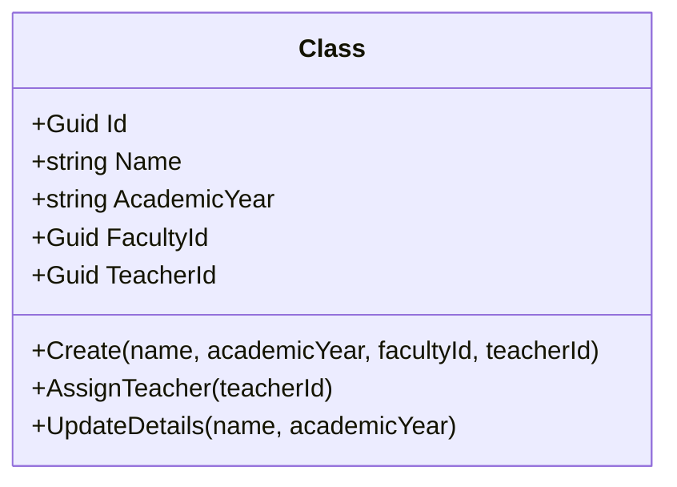

**Diagram sources**
- [Class.cs](file://api/src/Domain/CodePath.Domain/Users/Entities/Class.cs)
- [ClassConfiguration.cs](file://api/src/Infrastructure/CodePath.Infrastructure/Persistence/Configurations/ClassConfiguration.cs)

**Section sources**
- [Class.cs](file://api/src/Domain/CodePath.Domain/Users/Entities/Class.cs)
- [ClassConfiguration.cs](file://api/src/Infrastructure/CodePath.Infrastructure/Persistence/Configurations/ClassConfiguration.cs)

### Course Entity
- Fields and types
  - Id: Guid (PK)
  - SubjectName: string, required, max 200
  - SectionCode: string, required, max 50
  - Language: string, required, max 50
  - Semester: string, required, max 50
  - JoinCode: string, required, unique, max 20
  - MaxCapacity: int, default 60
  - Status: enum (Draft=1, Active=2, Closed=3)
  - TeacherId: Guid (required)
- Relationships
  - Belongs to Teacher (User)
  - Has many Enrollments
- Constraints and indexes
  - Unique index on JoinCode
  - Index on TeacherId
- Business rules
  - Create validates all required fields and positive capacity
  - Activate enforces current status not already Active
  - Close sets status to Closed
  - Assign teacher requires non-empty ID

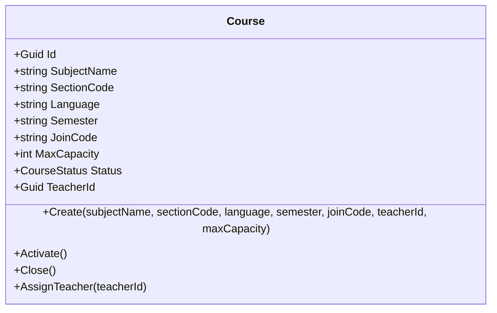

**Diagram sources**
- [Course.cs](file://api/src/Domain/CodePath.Domain/Users/Entities/Course.cs)
- [CourseStatus.cs](file://api/src/Domain/CodePath.Domain/Users/Enums/CourseStatus.cs)
- [CourseConfiguration.cs](file://api/src/Infrastructure/CodePath.Infrastructure/Persistence/Configurations/CourseConfiguration.cs)

**Section sources**
- [Course.cs](file://api/src/Domain/CodePath.Domain/Users/Entities/Course.cs)
- [CourseStatus.cs](file://api/src/Domain/CodePath.Domain/Users/Enums/CourseStatus.cs)
- [CourseConfiguration.cs](file://api/src/Infrastructure/CodePath.Infrastructure/Persistence/Configurations/CourseConfiguration.cs)

### Enrollment Entity
- Fields and types
  - Id: Guid (PK)
  - CourseId: Guid (required)
  - StudentId: Guid (required)
  - Status: enum (Active=1, Dropped=2, Completed=3)
  - MidtermScore: decimal? (precision 4,2)
  - FinalScore: decimal? (precision 4,2)
  - TotalScore: decimal? (precision 4,2)
  - IsPassed: bool? (default false)
- Relationships
  - Belongs to Course
  - Belongs to Student (User)
- Constraints and indexes
  - Unique composite index on (CourseId, StudentId)
  - Index on StudentId
- Business rules
  - Create validates non-empty IDs
  - Drop disallows dropping completed enrollments
  - Rejoin allows reactivating dropped enrollments
  - Complete sets status to Completed
  - UpdateScores validates score ranges and weight, computes weighted total, determines pass/fail, and auto-completes if passed

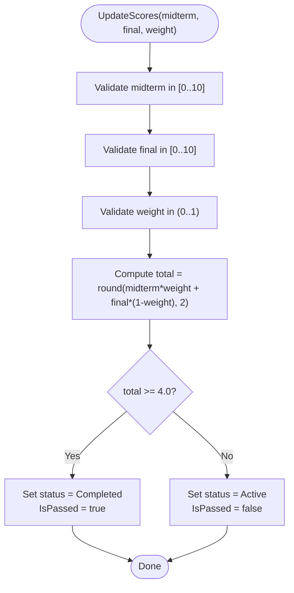

**Diagram sources**
- [Enrollment.cs](file://api/src/Domain/CodePath.Domain/Users/Entities/Enrollment.cs)
- [EnrollmentConfiguration.cs](file://api/src/Infrastructure/CodePath.Infrastructure/Persistence/Configurations/EnrollmentConfiguration.cs)

**Section sources**
- [Enrollment.cs](file://api/src/Domain/CodePath.Domain/Users/Entities/Enrollment.cs)
- [EnrollmentConfiguration.cs](file://api/src/Infrastructure/CodePath.Infrastructure/Persistence/Configurations/EnrollmentConfiguration.cs)

### User Role System and Status Management
- Roles
  - Admin: Administrative privileges; created with Active status and verified email.
  - Teacher: Can manage courses and classes; initial creation may set Pending status requiring approval.
  - Student: Can enroll in courses; initial creation may set Active or Pending depending on workflow.
- Statuses
  - Active: Account usable.
  - Pending: Requires approval before becoming Active.
  - Rejected: Cannot transition back to Pending.
  - Disabled: Can be enabled only when currently Disabled.
- Transitions
  - Teacher/Student approval/rejection enforced by domain methods.
  - Disable/Enable restricted to valid transitions and actor constraints.

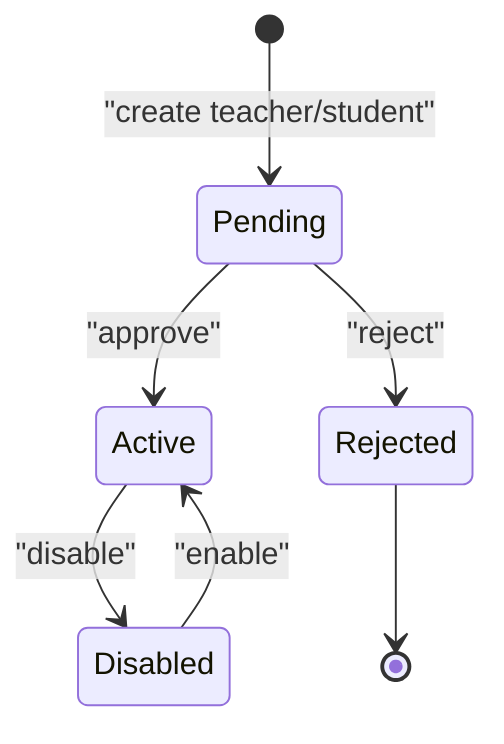

**Diagram sources**
- [User.cs](file://api/src/Domain/CodePath.Domain/Users/Entities/User.cs)

**Section sources**
- [User.cs](file://api/src/Domain/CodePath.Domain/Users/Entities/User.cs)

### Class Enrollment Workflows
- Enrollment lifecycle
  - Create: Student enrolls in an active course; status starts as Active.
  - Drop: Student drops an active enrollment; cannot drop completed enrollments.
  - Rejoin: Reactivate a dropped enrollment.
  - Complete: Manually mark as completed or automatically upon passing.
- Grading
  - Scores validated within bounds; weighted total computed; pass threshold triggers completion.

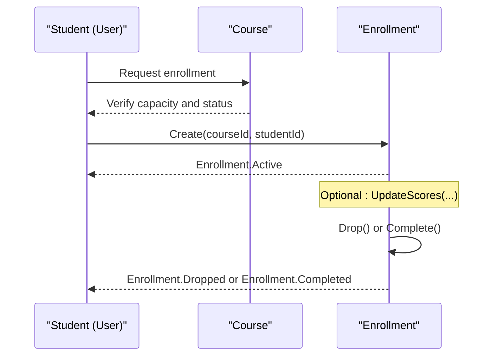

**Diagram sources**
- [Enrollment.cs](file://api/src/Domain/CodePath.Domain/Users/Entities/Enrollment.cs)
- [Course.cs](file://api/src/Domain/CodePath.Domain/Users/Entities/Course.cs)

**Section sources**
- [Enrollment.cs](file://api/src/Domain/CodePath.Domain/Users/Entities/Enrollment.cs)
- [Course.cs](file://api/src/Domain/CodePath.Domain/Users/Entities/Course.cs)

### Course Structure and Faculty Organization
- Course structure
  - Each course has a unique join code for student access.
  - Capacity limits enrollment growth.
  - Lifecycle states: Draft -> Active -> Closed.
- Faculty organization
  - Faculties group classes and teachers.
  - Teachers can be assigned directly to a faculty and also manage classes.

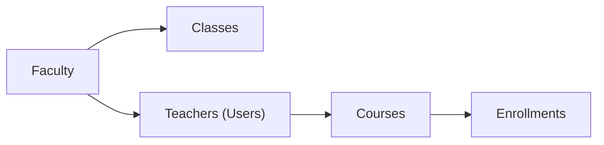

**Diagram sources**
- [Faculty.cs](file://api/src/Domain/CodePath.Domain/Users/Entities/Faculty.cs)
- [Class.cs](file://api/src/Domain/CodePath.Domain/Users/Entities/Class.cs)
- [Course.cs](file://api/src/Domain/CodePath.Domain/Users/Entities/Course.cs)
- [Enrollment.cs](file://api/src/Domain/CodePath.Domain/Users/Entities/Enrollment.cs)

**Section sources**
- [Faculty.cs](file://api/src/Domain/CodePath.Domain/Users/Entities/Faculty.cs)
- [Class.cs](file://api/src/Domain/CodePath.Domain/Users/Entities/Class.cs)
- [Course.cs](file://api/src/Domain/CodePath.Domain/Users/Entities/Course.cs)
- [Enrollment.cs](file://api/src/Domain/CodePath.Domain/Users/Entities/Enrollment.cs)

## Dependency Analysis
Entity relationships and referential integrity are enforced at both domain and persistence layers.

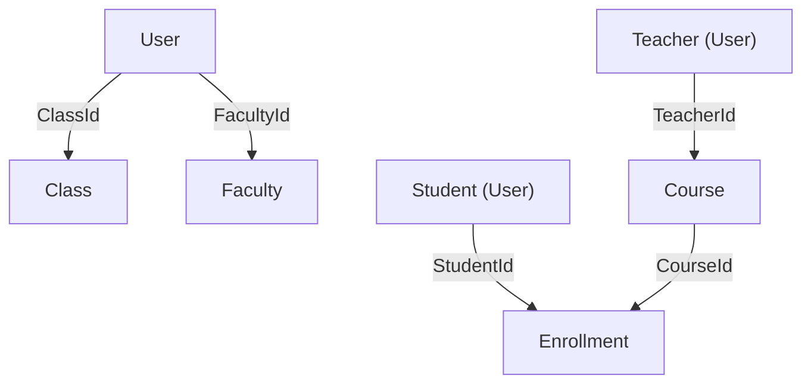

- Referential integrity
  - User.FacultyId references Faculty.Id (restrict delete)
  - User.ClassId references Class.Id (restrict delete)
  - Course.TeacherId references User.Id (restrict delete)
  - Enrollment.CourseId references Course.Id (restrict delete)
  - Enrollment.StudentId references User.Id (restrict delete)
- Uniqueness constraints
  - Users.Email, Users.StudentId, Users.TeacherId
  - Faculties.Code
  - Classes.JoinCode, Classes(Name, AcademicYear, FacultyId)
  - Courses.JoinCode
  - Enrollments(CourseId, StudentId)

**Diagram sources**
- [UserConfiguration.cs](file://api/src/Infrastructure/CodePath.Infrastructure/Persistence/Configurations/UserConfiguration.cs)
- [FacultyConfiguration.cs](file://api/src/Infrastructure/CodePath.Infrastructure/Persistence/Configurations/FacultyConfiguration.cs)
- [ClassConfiguration.cs](file://api/src/Infrastructure/CodePath.Infrastructure/Persistence/Configurations/ClassConfiguration.cs)
- [CourseConfiguration.cs](file://api/src/Infrastructure/CodePath.Infrastructure/Persistence/Configurations/CourseConfiguration.cs)
- [EnrollmentConfiguration.cs](file://api/src/Infrastructure/CodePath.Infrastructure/Persistence/Configurations/EnrollmentConfiguration.cs)

**Section sources**
- [UserConfiguration.cs](file://api/src/Infrastructure/CodePath.Infrastructure/Persistence/Configurations/UserConfiguration.cs)
- [FacultyConfiguration.cs](file://api/src/Infrastructure/CodePath.Infrastructure/Persistence/Configurations/FacultyConfiguration.cs)
- [ClassConfiguration.cs](file://api/src/Infrastructure/CodePath.Infrastructure/Persistence/Configurations/ClassConfiguration.cs)
- [CourseConfiguration.cs](file://api/src/Infrastructure/CodePath.Infrastructure/Persistence/Configurations/CourseConfiguration.cs)
- [EnrollmentConfiguration.cs](file://api/src/Infrastructure/CodePath.Infrastructure/Persistence/Configurations/EnrollmentConfiguration.cs)

## Performance Considerations
- Indexing strategy
  - Users: Unique indexes on Email, StudentId, TeacherId; additional indexes on Role, Status, ClassId, FacultyId for filtering and joins.
  - Faculties: Unique index on Code for fast lookups.
  - Classes: Unique composite index on (Name, AcademicYear, FacultyId); indexes on JoinCode, Status, AccessType, FacultyId, TeacherId for queries and filters.
  - Courses: Unique index on JoinCode; index on TeacherId for teacher-centric queries.
  - Enrollments: Unique composite index on (CourseId, StudentId) prevents duplicate enrollments; index on StudentId for student-centric queries.
- Query patterns
  - Find user by email or student/teacher ID.
  - List classes by faculty and academic year.
  - Retrieve courses by teacher or join code.
  - Get enrollments per student or per course.
- Data types and collations
  - Use of specific collations for case-sensitive codes (e.g., join codes) ensures correct uniqueness checks.
  - Decimal precision for scores avoids rounding issues.

[No sources needed since this section provides general guidance]

## Troubleshooting Guide
- Validation errors
  - Empty or oversized fields (e.g., names, IDs, bios) raise domain validation exceptions.
  - Invalid score ranges or weights in enrollment grading cause validation failures.
- State transition errors
  - Attempting to enable a non-disabled account or approve/reject non-pending accounts throws rule violations.
  - Dropping a completed enrollment or rejoining a non-dropped enrollment is prohibited.
- Referential integrity
  - Deleting referenced entities (Faculty, Class, Course, User) is restricted to prevent orphaned records.
- Common fixes
  - Ensure proper role before assigning profiles or memberships.
  - Approve pending accounts before enabling further actions.
  - Verify join codes and capacity constraints before enrollment.

**Section sources**
- [User.cs](file://api/src/Domain/CodePath.Domain/Users/Entities/User.cs)
- [Enrollment.cs](file://api/src/Domain/CodePath.Domain/Users/Entities/Enrollment.cs)
- [Course.cs](file://api/src/Domain/CodePath.Domain/Users/Entities/Course.cs)
- [Class.cs](file://api/src/Domain/CodePath.Domain/Users/Entities/Class.cs)
- [UserConfiguration.cs](file://api/src/Infrastructure/CodePath.Infrastructure/Persistence/Configurations/UserConfiguration.cs)
- [EnrollmentConfiguration.cs](file://api/src/Infrastructure/CodePath.Infrastructure/Persistence/Configurations/EnrollmentConfiguration.cs)
- [CourseConfiguration.cs](file://api/src/Infrastructure/CodePath.Infrastructure/Persistence/Configurations/CourseConfiguration.cs)
- [ClassConfiguration.cs](file://api/src/Infrastructure/CodePath.Infrastructure/Persistence/Configurations/ClassConfiguration.cs)

## Conclusion
The CodePart core data model defines a robust, constraint-rich foundation for managing users, faculties, classes, courses, and enrollments. Domain entities enforce business rules and state transitions, while EF configurations ensure consistent schema, performance-oriented indexing, and referential integrity. The design supports clear separation of concerns between administrative, teaching, and learning workflows, enabling scalable and maintainable operations across the platform.