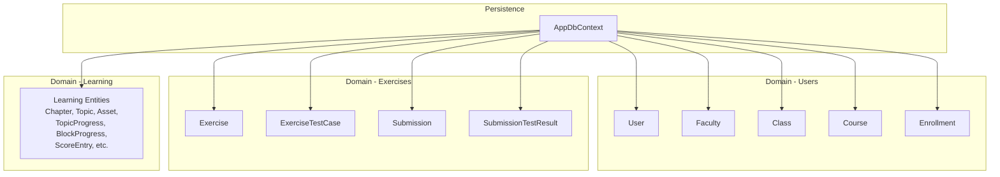
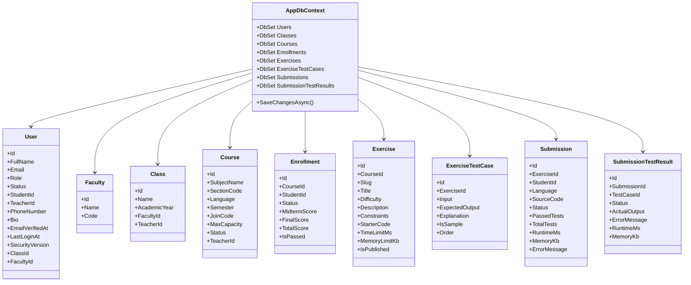
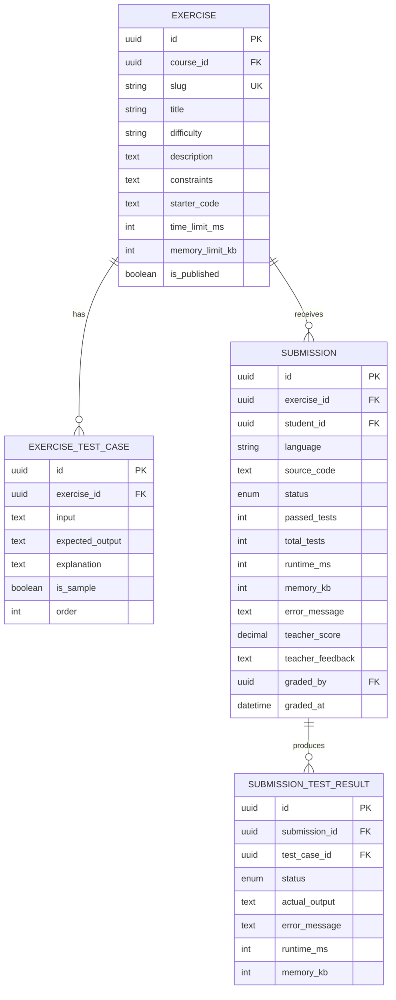
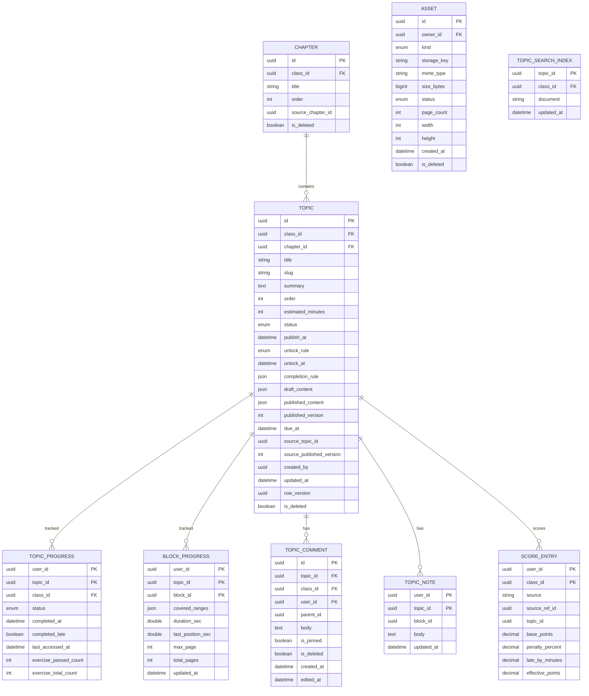
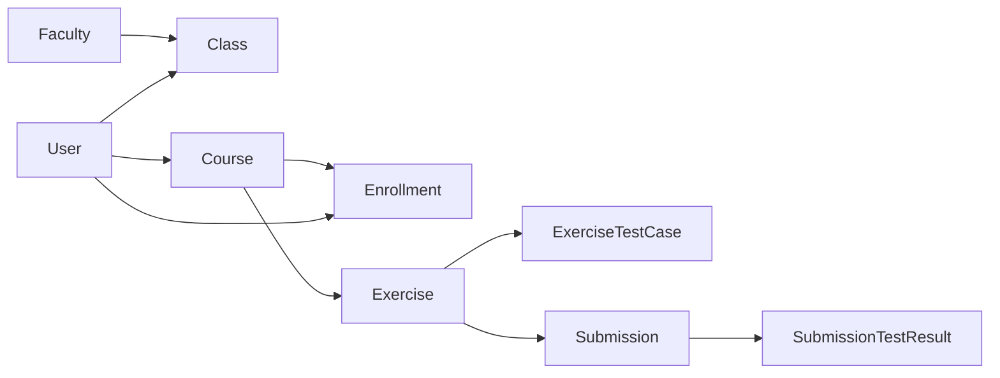

# Database Design

<cite>
**Referenced Files in This Document**
- [AppDbContext.cs](file://api/src/Infrastructure/CodePath.Infrastructure/Persistence/AppDbContext.cs)
- [User.cs](file://api/src/Domain/CodePath.Domain/Users/Entities/User.cs)
- [Class.cs](file://api/src/Domain/CodePath.Domain/Users/Entities/Class.cs)
- [Course.cs](file://api/src/Domain/CodePath.Domain/Users/Entities/Course.cs)
- [Enrollment.cs](file://api/src/Domain/CodePath.Domain/Users/Entities/Enrollment.cs)
- [Faculty.cs](file://api/src/Domain/CodePath.Domain/Users/Entities/Faculty.cs)
- [Exercise.cs](file://api/src/Domain/CodePath.Domain/Exercises/Entities/Exercise.cs)
- [ExerciseTestCase.cs](file://api/src/Domain/CodePath.Domain/Exercises/Entities/ExerciseTestCase.cs)
- [Submission.cs](file://api/src/Domain/CodePath.Domain/Exercises/Entities/Submission.cs)
- [SubmissionTestResult.cs](file://api/src/Domain/CodePath.Domain/Exercises/Entities/SubmissionTestResult.cs)
- [LearningEntities.cs](file://api/src/Domain/CodePath.Domain/Learning/LearningEntities.cs)
</cite>

## Table of Contents
1. [Introduction](#introduction)
2. [Project Structure](#project-structure)
3. [Core Components](#core-components)
4. [Architecture Overview](#architecture-overview)
5. [Detailed Component Analysis](#detailed-component-analysis)
6. [Dependency Analysis](#dependency-analysis)
7. [Performance Considerations](#performance-considerations)
8. [Troubleshooting Guide](#troubleshooting-guide)
9. [Conclusion](#conclusion)
10. [Appendices](#appendices)

## Introduction
This document describes the database design for CodePart, focusing on the core entities Users, Classes, Courses, Exercises, Submissions, and LearningContent-related models. It explains entity relationships, field definitions, primary and foreign keys, constraints, Entity Framework Core configuration, migration strategy, data access patterns, Redis caching considerations, performance characteristics, lifecycle management, security, privacy, and access control.

## Project Structure
The persistence layer is implemented with Entity Framework Core over MySQL. The main context aggregates domain entities from multiple modules (Users, Exercises, Auth, Auditing, Learning). Configuration is centralized in the DbContext and EF configurations applied via conventions.



**Diagram sources**
- [AppDbContext.cs:17-39](file://api/src/Infrastructure/CodePath.Infrastructure/Persistence/AppDbContext.cs#L17-L39)
- [User.cs:8-31](file://api/src/Domain/CodePath.Domain/Users/Entities/User.cs#L8-L31)
- [Class.cs:6-17](file://api/src/Domain/CodePath.Domain/Users/Entities/Class.cs#L6-L17)
- [Course.cs:7-20](file://api/src/Domain/CodePath.Domain/Users/Entities/Course.cs#L7-L20)
- [Enrollment.cs:7-20](file://api/src/Domain/CodePath.Domain/Users/Entities/Enrollment.cs#L7-L20)
- [Faculty.cs:5-11](file://api/src/Domain/CodePath.Domain/Users/Entities/Faculty.cs#L5-L11)
- [Exercise.cs:6-30](file://api/src/Domain/CodePath.Domain/Exercises/Entities/Exercise.cs#L6-L30)
- [ExerciseTestCase.cs:6-14](file://api/src/Domain/CodePath.Domain/Exercises/Entities/ExerciseTestCase.cs#L6-L14)
- [Submission.cs:6-38](file://api/src/Domain/CodePath.Domain/Exercises/Entities/Submission.cs#L6-L38)
- [SubmissionTestResult.cs:6-16](file://api/src/Domain/CodePath.Domain/Exercises/Entities/SubmissionTestResult.cs#L6-L16)
- [LearningEntities.cs:12-141](file://api/src/Domain/CodePath.Domain/Learning/LearningEntities.cs#L12-L141)

**Section sources**
- [AppDbContext.cs:17-39](file://api/src/Infrastructure/CodePath.Infrastructure/Persistence/AppDbContext.cs#L17-L39)

## Core Components
This section summarizes the key entities and their responsibilities.

- User: Represents system users (students, teachers, admins) with profile fields, role/status, and optional class/faculty associations.
- Faculty: Academic department or faculty unit; referenced by classes and teacher users.
- Class: A teaching cohort with a name, academic year, faculty, and assigned teacher; contains students.
- Course: A course offering owned by a teacher, with join code, capacity, and status; linked to enrollments.
- Enrollment: Many-to-many bridge between Course and Student with scores and pass/fail state.
- Exercise: Programming problem definition with metadata, limits, and test cases; optionally assigned to a course.
- ExerciseTestCase: Test inputs/outputs for an exercise.
- Submission: Student’s submitted code and execution results for an exercise.
- SubmissionTestResult: Per-test-case result for a submission.
- Learning Entities: Chapter, Topic, Asset, TopicProgress, BlockProgress, ScoreEntry, and related structures used by the learning module.

Key relationship highlights:
- User has many Enrollments; Enrollment belongs to a Course and a Student (User).
- Class has many Students (User) and one Teacher (User); Class belongs to a Faculty.
- Course has many Enrollments and is owned by a Teacher (User).
- Exercise can belong to a Course; Exercise has many TestCases and Submissions.
- Submission has many SubmissionTestResults.

**Section sources**
- [User.cs:8-31](file://api/src/Domain/CodePath.Domain/Users/Entities/User.cs#L8-L31)
- [Class.cs:6-17](file://api/src/Domain/CodePath.Domain/Users/Entities/Class.cs#L6-L17)
- [Course.cs:7-20](file://api/src/Domain/CodePath.Domain/Users/Entities/Course.cs#L7-L20)
- [Enrollment.cs:7-20](file://api/src/Domain/CodePath.Domain/Users/Entities/Enrollment.cs#L7-L20)
- [Faculty.cs:5-11](file://api/src/Domain/CodePath.Domain/Users/Entities/Faculty.cs#L5-L11)
- [Exercise.cs:6-30](file://api/src/Domain/CodePath.Domain/Exercises/Entities/Exercise.cs#L6-L30)
- [ExerciseTestCase.cs:6-14](file://api/src/Domain/CodePath.Domain/Exercises/Entities/ExerciseTestCase.cs#L6-L14)
- [Submission.cs:6-38](file://api/src/Domain/CodePath.Domain/Exercises/Entities/Submission.cs#L6-L38)
- [SubmissionTestResult.cs:6-16](file://api/src/Domain/CodePath.Domain/Exercises/Entities/SubmissionTestResult.cs#L6-L16)
- [LearningEntities.cs:12-141](file://api/src/Domain/CodePath.Domain/Learning/LearningEntities.cs#L12-L141)

## Architecture Overview
Entity Framework Core is configured to use MySQL with UTF-8 support and collation. All entity configurations are applied automatically from the assembly. The context exposes typed DbSets for all core entities and implements repository-like methods for auth, admin, and exercises domains.



**Diagram sources**
- [AppDbContext.cs:17-39](file://api/src/Infrastructure/CodePath.Infrastructure/Persistence/AppDbContext.cs#L17-L39)
- [User.cs:8-31](file://api/src/Domain/CodePath.Domain/Users/Entities/User.cs#L8-L31)
- [Class.cs:6-17](file://api/src/Domain/CodePath.Domain/Users/Entities/Class.cs#L6-L17)
- [Course.cs:7-20](file://api/src/Domain/CodePath.Domain/Users/Entities/Course.cs#L7-L20)
- [Enrollment.cs:7-20](file://api/src/Domain/CodePath.Domain/Users/Entities/Enrollment.cs#L7-L20)
- [Faculty.cs:5-11](file://api/src/Domain/CodePath.Domain/Users/Entities/Faculty.cs#L5-L11)
- [Exercise.cs:6-30](file://api/src/Domain/CodePath.Domain/Exercises/Entities/Exercise.cs#L6-L30)
- [ExerciseTestCase.cs:6-14](file://api/src/Domain/CodePath.Domain/Exercises/Entities/ExerciseTestCase.cs#L6-L14)
- [Submission.cs:6-38](file://api/src/Domain/CodePath.Domain/Exercises/Entities/Submission.cs#L6-L38)
- [SubmissionTestResult.cs:6-16](file://api/src/Domain/CodePath.Domain/Exercises/Entities/SubmissionTestResult.cs#L6-L16)

## Detailed Component Analysis

### Users and Academic Organization
- User
  - Primary key: Id (Guid)
  - Important fields: FullName, Email, PasswordHash, Role, Status, StudentId, TeacherId, PhoneNumber, Bio, EmailVerifiedAt, LastLoginAt, SecurityVersion
  - Relationships:
    - Optional ClassId -> Class
    - Optional FacultyId -> Faculty
    - One-to-many Enrollments (as Student)
    - One-to-many ManagedClasses (as Teacher)
    - One-to-many TeachingCourses (as Teacher)
  - Constraints and rules:
    - Validation enforced in domain methods (e.g., length checks, role-specific updates)
    - SecurityVersion incremented on sensitive changes
- Faculty
  - Primary key: Id (Guid)
  - Fields: Name, Code
  - Relationships: One-to-many Classes, One-to-many Users (teachers directly assigned)
- Class
  - Primary key: Id (Guid)
  - Fields: Name, AcademicYear, FacultyId, TeacherId
  - Relationships:
    - Belongs to Faculty
    - Has many Students (User)
    - Owned by Teacher (User)
- Course
  - Primary key: Id (Guid)
  - Fields: SubjectName, SectionCode, Language, Semester, JoinCode, MaxCapacity, Status, TeacherId
  - Relationships: One-to-many Enrollments; owned by Teacher (User)
- Enrollment
  - Primary key: Id (Guid)
  - Foreign keys: CourseId, StudentId
  - Fields: Status, MidtermScore, FinalScore, TotalScore, IsPassed
  - Business rules:
    - Scores validated and weighted; pass threshold determines completion
    - State transitions enforced (Active, Dropped, Completed)

```mermaid
erDiagram
USER {
uuid id PK
string full_name
string email UK
string password_hash
enum role
enum status
string student_id
string teacher_id
string phone_number
text bio
datetime email_verified_at
datetime last_login_at
bigint security_version
uuid class_id FK
uuid faculty_id FK
}
FACULTY {
uuid id PK
string name
string code UK
}
CLASS {
uuid id PK
string name
string academic_year
uuid faculty_id FK
uuid teacher_id FK
}
COURSE {
uuid id PK
string subject_name
string section_code
string language
string semester
string join_code
int max_capacity
enum status
uuid teacher_id FK
}
ENROLLMENT {
uuid id PK
uuid course_id FK
uuid student_id FK
enum status
decimal midterm_score
decimal final_score
decimal total_score
boolean is_passed
}
USER ||--o{ ENROLLMENT : "enrolled as student"
COURSE ||--o{ ENROLLMENT : "has enrollments"
FACULTY ||--o{ CLASS : "owns"
USER ||--o{ CLASS : "teaches"
USER ||--o{ COURSE : "teaches"
CLASS ||--o{ USER : "contains students"
```

**Diagram sources**
- [User.cs:8-31](file://api/src/Domain/CodePath.Domain/Users/Entities/User.cs#L8-L31)
- [Class.cs:6-17](file://api/src/Domain/CodePath.Domain/Users/Entities/Class.cs#L6-L17)
- [Course.cs:7-20](file://api/src/Domain/CodePath.Domain/Users/Entities/Course.cs#L7-L20)
- [Enrollment.cs:7-20](file://api/src/Domain/CodePath.Domain/Users/Entities/Enrollment.cs#L7-L20)
- [Faculty.cs:5-11](file://api/src/Domain/CodePath.Domain/Users/Entities/Faculty.cs#L5-L11)

**Section sources**
- [User.cs:8-31](file://api/src/Domain/CodePath.Domain/Users/Entities/User.cs#L8-L31)
- [Class.cs:6-17](file://api/src/Domain/CodePath.Domain/Users/Entities/Class.cs#L6-L17)
- [Course.cs:7-20](file://api/src/Domain/CodePath.Domain/Users/Entities/Course.cs#L7-L20)
- [Enrollment.cs:7-20](file://api/src/Domain/CodePath.Domain/Users/Entities/Enrollment.cs#L7-L20)
- [Faculty.cs:5-11](file://api/src/Domain/CodePath.Domain/Users/Entities/Faculty.cs#L5-L11)

### Exercises and Submissions
- Exercise
  - Primary key: Id (Guid)
  - Fields: Slug, Title, Difficulty, Description, Constraints, StarterCode, TimeLimitMs, MemoryLimitKb, IsPublished
  - Relationships:
    - Optional CourseId -> Course
    - One-to-many TestCases
    - One-to-many Submissions
  - Rules:
    - Publish requires at least one test case
    - Assign to course only once for unpublished exercises
- ExerciseTestCase
  - Primary key: Id (Guid)
  - Foreign key: ExerciseId
  - Fields: Input, ExpectedOutput, Explanation, IsSample, Order
- Submission
  - Primary key: Id (Guid)
  - Foreign keys: ExerciseId, StudentId
  - Fields: Language, SourceCode, Status, PassedTests, TotalTests, RuntimeMs, MemoryKb, ErrorMessage
  - Teacher grading fields: TeacherScore, TeacherFeedback, GradedBy, GradedAt
- SubmissionTestResult
  - Primary key: Id (Guid)
  - Foreign keys: SubmissionId, TestCaseId
  - Fields: Status, ActualOutput, ErrorMessage, RuntimeMs, MemoryKb



**Diagram sources**
- [Exercise.cs:6-30](file://api/src/Domain/CodePath.Domain/Exercises/Entities/Exercise.cs#L6-L30)
- [ExerciseTestCase.cs:6-14](file://api/src/Domain/CodePath.Domain/Exercises/Entities/ExerciseTestCase.cs#L6-L14)
- [Submission.cs:6-38](file://api/src/Domain/CodePath.Domain/Exercises/Entities/Submission.cs#L6-L38)
- [SubmissionTestResult.cs:6-16](file://api/src/Domain/CodePath.Domain/Exercises/Entities/SubmissionTestResult.cs#L6-L16)

**Section sources**
- [Exercise.cs:6-30](file://api/src/Domain/CodePath.Domain/Exercises/Entities/Exercise.cs#L6-L30)
- [ExerciseTestCase.cs:6-14](file://api/src/Domain/CodePath.Domain/Exercises/Entities/ExerciseTestCase.cs#L6-L14)
- [Submission.cs:6-38](file://api/src/Domain/CodePath.Domain/Exercises/Entities/Submission.cs#L6-L38)
- [SubmissionTestResult.cs:6-16](file://api/src/Domain/CodePath.Domain/Exercises/Entities/SubmissionTestResult.cs#L6-L16)

### Learning Content Entities
Learning content is modeled with rich structures for chapters, topics, assets, progress tracking, scoring, comments, notes, and search indexing. These are persisted alongside other domain entities through the same context.

- Chapter: Belongs to a Class; supports deletion flag and source mapping.
- Topic: Belongs to a Class and Chapter; includes publish controls, unlock rules, due dates, draft/published content, versioning, and ownership.
- Asset: Media files with storage metadata and dimensions/page count.
- TopicProgress / BlockProgress: Track per-user progress across topics and content blocks.
- ScoreEntry: Aggregates points from various sources with penalties and late adjustments.
- TopicSearchIndex: Search index documents per topic/class.
- TopicComment / TopicNote: Collaborative features tied to topics and users.



**Diagram sources**
- [LearningEntities.cs:12-141](file://api/src/Domain/CodePath.Domain/Learning/LearningEntities.cs#L12-L141)

**Section sources**
- [LearningEntities.cs:12-141](file://api/src/Domain/CodePath.Domain/Learning/LearningEntities.cs#L12-L141)

## Dependency Analysis
High-level dependencies among entities:



**Diagram sources**
- [Class.cs:6-17](file://api/src/Domain/CodePath.Domain/Users/Entities/Class.cs#L6-L17)
- [Course.cs:7-20](file://api/src/Domain/CodePath.Domain/Users/Entities/Course.cs#L7-L20)
- [Enrollment.cs:7-20](file://api/src/Domain/CodePath.Domain/Users/Entities/Enrollment.cs#L7-L20)
- [Exercise.cs:6-30](file://api/src/Domain/CodePath.Domain/Exercises/Entities/Exercise.cs#L6-L30)
- [ExerciseTestCase.cs:6-14](file://api/src/Domain/CodePath.Domain/Exercises/Entities/ExerciseTestCase.cs#L6-L14)
- [Submission.cs:6-38](file://api/src/Domain/CodePath.Domain/Exercises/Entities/Submission.cs#L6-L38)
- [SubmissionTestResult.cs:6-16](file://api/src/Domain/CodePath.Domain/Exercises/Entities/SubmissionTestResult.cs#L6-L16)

**Section sources**
- [AppDbContext.cs:17-39](file://api/src/Infrastructure/CodePath.Infrastructure/Persistence/AppDbContext.cs#L17-L39)

## Performance Considerations
- Indexing recommendations:
  - Users: Email (unique), StudentId/T each where applicable, Role/Status for filtering, ClassId/FacultyId for joins.
  - Courses: JoinCode (unique), TeacherId, Status.
  - Enrollments: Composite indexes on (CourseId, StudentId), Status.
  - Exercises: Slug (unique), CourseId, IsPublished.
  - ExerciseTestCase: ExerciseId, Order.
  - Submissions: ExerciseId, StudentId, Status, CreatedAt.
  - SubmissionTestResult: SubmissionId, TestCaseId.
  - Learning: Topic(ClassId, Slug), TopicProgress(UserId, TopicId), BlockProgress(UserId, TopicId, BlockId), ScoreEntry(UserId, ClassId).
- Query patterns:
  - Use AsNoTracking for read-only queries (already used in some contexts).
  - Avoid N+1 by including related data when necessary (e.g., Include(Course) for exercises).
- Concurrency and transactions:
  - Critical operations (token rotation, password reset consumption, session revocation) use explicit transactions with retry strategies.
- Storage:
  - MySQL with utf8mb4 charset and collation configured.

[No sources needed since this section provides general guidance]

## Troubleshooting Guide
Common issues and handling:
- Duplicate key conflicts: SaveChangesAsync catches duplicate key errors and throws a domain conflict exception indicating email, student ID, or unique record already exists.
- Validation failures: Domain methods enforce business rules (e.g., score ranges, lengths, state transitions) and throw validation exceptions.
- Token/session security: Refresh token rotation and password reset flows ensure atomicity and invalidate related tokens to maintain security posture.

Operational tips:
- Monitor audit logs for administrative actions.
- Ensure background jobs for RAG indexing are running if learning content changes frequently.

**Section sources**
- [AppDbContext.cs:342-354](file://api/src/Infrastructure/CodePath.Infrastructure/Persistence/AppDbContext.cs#L342-L354)
- [Submission.cs:13-25](file://api/src/Domain/CodePath.Domain/Exercises/Entities/Submission.cs#L13-L25)
- [Enrollment.cs:51-71](file://api/src/Domain/CodePath.Domain/Users/Entities/Enrollment.cs#L51-L71)

## Conclusion
The CodePart database schema centers around robust domain entities for users, academic organization, exercises, submissions, and learning content. Entity Framework Core is configured for MySQL with strong validation and transactional safety for critical operations. Proper indexing, careful query composition, and clear lifecycle rules will help maintain performance and data integrity as the system scales.

[No sources needed since this section summarizes without analyzing specific files]

## Appendices

### Data Access Patterns
- Read-heavy endpoints should use AsNoTracking to avoid change tracking overhead.
- Write paths should leverage domain methods to enforce business rules before persisting.
- Batch operations should be used where possible to reduce round trips.

[No sources needed since this section provides general guidance]

### Caching Strategy with Redis
- Cache frequently accessed, immutable or slowly changing data such as:
  - Published exercises and test cases
  - Course catalogs and join codes
  - Learning content drafts vs published versions
- Cache invalidation:
  - Invalidate on publish/unpublish events
  - Invalidate on exercise updates
- Session and token caches:
  - Use Redis for refresh token families and blacklist entries (outside the scope of this DB doc but relevant to overall architecture).

[No sources needed since this section provides general guidance]

### Data Lifecycle Management, Backup, and Archival
- Lifecycle:
  - Soft deletes for learning content (IsDeleted flags) to preserve history.
  - Versioning for topics (PublishedVersion, RowVersion).
- Backup:
  - Regular MySQL logical backups (mysqldump) and point-in-time recovery using binlogs.
- Archival:
  - Archive old submissions and test results based on retention policies.
  - Move inactive courses/enrollments to archive tables or partitions.

[No sources needed since this section provides general guidance]

### Security, Privacy, and Access Control
- Authentication and authorization:
  - Password hashes stored securely; roles and statuses gate access.
  - Refresh tokens and password resets handled atomically with security versioning.
- Privacy:
  - Limit exposure of sensitive fields (PasswordHash) in APIs.
  - Audit logging for administrative actions.
- Access control:
  - Enforce role-based permissions at application layer.
  - Validate ownership (e.g., only teachers can grade submissions).

**Section sources**
- [AppDbContext.cs:42-125](file://api/src/Infrastructure/CodePath.Infrastructure/Persistence/AppDbContext.cs#L42-L125)
- [AppDbContext.cs:159-228](file://api/src/Infrastructure/CodePath.Infrastructure/Persistence/AppDbContext.cs#L159-L228)
- [Submission.cs:13-25](file://api/src/Domain/CodePath.Domain/Exercises/Entities/Submission.cs#L13-L25)