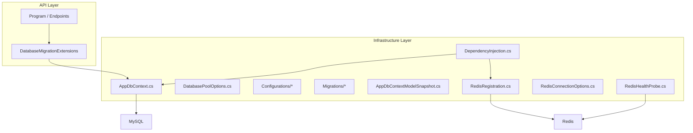
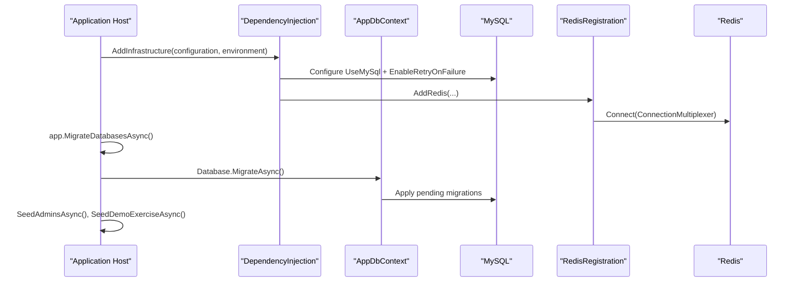
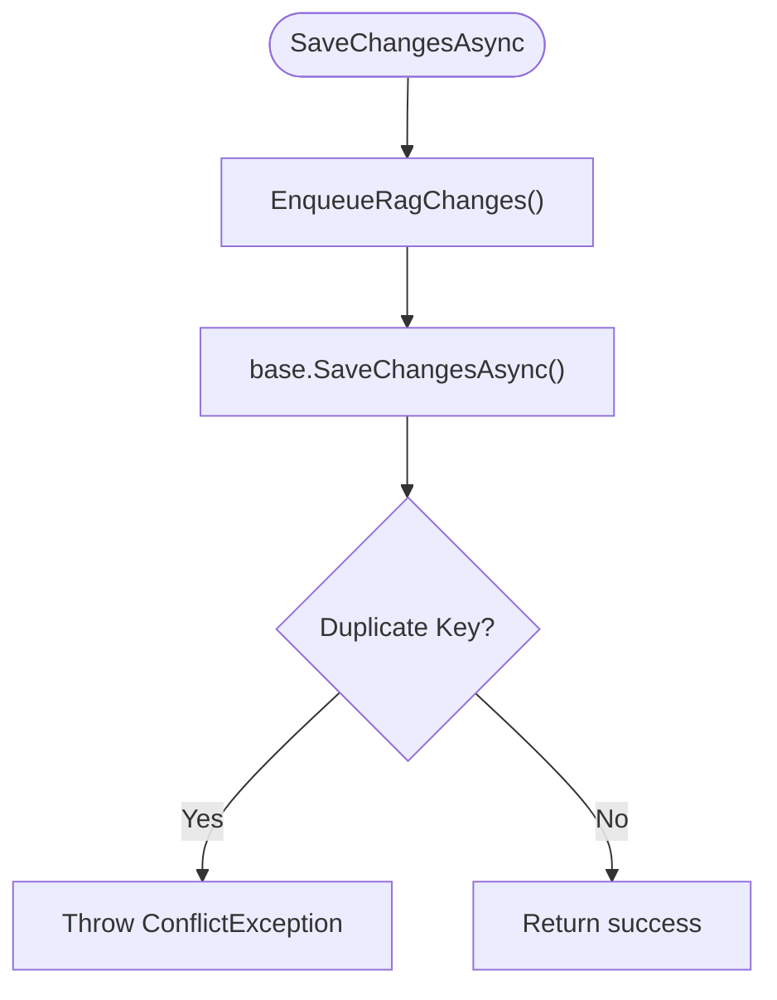
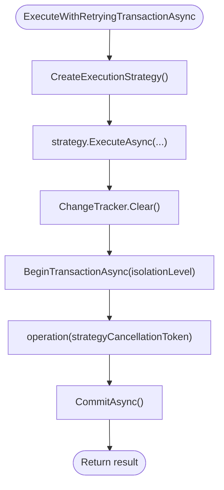
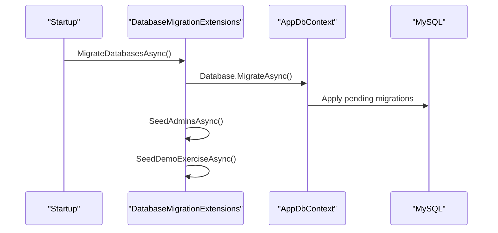
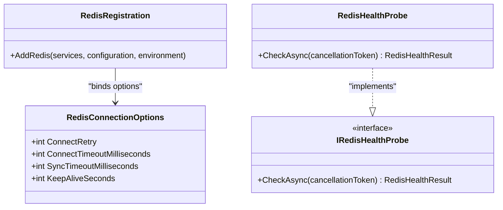
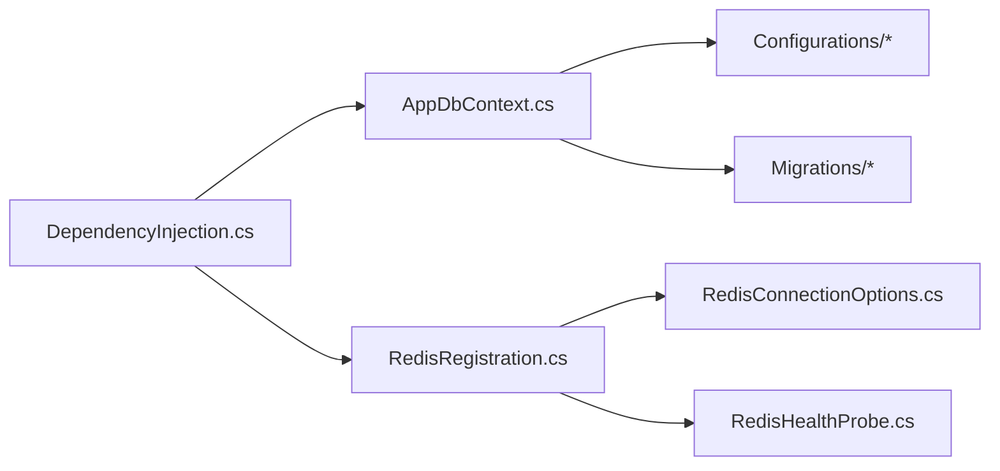

# Database Operations & Configuration

<cite>
**Referenced Files in This Document**
- [AppDbContext.cs](file://api/src/Infrastructure/CodePath.Infrastructure\Persistence\AppDbContext.cs)
- [DatabasePoolOptions.cs](file://api/src/Infrastructure/CodePath.Infrastructure\Persistence\DatabasePoolOptions.cs)
- [DependencyInjection.cs](file://api/src/Infrastructure/CodePath.Infrastructure\DependencyInjection.cs)
- [DatabaseMigrationExtensions.cs](file://api/src/Api/CodePath.Api/Extensions/DatabaseMigrationExtensions.cs)
- [UserConfiguration.cs](file://api/src/Infrastructure/CodePath.Infrastructure\Persistence\Configurations\UserConfiguration.cs)
- [RefreshTokenConfiguration.cs](file://api/src/Infrastructure/CodePath.Infrastructure\Persistence\Configurations\RefreshTokenConfiguration.cs)
- [ExerciseConfiguration.cs](file://api/src/Infrastructure/CodePath.Infrastructure\Persistence\Configurations\ExerciseConfiguration.cs)
- [EnrollmentConfiguration.cs](file://api/src/Infrastructure/CodePath.Infrastructure\Persistence\Configurations\EnrollmentConfiguration.cs)
- [InitialCreate Migration](file://api/src/Infrastructure/CodePath.Infrastructure\Persistence\Migrations\20261005135118_InitialCreate.cs)
- [Model Snapshot](file://api/src/Infrastructure/CodePath.Infrastructure\Persistence\Migrations\AppDbContextModelSnapshot.cs)
- [RedisConnectionOptions.cs](file://api/src/Infrastructure/CodePath.Infrastructure\Redis\RedisConnectionOptions.cs)
- [RedisRegistration.cs](file://api/src/Infrastructure/CodePath.Infrastructure\Redis\RedisRegistration.cs)
- [RedisHealthProbe.cs](file://api/src/Infrastructure/CodePath.Infrastructure\Redis\RedisHealthProbe.cs)
- [IRedisHealthProbe.cs](file://api/src/Application\CodePath.Application\Auth\Abstractions\IRedisHealthProbe.cs)
</cite>

## Table of Contents
1. Introduction
2. Project Structure
3. Core Components
4. Architecture Overview
5. Detailed Component Analysis
6. Dependency Analysis
7. Performance Considerations
8. Troubleshooting Guide
9. Conclusion

## Introduction
This document explains the database operations, Entity Framework Core configuration, and migration strategy for the application. It covers AppDbContext implementation, connection pooling, transaction management, retry strategies, entity mappings, indexes, constraints, migrations, versioning, deployment procedures, performance optimization, Redis caching integration, backup/recovery considerations, scaling, monitoring, and troubleshooting.

## Project Structure
The persistence layer is implemented in the Infrastructure project with EF Core configured against MySQL. The API layer triggers migrations and seeding at startup. Redis is used for caching and distributed state.

**Diagram sources**
- [DependencyInjection.cs:41-114](file://api/src/Infrastructure/CodePath.Infrastructure\DependencyInjection.cs#L41-L114)
- [DatabaseMigrationExtensions.cs:13-42](file://api/src/Api/CodePath.Api/Extensions/DatabaseMigrationExtensions.cs#L13-L42)
- [AppDbContext.cs:357-363](file://api/src/Infrastructure/CodePath.Infrastructure\Persistence\AppDbContext.cs#L357-L363)
- [RedisRegistration.cs:13-69](file://api/src/Infrastructure/CodePath.Infrastructure\Redis\RedisRegistration.cs#L13-L69)

**Section sources**
- [DependencyInjection.cs:41-114](file://api/src/Infrastructure/CodePath.Infrastructure\DependencyInjection.cs#L41-L114)
- [DatabaseMigrationExtensions.cs:13-42](file://api/src/Api/CodePath.Api/Extensions/DatabaseMigrationExtensions.cs#L13-L42)

## Core Components
- AppDbContext: Central EF Core context implementing multiple domain-specific DbContext interfaces; defines DbSets, query methods, SaveChanges overrides, model configuration, and retrying transactions.
- DependencyInjection: Registers MySQL provider, connection string building, pool options, retries, and maps AppDbContext to domain interfaces.
- DatabasePoolOptions: Configurable pool sizing and idle lifetime.
- Configurations: Per-entity EF Core Fluent API configurations defining tables, columns, indexes, constraints, and relationships.
- Migrations and Model Snapshot: Versioned schema changes and current model snapshot.
- Redis Integration: Connection options, registration, and health probe for caching and distributed features.

**Section sources**
- [AppDbContext.cs:18-383](file://api/src/Infrastructure/CodePath.Infrastructure\Persistence\AppDbContext.cs#L18-L383)
- [DependencyInjection.cs:41-114](file://api/src/Infrastructure/CodePath.Infrastructure\DependencyInjection.cs#L41-L114)
- [DatabasePoolOptions.cs:1-10](file://api/src/Infrastructure/CodePath.Infrastructure\Persistence\DatabasePoolOptions.cs#L1-L10)
- [UserConfiguration.cs:1-111](file://api/src/Infrastructure/CodePath.Infrastructure\Persistence\Configurations\UserConfiguration.cs#L1-L111)
- [RefreshTokenConfiguration.cs:1-103](file://api/src/Infrastructure/CodePath.Infrastructure\Persistence\Configurations\RefreshTokenConfiguration.cs#L1-L103)
- [ExerciseConfiguration.cs:1-30](file://api/src/Infrastructure/CodePath.Infrastructure\Persistence\Configurations\ExerciseConfiguration.cs#L1-L30)
- [EnrollmentConfiguration.cs:1-77](file://api/src/Infrastructure/CodePath.Infrastructure\Persistence\Configurations\EnrollmentConfiguration.cs#L1-L77)
- [InitialCreate Migration:1-692](file://api/src/Infrastructure/CodePath.Infrastructure\Persistence\Migrations\20261005135118_InitialCreate.cs#L1-L692)
- [Model Snapshot:1-800](file://api/src/Infrastructure/CodePath.Infrastructure\Persistence\Migrations\AppDbContextModelSnapshot.cs#L1-L800)
- [RedisConnectionOptions.cs:1-11](file://api/src/Infrastructure/CodePath.Infrastructure\Redis\RedisConnectionOptions.cs#L1-L11)
- [RedisRegistration.cs:13-69](file://api/src/Infrastructure/CodePath.Infrastructure\Redis\RedisRegistration.cs#L13-L69)
- [RedisHealthProbe.cs:1-37](file://api/src/Infrastructure/CodePath.Infrastructure\Redis\RedisHealthProbe.cs#L1-L37)
- [IRedisHealthProbe.cs:1-17](file://api/src/Application\CodePath.Application\Auth\Abstractions\IRedisHealthProbe.cs#L1-L17)

## Architecture Overview
The system uses EF Core with MySQL as the primary relational store. AppDbContext implements domain-specific DbContext interfaces to isolate concerns (auth, users, admin, exercises). Migrations are applied at startup via an extension that also seeds initial data. Redis provides caching and distributed primitives, with a dedicated health probe.

**Diagram sources**
- [DependencyInjection.cs:97-106](file://api/src/Infrastructure/CodePath.Infrastructure\DependencyInjection.cs#L97-L106)
- [DatabaseMigrationExtensions.cs:16-42](file://api/src/Api/CodePath.Api/Extensions/DatabaseMigrationExtensions.cs#L16-L42)
- [RedisRegistration.cs:51-69](file://api/src/Infrastructure/CodePath.Infrastructure\Redis\RedisRegistration.cs#L51-L69)

## Detailed Component Analysis

### AppDbContext Implementation
- Implements IAuthDbContext, IUsersDbContext, IAdminDbContext, IExerciseDbContext, INotificationDbContext to provide domain-scoped access.
- Exposes DbSets for core entities across auth, audit, exercises, and users.
- Provides read-only queries using AsNoTracking where appropriate.
- Overrides SaveChangesAsync to translate specific MySQL duplicate key exceptions into domain conflict exceptions.
- OnModelCreating sets charset/collation and applies all EntityTypeConfiguration classes from the assembly.
- Transaction helper ExecuteWithRetryingTransactionAsync wraps operations in a transaction with a configurable isolation level and leverages EF Core execution strategy for transient failure retries.

Key behaviors:
- Refresh token rotation and family revocation use ReadCommitted transactions with atomic updates and activity preservation.
- Password reset token consumption is transactional and invalidates existing sessions atomically.
- Admin operations can run under Serializable isolation when required.

**Diagram sources**
- [AppDbContext.cs:343-355](file://api/src/Infrastructure/CodePath.Infrastructure\Persistence\AppDbContext.cs#L343-L355)

**Section sources**
- [AppDbContext.cs:18-383](file://api/src/Infrastructure/CodePath.Infrastructure\Persistence\AppDbContext.cs#L18-L383)

### Connection String and Provider Configuration
- Connection string resolution supports both standard connection strings and DATABASE_URL, with fallback to explicit Database:* settings if needed.
- MySQL provider configured with ServerVersion 8.4.0, default boolean mapping to TinyInt1, DateTime mapping to DateTime6, and retry-on-failure enabled.
- Migrations history table set to __EFMigrationsHistory.

**Section sources**
- [DependencyInjection.cs:41-61](file://api/src/Infrastructure/CodePath.Infrastructure\DependencyInjection.cs#L41-L61)
- [DependencyInjection.cs:97-106](file://api/src/Infrastructure/CodePath.Infrastructure\DependencyInjection.cs#L97-L106)

### Connection Pooling
- DatabasePoolOptions exposes MinPoolSize, MaxPoolSize, and ConnectionIdleLifetimeSeconds.
- Values are validated and applied to MySqlConnectionStringBuilder before creating the DbContext.
- Defaults include GuidFormat Binary16 and DateTimeKind Utc.

Operational guidance:
- Tune MinPoolSize based on expected concurrency.
- Set MaxPoolSize to cap resource usage.
- Adjust ConnectionIdleLifetimeSeconds to balance connection reuse and server-side timeouts.

**Section sources**
- [DatabasePoolOptions.cs:1-10](file://api/src/Infrastructure/CodePath.Infrastructure\Persistence\DatabasePoolOptions.cs#L1-L10)
- [DependencyInjection.cs:63-95](file://api/src/Infrastructure/CodePath.Infrastructure\DependencyInjection.cs#L63-L95)

### Transaction Management and Retry Strategy
- ExecuteWithRetryingTransactionAsync creates an execution strategy and runs the operation within a transaction with the specified isolation level.
- ChangeTracker is cleared before each attempt to avoid stale state across retries.
- Used by critical flows such as refresh token rotation, session revocation, password reset token replacement/consumption, and admin transactional operations.

**Diagram sources**
- [AppDbContext.cs:365-381](file://api/src/Infrastructure/CodePath.Infrastructure\Persistence\AppDbContext.cs#L365-L381)

**Section sources**
- [AppDbContext.cs:49-84](file://api/src/Infrastructure/CodePath.Infrastructure\Persistence\AppDbContext.cs#L49-L84)
- [AppDbContext.cs:128-158](file://api/src/Infrastructure/CodePath.Infrastructure\Persistence\AppDbContext.cs#L128-L158)
- [AppDbContext.cs:160-230](file://api/src/Infrastructure/CodePath.Infrastructure\Persistence\AppDbContext.cs#L160-L230)
- [AppDbContext.cs:263-266](file://api/src/Infrastructure/CodePath.Infrastructure\Persistence\AppDbContext.cs#L263-L266)
- [AppDbContext.cs:365-381](file://api/src/Infrastructure/CodePath.Infrastructure\Persistence\AppDbContext.cs#L365-L381)

### Entity Mapping, Indexes, and Constraints
Entity configurations define tables, column types, constraints, indexes, and relationships. Examples:

- UserConfiguration:
  - Unique indexes on Email, StudentId, TeacherId.
  - Non-unique indexes on Role, Status, ClassId, FacultyId.
  - Relationships to Class and Faculty with Restrict delete behavior.
  - Collation and type specifications for sensitive fields.

- RefreshTokenConfiguration:
  - Unique index on TokenHash.
  - Composite index on UserId, FamilyId, RevokedAt for active token queries.
  - Index on SessionId, RevokedAt for cleanup.
  - Self-referencing ParentTokenId with SetNull behavior.

- ExerciseConfiguration:
  - Unique index on Slug.
  - Index on IsPublished for filtering published exercises.

- EnrollmentConfiguration:
  - Unique composite index on CourseId, StudentId.
  - Index on StudentId.
  - Decimal precision for scores.

These configurations are automatically applied via modelBuilder.ApplyConfigurationsFromAssembly.

**Section sources**
- [UserConfiguration.cs:1-111](file://api/src/Infrastructure/CodePath.Infrastructure\Persistence\Configurations\UserConfiguration.cs#L1-L111)
- [RefreshTokenConfiguration.cs:1-103](file://api/src/Infrastructure/CodePath.Infrastructure\Persistence\Configurations\RefreshTokenConfiguration.cs#L1-L103)
- [ExerciseConfiguration.cs:1-30](file://api/src/Infrastructure/CodePath.Infrastructure\Persistence\Configurations\ExerciseConfiguration.cs#L1-L30)
- [EnrollmentConfiguration.cs:1-77](file://api/src/Infrastructure/CodePath.Infrastructure\Persistence\Configurations\EnrollmentConfiguration.cs#L1-L77)
- [AppDbContext.cs:357-363](file://api/src/Infrastructure/CodePath.Infrastructure\Persistence\AppDbContext.cs#L357-L363)

### Migration Approach, Versioning, and Deployment
- Migrations are stored under Persistence/Migrations and include both .cs files and Designer.cs snapshots.
- The initial migration creates core tables and indexes; subsequent migrations add features like teacher portal, class management, lecture delivery, and RAG outbox/drafts.
- At startup, DatabaseMigrationExtensions calls dbContext.Database.MigrateAsync() and then seeds admin accounts and demo exercise data.
- The model snapshot captures the current EF model for migration diffing.

Deployment procedure:
- Ensure DATABASE_URL or ConnectionStrings:Database is configured.
- Ensure Redis connection is configured for non-development environments.
- Start the API host; migrations will be applied automatically during startup.
- Verify health endpoints for MySQL and Redis.

**Diagram sources**
- [DatabaseMigrationExtensions.cs:13-42](file://api/src/Api/CodePath.Api/Extensions/DatabaseMigrationExtensions.cs#L13-L42)

**Section sources**
- [DatabaseMigrationExtensions.cs:13-42](file://api/src/Api/CodePath.Api/Extensions/DatabaseMigrationExtensions.cs#L13-L42)
- [InitialCreate Migration:1-692](file://api/src/Infrastructure/CodePath.Infrastructure\Persistence\Migrations\20261005135118_InitialCreate.cs#L1-L692)
- [Model Snapshot:1-800](file://api/src/Infrastructure/CodePath.Infrastructure\Persistence\Migrations\AppDbContextModelSnapshot.cs#L1-L800)

### Redis Integration and Caching Strategy
- RedisConnectionOptions configures connect retry, connect timeout, sync timeout, and keep-alive.
- RedisRegistration binds options, validates ranges, constructs ConfigurationOptions, enforces authentication outside development/testing, and registers IConnectionMultiplexer as a singleton.
- RedisHealthProbe performs a round-trip write/read/delete test and reports latency and connectivity status.
- Application services depend on IRedisHealthProbe to make decisions without coupling to StackExchange.Redis.

**Diagram sources**
- [RedisConnectionOptions.cs:1-11](file://api/src/Infrastructure/CodePath.Infrastructure\Redis\RedisConnectionOptions.cs#L1-L11)
- [RedisRegistration.cs:13-69](file://api/src/Infrastructure/CodePath.Infrastructure\Redis\RedisRegistration.cs#L13-L69)
- [RedisHealthProbe.cs:1-37](file://api/src/Infrastructure/CodePath.Infrastructure\Redis\RedisHealthProbe.cs#L1-L37)
- [IRedisHealthProbe.cs:1-17](file://api/src/Application\CodePath.Application\Auth\Abstractions\IRedisHealthProbe.cs#L1-L17)

**Section sources**
- [RedisConnectionOptions.cs:1-11](file://api/src/Infrastructure/CodePath.Infrastructure\Redis\RedisConnectionOptions.cs#L1-L11)
- [RedisRegistration.cs:13-69](file://api/src/Infrastructure/CodePath.Infrastructure\Redis\RedisRegistration.cs#L13-L69)
- [RedisHealthProbe.cs:1-37](file://api/src/Infrastructure/CodePath.Infrastructure\Redis\RedisHealthProbe.cs#L1-L37)
- [IRedisHealthProbe.cs:1-17](file://api/src/Application\CodePath.Application\Auth\Abstractions\IRedisHealthProbe.cs#L1-L17)

## Dependency Analysis
- AppDbContext depends on domain entities and EF Core APIs.
- DependencyInjection wires MySQL provider, pool options, and Redis infrastructure.
- Configurations are discovered automatically by AppDbContext.OnModelCreating.
- Migrations are independent artifacts consumed by Database.MigrateAsync.

**Diagram sources**
- [DependencyInjection.cs:97-114](file://api/src/Infrastructure/CodePath.Infrastructure\DependencyInjection.cs#L97-L114)
- [AppDbContext.cs:357-363](file://api/src/Infrastructure/CodePath.Infrastructure\Persistence\AppDbContext.cs#L357-L363)
- [RedisRegistration.cs:13-69](file://api/src/Infrastructure/CodePath.Infrastructure\Redis\RedisRegistration.cs#L13-L69)

**Section sources**
- [DependencyInjection.cs:97-114](file://api/src/Infrastructure/CodePath.Infrastructure\DependencyInjection.cs#L97-L114)
- [AppDbContext.cs:357-363](file://api/src/Infrastructure/CodePath.Infrastructure\Persistence\AppDbContext.cs#L357-L363)

## Performance Considerations
- Connection pooling:
  - Set MinPoolSize to reduce cold-start latency under load.
  - Cap MaxPoolSize to prevent overloading the database.
  - Tune ConnectionIdleLifetimeSeconds to match DBA policies and avoid idle connection drops.
- Query patterns:
  - Prefer AsNoTracking for read-only queries to reduce change tracking overhead.
  - Use targeted includes and projection to minimize payload size.
- Transactions:
  - Use appropriate isolation levels; Serializable is available for strict consistency scenarios but may increase contention.
  - Keep transactions short and focused to reduce lock duration.
- Indexing:
  - Ensure composite indexes match common filter/order patterns (e.g., user email, student_id, course_id).
  - Avoid redundant or overly broad indexes that slow writes.
- Retries:
  - Enable retry-on-failure for transient network/database issues.
  - Wrap idempotent operations in retry-aware transactions.
- Redis:
  - Use Redis for high-frequency reads and distributed locks/rate limits.
  - Monitor latency and round-trip success via RedisHealthProbe.

[No sources needed since this section provides general guidance]

## Troubleshooting Guide
Common issues and resolutions:
- Duplicate key errors:
  - SaveChangesAsync translates MySQL duplicate key exceptions into domain conflict exceptions. Check unique constraints on Email, StudentId, TeacherId, and other indexed fields.
- Migration failures:
  - Review logs from DatabaseMigrationExtensions; ensure DATABASE_URL or ConnectionStrings:Database is correct and credentials are valid.
- Connection pool exhaustion:
  - Increase MaxPoolSize or optimize long-running transactions; monitor connection counts.
- Redis connectivity:
  - Validate RedisConnectionOptions and connection string; ensure password is provided outside development.
  - Use RedisHealthProbe to detect connectivity and round-trip failures.

**Section sources**
- [AppDbContext.cs:343-355](file://api/src/Infrastructure/CodePath.Infrastructure\Persistence\AppDbContext.cs#L343-L355)
- [DatabaseMigrationExtensions.cs:37-42](file://api/src/Api/CodePath.Api/Extensions/DatabaseMigrationExtensions.cs#L37-L42)
- [RedisRegistration.cs:51-69](file://api/src/Infrastructure/CodePath.Infrastructure\Redis\RedisRegistration.cs#L51-L69)
- [RedisHealthProbe.cs:16-37](file://api/src/Infrastructure/CodePath.Infrastructure\Redis\RedisHealthProbe.cs#L16-L37)

## Conclusion
The application’s database layer centers around a well-structured AppDbContext with clear separation of concerns through domain-specific interfaces. EF Core is configured for MySQL with robust retry semantics, while connection pooling is tunable via DatabasePoolOptions. Entity mappings and indexes are explicitly defined for performance and integrity. Migrations are applied at startup with optional seeding, and Redis provides caching and distributed capabilities with a health probe. By tuning pooling, indexing, and transaction scopes, and by leveraging Redis strategically, the system achieves reliable, scalable, and maintainable data operations.

[No sources needed since this section summarizes without analyzing specific files]