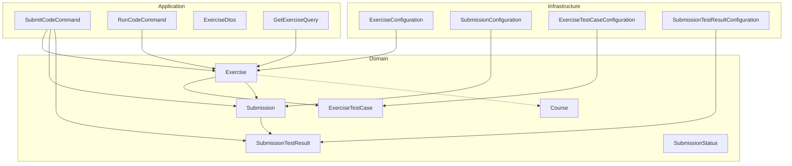
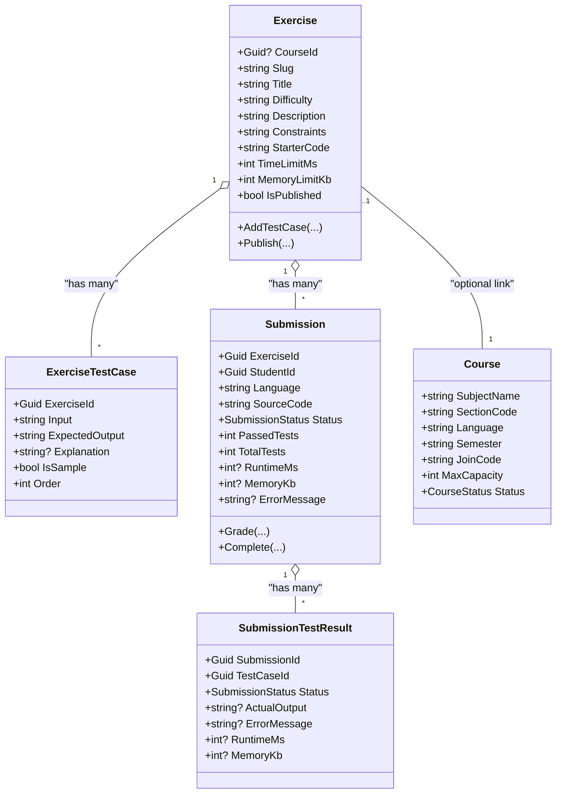
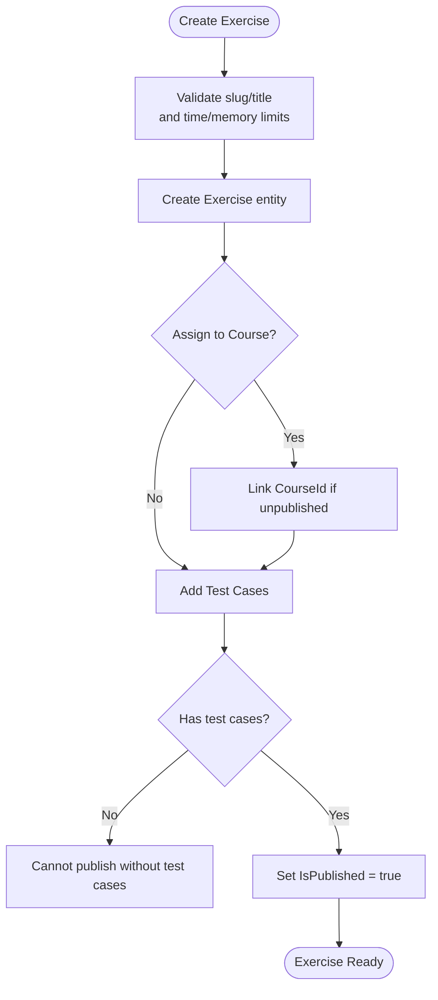
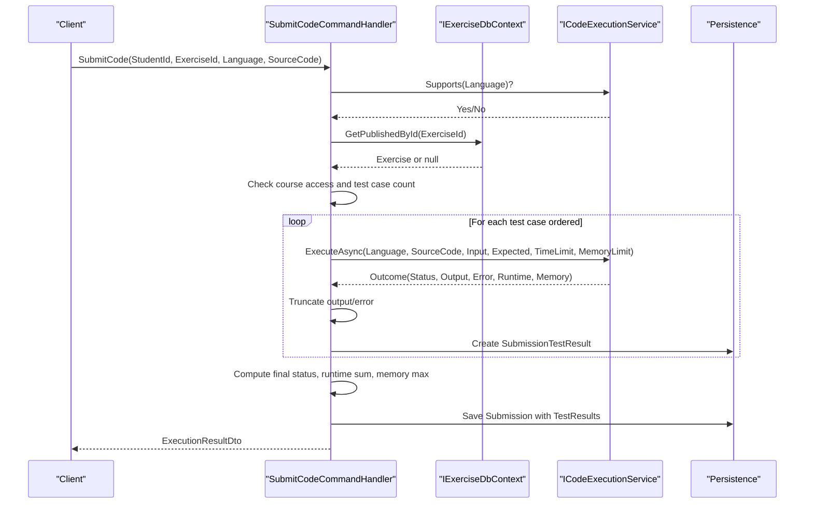
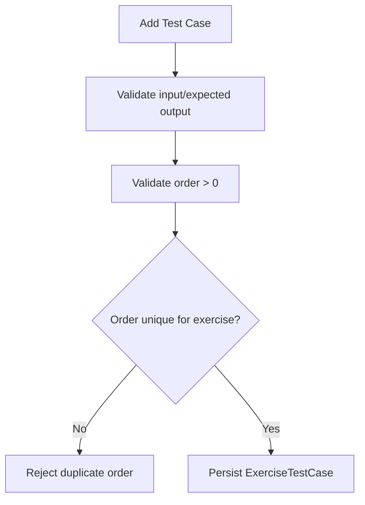
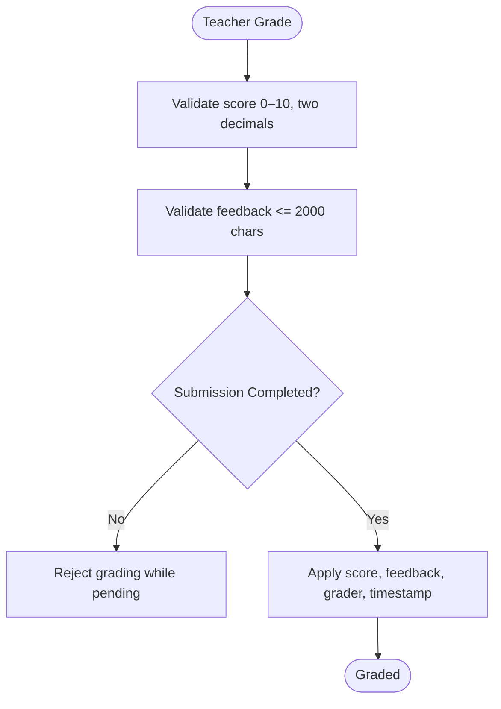
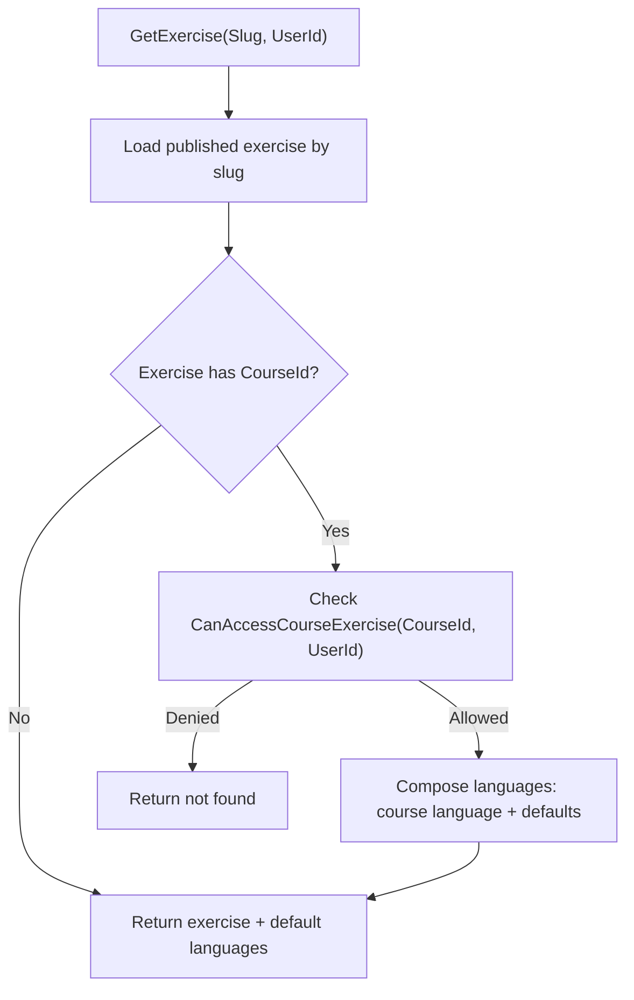
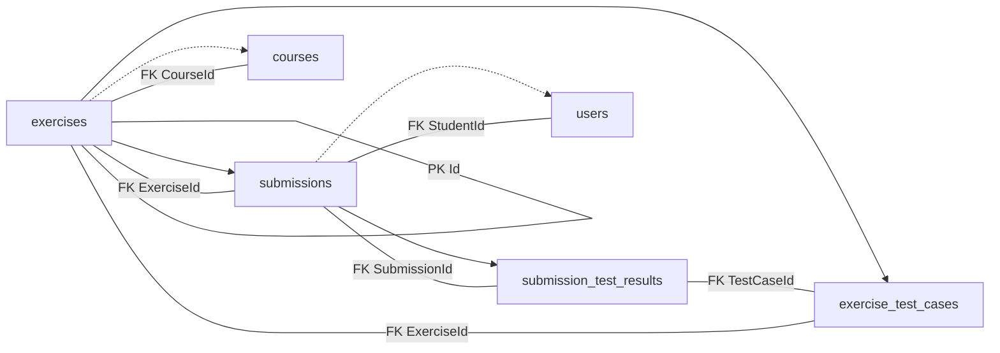

# Learning & Exercise Entities

<cite>
**Referenced Files in This Document**
- [Exercise.cs](file://api/src/Domain/CodePath.Domain/Exercises/Entities/Exercise.cs)
- [Submission.cs](file://api/src/Domain/CodePath.Domain/Exercises/Entities/Submission.cs)
- [ExerciseTestCase.cs](file://api/src/Domain/CodePath.Domain/Exercises/Entities/ExerciseTestCase.cs)
- [SubmissionTestResult.cs](file://api/src/Domain/CodePath.Domain/Exercises/Entities/SubmissionTestResult.cs)
- [SubmissionStatus.cs](file://api/src/Domain/CodePath.Domain/Exercises/Enums/SubmissionStatus.cs)
- [ExerciseConfiguration.cs](file://api/src/Infrastructure/CodePath.Infrastructure/Persistence/Configurations/ExerciseConfiguration.cs)
- [SubmissionConfiguration.cs](file://api/src/Infrastructure/CodePath.Infrastructure/Persistence/Configurations/SubmissionConfiguration.cs)
- [ExerciseTestCaseConfiguration.cs](file://api/src/Infrastructure/CodePath.Infrastructure/Persistence/Configurations/ExerciseTestCaseConfiguration.cs)
- [SubmissionTestResultConfiguration.cs](file://api/src/Infrastructure/CodePath.Infrastructure/Persistence/Configurations/SubmissionTestResultConfiguration.cs)
- [SubmitCodeCommand.cs](file://api/src/Application/CodePath.Application/Exercises/Commands/SubmitCodeCommand.cs)
- [RunCodeCommand.cs](file://api/src/Application/CodePath.Application/Exercises/Commands/RunCodeCommand.cs)
- [ExerciseDtos.cs](file://api/src/Application/CodePath.Application/Exercises/Dtos/ExerciseDtos.cs)
- [GetExerciseQuery.cs](file://api/src/Application/CodePath.Application/Exercises/Queries/GetExerciseQuery.cs)
- [Course.cs](file://api/src/Domain/CodePath.Domain/Users/Entities/Course.cs)
</cite>

## Table of Contents
1. Introduction
2. Project Structure
3. Core Components
4. Architecture Overview
5. Detailed Component Analysis
6. Dependency Analysis
7. Performance Considerations
8. Troubleshooting Guide
9. Conclusion

## Introduction
This document provides detailed data model documentation for learning and exercise-related entities: Exercise, Submission, ExerciseTestCase, and SubmissionTestResult. It explains the exercise lifecycle from creation to evaluation, test case management, submission processing workflow, relationships with courses, grading mechanisms, validation rules, result storage formats, and performance considerations for large-scale code execution scenarios.

## Project Structure
The relevant implementation spans three layers:
- Domain layer defines entities and business rules.
- Application layer implements commands and queries that orchestrate workflows.
- Infrastructure layer configures persistence mappings and database schema.

**Diagram sources**
- [Exercise.cs:6-30](file://api/src/Domain/CodePath.Domain/Exercises/Entities/Exercise.cs#L6-L30)
- [ExerciseTestCase.cs:6-14](file://api/src/Domain/CodePath.Domain/Exercises/Entities/ExerciseTestCase.cs#L6-L14)
- [Submission.cs:6-38](file://api/src/Domain/CodePath.Domain/Exercises/Entities/Submission.cs#L6-L38)
- [SubmissionTestResult.cs:6-16](file://api/src/Domain/CodePath.Domain/Exercises/Entities/SubmissionTestResult.cs#L6-L16)
- [SubmissionStatus.cs:3-12](file://api/src/Domain/CodePath.Domain/Exercises/Enums/SubmissionStatus.cs#L3-L12)
- [Course.cs:7-20](file://api/src/Domain/CodePath.Domain/Users/Entities/Course.cs#L7-L20)
- [SubmitCodeCommand.cs:11-31](file://api/src/Application/CodePath.Application/Exercises/Commands/SubmitCodeCommand.cs#L11-L31)
- [RunCodeCommand.cs:10-25](file://api/src/Application/CodePath.Application/Exercises/Commands/RunCodeCommand.cs#L10-L25)
- [ExerciseDtos.cs:3-36](file://api/src/Application/CodePath.Application/Exercises/Dtos/ExerciseDtos.cs#L3-L36)
- [GetExerciseQuery.cs:8-14](file://api/src/Application/CodePath.Application/Exercises/Queries/GetExerciseQuery.cs#L8-L14)
- [ExerciseConfiguration.cs:7-27](file://api/src/Infrastructure/CodePath.Infrastructure/Persistence/Configurations/ExerciseConfiguration.cs#L7-L27)
- [SubmissionConfiguration.cs:7-31](file://api/src/Infrastructure/CodePath.Infrastructure/Persistence/Configurations/SubmissionConfiguration.cs#L7-L31)
- [ExerciseTestCaseConfiguration.cs:7-25](file://api/src/Infrastructure/CodePath.Infrastructure/Persistence/Configurations/ExerciseTestCaseConfiguration.cs#L7-L25)
- [SubmissionTestResultConfiguration.cs:7-27](file://api/src/Infrastructure/CodePath.Infrastructure/Persistence/Configurations/SubmissionTestResultConfiguration.cs#L7-L27)

**Section sources**
- [Exercise.cs:6-30](file://api/src/Domain/CodePath.Domain/Exercises/Entities/Exercise.cs#L6-L30)
- [Submission.cs:6-38](file://api/src/Domain/CodePath.Domain/Exercises/Entities/Submission.cs#L6-L38)
- [ExerciseTestCase.cs:6-14](file://api/src/Domain/CodePath.Domain/Exercises/Entities/ExerciseTestCase.cs#L6-L14)
- [SubmissionTestResult.cs:6-16](file://api/src/Domain/CodePath.Domain/Exercises/Entities/SubmissionTestResult.cs#L6-L16)
- [ExerciseConfiguration.cs:7-27](file://api/src/Infrastructure/CodePath.Infrastructure/Persistence/Configurations/ExerciseConfiguration.cs#L7-L27)
- [SubmissionConfiguration.cs:7-31](file://api/src/Infrastructure/CodePath.Infrastructure/Persistence/Configurations/SubmissionConfiguration.cs#L7-L31)
- [ExerciseTestCaseConfiguration.cs:7-25](file://api/src/Infrastructure/CodePath.Infrastructure/Persistence/Configurations/ExerciseTestCaseConfiguration.cs#L7-L25)
- [SubmissionTestResultConfiguration.cs:7-27](file://api/src/Infrastructure/CodePath.Infrastructure/Persistence/Configurations/SubmissionTestResultConfiguration.cs#L7-L27)

## Core Components
- Exercise: Represents a coding problem with metadata, constraints, starter code, time/memory limits, and collections of test cases and submissions. Supports assignment to a course and publishing only when test cases exist.
- ExerciseTestCase: Defines input/output pairs, optional explanation, sample flag, and ordering within an exercise.
- Submission: Records a student’s source code attempt against an exercise, including status, runtime/memory metrics, error messages, and per-test results. Supports manual teacher grading.
- SubmissionTestResult: Stores per-test execution outcomes linked to both the submission and the corresponding test case.
- SubmissionStatus: Enumerates possible states such as Pending, Accepted, WrongAnswer, CompilationError, RuntimeError, TimeLimitExceeded, SystemError.

Key behaviors:
- Exercise.Create enforces non-empty slug/title and validates time/memory limits.
- Exercise.Publish requires at least one test case.
- Exercise.AddTestCase enforces unique order per exercise.
- Submission.Create initializes pending state and audit fields.
- Submission.Complete aggregates per-test results into overall status and metrics.
- Submission.Grade enforces score range, precision, feedback length, and prevents grading while pending.

**Section sources**
- [Exercise.cs:34-90](file://api/src/Domain/CodePath.Domain/Exercises/Entities/Exercise.cs#L34-L90)
- [ExerciseTestCase.cs:18-46](file://api/src/Domain/CodePath.Domain/Exercises/Entities/ExerciseTestCase.cs#L18-L46)
- [Submission.cs:42-76](file://api/src/Domain/CodePath.Domain/Exercises/Entities/Submission.cs#L42-L76)
- [SubmissionTestResult.cs:20-43](file://api/src/Domain/CodePath.Domain/Exercises/Entities/SubmissionTestResult.cs#L20-L43)
- [SubmissionStatus.cs:3-12](file://api/src/Domain/CodePath.Domain/Exercises/Enums/SubmissionStatus.cs#L3-L12)

## Architecture Overview
The system follows a layered architecture:
- Domain entities encapsulate business rules and invariants.
- Application commands handle use cases (run vs submit), enforce validation, interact with the code execution service, and persist domain objects.
- Infrastructure EF Core configurations define table names, column types, indexes, and relationships.

**Diagram sources**
- [Exercise.cs:6-30](file://api/src/Domain/CodePath.Domain/Exercises/Entities/Exercise.cs#L6-L30)
- [ExerciseTestCase.cs:6-14](file://api/src/Domain/CodePath.Domain/Exercises/Entities/ExerciseTestCase.cs#L6-L14)
- [Submission.cs:6-38](file://api/src/Domain/CodePath.Domain/Exercises/Entities/Submission.cs#L6-L38)
- [SubmissionTestResult.cs:6-16](file://api/src/Domain/CodePath.Domain/Exercises/Entities/SubmissionTestResult.cs#L6-L16)
- [Course.cs:7-20](file://api/src/Domain/CodePath.Domain/Users/Entities/Course.cs#L7-L20)

## Detailed Component Analysis

### Exercise Lifecycle and Relationships
Lifecycle highlights:
- Creation: Exercise.Create validates required fields and resource limits; sets timestamps.
- Assignment: AssignToCourse binds an unpublished exercise to a course once.
- Test Case Management: AddTestCase ensures unique order and creates associated test cases.
- Publishing: Publish requires at least one test case before enabling the exercise.

Relationships:
- Optional link to Course via CourseId.
- One-to-many relationships with ExerciseTestCase and Submission.

Validation rules:
- Slug and title are required.
- Time limit must be between 100 and 15000 ms.
- Memory limit must be between 16 MB and 1 GB.
- Test case order uniqueness per exercise.
- Publishing requires at least one test case.

Database mapping:
- Table: exercises
- Columns include slug, title, difficulty, description, constraints, starter code, timestamps, and published flag.
- Unique index on slug; index on IsPublished.
- Foreign key to Course with restrictive delete behavior.

**Diagram sources**
- [Exercise.cs:34-90](file://api/src/Domain/CodePath.Domain/Exercises/Entities/Exercise.cs#L34-L90)
- [ExerciseConfiguration.cs:11-27](file://api/src/Infrastructure/CodePath.Infrastructure/Persistence/Configurations/ExerciseConfiguration.cs#L11-L27)

**Section sources**
- [Exercise.cs:11-90](file://api/src/Domain/CodePath.Domain/Exercises/Entities/Exercise.cs#L11-L90)
- [ExerciseConfiguration.cs:11-27](file://api/src/Infrastructure/CodePath.Infrastructure/Persistence/Configurations/ExerciseConfiguration.cs#L11-L27)

### Submission Processing Workflow
Two primary flows:
- Run Code: Executes sample test cases or custom input without persisting a submission. Returns immediate results.
- Submit Code: Executes all test cases, persists a Submission with per-test results, and returns aggregated results.

Common steps:
- Validate command inputs (language, source code size).
- Resolve published exercise and enforce course access control.
- Execute tests via ICodeExecutionService with exercise-defined limits.
- Truncate outputs/errors to bounded lengths.
- Aggregate per-test results into overall status and metrics.

Submission-specific details:
- Creates Submission in Pending state.
- Iterates test cases by order, records SubmissionTestResult per test.
- Stops early on compilation/system errors.
- Computes final status, total runtime (sum), peak memory (max), and first error message.
- Persists submission and returns ExecutionResultDto.

**Diagram sources**
- [SubmitCodeCommand.cs:36-100](file://api/src/Application/CodePath.Application/Exercises/Commands/SubmitCodeCommand.cs#L36-L100)
- [Submission.cs:42-76](file://api/src/Domain/CodePath.Domain/Exercises/Entities/Submission.cs#L42-L76)
- [SubmissionTestResult.cs:20-43](file://api/src/Domain/CodePath.Domain/Exercises/Entities/SubmissionTestResult.cs#L20-L43)

**Section sources**
- [SubmitCodeCommand.cs:17-100](file://api/src/Application/CodePath.Application/Exercises/Commands/SubmitCodeCommand.cs#L17-L100)
- [RunCodeCommand.cs:16-76](file://api/src/Application/CodePath.Application/Exercises/Commands/RunCodeCommand.cs#L16-L76)
- [ExerciseDtos.cs:18-36](file://api/src/Application/CodePath.Application/Exercises/Dtos/ExerciseDtos.cs#L18-L36)

### Test Case Management
- ExerciseTestCase stores input, expected output, optional explanation, sample flag, and order.
- Validation enforces non-empty input/expected output and positive order.
- Database enforces unique order per exercise via composite unique index.

**Diagram sources**
- [ExerciseTestCase.cs:18-46](file://api/src/Domain/CodePath.Domain/Exercises/Entities/ExerciseTestCase.cs#L18-L46)
- [ExerciseTestCaseConfiguration.cs:21-24](file://api/src/Infrastructure/CodePath.Infrastructure/Persistence/Configurations/ExerciseTestCaseConfiguration.cs#L21-L24)

**Section sources**
- [ExerciseTestCase.cs:18-46](file://api/src/Domain/CodePath.Domain/Exercises/Entities/ExerciseTestCase.cs#L18-L46)
- [ExerciseTestCaseConfiguration.cs:11-24](file://api/src/Infrastructure/CodePath.Infrastructure/Persistence/Configurations/ExerciseTestCaseConfiguration.cs#L11-L24)

### Grading Mechanisms
- Teacher can grade a completed submission with a score (0–10, two decimal places) and optional feedback (up to 2000 characters).
- Grading is not allowed while the submission is still Pending.
- Grading updates audit fields (GradedBy, GradedAt) and touches updated metadata.

**Diagram sources**
- [Submission.cs:13-25](file://api/src/Domain/CodePath.Domain/Exercises/Entities/Submission.cs#L13-L25)

**Section sources**
- [Submission.cs:13-25](file://api/src/Domain/CodePath.Domain/Exercises/Entities/Submission.cs#L13-L25)

### Data Validation Rules
- Command-level validation:
  - SubmitCodeCommand: StudentId/ExerciseId required; Language max 32; SourceCode max 100,000.
  - RunCodeCommand: ExerciseId required; Language max 32; SourceCode max 100,000; CustomInput max 20,000.
- Domain-level validation:
  - Exercise.Create: Slug/title required; time limit 100–15000 ms; memory limit 16 MB–1 GB.
  - ExerciseTestCase.Create: Non-empty input/expected output; order > 0.
  - Submission.Grade: Score 0–10 with two decimals; feedback ≤ 2000 chars; cannot grade pending.
- Result truncation:
  - Standard output and error messages truncated to 16,384 characters before storage.

**Section sources**
- [SubmitCodeCommand.cs:17-25](file://api/src/Application/CodePath.Application/Exercises/Commands/SubmitCodeCommand.cs#L17-L25)
- [RunCodeCommand.cs:16-24](file://api/src/Application/CodePath.Application/Exercises/Commands/RunCodeCommand.cs#L16-L24)
- [Exercise.cs:45-50](file://api/src/Domain/CodePath.Domain/Exercises/Entities/Exercise.cs#L45-L50)
- [ExerciseTestCase.cs:27-32](file://api/src/Domain/CodePath.Domain/Exercises/Entities/ExerciseTestCase.cs#L27-L32)
- [Submission.cs:13-25](file://api/src/Domain/CodePath.Domain/Exercises/Entities/Submission.cs#L13-L25)
- [SubmitCodeCommand.cs:103-106](file://api/src/Application/CodePath.Application/Exercises/Commands/SubmitCodeCommand.cs#L103-L106)

### Result Storage Formats
- SubmissionTestResult fields:
  - SubmissionId, TestCaseId, Status, ActualOutput, ErrorMessage, RuntimeMs, MemoryKb.
- Submission aggregate fields:
  - PassedTests, TotalTests, RuntimeMs (sum across tests), MemoryKb (max across tests), ErrorMessage (first non-null).
- API response DTOs:
  - ExecutionResultDto includes SubmissionId, Status, PassedTests, TotalTests, RuntimeMs, MemoryKb, and list of TestCaseResultDto.
  - TestCaseResultDto includes TestCaseId, Order, Status, Input, ExpectedOutput, ActualOutput, ErrorMessage, RuntimeMs, MemoryKb.

**Section sources**
- [SubmissionTestResult.cs:8-16](file://api/src/Domain/CodePath.Domain/Exercises/Entities/SubmissionTestResult.cs#L8-L16)
- [Submission.cs:31-38](file://api/src/Domain/CodePath.Domain/Exercises/Entities/Submission.cs#L31-L38)
- [ExerciseDtos.cs:18-36](file://api/src/Application/CodePath.Application/Exercises/Dtos/ExerciseDtos.cs#L18-L36)

### Relationship Between Exercises and Courses
- Exercise optionally links to Course via CourseId.
- Access control checks ensure students can only access exercises tied to courses they are enrolled in.
- Query handler composes supported languages based on course language plus default set.

**Diagram sources**
- [GetExerciseQuery.cs:15-38](file://api/src/Application/CodePath.Application/Exercises/Queries/GetExerciseQuery.cs#L15-L38)
- [Exercise.cs:8-10](file://api/src/Domain/CodePath.Domain/Exercises/Entities/Exercise.cs#L8-L10)

**Section sources**
- [GetExerciseQuery.cs:15-38](file://api/src/Application/CodePath.Application/Exercises/Queries/GetExerciseQuery.cs#L15-L38)
- [Exercise.cs:8-10](file://api/src/Domain/CodePath.Domain/Exercises/Entities/Exercise.cs#L8-L10)

## Dependency Analysis
Entity relationships and persistence mappings:
- Exercise → ExerciseTestCase: One-to-many, cascade delete on test cases.
- Exercise → Submission: One-to-many, restrict delete on exercise.
- Submission → SubmissionTestResult: One-to-many, cascade delete on test results.
- Submission → User (Student): Many-to-one, restrict delete.
- Exercise → Course: Optional link, restrict delete.

Indexes and constraints:
- exercises.Slug unique index.
- exercises.IsPublished index.
- exercise_test_cases.ExerciseId+Order unique index.
- submission_test_results.SubmissionId+TestCaseId unique index.
- submissions.StudentId+ExerciseId+CreatedAt composite index.

**Diagram sources**
- [ExerciseConfiguration.cs:11-27](file://api/src/Infrastructure/CodePath.Infrastructure/Persistence/Configurations/ExerciseConfiguration.cs#L11-L27)
- [ExerciseTestCaseConfiguration.cs:21-24](file://api/src/Infrastructure/CodePath.Infrastructure/Persistence/Configurations/ExerciseTestCaseConfiguration.cs#L21-L24)
- [SubmissionConfiguration.cs:25-30](file://api/src/Infrastructure/CodePath.Infrastructure/Persistence/Configurations/SubmissionConfiguration.cs#L25-L30)
- [SubmissionTestResultConfiguration.cs:21-26](file://api/src/Infrastructure/CodePath.Infrastructure/Persistence/Configurations/SubmissionTestResultConfiguration.cs#L21-L26)

**Section sources**
- [ExerciseConfiguration.cs:11-27](file://api/src/Infrastructure/CodePath.Infrastructure/Persistence/Configurations/ExerciseConfiguration.cs#L11-L27)
- [ExerciseTestCaseConfiguration.cs:21-24](file://api/src/Infrastructure/CodePath.Infrastructure/Persistence/Configurations/ExerciseTestCaseConfiguration.cs#L21-L24)
- [SubmissionConfiguration.cs:25-30](file://api/src/Infrastructure/CodePath.Infrastructure/Persistence/Configurations/SubmissionConfiguration.cs#L25-L30)
- [SubmissionTestResultConfiguration.cs:21-26](file://api/src/Infrastructure/CodePath.Infrastructure/Persistence/Configurations/SubmissionTestResultConfiguration.cs#L21-L26)

## Performance Considerations
- Test case execution limits:
  - Maximum 50 test cases per submission to prevent unsafe execution loads.
  - Time and memory limits enforced per exercise; execution service respects these bounds.
- Output storage limits:
  - Standard output and error messages truncated to 16,384 characters to avoid excessive storage.
- Aggregation strategy:
  - RuntimeMs summed across test results; MemoryKb taken as maximum across test results.
- Indexing:
  - Composite index on submissions(StudentId, ExerciseId, CreatedAt) supports efficient queries for student history and leaderboard-like operations.
- Early termination:
  - Execution stops on CompilationError or SystemError to reduce unnecessary work.
- Large-scale scenarios:
  - Consider batching submissions, rate limiting per student/exercise, and scaling the code execution service horizontally.
  - Monitor memory usage per test and consider isolating executions to prevent cross-test interference.

[No sources needed since this section provides general guidance]

## Troubleshooting Guide
Common issues and resolutions:
- Language not supported:
  - Ensure the selected language is supported by the execution service.
- Exercise not found or inaccessible:
  - Verify the exercise is published and the user has access to the associated course.
- Too many test cases:
  - Reduce the number of test cases per exercise to stay within the safe limit.
- Grading failures:
  - Confirm the submission is completed (not pending) and the score/feedback meet validation rules.
- Excessive output size:
  - Outputs are truncated; review logic generating large outputs and optimize accordingly.

**Section sources**
- [SubmitCodeCommand.cs:38-46](file://api/src/Application/CodePath.Application/Exercises/Commands/SubmitCodeCommand.cs#L38-L46)
- [RunCodeCommand.cs:34-39](file://api/src/Application/CodePath.Application/Exercises/Commands/RunCodeCommand.cs#L34-L39)
- [Submission.cs:13-25](file://api/src/Domain/CodePath.Domain/Exercises/Entities/Submission.cs#L13-L25)

## Conclusion
The learning and exercise subsystem models a robust pipeline for creating exercises, managing test cases, executing code safely, and recording detailed submission results. Domain validations and infrastructure mappings ensure data integrity, while application commands orchestrate secure and efficient workflows. The design supports course-linked exercises, granular test execution, and teacher grading, with clear boundaries for performance and scalability.

[No sources needed since this section summarizes without analyzing specific files]