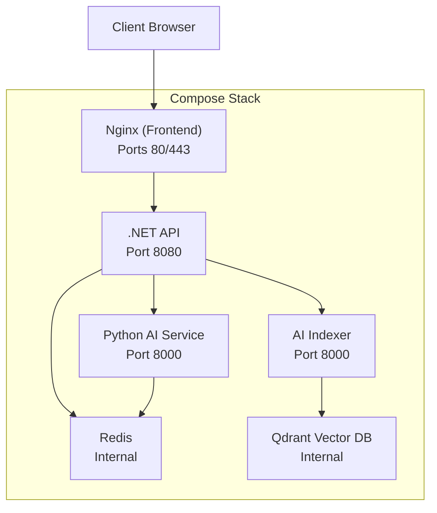
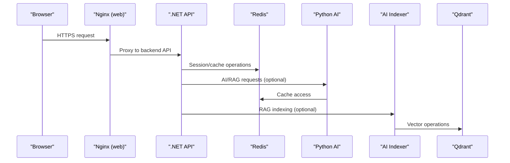
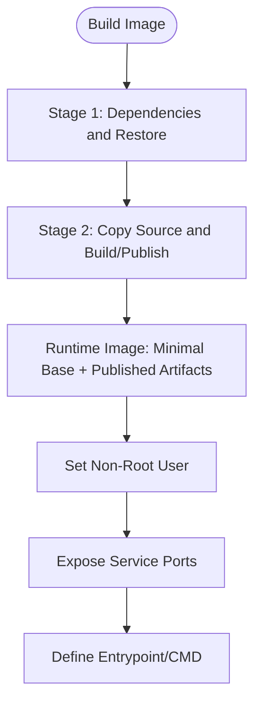
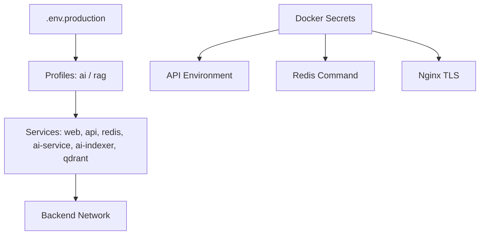
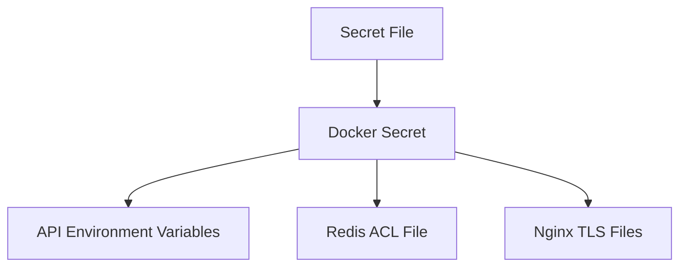
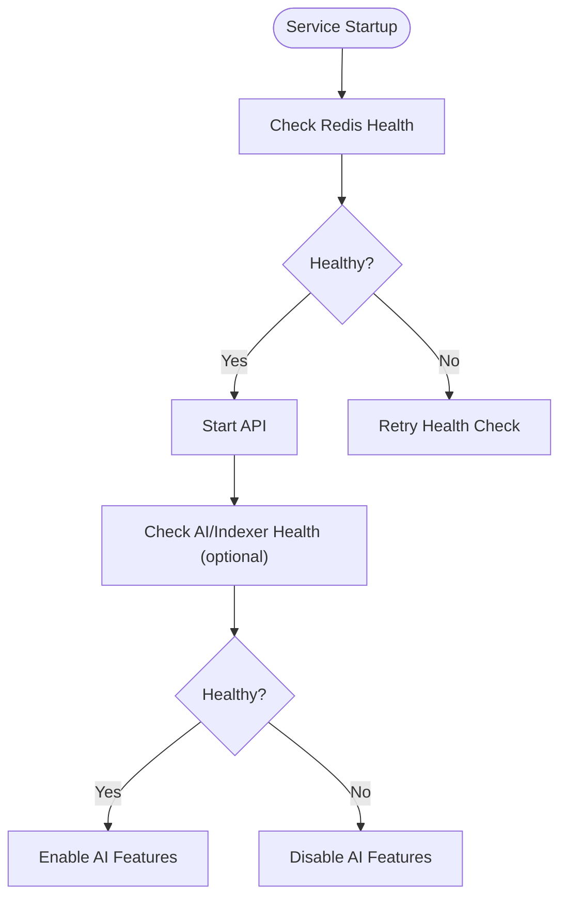
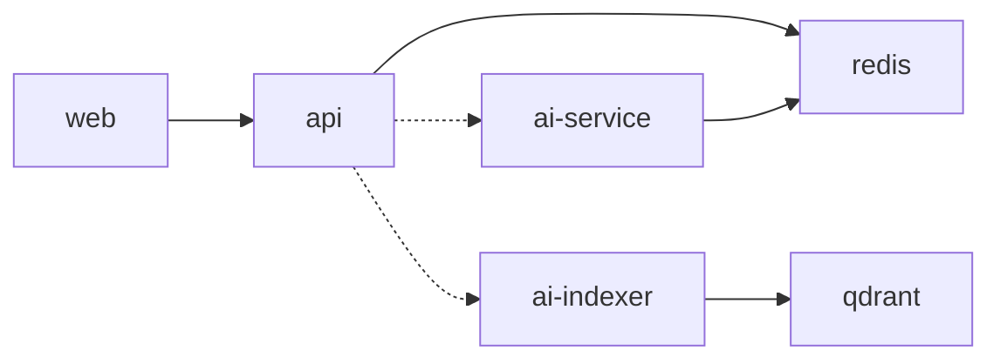

# Deployment & DevOps

<cite>
**Referenced Files in This Document**
- [api/Dockerfile](file://api/Dockerfile)
- [ai-service/Dockerfile](file://ai-service/Dockerfile)
- [frontend/Dockerfile](file://frontend/Dockerfile)
- [api/docker-compose.yml](file://api/docker-compose.yml)
- [api/docker-compose.production.yml](file://api/docker-compose.production.yml)
- [api/docs/COMPOSE.md](file://api/docs/COMPOSE.md)
</cite>

## Table of Contents
1. [Introduction](#introduction)
2. [Project Structure](#project-structure)
3. [Core Components](#core-components)
4. [Architecture Overview](#architecture-overview)
5. [Detailed Component Analysis](#detailed-component-analysis)
6. [Dependency Analysis](#dependency-analysis)
7. [Performance Considerations](#performance-considerations)
8. [Troubleshooting Guide](#troubleshooting-guide)
9. [Conclusion](#conclusion)
10. [Appendices](#appendices)

## Introduction
This document provides comprehensive deployment and DevOps guidance for CodePart’s containerized architecture. It covers Docker containerization for the .NET API, Python AI service, and React frontend; production deployment with docker-compose; environment configuration and secrets handling; health checks; scaling considerations; and operational runbooks. Kubernetes manifests are not present in the repository and are therefore out of scope. CI/CD automation is also not included in the provided files.

## Project Structure
CodePart deploys three primary services:
- .NET API: ASP.NET Core application exposing HTTP endpoints on port 8080 inside the container.
- Python AI Service: FastAPI/Uvicorn service providing AI and RAG capabilities on port 8000.
- React Frontend: Static assets served by Nginx on ports 80 and 443.

**Diagram sources**
- [api/docker-compose.production.yml:64-143](file://api/docker-compose.production.yml#L64-L143)
- [api/docker-compose.production.yml:144-210](file://api/docker-compose.production.yml#L144-L210)

**Section sources**
- [api/Dockerfile:1-29](file://api/Dockerfile#L1-L29)
- [ai-service/Dockerfile:1-11](file://ai-service/Dockerfile#L1-L11)
- [frontend/Dockerfile:1-13](file://frontend/Dockerfile#L1-L13)
- [api/docker-compose.production.yml:1-241](file://api/docker-compose.production.yml#L1-L241)

## Core Components
- .NET API container
  - Multi-stage build using .NET SDK 8.0 and ASP.NET runtime 8.0.
  - Publishes to /app/publish and runs as non-root user app.
  - Exposes HTTP on port 8080 via ASPNETCORE_URLS.
- Python AI Service container
  - Built from python:3.11-slim, installs dependencies with uv, runs as non-root assistant user.
  - Starts Uvicorn on 0.0.0.0:8000 with concurrency limit.
- React Frontend container
  - Build stage uses Node 24 Alpine to compile static assets.
  - Runtime stage serves assets with Nginx Alpine on ports 80/443.

**Section sources**
- [api/Dockerfile:1-29](file://api/Dockerfile#L1-L29)
- [ai-service/Dockerfile:1-11](file://ai-service/Dockerfile#L1-L11)
- [frontend/Dockerfile:1-13](file://frontend/Dockerfile#L1-L13)

## Architecture Overview
The production stack composes the following services:
- web: Nginx serving the React frontend, publishing ports 80 and 443.
- api: .NET API depending on Redis and optionally AI/Indexer.
- redis: Redis with ACL-based authentication via a secret file.
- ai-service: Python AI service requiring LLM provider configuration.
- ai-indexer: Python indexer for RAG, requiring embedding provider configuration.
- qdrant: Vector database used by the indexer.

**Diagram sources**
- [api/docker-compose.production.yml:64-143](file://api/docker-compose.production.yml#L64-L143)
- [api/docker-compose.production.yml:144-210](file://api/docker-compose.production.yml#L144-L210)

## Detailed Component Analysis

### Containerization Strategy
- .NET API
  - Multi-stage build separates dependency resolution and publish steps.
  - Non-root execution improves security posture.
  - Port 8080 is configured via environment variable.
- Python AI Service
  - Uses uv for fast, deterministic dependency installation.
  - Runs as non-root with read-only filesystem and tmpfs for temporary data.
  - Concurrency limited at process level.
- React Frontend
  - Build stage compiles TypeScript/React into static assets.
  - Nginx runtime serves assets and can terminate TLS when certificates are provided via secrets.

**Diagram sources**
- [api/Dockerfile:1-29](file://api/Dockerfile#L1-L29)
- [ai-service/Dockerfile:1-11](file://ai-service/Dockerfile#L1-L11)
- [frontend/Dockerfile:1-13](file://frontend/Dockerfile#L1-L13)

**Section sources**
- [api/Dockerfile:1-29](file://api/Dockerfile#L1-L29)
- [ai-service/Dockerfile:1-11](file://ai-service/Dockerfile#L1-L11)
- [frontend/Dockerfile:1-13](file://frontend/Dockerfile#L1-L13)

### Production Deployment with docker-compose
- Compose profiles control optional features:
  - No profile: core stack (web, api, redis).
  - ai: adds Python AI service.
  - rag: adds AI service, indexer, and Qdrant.
- Networking:
  - Internal backend network isolates Redis, API, AI, indexer, and Qdrant.
  - Only web publishes ports 80/443 to the host.
- Health checks:
  - Redis health check validates connectivity with password from secrets.
  - Python AI service exposes a /health endpoint checked by Compose.
- Secrets:
  - Database password, Redis password, JWT signing key, SMTP password, admin passwords, and TLS certificate/private key are injected via Docker secrets.

**Diagram sources**
- [api/docker-compose.production.yml:1-241](file://api/docker-compose.production.yml#L1-L241)

**Section sources**
- [api/docker-compose.production.yml:1-241](file://api/docker-compose.production.yml#L1-L241)
- [api/docs/COMPOSE.md:1-90](file://api/docs/COMPOSE.md#L1-L90)

### Development Deployment with docker-compose
- Development compose file focuses on Redis, optional AI, and optional RAG components.
- Host-bound ports ensure local access to Redis, AI, indexer, and Qdrant.
- AI and indexer use shared environment templates for RAG settings.
- Health checks validate AI service availability.

**Section sources**
- [api/docker-compose.yml:1-112](file://api/docker-compose.yml#L1-L112)
- [api/docs/COMPOSE.md:12-40](file://api/docs/COMPOSE.md#L12-L40)

### Environment Configuration Management
- .NET API environment variables include:
  - Server name, CORS origins, reverse proxy trusted networks.
  - Database connection details, Redis host, JWT issuer/audience.
  - Email SMTP settings, Judge0 integration flags and base URL.
  - AI feature flags and base URLs, anonymization key.
  - RAG feature flag and indexer base URL.
- Python AI service environment variables include:
  - SERVICE_API_KEY, REDIS_URL, LLM_PROVIDER, LLM_MODEL, LLM_ADVANCED_MODEL, LLM_BASE_URL, LLM_API_KEY.
  - RAG embedding configuration: EMBEDDING_BASE_URL, EMBEDDING_MODEL, EMBEDDING_DIMENSIONS, EMBEDDING_API_KEY.
  - Qdrant API key and URL for indexer.
- Frontend is stateless; it relies on the API base path configured during build or runtime proxying.

**Section sources**
- [api/docker-compose.production.yml:64-126](file://api/docker-compose.production.yml#L64-L126)
- [api/docker-compose.production.yml:144-193](file://api/docker-compose.production.yml#L144-L193)
- [api/docker-compose.yml:6-14](file://api/docker-compose.yml#L6-L14)

### Secrets Handling
- Docker secrets inject sensitive values into containers:
  - database_password, redis_password, jwt_signing_key, smtp_password, admin01_password, admin02_password.
  - tls_certificate and tls_private_key for Nginx TLS termination.
- Redis starts with an ACL file generated from the redis_password secret.
- API consumes secrets through environment variables mapped from secrets.

**Diagram sources**
- [api/docker-compose.production.yml:51-62](file://api/docker-compose.production.yml#L51-L62)
- [api/docker-compose.production.yml:102-114](file://api/docker-compose.production.yml#L102-L114)
- [api/docker-compose.production.yml:224-241](file://api/docker-compose.production.yml#L224-L241)

**Section sources**
- [api/docker-compose.production.yml:51-62](file://api/docker-compose.production.yml#L51-L62)
- [api/docker-compose.production.yml:102-114](file://api/docker-compose.production.yml#L102-L114)
- [api/docker-compose.production.yml:224-241](file://api/docker-compose.production.yml#L224-L241)

### Health Checks and Readiness
- Redis health check verifies PONG response using the secret password.
- Python AI service health check calls /health endpoint.
- Optional dependencies (ai-service, ai-indexer) are marked required: false for the API, allowing graceful degradation when AI/RAG are disabled.

**Diagram sources**
- [api/docker-compose.production.yml:55-62](file://api/docker-compose.production.yml#L55-L62)
- [api/docker-compose.production.yml:30-35](file://api/docker-compose.production.yml#L30-L35)
- [api/docker-compose.production.yml:117-125](file://api/docker-compose.production.yml#L117-L125)

**Section sources**
- [api/docker-compose.production.yml:30-35](file://api/docker-compose.production.yml#L30-L35)
- [api/docker-compose.production.yml:55-62](file://api/docker-compose.production.yml#L55-L62)
- [api/docker-compose.production.yml:117-125](file://api/docker-compose.production.yml#L117-L125)

### Scaling Considerations and Load Balancing
- Horizontal scaling:
  - Scale web and api replicas behind an external load balancer (e.g., ingress controller or reverse proxy).
  - Ensure sticky sessions if needed, or rely on stateless design with Redis-backed sessions.
- Resource limits:
  - AI service and indexer have CPU and memory limits defined in Compose.
  - PID limits and read-only filesystems reduce risk of resource abuse.
- Connection pooling:
  - Tune database connection pool options in the .NET application configuration.
  - Use Redis connection pooling appropriate for concurrent workloads.
- External dependencies:
  - For production, consider managed Redis and MySQL instances outside Compose.
  - Judge0 integration is optional and can be enabled via environment variables.

**Section sources**
- [api/docker-compose.production.yml:144-193](file://api/docker-compose.production.yml#L144-L193)
- [api/docker-compose.production.yml:64-126](file://api/docker-compose.production.yml#L64-L126)

### Monitoring Setup
- Health endpoints:
  - Python AI service exposes /health for liveness/readiness probes.
  - Redis health check validates connectivity.
- Logging:
  - Container logs should be forwarded to a centralized logging system (e.g., Loki, ELK).
- Metrics:
  - Expose .NET metrics and Prometheus scraping if enabled in application configuration.
  - Monitor Redis metrics via exporter.

[No sources needed since this section provides general guidance]

### Disaster Recovery Procedures
- Backups:
  - Schedule regular backups of MySQL databases externally.
  - Backup Redis persistence volumes and Qdrant storage volumes.
- Restore:
  - Restore database dumps to MySQL before starting the API.
  - Restore Redis and Qdrant data volumes to recover cache and vector index state.
- Failover:
  - Use managed database failover where available.
  - Keep multiple replicas of stateless services behind a load balancer.

[No sources needed since this section provides general guidance]

### Operational Runbooks
- Start production stack:
  - Prepare .env.production and secrets under api/secrets.
  - Run docker compose with production file and env file.
- Validate services:
  - Check container status and health.
  - Verify web TLS termination and API reachability.
- Stop stack:
  - Stop all profiles while preserving volumes.

**Section sources**
- [api/docs/COMPOSE.md:42-85](file://api/docs/COMPOSE.md#L42-L85)

## Dependency Analysis
The production stack defines clear dependencies:
- web depends on api.
- api depends on redis and optionally ai-service and ai-indexer.
- ai-service depends on redis.
- ai-indexer depends on qdrant.

**Diagram sources**
- [api/docker-compose.production.yml:64-143](file://api/docker-compose.production.yml#L64-L143)
- [api/docker-compose.production.yml:144-210](file://api/docker-compose.production.yml#L144-L210)

**Section sources**
- [api/docker-compose.production.yml:64-143](file://api/docker-compose.production.yml#L64-L143)
- [api/docker-compose.production.yml:144-210](file://api/docker-compose.production.yml#L144-L210)

## Performance Considerations
- Container images:
  - Use multi-stage builds to minimize image size and attack surface.
- Process limits:
  - Limit concurrency for AI services to prevent resource exhaustion.
- Caching:
  - Leverage Redis for session and cache layers.
- External services:
  - Offload code execution to Judge0 if enabled.
  - Use managed vector search for Qdrant in production.

[No sources needed since this section provides general guidance]

## Troubleshooting Guide
- Redis authentication failures:
  - Ensure redis_password secret matches the password used in AI_REDIS_URL.
  - Verify Redis health check passes with the secret.
- AI service startup errors:
  - Confirm SERVICE_API_KEY, REDIS_URL, LLM_MODEL, and LLM_ADVANCED_MODEL are set when using ai profile.
  - Check /health endpoint availability.
- RAG indexer startup errors:
  - Ensure QDRANT_API_KEY, EMBEDDING_BASE_URL, EMBEDDING_MODEL, and EMBEDDING_DIMENSIONS are set when using rag profile.
- TLS termination issues:
  - Verify tls_certificate and tls_private_key secrets are correctly mounted.
- Feature flags:
  - Set AI_ENABLED and RAG_ENABLED appropriately in .env.production to match profiles.

**Section sources**
- [api/docker-compose.production.yml:149-168](file://api/docker-compose.production.yml#L149-L168)
- [api/docker-compose.production.yml:178-186](file://api/docker-compose.production.yml#L178-L186)
- [api/docker-compose.production.yml:199-204](file://api/docker-compose.production.yml#L199-L204)
- [api/docs/COMPOSE.md:46-64](file://api/docs/COMPOSE.md#L46-L64)

## Conclusion
CodePart’s production deployment centers around a secure, layered docker-compose stack with explicit profiles for AI and RAG capabilities. The .NET API, Python AI service, and React frontend are containerized with best practices including non-root users, read-only filesystems, and secrets management. Health checks and optional dependencies enable resilient operation. For Kubernetes and CI/CD, additional manifests and pipelines would need to be created beyond the current repository scope.

## Appendices
- Compose usage reference:
  - Development and production workflows, profiles, and validation commands are documented in the project’s Compose documentation.

**Section sources**
- [api/docs/COMPOSE.md:1-90](file://api/docs/COMPOSE.md#L1-L90)