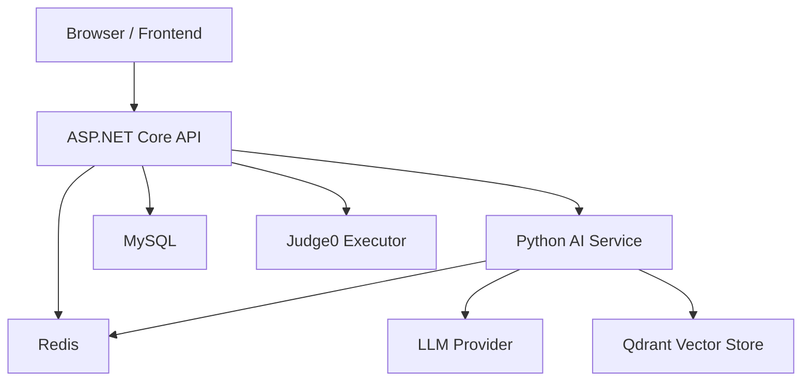
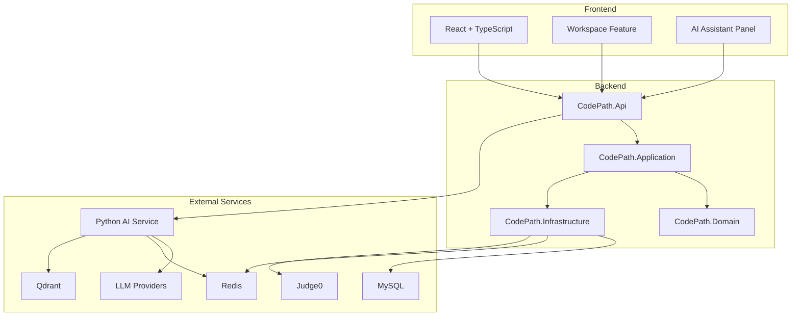
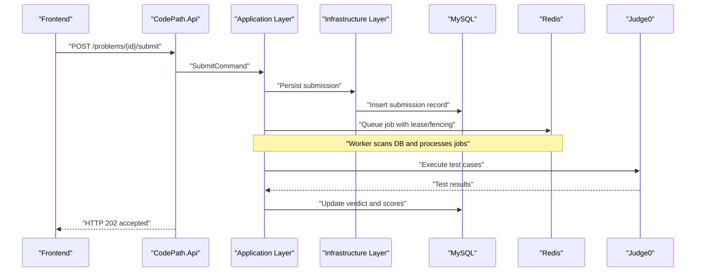
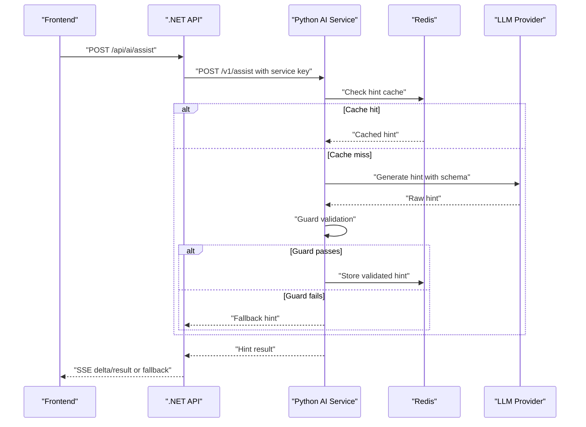
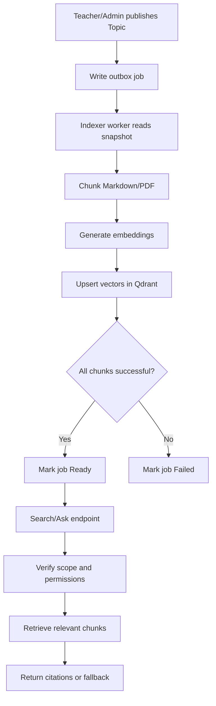
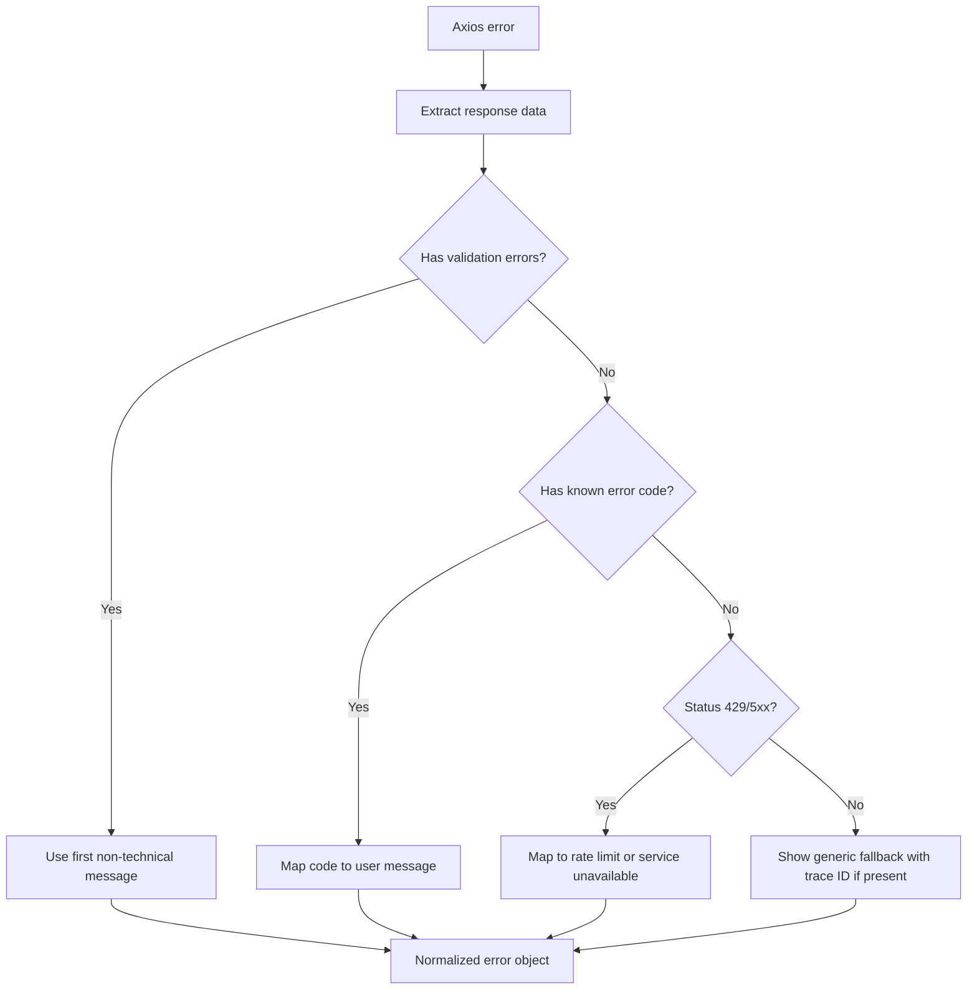
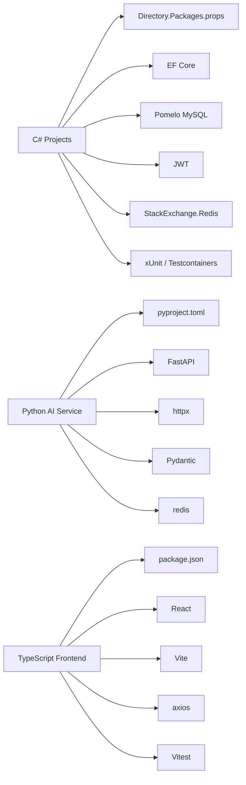

# Development Guidelines

<cite>
**Referenced Files in This Document**
- [ai-service README.md](file://ai-service/README.md)
- [ai-service main.py](file://ai-service/app/main.py)
- [ai-service pyproject.toml](file://ai-service/pyproject.toml)
- [api Directory.Build.props](file://api/Directory.Build.props)
- [api Directory.Packages.props](file://api/Directory.Packages.props)
- [api Architecture documentation](file://api/docs/ARCHITECTURE.md)
- [api Compose documentation](file://api/docs/COMPOSE.md)
- [api RAG documentation](file://api/docs/RAG.md)
- [api Teacher documentation](file://api/docs/TEACHER.md)
- [frontend package.json](file://frontend/package.json)
- [frontend workspace README](file://frontend/src/features/workspace/README.md)
- [frontend error service](file://frontend/src/lib/errorService.ts)
</cite>

## Table of Contents
1. [Introduction](#introduction)
2. [Project Structure](#project-structure)
3. [Core Components](#core-components)
4. [Architecture Overview](#architecture-overview)
5. [Detailed Component Analysis](#detailed-component-analysis)
6. [Dependency Analysis](#dependency-analysis)
7. [Performance Considerations](#performance-considerations)
8. [Troubleshooting Guide](#troubleshooting-guide)
9. [Conclusion](#conclusion)
10. [Appendices](#appendices)

## Introduction
This document defines the development guidelines for CodePart’s multi-language workflow. It covers coding standards, project structure conventions, Git and code review practices, debugging and logging patterns, dependency management, security scanning, contribution rules, pull request templates, and quality gates across:

- C# (.NET 8) backend API
- Python (FastAPI) AI assistant and RAG services
- TypeScript (React) frontend

The goal is to keep the system consistent, secure, testable, and easy to operate in development, testing, and production environments.

## Project Structure
CodePart is organized into three primary service boundaries with shared documentation and tooling:

- `api`: ASP.NET Core 8 backend using Clean Architecture, MediatR, EF Core, MySQL, Redis, and optional Judge0 integration.
- `ai-service`: FastAPI service providing AI hint generation, guard logic, caching, and RAG indexing support.
- `frontend`: React + TypeScript application built with Vite, Tailwind CSS, React Query, and Monaco Editor.

**Diagram sources**
- [api Architecture documentation:5-20](file://api/docs/ARCHITECTURE.md#L5-L20)
- [ai-service README.md:39-66](file://ai-service/README.md#L39-L66)
- [api RAG documentation:1-21](file://api/docs/RAG.md#L1-L21)

### Backend Project Layout
The backend follows Clean Architecture with clear layer responsibilities:

| Layer | Responsibility |
| --- | --- |
| Api | Endpoints, authentication, middleware, configuration |
| Application | Commands, queries, validation, DTOs, interfaces |
| Domain | Entities and business rules |
| Infrastructure | EF Core, MySQL, Redis, JWT, Judge0, external integrations |
| Shared Kernel | Base entities, Result pattern, shared types |
| Shared Web | HTTP helpers and error handling |

**Section sources**
- [api Architecture documentation:5-20](file://api/docs/ARCHITECTURE.md#L5-L20)

### Python Service Layout
The AI service exposes an internal API protected by a service key, provides hint generation, guard checks, Redis-backed caching, and integrates with LLM providers. It also supports RAG indexing through a separate indexer process.

**Section sources**
- [ai-service README.md:39-66](file://ai-service/README.md#L39-L66)
- [ai-service main.py:36-64](file://ai-service/app/main.py#L36-L64)

### Frontend Layout
The frontend uses feature folders, shared UI components, mock handlers for local development, and communicates with the backend via REST APIs and SSE streams. The workspace feature replaces the older exercise screen while keeping existing problem APIs.

**Section sources**
- [frontend workspace README:1-27](file://frontend/src/features/workspace/README.md#L1-L27)
- [frontend workspace README:52-73](file://frontend/src/features/workspace/README.md#L52-L73)

## Core Components
This section summarizes the core development expectations for each language stack.

### C# (.NET 8) Standards
- Target framework: .NET 8.
- Nullable reference types enabled.
- Implicit usings enabled.
- Warnings treated as errors for nullable analysis.
- Centralized package versioning through `Directory.Packages.props`.
- Clean Architecture boundaries enforced by tests.
- Database migrations are explicit; the application does not auto-migrate on normal startup.
- Health endpoints check MySQL and Redis.

Recommended coding practices:
- Use domain exceptions and a shared error catalog to sanitize technical details before exposing them to clients.
- Prefer commands and queries over direct controller logic.
- Keep DTOs separate from domain entities.
- Validate input at the boundary and return structured error responses.
- Avoid writing secrets or sensitive payloads to logs.

**Section sources**
- [api Directory.Build.props:1-10](file://api/Directory.Build.props#L1-L10)
- [api Directory.Packages.props:1-5](file://api/Directory.Packages.props#L1-L5)
- [api Architecture documentation:22-42](file://api/docs/ARCHITECTURE.md#L22-L42)

### Python (FastAPI) Standards
- Minimum Python version: 3.11.
- Dependency resolution should use the locked lockfile where available.
- FastAPI app exposes health and internal AI endpoints.
- Internal requests require a service key header.
- Validation errors map to a stable error code.
- Unhandled exceptions map to a service-unavailable response.
- Environment variables control provider selection, model names, cache URLs, and keys.

Recommended coding practices:
- Keep prompts, strategies, and system instructions under a dedicated configuration area.
- Validate all inputs with Pydantic models.
- Do not execute student code in the Python process.
- Never log raw source code, hidden test data, or secrets.
- Use Redis for quota, rate limiting, and short-lived caches.
- Treat guard results as heuristic safety checks, not formal verification.

**Section sources**
- [ai-service README.md:7-25](file://ai-service/README.md#L7-L25)
- [ai-service main.py:36-64](file://ai-service/app/main.py#L36-L64)
- [ai-service pyproject.toml:1-10](file://ai-service/pyproject.toml#L1-L10)

### TypeScript (React) Standards
- Build pipeline uses Vite and TypeScript.
- Linting uses Oxlint.
- Testing uses Vitest for unit tests and Playwright for E2E scenarios.
- State management uses Zustand for editor drafts and UI state.
- API calls go through a centralized Axios setup with normalized error handling.
- Mocks are available for local workspace development but must not be used in production builds.

Recommended coding practices:
- Keep feature-specific code in `features/<feature>` folders.
- Separate API contracts, hooks, components, pages, and styles.
- Normalize API errors and show user-friendly messages without leaking technical details.
- Debounce draft saves and avoid storing tokens locally.
- Respect reduced motion and keyboard accessibility requirements.

**Section sources**
- [frontend package.json:1-14](file://frontend/package.json#L1-L14)
- [frontend workspace README:52-73](file://frontend/src/features/workspace/README.md#L52-L73)
- [frontend error service:65-127](file://frontend/src/lib/errorService.ts#L65-L127)

## Architecture Overview
The system separates concerns across layers and services:

**Diagram sources**
- [api Architecture documentation:5-20](file://api/docs/ARCHITECTURE.md#L5-L20)
- [ai-service README.md:39-66](file://ai-service/README.md#L39-L66)
- [api RAG documentation:1-21](file://api/docs/RAG.md#L1-L21)

## Detailed Component Analysis

### C# Backend Workflow
The backend exposes REST endpoints, enforces roles and policies, manages sessions, handles exercises and submissions, and coordinates with external services.

**Diagram sources**
- [api Architecture documentation:55-65](file://api/docs/ARCHITECTURE.md#L55-L65)
- [api Teacher documentation:55-78](file://api/docs/TEACHER.md#L55-L78)

Key implementation notes:
- Submissions return HTTP 202 and are processed asynchronously.
- Concurrency and idempotency are handled through database constraints, leases, and token fencing.
- Hidden test data is never exposed to students.
- Source size and I/O limits are enforced.

**Section sources**
- [api Architecture documentation:55-65](file://api/docs/ARCHITECTURE.md#L55-L65)
- [api Teacher documentation:55-78](file://api/docs/TEACHER.md#L55-L78)

### Python AI Assistant Flow
The AI assistant generates hints based on problem context, stage, level, and student submission history. Guard logic prevents unsafe or leaked content.

**Diagram sources**
- [ai-service README.md:39-66](file://ai-service/README.md#L39-L66)
- [ai-service main.py:36-64](file://ai-service/app/main.py#L36-L64)

Important behaviors:
- Internal service authentication uses a required header.
- Validation failures return a stable error code.
- Unhandled failures return a service-unavailable status.
- Hints may fall back when the AI service is unavailable.
- Quota and rate limits are enforced through Redis.

**Section sources**
- [ai-service README.md:39-66](file://ai-service/README.md#L39-L66)
- [ai-service main.py:36-64](file://ai-service/app/main.py#L36-L64)

### RAG Indexing and Retrieval
RAG adds semantic search and question answering over learning materials. Indexing runs asynchronously with outbox jobs, revision tracking, and vector storage.

**Diagram sources**
- [api RAG documentation:1-21](file://api/docs/RAG.md#L1-L21)
- [api RAG documentation:123-157](file://api/docs/RAG.md#L123-L157)

Operational constraints:
- Indexing is asynchronous and transactional with outbox records.
- Revisions tie vector data to published snapshots.
- Permissions are checked after retrieval.
- Fallback to previous hint pipelines occurs when retrieval fails.

**Section sources**
- [api RAG documentation:1-21](file://api/docs/RAG.md#L1-L21)
- [api RAG documentation:123-157](file://api/docs/RAG.md#L123-L157)

### Frontend Error Handling Flow
The frontend normalizes API errors, avoids showing technical stack traces, and maps common statuses to user-friendly messages.

**Diagram sources**
- [frontend error service:65-127](file://frontend/src/lib/errorService.ts#L65-L127)

Guidelines:
- Never expose stack traces, connection strings, or database keywords to users.
- Preserve correlation IDs for troubleshooting.
- Handle network failures separately from server errors.

**Section sources**
- [frontend error service:65-127](file://frontend/src/lib/errorService.ts#L65-L127)

## Dependency Analysis
Dependencies are managed centrally in the backend and explicitly declared per service.

**Diagram sources**
- [api Directory.Packages.props:1-59](file://api/Directory.Packages.props#L1-L59)
- [ai-service pyproject.toml:1-10](file://ai-service/pyproject.toml#L1-L10)
- [frontend package.json:1-70](file://frontend/package.json#L1-L70)

Centralized dependency rules:
- Pin versions centrally for .NET packages.
- Use transitive pinning where appropriate.
- Keep optional dependencies grouped by purpose.
- Lock Python dependencies using the provided lockfile.
- Keep frontend dev and runtime dependencies separated.

**Section sources**
- [api Directory.Packages.props:1-59](file://api/Directory.Packages.props#L1-L59)
- [ai-service pyproject.toml:1-10](file://ai-service/pyproject.toml#L1-L10)
- [frontend package.json:1-70](file://frontend/package.json#L1-L70)

## Performance Considerations
- Backend polling for submission status is approximately every 1.5 seconds.
- AI hint deadlines are around 19 seconds in Python and 20 seconds in .NET, including retries.
- Frontend timeout is approximately 25 seconds.
- Redis is used for caching, quotas, rate limits, and distributed coordination.
- Judge0 executes code externally; do not run student code inside API or AI processes.
- RAG indexing has bounded timeouts and retry limits to prevent long-running jobs from blocking resources.

Recommendations:
- Avoid unnecessary re-fetches in the frontend.
- Debounce editor drafts and avoid redundant API calls.
- Use circuit breakers and retries only for transient failures.
- Monitor Redis latency and queue depth.
- Keep prompt sizes within documented limits.

[No sources needed since this section provides general guidance]

## Troubleshooting Guide
Common issues and recovery steps:

- AI service unavailable:
  - Backend returns a fallback hint when the AI service cannot respond.
  - Check service key configuration and environment variables.
  - Verify Redis connectivity and quota counters.

- Validation errors:
  - Python returns a stable invalid-context code.
  - Frontend normalizes validation payloads and shows friendly messages.

- Rate limiting and quotas:
  - Excessive requests return rate-limit responses.
  - Quotas are tracked per user and time window.

- Authentication and session issues:
  - Session idle and expiration codes are surfaced to the frontend.
  - Refresh tokens rotate and can be revoked.

- Database migration problems:
  - Migrations are explicit; do not assume automatic migration on startup.
  - Run migrations against the correct database context.

- Docker Compose configuration:
  - Use the documented profiles for development and production.
  - Do not merge development and production compose files.

**Section sources**
- [ai-service README.md:39-53](file://ai-service/README.md#L39-L53)
- [frontend error service:65-127](file://frontend/src/lib/errorService.ts#L65-L127)
- [api Architecture documentation:22-42](file://api/docs/ARCHITECTURE.md#L22-L42)
- [api Compose documentation:1-40](file://api/docs/COMPOSE.md#L1-L40)

## Conclusion
CodePart’s development workflow relies on clear boundaries between backend, AI, and frontend services. Consistent coding standards, explicit dependency management, strong error handling, and careful security practices ensure maintainability and reliability. Teams should follow the documented architecture, use the provided testing and deployment guides, and enforce quality gates through linting, testing, and code reviews.

[No sources needed since this section summarizes without analyzing specific files]

## Appendices

### Coding Standards Summary

| Area | C# (.NET 8) | Python (FastAPI) | TypeScript (React) |
| --- | --- | --- | --- |
| Language target | net8.0, nullable enabled | Python >= 3.11 | TypeScript ~6.0.2 |
| Linting | Compiler warnings as errors | Pydantic validation | Oxlint |
| Testing | xUnit, Testcontainers | pytest | Vitest, Playwright |
| Configuration | appsettings, environment variables | Environment variables | Vite env vars |
| Secrets | Not logged; use secure configuration | SERVICE_API_KEY, provider keys | No secrets in frontend |
| Error format | ProblemDetails with sanitized messages | Stable error codes | Normalized client errors |

**Section sources**
- [api Directory.Build.props:1-10](file://api/Directory.Build.props#L1-L10)
- [ai-service README.md:7-25](file://ai-service/README.md#L7-L25)
- [frontend package.json:1-14](file://frontend/package.json#L1-L14)

### Git Workflow and Branching Strategy
Recommended branching model:
- `main`: Production-ready code.
- `develop`: Integration branch for features.
- `feature/<short-description>`: New functionality.
- `fix/<short-description>`: Bug fixes.
- `release/<version>`: Pre-release preparation.
- `hotfix/<issue-id>`: Critical production fixes.

Branch naming rules:
- Use lowercase letters, numbers, and hyphens.
- Include issue or ticket identifiers when available.
- Keep branches focused on one change.

Merge policy:
- All changes must pass linting, unit tests, and relevant integration tests.
- Pull requests require at least one reviewer.
- Security-sensitive changes require additional review.

**Section sources**
- [api Architecture documentation:81-85](file://api/docs/ARCHITECTURE.md#L81-L85)
- [ai-service README.md:98-110](file://ai-service/README.md#L98-L110)
- [frontend workspace README:75-85](file://frontend/src/features/workspace/README.md#L75-L85)

### Code Review Checklist
- Does the change follow Clean Architecture boundaries?
- Are inputs validated and outputs properly modeled?
- Are secrets and sensitive data excluded from logs and responses?
- Are tests added or updated?
- Is error handling consistent with the shared error catalog or frontend normalization?
- Are performance implications considered?
- Are Docker or environment configurations updated where necessary?

**Section sources**
- [api Architecture documentation:5-20](file://api/docs/ARCHITECTURE.md#L5-L20)
- [frontend error service:65-127](file://frontend/src/lib/errorService.ts#L65-L127)

### Pull Request Template
Use the following template when creating pull requests:

- **Summary**: One paragraph describing the change.
- **Motivation**: Why this change is needed.
- **Changes**: Bullet list of modified areas.
- **Testing**: Unit tests, integration tests, manual checks.
- **Security**: Secrets, permissions, and data exposure considerations.
- **Performance**: Latency, memory, and throughput impact.
- **Migration**: Database or configuration changes.
- **Rollback**: Steps to revert safely.

**Section sources**
- [api Architecture documentation:81-85](file://api/docs/ARCHITECTURE.md#L81-L85)
- [ai-service README.md:98-110](file://ai-service/README.md#L98-L110)
- [frontend workspace README:75-85](file://frontend/src/features/workspace/README.md#L75-L85)

### Quality Gates
Automated gates before merging:
- `.NET build and tests`
- `Python tests`
- `Frontend build and lint`
- `Frontend unit tests`
- `Docker Compose configuration validation`

Manual gates:
- Code review approval
- Security-sensitive change review
- Migration review
- Documentation updates where applicable

**Section sources**
- [api Directory.Packages.props:42-51](file://api/Directory.Packages.props#L42-L51)
- [ai-service README.md:98-110](file://ai-service/README.md#L98-L110)
- [frontend package.json:6-14](file://frontend/package.json#L6-L14)
- [api Compose documentation:74-87](file://api/docs/COMPOSE.md#L74-L87)