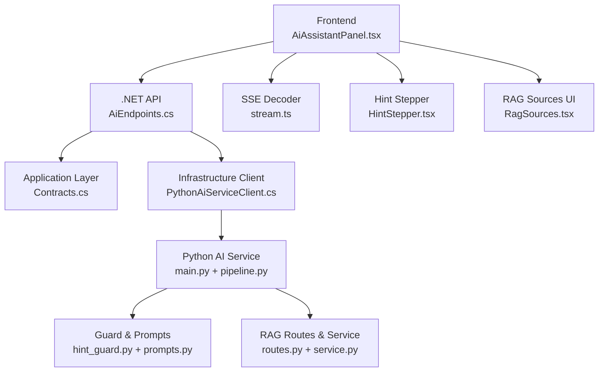
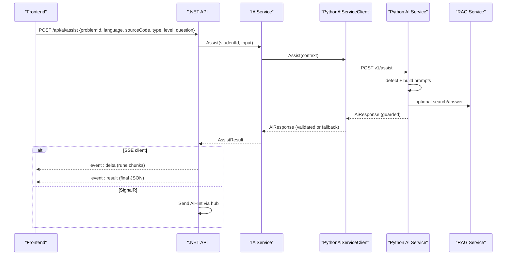
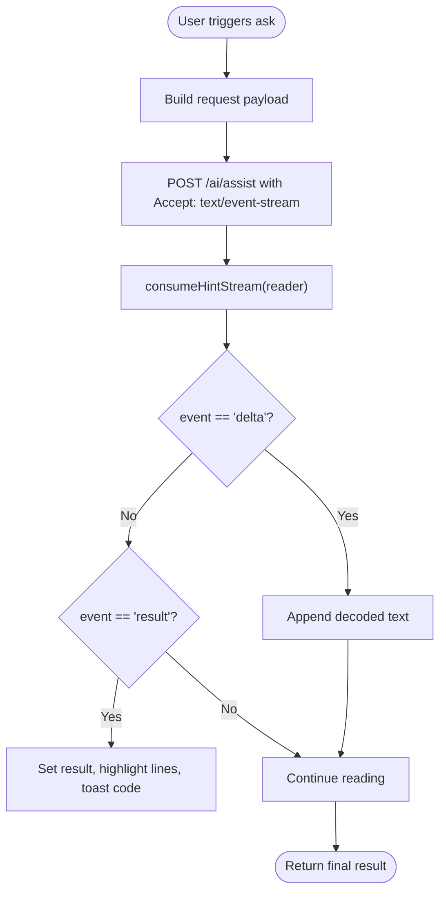
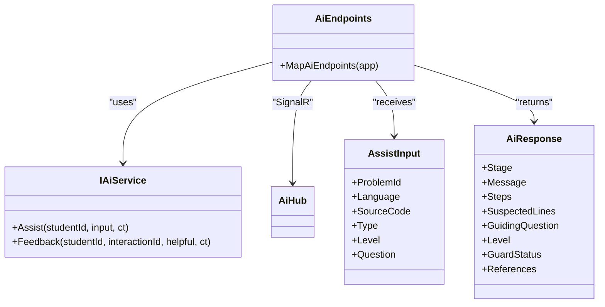
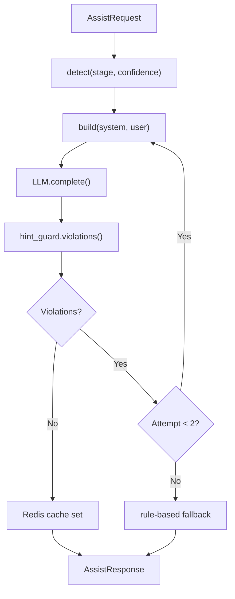
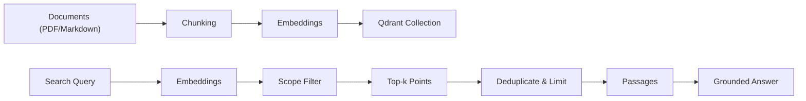
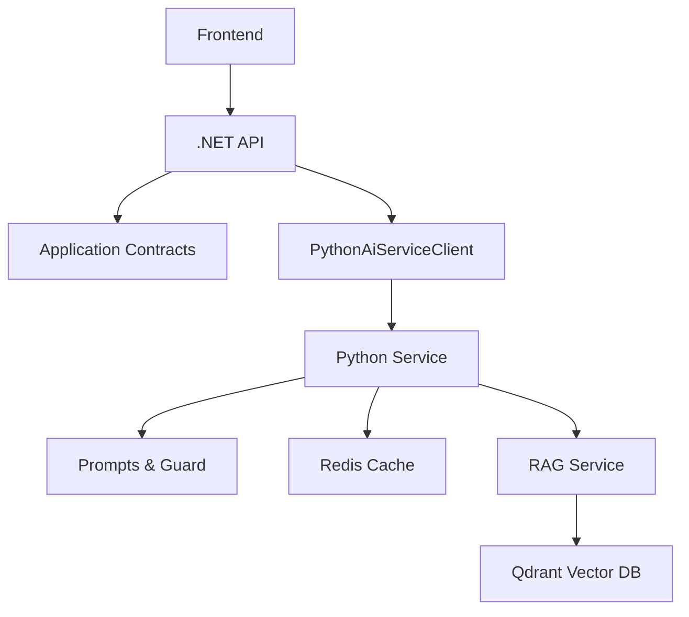

# AI Assistant Feature

<cite>
**Referenced Files in This Document**
- [AiAssistantPanel.tsx](file://frontend/src/features/ai-assistant/AiAssistantPanel.tsx)
- [HintStepper.tsx](file://frontend/src/features/ai-assistant/HintStepper.tsx)
- [RagSources.tsx](file://frontend/src/features/ai-assistant/RagSources.tsx)
- [stream.ts](file://frontend/src/features/ai-assistant/stream.ts)
- [assistant-stream.test.mjs](file://frontend/tests/assistant-stream.test.mjs)
- [AiEndpoints.cs](file://api/src/Api/CodePath.Api/Endpoints/AiEndpoints.cs)
- [Contracts.cs](file://api/src/Application/CodePath.Application/Ai/Contracts.cs)
- [PythonAiServiceClient.cs](file://api/src/Infrastructure/CodePath.Infrastructure/Ai/PythonAiServiceClient.cs)
- [main.py](file://ai-service/app/main.py)
- [pipeline.py](file://ai-service/app/api/pipeline.py)
- [contracts.py](file://ai-service/app/contracts.py)
- [prompts.py](file://ai-service/app/hints/prompts.py)
- [hint_guard.py](file://ai-service/app/guard/hint_guard.py)
- [routes.py](file://ai-service/app/rag/routes.py)
- [service.py](file://ai-service/app/rag/service.py)
- [AI_ASSISTANT.md](file://api/docs/AI_ASSISTANT.md)
</cite>

## Table of Contents
1. [Introduction](#introduction)
2. [Project Structure](#project-structure)
3. [Core Components](#core-components)
4. [Architecture Overview](#architecture-overview)
5. [Detailed Component Analysis](#detailed-component-analysis)
6. [Dependency Analysis](#dependency-analysis)
7. [Performance Considerations](#performance-considerations)
8. [Troubleshooting Guide](#troubleshooting-guide)
9. [Conclusion](#conclusion)
10. [Appendices](#appendices)

## Introduction
This document explains the end-to-end implementation of the AI assistant feature. It covers real-time streaming communication with the AI service, the hint generation interface, and RAG-powered knowledge base integration. It also documents the component architecture including the main panel, hint stepper, and source display components; WebSocket/SSE connection handling; message formatting; error recovery mechanisms; customization examples; and performance optimization guidance.

## Project Structure
The AI assistant spans three layers:
- Frontend React components for user interaction, streaming consumption, and RAG source display.
- .NET API endpoints that enforce authorization, quota, unlock policy, persistence, and SSE streaming or SignalR delivery.
- Python AI service that builds prompts, runs stage detection, generates guarded hints, integrates RAG retrieval, and exposes internal search/draft endpoints.

**Diagram sources**
- [AiAssistantPanel.tsx:1-88](file://frontend/src/features/ai-assistant/AiAssistantPanel.tsx#L1-L88)
- [AiEndpoints.cs:1-45](file://api/src/Api/CodePath.Api/Endpoints/AiEndpoints.cs#L1-L45)
- [Contracts.cs:1-32](file://api/src/Application/CodePath.Application/Ai/Contracts.cs#L1-L32)
- [PythonAiServiceClient.cs:1-41](file://api/src/Infrastructure/CodePath.Infrastructure/Ai/PythonAiServiceClient.cs#L1-L41)
- [main.py:1-85](file://ai-service/app/main.py#L1-L85)
- [pipeline.py:1-41](file://ai-service/app/api/pipeline.py#L1-L41)
- [hint_guard.py:1-48](file://ai-service/app/guard/hint_guard.py#L1-L48)
- [prompts.py:1-41](file://ai-service/app/hints/prompts.py#L1-L41)
- [routes.py:1-93](file://ai-service/app/rag/routes.py#L1-L93)
- [service.py:1-144](file://ai-service/app/rag/service.py#L1-L144)
- [stream.ts:1-25](file://frontend/src/features/ai-assistant/stream.ts#L1-L25)
- [HintStepper.tsx:1-8](file://frontend/src/features/ai-assistant/HintStepper.tsx#L1-L8)
- [RagSources.tsx:1-36](file://frontend/src/features/ai-assistant/RagSources.tsx#L1-L36)

**Section sources**
- [AiAssistantPanel.tsx:1-88](file://frontend/src/features/ai-assistant/AiAssistantPanel.tsx#L1-L88)
- [AiEndpoints.cs:1-45](file://api/src/Api/CodePath.Api/Endpoints/AiEndpoints.cs#L1-L45)
- [main.py:1-85](file://ai-service/app/main.py#L1-L85)

## Core Components
- AiAssistantPanel: Orchestrates user input, stage inference from test results, SSE request to /ai/assist, streaming delta rendering, result state, feedback submission, and suspected-line highlighting.
- HintStepper: Renders level-based hint controls with lock/unlock behavior based on unlockedLevel and remaining quota.
- RagSources: Displays references returned by the AI and fetches source content via a topic endpoint, supporting both PDF links and inline text.
- stream.ts: Decodes Server-Sent Events across UTF-8 boundaries, emitting delta events and returning the final result object.
- AiEndpoints.cs: Exposes /api/ai/assist (JSON or SSE), /api/ai/{id}/feedback, and SignalR hub /api/ai/hub.
- Contracts.cs: Defines AssistInput, AiResponse, AssistResult, IAiService, IAiAssistantClient, and policy helpers for quota and unlock rules.
- PythonAiServiceClient.cs: Calls the Python service with a deadline, validates responses, and falls back to rule-based hints when needed.
- main.py and pipeline.py: FastAPI entrypoint, authentication, timeout, prompt building, stage detection, guard checks, caching, and LLM calls.
- contracts.py: Strict Pydantic models for requests, responses, stages, run state, history, and hints.
- prompts.py and hint_guard.py: Prompt versioning, strategy selection, and safety guard logic.
- routes.py and service.py: RAG indexing, search, answer, and draft endpoints plus Qdrant-backed vector storage and embedding integration.

**Section sources**
- [AiAssistantPanel.tsx:18-85](file://frontend/src/features/ai-assistant/AiAssistantPanel.tsx#L18-L85)
- [HintStepper.tsx:1-8](file://frontend/src/features/ai-assistant/HintStepper.tsx#L1-L8)
- [RagSources.tsx:1-36](file://frontend/src/features/ai-assistant/RagSources.tsx#L1-L36)
- [stream.ts:1-25](file://frontend/src/features/ai-assistant/stream.ts#L1-L25)
- [AiEndpoints.cs:12-43](file://api/src/Api/CodePath.Api/Endpoints/AiEndpoints.cs#L12-L43)
- [Contracts.cs:4-31](file://api/src/Application/CodePath.Application/Ai/Contracts.cs#L4-L31)
- [PythonAiServiceClient.cs:6-39](file://api/src/Infrastructure/CodePath.Infrastructure/Ai/PythonAiServiceClient.cs#L6-L39)
- [main.py:45-84](file://ai-service/app/main.py#L45-L84)
- [pipeline.py:10-40](file://ai-service/app/api/pipeline.py#L10-L40)
- [contracts.py:5-100](file://ai-service/app/contracts.py#L5-L100)
- [prompts.py:7-40](file://ai-service/app/hints/prompts.py#L7-L40)
- [hint_guard.py:22-47](file://ai-service/app/guard/hint_guard.py#L22-L47)
- [routes.py:7-92](file://ai-service/app/rag/routes.py#L7-L92)
- [service.py:13-143](file://ai-service/app/rag/service.py#L13-L143)

## Architecture Overview
The assistant uses a hybrid streaming approach:
- The frontend sends an HTTP POST to /api/ai/assist with Accept: text/event-stream.
- The .NET API calls IAiService.Assist, which delegates to PythonAiServiceClient.
- The Python service builds context, detects stage, constructs prompts, runs guard checks, optionally caches results, and returns a validated hint.
- The .NET API streams the hint as SSE events (delta and result) or delivers it via SignalR for non-SSE clients.
- The frontend consumes deltas to render incremental Vietnamese text safely and displays the final result, steps, guiding question, and RAG references.

**Diagram sources**
- [AiAssistantPanel.tsx:38-61](file://frontend/src/features/ai-assistant/AiAssistantPanel.tsx#L38-L61)
- [AiEndpoints.cs:15-36](file://api/src/Api/CodePath.Api/Endpoints/AiEndpoints.cs#L15-L36)
- [PythonAiServiceClient.cs:8-39](file://api/src/Infrastructure/CodePath.Infrastructure/Ai/PythonAiServiceClient.cs#L8-L39)
- [main.py:64-81](file://ai-service/app/main.py#L64-L81)
- [pipeline.py:10-40](file://ai-service/app/api/pipeline.py#L10-L40)
- [routes.py:31-63](file://ai-service/app/rag/routes.py#L31-L63)

## Detailed Component Analysis

### Frontend Panel and Streaming
- Stage inference: The panel infers Start, InProgress, LogicError, CannotRun, or PartialPass from test verdicts and code state.
- Request flow: It posts to /ai/assist with adapter fetch and responseType stream, sets Accept: text/event-stream, and aborts previous requests on new asks.
- SSE decoding: consumeHintStream buffers UTF-8 bytes, splits on \n\n, parses event/data lines, emits delta JSON, and returns the final result.
- Error handling: Cancellation is ignored; other errors parse proxy error bodies and show localized messages. Quota and rate-limit codes are surfaced.
- Feedback: Submits helpfulness per interactionId.

**Diagram sources**
- [AiAssistantPanel.tsx:38-61](file://frontend/src/features/ai-assistant/AiAssistantPanel.tsx#L38-L61)
- [stream.ts:1-25](file://frontend/src/features/ai-assistant/stream.ts#L1-L25)

**Section sources**
- [AiAssistantPanel.tsx:18-85](file://frontend/src/features/ai-assistant/AiAssistantPanel.tsx#L18-L85)
- [stream.ts:1-25](file://frontend/src/features/ai-assistant/stream.ts#L1-L25)
- [assistant-stream.test.mjs:10-21](file://frontend/tests/assistant-stream.test.mjs#L10-L21)

### Hint Stepper
- Renders levels 1–3 with lock icons when locked beyond unlockedLevel.
- Disables selection while busy or when remaining quota is zero.
- Guides users to progress through submissions or waiting periods to unlock higher levels.

**Section sources**
- [HintStepper.tsx:1-8](file://frontend/src/features/ai-assistant/HintStepper.tsx#L1-L8)

### RAG Source Display
- Lists references attached to a hint.
- Fetches source content via GET /topics/{topicId}/rag/sources/{blockId}?version={version}.
- Validates URL scheme and supports opening PDFs or rendering inline Markdown.
- Shows error messaging when access changes or permissions are lost.

**Section sources**
- [RagSources.tsx:1-36](file://frontend/src/features/ai-assistant/RagSources.tsx#L1-L36)

### .NET API Endpoints
- Authorization: Requires ActiveStudent policy.
- Assist: Builds context, calls IAiService, streams SSE if requested, otherwise returns JSON. Also pushes to SignalR hub for connected clients.
- Feedback: Updates helpfulness for an interaction.
- Hub: Registers /api/ai/hub for real-time updates.

**Diagram sources**
- [AiEndpoints.cs:8-43](file://api/src/Api/CodePath.Api/Endpoints/AiEndpoints.cs#L8-L43)
- [Contracts.cs:4-18](file://api/src/Application/CodePath.Application/Ai/Contracts.cs#L4-L18)

**Section sources**
- [AiEndpoints.cs:12-43](file://api/src/Api/CodePath.Api/Endpoints/AiEndpoints.cs#L12-L43)
- [Contracts.cs:4-31](file://api/src/Application/CodePath.Application/Ai/Contracts.cs#L4-L31)

### Python AI Service Pipeline
- Authentication: Uses X-Service-Key HMAC validation.
- Endpoint: /v1/assist validates context, builds prompts, runs assist pipeline under a deadline, and sets X-AI-Code header when guard fallback occurs.
- Pipeline: Detects stage, builds system/user prompts with strategy selection, calls LLM, applies guard violations, retries once, caches successful outputs, and returns fallback when necessary.
- Contracts: Strict Pydantic models ensure safe payloads and bounded sizes.

**Diagram sources**
- [main.py:64-81](file://ai-service/app/main.py#L64-L81)
- [pipeline.py:10-40](file://ai-service/app/api/pipeline.py#L10-L40)
- [contracts.py:72-97](file://ai-service/app/contracts.py#L72-L97)
- [prompts.py:13-29](file://ai-service/app/hints/prompts.py#L13-L29)
- [hint_guard.py:22-47](file://ai-service/app/guard/hint_guard.py#L22-L47)

**Section sources**
- [main.py:45-84](file://ai-service/app/main.py#L45-L84)
- [pipeline.py:10-40](file://ai-service/app/api/pipeline.py#L10-L40)
- [contracts.py:5-100](file://ai-service/app/contracts.py#L5-L100)
- [prompts.py:7-40](file://ai-service/app/hints/prompts.py#L7-L40)
- [hint_guard.py:1-47](file://ai-service/app/guard/hint_guard.py#L1-L47)

### RAG-Powered Knowledge Base Integration
- Indexing: Converts PDFs or markdown into chunks, embeds them, and stores vectors in Qdrant with topic/revision scoping.
- Search: Embeds query, filters by allowed scopes, deduplicates content, and caps total characters.
- Answer: Generates grounded answers constrained to provided passages, rejecting unsafe markers and ensuring sourceIds are valid.
- Draft: Teacher-only endpoint to generate exercises or quizzes grounded in passages.

**Diagram sources**
- [service.py:85-143](file://ai-service/app/rag/service.py#L85-L143)
- [routes.py:10-90](file://ai-service/app/rag/routes.py#L10-L90)

**Section sources**
- [service.py:13-143](file://ai-service/app/rag/service.py#L13-L143)
- [routes.py:7-92](file://ai-service/app/rag/routes.py#L7-L92)

## Dependency Analysis
- Frontend depends on axios/fetch for streaming, react-markdown for rendering, and local utilities for SSE decoding.
- .NET API depends on Application layer contracts and Infrastructure client to call Python service; uses SignalR for hub broadcasting.
- Python service depends on LLM provider client, Redis cache, optional classifier, and RAG service for retrieval and grounding.
- Guard and prompts depend on strict contract models and YAML/Jinja configuration.

**Diagram sources**
- [AiAssistantPanel.tsx:1-88](file://frontend/src/features/ai-assistant/AiAssistantPanel.tsx#L1-L88)
- [AiEndpoints.cs:1-45](file://api/src/Api/CodePath.Api/Endpoints/AiEndpoints.cs#L1-L45)
- [PythonAiServiceClient.cs:1-41](file://api/src/Infrastructure/CodePath.Infrastructure/Ai/PythonAiServiceClient.cs#L1-L41)
- [main.py:1-85](file://ai-service/app/main.py#L1-L85)
- [service.py:1-144](file://ai-service/app/rag/service.py#L1-L144)

**Section sources**
- [AiAssistantPanel.tsx:1-88](file://frontend/src/features/ai-assistant/AiAssistantPanel.tsx#L1-L88)
- [AiEndpoints.cs:1-45](file://api/src/Api/CodePath.Api/Endpoints/AiEndpoints.cs#L1-L45)
- [PythonAiServiceClient.cs:1-41](file://api/src/Infrastructure/CodePath.Infrastructure/Ai/PythonAiServiceClient.cs#L1-L41)
- [main.py:1-85](file://ai-service/app/main.py#L1-L85)
- [service.py:1-144](file://ai-service/app/rag/service.py#L1-L144)

## Performance Considerations
- Streaming efficiency: The .NET API streams rune chunks to minimize latency; the frontend decodes UTF-8 incrementally without buffering entire responses.
- Caching: Successful hints are cached in Redis with a short TTL to reduce repeated LLM calls for identical contexts.
- Timeout control: Python service enforces a hard deadline around assist processing; .NET client adds a 20-second deadline to avoid hanging.
- Context size limits: Prompt builder rejects oversized payloads; guard enforces response length and snippet constraints.
- RAG retrieval limits: Search caps returned points and total character volume to keep downstream prompts manageable.
- Connection pooling: Python service initializes httpx with connection limits; embeddings and PDF downloads use timeouts and streaming where appropriate.

[No sources needed since this section provides general guidance]

## Troubleshooting Guide
- No hint received: Ensure Accept: text/event-stream is set and the stream completes with a result event. Truncated streams throw an incomplete stream error.
- Quota exceeded: When daily quota is reached, the UI shows a quota error and disables further asks until reset.
- Rate limited: The UI instructs users to wait before retrying.
- Guard fallback: If guard blocks generated hints twice, the service returns a rule-based fallback; the X-AI-Code header indicates fallback status.
- Invalid context: Malformed or oversized context returns INVALID_CONTEXT; verify problem statement, run state, and history fields.
- RAG access errors: Opening a source may fail due to permission changes; the UI surfaces a friendly error and suggests re-asking for updated references.
- Network interruptions: The frontend aborts previous requests on new asks and handles cancellation gracefully.

**Section sources**
- [stream.ts:1-25](file://frontend/src/features/ai-assistant/stream.ts#L1-L25)
- [assistant-stream.test.mjs:10-21](file://frontend/tests/assistant-stream.test.mjs#L10-L21)
- [AiAssistantPanel.tsx:49-61](file://frontend/src/features/ai-assistant/AiAssistantPanel.tsx#L49-L61)
- [main.py:48-54](file://ai-service/app/main.py#L48-L54)
- [pipeline.py:23-40](file://ai-service/app/api/pipeline.py#L23-L40)
- [RagSources.tsx:14-25](file://frontend/src/features/ai-assistant/RagSources.tsx#L14-L25)

## Conclusion
The AI assistant feature combines a responsive React frontend, a robust .NET API with SSE and SignalR support, and a Python AI service with strict contracts, guardrails, and RAG integration. Real-time streaming ensures immediate feedback, while caching, timeouts, and guard policies maintain reliability and safety. The modular design allows customization of hint behavior, expansion of AI capabilities, and optimization of performance across all layers.

[No sources needed since this section summarizes without analyzing specific files]

## Appendices

### Customizing Hint Behavior
- Adjust prompt strategies and system instructions in the Python prompts module to change tone, verbosity, or pedagogical style.
- Tune guard thresholds in the guard module to allow or restrict code snippets, unfenced code, or reference similarity.
- Modify unlock policy in the application layer to change failure counts or time windows required to unlock higher hint levels.

**Section sources**
- [prompts.py:13-29](file://ai-service/app/hints/prompts.py#L13-L29)
- [hint_guard.py:22-47](file://ai-service/app/guard/hint_guard.py#L22-L47)
- [Contracts.cs:24-31](file://api/src/Application/CodePath.Application/Ai/Contracts.cs#L24-L31)

### Integrating Additional AI Capabilities
- Extend the Python pipeline to include additional providers or advanced model paths based on request level or stage.
- Add new RAG endpoints for specialized tasks such as code explanation or test case generation, following the existing grounded-answer pattern.
- Wire new capabilities into the .NET API by extending IAiService and mapping new endpoints or SignalR events.

**Section sources**
- [pipeline.py:23-40](file://ai-service/app/api/pipeline.py#L23-L40)
- [routes.py:39-90](file://ai-service/app/rag/routes.py#L39-L90)
- [AiEndpoints.cs:15-43](file://api/src/Api/CodePath.Api/Endpoints/AiEndpoints.cs#L15-L43)

### Optimizing Response Performance
- Increase Redis cache hit ratio by normalizing context inputs and avoiding unnecessary regeneration.
- Reduce embedding dimensions or batch sizes in RAG service to lower memory usage.
- Use adaptive chunking strategies in RAG to balance retrieval accuracy and token budget.
- Prefer SSE over polling to reduce bandwidth and improve perceived responsiveness.

**Section sources**
- [pipeline.py:13-35](file://ai-service/app/api/pipeline.py#L13-L35)
- [service.py:49-62](file://ai-service/app/rag/service.py#L49-L62)
- [service.py:123-143](file://ai-service/app/rag/service.py#L123-L143)

### End-to-End Verification Notes
- The documentation checklist confirms SSE preserves Vietnamese across UTF-8 boundaries, truncated streams do not complete hints prematurely, and policy boundaries are enforced.

**Section sources**
- [AI_ASSISTANT.md:26-80](file://api/docs/AI_ASSISTANT.md#L26-L80)
- [assistant-stream.test.mjs:10-21](file://frontend/tests/assistant-stream.test.mjs#L10-L21)