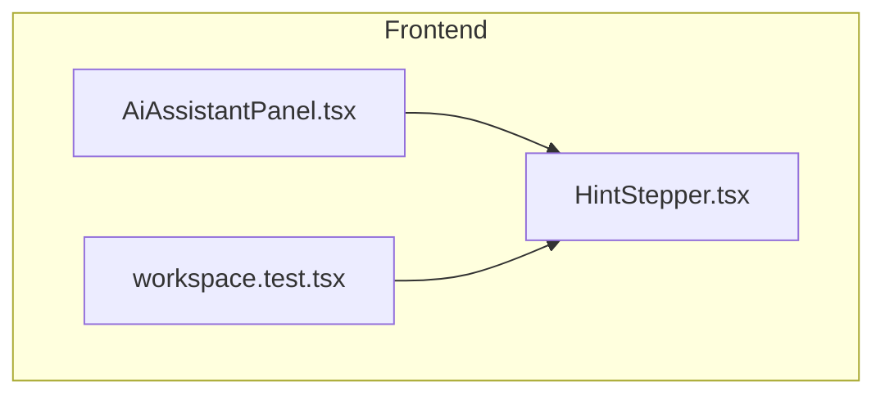
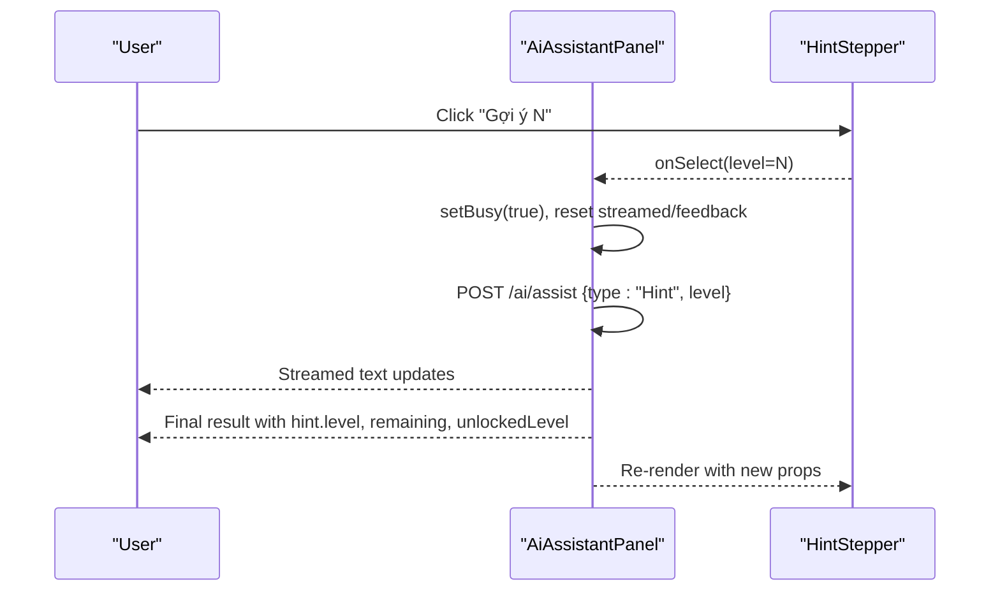
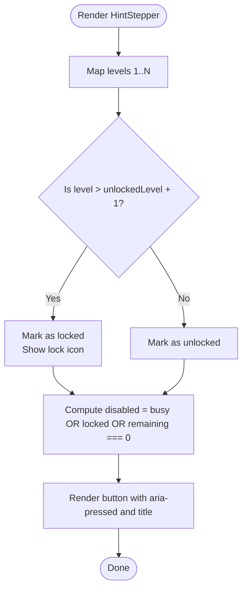
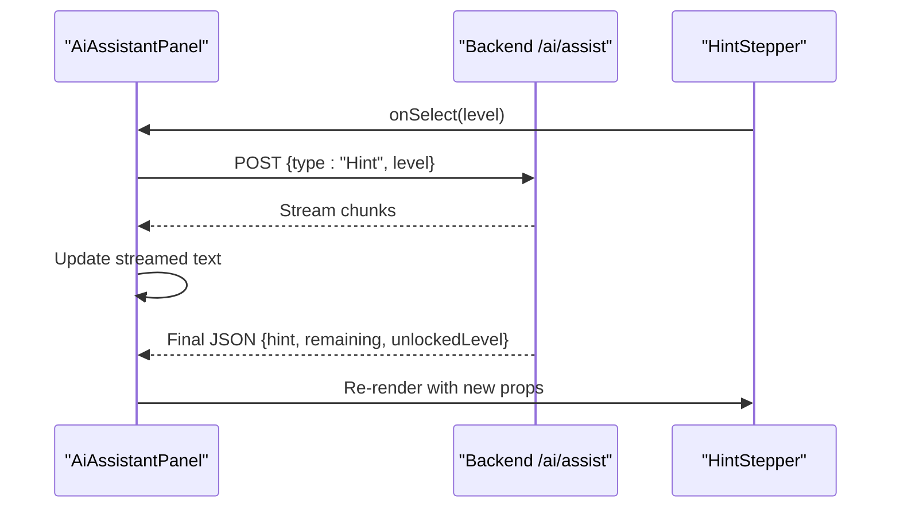
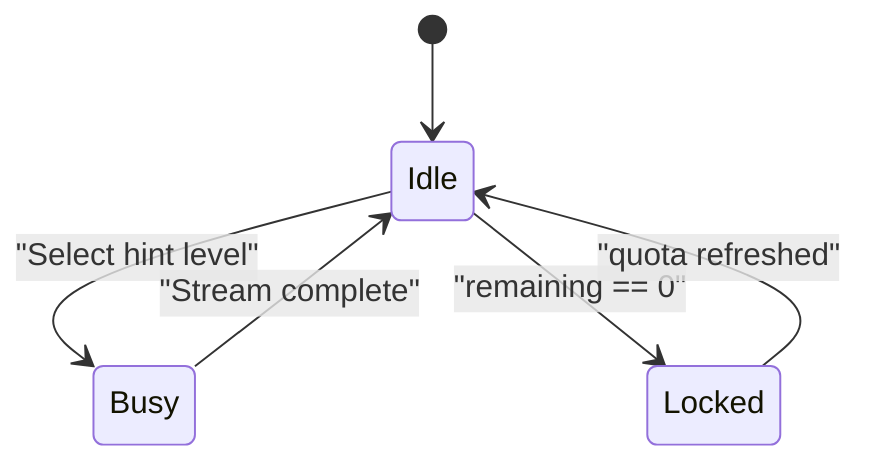
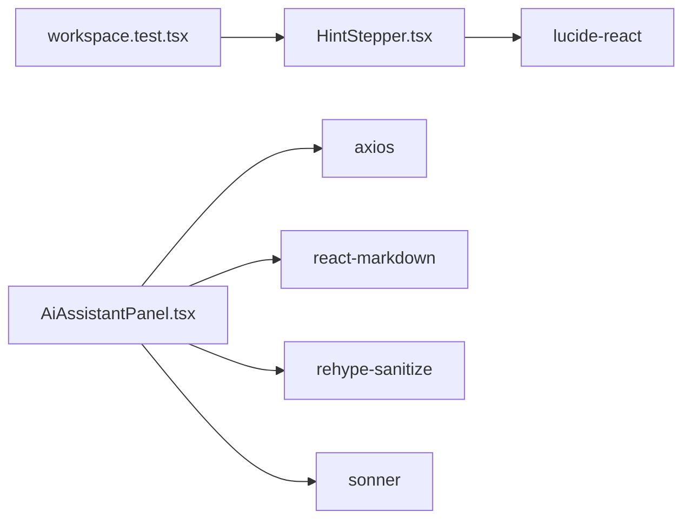

# Hint Stepper Interface

<cite>
**Referenced Files in This Document**
- [HintStepper.tsx](file://frontend/src/features/ai-assistant/HintStepper.tsx)
- [AiAssistantPanel.tsx](file://frontend/src/features/ai-assistant/AiAssistantPanel.tsx)
- [workspace.test.tsx](file://frontend/tests/workspace.test.tsx)
</cite>

## Table of Contents
1. [Introduction](#introduction)
2. [Project Structure](#project-structure)
3. [Core Components](#core-components)
4. [Architecture Overview](#architecture-overview)
5. [Detailed Component Analysis](#detailed-component-analysis)
6. [Dependency Analysis](#dependency-analysis)
7. [Performance Considerations](#performance-considerations)
8. [Troubleshooting Guide](#troubleshooting-guide)
9. [Conclusion](#conclusion)
10. [Appendices](#appendices)

## Introduction
This document explains the Hint Stepper UI component used by the AI Assistant panel. It focuses on:
- The level-based hint progression system
- User interaction patterns and state management
- Props, visual feedback, accessibility, and responsive behavior
- Customization strategies for hint levels, additional hint types, and extended stepper behavior

The Hint Stepper is a small, focused React component that renders three hint levels with locking logic, disabled states based on quota and busy status, and accessible labels. It integrates with the parent AI Assistant panel to request hints at a chosen level and display remaining quota.

## Project Structure
The Hint Stepper lives under the AI assistant feature and is consumed by the AI Assistant panel. Tests verify its locking and disabling behavior.

**Diagram sources**
- [AiAssistantPanel.tsx:1-88](file://frontend/src/features/ai-assistant/AiAssistantPanel.tsx#L1-L88)
- [HintStepper.tsx:1-8](file://frontend/src/features/ai-assistant/HintStepper.tsx#L1-L8)
- [workspace.test.tsx:63-74](file://frontend/tests/workspace.test.tsx#L63-L74)

**Section sources**
- [AiAssistantPanel.tsx:1-88](file://frontend/src/features/ai-assistant/AiAssistantPanel.tsx#L1-L88)
- [HintStepper.tsx:1-8](file://frontend/src/features/ai-assistant/HintStepper.tsx#L1-L8)
- [workspace.test.tsx:63-74](file://frontend/tests/workspace.test.tsx#L63-L74)

## Core Components
- HintStepper: Renders three hint levels (1, 2, 3). Controls are locked or disabled based on unlockedLevel, currentLevel, busy, and remaining quota.
- AiAssistantPanel: Owns the result state, including hint level, remaining quota, and unlocked level. It passes these props to HintStepper and handles streaming responses from the backend.

Key responsibilities:
- HintStepper: Presentational and interactive; no network calls.
- AiAssistantPanel: Stateful orchestrator; manages API requests, streaming, error handling, and feeds data into HintStepper.

**Section sources**
- [HintStepper.tsx:1-8](file://frontend/src/features/ai-assistant/HintStepper.tsx#L1-L8)
- [AiAssistantPanel.tsx:18-88](file://frontend/src/features/ai-assistant/AiAssistantPanel.tsx#L18-L88)

## Architecture Overview
The Hint Stepper is part of a simple two-layer flow:
- Parent panel computes and holds state (result, busy, remaining, unlockedLevel).
- Child stepper renders buttons and delegates selection to the parent via onSelect.

**Diagram sources**
- [AiAssistantPanel.tsx:38-62](file://frontend/src/features/ai-assistant/AiAssistantPanel.tsx#L38-L62)
- [AiAssistantPanel.tsx:70-85](file://frontend/src/features/ai-assistant/AiAssistantPanel.tsx#L70-L85)
- [HintStepper.tsx:2-6](file://frontend/src/features/ai-assistant/HintStepper.tsx#L2-L6)

## Detailed Component Analysis

### HintStepper Component
Purpose:
- Render a row of hint level buttons (1, 2, 3).
- Lock future levels beyond unlockedLevel + 1.
- Disable all buttons when busy or remaining equals zero.
- Highlight the current level using aria-pressed.
- Provide a lock icon for locked levels and a tooltip explaining how to unlock further levels.

Props:
- unlockedLevel: number — highest hint level currently available.
- currentLevel?: number — active hint level.
- busy: boolean — indicates an ongoing request.
- remaining?: number — remaining hint quota for today.
- onSelect: (level: number) => void — callback invoked when a user selects a level.

Behavior details:
- Locked condition: level > unlockedLevel + 1.
- Disabled condition: busy OR locked OR remaining === 0.
- Visual state: selected button uses a distinct background/border; hovered unselected buttons show hover color.
- Accessibility:
  - nav with aria-label for the hint navigation region.
  - Each button has aria-pressed matching currentLevel.
  - Locked buttons include a title describing how to unlock further levels.
  - Uses semantic <nav> and <button> elements.

Responsive considerations:
- Buttons use flex-wrap to adapt to narrow screens.
- Spacing and sizing are compact but readable across devices.

Customization hooks:
- Extend levels: change the mapped array from [1, 2, 3] to any desired set.
- Customize visuals: adjust Tailwind classes for colors, borders, and spacing.
- Change unlocking policy: modify the locked condition to fit your game-like progression.

**Diagram sources**
- [HintStepper.tsx:2-6](file://frontend/src/features/ai-assistant/HintStepper.tsx#L2-L6)

**Section sources**
- [HintStepper.tsx:1-8](file://frontend/src/features/ai-assistant/HintStepper.tsx#L1-L8)

### AiAssistantPanel Integration
Responsibilities:
- Maintain result state containing hint metadata (level, stage, message, steps, suspectedLines, references), remaining quota, and unlockedLevel.
- Handle streaming responses from /ai/assist and update UI accordingly.
- Pass unlockedLevel, currentLevel, busy, remaining, and onSelect to HintStepper.
- Show remaining quota in the header and disable actions when quota is exhausted.

Interaction flow:
- When a user clicks a hint level, the panel posts a request with type "Hint" and the selected level.
- While streaming, busy is true and streamed text is shown.
- On success, the panel sets the final result and highlights suggested lines.
- Error codes map to user-friendly messages; some errors affect availability (e.g., quota exceeded).

**Diagram sources**
- [AiAssistantPanel.tsx:38-62](file://frontend/src/features/ai-assistant/AiAssistantPanel.tsx#L38-L62)
- [AiAssistantPanel.tsx:70-85](file://frontend/src/features/ai-assistant/AiAssistantPanel.tsx#L70-L85)

**Section sources**
- [AiAssistantPanel.tsx:18-88](file://frontend/src/features/ai-assistant/AiAssistantPanel.tsx#L18-L88)

### State Management and Level Progression
State ownership:
- AiAssistantPanel owns result, resultCode, streamed, question, busy, feedback, and feedbackBusy.
- HintStepper is stateless; it reflects props only.

Level progression rules:
- unlockedLevel controls which levels are available.
- A level is locked if it exceeds unlockedLevel + 1.
- All buttons are disabled when busy or when remaining equals zero.
- The current level is indicated via aria-pressed.

Quota and feedback:
- remaining is displayed in the panel header and disables interactions when zero.
- Feedback buttons allow rating hint usefulness; they do not affect HintStepper directly.

**Diagram sources**
- [AiAssistantPanel.tsx:38-62](file://frontend/src/features/ai-assistant/AiAssistantPanel.tsx#L38-L62)
- [AiAssistantPanel.tsx:70-85](file://frontend/src/features/ai-assistant/AiAssistantPanel.tsx#L70-L85)
- [HintStepper.tsx:2-6](file://frontend/src/features/ai-assistant/HintStepper.tsx#L2-L6)

**Section sources**
- [AiAssistantPanel.tsx:18-88](file://frontend/src/features/ai-assistant/AiAssistantPanel.tsx#L18-L88)
- [HintStepper.tsx:1-8](file://frontend/src/features/ai-assistant/HintStepper.tsx#L1-L8)

### Accessibility Features
- Semantic landmarks: <nav> with aria-label for hint navigation.
- Button semantics: each level is a <button> with aria-pressed indicating selection.
- Tooltips: locked buttons provide a title explaining how to unlock further levels.
- Live regions: the panel uses aria-live="polite" for streaming content updates.
- Keyboard support: native <button> elements ensure focusability and activation via keyboard.

**Section sources**
- [HintStepper.tsx:2-6](file://frontend/src/features/ai-assistant/HintStepper.tsx#L2-L6)
- [AiAssistantPanel.tsx:70-85](file://frontend/src/features/ai-assistant/AiAssistantPanel.tsx#L70-L85)

### Responsive Design Considerations
- Flexbox layout with wrap ensures buttons reflow on smaller screens.
- Compact padding and font sizes keep the stepper usable on mobile.
- Colors and borders maintain contrast and readability across themes.

[No sources needed since this section provides general guidance]

### Examples and Customization

#### Customizing Hint Levels
- To add more levels, change the mapped array from [1, 2, 3] to a larger set.
- Adjust the locked condition to control progression (e.g., unlockedLevel + 2).
- Example path: [HintStepper.tsx:2-6](file://frontend/src/features/ai-assistant/HintStepper.tsx#L2-L6)

#### Integrating Additional Hint Types
- The panel supports different action types such as "Ask", "TraceTestCase", and "ExplainError".
- To integrate a new hint type, add a new button in the panel and call ask with the new type.
- Example paths:
  - [AiAssistantPanel.tsx:82-84](file://frontend/src/features/ai-assistant/AiAssistantPanel.tsx#L82-L84)
  - [AiAssistantPanel.tsx:38-62](file://frontend/src/features/ai-assistant/AiAssistantPanel.tsx#L38-L62)

#### Extending Stepper Behavior
- Add custom icons or badges per level by extending the rendered content inside the loop.
- Introduce a “skip” or “auto-next” action by adding a handler in the parent and wiring it to HintStepper’s onSelect.
- Persist user preferences (e.g., default level) in local storage and pass them as props.

[No sources needed since this section provides general guidance]

## Dependency Analysis
- HintStepper depends on lucide-react for the lock icon.
- AiAssistantPanel depends on axios, react-markdown, rehype-sanitize, sonner, and internal modules for streaming and RAG sources.
- Tests import HintStepper to validate locking and disabling behavior.

**Diagram sources**
- [HintStepper.tsx:1-8](file://frontend/src/features/ai-assistant/HintStepper.tsx#L1-L8)
- [AiAssistantPanel.tsx:1-10](file://frontend/src/features/ai-assistant/AiAssistantPanel.tsx#L1-L10)
- [workspace.test.tsx:1-6](file://frontend/tests/workspace.test.tsx#L1-L6)

**Section sources**
- [HintStepper.tsx:1-8](file://frontend/src/features/ai-assistant/HintStepper.tsx#L1-L8)
- [AiAssistantPanel.tsx:1-10](file://frontend/src/features/ai-assistant/AiAssistantPanel.tsx#L1-L10)
- [workspace.test.tsx:1-6](file://frontend/tests/workspace.test.tsx#L1-L6)

## Performance Considerations
- HintStepper is lightweight and stateless; rendering cost is minimal.
- AiAssistantPanel streams responses incrementally; avoid unnecessary re-renders by keeping state updates granular.
- Debounce or throttle repeated hint requests if users rapidly click levels.
- Consider memoizing expensive computations in the panel (e.g., inferred stage) if results grow large.

[No sources needed since this section provides general guidance]

## Troubleshooting Guide
Common issues and resolutions:
- Quota exhausted:
  - Symptom: All hint buttons disabled; header shows remaining equals zero.
  - Resolution: Wait until quota refreshes or implement a mechanism to refresh quota.
  - Evidence: Tests assert disabling when remaining equals zero.
  - Reference: [workspace.test.tsx:63-74](file://frontend/tests/workspace.test.tsx#L63-L74)

- Busy state blocking interactions:
  - Symptom: Buttons disabled while a request is in flight.
  - Resolution: Ensure the panel clears busy after stream completion or error.
  - Reference: [AiAssistantPanel.tsx:38-62](file://frontend/src/features/ai-assistant/AiAssistantPanel.tsx#L38-L62)

- Locked levels not unlocking:
  - Symptom: Future levels remain locked even after submissions.
  - Resolution: Verify unlockedLevel updates correctly from server response.
  - Reference: [AiAssistantPanel.tsx:70-85](file://frontend/src/features/ai-assistant/AiAssistantPanel.tsx#L70-L85)

- Accessibility concerns:
  - Symptom: Screen readers do not announce selection state.
  - Resolution: Ensure aria-pressed is updated when currentLevel changes.
  - Reference: [HintStepper.tsx:2-6](file://frontend/src/features/ai-assistant/HintStepper.tsx#L2-L6)

**Section sources**
- [workspace.test.tsx:63-74](file://frontend/tests/workspace.test.tsx#L63-L74)
- [AiAssistantPanel.tsx:38-62](file://frontend/src/features/ai-assistant/AiAssistantPanel.tsx#L38-L62)
- [AiAssistantPanel.tsx:70-85](file://frontend/src/features/ai-assistant/AiAssistantPanel.tsx#L70-L85)
- [HintStepper.tsx:2-6](file://frontend/src/features/ai-assistant/HintStepper.tsx#L2-L6)

## Conclusion
The Hint Stepper provides a clear, accessible interface for guiding learners through progressive hints. Its simplicity makes it easy to customize and extend. The parent AI Assistant panel manages state, networking, and error handling, while the stepper focuses on presentation and interaction. By adjusting props and behaviors, teams can tailor hint progression, quota policies, and visual design to their product needs.

[No sources needed since this section summarizes without analyzing specific files]

## Appendices

### Props Reference
- unlockedLevel: number — Highest available hint level.
- currentLevel?: number — Currently selected hint level.
- busy: boolean — Indicates ongoing request.
- remaining?: number — Remaining hint quota.
- onSelect: (level: number) => void — Callback for level selection.

**Section sources**
- [HintStepper.tsx:2-6](file://frontend/src/features/ai-assistant/HintStepper.tsx#L2-L6)