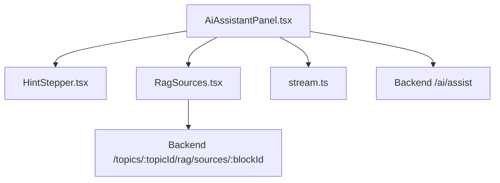
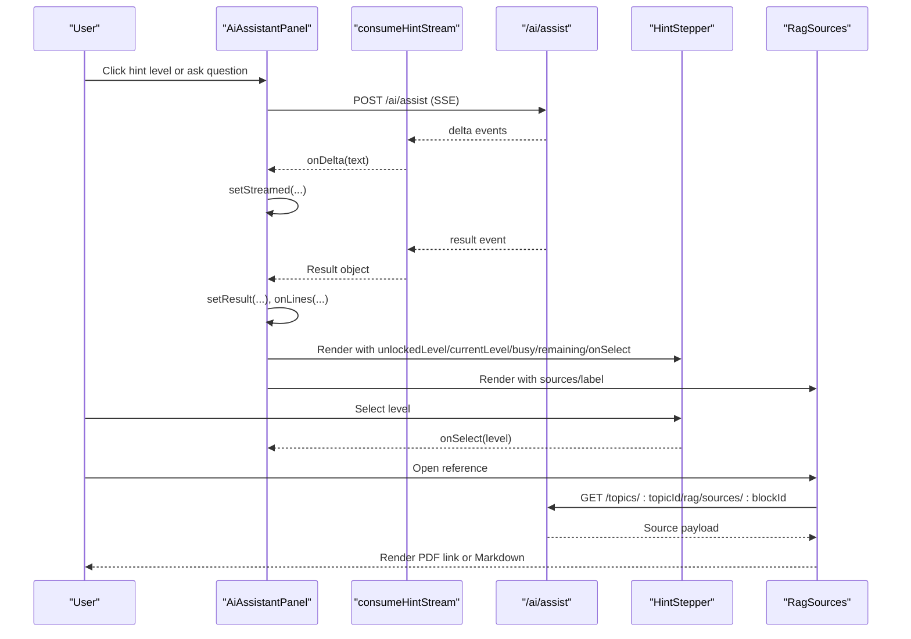
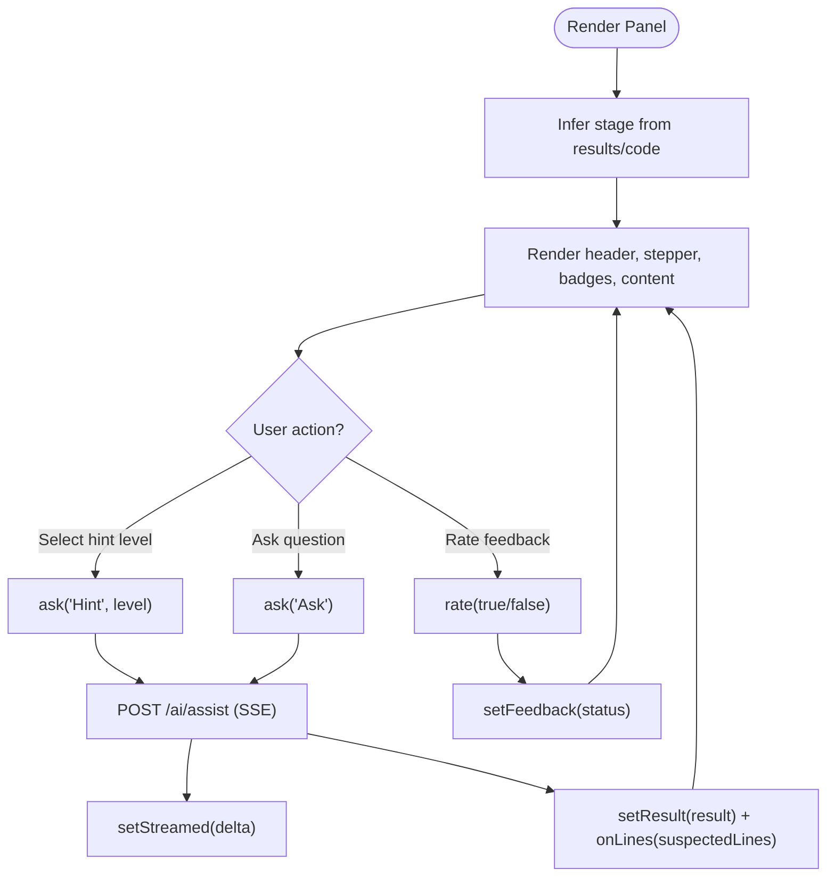
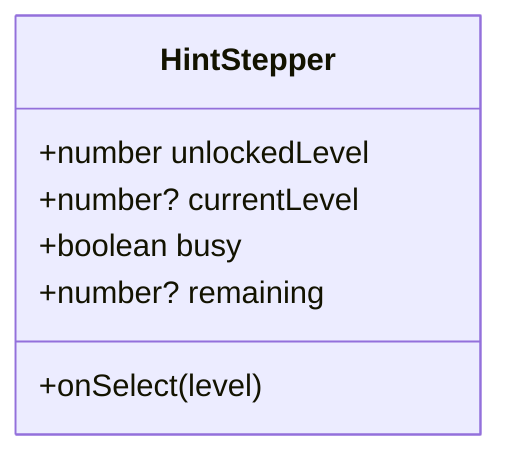
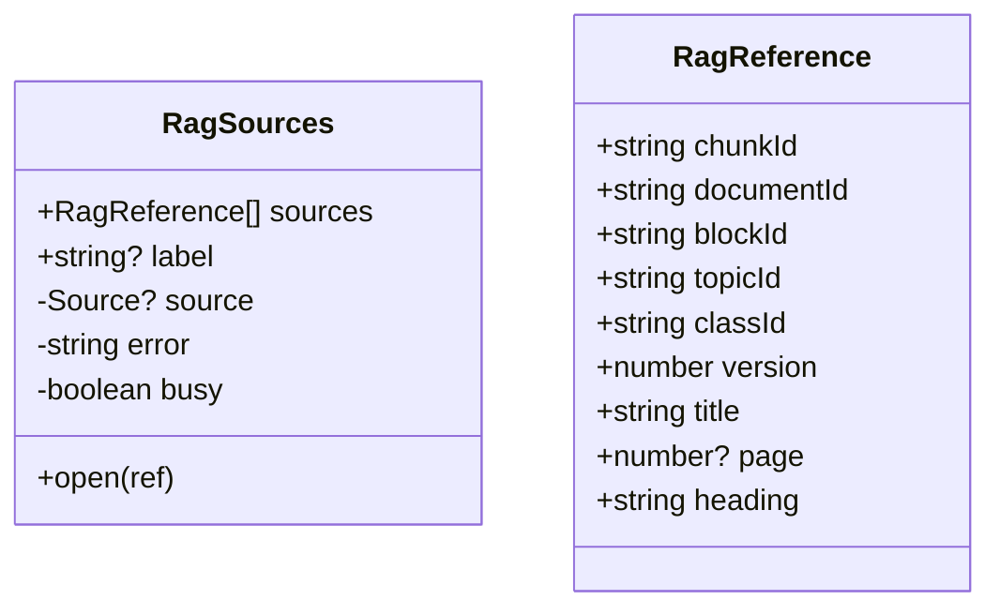
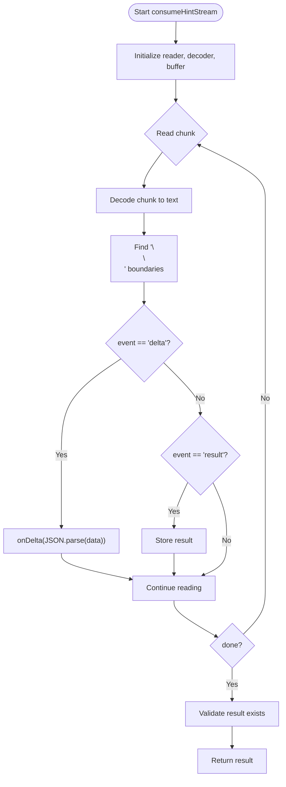
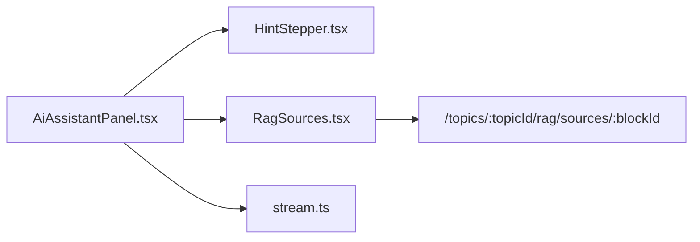

# Component Composition

<cite>
**Referenced Files in This Document**
- [AiAssistantPanel.tsx](file://frontend/src/features/ai-assistant/AiAssistantPanel.tsx)
- [HintStepper.tsx](file://frontend/src/features/ai-assistant/HintStepper.tsx)
- [RagSources.tsx](file://frontend/src/features/ai-assistant/RagSources.tsx)
- [stream.ts](file://frontend/src/features/ai-assistant/stream.ts)
- [assistant.css](file://frontend/src/features/ai-assistant/assistant.css)
</cite>

## Table of Contents
1. [Introduction](#introduction)
2. [Project Structure](#project-structure)
3. [Core Components](#core-components)
4. [Architecture Overview](#architecture-overview)
5. [Detailed Component Analysis](#detailed-component-analysis)
6. [Dependency Analysis](#dependency-analysis)
7. [Performance Considerations](#performance-considerations)
8. [Troubleshooting Guide](#troubleshooting-guide)
9. [Conclusion](#conclusion)

## Introduction
This document explains the component composition architecture of the AI assistant panel. It focuses on how the main panel orchestrates child components, specifically HintStepper and RagSources. The documentation covers prop passing patterns, event delegation, data flow between parent and children, lifecycle management, conditional rendering, styling coordination, integration points, and extension mechanisms for adding new sub-components.

## Project Structure
The AI assistant feature is implemented as a small React feature module under the frontend application. The key files are:
- AiAssistantPanel.tsx: Main container that owns state, handles streaming requests, and composes child components.
- HintStepper.tsx: Presentational stepper for hint levels with lock states.
- RagSources.tsx: Reference viewer that fetches and renders source content.
- stream.ts: Utility to consume server-sent events (SSE) and decode incremental JSON deltas.
- assistant.css: Placeholder indicating styles are handled via Tailwind utilities.

**Diagram sources**
- [AiAssistantPanel.tsx:18-87](file://frontend/src/features/ai-assistant/AiAssistantPanel.tsx#L18-L87)
- [HintStepper.tsx:1-8](file://frontend/src/features/ai-assistant/HintStepper.tsx#L1-L8)
- [RagSources.tsx:1-36](file://frontend/src/features/ai-assistant/RagSources.tsx#L1-L36)
- [stream.ts:1-25](file://frontend/src/features/ai-assistant/stream.ts#L1-L25)

**Section sources**
- [AiAssistantPanel.tsx:1-88](file://frontend/src/features/ai-assistant/AiAssistantPanel.tsx#L1-L88)
- [HintStepper.tsx:1-8](file://frontend/src/features/ai-assistant/HintStepper.tsx#L1-L8)
- [RagSources.tsx:1-36](file://frontend/src/features/ai-assistant/RagSources.tsx#L1-L36)
- [stream.ts:1-25](file://frontend/src/features/ai-assistant/stream.ts#L1-L25)
- [assistant.css:1-2](file://frontend/src/features/ai-assistant/assistant.css#L1-L2)

## Core Components
- AiAssistantPanel: Orchestrates user input, streaming hints, error handling, feedback submission, and composes HintStepper and RagSources. It also coordinates test result badges and action buttons based on inferred stage.
- HintStepper: Renders hint level buttons, enforces unlock rules, and delegates selection to the parent via an onSelect callback.
- RagSources: Displays available references, fetches content by topic and block, and renders either a PDF link or sanitized Markdown.
- stream: Decodes SSE streams into incremental text deltas and final result objects.

Key responsibilities and interactions:
- Parent-to-child props:
  - HintStepper receives unlockedLevel, currentLevel, busy, remaining, and onSelect.
  - RagSources receives sources array and optional label.
- Child-to-parent events:
  - HintStepper calls onSelect(level) when a hint level is selected.
  - RagSources performs its own API calls and manages internal UI state; it does not emit custom events to the parent.
- Data flow:
  - Parent collects results from backend via SSE and passes structured hint data to children.
  - Children render derived UI without owning the primary hint state.

**Section sources**
- [AiAssistantPanel.tsx:18-87](file://frontend/src/features/ai-assistant/AiAssistantPanel.tsx#L18-L87)
- [HintStepper.tsx:1-8](file://frontend/src/features/ai-assistant/HintStepper.tsx#L1-L8)
- [RagSources.tsx:1-36](file://frontend/src/features/ai-assistant/RagSources.tsx#L1-L36)
- [stream.ts:1-25](file://frontend/src/features/ai-assistant/stream.ts#L1-L25)

## Architecture Overview
The AI assistant panel follows a unidirectional data flow pattern:
- User actions trigger parent handlers.
- Parent makes network requests using axios and consumes SSE via stream.ts.
- Parent updates local state and renders child components with props.
- Children respond to props and delegate interactions back to parent through callbacks.

**Diagram sources**
- [AiAssistantPanel.tsx:38-69](file://frontend/src/features/ai-assistant/AiAssistantPanel.tsx#L38-L69)
- [stream.ts:2-23](file://frontend/src/features/ai-assistant/stream.ts#L2-L23)
- [HintStepper.tsx:2-6](file://frontend/src/features/ai-assistant/HintStepper.tsx#L2-L6)
- [RagSources.tsx:10-33](file://frontend/src/features/ai-assistant/RagSources.tsx#L10-L33)

## Detailed Component Analysis

### AiAssistantPanel
Responsibilities:
- Owns state for result, streamed text, question input, busy indicators, and feedback status.
- Infers current stage from test results and code state.
- Handles SSE streaming, aborting previous requests, and updating UI incrementally.
- Delegates line highlighting to parent via onLines callback.
- Composes HintStepper and RagSources with appropriate props.
- Provides contextual action buttons based on stage.
- Manages feedback submission and error notifications.

Prop passing patterns:
- HintStepper:
  - unlockedLevel: controls which levels are locked.
  - currentLevel: highlights active level.
  - busy: disables interaction during streaming.
  - remaining: disables further selections when quota is exhausted.
  - onSelect: callback invoked with selected level.
- RagSources:
  - sources: array of reference metadata.
  - label: accessible title for the section.

Event handling delegation:
- HintStepper.onSelect(level) triggers ask('Hint', level).
- Feedback buttons call rate(true/false) to submit feedback.

Lifecycle management:
- AbortController is created per request and aborted on cleanup to prevent stale updates.
- Latest code ref ensures streamed updates only apply to the latest request.

Conditional rendering:
- Test result badges appear in PartialPass stage.
- Action buttons vary by stage (LogicError, PartialPass, CannotRun).
- HintStepper and RagSources are always rendered but behave conditionally based on props.

Styling coordination:
- Inline Tailwind utility classes define layout, colors, spacing, and accessibility attributes.
- assistant.css is a placeholder; all visual styling is applied via Tailwind.

**Diagram sources**
- [AiAssistantPanel.tsx:18-87](file://frontend/src/features/ai-assistant/AiAssistantPanel.tsx#L18-L87)
- [stream.ts:2-23](file://frontend/src/features/ai-assistant/stream.ts#L2-L23)

**Section sources**
- [AiAssistantPanel.tsx:18-87](file://frontend/src/features/ai-assistant/AiAssistantPanel.tsx#L18-L87)

### HintStepper
Responsibilities:
- Renders three hint levels with lock icons and disabled states.
- Highlights the current level.
- Enforces unlock logic: levels beyond unlockedLevel + 1 are locked.
- Disables interaction when busy or when remaining quota is zero.
- Emits onSelect(level) to parent.

Props:
- unlockedLevel: number
- currentLevel?: number
- busy: boolean
- remaining?: number
- onSelect: (level: number) => void

Behavioral notes:
- Accessibility includes aria-pressed for active level and descriptive titles for locked states.
- Visual feedback uses Tailwind classes for hover, focus, and disabled states.

**Diagram sources**
- [HintStepper.tsx:1-8](file://frontend/src/features/ai-assistant/HintStepper.tsx#L1-L8)

**Section sources**
- [HintStepper.tsx:1-8](file://frontend/src/features/ai-assistant/HintStepper.tsx#L1-L8)

### RagSources
Responsibilities:
- Lists available references provided by parent.
- Fetches source content by topic and block ID.
- Validates URLs and appends page anchors when present.
- Renders either a PDF link or sanitized Markdown content.
- Shows error messages when fetching fails or permissions change.

Props:
- sources: RagReference[]
- label?: string

Data model:
- RagReference includes identifiers for chunk, document, block, topic, class, version, plus title, optional page, and heading.

Internal state:
- source: currently opened source payload.
- error: message string for failures.
- busy: loading indicator while fetching.

**Diagram sources**
- [RagSources.tsx:1-36](file://frontend/src/features/ai-assistant/RagSources.tsx#L1-L36)

**Section sources**
- [RagSources.tsx:1-36](file://frontend/src/features/ai-assistant/RagSources.tsx#L1-L36)

### stream.ts
Responsibilities:
- Consumes ReadableStream of Uint8Array chunks.
- Decodes UTF-8 text across arbitrary boundaries.
- Parses SSE events with names delta and result.
- Invokes onDelta for incremental text and returns the final result object.

Usage:
- AiAssistantPanel uses consumeHintStream to update streamed text and set final result.

**Diagram sources**
- [stream.ts:1-25](file://frontend/src/features/ai-assistant/stream.ts#L1-L25)

**Section sources**
- [stream.ts:1-25](file://frontend/src/features/ai-assistant/stream.ts#L1-L25)

## Dependency Analysis
Component relationships:
- AiAssistantPanel depends on HintStepper and RagSources for presentation.
- AiAssistantPanel depends on stream.ts for SSE consumption.
- RagSources depends on backend topics endpoint for source retrieval.
- All components use Tailwind utility classes for styling; assistant.css is a placeholder.

**Diagram sources**
- [AiAssistantPanel.tsx:1-88](file://frontend/src/features/ai-assistant/AiAssistantPanel.tsx#L1-L88)
- [HintStepper.tsx:1-8](file://frontend/src/features/ai-assistant/HintStepper.tsx#L1-L8)
- [RagSources.tsx:1-36](file://frontend/src/features/ai-assistant/RagSources.tsx#L1-L36)
- [stream.ts:1-25](file://frontend/src/features/ai-assistant/stream.ts#L1-L25)

**Section sources**
- [AiAssistantPanel.tsx:1-88](file://frontend/src/features/ai-assistant/AiAssistantPanel.tsx#L1-L88)
- [HintStepper.tsx:1-8](file://frontend/src/features/ai-assistant/HintStepper.tsx#L1-L8)
- [RagSources.tsx:1-36](file://frontend/src/features/ai-assistant/RagSources.tsx#L1-L36)
- [stream.ts:1-25](file://frontend/src/features/ai-assistant/stream.ts#L1-L25)

## Performance Considerations
- Streaming updates: Incremental rendering via onDelta avoids full re-renders until final result arrives.
- AbortController: Cancels in-flight requests when code changes or component unmounts, preventing unnecessary work and memory leaks.
- Conditional rendering: Only renders heavy sections (e.g., test badges, action buttons) when relevant stages are active.
- Sanitization: Uses rehype-sanitize to safely render Markdown, reducing risk and overhead from unsafe HTML.

[No sources needed since this section provides general guidance]

## Troubleshooting Guide
Common issues and resolutions:
- Stale streamed updates after code changes:
  - Ensure the latest code ref matches the requested code before applying streamed text.
- Quota exceeded errors:
  - Display informative messages and disable further hint selections.
- Network timeouts or cancellations:
  - Handle axios cancellation gracefully and avoid showing error toasts for intentional aborts.
- Reference access failures:
  - Show user-friendly error messages and suggest asking again to refresh references.

Operational tips:
- Use aria-busy and aria-live regions to improve accessibility during streaming.
- Validate external URLs before opening PDF links to prevent protocol misuse.

**Section sources**
- [AiAssistantPanel.tsx:38-69](file://frontend/src/features/ai-assistant/AiAssistantPanel.tsx#L38-L69)
- [RagSources.tsx:14-25](file://frontend/src/features/ai-assistant/RagSources.tsx#L14-L25)

## Conclusion
The AI assistant panel demonstrates a clear composition pattern where the parent component owns state and orchestrates child components through props and callbacks. HintStepper and RagSources remain focused on presentation and localized interactions, while AiAssistantPanel manages streaming, error handling, and lifecycle concerns. Styling is consistently applied via Tailwind utilities, and extension points exist for adding new sub-components by following the established prop/event contracts.

[No sources needed since this section summarizes without analyzing specific files]