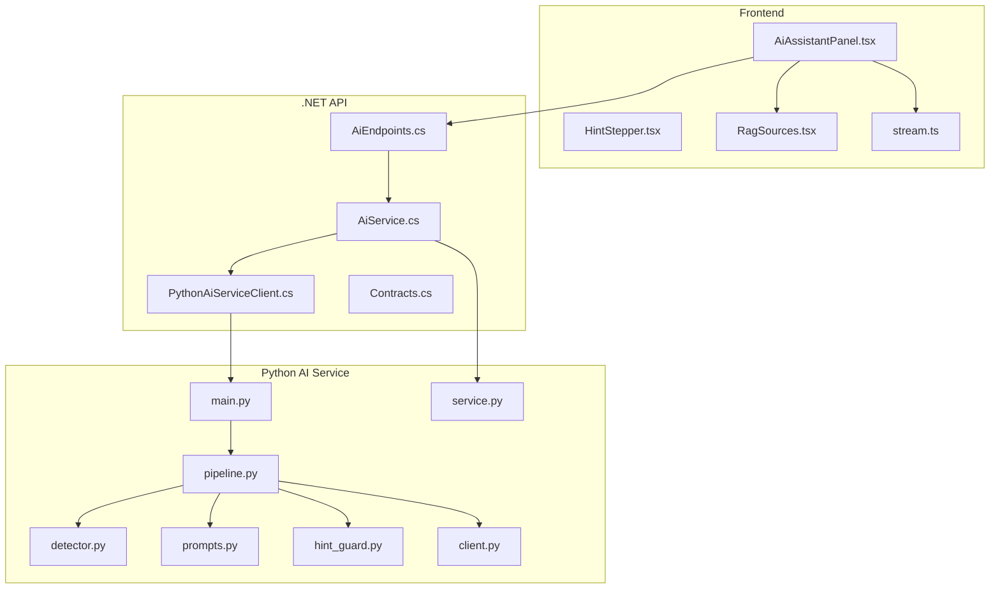
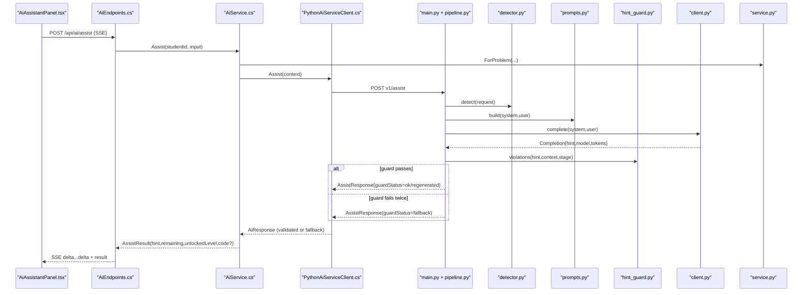
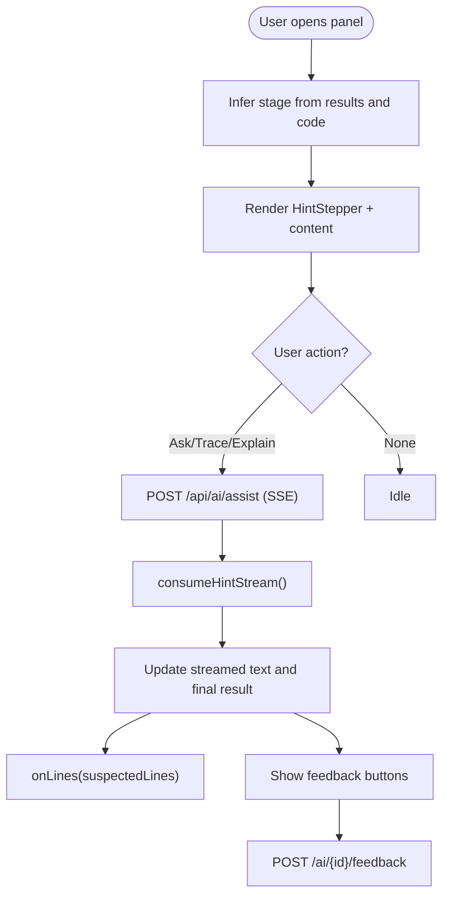
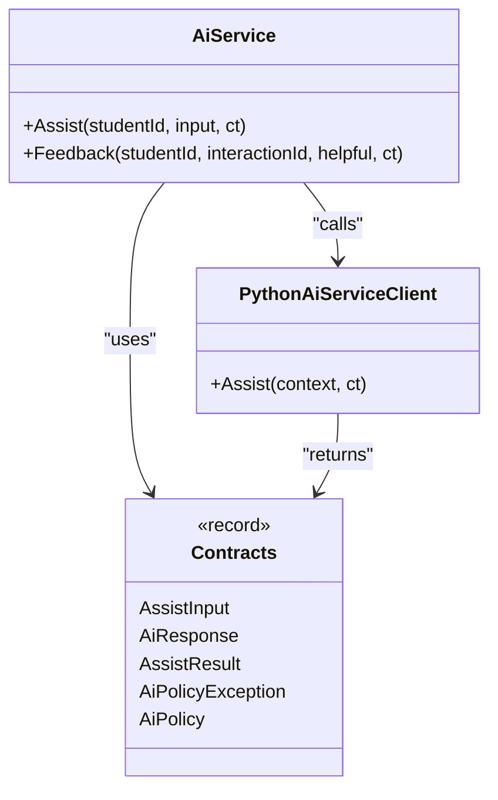
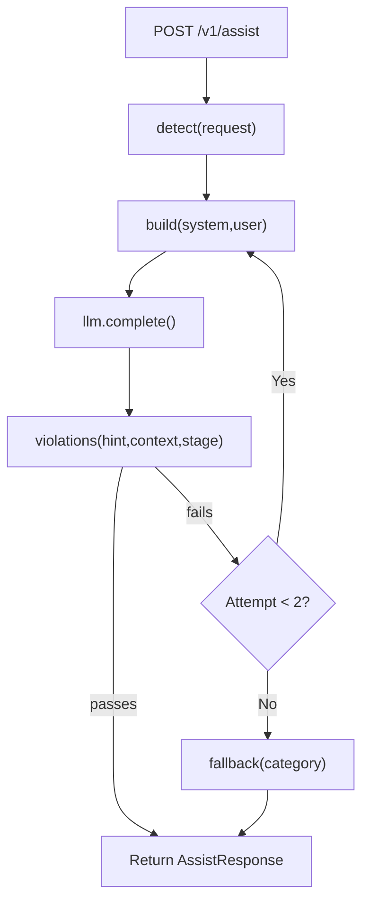
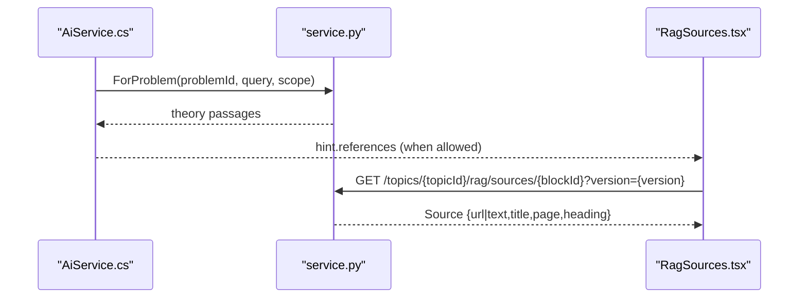
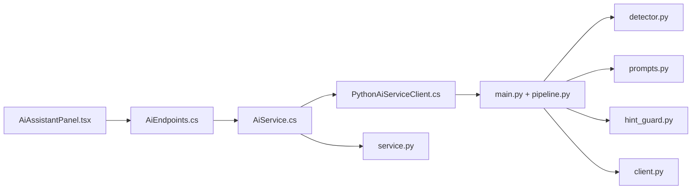

# Main Panel Architecture

<cite>
**Referenced Files in This Document**
- [AiAssistantPanel.tsx](file://frontend/src/features/ai-assistant/AiAssistantPanel.tsx)
- [HintStepper.tsx](file://frontend/src/features/ai-assistant/HintStepper.tsx)
- [RagSources.tsx](file://frontend/src/features/ai-assistant/RagSources.tsx)
- [stream.ts](file://frontend/src/features/ai-assistant/stream.ts)
- [AiEndpoints.cs](file://api/src/Api/CodePath.Api/Endpoints/AiEndpoints.cs)
- [AiService.cs](file://api/src/Infrastructure/CodePath.Infrastructure/Ai/AiService.cs)
- [PythonAiServiceClient.cs](file://api/src/Infrastructure/CodePath.Infrastructure/Ai/PythonAiServiceClient.cs)
- [Contracts.cs](file://api/src/Application/CodePath.Application/Ai/Contracts.cs)
- [main.py](file://ai-service/app/main.py)
- [pipeline.py](file://ai-service/app/api/pipeline.py)
- [detector.py](file://ai-service/app/stage/detector.py)
- [prompts.py](file://ai-service/app/hints/prompts.py)
- [hint_guard.py](file://ai-service/app/guard/hint_guard.py)
- [client.py](file://ai-service/app/llm/client.py)
- [service.py](file://ai-service/app/rag/service.py)
</cite>

## Table of Contents
1. [Introduction](#introduction)
2. [Project Structure](#project-structure)
3. [Core Components](#core-components)
4. [Architecture Overview](#architecture-overview)
5. [Detailed Component Analysis](#detailed-component-analysis)
6. [Dependency Analysis](#dependency-analysis)
7. [Performance Considerations](#performance-considerations)
8. [Troubleshooting Guide](#troubleshooting-guide)
9. [Conclusion](#conclusion)
10. [Appendices](#appendices)

## Introduction
This document explains the architecture of the main AI assistant panel and its end-to-end integration across the frontend, API layer, and Python AI service. It focuses on:
- The React component composition pattern used by the panel
- State management strategies for streaming hints, stage inference, and user interactions
- Integration with test results, RAG sources, feedback, and rate/quota controls
- Stage inference logic and result processing pipeline
- Event handling mechanisms and SSE streaming
- API contracts, error recovery, caching, and guardrails
- Performance optimizations and extension points for new hint types and UI customization

## Project Structure
The AI assistant spans three layers:
- Frontend React components that render the panel, stream hints, and display references
- .NET API endpoints that enforce policy, orchestrate context building, and stream responses
- Python AI service that detects student stage, builds prompts, calls LLM providers, applies guards, and returns structured hints

**Diagram sources**
- [AiAssistantPanel.tsx:1-88](file://frontend/src/features/ai-assistant/AiAssistantPanel.tsx#L1-L88)
- [AiEndpoints.cs:1-45](file://api/src/Api/CodePath.Api/Endpoints/AiEndpoints.cs#L1-L45)
- [AiService.cs:1-125](file://api/src/Infrastructure/CodePath.Infrastructure/Ai/AiService.cs#L1-L125)
- [PythonAiServiceClient.cs:1-41](file://api/src/Infrastructure/CodePath.Infrastructure/Ai/PythonAiServiceClient.cs#L1-L41)
- [Contracts.cs:1-32](file://api/src/Application/CodePath.Application/Ai/Contracts.cs#L1-L32)
- [main.py:1-85](file://ai-service/app/main.py#L1-L85)
- [pipeline.py:1-41](file://ai-service/app/api/pipeline.py#L1-L41)
- [detector.py:1-38](file://ai-service/app/stage/detector.py#L1-L38)
- [prompts.py:1-41](file://ai-service/app/hints/prompts.py#L1-L41)
- [hint_guard.py:1-48](file://ai-service/app/guard/hint_guard.py#L1-L48)
- [client.py:1-83](file://ai-service/app/llm/client.py#L1-L83)
- [service.py:1-144](file://ai-service/app/rag/service.py#L1-L144)

**Section sources**
- [AiAssistantPanel.tsx:1-88](file://frontend/src/features/ai-assistant/AiAssistantPanel.tsx#L1-L88)
- [AiEndpoints.cs:1-45](file://api/src/Api/CodePath.Api/Endpoints/AiEndpoints.cs#L1-L45)
- [AiService.cs:1-125](file://api/src/Infrastructure/CodePath.Infrastructure/Ai/AiService.cs#L1-L125)
- [main.py:1-85](file://ai-service/app/main.py#L1-L85)

## Core Components
- AiAssistantPanel: Orchestrates state, stage inference, streaming, and user actions (ask, trace, explain, feedback).
- HintStepper: Renders level-stepped hint selection with lock/unlock behavior.
- RagSources: Displays and fetches learning material references returned by the AI pipeline.
- stream: Decodes Server-Sent Events into incremental text deltas and a final JSON result.
- AiEndpoints: Exposes /api/ai/assist and feedback; streams SSE when requested.
- AiService: Enforces policy, builds context, integrates RAG, persists interactions, and returns remaining quota and unlocked level.
- PythonAiServiceClient: Validates and normalizes AI responses; provides fallback hints on failure.
- main.py + pipeline.py: FastAPI entrypoint, assist orchestration, caching, guard checks, and fallback generation.
- detector.py: Rule-based stage detection with optional ML refinement.
- prompts.py: Builds system/user prompts from templates and strategy configuration.
- hint_guard.py: Guardrails to prevent unsafe or overly complete code leakage.
- client.py: Multi-provider LLM client with retries and circuit breaker-like backoff.
- service.py: RAG indexing/search over Qdrant with embedding and scope filtering.

**Section sources**
- [AiAssistantPanel.tsx:1-88](file://frontend/src/features/ai-assistant/AiAssistantPanel.tsx#L1-L88)
- [HintStepper.tsx:1-8](file://frontend/src/features/ai-assistant/HintStepper.tsx#L1-L8)
- [RagSources.tsx:1-36](file://frontend/src/features/ai-assistant/RagSources.tsx#L1-L36)
- [stream.ts:1-25](file://frontend/src/features/ai-assistant/stream.ts#L1-L25)
- [AiEndpoints.cs:1-45](file://api/src/Api/CodePath.Api/Endpoints/AiEndpoints.cs#L1-L45)
- [AiService.cs:1-125](file://api/src/Infrastructure/CodePath.Infrastructure/Ai/AiService.cs#L1-L125)
- [PythonAiServiceClient.cs:1-41](file://api/src/Infrastructure/CodePath.Infrastructure/Ai/PythonAiServiceClient.cs#L1-L41)
- [main.py:1-85](file://ai-service/app/main.py#L1-L85)
- [pipeline.py:1-41](file://ai-service/app/api/pipeline.py#L1-L41)
- [detector.py:1-38](file://ai-service/app/stage/detector.py#L1-L38)
- [prompts.py:1-41](file://ai-service/app/hints/prompts.py#L1-L41)
- [hint_guard.py:1-48](file://ai-service/app/guard/hint_guard.py#L1-L48)
- [client.py:1-83](file://ai-service/app/llm/client.py#L1-L83)
- [service.py:1-144](file://ai-service/app/rag/service.py#L1-L144)

## Architecture Overview
The request flow is designed for safety, performance, and educational value:
- The frontend requests a hint via SSE, receiving incremental message chunks followed by a final result object.
- The API enforces authorization, problem access, rate limits, daily quotas, and level unlocking rules.
- Context is built from problem metadata, starter code, recent submissions, and run results, then augmented with RAG theory.
- The Python service detects the student’s stage, constructs prompts, calls an LLM provider, validates output through guardrails, caches safe hints, and returns structured guidance.
- References are attached only when guard status allows, and the UI renders them safely.

**Diagram sources**
- [AiAssistantPanel.tsx:38-62](file://frontend/src/features/ai-assistant/AiAssistantPanel.tsx#L38-L62)
- [AiEndpoints.cs:15-36](file://api/src/Api/CodePath.Api/Endpoints/AiEndpoints.cs#L15-L36)
- [AiService.cs:22-113](file://api/src/Infrastructure/CodePath.Infrastructure/Ai/AiService.cs#L22-L113)
- [PythonAiServiceClient.cs:8-39](file://api/src/Infrastructure/CodePath.Infrastructure/Ai/PythonAiServiceClient.cs#L8-L39)
- [main.py:64-81](file://ai-service/app/main.py#L64-L81)
- [pipeline.py:10-40](file://ai-service/app/api/pipeline.py#L10-L40)
- [detector.py:11-37](file://ai-service/app/stage/detector.py#L11-L37)
- [prompts.py:13-29](file://ai-service/app/hints/prompts.py#L13-L29)
- [hint_guard.py:22-47](file://ai-service/app/guard/hint_guard.py#L22-L47)
- [client.py:31-82](file://ai-service/app/llm/client.py#L31-L82)
- [service.py:100-108](file://ai-service/app/rag/service.py#L100-L108)

## Detailed Component Analysis

### Frontend Panel Composition and State Management
- AiAssistantPanel composes HintStepper and RagSources, manages local state for streaming text, current hint result, question input, busy states, and feedback.
- Stage inference combines test verdicts with source code comparison against starter code to select Start, InProgress, LogicError, CannotRun, or PartialPass.
- Streaming uses consumeHintStream to decode SSE events, updating UI incrementally and storing the final result once the latest code snapshot matches.
- Error handling maps backend codes to user-friendly messages and handles cancellation when code changes mid-request.
- Feedback posts helpfulness per interaction and updates UI accordingly.

**Diagram sources**
- [AiAssistantPanel.tsx:18-85](file://frontend/src/features/ai-assistant/AiAssistantPanel.tsx#L18-L85)
- [stream.ts:1-25](file://frontend/src/features/ai-assistant/stream.ts#L1-L25)

**Section sources**
- [AiAssistantPanel.tsx:18-85](file://frontend/src/features/ai-assistant/AiAssistantPanel.tsx#L18-L85)
- [HintStepper.tsx:1-8](file://frontend/src/features/ai-assistant/HintStepper.tsx#L1-L8)
- [RagSources.tsx:1-36](file://frontend/src/features/ai-assistant/RagSources.tsx#L1-L36)
- [stream.ts:1-25](file://frontend/src/features/ai-assistant/stream.ts#L1-L25)

### API Layer: Endpoints, Policy, and Streaming
- AiEndpoints exposes /api/ai/assist with authorization and SSE streaming. It buffers generated hint text and emits delta events followed by a final result event.
- AiService enforces:
  - Input validation and policy constraints
  - Problem access control and starter code lookup
  - Per-student Redis locking, daily quota, and per-minute rate limiting
  - Level unlock policy based on failures and time since last hint
  - Run-state normalization and similarity hashing to avoid repeated stale hints
  - RAG augmentation and post-generation permission check
  - Interaction persistence and return of remaining quota and unlocked level
- PythonAiServiceClient validates LLM response shape and provides a rule-based fallback hint when the external service fails.

**Diagram sources**
- [AiService.cs:18-124](file://api/src/Infrastructure/CodePath.Infrastructure/Ai/AiService.cs#L18-L124)
- [PythonAiServiceClient.cs:6-39](file://api/src/Infrastructure/CodePath.Infrastructure/Ai/PythonAiServiceClient.cs#L6-L39)
- [Contracts.cs:4-31](file://api/src/Application/CodePath.Application/Ai/Contracts.cs#L4-L31)

**Section sources**
- [AiEndpoints.cs:12-42](file://api/src/Api/CodePath.Api/Endpoints/AiEndpoints.cs#L12-L42)
- [AiService.cs:22-113](file://api/src/Infrastructure/CodePath.Infrastructure/Ai/AiService.cs#L22-L113)
- [PythonAiServiceClient.cs:8-39](file://api/src/Infrastructure/CodePath.Infrastructure/Ai/PythonAiServiceClient.cs#L8-L39)
- [Contracts.cs:4-31](file://api/src/Application/CodePath.Application/Ai/Contracts.cs#L4-L31)

### Python AI Service: Stage Detection, Prompting, Guarding, and LLM Calls
- main.py initializes lifespan resources (LLM client, RAG service, Redis cache, optional classifier), authenticates service-to-service calls, and defines the /v1/assist endpoint with timeout and error mapping.
- pipeline orchestrates:
  - Stage detection
  - Cache key computation and retrieval
  - Prompt construction
  - LLM completion with optional advanced model usage
  - Guard violation checks and retry up to two attempts
  - Safe caching and fallback generation
- detector implements rule-based stage classification with optional ML category refinement and stuck detection.
- prompts builds system/user payloads using Jinja templates and YAML strategies, ensuring payload size limits and stripping non-sample test data.
- hint_guard enforces constraints such as no early full solutions, length limits, reference similarity checks, hidden test protection, and invalid line ranges.
- client supports multiple LLM providers with retries, token usage tracking, and transient error handling.

**Diagram sources**
- [main.py:64-81](file://ai-service/app/main.py#L64-L81)
- [pipeline.py:10-40](file://ai-service/app/api/pipeline.py#L10-L40)
- [detector.py:11-37](file://ai-service/app/stage/detector.py#L11-L37)
- [prompts.py:13-29](file://ai-service/app/hints/prompts.py#L13-L29)
- [hint_guard.py:22-47](file://ai-service/app/guard/hint_guard.py#L22-L47)
- [client.py:31-82](file://ai-service/app/llm/client.py#L31-L82)

**Section sources**
- [main.py:17-85](file://ai-service/app/main.py#L17-L85)
- [pipeline.py:1-41](file://ai-service/app/api/pipeline.py#L1-41)
- [detector.py:1-38](file://ai-service/app/stage/detector.py#L1-38)
- [prompts.py:1-41](file://ai-service/app/hints/prompts.py#L1-41)
- [hint_guard.py:1-48](file://ai-service/app/guard/hint_guard.py#L1-48)
- [client.py:1-83](file://ai-service/app/llm/client.py#L1-L83)

### RAG Integration and Reference Display
- AiService augments context with RAG theory for the problem and strips it down to fit prompt size limits.
- After generation, references are attached only if guard status permits; otherwise they are cleared.
- RagSources fetches topic-specific source content by block ID and version, validates URLs, and renders either a PDF link or sanitized Markdown.

**Diagram sources**
- [AiService.cs:100-108](file://api/src/Infrastructure/CodePath.Infrastructure/Ai/AiService.cs#L100-L108)
- [service.py:123-143](file://ai-service/app/rag/service.py#L123-L143)
- [RagSources.tsx:14-33](file://frontend/src/features/ai-assistant/RagSources.tsx#L14-L33)

**Section sources**
- [AiService.cs:100-108](file://api/src/Infrastructure/CodePath.Infrastructure/Ai/AiService.cs#L100-L108)
- [RagSources.tsx:1-36](file://frontend/src/features/ai-assistant/RagSources.tsx#L1-L36)
- [service.py:123-143](file://ai-service/app/rag/service.py#L123-L143)

## Dependency Analysis
Key coupling and cohesion:
- AiAssistantPanel depends on stream.ts for SSE decoding and RagSources.tsx for references; it does not directly call the Python service.
- AiEndpoints depends on IAiService and HubContext for real-time signaling and SSE streaming.
- AiService depends on JudgeDbContext, Redis, RAG, Learning, and IAiAssistantClient; it centralizes policy and orchestration.
- PythonAiServiceClient depends on HttpClient and Polly-like patterns; it isolates provider differences.
- Python service modules are cohesive: detector, prompts, guard, and client each have clear responsibilities.

**Diagram sources**
- [AiAssistantPanel.tsx:1-88](file://frontend/src/features/ai-assistant/AiAssistantPanel.tsx#L1-L88)
- [AiEndpoints.cs:1-45](file://api/src/Api/CodePath.Api/Endpoints/AiEndpoints.cs#L1-L45)
- [AiService.cs:1-125](file://api/src/Infrastructure/CodePath.Infrastructure/Ai/AiService.cs#L1-L125)
- [PythonAiServiceClient.cs:1-41](file://api/src/Infrastructure/CodePath.Infrastructure/Ai/PythonAiServiceClient.cs#L1-L41)
- [main.py:1-85](file://ai-service/app/main.py#L1-L85)
- [pipeline.py:1-41](file://ai-service/app/api/pipeline.py#L1-L41)
- [detector.py:1-38](file://ai-service/app/stage/detector.py#L1-L38)
- [prompts.py:1-41](file://ai-service/app/hints/prompts.py#L1-L41)
- [hint_guard.py:1-48](file://ai-service/app/guard/hint_guard.py#L1-L48)
- [client.py:1-83](file://ai-service/app/llm/client.py#L1-L83)
- [service.py:1-144](file://ai-service/app/rag/service.py#L1-L144)

**Section sources**
- [AiAssistantPanel.tsx:1-88](file://frontend/src/features/ai-assistant/AiAssistantPanel.tsx#L1-L88)
- [AiEndpoints.cs:1-45](file://api/src/Api/CodePath.Api/Endpoints/AiEndpoints.cs#L1-L45)
- [AiService.cs:1-125](file://api/src/Infrastructure/CodePath.Infrastructure/Ai/AiService.cs#L1-L125)
- [PythonAiServiceClient.cs:1-41](file://api/src/Infrastructure/CodePath.Infrastructure/Ai/PythonAiServiceClient.cs#L1-L41)
- [main.py:1-85](file://ai-service/app/main.py#L1-L85)
- [pipeline.py:1-41](file://ai-service/app/api/pipeline.py#L1-L41)
- [detector.py:1-38](file://ai-service/app/stage/detector.py#L1-L38)
- [prompts.py:1-41](file://ai-service/app/hints/prompts.py#L1-L41)
- [hint_guard.py:1-48](file://ai-service/app/guard/hint_guard.py#L1-L48)
- [client.py:1-83](file://ai-service/app/llm/client.py#L1-L83)
- [service.py:1-144](file://ai-service/app/rag/service.py#L1-L144)

## Performance Considerations
- SSE streaming reduces perceived latency by rendering incremental hint text while the backend buffers the full message.
- Redis-based daily quota and per-minute rate limiting protect downstream services and ensure fair usage.
- Similarity hashing and run snapshots avoid redundant LLM calls for identical code versions.
- RAG theory is truncated to fit prompt budgets without losing essential context.
- Guard caching avoids unnecessary LLM calls for previously validated hints.
- Provider client retries transient errors and short-circuits after repeated failures to reduce load.

[No sources needed since this section provides general guidance]

## Troubleshooting Guide
Common issues and recovery strategies:
- AI_UNAVAILABLE: External LLM provider is down; the system falls back to rule-based hints and surfaces a friendly message.
- QUOTA or AI_QUOTA_EXCEEDED: Daily hint limit reached; users must wait until the next day.
- RATE_LIMIT: Too many requests in a short window; ask again later.
- LEVEL_LOCKED: Next hint level requires more attempts or time; encourage revisiting the problem.
- GUARD_FALLBACK: Guard detected unsafe output; a safe rule-based hint is provided instead.
- FORBIDDEN: User lacks access to the problem or class; join the class or contact support.
- CONTEXT_CHANGED: Underlying learning material changed during generation; re-request the hint.

Operational tips:
- If streaming stalls, verify Accept headers and SSE buffering settings.
- Check Redis connectivity for quota/rate limiting and cache hits.
- Validate LLM provider credentials and model configuration.
- Inspect guard logs for blocked reasons like early_code, reference_similarity, or hidden_test.

**Section sources**
- [AiAssistantPanel.tsx:48-60](file://frontend/src/features/ai-assistant/AiAssistantPanel.tsx#L48-L60)
- [AiService.cs:22-113](file://api/src/Infrastructure/CodePath.Infrastructure/Ai/AiService.cs#L22-L113)
- [PythonAiServiceClient.cs:25-39](file://api/src/Infrastructure/CodePath.Infrastructure/Ai/PythonAiServiceClient.cs#L25-L39)
- [main.py:48-54](file://ai-service/app/main.py#L48-L54)
- [pipeline.py:33-40](file://ai-service/app/api/pipeline.py#L33-L40)
- [hint_guard.py:22-47](file://ai-service/app/guard/hint_guard.py#L22-L47)

## Conclusion
The main AI assistant panel integrates a robust, multi-layered architecture that emphasizes safety, performance, and pedagogical value. The frontend composes focused components and streams hints efficiently. The API enforces policy and orchestrates context building with RAG. The Python service detects student stage, generates guarded hints, and provides reliable fallbacks. Together, these layers deliver a resilient, extensible AI tutoring experience.

[No sources needed since this section summarizes without analyzing specific files]

## Appendices

### Extending the Panel with New Hint Types
- Add a new type string to the backend contract and validate it in AiService input checks.
- Implement corresponding prompt strategies in prompts.py under the appropriate stage and level.
- Optionally add UI actions in AiAssistantPanel to trigger the new type and handle any special result fields.

**Section sources**
- [Contracts.cs:4-12](file://api/src/Application/CodePath.Application/Ai/Contracts.cs#L4-L12)
- [AiService.cs:22-26](file://api/src/Infrastructure/CodePath.Infrastructure/Ai/AiService.cs#L22-L26)
- [prompts.py:13-29](file://ai-service/app/hints/prompts.py#L13-L29)
- [AiAssistantPanel.tsx:38-62](file://frontend/src/features/ai-assistant/AiAssistantPanel.tsx#L38-L62)

### Customizing the UI Layout
- Adjust Tailwind classes in AiAssistantPanel and HintStepper to change layout, colors, and spacing.
- Extend RagSources to support additional source kinds or custom rendering logic.
- Integrate with your design system by replacing inline styles with theme tokens.

**Section sources**
- [AiAssistantPanel.tsx:70-85](file://frontend/src/features/ai-assistant/AiAssistantPanel.tsx#L70-L85)
- [HintStepper.tsx:1-8](file://frontend/src/features/ai-assistant/HintStepper.tsx#L1-L8)
- [RagSources.tsx:10-35](file://frontend/src/features/ai-assistant/RagSources.tsx#L10-L35)

### Integrating Additional AI Capabilities
- Add a new LLM provider by extending client.py with provider-specific request formatting and parsing.
- Introduce new stages or categories in detector.py and update prompts.py strategies accordingly.
- Expand RAG capabilities by adjusting service.py embedding dimensions, collection naming, or search filters.

**Section sources**
- [client.py:22-82](file://ai-service/app/llm/client.py#L22-L82)
- [detector.py:11-37](file://ai-service/app/stage/detector.py#L11-L37)
- [prompts.py:13-29](file://ai-service/app/hints/prompts.py#L13-L29)
- [service.py:13-25](file://ai-service/app/rag/service.py#L13-L25)