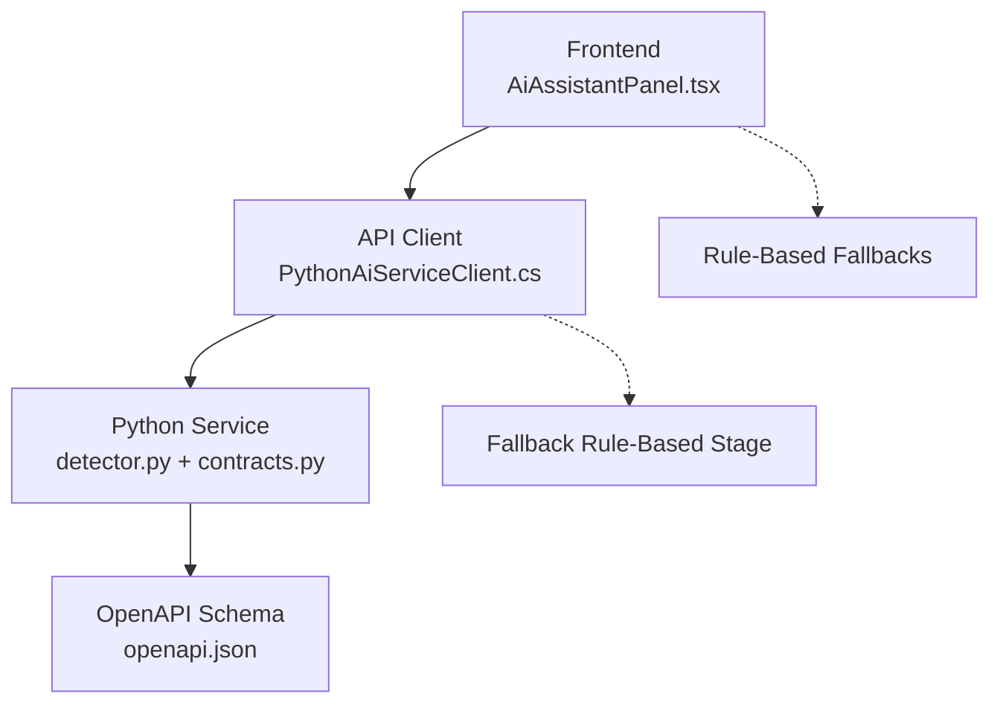
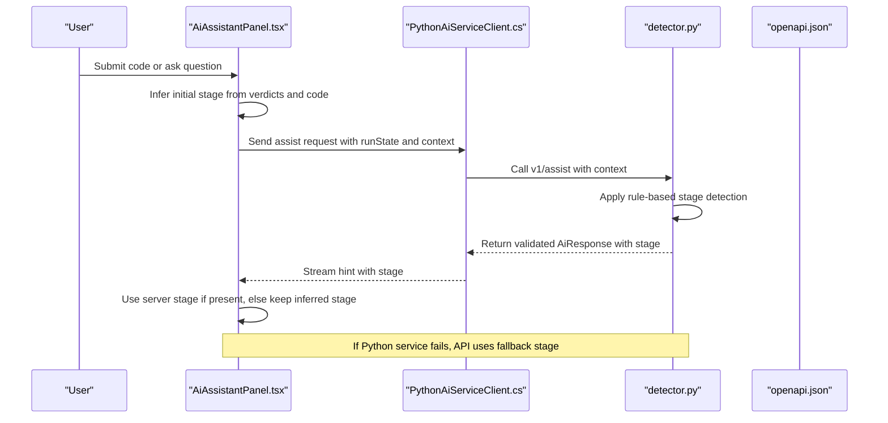
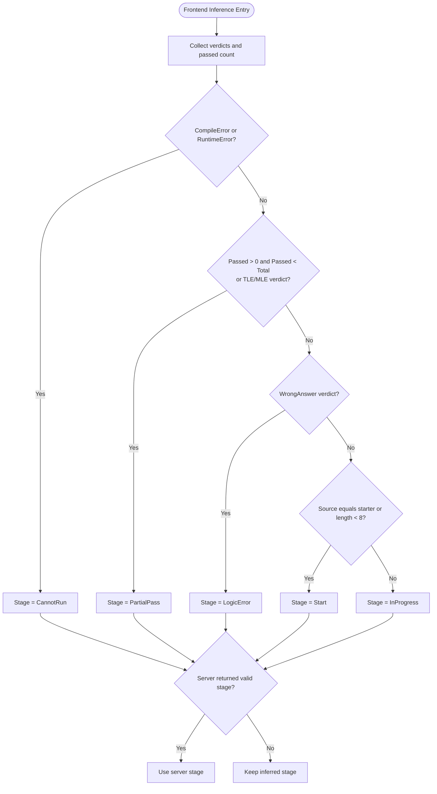
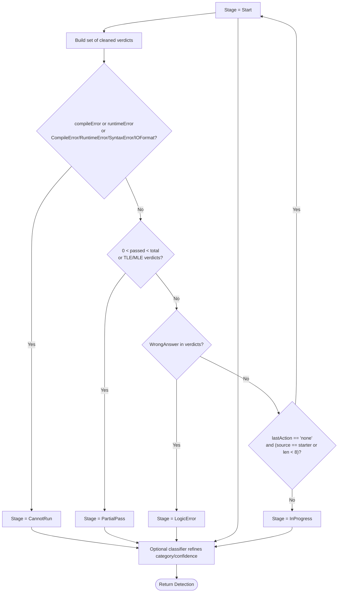
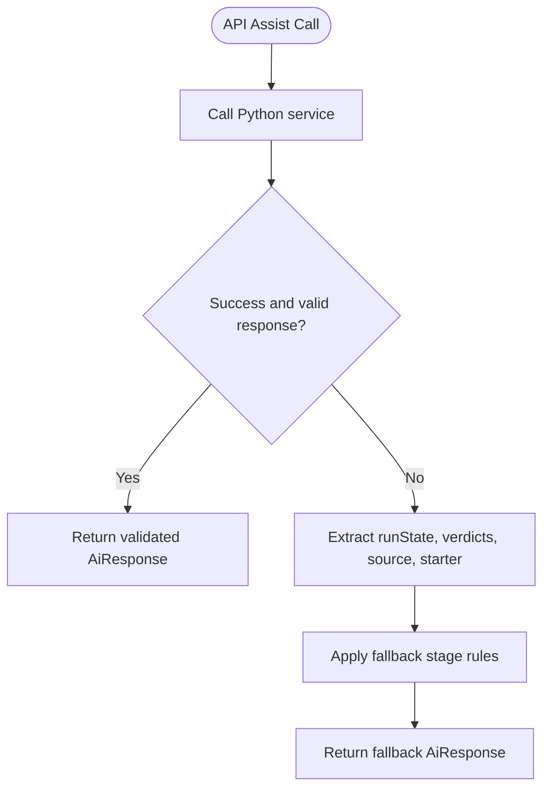
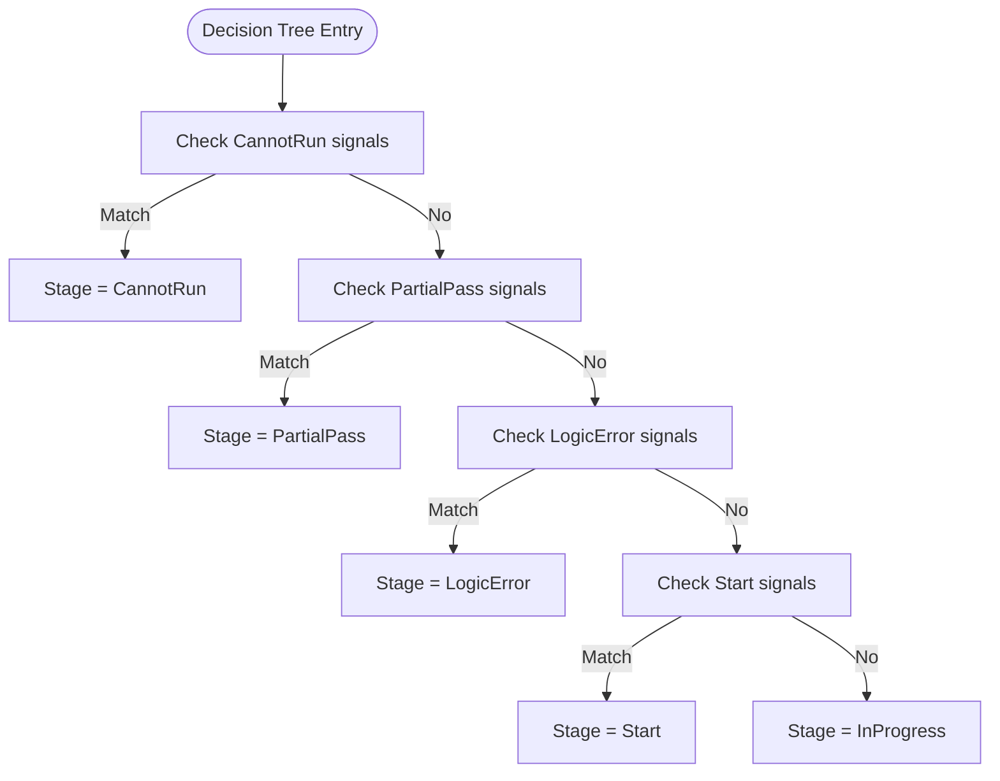
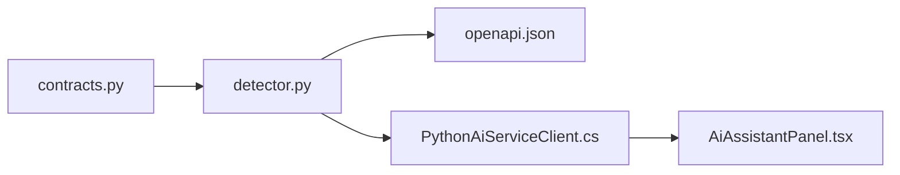

# Stage Inference Logic

<cite>
**Referenced Files in This Document**
- [AiAssistantPanel.tsx](file://frontend/src/features/ai-assistant/AiAssistantPanel.tsx)
- [PythonAiServiceClient.cs](file://api/src/Infrastructure/CodePath.Infrastructure/Ai/PythonAiServiceClient.cs)
- [detector.py](file://ai-service/app/stage/detector.py)
- [contracts.py](file://ai-service/app/contracts.py)
- [test_detector.py](file://ai-service/tests/test_detector.py)
- [openapi.json](file://ai-service/openapi.json)
</cite>

## Table of Contents
1. [Introduction](#introduction)
2. [Project Structure](#project-structure)
3. [Core Components](#core-components)
4. [Architecture Overview](#architecture-overview)
5. [Detailed Component Analysis](#detailed-component-analysis)
6. [Dependency Analysis](#dependency-analysis)
7. [Performance Considerations](#performance-considerations)
8. [Troubleshooting Guide](#troubleshooting-guide)
9. [Conclusion](#conclusion)

## Introduction
This document explains how the AI assistant panel infers the current learning stage from test results and code state. The supported stages are:

- Start
- InProgress
- LogicError
- CannotRun
- PartialPass

The inference is implemented in three layers:

- Frontend rule-based inference for immediate UI behavior.
- Python service rule-based detection with optional ML refinement.
- API fallback inference when the Python service is unavailable or returns invalid data.

The goal is to provide consistent, predictable guidance by mapping observable signals such as verdicts, error messages, passed counts, and starter code equality into a single stage value.

## Project Structure
The stage inference logic spans frontend, backend API, and an external Python AI service:

**Diagram sources**
- [AiAssistantPanel.tsx:12-37](file://frontend/src/features/ai-assistant/AiAssistantPanel.tsx#L12-L37)
- [PythonAiServiceClient.cs:8-38](file://api/src/Infrastructure/CodePath.Infrastructure/Ai/PythonAiServiceClient.cs#L8-L38)
- [detector.py:11-33](file://ai-service/app/stage/detector.py#L11-L33)
- [contracts.py:5-54](file://ai-service/app/contracts.py#L5-L54)
- [openapi.json:395-404](file://ai-service/openapi.json#L395-L404)

**Section sources**
- [AiAssistantPanel.tsx:12-37](file://frontend/src/features/ai-assistant/AiAssistantPanel.tsx#L12-L37)
- [PythonAiServiceClient.cs:8-38](file://api/src/Infrastructure/CodePath.Infrastructure/Ai/PythonAiServiceClient.cs#L8-L38)
- [detector.py:11-33](file://ai-service/app/stage/detector.py#L11-L33)
- [contracts.py:5-54](file://ai-service/app/contracts.py#L5-L54)
- [openapi.json:395-404](file://ai-service/openapi.json#L395-L404)

## Core Components
The stage inference system has three main responsibilities:

1. **Frontend inference**: Determines the initial stage based on test verdicts and source code state. It also allows the server-provided stage to override the inferred stage when available.
2. **Python service detection**: Applies a deterministic decision tree over run state, verdicts, errors, and starter code. It can optionally refine category and confidence through a classifier without overriding priority rules.
3. **API fallback inference**: When the Python service fails or returns invalid responses, the API computes a safe fallback stage using the same logical principles.

Key inputs across components include:

- Verdicts: Accepted, WrongAnswer, CompileError, RuntimeError, SyntaxError, IOFormat, TimeLimitExceeded, MemoryLimitExceeded.
- Run state: lastAction, compileError, runtimeError, passed, total.
- Source code: current source and starter template.
- Request metadata: level, language, problem description.

**Section sources**
- [AiAssistantPanel.tsx:12-37](file://frontend/src/features/ai-assistant/AiAssistantPanel.tsx#L12-L37)
- [detector.py:11-33](file://ai-service/app/stage/detector.py#L11-L33)
- [PythonAiServiceClient.cs:25-38](file://api/src/Infrastructure/CodePath.Infrastructure/Ai/PythonAiServiceClient.cs#L25-L38)
- [contracts.py:5-54](file://ai-service/app/contracts.py#L5-L54)

## Architecture Overview
The end-to-end flow for stage inference is:

**Diagram sources**
- [AiAssistantPanel.tsx:31-37](file://frontend/src/features/ai-assistant/AiAssistantPanel.tsx#L31-L37)
- [PythonAiServiceClient.cs:8-23](file://api/src/Infrastructure/CodePath.Infrastructure/Ai/PythonAiServiceClient.cs#L8-L23)
- [detector.py:11-33](file://ai-service/app/stage/detector.py#L11-L33)
- [openapi.json:395-404](file://ai-service/openapi.json#L395-L404)

## Detailed Component Analysis

### Frontend Stage Inference
The frontend defines a local `Stage` type and computes an inferred stage before receiving server feedback. The inference prioritizes:

1. **CannotRun**: Any CompileError or RuntimeError verdict.
2. **PartialPass**: Some tests passed but not all, or TimeLimitExceeded/MemoryLimitExceeded verdicts.
3. **LogicError**: WrongAnswer verdict without partial pass conditions.
4. **Start**: Source equals starter code or source is very short.
5. **InProgress**: Default when none of the above apply.

When the server returns a result, its stage overrides the inferred stage only if it corresponds to the latest submitted code.

**Diagram sources**
- [AiAssistantPanel.tsx:31-37](file://frontend/src/features/ai-assistant/AiAssistantPanel.tsx#L31-L37)

**Section sources**
- [AiAssistantPanel.tsx:12-37](file://frontend/src/features/ai-assistant/AiAssistantPanel.tsx#L12-L37)

### Python Service Detection
The Python detector applies a strict decision tree over `AssistRequest`, which includes `runState`, `sourceCode`, and `problem.starterCode`. The priority order is:

1. **CannotRun**: Errors exist or verdicts include CompileError, RuntimeError, SyntaxError, or IOFormat.
2. **PartialPass**: Passed tests are greater than zero but less than total, or verdicts include TimeLimitExceeded, MemoryLimitExceeded, TLE, or MLE.
3. **LogicError**: WrongAnswer exists.
4. **Start**: Last action is none and source equals starter code or source is very short.
5. **InProgress**: Default.

After determining the stage, the detector may refine category and confidence via an optional classifier, but it does not override the rule-based stage priority.

**Diagram sources**
- [detector.py:11-33](file://ai-service/app/stage/detector.py#L11-L33)
- [contracts.py:40-54](file://ai-service/app/contracts.py#L40-L54)

**Section sources**
- [detector.py:11-33](file://ai-service/app/stage/detector.py#L11-L33)
- [contracts.py:5-54](file://ai-service/app/contracts.py#L5-L54)

### API Fallback Inference
When the Python service throws an exception due to network failure, cancellation, JSON parsing issues, or circuit breaker activation, the API computes a fallback stage using the same logical principles:

- CannotRun if compileError/runtimeError fields exist or verdicts include CompileError, RuntimeError, SyntaxError, or IOFormat.
- PartialPass if passed is between zero and total, or verdicts include TimeLimitExceeded or MemoryLimitExceeded.
- LogicError if WrongAnswer is present.
- Start if no recent run and source equals starter or is very short.
- InProgress otherwise.

The fallback response includes guard status marked as fallback and a generic guiding message.

**Diagram sources**
- [PythonAiServiceClient.cs:8-23](file://api/src/Infrastructure/CodePath.Infrastructure/Ai/PythonAiServiceClient.cs#L8-L23)
- [PythonAiServiceClient.cs:25-38](file://api/src/Infrastructure/CodePath.Infrastructure/Ai/PythonAiServiceClient.cs#L25-L38)

**Section sources**
- [PythonAiServiceClient.cs:8-38](file://api/src/Infrastructure/CodePath.Infrastructure/Ai/PythonAiServiceClient.cs#L8-L38)

### Decision Tree Algorithm Summary
The unified decision tree across frontend, Python service, and API fallback follows this priority:

1. **CannotRun**
   - Signals: CompileError, RuntimeError, SyntaxError, IOFormat, or presence of compile/runtime error strings.
   - Rationale: Code cannot execute correctly; user must fix execution blockers first.

2. **PartialPass**
   - Signals: Some tests passed but not all, or TimeLimitExceeded/MemoryLimitExceeded/TLE/MLE.
   - Rationale: Implementation works partially or violates performance constraints.

3. **LogicError**
   - Signals: WrongAnswer without partial pass conditions.
   - Rationale: Execution succeeds but output is incorrect.

4. **Start**
   - Signals: No recent run and source equals starter code or source is very short.
   - Rationale: User has not started meaningful implementation.

5. **InProgress**
   - Signals: None of the above.
   - Rationale: User is actively working and needs next-step guidance.

**Diagram sources**
- [AiAssistantPanel.tsx:33-35](file://frontend/src/features/ai-assistant/AiAssistantPanel.tsx#L33-L35)
- [detector.py:16-27](file://ai-service/app/stage/detector.py#L16-L27)
- [PythonAiServiceClient.cs:33-35](file://api/src/Infrastructure/CodePath.Infrastructure/Ai/PythonAiServiceClient.cs#L33-L35)

### Verdict Analysis Patterns
The system treats verdicts as categorical signals rather than numeric scores:

- **Execution-blocking verdicts**: CompileError, RuntimeError, SyntaxError, IOFormat → CannotRun.
- **Performance-limiting verdicts**: TimeLimitExceeded, MemoryLimitExceeded, TLE, MLE → PartialPass.
- **Correctness-verdict**: WrongAnswer → LogicError unless overridden by stronger signals.
- **Success signal**: Accepted contributes to partial-pass detection when not all tests pass.

The Python detector normalizes verdict strings by removing spaces before analysis, improving robustness against minor formatting differences.

**Section sources**
- [detector.py:12-23](file://ai-service/app/stage/detector.py#L12-L23)
- [PythonAiServiceClient.cs:28-35](file://api/src/Infrastructure/CodePath.Infrastructure/Ai/PythonAiServiceClient.cs#L28-L35)
- [AiAssistantPanel.tsx:31-35](file://frontend/src/features/ai-assistant/AiAssistantPanel.tsx#L31-L35)

### Edge Case Handling
Important edge cases and their handling:

- **Empty starter code**: If starter code is empty, comparison still works; the frontend checks exact trimmed equality, while the Python detector compares stripped versions.
- **Very short source code**: Source shorter than eight characters is treated as unstarted, regardless of other signals except stronger ones like CannotRun.
- **No recent run**: When lastAction is none, the system assumes the user has not executed code yet, favoring Start when combined with starter equality or short source.
- **Mixed verdicts**: If both WrongAnswer and Accepted appear, the strongest applicable rule wins; PartialPass takes precedence when some tests pass.
- **Invalid or missing server response**: The API fallback ensures a safe stage is always returned, preventing UI stalls.

**Section sources**
- [detector.py:24-27](file://ai-service/app/stage/detector.py#L24-L27)
- [PythonAiServiceClient.cs:25-38](file://api/src/Infrastructure/CodePath.Infrastructure/Ai/PythonAiServiceClient.cs#L25-L38)
- [AiAssistantPanel.tsx:33-37](file://frontend/src/features/ai-assistant/AiAssistantPanel.tsx#L33-L37)

### Examples of Code States and Inferred Stages
Below are representative scenarios mapped to inferred stages:

| Scenario | Inputs | Inferred Stage | Reasoning |
|---|---|---|---|
| Fresh starter code | Source equals starter, no run | Start | No meaningful changes yet |
| Short placeholder | Source length less than 8, no run | Start | Insufficient implementation |
| Compilation failed | CompileError verdict or compileError field | CannotRun | Execution blocked |
| Runtime crash | RuntimeError verdict or runtimeError field | CannotRun | Execution blocked |
| Wrong output | WrongAnswer, no partial pass | LogicError | Output incorrect |
| Some tests pass | Passed greater than zero but less than total | PartialPass | Partial correctness |
| Time limit exceeded | TimeLimitExceeded verdict | PartialPass | Performance issue |
| Memory limit exceeded | MemoryLimitExceeded verdict | PartialPass | Performance issue |
| All tests pass | Accepted for all tests | InProgress | Implementation complete; next step guidance |
| Mixed verdicts with some passes | Accepted plus WrongAnswer | PartialPass | Some tests pass |
| Invalid Python service response | Network or JSON error | Fallback stage | API fallback applies same rules |

These examples align with the decision tree priorities and are validated by unit tests.

**Section sources**
- [test_detector.py:5-19](file://ai-service/tests/test_detector.py#L5-L19)
- [detector.py:16-27](file://ai-service/app/stage/detector.py#L16-L27)

## Dependency Analysis
The stage inference components have clear boundaries:

- Frontend depends on test results and source code to compute an initial stage.
- API depends on Python service for intelligent hints but implements fallback logic.
- Python service depends on contracts for typed input and validation.
- OpenAPI schema defines allowed stage values and response structure.

**Diagram sources**
- [contracts.py:5-54](file://ai-service/app/contracts.py#L5-L54)
- [detector.py:11-33](file://ai-service/app/stage/detector.py#L11-L33)
- [openapi.json:395-404](file://ai-service/openapi.json#L395-L404)
- [PythonAiServiceClient.cs:8-38](file://api/src/Infrastructure/CodePath.Infrastructure/Ai/PythonAiServiceClient.cs#L8-L38)
- [AiAssistantPanel.tsx:12-37](file://frontend/src/features/ai-assistant/AiAssistantPanel.tsx#L12-L37)

**Section sources**
- [contracts.py:5-54](file://ai-service/app/contracts.py#L5-L54)
- [detector.py:11-33](file://ai-service/app/stage/detector.py#L11-L33)
- [openapi.json:395-404](file://ai-service/openapi.json#L395-L404)
- [PythonAiServiceClient.cs:8-38](file://api/src/Infrastructure/CodePath.Infrastructure/Ai/PythonAiServiceClient.cs#L8-L38)
- [AiAssistantPanel.tsx:12-37](file://frontend/src/features/ai-assistant/AiAssistantPanel.tsx#L12-L37)

## Performance Considerations
- The decision tree is O(1) relative to the number of verdicts because it performs constant-time checks over small fixed sets.
- Verdict normalization removes spaces once per run state, minimizing repeated string operations.
- Frontend inference runs locally and immediately, avoiding unnecessary network calls for UI readiness.
- API fallback avoids blocking the UI by providing a safe default stage when the Python service is unavailable.
- Streaming responses allow the frontend to display progress while awaiting full hint generation.

[No sources needed since this section provides general guidance]

## Troubleshooting Guide
Common issues and resolutions:

- **UI shows Start unexpectedly**: Verify whether source equals starter code or is shorter than eight characters. Also check whether lastAction is none.
- **UI shows CannotRun despite passing tests**: Look for CompileError, RuntimeError, SyntaxError, or IOFormat verdicts or error fields.
- **UI shows LogicError when some tests pass**: Ensure PartialPass conditions are met; otherwise WrongAnswer alone maps to LogicError.
- **Server stage differs from inferred stage**: The server stage overrides the inferred stage only when it corresponds to the latest submitted code.
- **Fallback stage appears**: This indicates Python service failure or invalid response; the API fallback applied rule-based inference.

Validation and testing references:

- Unit tests cover starter code equality, error priority, and verdict-driven stage transitions.
- OpenAPI schema enforces allowed stage values and response constraints.

**Section sources**
- [test_detector.py:21-33](file://ai-service/tests/test_detector.py#L21-L33)
- [openapi.json:395-404](file://ai-service/openapi.json#L395-L404)
- [PythonAiServiceClient.cs:25-38](file://api/src/Infrastructure/CodePath.Infrastructure/Ai/PythonAiServiceClient.cs#L25-L38)

## Conclusion
The stage inference logic combines deterministic rule-based decisions with optional ML refinement and robust fallbacks. Across frontend, API, and Python service layers, the system consistently maps test verdicts and code state to one of five stages. This design ensures that users receive appropriate guidance whether they are starting fresh, encountering execution errors, making logical mistakes, partially passing tests, or progressing toward completion.

[No sources needed since this section summarizes without analyzing specific files]