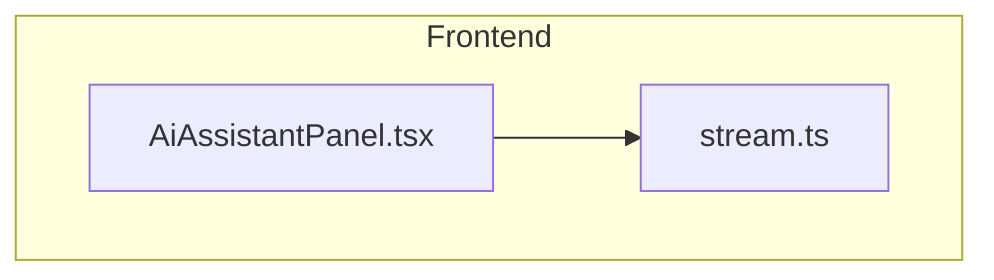
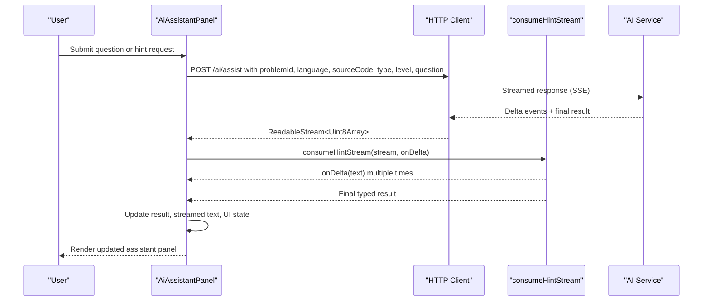
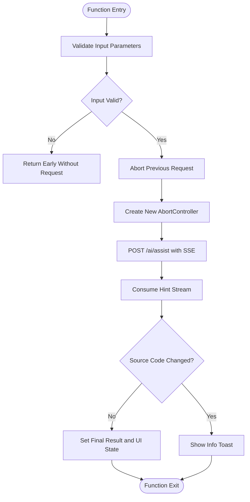
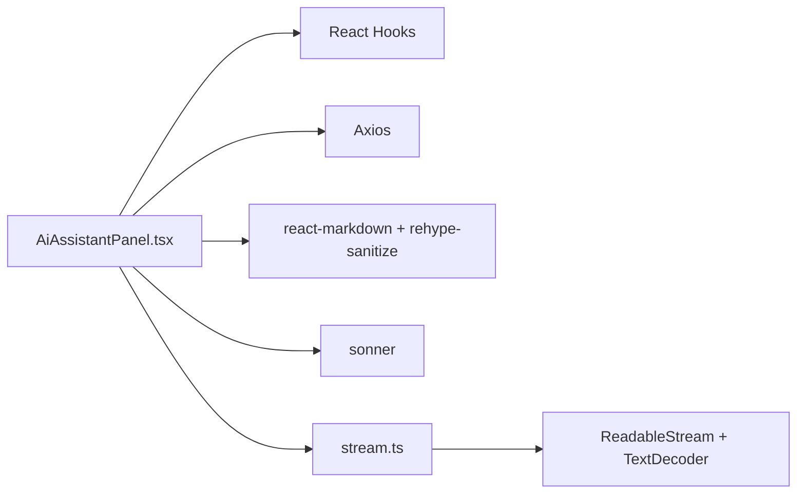

# State Management Patterns

<cite>
**Referenced Files in This Document**
- [AiAssistantPanel.tsx](file://frontend/src/features/ai-assistant/AiAssistantPanel.tsx)
- [stream.ts](file://frontend/src/features/ai-assistant/stream.ts)
</cite>

## Table of Contents
1. [Introduction](#introduction)
2. [Project Structure](#project-structure)
3. [Core Components](#core-components)
4. [Architecture Overview](#architecture-overview)
5. [Detailed Component Analysis](#detailed-component-analysis)
6. [Dependency Analysis](#dependency-analysis)
7. [Performance Considerations](#performance-considerations)
8. [Troubleshooting Guide](#troubleshooting-guide)
9. [Conclusion](#conclusion)

## Introduction
This document explains the state management patterns used by the AI assistant panel component. It focuses on how React hooks manage result data, streaming content, user input, and UI states; how mutable references are used for source code snapshots and abort controllers; how cleanup is handled to prevent memory leaks; and how state synchronization, conditional rendering, and performance optimizations are implemented.

## Project Structure
The AI assistant feature lives under the frontend application’s features directory. The key files for this analysis are:
- AiAssistantPanel.tsx: The main React component that owns all UI state, handles streaming requests, and renders the assistant interface.
- stream.ts: A small utility that consumes server-sent events (SSE), decodes UTF-8 chunks, and emits incremental deltas plus a final result.

**Diagram sources**
- [AiAssistantPanel.tsx:1-10](file://frontend/src/features/ai-assistant/AiAssistantPanel.tsx#L1-L10)
- [stream.ts:1-25](file://frontend/src/features/ai-assistant/stream.ts#L1-L25)

**Section sources**
- [AiAssistantPanel.tsx:1-10](file://frontend/src/features/ai-assistant/AiAssistantPanel.tsx#L1-L10)
- [stream.ts:1-25](file://frontend/src/features/ai-assistant/stream.ts#L1-L25)

## Core Components
- AiAssistantPanel: A functional React component that manages:
  - Result data from the AI assistant
  - Streaming text updates while waiting for the final result
  - User question input
  - UI busy and feedback states
  - Abort controller for canceling in-flight requests
  - Mutable reference to the latest source code to avoid stale closures
- consumeHintStream: An async function that reads an SSE stream, decodes UTF-8 chunks, parses event boundaries, emits delta updates, and returns the final typed result.

Key responsibilities:
- State ownership and lifecycle via useState and useEffect
- Request cancellation via AbortController
- Safe streaming with TextDecoder and buffer handling
- Conditional UI based on inferred stage and test results

**Section sources**
- [AiAssistantPanel.tsx:18-87](file://frontend/src/features/ai-assistant/AiAssistantPanel.tsx#L18-L87)
- [stream.ts:1-25](file://frontend/src/features/ai-assistant/stream.ts#L1-L25)

## Architecture Overview
The AI assistant panel coordinates between the UI, a streaming API, and a helper stream consumer.

**Diagram sources**
- [AiAssistantPanel.tsx:38-62](file://frontend/src/features/ai-assistant/AiAssistantPanel.tsx#L38-L62)
- [stream.ts:1-25](file://frontend/src/features/ai-assistant/stream.ts#L1-L25)

## Detailed Component Analysis

### useState Usage and Data Model
The component uses several useState hooks to manage distinct concerns:
- Result data: Stores the last successful hint payload, including message, steps, suspected lines, and metadata like remaining attempts and unlocked level.
- Code snapshot: Tracks which version of the source code produced the current result to avoid showing stale hints after edits.
- Streaming content: Accumulates incremental text during the SSE stream before the final result arrives.
- User input: Holds the question text bound to the textarea.
- UI states: Busy flag for disabling controls and showing loading messages; feedback flags for rating suggestions.

State synchronization highlights:
- When a new request starts, the component resets streamed text and feedback to ensure a clean slate.
- The current displayed result is derived from comparing the stored resultCode with the latest sourceCode prop, ensuring only relevant hints are shown.
- The inferred stage is computed from test results and starter code comparison, providing immediate UI context even before a server response.

Complexity considerations:
- Updating streamed text on each delta can cause frequent re-renders; however, it keeps the UI responsive and shows real-time progress.
- Deriving stage and passed counts from results is O(n) over test cases, which is acceptable given typical test set sizes.

**Section sources**
- [AiAssistantPanel.tsx:21-37](file://frontend/src/features/ai-assistant/AiAssistantPanel.tsx#L21-L37)

### useRef for Mutable References
Two primary useRef usages:
- AbortController reference: Maintains the active request so it can be aborted when a new request starts or the component unmounts.
- Latest source code reference: Keeps a mutable pointer to the most recent sourceCode prop to guard against stale closures inside async callbacks.

Cleanup pattern:
- On mount, an effect registers a cleanup function that aborts any ongoing request when the component unmounts, preventing memory leaks and dangling network operations.

Best practices demonstrated:
- Always abort previous requests before starting a new one to avoid race conditions.
- Use refs for values that must remain stable across renders but need to reflect the latest props without triggering re-renders.

**Section sources**
- [AiAssistantPanel.tsx:28-30](file://frontend/src/features/ai-assistant/AiAssistantPanel.tsx#L28-L30)
- [AiAssistantPanel.tsx:38-47](file://frontend/src/features/ai-assistant/AiAssistantPanel.tsx#L38-L47)

### useEffect Cleanup and Memory Management
The cleanup effect ensures:
- Any in-flight request is aborted when the component unmounts.
- No lingering AbortController remains attached to a dead component instance.

Memory management strategies:
- Releasing the reader lock in the stream consumer prevents resource leaks when reading completes or errors occur.
- Avoiding unnecessary state updates by checking if the source code changed since the request started.

**Section sources**
- [AiAssistantPanel.tsx:30](file://frontend/src/features/ai-assistant/AiAssistantPanel.tsx#L30)
- [stream.ts:21-23](file://frontend/src/features/ai-assistant/stream.ts#L21-L23)

### Conditional Rendering Logic
The panel renders different UI elements depending on the inferred stage and available data:
- If tests indicate compile/runtime errors, show “explain error” actions.
- If some tests pass but others fail, show step-by-step tracing options.
- If no meaningful changes have been made yet, prompt the user to start solving.
- Display test verdict badges when partial passes are detected.
- Show streaming placeholder text while busy, then render the final hint content once available.

This approach provides clear guidance tailored to the current problem state and improves usability.

**Section sources**
- [AiAssistantPanel.tsx:33-37](file://frontend/src/features/ai-assistant/AiAssistantPanel.tsx#L33-L37)
- [AiAssistantPanel.tsx:74-84](file://frontend/src/features/ai-assistant/AiAssistantPanel.tsx#L74-L84)

### Performance Optimizations Through State Organization
- Separating streaming text from final result avoids premature re-renders caused by incomplete payloads.
- Using a separate resultCode ensures that only hints corresponding to the exact source snapshot are rendered.
- Keeping UI flags (busy, feedbackBusy) minimal reduces unnecessary re-renders.
- Debouncing or batching could further optimize frequent delta updates if needed, though the current design prioritizes responsiveness.

[No sources needed since this section provides general guidance]

### Error Handling and Feedback Flow
Error handling covers:
- Network cancellations due to AbortController are ignored to avoid showing error toasts.
- Axios errors extract error codes from responses, including edge cases where the body is a stream.
- Quota exceeded and rate limiting display appropriate user messages.
- Feedback submission toggles UI state and reports success or failure.

**Diagram sources**
- [AiAssistantPanel.tsx:38-62](file://frontend/src/features/ai-assistant/AiAssistantPanel.tsx#L38-L62)

**Section sources**
- [AiAssistantPanel.tsx:49-61](file://frontend/src/features/ai-assistant/AiAssistantPanel.tsx#L49-L61)
- [AiAssistantPanel.tsx:63-69](file://frontend/src/features/ai-assistant/AiAssistantPanel.tsx#L63-L69)

## Dependency Analysis
The component depends on:
- React hooks for state and side effects
- Axios for HTTP requests with streaming support
- react-markdown and rehype-sanitize for safe markdown rendering
- sonner for toast notifications
- Internal modules for API configuration and types

**Diagram sources**
- [AiAssistantPanel.tsx:1-10](file://frontend/src/features/ai-assistant/AiAssistantPanel.tsx#L1-L10)
- [stream.ts:1-25](file://frontend/src/features/ai-assistant/stream.ts#L1-L25)

**Section sources**
- [AiAssistantPanel.tsx:1-10](file://frontend/src/features/ai-assistant/AiAssistantPanel.tsx#L1-L10)
- [stream.ts:1-25](file://frontend/src/features/ai-assistant/stream.ts#L1-L25)

## Performance Considerations
- Streaming updates provide immediate feedback but may trigger many re-renders; consider memoization or throttling if latency becomes noticeable.
- Avoid storing large intermediate buffers in state; keep only necessary deltas and final result.
- Use refs for mutable values that do not need to trigger re-renders, such as the latest source code and abort controller.
- Ensure cleanup functions release locks and abort controllers to prevent memory leaks.

[No sources needed since this section provides general guidance]

## Troubleshooting Guide
Common issues and resolutions:
- Stale hints after editing code: The component compares the stored resultCode with the latest sourceCode to prevent showing outdated hints. If hints appear stale, verify that the sourceCode prop updates correctly.
- Requests not canceling: Confirm that the AbortController is created per request and aborted on new requests or unmount.
- Incomplete stream errors: The stream consumer throws when the final result is missing; check server-side SSE emission and network stability.
- Feedback not saving: Verify the feedback endpoint and handle error toasts appropriately.

**Section sources**
- [AiAssistantPanel.tsx:45-47](file://frontend/src/features/ai-assistant/AiAssistantPanel.tsx#L45-L47)
- [AiAssistantPanel.tsx:63-69](file://frontend/src/features/ai-assistant/AiAssistantPanel.tsx#L63-L69)
- [stream.ts:22-23](file://frontend/src/features/ai-assistant/stream.ts#L22-L23)

## Conclusion
The AI assistant panel demonstrates robust state management using React hooks and refs:
- useState organizes result data, streaming text, user input, and UI flags.
- useRef maintains mutable references for source code snapshots and abort controllers.
- useEffect cleanup ensures proper resource management and prevents memory leaks.
- Conditional rendering adapts the UI to the current problem state and test outcomes.
- Error handling and feedback flows improve user experience and reliability.

These patterns collectively deliver a responsive, safe, and maintainable assistant interface.

[No sources needed since this section summarizes without analyzing specific files]