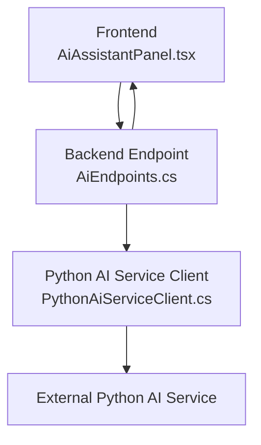
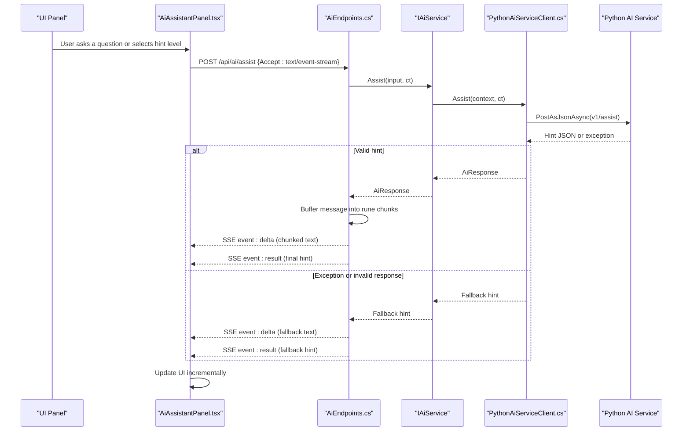
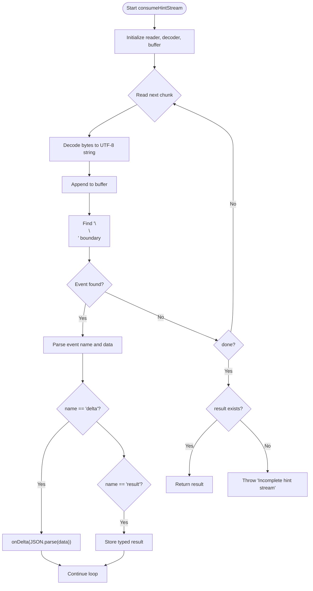
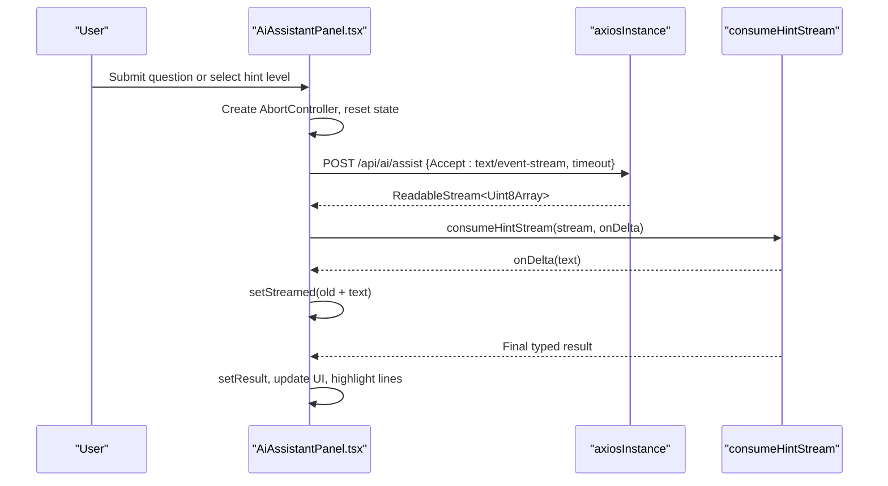
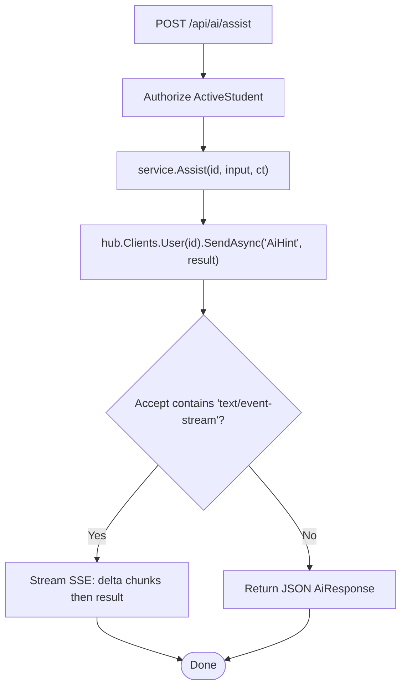
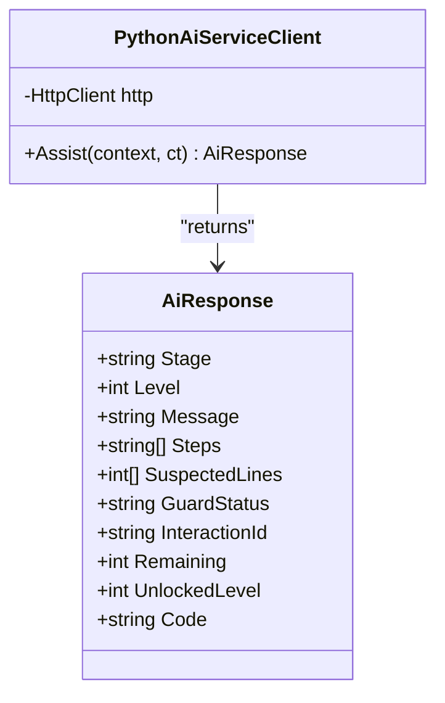
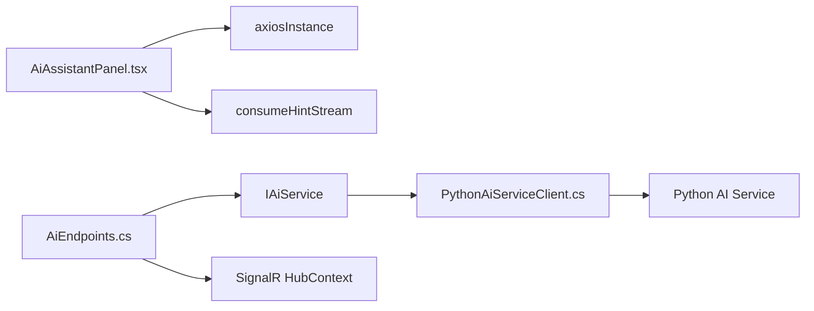

# Streaming API Integration

<cite>
**Referenced Files in This Document**
- [stream.ts](file://frontend/src/features/ai-assistant/stream.ts)
- [AiAssistantPanel.tsx](file://frontend/src/features/ai-assistant/AiAssistantPanel.tsx)
- [AiEndpoints.cs](file://api/src/Api/CodePath.Api/Endpoints/AiEndpoints.cs)
- [PythonAiServiceClient.cs](file://api/src/Infrastructure/CodePath.Infrastructure/Ai/PythonAiServiceClient.cs)
</cite>

## Table of Contents
1. [Introduction](#introduction)
2. [Project Structure](#project-structure)
3. [Core Components](#core-components)
4. [Architecture Overview](#architecture-overview)
5. [Detailed Component Analysis](#detailed-component-analysis)
6. [Dependency Analysis](#dependency-analysis)
7. [Performance Considerations](#performance-considerations)
8. [Troubleshooting Guide](#troubleshooting-guide)
9. [Conclusion](#conclusion)

## Introduction
This document explains the streaming API integration pattern used by the AI assistant panel. It covers Server-Sent Events (SSE), stream consumption, real-time hint delivery, request cancellation with AbortController, error handling for network failures and policy errors, timeout management, data transformation during streaming, UI updates, and the integration with the consumeHintStream utility function.

The implementation spans:
- Frontend React component that initiates a streaming request and renders incremental hints.
- A lightweight SSE consumer that decodes event chunks and transforms them into typed results.
- Backend endpoints that generate SSE responses after validating and buffering LLM output through a guard layer.
- An infrastructure client that calls an external Python AI service and applies fallback logic when the service is unavailable or returns invalid data.

## Project Structure
The streaming flow connects four main pieces:
- The frontend panel triggers a POST to /api/ai/assist with Accept: text/event-stream.
- The backend endpoint streams SSE events containing delta and result payloads.
- The frontend consumes the stream using consumeHintStream, which parses deltas and final results.
- The backend uses a Python AI service client to obtain hints; if it fails, a rule-based fallback is returned before streaming.

**Diagram sources**
- [AiAssistantPanel.tsx:38-62](file://frontend/src/features/ai-assistant/AiAssistantPanel.tsx#L38-L62)
- [AiEndpoints.cs:15-39](file://api/src/Api/CodePath.Api/Endpoints/AiEndpoints.cs#L15-L39)
- [PythonAiServiceClient.cs:8-39](file://api/src/Infrastructure/CodePath.Infrastructure/Ai/PythonAiServiceClient.cs#L8-L39)

**Section sources**
- [AiAssistantPanel.tsx:18-62](file://frontend/src/features/ai-assistant/AiAssistantPanel.tsx#L18-L62)
- [AiEndpoints.cs:12-42](file://api/src/Api/CodePath.Api/Endpoints/AiEndpoints.cs#L12-L42)
- [PythonAiServiceClient.cs:6-40](file://api/src/Infrastructure/CodePath.Infrastructure/Ai/PythonAiServiceClient.cs#L6-L40)

## Core Components
- Frontend streaming consumer: consumeHintStream reads a ReadableStream of UTF-8 bytes, splits on SSE boundaries, parses event names and data, emits delta updates via a callback, and returns the final typed result.
- Frontend panel: AiAssistantPanel manages state, creates an AbortController per request, sends a POST with Accept: text/event-stream, streams response data, updates UI incrementally, handles errors and timeouts, and integrates feedback.
- Backend endpoint: AiEndpoints maps /api/ai/assist, authenticates users, invokes IAiService, and conditionally streams SSE events with buffered delta chunks and a final result payload.
- Python AI service client: PythonAiServiceClient calls the external Python service with a deadline, validates the response shape, and falls back to a safe rule-based hint when exceptions occur.

Key responsibilities:
- Stream decoding and type safety are handled in the frontend consumer.
- Real-time UI updates are driven by delta events.
- Request cancellation is managed via AbortController.
- Error handling covers Axios cancellations, HTTP errors, policy codes, and fallback scenarios.
- Timeout management exists both at the frontend request level and the backend service call level.

**Section sources**
- [stream.ts:1-24](file://frontend/src/features/ai-assistant/stream.ts#L1-L24)
- [AiAssistantPanel.tsx:18-62](file://frontend/src/features/ai-assistant/AiAssistantPanel.tsx#L18-L62)
- [AiEndpoints.cs:15-39](file://api/src/Api/CodePath.Api/Endpoints/AiEndpoints.cs#L15-L39)
- [PythonAiServiceClient.cs:8-39](file://api/src/Infrastructure/CodePath.Infrastructure/Ai/PythonAiServiceClient.cs#L8-L39)

## Architecture Overview
The SSE pipeline ensures safe, incremental delivery of AI-generated hints while protecting against untrusted content and network instability.

**Diagram sources**
- [AiAssistantPanel.tsx:38-62](file://frontend/src/features/ai-assistant/AiAssistantPanel.tsx#L38-L62)
- [AiEndpoints.cs:15-39](file://api/src/Api/CodePath.Api/Endpoints/AiEndpoints.cs#L15-L39)
- [PythonAiServiceClient.cs:8-39](file://api/src/Infrastructure/CodePath.Infrastructure/Ai/PythonAiServiceClient.cs#L8-L39)

## Detailed Component Analysis

### Frontend SSE Consumer: consumeHintStream
consumeHintStream implements robust SSE parsing across arbitrary chunk boundaries:
- Uses TextDecoder to decode UTF-8 byte chunks.
- Accumulates raw text in a buffer until finding double newline boundaries.
- Splits each event into name and data fields.
- Emits delta events via onDelta for incremental rendering.
- Parses result events into a strongly-typed return value.
- Releases the reader lock in finally to prevent resource leaks.
- Throws an error if no result event arrives, ensuring incomplete streams fail fast.

Complexity considerations:
- Time complexity is linear in total bytes processed due to single-pass scanning.
- Space complexity includes the accumulated buffer and decoded string; keep chunks small to avoid large memory spikes.

Error handling:
- Incomplete streams throw an explicit error.
- JSON parse errors inside delta/result events will propagate up to the caller.

**Diagram sources**
- [stream.ts:1-24](file://frontend/src/features/ai-assistant/stream.ts#L1-L24)

**Section sources**
- [stream.ts:1-24](file://frontend/src/features/ai-assistant/stream.ts#L1-L24)

### Frontend Panel: AiAssistantPanel
AiAssistantPanel orchestrates the user interaction and streaming lifecycle:
- State management: tracks current result, streamed text, question input, busy state, and feedback status.
- AbortController usage: creates a new controller per request and aborts previous ones to cancel stale streams.
- Request initiation: posts to /api/ai/assist with Accept: text/event-stream and sets a timeout.
- Stream consumption: passes the response stream to consumeHintStream, updating UI incrementally via setStreamed.
- Code change detection: compares latest code reference to requested code to avoid rendering outdated hints.
- Error handling: distinguishes Axios cancellation from other errors, extracts error codes from response bodies, and shows appropriate toast messages.
- Feedback submission: posts helpful/unhelpful feedback for the last interaction.

Timeout and cancellation:
- Frontend timeout is set on the axios request.
- AbortController signal is passed to the request to allow immediate cancellation when the component unmounts or a new request starts.

UI updates:
- While streaming, the panel displays incremental text.
- On completion, it renders Markdown-formatted hint, steps, guiding question, RAG references, and suspected lines.

**Diagram sources**
- [AiAssistantPanel.tsx:38-62](file://frontend/src/features/ai-assistant/AiAssistantPanel.tsx#L38-L62)
- [stream.ts:1-24](file://frontend/src/features/ai-assistant/stream.ts#L1-L24)

**Section sources**
- [AiAssistantPanel.tsx:18-62](file://frontend/src/features/ai-assistant/AiAssistantPanel.tsx#L18-L62)

### Backend Endpoint: AiEndpoints
AiEndpoints exposes /api/ai/assist and supports two modes:
- Non-streaming: returns JSON AiResponse directly.
- Streaming: detects Accept: text/event-stream and streams SSE events.

Streaming behavior:
- Sets Cache-Control and X-Accel-Buffering headers to ensure proper proxy behavior.
- Buffers the generated hint message into rune chunks to avoid sending unchecked tokens directly.
- Emits multiple delta events with small text segments.
- Emits a final result event with the complete AiResponse object.

Policy and error handling:
- Catches AiPolicyException and converts it to a structured HTTP failure with a safe message and error code.

**Diagram sources**
- [AiEndpoints.cs:15-39](file://api/src/Api/CodePath.Api/Endpoints/AiEndpoints.cs#L15-L39)

**Section sources**
- [AiEndpoints.cs:12-42](file://api/src/Api/CodePath.Api/Endpoints/AiEndpoints.cs#L12-L42)

### Python AI Service Client: PythonAiServiceClient
PythonAiServiceClient encapsulates communication with the external Python AI service:
- Applies a deadline token to enforce a 20-second timeout.
- Posts context JSON to v1/assist and reads the response as AiResponse.
- Validates response structure, including stage values, levels, step counts, and confidence ranges.
- On failure, constructs a safe rule-based fallback hint based on run state and verdicts.

Fallback logic:
- Determines stage from run state and test verdicts.
- Returns a minimal hint with safe defaults and guard status indicating fallback.

**Diagram sources**
- [PythonAiServiceClient.cs:6-39](file://api/src/Infrastructure/CodePath.Infrastructure/Ai/PythonAiServiceClient.cs#L6-L39)

**Section sources**
- [PythonAiServiceClient.cs:6-39](file://api/src/Infrastructure/CodePath.Infrastructure/Ai/PythonAiServiceClient.cs#L6-L39)

## Dependency Analysis
The streaming integration depends on several layers:
- Frontend relies on axios for HTTP requests and the fetch adapter to access ReadableStream.
- Frontend consumes SSE events and transforms them into UI updates.
- Backend depends on ASP.NET Core routing, SignalR hub context for broadcasting, and IAiService abstraction.
- Backend’s PythonAiServiceClient depends on HttpClient and external Python service availability.

**Diagram sources**
- [AiAssistantPanel.tsx:38-62](file://frontend/src/features/ai-assistant/AiAssistantPanel.tsx#L38-L62)
- [AiEndpoints.cs:15-39](file://api/src/Api/CodePath.Api/Endpoints/AiEndpoints.cs#L15-L39)
- [PythonAiServiceClient.cs:8-39](file://api/src/Infrastructure/CodePath.Infrastructure/Ai/PythonAiServiceClient.cs#L8-L39)

**Section sources**
- [AiAssistantPanel.tsx:18-62](file://frontend/src/features/ai-assistant/AiAssistantPanel.tsx#L18-L62)
- [AiEndpoints.cs:12-42](file://api/src/Api/CodePath.Api/Endpoints/AiEndpoints.cs#L12-L42)
- [PythonAiServiceClient.cs:6-40](file://api/src/Infrastructure/CodePath.Infrastructure/Ai/PythonAiServiceClient.cs#L6-L40)

## Performance Considerations
- Chunk size tuning: The backend buffers hint text into rune chunks of fixed size to balance latency and overhead. Smaller chunks increase event frequency but reduce per-event payload.
- Decoder efficiency: The frontend uses TextDecoder with streaming mode to minimize memory copies across chunk boundaries.
- Buffer management: Avoid accumulating excessively large buffers; process events as soon as boundaries are detected.
- Network resilience: Use timeouts and cancellation to prevent long-running requests from blocking UI threads.
- Proxy configuration: Ensure proxies do not buffer SSE responses; headers like X-Accel-Buffering=no help.

[No sources needed since this section provides general guidance]

## Troubleshooting Guide
Common issues and strategies:
- Incomplete stream: If consumeHintStream throws an error about an incomplete hint stream, verify that the server emits a final result event and that the connection remains open until completion.
- Stale hints after code changes: The panel checks whether the source code changed during streaming and discards outdated hints. Re-submit the question to get fresh suggestions.
- Quota exceeded: When the backend returns a quota-related error code, show a clear message to the user and disable further requests until the quota resets.
- Rate limiting: Display a polite delay message and retry later.
- Policy exceptions: Convert policy errors into safe messages and codes; surface them to the user without leaking internal details.
- Network failures: Catch Axios errors, inspect response bodies for error codes, and provide actionable feedback.
- Timeout errors: Frontend timeout should be tuned to expected streaming duration; backend deadlines protect against slow downstream services.

**Section sources**
- [AiAssistantPanel.tsx:49-61](file://frontend/src/features/ai-assistant/AiAssistantPanel.tsx#L49-L61)
- [AiEndpoints.cs:38-39](file://api/src/Api/CodePath.Api/Endpoints/AiEndpoints.cs#L38-L39)
- [PythonAiServiceClient.cs:25-38](file://api/src/Infrastructure/CodePath.Infrastructure/Ai/PythonAiServiceClient.cs#L25-L38)

## Conclusion
The streaming API integration combines a robust frontend SSE consumer, a responsive React panel, a backend endpoint that safely buffers and streams hint text, and a resilient Python AI service client with fallback logic. Together, they deliver real-time, incremental hints while handling cancellation, timeouts, and errors gracefully. The design emphasizes safety by buffering LLM output, validating responses, and providing clear user feedback during failures.

[No sources needed since this section summarizes without analyzing specific files]