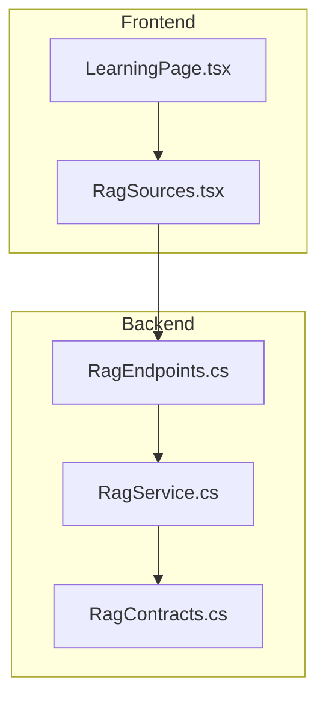
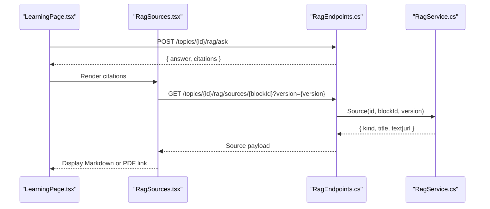
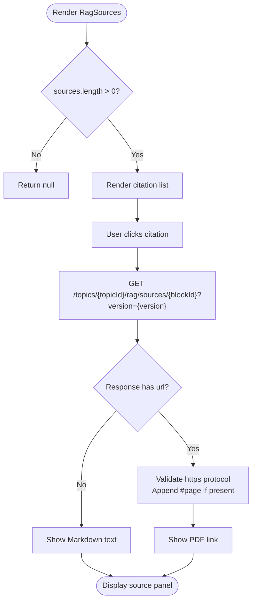
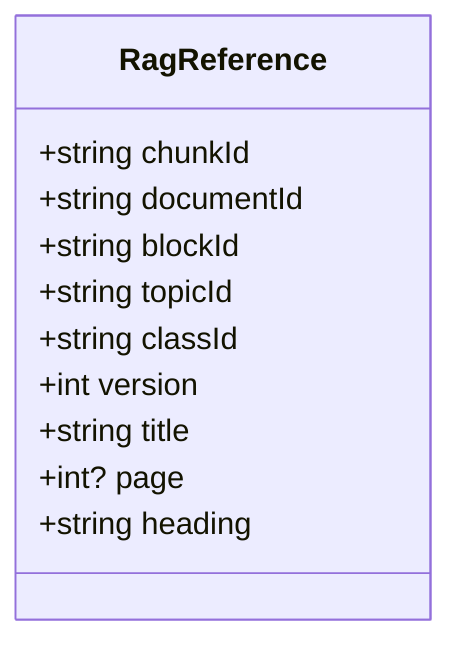
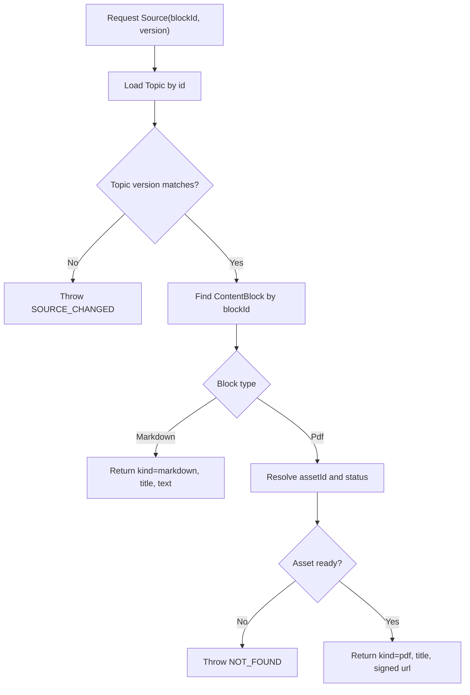
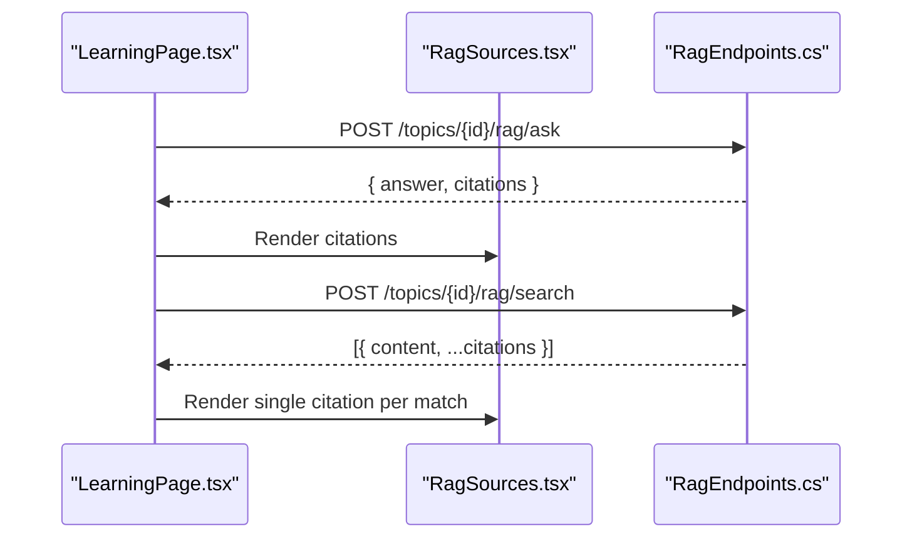
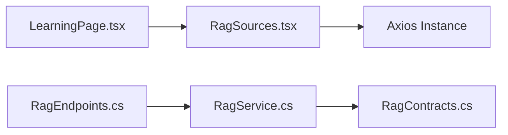

# RAG Sources Display

<cite>
**Referenced Files in This Document**   
- [RagSources.tsx](file://frontend/src/features/ai-assistant/RagSources.tsx)
- [LearningPage.tsx](file://frontend/src/features/learning/LearningPage.tsx)
- [RagContracts.cs](file://api/src/Application/CodePath.Application/Learning/RagContracts.cs)
- [RagService.cs](file://api/src/Infrastructure/CodePath.Infrastructure/Learning/RagService.cs)
- [RagEndpoints.cs](file://api/src/Api/CodePath.Api/Endpoints/RagEndpoints.cs)
</cite>

## Table of Contents
1. [Introduction](#introduction)
2. [Project Structure](#project-structure)
3. [Core Components](#core-components)
4. [Architecture Overview](#architecture-overview)
5. [Detailed Component Analysis](#detailed-component-analysis)
6. [Dependency Analysis](#dependency-analysis)
7. [Performance Considerations](#performance-considerations)
8. [Troubleshooting Guide](#troubleshooting-guide)
9. [Conclusion](#conclusion)
10. [Appendices](#appendices)

## Introduction
This document explains the Retrieval-Augmented Generation (RAG) sources display component used to present referenced learning materials to users. It covers how citations are modeled, how source metadata is handled, and how users interact with educational resources through the frontend component and backend API. It also documents the RagReference type structure, source categorization, display formatting, and provides guidance for integrating additional source types, customizing presentation, and implementing filtering capabilities.

## Project Structure
The RAG sources feature spans both the frontend React application and the backend API:

- Frontend
  - The RAG sources display component renders a list of citations returned by RAG queries and allows users to open individual sources.
  - The learning page integrates the RAG sources component into question-answer and search results.

- Backend
  - Contracts define the data models for RAG references, passages, and answers.
  - The RAG service implements retrieval, validation, and source resolution logic.
  - Endpoints expose the RAG operations, including the source detail endpoint consumed by the frontend.

**Diagram sources**
- [RagSources.tsx:10-34](file://frontend/src/features/ai-assistant/RagSources.tsx#L10-L34)
- [LearningPage.tsx:137-157](file://frontend/src/features/learning/LearningPage.tsx#L137-L157)
- [RagEndpoints.cs:17-27](file://api/src/Api/CodePath.Api/Endpoints/RagEndpoints.cs#L17-L27)
- [RagService.cs:18-19](file://api/src/Infrastructure/CodePath.Infrastructure/Learning/RagService.cs#L18-L19)
- [RagContracts.cs:8-13](file://api/src/Application/CodePath.Application/Learning/RagContracts.cs#L8-L13)

**Section sources**
- [RagSources.tsx:1-36](file://frontend/src/features/ai-assistant/RagSources.tsx#L1-L36)
- [LearningPage.tsx:137-157](file://frontend/src/features/learning/LearningPage.tsx#L137-L157)
- [RagEndpoints.cs:1-44](file://api/src/Api/CodePath.Api/Endpoints/RagEndpoints.cs#L1-L44)
- [RagService.cs:1-146](file://api/src/Infrastructure/CodePath.Infrastructure/Learning/RagService.cs#L1-L146)
- [RagContracts.cs:1-50](file://api/src/Application/CodePath.Application/Learning/RagContracts.cs#L1-L50)

## Core Components
- RagSources component
  - Renders a list of RagReference items.
  - Fetches detailed source content via an API call when a user clicks a citation.
  - Displays either a PDF link or sanitized Markdown text depending on the source kind.
  - Handles busy state, error messages, and safe URL protocol validation.

- RagReference model
  - Represents a citation returned by RAG queries.
  - Includes identifiers for chunk, document, block, topic, class, version, title, optional page number, and heading.

- Source resolution
  - Backend resolves a source by topic ID, block ID, and version.
  - Returns either Markdown content or a signed PDF URL based on the underlying content block type.

**Section sources**
- [RagSources.tsx:6-8](file://frontend/src/features/ai-assistant/RagSources.tsx#L6-L8)
- [RagSources.tsx:10-34](file://frontend/src/features/ai-assistant/RagSources.tsx#L10-L34)
- [RagContracts.cs:8-13](file://api/src/Application/CodePath.Application/Learning/RagContracts.cs#L8-L13)
- [RagService.cs:132-143](file://api/src/Infrastructure/CodePath.Infrastructure/Learning/RagService.cs#L132-L143)

## Architecture Overview
The RAG sources display follows a client-server flow:

1. User asks a question or searches within a topic using the learning interface.
2. Backend retrieves relevant passages and returns citations as RagReference arrays.
3. Frontend renders citations using RagSources.
4. When a user opens a citation, the frontend calls the source endpoint with topic ID, block ID, and version.
5. Backend validates access, checks topic version, locates the content block, and returns either Markdown text or a signed PDF URL.
6. Frontend displays the source content inline or opens the PDF in a new tab.

**Diagram sources**
- [LearningPage.tsx:137-157](file://frontend/src/features/learning/LearningPage.tsx#L137-L157)
- [RagSources.tsx:14-26](file://frontend/src/features/ai-assistant/RagSources.tsx#L14-L26)
- [RagEndpoints.cs:22-27](file://api/src/Api/CodePath.Api/Endpoints/RagEndpoints.cs#L22-L27)
- [RagService.cs:132-143](file://api/src/Infrastructure/CodePath.Infrastructure/Learning/RagService.cs#L132-L143)

## Detailed Component Analysis

### RagSources Component
Responsibilities:
- Accepts an array of RagReference items and an optional label.
- Maintains local state for the currently opened source, error message, and loading indicator.
- Validates that any returned PDF URL uses HTTPS before opening it.
- Appends a page fragment to the PDF URL when a page number is provided.
- Renders a list of citation buttons showing title, optional page number, or heading.
- Displays either a sanitized Markdown preview or a PDF link inside a scrollable panel.

User interaction:
- Clicking a citation triggers a fetch to the source endpoint.
- Errors set a user-facing alert message.
- Busy state disables further interactions until the request completes.

Display formatting:
- Uses Tailwind-like utility classes for layout and styling.
- Sanitizes Markdown content to prevent unsafe HTML.

**Diagram sources**
- [RagSources.tsx:10-34](file://frontend/src/features/ai-assistant/RagSources.tsx#L10-L34)

**Section sources**
- [RagSources.tsx:1-36](file://frontend/src/features/ai-assistant/RagSources.tsx#L1-L36)

### RagReference Type Structure
The RagReference type represents a citation item:
- chunkId: Unique identifier for the retrieved chunk.
- documentId: Identifier linking to the original document.
- blockId: Identifier for the content block within the topic.
- topicId: Topic context for the citation.
- classId: Class context for access control.
- version: Version of the topic to ensure consistency.
- title: Human-readable title shown in the citation list.
- page: Optional page number for PDF sources.
- heading: Optional heading text for Markdown sources.

This structure is mirrored between frontend and backend:
- Frontend defines a compatible TypeScript type.
- Backend defines a C# record with matching fields.

**Diagram sources**
- [RagSources.tsx:6-7](file://frontend/src/features/ai-assistant/RagSources.tsx#L6-L7)
- [RagContracts.cs:8-9](file://api/src/Application/CodePath.Application/Learning/RagContracts.cs#L8-L9)

**Section sources**
- [RagSources.tsx:6-7](file://frontend/src/features/ai-assistant/RagSources.tsx#L6-L7)
- [RagContracts.cs:8-9](file://api/src/Application/CodePath.Application/Learning/RagContracts.cs#L8-L9)

### Source Categorization and Metadata Handling
Source categorization:
- Markdown sources return a kind of markdown with embedded text content.
- PDF sources return a kind of pdf with a signed URL.

Metadata handling:
- Title comes from the topic or content block.
- Page numbers are appended to PDF URLs when available.
- Heading is included in the citation label for Markdown sources.

Validation and security:
- The frontend enforces HTTPS for PDF URLs.
- The backend verifies topic version and block existence before returning a source.

**Diagram sources**
- [RagService.cs:132-143](file://api/src/Infrastructure/CodePath.Infrastructure/Learning/RagService.cs#L132-L143)

**Section sources**
- [RagService.cs:132-143](file://api/src/Infrastructure/CodePath.Infrastructure/Learning/RagService.cs#L132-L143)

### Integration Points
- LearningPage integrates the RAG sources component into both ask and search flows.
- Ask returns citations; Search returns matched passages with content and citations.
- Both flows render RagSources to allow users to explore referenced materials.

**Diagram sources**
- [LearningPage.tsx:137-157](file://frontend/src/features/learning/LearningPage.tsx#L137-L157)
- [RagEndpoints.cs:22-27](file://api/src/Api/CodePath.Api/Endpoints/RagEndpoints.cs#L22-L27)

**Section sources**
- [LearningPage.tsx:137-157](file://frontend/src/features/learning/LearningPage.tsx#L137-L157)

## Dependency Analysis
Key dependencies:
- Frontend
  - React state management for source display.
  - react-markdown and rehype-sanitize for safe Markdown rendering.
  - Axios instance for HTTP requests.

- Backend
  - Endpoint routing maps RAG operations.
  - Service layer handles retrieval, validation, and source resolution.
  - Contracts define shared data structures.

**Diagram sources**
- [RagSources.tsx:1-4](file://frontend/src/features/ai-assistant/RagSources.tsx#L1-L4)
- [LearningPage.tsx:137-157](file://frontend/src/features/learning/LearningPage.tsx#L137-L157)
- [RagEndpoints.cs:17-27](file://api/src/Api/CodePath.Api/Endpoints/RagEndpoints.cs#L17-L27)
- [RagService.cs:1-16](file://api/src/Infrastructure/CodePath.Infrastructure/Learning/RagService.cs#L1-L16)
- [RagContracts.cs:1-13](file://api/src/Application/CodePath.Application/Learning/RagContracts.cs#L1-L13)

**Section sources**
- [RagSources.tsx:1-4](file://frontend/src/features/ai-assistant/RagSources.tsx#L1-L4)
- [LearningPage.tsx:137-157](file://frontend/src/features/learning/LearningPage.tsx#L137-L157)
- [RagEndpoints.cs:17-27](file://api/src/Api/CodePath.Api/Endpoints/RagEndpoints.cs#L17-L27)
- [RagService.cs:1-16](file://api/src/Infrastructure/CodePath.Infrastructure/Learning/RagService.cs#L1-L16)
- [RagContracts.cs:1-13](file://api/src/Application/CodePath.Application/Learning/RagContracts.cs#L1-L13)

## Performance Considerations
- Lazy loading of source details: Only fetch source content when a user clicks a citation.
- Safe Markdown rendering: Use sanitization to avoid expensive or unsafe HTML processing.
- Rate limiting and availability: Backend protects against excessive usage and external service failures.
- Version checks: Prevent unnecessary work by validating topic versions early.

[No sources needed since this section provides general guidance]

## Troubleshooting Guide
Common issues and resolutions:
- Invalid source URL
  - Cause: Non-HTTPS PDF URL.
  - Resolution: Ensure backend returns HTTPS URLs; frontend rejects non-HTTPS links.

- Source changed or permission lost
  - Cause: Topic version mismatch or revoked access.
  - Resolution: Refresh the page or re-run the query to get updated citations.

- Not found
  - Cause: Block not found or asset not ready.
  - Resolution: Verify content block exists and asset status is ready.

- Context changed
  - Cause: Retrieved passages no longer valid due to updates.
  - Resolution: Re-run the query to refresh passages and citations.

**Section sources**
- [RagSources.tsx:18-24](file://frontend/src/features/ai-assistant/RagSources.tsx#L18-L24)
- [RagService.cs:132-143](file://api/src/Infrastructure/CodePath.Infrastructure/Learning/RagService.cs#L132-L143)

## Conclusion
The RAG sources display component provides a clear, secure, and interactive way to present referenced learning materials. It integrates tightly with the backend’s RAG pipeline, ensuring citations are accurate, validated, and safely rendered. By following the patterns described here, you can extend source types, customize presentation, and implement advanced filtering while maintaining consistent behavior across the system.

[No sources needed since this section summarizes without analyzing specific files]

## Appendices

### Extending Source Types
To add a new source type:
- Backend
  - Extend the source resolution method to detect the new block type.
  - Return a new kind value along with appropriate metadata (e.g., text, URL, or structured data).
  - Ensure access checks and version validation remain intact.

- Frontend
  - Update the Source type to include fields for the new kind.
  - Add conditional rendering logic to handle the new kind appropriately.
  - Apply sanitization or security checks as needed.

**Section sources**
- [RagService.cs:132-143](file://api/src/Infrastructure/CodePath.Infrastructure/Learning/RagService.cs#L132-L143)
- [RagSources.tsx:8-8](file://frontend/src/features/ai-assistant/RagSources.tsx#L8-L8)

### Customizing Source Presentation
- Change the label prop to localize or rename the section header.
- Adjust Tailwind-like classes to modify layout, colors, and spacing.
- Replace Markdown rendering with a custom renderer if richer formatting is required.

**Section sources**
- [RagSources.tsx:10-10](file://frontend/src/features/ai-assistant/RagSources.tsx#L10-L10)
- [RagSources.tsx:28-33](file://frontend/src/features/ai-assistant/RagSources.tsx#L28-L33)

### Implementing Source Filtering
- Client-side filtering
  - Filter citations by title, heading, or page number before rendering.
  - Debounce input changes to reduce re-renders.

- Server-side filtering
  - Extend the search endpoint to accept filters such as block type or metadata criteria.
  - Return filtered citations and optionally pre-resolved source previews.

**Section sources**
- [RagSources.tsx:28-33](file://frontend/src/features/ai-assistant/RagSources.tsx#L28-L33)
- [RagEndpoints.cs:24-27](file://api/src/Api/CodePath.Api/Endpoints/RagEndpoints.cs#L24-L27)