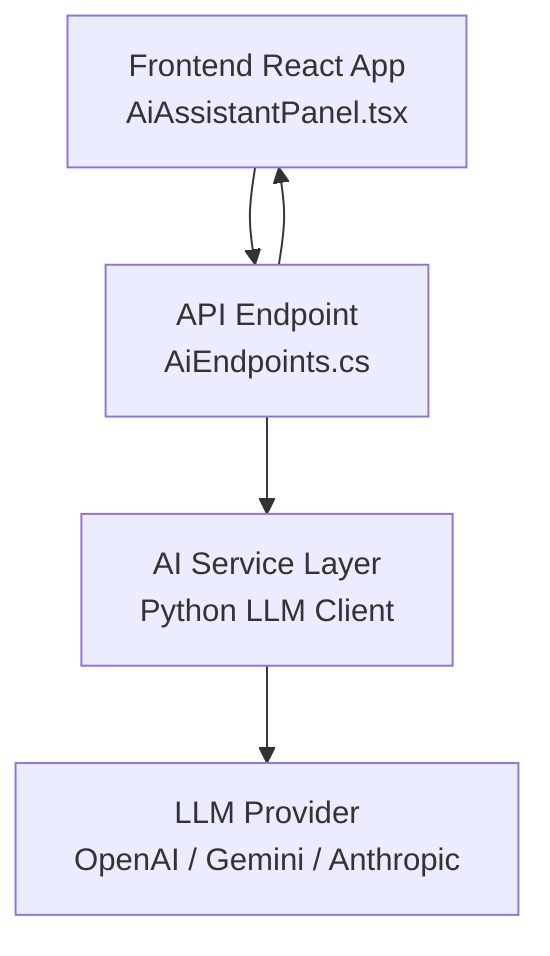
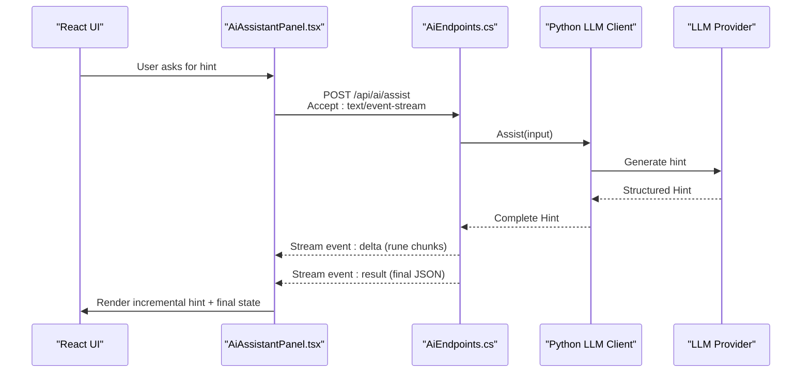
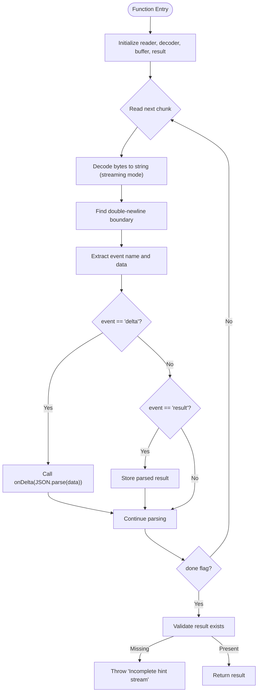
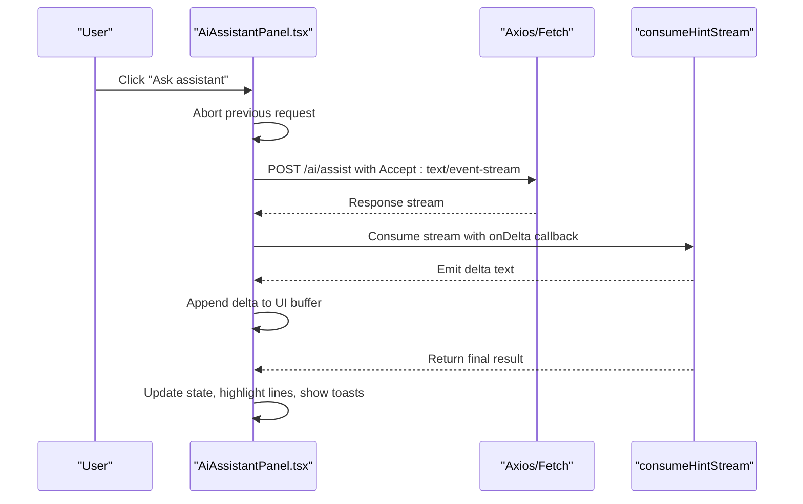
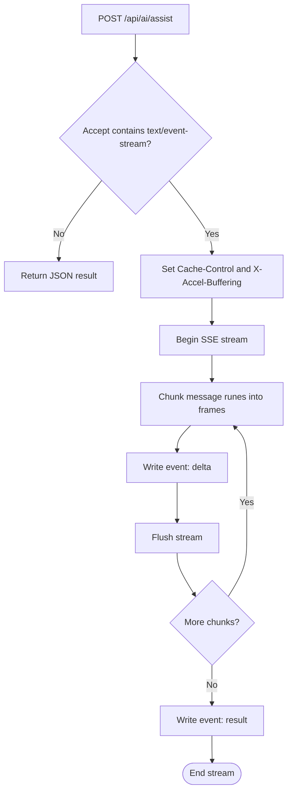
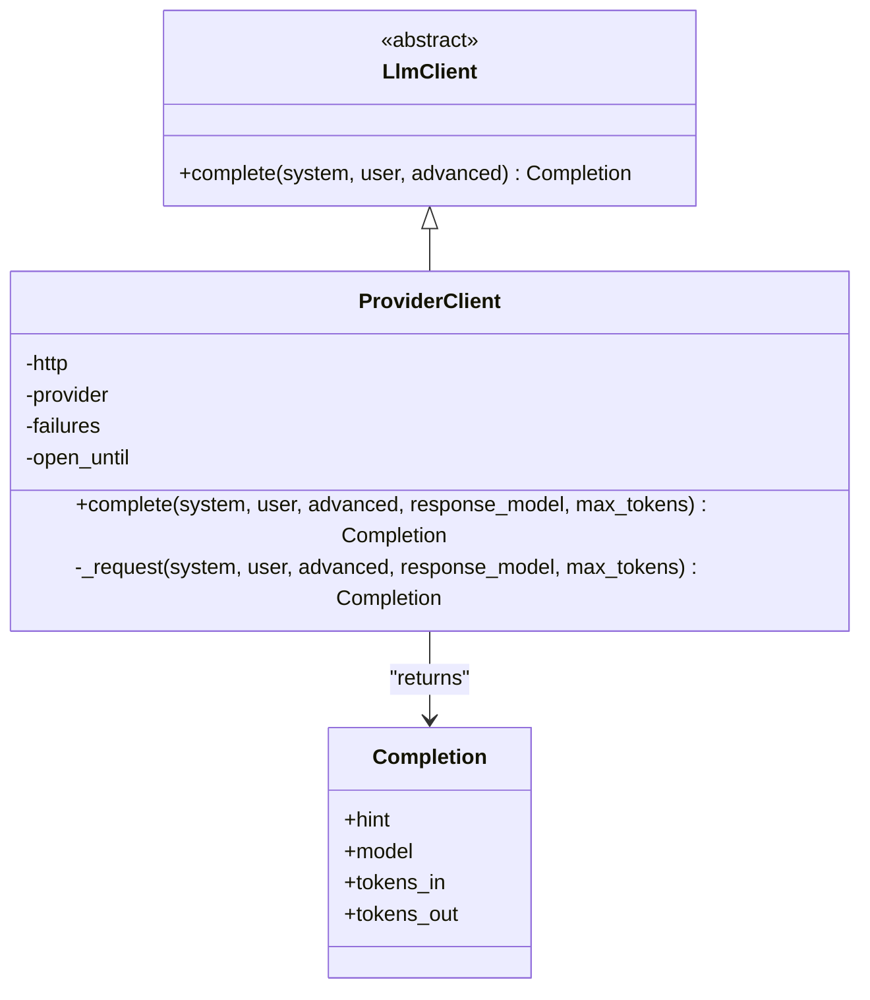
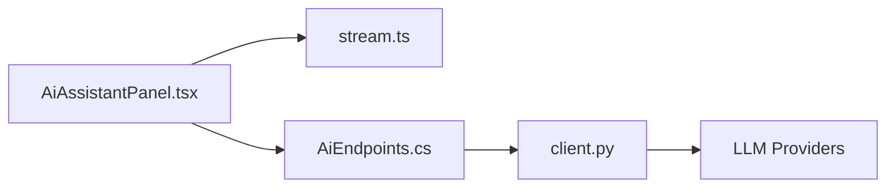

# Real-time Streaming Communication

<cite>
**Referenced Files in This Document**
- [AiAssistantPanel.tsx](file://frontend/src/features/ai-assistant/AiAssistantPanel.tsx)
- [stream.ts](file://frontend/src/features/ai-assistant/stream.ts)
- [assistant-stream.test.mjs](file://frontend/tests/assistant-stream.test.mjs)
- [AiEndpoints.cs](file://api/src/Api/CodePath.Api/Endpoints/AiEndpoints.cs)
- [client.py](file://ai-service/app/llm/client.py)
- [handlers.ts](file://frontend/src/features/workspace/mocks/handlers.ts)
</cite>

## Table of Contents
1. [Introduction](#introduction)
2. [Project Structure](#project-structure)
3. [Core Components](#core-components)
4. [Architecture Overview](#architecture-overview)
5. [Detailed Component Analysis](#detailed-component-analysis)
6. [Dependency Analysis](#dependency-analysis)
7. [Performance Considerations](#performance-considerations)
8. [Troubleshooting Guide](#troubleshooting-guide)
9. [Conclusion](#conclusion)

## Introduction
This document explains the real-time streaming communication system used by the AI Assistant feature. It focuses on Server-Sent Events (SSE), stream consumption patterns, error handling, connection management, abort controller usage, and data parsing logic. The implementation spans:
- Frontend React component that initiates streaming requests and renders incremental hints.
- A lightweight SSE parser that safely consumes UTF-8 byte chunks and reconstructs events.
- API endpoint that streams pre-approved hint text as SSE frames.
- Python LLM client that generates complete hints before they are streamed to clients.

The design ensures that only fully validated hints are streamed, protecting users from untrusted model output while providing a smooth, incremental reading experience.

## Project Structure
The streaming pipeline connects three main layers:
- Frontend UI layer: initiates requests, manages AbortController, and renders streamed deltas.
- API gateway layer: detects SSE-capable clients and streams event frames.
- AI service layer: produces complete hints using an LLM provider with retry and circuit-breaking behavior.

**Diagram sources**
- [AiAssistantPanel.tsx:38-62](file://frontend/src/features/ai-assistant/AiAssistantPanel.tsx#L38-L62)
- [AiEndpoints.cs:15-36](file://api/src/Api/CodePath.Api/Endpoints/AiEndpoints.cs#L15-L36)
- [client.py:31-82](file://ai-service/app/llm/client.py#L31-L82)

**Section sources**
- [AiAssistantPanel.tsx:18-62](file://frontend/src/features/ai-assistant/AiAssistantPanel.tsx#L18-L62)
- [AiEndpoints.cs:10-43](file://api/src/Api/CodePath.Api/Endpoints/AiEndpoints.cs#L10-L43)
- [client.py:16-82](file://ai-service/app/llm/client.py#L16-L82)

## Core Components
- consumeHintStream function: Parses SSE frames from a ReadableStream of bytes, handles UTF-8 boundaries, emits delta events, and returns the final result object.
- AiAssistantPanel: Initiates streaming requests, manages AbortController, updates UI incrementally, and handles errors including timeouts and partial responses.
- AiEndpoints: Detects SSE clients, sets appropriate headers, and streams rune-chunked delta events followed by a final result frame.
- Python LLM client: Generates complete hints via providers, applies retries and transient failure protection, and returns structured Hint objects.

Key responsibilities:
- Connection lifecycle: request creation, timeout, cancellation, and cleanup.
- Data parsing: robust UTF-8 decoding and SSE frame reconstruction.
- Error handling: distinguishing cancellations from server errors, mapping codes to user messages, and guarding against incomplete streams.

**Section sources**
- [stream.ts:1-24](file://frontend/src/features/ai-assistant/stream.ts#L1-L24)
- [AiAssistantPanel.tsx:38-62](file://frontend/src/features/ai-assistant/AiAssistantPanel.tsx#L38-L62)
- [AiEndpoints.cs:15-36](file://api/src/Api/CodePath.Api/Endpoints/AiEndpoints.cs#L15-L36)
- [client.py:31-82](file://ai-service/app/llm/client.py#L31-L82)

## Architecture Overview
The streaming flow is designed for safety and performance:
- The frontend sends a POST request with Accept: text/event-stream.
- The API checks the Accept header; if SSE is requested, it streams delta frames then a final result frame.
- The backend first computes the full hint through the AI service, ensuring all content passes guard policies before streaming begins.
- The frontend parses each delta, appends it to the UI buffer, and waits for the final result to finalize state.

**Diagram sources**
- [AiAssistantPanel.tsx:38-62](file://frontend/src/features/ai-assistant/AiAssistantPanel.tsx#L38-L62)
- [AiEndpoints.cs:15-36](file://api/src/Api/CodePath.Api/Endpoints/AiEndpoints.cs#L15-L36)
- [client.py:31-82](file://ai-service/app/llm/client.py#L31-L82)

## Detailed Component Analysis

### SSE Parser: consumeHintStream
consumeHintStream implements a robust SSE consumer over arbitrary network chunk boundaries:
- Uses ReadableStream reader and TextDecoder with streaming mode to avoid splitting multi-byte characters.
- Accumulates raw text into a buffer and splits on double newline boundaries to extract SSE frames.
- Extracts event type and data fields, emitting delta events and capturing the final result.
- Releases the reader lock in a finally block to prevent resource leaks.
- Throws an error when no final result frame arrives, indicating a truncated or incomplete stream.

Complexity considerations:
- Buffer growth is proportional to total streamed text; memory usage grows until completion.
- String operations per frame are linear in frame size; overall complexity is O(N) where N is total bytes.

Error handling:
- Incomplete streams throw an error, preventing partial results from being treated as valid.
- JSON parse errors inside delta/result frames will propagate up to the caller.

**Diagram sources**
- [stream.ts:1-24](file://frontend/src/features/ai-assistant/stream.ts#L1-L24)

**Section sources**
- [stream.ts:1-24](file://frontend/src/features/ai-assistant/stream.ts#L1-L24)
- [assistant-stream.test.mjs:10-20](file://frontend/tests/assistant-stream.test.mjs#L10-L20)

### Frontend Streaming Consumer: AiAssistantPanel
AiAssistantPanel orchestrates the streaming request and UI updates:
- Creates and reuses an AbortController to cancel previous requests when new ones start or the component unmounts.
- Sends a POST request with Accept: text/event-stream and a 35-second timeout.
- Consumes the response stream via consumeHintStream, appending delta text to the UI buffer only if the source code has not changed since the request started.
- On successful completion, updates the final result, highlights suspected lines, and shows error codes as toast notifications.
- Handles Axios errors, including cancellations and proxy error bodies, mapping error codes to user-friendly messages.

Connection management:
- Aborts prior connections before starting new ones to avoid overlapping streams.
- Cleans up the AbortController on component unmount.

Data parsing logic:
- Delegates SSE parsing to consumeHintStream, which emits deltas and returns the final result.

Error handling:
- Distinguishes between cancellation and other errors.
- Reads error payloads from proxied responses when available.
- Maps known error codes like quota limits and rate limits to specific user messages.

**Diagram sources**
- [AiAssistantPanel.tsx:38-62](file://frontend/src/features/ai-assistant/AiAssistantPanel.tsx#L38-L62)
- [stream.ts:1-24](file://frontend/src/features/ai-assistant/stream.ts#L1-L24)

**Section sources**
- [AiAssistantPanel.tsx:18-62](file://frontend/src/features/ai-assistant/AiAssistantPanel.tsx#L18-L62)

### API SSE Streaming: AiEndpoints
AiEndpoints provides the SSE streaming endpoint:
- Detects SSE capability via the Accept header containing text/event-stream.
- Sets Cache-Control and X-Accel-Buffering headers to ensure immediate delivery.
- Streams rune-chunked delta events followed by a final result frame.
- Wraps streaming in Results.Stream to manage writer lifecycle and flushing.

Safety guarantees:
- The entire hint is generated and validated before streaming begins, ensuring no unchecked tokens reach the client.

**Diagram sources**
- [AiEndpoints.cs:15-36](file://api/src/Api/CodePath.Api/Endpoints/AiEndpoints.cs#L15-L36)

**Section sources**
- [AiEndpoints.cs:10-43](file://api/src/Api/CodePath.Api/Endpoints/AiEndpoints.cs#L10-L43)

### AI Service LLM Client: Python LLM Client
The Python LLM client abstracts multiple providers and enforces reliability:
- Supports OpenAI, local vLLM, Gemini, and Anthropic backends.
- Applies retry logic for transient transport errors and provider throttling.
- Implements a simple circuit breaker pattern: after repeated failures, temporarily blocks new requests.
- Validates provider responses and maps them to a structured Hint model.

Reliability features:
- Retries up to two attempts with fixed wait intervals for transport errors.
- Raises a transient provider error for 429 and 5xx responses, enabling upstream handling.
- Enforces required configuration variables for models and keys.

**Diagram sources**
- [client.py:9-14](file://ai-service/app/llm/client.py#L9-L14)
- [client.py:16-18](file://ai-service/app/llm/client.py#L16-L18)
- [client.py:22-41](file://ai-service/app/llm/client.py#L22-L41)
- [client.py:43-82](file://ai-service/app/llm/client.py#L43-L82)

**Section sources**
- [client.py:16-82](file://ai-service/app/llm/client.py#L16-L82)

### Mock Streaming Handler
For development and testing, the mock handler simulates SSE streaming:
- Encodes message parts into delta events with small delays.
- Emits a final result event with interaction metadata.
- Returns a ReadableStream with Content-Type: text/event-stream.

This enables end-to-end tests without relying on the live API.

**Section sources**
- [handlers.ts:63-70](file://frontend/src/features/workspace/mocks/handlers.ts#L63-L70)

## Dependency Analysis
The streaming system depends on:
- Frontend React components for UI and request orchestration.
- Axios/Fetch adapter configured for streaming responses.
- SSE parser for safe UTF-8 decoding and frame reconstruction.
- API endpoint for SSE framing and header management.
- Python LLM client for provider abstraction and reliability.

**Diagram sources**
- [AiAssistantPanel.tsx:38-62](file://frontend/src/features/ai-assistant/AiAssistantPanel.tsx#L38-L62)
- [stream.ts:1-24](file://frontend/src/features/ai-assistant/stream.ts#L1-L24)
- [AiEndpoints.cs:15-36](file://api/src/Api/CodePath.Api/Endpoints/AiEndpoints.cs#L15-L36)
- [client.py:31-82](file://ai-service/app/llm/client.py#L31-L82)

**Section sources**
- [AiAssistantPanel.tsx:38-62](file://frontend/src/features/ai-assistant/AiAssistantPanel.tsx#L38-L62)
- [stream.ts:1-24](file://frontend/src/features/ai-assistant/stream.ts#L1-L24)
- [AiEndpoints.cs:15-36](file://api/src/Api/CodePath.Api/Endpoints/AiEndpoints.cs#L15-L36)
- [client.py:31-82](file://ai-service/app/llm/client.py#L31-L82)

## Performance Considerations
- Incremental rendering: Delta events allow the UI to update progressively, improving perceived responsiveness.
- Rune-based chunking: The API chunks by runes to preserve Unicode correctness across character boundaries.
- Buffer management: The frontend accumulates delta text in memory; consider limiting buffer size for very long hints.
- Network efficiency: SSE avoids re-fetching entire responses; use proper caching headers at proxies if needed.
- Retry and circuit breaking: The LLM client reduces load spikes and protects against provider outages.

[No sources needed since this section provides general guidance]

## Troubleshooting Guide
Common issues and resolutions:
- Connection timeouts:
  - The frontend uses a 35-second timeout; adjust based on expected hint length and network conditions.
  - Ensure proxies do not buffer or drop long-lived streams; verify X-Accel-Buffering and Cache-Control headers.
- Partial responses:
  - If the stream ends without a result frame, consumeHintStream throws an error; handle this in the caller to prompt retry.
  - Tests assert that truncated streams fail validation, preventing partial results from being accepted.
- Memory management:
  - Large hints can grow the buffer significantly; monitor memory usage and consider streaming UI updates with virtualization.
  - Always release the stream reader lock; the parser does this in a finally block.
- Network interruptions:
  - Use AbortController to cancel in-flight requests; the panel aborts previous requests before starting new ones.
  - Handle Axios cancellation separately from server errors to avoid misleading user feedback.
- Provider errors:
  - Transient provider errors trigger retries and temporary circuit breaking; surface appropriate messages to users.
  - Quota and rate limit errors are mapped to user-facing toasts.

Operational tips:
- Validate Accept header handling at reverse proxies to ensure SSE passthrough.
- Monitor stream completion rates and error codes to detect upstream instability.
- Log delta count and final result presence to diagnose incomplete streams.

**Section sources**
- [AiAssistantPanel.tsx:40-62](file://frontend/src/features/ai-assistant/AiAssistantPanel.tsx#L40-L62)
- [stream.ts:21-23](file://frontend/src/features/ai-assistant/stream.ts#L21-L23)
- [assistant-stream.test.mjs:18-20](file://frontend/tests/assistant-stream.test.mjs#L18-L20)
- [client.py:31-41](file://ai-service/app/llm/client.py#L31-L41)

## Conclusion
The real-time streaming communication system combines a safe SSE parser, a responsive React UI, a streaming API endpoint, and a reliable LLM client. It prioritizes correctness and security by buffering and validating hints before streaming, while delivering a smooth incremental reading experience. Proper connection management, error handling, and performance tuning ensure robust operation under varying network and provider conditions.

[No sources needed since this section summarizes without analyzing specific files]