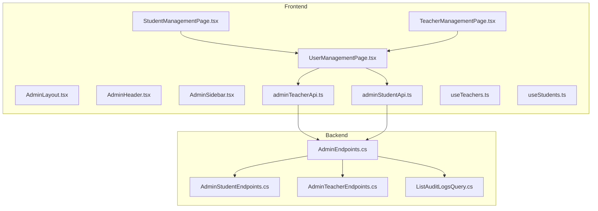
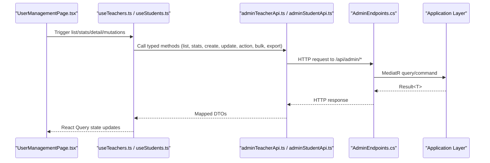
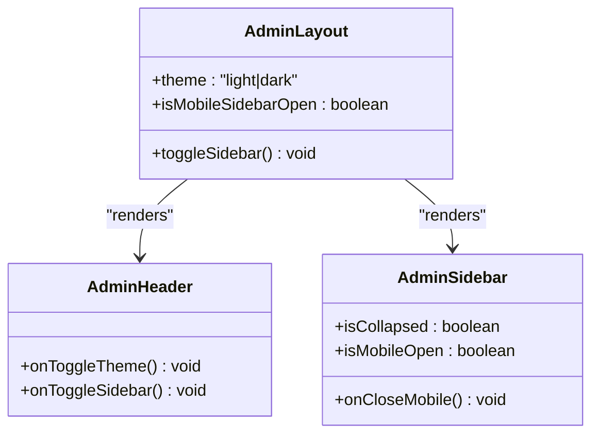
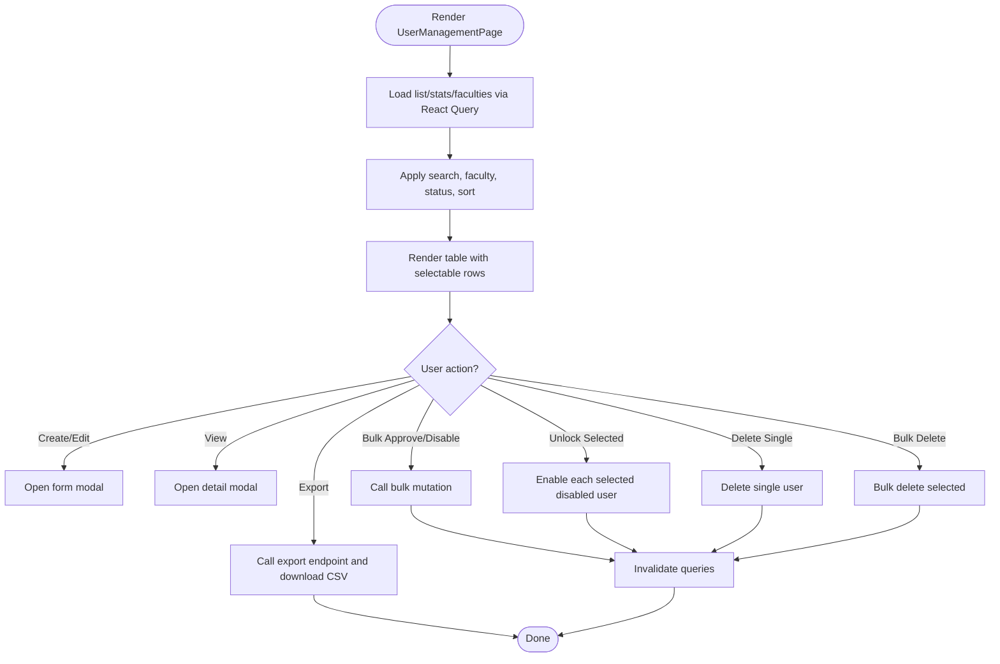
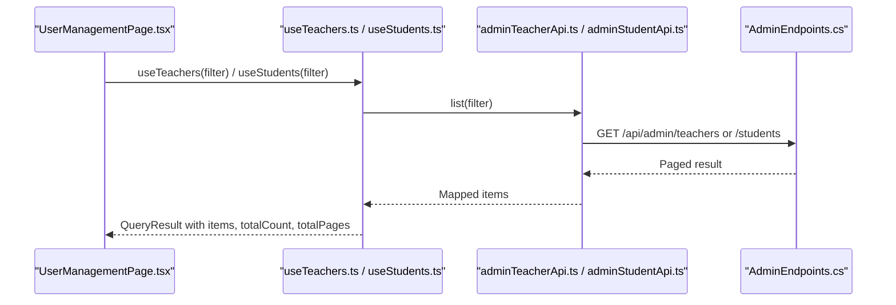
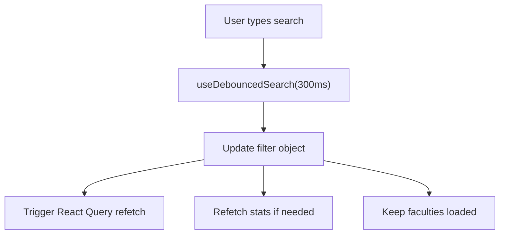
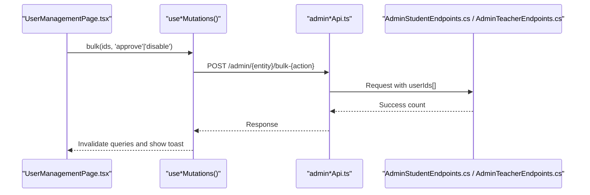
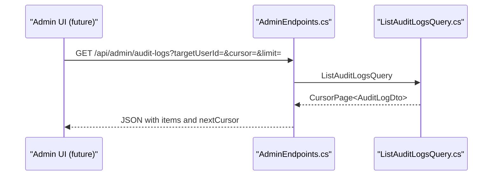
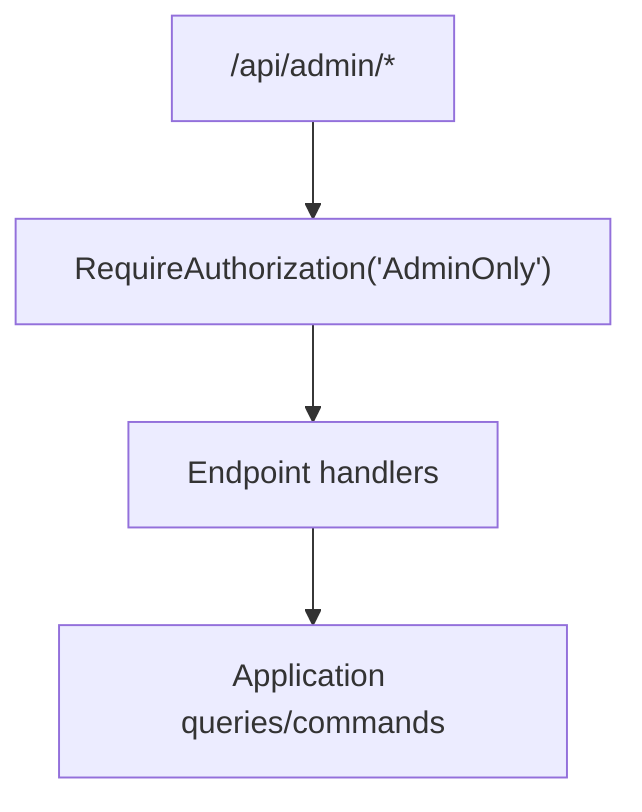
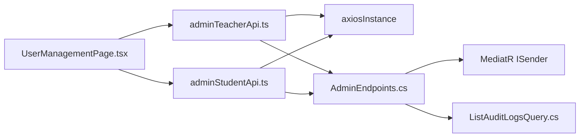

# Admin Dashboard

<cite>
**Referenced Files in This Document**
- [AdminEndpoints.cs](file://api/src/Api/CodePath.Api/Endpoints/AdminEndpoints.cs)
- [AdminStudentEndpoints.cs](file://api/src/Api/CodePath.Api/Endpoints/AdminStudentEndpoints.cs)
- [AdminTeacherEndpoints.cs](file://api/src/Api/CodePath.Api/Endpoints/AdminTeacherEndpoints.cs)
- [ListAuditLogsQuery.cs](file://api/src/Application/CodePath.Application/Admin/Queries/ListAuditLogsQuery.cs)
- [UserManagementPage.tsx](file://frontend/src/features/admin/pages/UserManagementPage.tsx)
- [StudentManagementPage.tsx](file://frontend/src/features/admin/pages/StudentManagementPage.tsx)
- [TeacherManagementPage.tsx](file://frontend/src/features/admin/pages/TeacherManagementPage.tsx)
- [AdminLayout.tsx](file://frontend/src/features/admin/layouts/AdminLayout.tsx)
- [AdminHeader.tsx](file://frontend/src/features/admin/components/AdminHeader.tsx)
- [AdminSidebar.tsx](file://frontend/src/features/admin/components/AdminSidebar.tsx)
- [admin.types.ts](file://frontend/src/features/admin/types/admin.types.ts)
- [adminTeacherApi.ts](file://frontend/src/features/admin/api/adminTeacherApi.ts)
- [adminStudentApi.ts](file://frontend/src/features/admin/api/adminStudentApi.ts)
- [useTeachers.ts](file://frontend/src/features/admin/hooks/useTeachers.ts)
- [useStudents.ts](file://frontend/src/features/admin/hooks/useStudents.ts)
</cite>

## Table of Contents
1. [Introduction](#introduction)
2. [Project Structure](#project-structure)
3. [Core Components](#core-components)
4. [Architecture Overview](#architecture-overview)
5. [Detailed Component Analysis](#detailed-component-analysis)
6. [Dependency Analysis](#dependency-analysis)
7. [Performance Considerations](#performance-considerations)
8. [Troubleshooting Guide](#troubleshooting-guide)
9. [Conclusion](#conclusion)
10. [Appendices](#appendices)

## Introduction
This document explains the administrative dashboard implementation across backend endpoints and frontend pages. It covers user management interfaces for students and teachers, system monitoring via audit logs, data fetching patterns with React Query, filtering and search behavior, bulk operations, admin-specific layouts and navigation, and permission-based UI rendering. It also provides guidance on adding new admin features, extending user management capabilities, and implementing custom reporting tools.

## Project Structure
The admin feature is split into:
- Backend API endpoints under the admin route group, protected by an AdminOnly authorization policy.
- Application layer queries and commands handling business logic (e.g., listing users, exporting CSV, audit log pagination).
- Frontend admin pages and components that render dashboards, tables, modals, and navigation.

**Diagram sources**
- [AdminLayout.tsx:1-39](file://frontend/src/features/admin/layouts/AdminLayout.tsx#L1-L39)
- [AdminHeader.tsx:1-65](file://frontend/src/features/admin/components/AdminHeader.tsx#L1-L65)
- [AdminSidebar.tsx:1-54](file://frontend/src/features/admin/components/AdminSidebar.tsx#L1-L54)
- [UserManagementPage.tsx:1-734](file://frontend/src/features/admin/pages/UserManagementPage.tsx#L1-L734)
- [StudentManagementPage.tsx:1-5](file://frontend/src/features/admin/pages/StudentManagementPage.tsx#L1-L5)
- [TeacherManagementPage.tsx:1-5](file://frontend/src/features/admin/pages/TeacherManagementPage.tsx#L1-L5)
- [adminTeacherApi.ts:1-65](file://frontend/src/features/admin/api/adminTeacherApi.ts#L1-L65)
- [adminStudentApi.ts:1-113](file://frontend/src/features/admin/api/adminStudentApi.ts#L1-L113)
- [useTeachers.ts:1-35](file://frontend/src/features/admin/hooks/useTeachers.ts#L1-L35)
- [useStudents.ts:1-54](file://frontend/src/features/admin/hooks/useStudents.ts#L1-L54)
- [AdminEndpoints.cs:1-160](file://api/src/Api/CodePath.Api/Endpoints/AdminEndpoints.cs#L1-L160)
- [AdminStudentEndpoints.cs:1-97](file://api/src/Api/CodePath.Api/Endpoints/AdminStudentEndpoints.cs#L1-L97)
- [AdminTeacherEndpoints.cs:1-86](file://api/src/Api/CodePath.Api/Endpoints/AdminTeacherEndpoints.cs#L1-L86)
- [ListAuditLogsQuery.cs:1-70](file://api/src/Application/CodePath.Application/Admin/Queries/ListAuditLogsQuery.cs#L1-L70)

**Section sources**
- [AdminEndpoints.cs:17-25](file://api/src/Api/CodePath.Api/Endpoints/AdminEndpoints.cs#L17-L25)
- [AdminLayout.tsx:6-38](file://frontend/src/features/admin/layouts/AdminLayout.tsx#L6-L38)

## Core Components
- Admin layout and navigation:
  - AdminLayout renders a shell with header, sidebar, and main content area. It manages theme persistence and responsive sidebar behavior.
  - AdminHeader provides global search, settings panel, notifications placeholder, and profile/logout controls.
  - AdminSidebar defines admin navigation entries and mobile/desktop presentation.
- User management pages:
  - StudentManagementPage and TeacherManagementPage are thin wrappers around UserManagementPage, selecting role context.
  - UserManagementPage implements comprehensive table UI with search, filters, sorting, column customization, selection, bulk actions, export, and detail/edit modals.
- Data access:
  - adminTeacherApi and adminStudentApi encapsulate HTTP calls to backend endpoints, mapping responses to shared types.
  - useTeachers and useStudents wrap React Query hooks for list, stats, detail, and mutations (create/update/action/bulk/bulkDelete/export).
- Backend endpoints:
  - AdminEndpoints groups admin routes under /api/admin with AdminOnly authorization and exposes teacher/user lifecycle endpoints and audit logs.
  - AdminStudentEndpoints and AdminTeacherEndpoints define CRUD, bulk operations, stats, faculties, and export endpoints.

**Section sources**
- [AdminLayout.tsx:6-38](file://frontend/src/features/admin/layouts/AdminLayout.tsx#L6-L38)
- [AdminHeader.tsx:9-63](file://frontend/src/features/admin/components/AdminHeader.tsx#L9-L63)
- [AdminSidebar.tsx:7-52](file://frontend/src/features/admin/components/AdminSidebar.tsx#L7-L52)
- [StudentManagementPage.tsx:1-5](file://frontend/src/features/admin/pages/StudentManagementPage.tsx#L1-L5)
- [TeacherManagementPage.tsx:1-5](file://frontend/src/features/admin/pages/TeacherManagementPage.tsx#L1-L5)
- [UserManagementPage.tsx:50-119](file://frontend/src/features/admin/pages/UserManagementPage.tsx#L50-L119)
- [adminTeacherApi.ts:29-60](file://frontend/src/features/admin/api/adminTeacherApi.ts#L29-L60)
- [adminStudentApi.ts:60-107](file://frontend/src/features/admin/api/adminStudentApi.ts#L60-L107)
- [useTeachers.ts:5-34](file://frontend/src/features/admin/hooks/useTeachers.ts#L5-L34)
- [useStudents.ts:4-52](file://frontend/src/features/admin/hooks/useStudents.ts#L4-L52)
- [AdminEndpoints.cs:17-152](file://api/src/Api/CodePath.Api/Endpoints/AdminEndpoints.cs#L17-L152)
- [AdminStudentEndpoints.cs:19-95](file://api/src/Api/CodePath.Api/Endpoints/AdminStudentEndpoints.cs#L19-L95)
- [AdminTeacherEndpoints.cs:19-84](file://api/src/Api/CodePath.Api/Endpoints/AdminTeacherEndpoints.cs#L19-L84)

## Architecture Overview
The admin dashboard follows a layered architecture:
- Frontend pages call typed API clients built on axios.
- API clients send requests to backend endpoints grouped under /api/admin.
- Endpoints enforce AdminOnly authorization and delegate to application queries/commands.
- Queries/commands interact with domain models and return results or errors.

**Diagram sources**
- [UserManagementPage.tsx:92-119](file://frontend/src/features/admin/pages/UserManagementPage.tsx#L92-L119)
- [useTeachers.ts:5-34](file://frontend/src/features/admin/hooks/useTeachers.ts#L5-L34)
- [useStudents.ts:4-52](file://frontend/src/features/admin/hooks/useStudents.ts#L4-L52)
- [adminTeacherApi.ts:29-60](file://frontend/src/features/admin/api/adminTeacherApi.ts#L29-L60)
- [adminStudentApi.ts:60-107](file://frontend/src/features/admin/api/adminStudentApi.ts#L60-L107)
- [AdminEndpoints.cs:17-152](file://api/src/Api/CodePath.Api/Endpoints/AdminEndpoints.cs#L17-L152)

## Detailed Component Analysis

### Admin Layout and Navigation
- AdminLayout:
  - Persists theme preference and toggles between light/dark modes.
  - Renders AdminHeader and AdminSidebar, with a responsive main content area.
- AdminHeader:
  - Provides quick search over adminNavigation entries, settings dropdown, notifications placeholder, and profile/logout.
- AdminSidebar:
  - Defines adminNavigation entries: overview, student management, teacher management.
  - Supports collapsed desktop mode and modal overlay on mobile.

**Diagram sources**
- [AdminLayout.tsx:6-38](file://frontend/src/features/admin/layouts/AdminLayout.tsx#L6-L38)
- [AdminHeader.tsx:9-63](file://frontend/src/features/admin/components/AdminHeader.tsx#L9-L63)
- [AdminSidebar.tsx:7-52](file://frontend/src/features/admin/components/AdminSidebar.tsx#L7-L52)

**Section sources**
- [AdminLayout.tsx:6-38](file://frontend/src/features/admin/layouts/AdminLayout.tsx#L6-L38)
- [AdminHeader.tsx:9-63](file://frontend/src/features/admin/components/AdminHeader.tsx#L9-L63)
- [AdminSidebar.tsx:7-52](file://frontend/src/features/admin/components/AdminSidebar.tsx#L7-L52)

### User Management Interfaces
- Role-specific pages:
  - StudentManagementPage and TeacherManagementPage pass a fixed role to UserManagementPage.
- UserManagementPage:
  - Unified interface for both roles with dynamic columns, status labels, and statistics.
  - Debounced search input, faculty filter, status filter, sort controls, and pagination.
  - Column customization (hide/show, resizable widths), density toggle, and overview panel.
  - Selection and bulk operations: approve/disable, unlock selected disabled users, bulk delete.
  - Export CSV using backend export endpoints.
  - Detail modal and edit/create form integration.

**Diagram sources**
- [UserManagementPage.tsx:92-119](file://frontend/src/features/admin/pages/UserManagementPage.tsx#L92-L119)
- [UserManagementPage.tsx:191-259](file://frontend/src/features/admin/pages/UserManagementPage.tsx#L191-L259)
- [UserManagementPage.tsx:267-295](file://frontend/src/features/admin/pages/UserManagementPage.tsx#L267-L295)
- [adminTeacherApi.ts:49-60](file://frontend/src/features/admin/api/adminTeacherApi.ts#L49-L60)
- [adminStudentApi.ts:95-107](file://frontend/src/features/admin/api/adminStudentApi.ts#L95-L107)

**Section sources**
- [StudentManagementPage.tsx:1-5](file://frontend/src/features/admin/pages/StudentManagementPage.tsx#L1-L5)
- [TeacherManagementPage.tsx:1-5](file://frontend/src/features/admin/pages/TeacherManagementPage.tsx#L1-L5)
- [UserManagementPage.tsx:50-119](file://frontend/src/features/admin/pages/UserManagementPage.tsx#L50-L119)
- [UserManagementPage.tsx:191-259](file://frontend/src/features/admin/pages/UserManagementPage.tsx#L191-L259)
- [UserManagementPage.tsx:267-295](file://frontend/src/features/admin/pages/UserManagementPage.tsx#L267-L295)

### Data Fetching Patterns
- React Query hooks:
  - useTeachers and useStudents provide list, stats, detail, and mutations.
  - Mutations invalidate queries on success to keep UI consistent.
- API clients:
  - adminTeacherApi and adminStudentApi map backend responses to shared AdminUserItem type.
  - Export endpoints return blobs; clients trigger file downloads.

**Diagram sources**
- [UserManagementPage.tsx:92-119](file://frontend/src/features/admin/pages/UserManagementPage.tsx#L92-L119)
- [useTeachers.ts:5-8](file://frontend/src/features/admin/hooks/useTeachers.ts#L5-L8)
- [useStudents.ts:4-9](file://frontend/src/features/admin/hooks/useStudents.ts#L4-L9)
- [adminTeacherApi.ts:29-33](file://frontend/src/features/admin/api/adminTeacherApi.ts#L29-L33)
- [adminStudentApi.ts:60-64](file://frontend/src/features/admin/api/adminStudentApi.ts#L60-L64)
- [AdminEndpoints.cs:26-52](file://api/src/Api/CodePath.Api/Endpoints/AdminEndpoints.cs#L26-L52)
- [AdminStudentEndpoints.cs:24-36](file://api/src/Api/CodePath.Api/Endpoints/AdminStudentEndpoints.cs#L24-L36)

**Section sources**
- [useTeachers.ts:5-34](file://frontend/src/features/admin/hooks/useTeachers.ts#L5-L34)
- [useStudents.ts:4-52](file://frontend/src/features/admin/hooks/useStudents.ts#L4-L52)
- [adminTeacherApi.ts:29-60](file://frontend/src/features/admin/api/adminTeacherApi.ts#L29-L60)
- [adminStudentApi.ts:60-107](file://frontend/src/features/admin/api/adminStudentApi.ts#L60-L107)

### Filtering and Search Functionality
- Debounced search:
  - useDebouncedSearch delays search updates to reduce network churn.
- Filters:
  - Faculty (department) filter via dropdown populated from faculties endpoint.
  - Status filter supports ALL, Active, Pending, Disabled, Rejected.
  - Sort by name or created date ascending/descending.
- URL sync:
  - Status changes reflect in URL query parameters for shareable views.

**Diagram sources**
- [useTeachers.ts:9-13](file://frontend/src/features/admin/hooks/useTeachers.ts#L9-L13)
- [UserManagementPage.tsx:92-100](file://frontend/src/features/admin/pages/UserManagementPage.tsx#L92-L100)
- [UserManagementPage.tsx:178-182](file://frontend/src/features/admin/pages/UserManagementPage.tsx#L178-L182)

**Section sources**
- [useTeachers.ts:9-13](file://frontend/src/features/admin/hooks/useTeachers.ts#L9-L13)
- [UserManagementPage.tsx:92-100](file://frontend/src/features/admin/pages/UserManagementPage.tsx#L92-L100)
- [UserManagementPage.tsx:178-182](file://frontend/src/features/admin/pages/UserManagementPage.tsx#L178-L182)

### Bulk Operations
- Bulk approve/disable:
  - Students and teachers have dedicated bulk endpoints.
- Bulk delete:
  - Separate bulk-delete endpoints for each entity type.
- Unlock selected disabled users:
  - Sequentially enable each selected disabled user with progress feedback.

**Diagram sources**
- [UserManagementPage.tsx:251-259](file://frontend/src/features/admin/pages/UserManagementPage.tsx#L251-L259)
- [adminTeacherApi.ts:46-50](file://frontend/src/features/admin/api/adminTeacherApi.ts#L46-L50)
- [adminStudentApi.ts:92-97](file://frontend/src/features/admin/api/adminStudentApi.ts#L92-L97)
- [AdminStudentEndpoints.cs:71-87](file://api/src/Api/CodePath.Api/Endpoints/AdminStudentEndpoints.cs#L71-L87)
- [AdminTeacherEndpoints.cs:55-77](file://api/src/Api/CodePath.Api/Endpoints/AdminTeacherEndpoints.cs#L55-L77)

**Section sources**
- [UserManagementPage.tsx:251-259](file://frontend/src/features/admin/pages/UserManagementPage.tsx#L251-L259)
- [UserManagementPage.tsx:233-249](file://frontend/src/features/admin/pages/UserManagementPage.tsx#L233-L249)
- [adminTeacherApi.ts:46-50](file://frontend/src/features/admin/api/adminTeacherApi.ts#L46-L50)
- [adminStudentApi.ts:92-97](file://frontend/src/features/admin/api/adminStudentApi.ts#L92-L97)
- [AdminStudentEndpoints.cs:71-87](file://api/src/Api/CodePath.Api/Endpoints/AdminStudentEndpoints.cs#L71-L87)
- [AdminTeacherEndpoints.cs:55-77](file://api/src/Api/CodePath.Api/Endpoints/AdminTeacherEndpoints.cs#L55-L77)

### System Monitoring Tools
- Audit logs:
  - Endpoint lists audit logs with cursor-based pagination and optional targetUserId filter.
  - Application handler validates limit and decodes cursor, returning nextCursor when more data exists.

**Diagram sources**
- [AdminEndpoints.cs:136-150](file://api/src/Api/CodePath.Api/Endpoints/AdminEndpoints.cs#L136-L150)
- [ListAuditLogsQuery.cs:10-62](file://api/src/Application/CodePath.Application/Admin/Queries/ListAuditLogsQuery.cs#L10-L62)

**Section sources**
- [AdminEndpoints.cs:136-150](file://api/src/Api/CodePath.Api/Endpoints/AdminEndpoints.cs#L136-L150)
- [ListAuditLogsQuery.cs:10-62](file://api/src/Application/CodePath.Application/Admin/Queries/ListAuditLogsQuery.cs#L10-L62)

### Permission-Based UI Rendering
- Authorization:
  - All admin endpoints are grouped under /api/admin and require AdminOnly authorization.
- Frontend:
  - AdminHeader and AdminSidebar integrate with auth store and logout flow.
  - Pages assume authenticated admin context; error states surface when requests fail.

**Diagram sources**
- [AdminEndpoints.cs:17-21](file://api/src/Api/CodePath.Api/Endpoints/AdminEndpoints.cs#L17-L21)
- [AdminHeader.tsx:5-6](file://frontend/src/features/admin/components/AdminHeader.tsx#L5-L6)
- [AdminSidebar.tsx:4-5](file://frontend/src/features/admin/components/AdminSidebar.tsx#L4-L5)

**Section sources**
- [AdminEndpoints.cs:17-21](file://api/src/Api/CodePath.Api/Endpoints/AdminEndpoints.cs#L17-L21)
- [AdminHeader.tsx:9-63](file://frontend/src/features/admin/components/AdminHeader.tsx#L9-L63)
- [AdminSidebar.tsx:7-52](file://frontend/src/features/admin/components/AdminSidebar.tsx#L7-L52)

## Dependency Analysis
- Frontend dependencies:
  - Pages depend on typed API clients and React Query hooks.
  - API clients depend on axios instance and error service.
- Backend dependencies:
  - Endpoints depend on MediatR ISender to dispatch queries/commands.
  - Audit logs depend on IAdminDbContext and AdminCursor utilities.

**Diagram sources**
- [UserManagementPage.tsx:10-13](file://frontend/src/features/admin/pages/UserManagementPage.tsx#L10-L13)
- [adminTeacherApi.ts:1-3](file://frontend/src/features/admin/api/adminTeacherApi.ts#L1-L3)
- [adminStudentApi.ts:1-4](file://frontend/src/features/admin/api/adminStudentApi.ts#L1-L4)
- [AdminEndpoints.cs:1-11](file://api/src/Api/CodePath.Api/Endpoints/AdminEndpoints.cs#L1-L11)
- [ListAuditLogsQuery.cs:1-6](file://api/src/Application/CodePath.Application/Admin/Queries/ListAuditLogsQuery.cs#L1-L6)

**Section sources**
- [UserManagementPage.tsx:10-13](file://frontend/src/features/admin/pages/UserManagementPage.tsx#L10-L13)
- [adminTeacherApi.ts:1-3](file://frontend/src/features/admin/api/adminTeacherApi.ts#L1-L3)
- [adminStudentApi.ts:1-4](file://frontend/src/features/admin/api/adminStudentApi.ts#L1-L4)
- [AdminEndpoints.cs:1-11](file://api/src/Api/CodePath.Api/Endpoints/AdminEndpoints.cs#L1-L11)
- [ListAuditLogsQuery.cs:1-6](file://api/src/Application/CodePath.Application/Admin/Queries/ListAuditLogsQuery.cs#L1-L6)

## Performance Considerations
- Debounced search reduces unnecessary network requests during typing.
- Pagination and cursor-based pagination for audit logs prevent large payloads.
- React Query caching and invalidation ensure efficient re-fetching after mutations.
- Export endpoints stream CSV files to avoid loading large datasets into memory on the client.

[No sources needed since this section provides general guidance]

## Troubleshooting Guide
- Common issues:
  - Unauthorized or forbidden responses indicate missing or invalid admin authorization.
  - Validation errors on audit logs occur when limit exceeds allowed range.
  - Invalid cursor values cause failures in audit log pagination.
- Diagnostics:
  - Use error messages surfaced by API clients and toast notifications.
  - Refetch queries from UI when transient errors occur.

**Section sources**
- [AdminEndpoints.cs:136-150](file://api/src/Api/CodePath.Api/Endpoints/AdminEndpoints.cs#L136-L150)
- [ListAuditLogsQuery.cs:15-19](file://api/src/Application/CodePath.Application/Admin/Queries/ListAuditLogsQuery.cs#L15-L19)
- [ListAuditLogsQuery.cs:32-37](file://api/src/Application/CodePath.Application/Admin/Queries/ListAuditLogsQuery.cs#L32-L37)
- [adminTeacherApi.ts:62-64](file://frontend/src/features/admin/api/adminTeacherApi.ts#L62-L64)
- [adminStudentApi.ts:110-112](file://frontend/src/features/admin/api/adminStudentApi.ts#L110-L112)

## Conclusion
The admin dashboard provides a robust, extensible platform for managing students and teachers, performing bulk operations, exporting reports, and monitoring system activity through audit logs. The separation of concerns between frontend pages, API clients, React Query hooks, and backend endpoints ensures maintainability and scalability. Following the patterns outlined here will help you add new admin features, extend user management capabilities, and implement custom reporting tools effectively.

[No sources needed since this section summarizes without analyzing specific files]

## Appendices

### Adding a New Admin Feature
- Backend:
  - Add a new endpoint under AdminEndpoints.cs or a dedicated file within Endpoints.
  - Protect it with RequireAuthorization("AdminOnly").
  - Implement MediatR query/command handlers in Application/Admin.
- Frontend:
  - Create a typed API method in adminTeacherApi.ts or adminStudentApi.ts (or a new module).
  - Add a React Query hook in hooks/ to encapsulate list/stats/detail/mutations.
  - Extend UserManagementPage or create a new page component.
  - Update AdminSidebar navigation entries if necessary.

**Section sources**
- [AdminEndpoints.cs:17-25](file://api/src/Api/CodePath.Api/Endpoints/AdminEndpoints.cs#L17-L25)
- [AdminSidebar.tsx:7-11](file://frontend/src/features/admin/components/AdminSidebar.tsx#L7-L11)
- [adminTeacherApi.ts:29-60](file://frontend/src/features/admin/api/adminTeacherApi.ts#L29-L60)
- [useTeachers.ts:24-34](file://frontend/src/features/admin/hooks/useTeachers.ts#L24-L34)

### Extending User Management Capabilities
- Add new fields to AdminUserItem and map them in API clients.
- Extend filters and sorting options in hooks and pages.
- Introduce new mutations for additional actions (e.g., transfer ownership).

**Section sources**
- [admin.types.ts:3-25](file://frontend/src/features/admin/types/admin.types.ts#L3-L25)
- [adminTeacherApi.ts:20-27](file://frontend/src/features/admin/api/adminTeacherApi.ts#L20-L27)
- [adminStudentApi.ts:26-58](file://frontend/src/features/admin/api/adminStudentApi.ts#L26-L58)
- [UserManagementPage.tsx:92-100](file://frontend/src/features/admin/pages/UserManagementPage.tsx#L92-L100)

### Implementing Custom Reporting Tools
- Use existing export endpoints as templates:
  - Backend returns Blob files; frontend triggers download.
- For complex reports:
  - Add new export endpoints with filtered queries.
  - Integrate a report generator in Application layer.
  - Expose a new API client method and UI button in UserManagementPage.

**Section sources**
- [AdminStudentEndpoints.cs:89-94](file://api/src/Api/CodePath.Api/Endpoints/AdminStudentEndpoints.cs#L89-L94)
- [AdminTeacherEndpoints.cs:78-83](file://api/src/Api/CodePath.Api/Endpoints/AdminTeacherEndpoints.cs#L78-L83)
- [adminTeacherApi.ts:52-60](file://frontend/src/features/admin/api/adminTeacherApi.ts#L52-L60)
- [adminStudentApi.ts:98-107](file://frontend/src/features/admin/api/adminStudentApi.ts#L98-L107)
- [UserManagementPage.tsx:191-205](file://frontend/src/features/admin/pages/UserManagementPage.tsx#L191-L205)