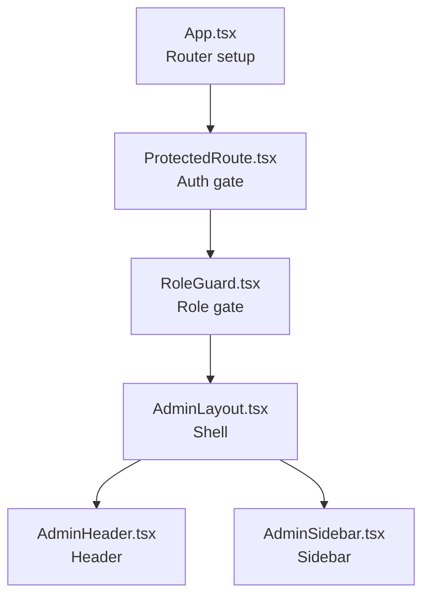
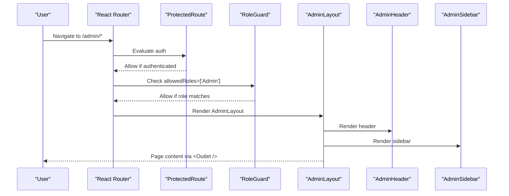
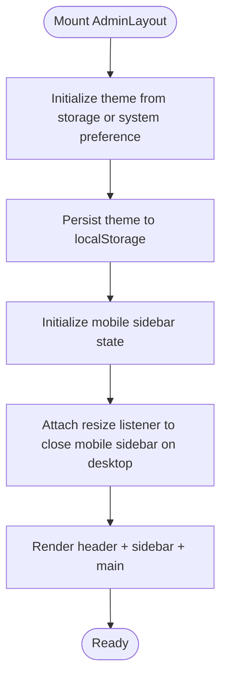
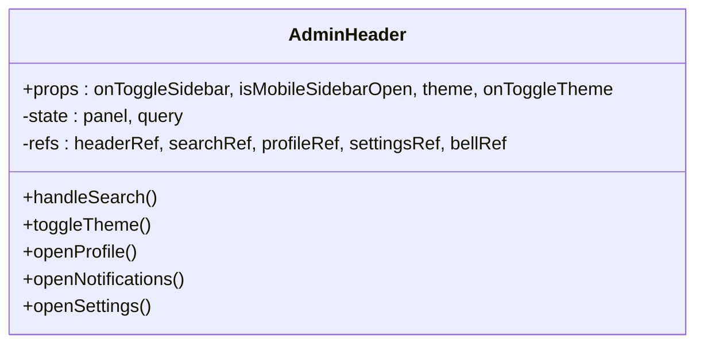
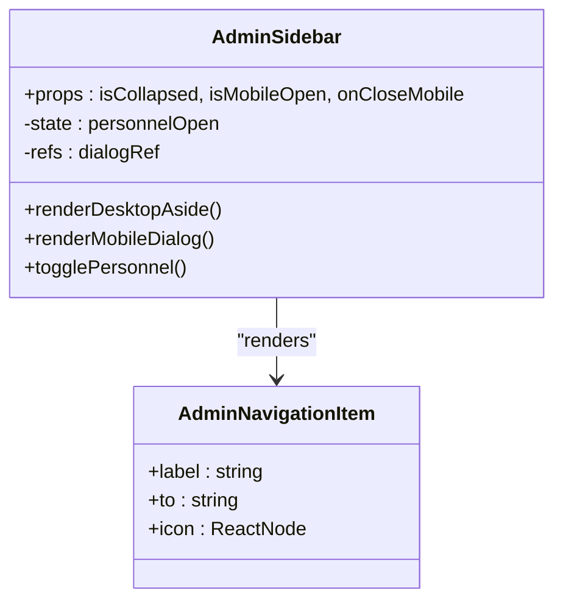
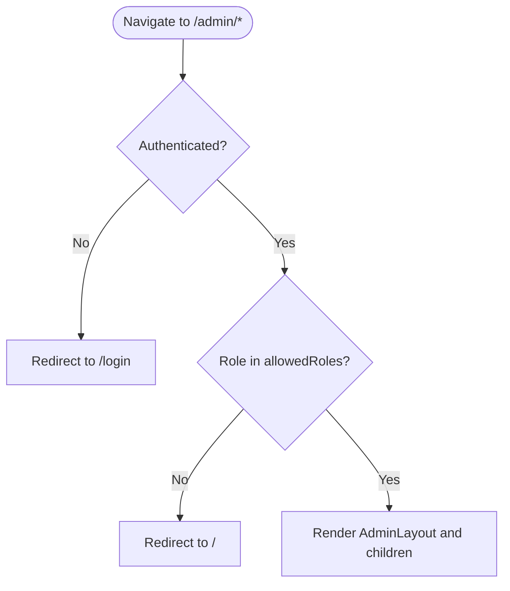
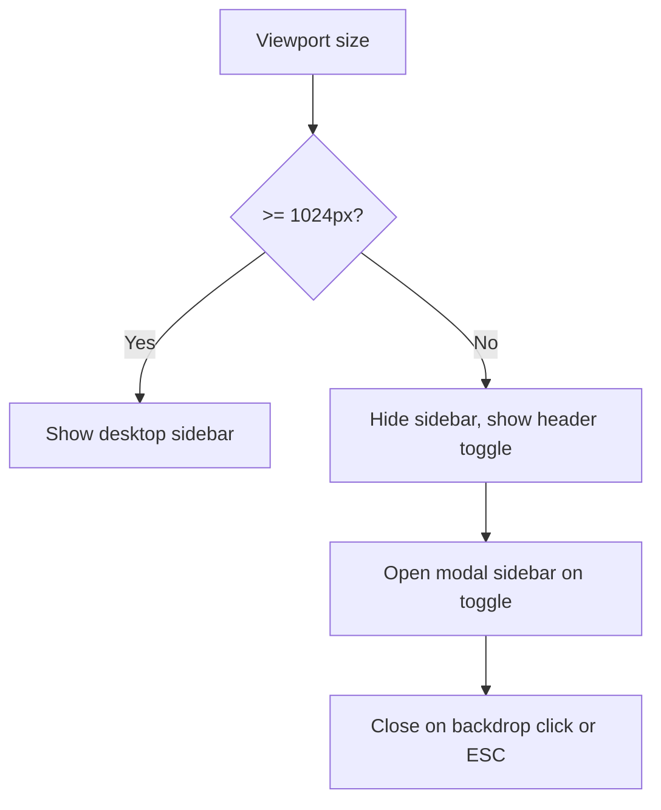
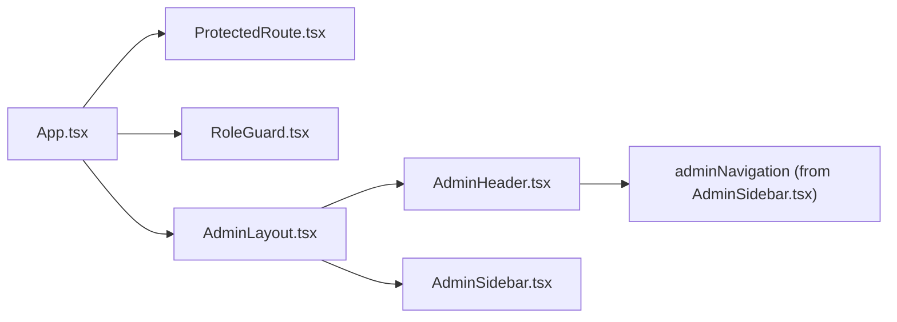

# Admin Layout & Navigation

<cite>
**Referenced Files in This Document**
- [App.tsx](file://frontend/src/App.tsx)
- [ProtectedRoute.tsx](file://frontend/src/routes/ProtectedRoute.tsx)
- [RoleGuard.tsx](file://frontend/src/routes/RoleGuard.tsx)
- [AdminLayout.tsx](file://frontend/src/features/admin/layouts/AdminLayout.tsx)
- [AdminHeader.tsx](file://frontend/src/features/admin/components/AdminHeader.tsx)
- [AdminSidebar.tsx](file://frontend/src/features/admin/components/AdminSidebar.tsx)
</cite>

## Table of Contents
1. [Introduction](#introduction)
2. [Project Structure](#project-structure)
3. [Core Components](#core-components)
4. [Architecture Overview](#architecture-overview)
5. [Detailed Component Analysis](#detailed-component-analysis)
6. [Dependency Analysis](#dependency-analysis)
7. [Performance Considerations](#performance-considerations)
8. [Troubleshooting Guide](#troubleshooting-guide)
9. [Conclusion](#conclusion)
10. [Appendices](#appendices)

## Introduction
This document explains the admin layout and navigation system used by the application’s administrative area. It covers the sidebar structure, header components (user profile, notifications, settings), route protection, role-based menu rendering, responsive behavior, React Router integration, and how to extend or customize the admin UI.

## Project Structure
The admin UI is composed of:
- A top-level router that wires protected routes and role guards to the admin layout.
- An admin layout shell that composes a header and sidebar around page content.
- A header with search, theme toggle, notifications, and user profile.
- A sidebar with navigation items and mobile drawer behavior.

**Diagram sources**
- [App.tsx:22-96](file://frontend/src/App.tsx#L22-L96)
- [ProtectedRoute.tsx:5-13](file://frontend/src/routes/ProtectedRoute.tsx#L5-L13)
- [RoleGuard.tsx:10-22](file://frontend/src/routes/RoleGuard.tsx#L10-L22)
- [AdminLayout.tsx:6-38](file://frontend/src/features/admin/layouts/AdminLayout.tsx#L6-L38)
- [AdminHeader.tsx:9-63](file://frontend/src/features/admin/components/AdminHeader.tsx#L9-L63)
- [AdminSidebar.tsx:13-52](file://frontend/src/features/admin/components/AdminSidebar.tsx#L13-L52)

**Section sources**
- [App.tsx:22-96](file://frontend/src/App.tsx#L22-L96)
- [AdminLayout.tsx:6-38](file://frontend/src/features/admin/layouts/AdminLayout.tsx#L6-L38)

## Core Components
- AdminLayout: Shell that renders AdminHeader, AdminSidebar, and an Outlet for child pages. Manages theme persistence and mobile sidebar state.
- AdminHeader: Provides brand link, global search over admin navigation, theme toggle, notifications panel, and user profile dropdown with logout.
- AdminSidebar: Renders navigation links, a collapsible “Personnel” group, and a footer with user info and logout. Supports desktop and mobile modes.

Key responsibilities:
- Route protection and role gating are handled at the router level before AdminLayout mounts.
- AdminLayout composes UI and manages local state (theme, mobile sidebar).
- AdminHeader and AdminSidebar read user data from the auth store and provide interactive controls.

**Section sources**
- [AdminLayout.tsx:6-38](file://frontend/src/features/admin/layouts/AdminLayout.tsx#L6-L38)
- [AdminHeader.tsx:9-63](file://frontend/src/features/admin/components/AdminHeader.tsx#L9-L63)
- [AdminSidebar.tsx:7-52](file://frontend/src/features/admin/components/AdminSidebar.tsx#L7-L52)

## Architecture Overview
The admin flow uses React Router v6 with lazy-loaded routes and layered guards:
- ProtectedRoute ensures authentication.
- RoleGuard enforces allowed roles per section.
- AdminLayout provides the admin shell for all admin pages.

**Diagram sources**
- [App.tsx:64-96](file://frontend/src/App.tsx#L64-L96)
- [ProtectedRoute.tsx:5-13](file://frontend/src/routes/ProtectedRoute.tsx#L5-L13)
- [RoleGuard.tsx:10-22](file://frontend/src/routes/RoleGuard.tsx#L10-L22)
- [AdminLayout.tsx:6-38](file://frontend/src/features/admin/layouts/AdminLayout.tsx#L6-L38)

## Detailed Component Analysis

### AdminLayout
Responsibilities:
- Theme management persisted to localStorage and synced with prefers-color-scheme.
- Mobile sidebar open/close state and cleanup on resize.
- Compose header, sidebar, and main content area.

Responsive behavior:
- On screens below lg breakpoint, the sidebar is hidden and can be opened via a button in the header.
- The main content area adapts padding and width.

Accessibility:
- Skip-to-content link targets the main content region.
- Keyboard focus management is supported through tab indices.

**Diagram sources**
- [AdminLayout.tsx:6-38](file://frontend/src/features/admin/layouts/AdminLayout.tsx#L6-L38)

**Section sources**
- [AdminLayout.tsx:6-38](file://frontend/src/features/admin/layouts/AdminLayout.tsx#L6-L38)

### AdminHeader
Responsibilities:
- Brand link to admin dashboard.
- Global search overlay filtering admin navigation entries.
- Settings panel to toggle light/dark theme.
- Notifications panel placeholder.
- Profile dropdown showing user details and logout action.

Keyboard and accessibility:
- Ctrl/Cmd+K focuses the search input and opens the search panel.
- Escape closes panels and returns focus to the originating control.
- aria-expanded and aria-controls manage dropdown states.

**Diagram sources**
- [AdminHeader.tsx:9-63](file://frontend/src/features/admin/components/AdminHeader.tsx#L9-L63)

**Section sources**
- [AdminHeader.tsx:9-63](file://frontend/src/features/admin/components/AdminHeader.tsx#L9-L63)

### AdminSidebar
Responsibilities:
- Static navigation list defined as adminNavigation.
- Collapsible “Personnel” submenu grouping students and teachers.
- Footer with user avatar, name, email, and logout.
- Desktop aside and mobile dialog drawer.

State and interactions:
- personnelOpen toggles visibility of the nested menu.
- Mobile mode traps body scroll and uses a native dialog element.

**Diagram sources**
- [AdminSidebar.tsx:7-52](file://frontend/src/features/admin/components/AdminSidebar.tsx#L7-L52)

**Section sources**
- [AdminSidebar.tsx:7-52](file://frontend/src/features/admin/components/AdminSidebar.tsx#L7-L52)

### Route Protection and Role-Based Rendering
- ProtectedRoute redirects unauthenticated users to login.
- RoleGuard restricts access based on allowedRoles array; unauthorized users are redirected.
- Admin routes are grouped under a RoleGuard with allowedRoles=['Admin'].

**Diagram sources**
- [ProtectedRoute.tsx:5-13](file://frontend/src/routes/ProtectedRoute.tsx#L5-L13)
- [RoleGuard.tsx:10-22](file://frontend/src/routes/RoleGuard.tsx#L10-L22)
- [App.tsx:64-96](file://frontend/src/App.tsx#L64-L96)

**Section sources**
- [ProtectedRoute.tsx:5-13](file://frontend/src/routes/ProtectedRoute.tsx#L5-L13)
- [RoleGuard.tsx:10-22](file://frontend/src/routes/RoleGuard.tsx#L10-L22)
- [App.tsx:64-96](file://frontend/src/App.tsx#L64-L96)

### Responsive Navigation Patterns
- Desktop: Sidebar is visible as a sticky aside; header includes a hidden mobile trigger.
- Mobile: Header shows a hamburger icon to open a full-screen dialog sidebar; body scroll is disabled while open.
- Breakpoints: The layout switches behavior around lg (1024px) using CSS classes and media queries.

**Diagram sources**
- [AdminLayout.tsx:17-27](file://frontend/src/features/admin/layouts/AdminLayout.tsx#L17-L27)
- [AdminSidebar.tsx:19-28](file://frontend/src/features/admin/components/AdminSidebar.tsx#L19-L28)
- [AdminHeader.tsx:42-46](file://frontend/src/features/admin/components/AdminHeader.tsx#L42-L46)

**Section sources**
- [AdminLayout.tsx:17-27](file://frontend/src/features/admin/layouts/AdminLayout.tsx#L17-L27)
- [AdminSidebar.tsx:19-28](file://frontend/src/features/admin/components/AdminSidebar.tsx#L19-L28)
- [AdminHeader.tsx:42-46](file://frontend/src/features/admin/components/AdminHeader.tsx#L42-L46)

### Breadcrumb System
There is no dedicated breadcrumb component in the admin layout. If needed, implement a breadcrumb bar inside AdminLayout above the main content, deriving segments from the current route path.

[No sources needed since this section proposes a conceptual addition]

## Dependency Analysis
High-level dependencies:
- App.tsx defines routes and applies guards.
- AdminLayout depends on AdminHeader and AdminSidebar.
- AdminHeader reads user data from the auth store and uses adminNavigation from AdminSidebar for search results.
- AdminSidebar also reads user data and exposes logout via a shared hook.

**Diagram sources**
- [App.tsx:22-96](file://frontend/src/App.tsx#L22-L96)
- [AdminLayout.tsx:1-5](file://frontend/src/features/admin/layouts/AdminLayout.tsx#L1-L5)
- [AdminHeader.tsx:1-7](file://frontend/src/features/admin/components/AdminHeader.tsx#L1-L7)
- [AdminSidebar.tsx:1-11](file://frontend/src/features/admin/components/AdminSidebar.tsx#L1-L11)

**Section sources**
- [App.tsx:22-96](file://frontend/src/App.tsx#L22-L96)
- [AdminLayout.tsx:1-5](file://frontend/src/features/admin/layouts/AdminLayout.tsx#L1-L5)
- [AdminHeader.tsx:1-7](file://frontend/src/features/admin/components/AdminHeader.tsx#L1-L7)
- [AdminSidebar.tsx:1-11](file://frontend/src/features/admin/components/AdminSidebar.tsx#L1-L11)

## Performance Considerations
- Lazy route loading reduces initial bundle size for admin sections.
- Local state for theme and mobile sidebar avoids unnecessary re-renders.
- Search in AdminHeader filters a small static array; consider memoization if the list grows.
- Avoid heavy computations in render paths; keep event handlers lightweight.

[No sources needed since this section provides general guidance]

## Troubleshooting Guide
Common issues and resolutions:
- Unauthenticated redirect loops: Ensure ProtectedRoute and RoleGuard are correctly applied to admin routes.
- Role mismatch: Verify the user’s role matches the allowedRoles for the target section.
- Mobile sidebar not closing: Confirm resize listener is attached and dialog close logic runs on backdrop clicks.
- Theme not persisting: Check browser storage availability and fallback behavior.

**Section sources**
- [ProtectedRoute.tsx:5-13](file://frontend/src/routes/ProtectedRoute.tsx#L5-L13)
- [RoleGuard.tsx:10-22](file://frontend/src/routes/RoleGuard.tsx#L10-L22)
- [AdminLayout.tsx:17-27](file://frontend/src/features/admin/layouts/AdminLayout.tsx#L17-L27)
- [AdminSidebar.tsx:19-28](file://frontend/src/features/admin/components/AdminSidebar.tsx#L19-L28)

## Conclusion
The admin layout is a clean composition of a header and sidebar within a responsive shell, secured by route-level authentication and role checks. Extending it involves adding routes, updating the admin navigation configuration, and optionally integrating additional header features like notifications or breadcrumbs.

[No sources needed since this section summarizes without analyzing specific files]

## Appendices

### How-To Guides

#### Add a New Admin Section
Steps:
1. Define the new route under the admin group in App.tsx.
2. Create the page component and import it lazily.
3. Add a corresponding entry to adminNavigation in AdminSidebar.tsx.
4. Optionally add a matching link in AdminHeader’s quick search results (already driven by adminNavigation).

References:
- [App.tsx:64-96](file://frontend/src/App.tsx#L64-L96)
- [AdminSidebar.tsx:7-11](file://frontend/src/features/admin/components/AdminSidebar.tsx#L7-L11)

#### Customize Sidebar Items
- Edit the adminNavigation array to change labels, routes, and icons.
- Use the existing pattern for nested groups if you need submenus.

References:
- [AdminSidebar.tsx:7-11](file://frontend/src/features/admin/components/AdminSidebar.tsx#L7-L11)

#### Implement Notification System
- Replace the placeholder panel in AdminHeader with real notification data and actions.
- Integrate with your backend API and update the dropdown UI accordingly.

References:
- [AdminHeader.tsx:54-57](file://frontend/src/features/admin/components/AdminHeader.tsx#L54-L57)

#### Create Mobile-Responsive Navigation Patterns
- Keep the mobile dialog approach in AdminSidebar.
- Ensure header toggle triggers the dialog and body scroll is locked while open.
- Respect breakpoints consistently across components.

References:
- [AdminLayout.tsx:17-27](file://frontend/src/features/admin/layouts/AdminLayout.tsx#L17-L27)
- [AdminSidebar.tsx:19-28](file://frontend/src/features/admin/components/AdminSidebar.tsx#L19-L28)
- [AdminHeader.tsx:42-46](file://frontend/src/features/admin/components/AdminHeader.tsx#L42-L46)