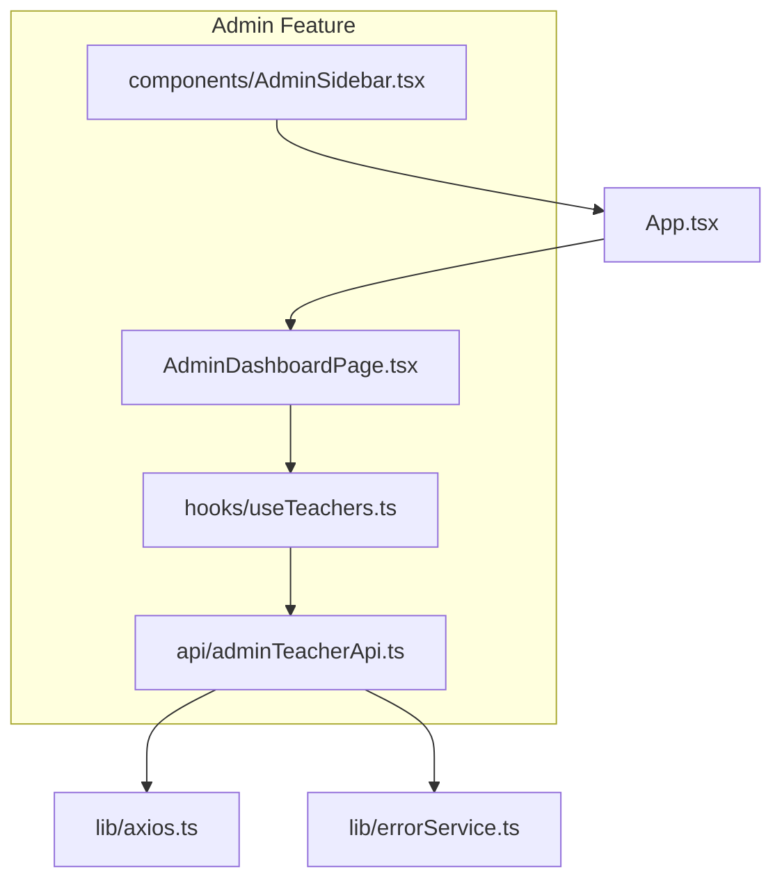
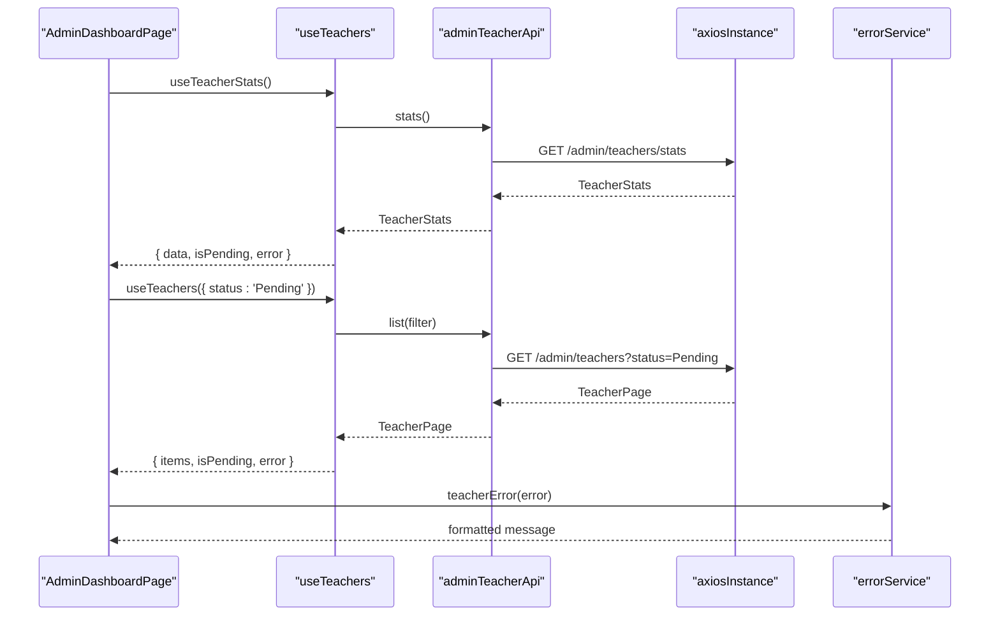
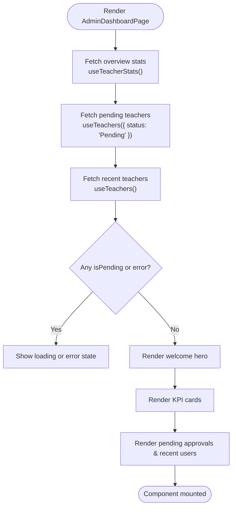
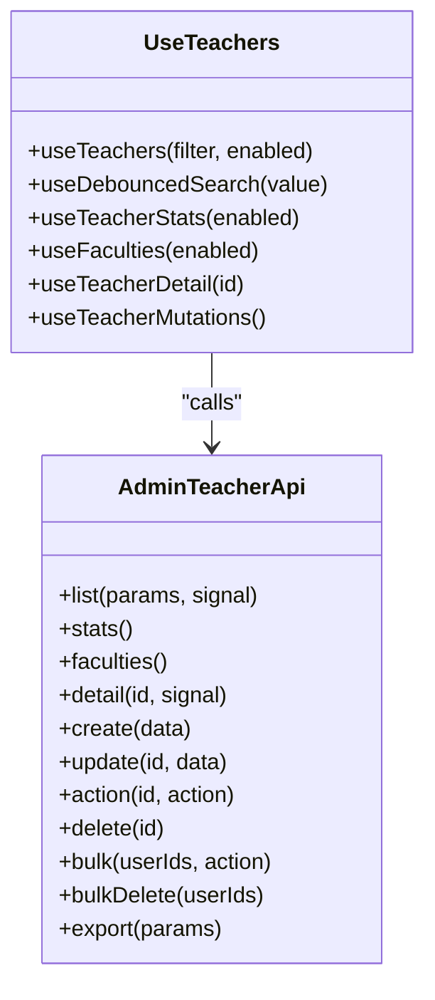
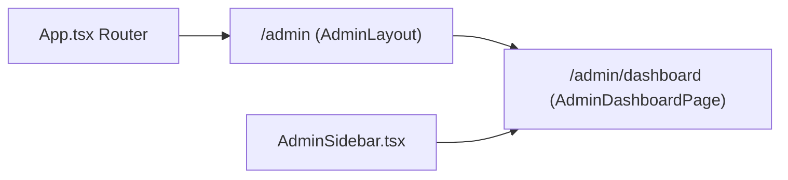
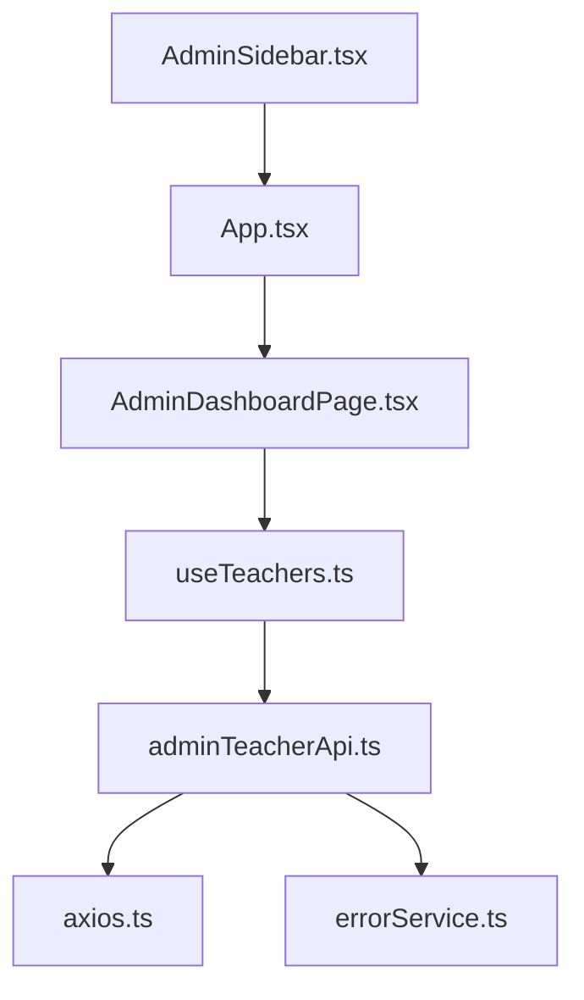

# Dashboard Overview

<cite>
**Referenced Files in This Document**
- [AdminDashboardPage.tsx](file://frontend/src/features/admin/pages/AdminDashboardPage.tsx)
- [useTeachers.ts](file://frontend/src/features/admin/hooks/useTeachers.ts)
- [adminTeacherApi.ts](file://frontend/src/features/admin/api/adminTeacherApi.ts)
- [App.tsx](file://frontend/src/App.tsx)
- [AdminSidebar.tsx](file://frontend/src/features/admin/components/AdminSidebar.tsx)
- [axios.ts](file://frontend/src/lib/axios.ts)
- [errorService.ts](file://frontend/src/lib/errorService.ts)
</cite>

## Table of Contents
1. [Introduction](#introduction)
2. [Project Structure](#project-structure)
3. [Core Components](#core-components)
4. [Architecture Overview](#architecture-overview)
5. [Detailed Component Analysis](#detailed-component-analysis)
6. [Dependency Analysis](#dependency-analysis)
7. [Performance Considerations](#performance-considerations)
8. [Troubleshooting Guide](#troubleshooting-guide)
9. [Conclusion](#conclusion)
10. [Appendices](#appendices)

## Introduction
This document explains the Admin Dashboard Overview component, which provides a high-level view of teacher-related system statistics and quick actions for administrators. It covers:
- The main dashboard layout and sections
- KPI cards for total teachers, active teachers, disabled teachers, and pending approvals
- The welcome hero section with contextual messaging and navigation
- Data fetching using React Query hooks
- Error handling strategies and loading states
- Navigation integration with other admin pages
- Responsive design implementation
- Examples for customizing metrics and adding new KPI cards

## Project Structure
The dashboard is implemented as a feature module under the admin feature area. Key files include:
- Page component that renders the dashboard UI
- Custom React Query hooks for data fetching
- API client for teacher-related endpoints
- Routing configuration that registers the dashboard route
- Sidebar component that links to the dashboard

**Diagram sources**
- [AdminDashboardPage.tsx:1-220](file://frontend/src/features/admin/pages/AdminDashboardPage.tsx#L1-L220)
- [useTeachers.ts:1-35](file://frontend/src/features/admin/hooks/useTeachers.ts#L1-L35)
- [adminTeacherApi.ts:1-65](file://frontend/src/features/admin/api/adminTeacherApi.ts#L1-L65)
- [App.tsx:64-96](file://frontend/src/App.tsx#L64-L96)
- [AdminSidebar.tsx:1-40](file://frontend/src/features/admin/components/AdminSidebar.tsx#L1-L40)

**Section sources**
- [AdminDashboardPage.tsx:1-220](file://frontend/src/features/admin/pages/AdminDashboardPage.tsx#L1-L220)
- [App.tsx:64-96](file://frontend/src/App.tsx#L64-L96)

## Core Components
- AdminDashboardPage: Renders the dashboard layout, including the welcome hero, KPI cards, pending approvals list, and recent users list. It composes data from React Query hooks and handles loading and error states.
- useTeachers: Provides React Query hooks for listing teachers, fetching stats, and mutations for administrative actions.
- adminTeacherApi: Defines typed API methods for teacher management, including list, stats, detail, create, update, action, bulk operations, export, and error formatting.

Key responsibilities:
- Fetching overview statistics via useTeacherStats
- Fetching paginated teacher lists for pending approvals and recent users via useTeachers
- Rendering responsive KPI cards and actionable hero section
- Centralized error handling and retry behavior

**Section sources**
- [AdminDashboardPage.tsx:16-28](file://frontend/src/features/admin/pages/AdminDashboardPage.tsx#L16-L28)
- [useTeachers.ts:5-16](file://frontend/src/features/admin/hooks/useTeachers.ts#L5-L16)
- [adminTeacherApi.ts:29-35](file://frontend/src/features/admin/api/adminTeacherApi.ts#L29-L35)

## Architecture Overview
The dashboard follows a layered approach:
- Presentation layer (AdminDashboardPage) composes UI and orchestrates data fetching
- Hooks layer (useTeachers) encapsulates React Query logic and query keys
- API layer (adminTeacherApi) abstracts HTTP calls and response mapping
- Infrastructure layer (axios, errorService) handles network requests and error normalization

**Diagram sources**
- [AdminDashboardPage.tsx:18-27](file://frontend/src/features/admin/pages/AdminDashboardPage.tsx#L18-L27)
- [useTeachers.ts:5-16](file://frontend/src/features/admin/hooks/useTeachers.ts#L5-L16)
- [adminTeacherApi.ts:30-35](file://frontend/src/features/admin/api/adminTeacherApi.ts#L30-L35)
- [errorService.ts:1-200](file://frontend/src/lib/errorService.ts#L1-L200)

## Detailed Component Analysis

### AdminDashboardPage
Responsibilities:
- Compose overview stats and two teacher lists (pending approvals and recent users)
- Render a welcome hero card with contextual messages and navigation buttons
- Display four KPI cards: total teachers, active teachers, disabled teachers, pending approvals
- Provide quick actions to navigate to teacher management and pending approvals
- Handle loading and error states centrally

Data flow:
- useTeacherStats fetches overview statistics
- useTeachers with status Pending fetches pending approvals
- useTeachers without status filters fetches recent users
- Errors are normalized via teacherError and displayed with a retry button

Responsive design:
- Uses Tailwind utility classes for grid layouts and spacing
- Adapts from single-column on small screens to multi-column on larger screens

Navigation integration:
- Navigates to /admin/teachers and /admin/teachers?tab=pending using react-router-dom’s useNavigate

**Diagram sources**
- [AdminDashboardPage.tsx:16-28](file://frontend/src/features/admin/pages/AdminDashboardPage.tsx#L16-L28)
- [AdminDashboardPage.tsx:29-126](file://frontend/src/features/admin/pages/AdminDashboardPage.tsx#L29-L126)
- [AdminDashboardPage.tsx:128-216](file://frontend/src/features/admin/pages/AdminDashboardPage.tsx#L128-L216)

**Section sources**
- [AdminDashboardPage.tsx:16-28](file://frontend/src/features/admin/pages/AdminDashboardPage.tsx#L16-L28)
- [AdminDashboardPage.tsx:29-126](file://frontend/src/features/admin/pages/AdminDashboardPage.tsx#L29-L126)
- [AdminDashboardPage.tsx:128-216](file://frontend/src/features/admin/pages/AdminDashboardPage.tsx#L128-L216)

### useTeachers Hook
Responsibilities:
- Encapsulate React Query usage for teacher-related data
- Provide query keys for caching and invalidation
- Expose hooks for listing teachers, fetching stats, faculties, details, and mutations

Key patterns:
- useQuery with stable query keys for cache control
- Mutation hooks for creating, updating, and performing actions on teachers
- Automatic invalidation of related queries after mutations

**Diagram sources**
- [useTeachers.ts:5-34](file://frontend/src/features/admin/hooks/useTeachers.ts#L5-L34)
- [adminTeacherApi.ts:29-60](file://frontend/src/features/admin/api/adminTeacherApi.ts#L29-L60)

**Section sources**
- [useTeachers.ts:5-34](file://frontend/src/features/admin/hooks/useTeachers.ts#L5-L34)

### adminTeacherApi Module
Responsibilities:
- Define typed interfaces for filters, stats, faculty, form data, and actions
- Implement HTTP methods using axiosInstance
- Map backend responses to frontend types
- Provide centralized error formatting via teacherError

Key endpoints used by the dashboard:
- GET /admin/teachers/stats returns TeacherStats
- GET /admin/teachers returns paginated teacher list

Error handling:
- teacherError wraps getErrorMessage to normalize errors into user-friendly strings

**Section sources**
- [adminTeacherApi.ts:5-19](file://frontend/src/features/admin/api/adminTeacherApi.ts#L5-L19)
- [adminTeacherApi.ts:29-35](file://frontend/src/features/admin/api/adminTeacherApi.ts#L29-L35)
- [adminTeacherApi.ts:62-64](file://frontend/src/features/admin/api/adminTeacherApi.ts#L62-L64)

### Routing and Navigation Integration
- The dashboard route is registered under /admin/dashboard and lazy-loaded
- The default admin index redirects to /admin/dashboard
- The sidebar includes a link to the dashboard for easy navigation

**Diagram sources**
- [App.tsx:64-96](file://frontend/src/App.tsx#L64-L96)
- [AdminSidebar.tsx:1-40](file://frontend/src/features/admin/components/AdminSidebar.tsx#L1-L40)

**Section sources**
- [App.tsx:64-96](file://frontend/src/App.tsx#L64-L96)
- [AdminSidebar.tsx:1-40](file://frontend/src/features/admin/components/AdminSidebar.tsx#L1-L40)

## Dependency Analysis
- AdminDashboardPage depends on:
  - React Query hooks from useTeachers
  - API methods from adminTeacherApi
  - React Router for navigation
  - Icon library for visual indicators
- useTeachers depends on:
  - @tanstack/react-query for data fetching and caching
  - adminTeacherApi for HTTP calls
- adminTeacherApi depends on:
  - axiosInstance for HTTP transport
  - errorService for error normalization

**Diagram sources**
- [AdminDashboardPage.tsx:1-14](file://frontend/src/features/admin/pages/AdminDashboardPage.tsx#L1-L14)
- [useTeachers.ts:1-4](file://frontend/src/features/admin/hooks/useTeachers.ts#L1-L4)
- [adminTeacherApi.ts:1-3](file://frontend/src/features/admin/api/adminTeacherApi.ts#L1-L3)
- [App.tsx:64-96](file://frontend/src/App.tsx#L64-L96)
- [AdminSidebar.tsx:1-40](file://frontend/src/features/admin/components/AdminSidebar.tsx#L1-L40)

**Section sources**
- [AdminDashboardPage.tsx:1-14](file://frontend/src/features/admin/pages/AdminDashboardPage.tsx#L1-L14)
- [useTeachers.ts:1-4](file://frontend/src/features/admin/hooks/useTeachers.ts#L1-L4)
- [adminTeacherApi.ts:1-3](file://frontend/src/features/admin/api/adminTeacherApi.ts#L1-L3)
- [App.tsx:64-96](file://frontend/src/App.tsx#L64-L96)
- [AdminSidebar.tsx:1-40](file://frontend/src/features/admin/components/AdminSidebar.tsx#L1-L40)

## Performance Considerations
- React Query caching:
  - Stable query keys ensure efficient caching and automatic refetching when dependencies change
  - Mutations invalidate related queries to keep UI consistent
- Network efficiency:
  - Paginated teacher lists reduce payload size
  - Abort signals can be passed to cancel in-flight requests when components unmount
- UI responsiveness:
  - Loading states prevent rendering incomplete data
  - Error states provide clear feedback and retry options

[No sources needed since this section provides general guidance]

## Troubleshooting Guide
Common issues and resolutions:
- Loading indefinitely:
  - Verify that useTeacherStats and useTeachers are enabled and not disabled unintentionally
  - Check network requests to /admin/teachers/stats and /admin/teachers
- Error display:
  - Ensure teacherError is invoked to normalize backend errors
  - Confirm errorService is configured correctly
- Retry behavior:
  - Call refetch on overview, pending, and recent queries to refresh data
- Navigation problems:
  - Confirm routes are registered in App.tsx and accessible to Admin role
  - Ensure sidebar links point to correct paths

**Section sources**
- [AdminDashboardPage.tsx:26-27](file://frontend/src/features/admin/pages/AdminDashboardPage.tsx#L26-L27)
- [adminTeacherApi.ts:62-64](file://frontend/src/features/admin/api/adminTeacherApi.ts#L62-L64)
- [App.tsx:64-96](file://frontend/src/App.tsx#L64-L96)

## Conclusion
The Admin Dashboard Overview provides a clear, responsive interface for administrators to monitor teacher statistics and perform quick actions. It leverages React Query for robust data fetching, maintains clean separation between presentation, hooks, and API layers, and integrates seamlessly with routing and navigation. Extensibility is straightforward through additional KPI cards and metrics derived from existing hooks and API methods.

[No sources needed since this section summarizes without analyzing specific files]

## Appendices

### Customizing Dashboard Metrics
To customize dashboard metrics:
- Extend TeacherStats type to include new fields if required by backend
- Update overview data mapping in AdminDashboardPage to include new metrics
- Add new KPI cards following the existing pattern for layout and styling

Example steps:
- Modify adminTeacherApi.ts to add new stats fields if backend supports them
- Adjust AdminDashboardPage.tsx to render new KPI cards and update hero messaging

**Section sources**
- [adminTeacherApi.ts:13-16](file://frontend/src/features/admin/api/adminTeacherApi.ts#L13-L16)
- [AdminDashboardPage.tsx:21-22](file://frontend/src/features/admin/pages/AdminDashboardPage.tsx#L21-L22)

### Adding New KPI Cards
To add new KPI cards:
- Determine the metric source (overview stats or separate endpoint)
- If using overview stats, extend TeacherStats and map the new field in AdminDashboardPage
- If using a separate endpoint, create a new hook in useTeachers and integrate it into AdminDashboardPage
- Follow the existing KPI card structure for consistency

**Section sources**
- [useTeachers.ts:14-16](file://frontend/src/features/admin/hooks/useTeachers.ts#L14-L16)
- [AdminDashboardPage.tsx:73-126](file://frontend/src/features/admin/pages/AdminDashboardPage.tsx#L73-L126)

### Integrating Additional Administrative Statistics
To integrate additional administrative statistics:
- Create a new API method in adminTeacherApi.ts for the new endpoint
- Add a corresponding hook in useTeachers.ts with a unique query key
- Consume the hook in AdminDashboardPage and render the new data in the dashboard layout

**Section sources**
- [adminTeacherApi.ts:29-35](file://frontend/src/features/admin/api/adminTeacherApi.ts#L29-L35)
- [useTeachers.ts:5-16](file://frontend/src/features/admin/hooks/useTeachers.ts#L5-L16)
- [AdminDashboardPage.tsx:18-24](file://frontend/src/features/admin/pages/AdminDashboardPage.tsx#L18-L24)