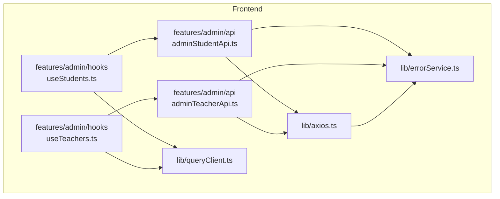
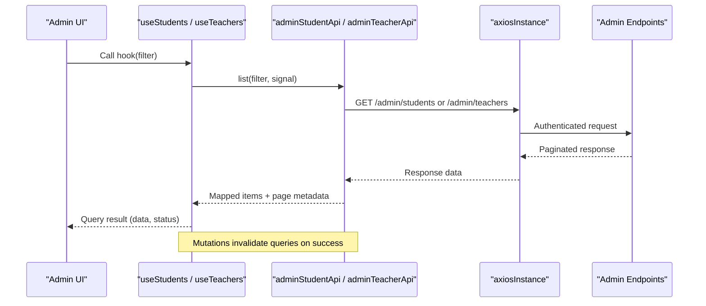
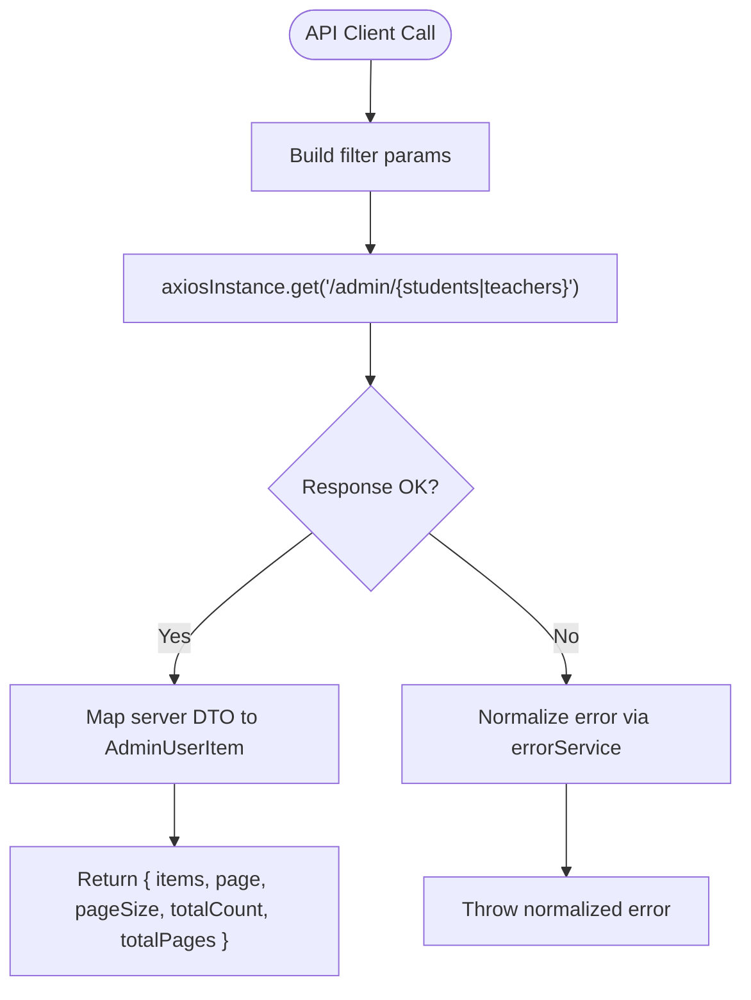
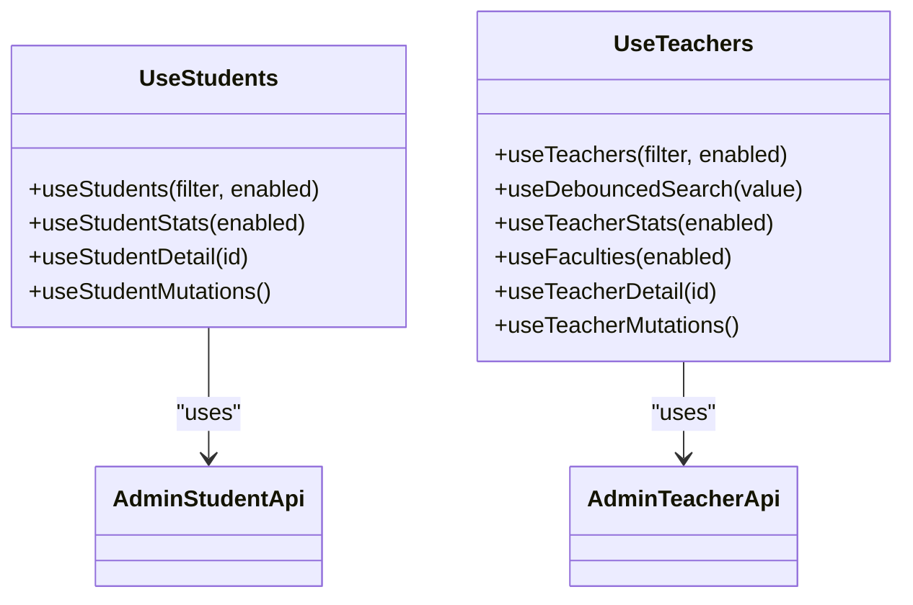
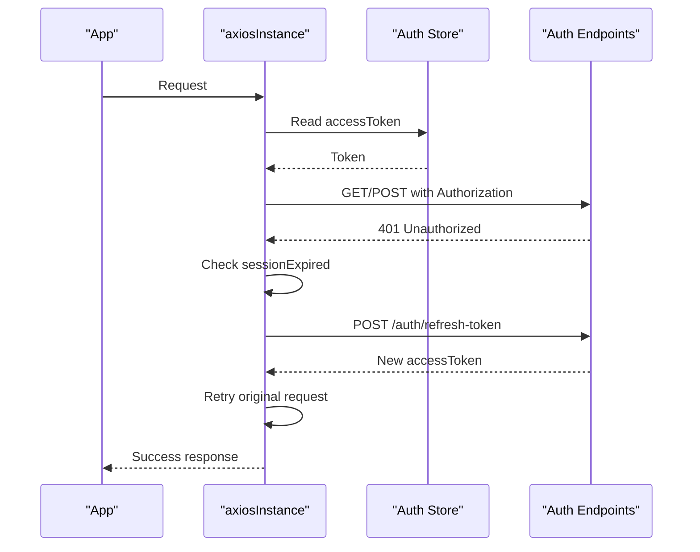
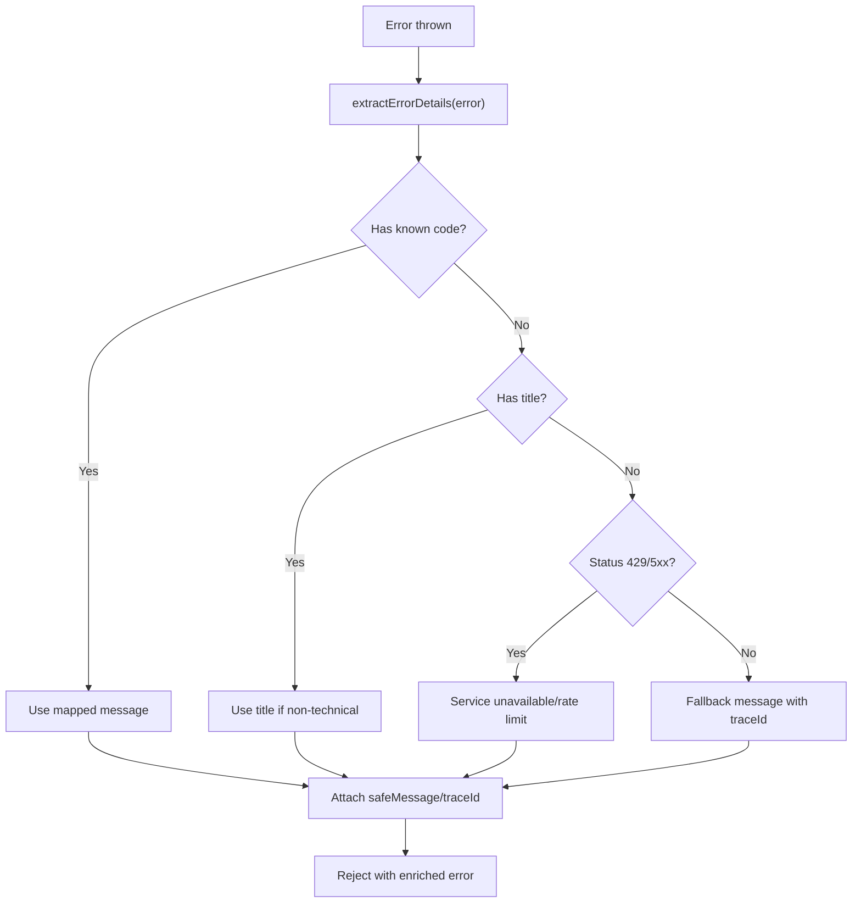
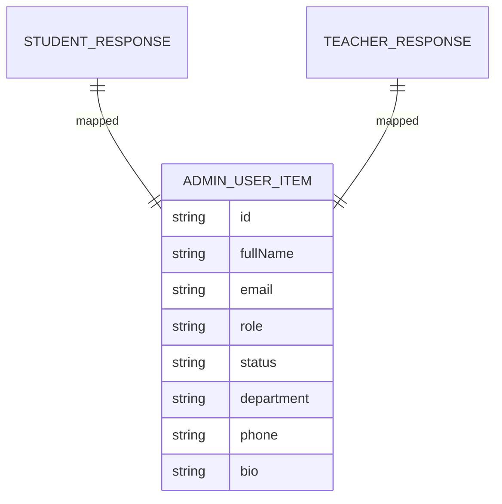
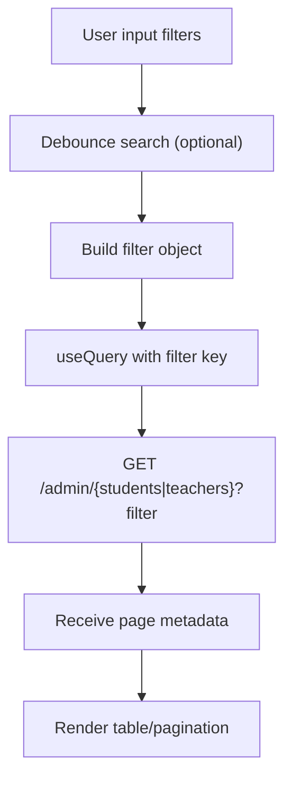
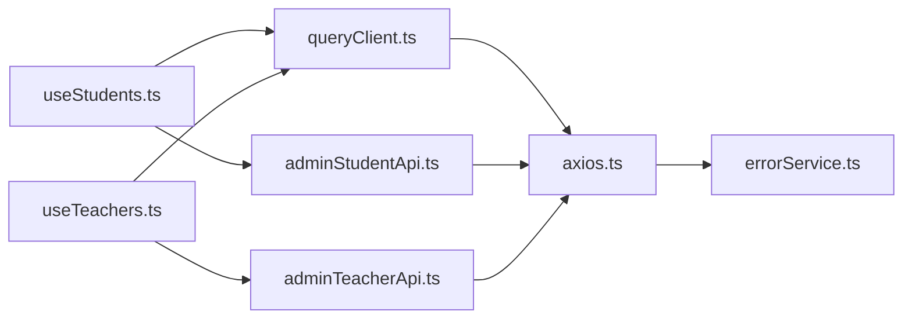

# Data Hooks & State Management

<cite>
**Referenced Files in This Document**
- [queryClient.ts](file://frontend/src/lib/queryClient.ts)
- [axios.ts](file://frontend/src/lib/axios.ts)
- [errorService.ts](file://frontend/src/lib/errorService.ts)
- [adminStudentApi.ts](file://frontend/src/features/admin/api/adminStudentApi.ts)
- [adminTeacherApi.ts](file://frontend/src/features/admin/api/adminTeacherApi.ts)
- [useStudents.ts](file://frontend/src/features/admin/hooks/useStudents.ts)
- [useTeachers.ts](file://frontend/src/features/admin/hooks/useTeachers.ts)
</cite>

## Table of Contents
1. [Introduction](#introduction)
2. [Project Structure](#project-structure)
3. [Core Components](#core-components)
4. [Architecture Overview](#architecture-overview)
5. [Detailed Component Analysis](#detailed-component-analysis)
6. [Dependency Analysis](#dependency-analysis)
7. [Performance Considerations](#performance-considerations)
8. [Troubleshooting Guide](#troubleshooting-guide)
9. [Conclusion](#conclusion)
10. [Appendices](#appendices)

## Introduction
This document explains the admin data hooks and API integration layer for students and teachers. It covers React Query hook implementations, caching strategies, optimistic update patterns, API client configuration, error handling, request/response transformations, and state management for admin-specific data including filtering, pagination, and real-time invalidation. It also provides guidance on creating new data hooks, extending existing APIs, implementing custom mutations, and handling complex query scenarios with multiple dependencies.

## Project Structure
The admin feature is organized into:
- API clients under features/admin/api for HTTP calls and response mapping
- React Query hooks under features/admin/hooks for data fetching and mutations
- Shared infrastructure under lib for axios configuration, error normalization, and React Query client setup

**Diagram sources**
- [adminStudentApi.ts:1-113](file://frontend/src/features/admin/api/adminStudentApi.ts#L1-L113)
- [adminTeacherApi.ts:1-65](file://frontend/src/features/admin/api/adminTeacherApi.ts#L1-L65)
- [useStudents.ts:1-54](file://frontend/src/features/admin/hooks/useStudents.ts#L1-L54)
- [useTeachers.ts:1-35](file://frontend/src/features/admin/hooks/useTeachers.ts#L1-L35)
- [axios.ts:1-128](file://frontend/src/lib/axios.ts#L1-L128)
- [queryClient.ts:1-12](file://frontend/src/lib/queryClient.ts#L1-L12)
- [errorService.ts:1-128](file://frontend/src/lib/errorService.ts#L1-L128)

**Section sources**
- [adminStudentApi.ts:1-113](file://frontend/src/features/admin/api/adminStudentApi.ts#L1-L113)
- [adminTeacherApi.ts:1-65](file://frontend/src/features/admin/api/adminTeacherApi.ts#L1-L65)
- [useStudents.ts:1-54](file://frontend/src/features/admin/hooks/useStudents.ts#L1-L54)
- [useTeachers.ts:1-35](file://frontend/src/features/admin/hooks/useTeachers.ts#L1-L35)
- [axios.ts:1-128](file://frontend/src/lib/axios.ts#L1-L128)
- [queryClient.ts:1-12](file://frontend/src/lib/queryClient.ts#L1-L12)
- [errorService.ts:1-128](file://frontend/src/lib/errorService.ts#L1-L128)

## Core Components
- Admin API clients:
  - Student API client exposes list, stats, faculties, detail, create, update, action, delete, bulk operations, and export. It maps server responses to a unified AdminUserItem shape and supports AbortSignal for cancellation.
  - Teacher API client mirrors student capabilities with teacher-specific endpoints and mappings.
- React Query hooks:
  - useStudents provides queries for list, stats, and detail, plus a mutation bundle for create/update/action/bulk/remove/bulkDelete that invalidates related queries on success.
  - useTeachers provides similar queries and mutations, plus a debounced search helper for efficient filtering.
- Infrastructure:
  - Axios instance configures base URL, credentials, authorization headers, session refresh, and logout flows.
  - Error service normalizes API errors into user-friendly messages and attaches trace identifiers.
  - React Query client sets default retry, stale time, garbage collection time, and disables refetch on window focus.

**Section sources**
- [adminStudentApi.ts:6-113](file://frontend/src/features/admin/api/adminStudentApi.ts#L6-L113)
- [adminTeacherApi.ts:5-65](file://frontend/src/features/admin/api/adminTeacherApi.ts#L5-L65)
- [useStudents.ts:1-54](file://frontend/src/features/admin/hooks/useStudents.ts#L1-L54)
- [useTeachers.ts:1-35](file://frontend/src/features/admin/hooks/useTeachers.ts#L1-L35)
- [axios.ts:1-128](file://frontend/src/lib/axios.ts#L1-L128)
- [errorService.ts:1-128](file://frontend/src/lib/errorService.ts#L1-L128)
- [queryClient.ts:1-12](file://frontend/src/lib/queryClient.ts#L1-L12)

## Architecture Overview
The admin data flow uses React Query as the source of truth. Components call hooks; hooks invoke typed API clients; API clients use an authenticated axios instance; errors are normalized centrally; mutations trigger cache invalidation to keep UI consistent.

**Diagram sources**
- [useStudents.ts:4-10](file://frontend/src/features/admin/hooks/useStudents.ts#L4-L10)
- [useTeachers.ts:5-8](file://frontend/src/features/admin/hooks/useTeachers.ts#L5-L8)
- [adminStudentApi.ts:60-64](file://frontend/src/features/admin/api/adminStudentApi.ts#L60-L64)
- [adminTeacherApi.ts:29-33](file://frontend/src/features/admin/api/adminTeacherApi.ts#L29-L33)
- [axios.ts:79-90](file://frontend/src/lib/axios.ts#L79-L90)

## Detailed Component Analysis

### Admin API Clients
Responsibilities:
- Define filter types, DTOs, and response shapes
- Map server responses to a unified AdminUserItem type
- Provide CRUD, bulk actions, stats, faculties, and export utilities
- Support AbortSignal for request cancellation

Key patterns:
- List endpoints return paginated structures with items and page metadata
- Detail endpoints accept optional AbortSignal
- Create/update payloads normalize optional fields and defaults
- Export endpoints handle Blob downloads safely

**Diagram sources**
- [adminStudentApi.ts:60-64](file://frontend/src/features/admin/api/adminStudentApi.ts#L60-L64)
- [adminTeacherApi.ts:29-33](file://frontend/src/features/admin/api/adminTeacherApi.ts#L29-L33)
- [errorService.ts:72-128](file://frontend/src/lib/errorService.ts#L72-L128)

**Section sources**
- [adminStudentApi.ts:6-113](file://frontend/src/features/admin/api/adminStudentApi.ts#L6-L113)
- [adminTeacherApi.ts:5-65](file://frontend/src/features/admin/api/adminTeacherApi.ts#L5-L65)

### React Query Hooks
- useStudents:
  - Queries: list, stats, detail
  - Mutations: create, update, action, bulk, remove, bulkDelete
  - On success, invalidates all student-related queries to refresh lists and stats
- useTeachers:
  - Queries: list, stats, faculties, detail
  - Mutations: same set as students
  - Includes a debounced search utility to reduce network churn during typing

Optimistic updates:
- The current implementation uses optimistic invalidation rather than manual cache patching. After successful mutations, related queries are invalidated so the next fetch reflects server state. This approach avoids cache drift and simplifies consistency.

Real-time updates:
- Real-time behavior is achieved by triggering invalidations from mutations. For true push-based updates, integrate WebSocket events that call queryClient.invalidateQueries with the relevant keys.

**Diagram sources**
- [useStudents.ts:1-54](file://frontend/src/features/admin/hooks/useStudents.ts#L1-L54)
- [useTeachers.ts:1-35](file://frontend/src/features/admin/hooks/useTeachers.ts#L1-L35)
- [adminStudentApi.ts:60-108](file://frontend/src/features/admin/api/adminStudentApi.ts#L60-L108)
- [adminTeacherApi.ts:29-60](file://frontend/src/features/admin/api/adminTeacherApi.ts#L29-L60)

**Section sources**
- [useStudents.ts:1-54](file://frontend/src/features/admin/hooks/useStudents.ts#L1-L54)
- [useTeachers.ts:1-35](file://frontend/src/features/admin/hooks/useTeachers.ts#L1-L35)

### API Client Configuration and Authentication
- Base URL configured via environment variable with fallback
- Authorization header injected from auth store
- Session idle detection prevents requests when session is expired due to inactivity
- Automatic token refresh with lock serialization across tabs
- Graceful logout flow clears caches and redirects on failure

**Diagram sources**
- [axios.ts:19-77](file://frontend/src/lib/axios.ts#L19-L77)
- [axios.ts:79-128](file://frontend/src/lib/axios.ts#L79-L128)

**Section sources**
- [axios.ts:1-128](file://frontend/src/lib/axios.ts#L1-L128)

### Error Handling Patterns
- Centralized normalization extracts code, traceId, status, and user-friendly message
- Validation errors surface first field message if non-technical
- Rate limiting and service unavailability mapped to friendly messages
- Axios interceptors attach safeMessage and traceId to thrown errors

**Diagram sources**
- [errorService.ts:72-128](file://frontend/src/lib/errorService.ts#L72-L128)
- [axios.ts:122-128](file://frontend/src/lib/axios.ts#L122-L128)

**Section sources**
- [errorService.ts:1-128](file://frontend/src/lib/errorService.ts#L1-L128)
- [axios.ts:92-128](file://frontend/src/lib/axios.ts#L92-L128)

### Data Models and Transformations
- AdminUserItem is the canonical entity used by hooks and components
- Student and Teacher API clients map server DTOs to AdminUserItem, ensuring consistent role, department, phone, bio, and enrollment fields
- Pagination metadata is preserved alongside mapped items

**Diagram sources**
- [adminStudentApi.ts:26-50](file://frontend/src/features/admin/api/adminStudentApi.ts#L26-L50)
- [adminTeacherApi.ts:20-27](file://frontend/src/features/admin/api/adminTeacherApi.ts#L20-L27)

**Section sources**
- [adminStudentApi.ts:26-50](file://frontend/src/features/admin/api/adminStudentApi.ts#L26-L50)
- [adminTeacherApi.ts:20-27](file://frontend/src/features/admin/api/adminTeacherApi.ts#L20-L27)

### Filtering, Pagination, and Sorting
- Filters include page, pageSize, search, facultyId, status, sortBy
- Sort options support name and created date ascending/descending
- Pagination metadata includes page, pageSize, totalCount, totalPages
- Debounced search reduces unnecessary requests while typing

**Diagram sources**
- [adminStudentApi.ts:6-13](file://frontend/src/features/admin/api/adminStudentApi.ts#L6-L13)
- [adminTeacherApi.ts:5-12](file://frontend/src/features/admin/api/adminTeacherApi.ts#L5-L12)
- [useTeachers.ts:9-13](file://frontend/src/features/admin/hooks/useTeachers.ts#L9-L13)

**Section sources**
- [adminStudentApi.ts:6-13](file://frontend/src/features/admin/api/adminStudentApi.ts#L6-L13)
- [adminTeacherApi.ts:5-12](file://frontend/src/features/admin/api/adminTeacherApi.ts#L5-L12)
- [useTeachers.ts:9-13](file://frontend/src/features/admin/hooks/useTeachers.ts#L9-L13)

### Optimistic Updates Strategy
Current strategy:
- Mutation success triggers query invalidation for affected query keys
- UI re-fetches data automatically based on React Query defaults

Recommended enhancements:
- For immediate feedback without waiting for server round-trip, consider using setQueryData to temporarily insert or update items, then revert on error
- Combine optimistic setQueryData with background refetch after mutation settles

Example pattern reference:
- Invalidating queries on success: [useStudents.ts:28-52](file://frontend/src/features/admin/hooks/useStudents.ts#L28-L52), [useTeachers.ts:24-33](file://frontend/src/features/admin/hooks/useTeachers.ts#L24-L33)

**Section sources**
- [useStudents.ts:28-52](file://frontend/src/features/admin/hooks/useStudents.ts#L28-L52)
- [useTeachers.ts:24-33](file://frontend/src/features/admin/hooks/useTeachers.ts#L24-L33)

### Creating New Data Hooks
Steps:
1. Add endpoint methods to the appropriate API client file
2. Define filter and DTO types
3. Implement mapping functions to normalize responses
4. Create a hook with useQuery for reads and useMutation for writes
5. Invalidate related queries on mutation success
6. Optionally add debounced search helpers

Reference files:
- [adminStudentApi.ts:60-108](file://frontend/src/features/admin/api/adminStudentApi.ts#L60-L108)
- [adminTeacherApi.ts:29-60](file://frontend/src/features/admin/api/adminTeacherApi.ts#L29-L60)
- [useStudents.ts:4-52](file://frontend/src/features/admin/hooks/useStudents.ts#L4-L52)
- [useTeachers.ts:5-33](file://frontend/src/features/admin/hooks/useTeachers.ts#L5-L33)

**Section sources**
- [adminStudentApi.ts:60-108](file://frontend/src/features/admin/api/adminStudentApi.ts#L60-L108)
- [adminTeacherApi.ts:29-60](file://frontend/src/features/admin/api/adminTeacherApi.ts#L29-L60)
- [useStudents.ts:4-52](file://frontend/src/features/admin/hooks/useStudents.ts#L4-L52)
- [useTeachers.ts:5-33](file://frontend/src/features/admin/hooks/useTeachers.ts#L5-L33)

### Extending Existing APIs
- Add new filter parameters to filter interfaces
- Extend list/detail/create/update methods with new signals or payload fields
- Introduce new mutation methods and expose them through the hook’s mutation bundle
- Ensure error messages are covered in errorService if new codes appear

Reference files:
- [adminStudentApi.ts:6-24](file://frontend/src/features/admin/api/adminStudentApi.ts#L6-L24)
- [adminTeacherApi.ts:5-19](file://frontend/src/features/admin/api/adminTeacherApi.ts#L5-L19)
- [errorService.ts:3-63](file://frontend/src/lib/errorService.ts#L3-L63)

**Section sources**
- [adminStudentApi.ts:6-24](file://frontend/src/features/admin/api/adminStudentApi.ts#L6-L24)
- [adminTeacherApi.ts:5-19](file://frontend/src/features/admin/api/adminTeacherApi.ts#L5-L19)
- [errorService.ts:3-63](file://frontend/src/lib/errorService.ts#L3-L63)

### Custom Mutations and Complex Query Scenarios
- Custom mutations:
  - Wrap multiple API calls in a single mutation function
  - Use try/catch to handle partial failures and provide user feedback
  - Invalidate dependent queries after success
- Multiple dependencies:
  - Use queryClient.getQueryData to read cached values before making dependent mutations
  - Coordinate parallel queries with Promise.all and combine results in a derived hook

References:
- [useStudents.ts:28-52](file://frontend/src/features/admin/hooks/useStudents.ts#L28-L52)
- [useTeachers.ts:24-33](file://frontend/src/features/admin/hooks/useTeachers.ts#L24-L33)

**Section sources**
- [useStudents.ts:28-52](file://frontend/src/features/admin/hooks/useStudents.ts#L28-L52)
- [useTeachers.ts:24-33](file://frontend/src/features/admin/hooks/useTeachers.ts#L24-L33)

## Dependency Analysis
High-level dependency relationships:

**Diagram sources**
- [queryClient.ts:1-12](file://frontend/src/lib/queryClient.ts#L1-L12)
- [axios.ts:1-128](file://frontend/src/lib/axios.ts#L1-L128)
- [errorService.ts:1-128](file://frontend/src/lib/errorService.ts#L1-L128)
- [adminStudentApi.ts:1-113](file://frontend/src/features/admin/api/adminStudentApi.ts#L1-L113)
- [adminTeacherApi.ts:1-65](file://frontend/src/features/admin/api/adminTeacherApi.ts#L1-L65)
- [useStudents.ts:1-54](file://frontend/src/features/admin/hooks/useStudents.ts#L1-L54)
- [useTeachers.ts:1-35](file://frontend/src/features/admin/hooks/useTeachers.ts#L1-L35)

**Section sources**
- [queryClient.ts:1-12](file://frontend/src/lib/queryClient.ts#L1-L12)
- [axios.ts:1-128](file://frontend/src/lib/axios.ts#L1-L128)
- [errorService.ts:1-128](file://frontend/src/lib/errorService.ts#L1-L128)
- [adminStudentApi.ts:1-113](file://frontend/src/features/admin/api/adminStudentApi.ts#L1-L113)
- [adminTeacherApi.ts:1-65](file://frontend/src/features/admin/api/adminTeacherApi.ts#L1-L65)
- [useStudents.ts:1-54](file://frontend/src/features/admin/hooks/useStudents.ts#L1-L54)
- [useTeachers.ts:1-35](file://frontend/src/features/admin/hooks/useTeachers.ts#L1-L35)

## Performance Considerations
- Stale time and garbage collection:
  - Default staleTime ensures data remains fresh for one minute
  - gcTime keeps unused queries in memory for five minutes
- Retry policy:
  - Single retry helps recover from transient failures without excessive retries
- Refetch on window focus disabled:
  - Reduces unnecessary network traffic when users switch tabs
- Debounced search:
  - Minimizes requests during rapid typing
- AbortSignal usage:
  - Cancels in-flight requests when filters change quickly

Recommendations:
- Tune staleTime/gcTime based on data volatility
- Consider background refetch intervals for dashboards
- Use select to derive minimal data for performance-sensitive components

**Section sources**
- [queryClient.ts:2-11](file://frontend/src/lib/queryClient.ts#L2-L11)
- [useTeachers.ts:9-13](file://frontend/src/features/admin/hooks/useTeachers.ts#L9-L13)

## Troubleshooting Guide
Common issues and resolutions:
- Session expired due to inactivity:
  - Requests are canceled proactively; UI should redirect to login
- 401 Unauthorized:
  - Automatic refresh attempts once; if failed, user is redirected to login
- Validation errors:
  - First validation message surfaced to user; check form inputs
- Rate limiting:
  - User sees rate limit message; advise retry after delay
- Service unavailable:
  - Generic message displayed; retry later

Debugging tips:
- Inspect safeMessage and traceId attached to errors
- Verify environment variables for API base URL
- Confirm auth store has valid access token

**Section sources**
- [axios.ts:22-46](file://frontend/src/lib/axios.ts#L22-L46)
- [axios.ts:92-128](file://frontend/src/lib/axios.ts#L92-L128)
- [errorService.ts:72-128](file://frontend/src/lib/errorService.ts#L72-L128)

## Conclusion
The admin data layer combines typed API clients, React Query hooks, and centralized error handling to deliver a robust, maintainable experience for managing students and teachers. The current design favors simplicity and correctness through query invalidation after mutations. Enhancements such as optimistic cache updates and WebSocket-driven invalidations can further improve responsiveness and real-time consistency.

## Appendices

### API Endpoints Summary
- Students:
  - List: GET /admin/students with pagination and filters
  - Stats: GET /admin/students/stats
  - Faculties: GET /admin/faculties
  - Detail: GET /admin/students/:id
  - Create: POST /admin/students
  - Update: PUT /admin/students/:id
  - Action: POST /admin/users/:id/{approve|reject|disable|enable}
  - Delete: DELETE /admin/students/:id
  - Bulk approve/disable: POST /admin/students/bulk-{action}
  - Bulk delete: POST /admin/students/bulk-delete
  - Export: GET /admin/students/export (CSV blob)
- Teachers:
  - Same structure as students with /admin/teachers paths

Reference files:
- [adminStudentApi.ts:60-108](file://frontend/src/features/admin/api/adminStudentApi.ts#L60-L108)
- [adminTeacherApi.ts:29-60](file://frontend/src/features/admin/api/adminTeacherApi.ts#L29-L60)

**Section sources**
- [adminStudentApi.ts:60-108](file://frontend/src/features/admin/api/adminStudentApi.ts#L60-L108)
- [adminTeacherApi.ts:29-60](file://frontend/src/features/admin/api/adminTeacherApi.ts#L29-L60)