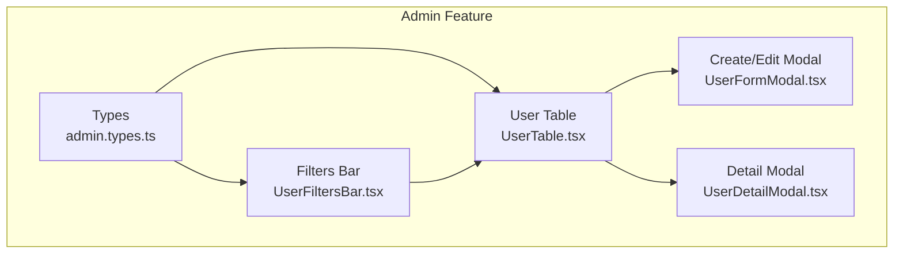
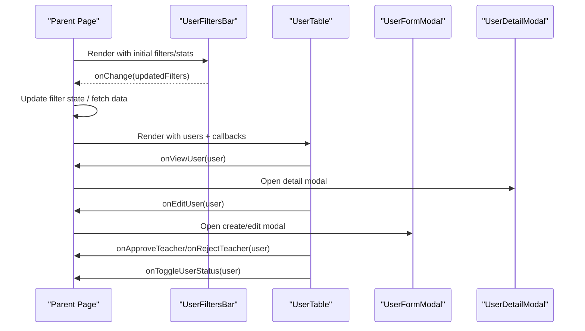
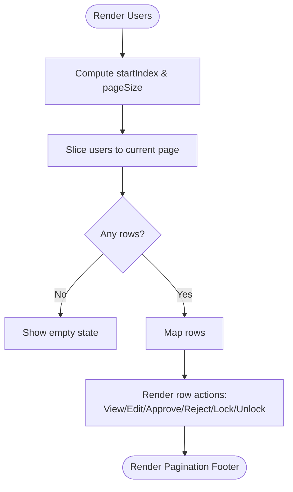
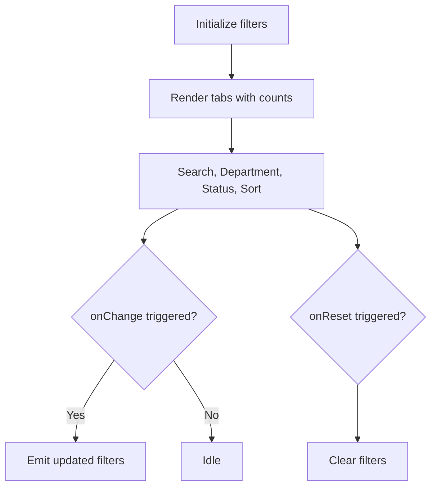
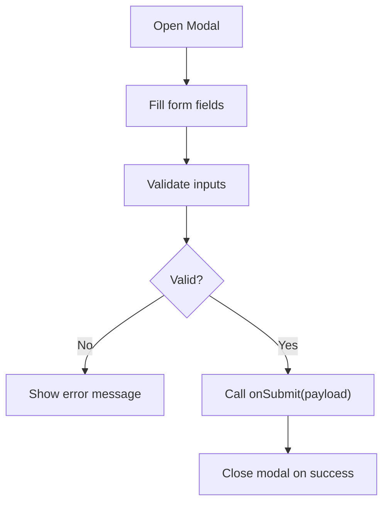
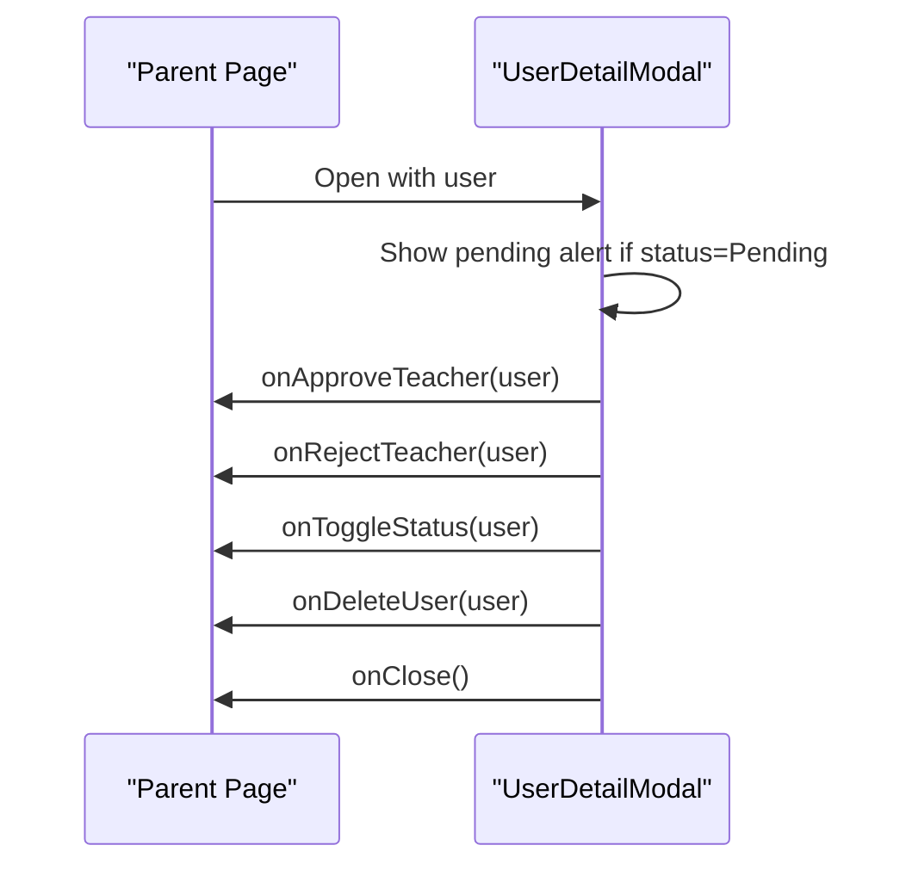
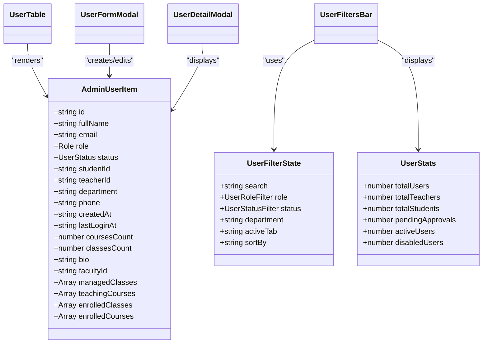

# User Management Table

<cite>
**Referenced Files in This Document**
- [UserTable.tsx](file://frontend/src/features/admin/components/UserTable.tsx)
- [UserFiltersBar.tsx](file://frontend/src/features/admin/components/UserFiltersBar.tsx)
- [UserFormModal.tsx](file://frontend/src/features/admin/components/UserFormModal.tsx)
- [UserDetailModal.tsx](file://frontend/src/features/admin/components/UserDetailModal.tsx)
- [admin.types.ts](file://frontend/src/features/admin/types/admin.types.ts)
</cite>

## Table of Contents
1. [Introduction](#introduction)
2. [Project Structure](#project-structure)
3. [Core Components](#core-components)
4. [Architecture Overview](#architecture-overview)
5. [Detailed Component Analysis](#detailed-component-analysis)
6. [Dependency Analysis](#dependency-analysis)
7. [Performance Considerations](#performance-considerations)
8. [Troubleshooting Guide](#troubleshooting-guide)
9. [Conclusion](#conclusion)
10. [Appendices](#appendices)

## Introduction
This document explains the user management table component and its ecosystem within the admin feature. It covers the data grid implementation, including client-side pagination, selection for bulk operations, row actions (view, edit, approve/reject teacher, lock/unlock), and integration with a filters bar that supports search, role/status/department filters, and sorting. It also documents the modal system used for creating/editing users and viewing details, along with guidance on extending columns, adding custom actions, implementing export, and supporting different user types such as students and teachers. Performance considerations for large datasets and accessibility features are included.

## Project Structure
The user management UI is implemented under the admin feature:
- Data model and filter state types define the shape of user items and filter configuration.
- Filters bar provides advanced filtering and sorting controls.
- Table renders rows, handles selection, and exposes callbacks for row actions.
- Modals handle creation/editing and detailed view with status changes and deletion.

**Diagram sources**
- [admin.types.ts:1-47](file://frontend/src/features/admin/types/admin.types.ts#L1-L47)
- [UserFiltersBar.tsx:1-152](file://frontend/src/features/admin/components/UserFiltersBar.tsx#L1-L152)
- [UserTable.tsx:1-349](file://frontend/src/features/admin/components/UserTable.tsx#L1-L349)
- [UserFormModal.tsx:1-311](file://frontend/src/features/admin/components/UserFormModal.tsx#L1-L311)
- [UserDetailModal.tsx:1-363](file://frontend/src/features/admin/components/UserDetailModal.tsx#L1-L363)

**Section sources**
- [admin.types.ts:1-47](file://frontend/src/features/admin/types/admin.types.ts#L1-L47)
- [UserFiltersBar.tsx:1-152](file://frontend/src/features/admin/components/UserFiltersBar.tsx#L1-L152)
- [UserTable.tsx:1-349](file://frontend/src/features/admin/components/UserTable.tsx#L1-L349)
- [UserFormModal.tsx:1-311](file://frontend/src/features/admin/components/UserFormModal.tsx#L1-L311)
- [UserDetailModal.tsx:1-363](file://frontend/src/features/admin/components/UserDetailModal.tsx#L1-L363)

## Core Components
- AdminUserItem: Represents a user record with identity fields, role, status, department, timestamps, and optional academic/teaching summaries.
- UserFilterState: Defines search text, role/status filters, department, active tab, and sort options.
- UserStats: Aggregates counts for total users, teachers, students, pending approvals, active/disabled users.

Key responsibilities:
- UserFiltersBar: Provides segmented tabs (all, teachers, students, pending, disabled), search input, department dropdown, status dropdown, and sort selector; emits onChange and onReset events.
- UserTable: Renders paginated rows, supports multi-select, shows quick actions per row (approve/reject for pending teachers, view, edit, lock/unlock), and includes a pagination footer.
- UserFormModal: Handles create/edit flows with validation, role switching, identifier fields (studentId/teacherId), department/faculty mapping, and submission callback.
- UserDetailModal: Displays comprehensive user details, pending approval workflow, account lock/unlock, and optional delete confirmation.

**Section sources**
- [admin.types.ts:1-47](file://frontend/src/features/admin/types/admin.types.ts#L1-L47)
- [UserFiltersBar.tsx:1-152](file://frontend/src/features/admin/components/UserFiltersBar.tsx#L1-L152)
- [UserTable.tsx:1-349](file://frontend/src/features/admin/components/UserTable.tsx#L1-L349)
- [UserFormModal.tsx:1-311](file://frontend/src/features/admin/components/UserFormModal.tsx#L1-L311)
- [UserDetailModal.tsx:1-363](file://frontend/src/features/admin/components/UserDetailModal.tsx#L1-L363)

## Architecture Overview
The components collaborate to provide a complete user management experience:
- The parent page composes filters, table, and modals.
- Filters update filter state and trigger data fetching or client-side filtering/sorting.
- Table renders the current dataset slice based on pagination and exposes action handlers.
- Modals encapsulate complex interactions like form submission and detail view workflows.

**Diagram sources**
- [UserFiltersBar.tsx:1-152](file://frontend/src/features/admin/components/UserFiltersBar.tsx#L1-L152)
- [UserTable.tsx:1-349](file://frontend/src/features/admin/components/UserTable.tsx#L1-L349)
- [UserFormModal.tsx:1-311](file://frontend/src/features/admin/components/UserFormModal.tsx#L1-L311)
- [UserDetailModal.tsx:1-363](file://frontend/src/features/admin/components/UserDetailModal.tsx#L1-L363)

## Detailed Component Analysis

### UserTable
Responsibilities:
- Client-side pagination using currentPage and pageSize.
- Multi-row selection with select-all and individual checkboxes.
- Row actions:
  - View user detail via onViewUser.
  - Edit user via onEditUser.
  - Approve/reject teacher when role is Teacher and status is Pending.
  - Lock/unlock non-admin users via onToggleUserStatus.
- Empty state display when no users match.

Data flow:
- Receives users array from parent.
- Computes totalPages and paginatedUsers locally.
- Emits callbacks for all row actions.

Accessibility:
- Buttons include titles for screen readers.
- Inputs have clear labels through context and aria attributes where applicable.

**Diagram sources**
- [UserTable.tsx:37-43](file://frontend/src/features/admin/components/UserTable.tsx#L37-L43)
- [UserTable.tsx:104-297](file://frontend/src/features/admin/components/UserTable.tsx#L104-L297)
- [UserTable.tsx:299-345](file://frontend/src/features/admin/components/UserTable.tsx#L299-L345)

**Section sources**
- [UserTable.tsx:18-34](file://frontend/src/features/admin/components/UserTable.tsx#L18-L34)
- [UserTable.tsx:37-43](file://frontend/src/features/admin/components/UserTable.tsx#L37-L43)
- [UserTable.tsx:45-57](file://frontend/src/features/admin/components/UserTable.tsx#L45-L57)
- [UserTable.tsx:104-297](file://frontend/src/features/admin/components/UserTable.tsx#L104-L297)
- [UserTable.tsx:299-345](file://frontend/src/features/admin/components/UserTable.tsx#L299-L345)

### UserFiltersBar
Responsibilities:
- Segmented tabs for quick views: All, Teachers, Students, Pending, Disabled.
- Search input with clear button.
- Department dropdown populated from constants.
- Status dropdown with ALL and specific statuses.
- Sort selector with predefined options.
- Reset button when any filter is active.

Integration:
- Emits onChange with partial updates to UserFilterState.
- Emits onReset to clear filters.

**Diagram sources**
- [UserFiltersBar.tsx:21-67](file://frontend/src/features/admin/components/UserFiltersBar.tsx#L21-L67)
- [UserFiltersBar.tsx:69-147](file://frontend/src/features/admin/components/UserFiltersBar.tsx#L69-L147)

**Section sources**
- [UserFiltersBar.tsx:6-12](file://frontend/src/features/admin/components/UserFiltersBar.tsx#L6-L12)
- [UserFiltersBar.tsx:21-67](file://frontend/src/features/admin/components/UserFiltersBar.tsx#L21-L67)
- [UserFiltersBar.tsx:69-147](file://frontend/src/features/admin/components/UserFiltersBar.tsx#L69-L147)

### UserFormModal
Responsibilities:
- Create or edit user with validation rules:
  - Full name required.
  - Email must be valid and end with @hanu.edu.vn.
  - Identifier required depending on role (studentId for Student, teacherId for Teacher).
- Role selection (Student/Teacher) with conditional fields.
- Optional temporary password and initial status for new users.
- Department/faculty mapping support.
- Submission via onSubmit callback with error handling.

**Diagram sources**
- [UserFormModal.tsx:41-80](file://frontend/src/features/admin/components/UserFormModal.tsx#L41-L80)
- [UserFormModal.tsx:117-281](file://frontend/src/features/admin/components/UserFormModal.tsx#L117-L281)

**Section sources**
- [UserFormModal.tsx:8-15](file://frontend/src/features/admin/components/UserFormModal.tsx#L8-L15)
- [UserFormModal.tsx:41-80](file://frontend/src/features/admin/components/UserFormModal.tsx#L41-L80)
- [UserFormModal.tsx:117-281](file://frontend/src/features/admin/components/UserFormModal.tsx#L117-L281)

### UserDetailModal
Responsibilities:
- Display detailed user information including department, identifiers, phone, status, timestamps, and optional academic/teaching summaries.
- Pending approval workflow with approve/reject buttons (conditional on email verification for teachers).
- Account lock/unlock toggle for non-admin users.
- Optional delete confirmation flow.

**Diagram sources**
- [UserDetailModal.tsx:104-143](file://frontend/src/features/admin/components/UserDetailModal.tsx#L104-L143)
- [UserDetailModal.tsx:309-346](file://frontend/src/features/admin/components/UserDetailModal.tsx#L309-L346)

**Section sources**
- [UserDetailModal.tsx:23-32](file://frontend/src/features/admin/components/UserDetailModal.tsx#L23-L32)
- [UserDetailModal.tsx:104-143](file://frontend/src/features/admin/components/UserDetailModal.tsx#L104-L143)
- [UserDetailModal.tsx:309-346](file://frontend/src/features/admin/components/UserDetailModal.tsx#L309-L346)

## Dependency Analysis
Component relationships:
- UserTable depends on AdminUserItem type and badge components for role/status rendering.
- UserFiltersBar depends on UserFilterState, UserStats, and department constants.
- UserFormModal depends on AdminUserItem, Role, UserStatus, and faculty/department data.
- UserDetailModal depends on AdminUserItem and badge components.

**Diagram sources**
- [admin.types.ts:1-47](file://frontend/src/features/admin/types/admin.types.ts#L1-L47)
- [UserTable.tsx:1-349](file://frontend/src/features/admin/components/UserTable.tsx#L1-L349)
- [UserFiltersBar.tsx:1-152](file://frontend/src/features/admin/components/UserFiltersBar.tsx#L1-L152)
- [UserFormModal.tsx:1-311](file://frontend/src/features/admin/components/UserFormModal.tsx#L1-L311)
- [UserDetailModal.tsx:1-363](file://frontend/src/features/admin/components/UserDetailModal.tsx#L1-L363)

**Section sources**
- [admin.types.ts:1-47](file://frontend/src/features/admin/types/admin.types.ts#L1-L47)
- [UserTable.tsx:1-349](file://frontend/src/features/admin/components/UserTable.tsx#L1-L349)
- [UserFiltersBar.tsx:1-152](file://frontend/src/features/admin/components/UserFiltersBar.tsx#L1-L152)
- [UserFormModal.tsx:1-311](file://frontend/src/features/admin/components/UserFormModal.tsx#L1-L311)
- [UserDetailModal.tsx:1-363](file://frontend/src/features/admin/components/UserDetailModal.tsx#L1-L363)

## Performance Considerations
Current implementation characteristics:
- Pagination is client-side: slices the users array by pageSize and currentPage.
- Sorting and filtering are exposed via filters but not applied inside the table; typically handled at the parent level before passing users to the table.

Recommendations for large datasets:
- Prefer server-side pagination, sorting, and filtering to avoid loading entire datasets into memory.
- If keeping client-side pagination, consider virtualization for very large lists to reduce DOM size.
- Debounce search input in filters to minimize re-renders.
- Memoize computed values (e.g., initials, avatar gradients) and use React.memo for row components to prevent unnecessary re-renders.
- Use stable keys (user.id) for list items to optimize reconciliation.

[No sources needed since this section provides general guidance]

## Troubleshooting Guide
Common issues and resolutions:
- No users displayed:
  - Verify filters are not overly restrictive; reset filters to defaults.
  - Ensure the parent passes a non-empty users array to the table.
- Cannot approve a pending teacher:
  - Check if the teacher’s email is verified; approval may be disabled until verified.
- Cannot lock/unlock a user:
  - Admin users cannot be locked/unlocked; ensure the user role is not Admin.
- Form submission errors:
  - Validate email domain (@hanu.edu.vn) and required fields (full name, identifier based on role).
  - Review temporary password requirements when creating new users.

**Section sources**
- [UserFiltersBar.tsx:137-147](file://frontend/src/features/admin/components/UserFiltersBar.tsx#L137-L147)
- [UserDetailModal.tsx:117-140](file://frontend/src/features/admin/components/UserDetailModal.tsx#L117-L140)
- [UserTable.tsx:270-288](file://frontend/src/features/admin/components/UserTable.tsx#L270-L288)
- [UserFormModal.tsx:41-80](file://frontend/src/features/admin/components/UserFormModal.tsx#L41-L80)

## Conclusion
The user management table component provides a robust foundation for managing users with client-side pagination, selection, and row actions. Integrated with a flexible filters bar and comprehensive modals, it supports both student and teacher workflows, including approval processes and account lifecycle management. For production-scale usage, adopt server-side pagination/filtering/sorting and consider virtualization and memoization to maintain performance. Accessibility is supported through descriptive titles and semantic controls.

[No sources needed since this section summarizes without analyzing specific files]

## Appendices

### Extending Table Columns
- Add a new column by inserting a header cell in thead and corresponding cell in tbody for each user row.
- Compute derived values (e.g., initials, formatted dates) within the row map.
- Example path: [UserTable.tsx:107-127](file://frontend/src/features/admin/components/UserTable.tsx#L107-L127) for headers and [UserTable.tsx:145-293](file://frontend/src/features/admin/components/UserTable.tsx#L145-L293) for row cells.

**Section sources**
- [UserTable.tsx:107-127](file://frontend/src/features/admin/components/UserTable.tsx#L107-L127)
- [UserTable.tsx:145-293](file://frontend/src/features/admin/components/UserTable.tsx#L145-L293)

### Adding Custom Row Actions
- Extend the actions cell to include additional buttons and wire them to parent-provided callbacks.
- Example path: [UserTable.tsx:225-289](file://frontend/src/features/admin/components/UserTable.tsx#L225-L289).

**Section sources**
- [UserTable.tsx:225-289](file://frontend/src/features/admin/components/UserTable.tsx#L225-L289)

### Implementing Export Functionality
- Add an export button in the parent page or table toolbar.
- Serialize selectedIds or filtered users to CSV/JSON and trigger download.
- Integrate with existing selection state to export only selected rows.

[No sources needed since this section provides general guidance]

### Integrating Different User Types (Students, Teachers)
- Use fixedRole prop in UserFormModal to constrain role selection.
- Adjust identifier field label and placeholder based on role.
- Example path: [UserFormModal.tsx:157-186](file://frontend/src/features/admin/components/UserFormModal.tsx#L157-L186) and [UserFormModal.tsx:189-219](file://frontend/src/features/admin/components/UserFormModal.tsx#L189-L219).

**Section sources**
- [UserFormModal.tsx:157-186](file://frontend/src/features/admin/components/UserFormModal.tsx#L157-L186)
- [UserFormModal.tsx:189-219](file://frontend/src/features/admin/components/UserFormModal.tsx#L189-L219)

### Accessibility Features
- Provide meaningful titles for icon-only buttons.
- Use semantic HTML elements (table, th, td, button, input).
- Ensure focus states are visible and keyboard navigation works for pagination and actions.

**Section sources**
- [UserTable.tsx:109-118](file://frontend/src/features/admin/components/UserTable.tsx#L109-L118)
- [UserTable.tsx:225-289](file://frontend/src/features/admin/components/UserTable.tsx#L225-L289)