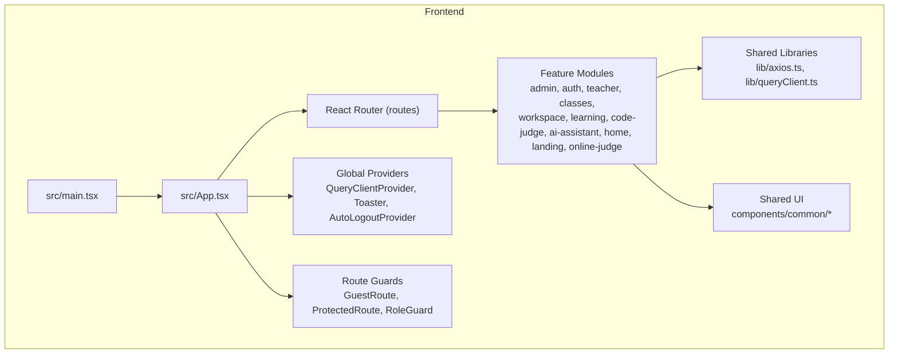
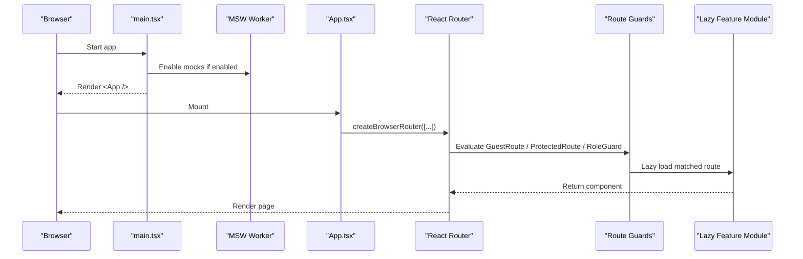
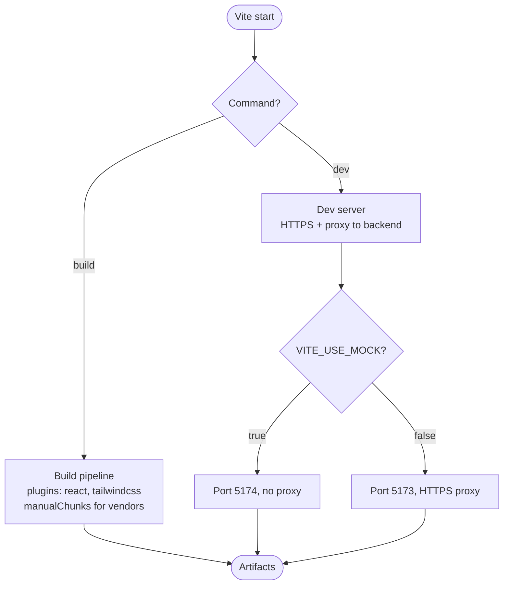
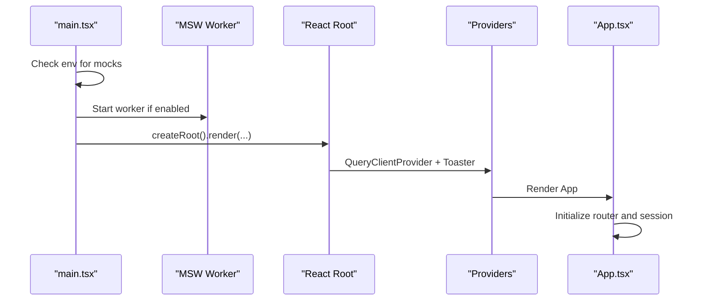
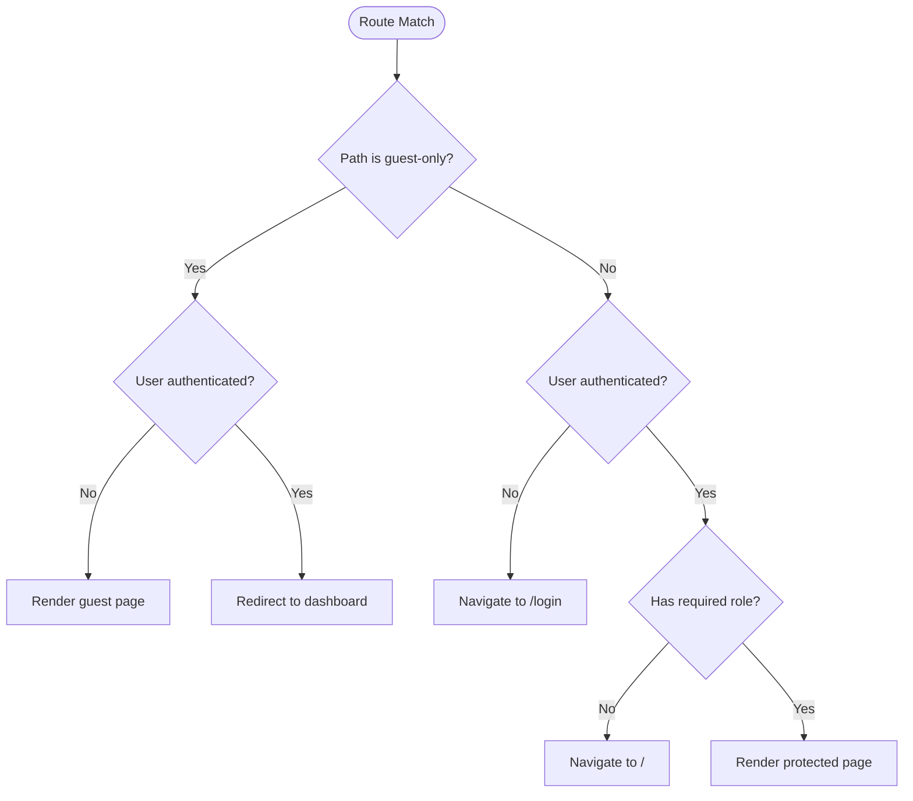
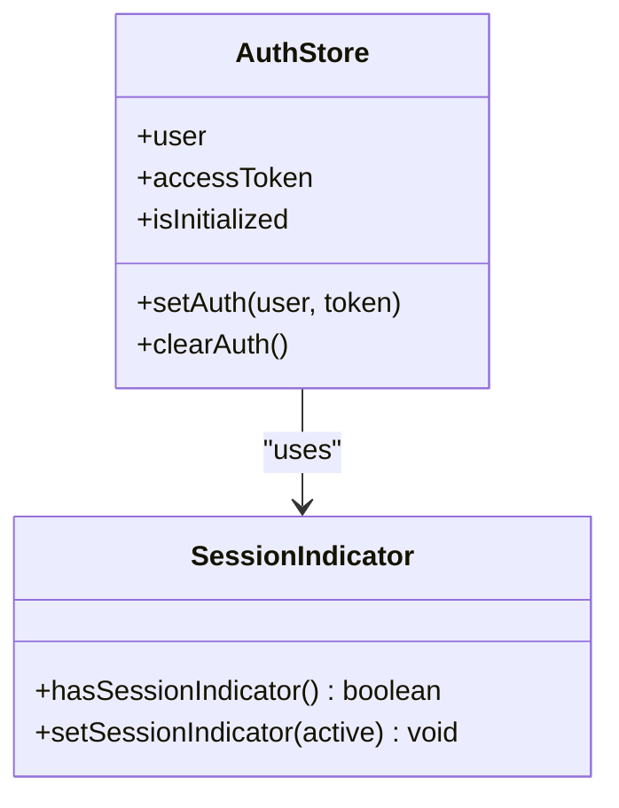
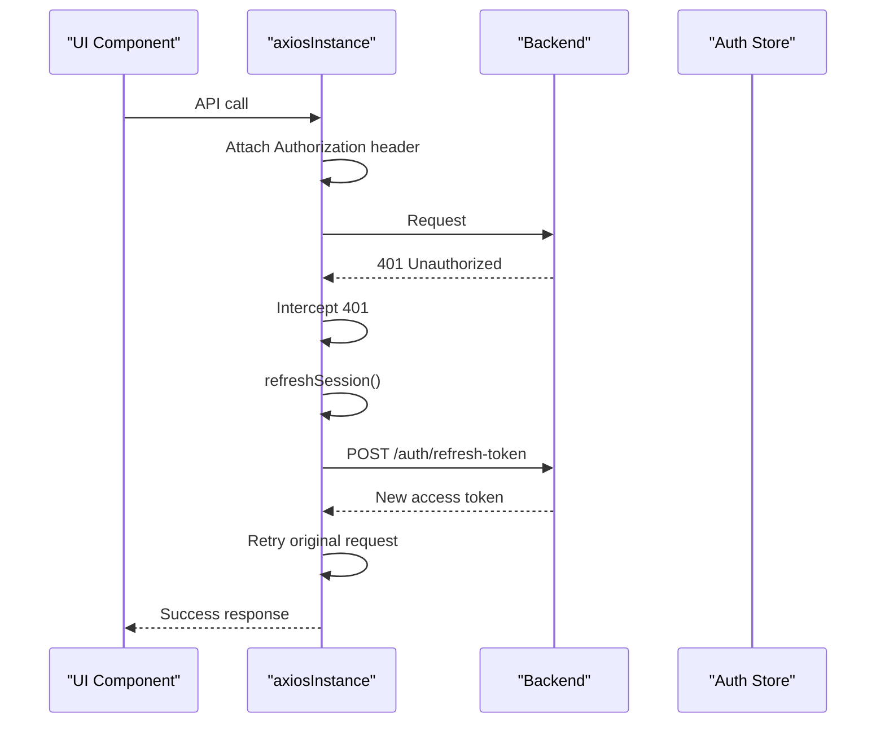
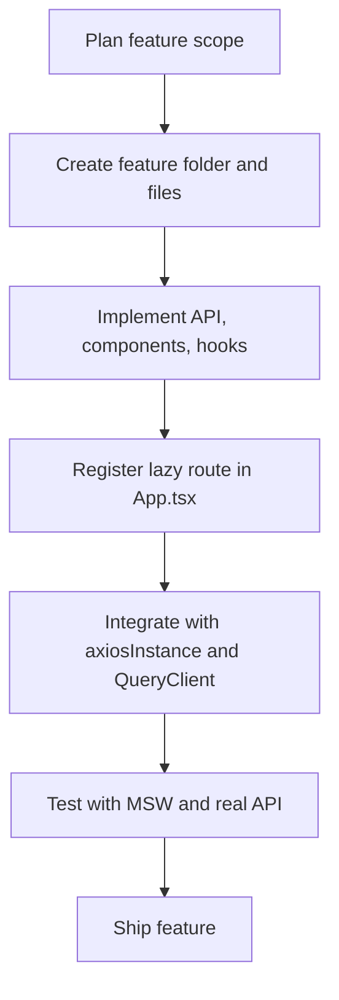
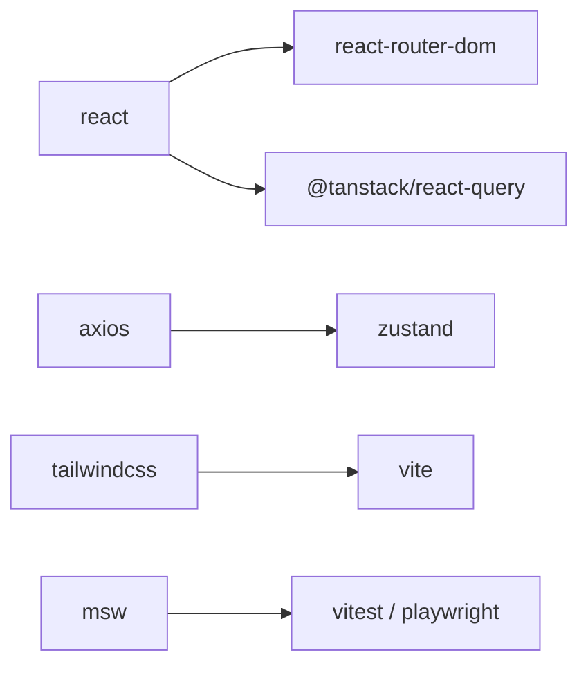

# Application Structure & Architecture

<cite>
**Referenced Files in This Document**
- [package.json](file://frontend/package.json)
- [vite.config.ts](file://frontend/vite.config.ts)
- [main.tsx](file://frontend/src/main.tsx)
- [App.tsx](file://frontend/src/App.tsx)
- [ProtectedRoute.tsx](file://frontend/src/routes/ProtectedRoute.tsx)
- [GuestRoute.tsx](file://frontend/src/routes/GuestRoute.tsx)
- [RoleGuard.tsx](file://frontend/src/routes/RoleGuard.tsx)
- [authStore.ts](file://frontend/src/features/auth/store/authStore.ts)
- [axios.ts](file://frontend/src/lib/axios.ts)
- [queryClient.ts](file://frontend/src/lib/queryClient.ts)
- [RouteErrorBoundary.tsx](file://frontend/src/components/common/RouteErrorBoundary.tsx)
- [PageSkeleton.tsx](file://frontend/src/components/common/PageSkeleton.tsx)
</cite>

## Table of Contents
1. [Introduction](#introduction)
2. [Project Structure](#project-structure)
3. [Core Components](#core-components)
4. [Architecture Overview](#architecture-overview)
5. [Detailed Component Analysis](#detailed-component-analysis)
6. [Dependency Analysis](#dependency-analysis)
7. [Performance Considerations](#performance-considerations)
8. [Troubleshooting Guide](#troubleshooting-guide)
9. [Conclusion](#conclusion)
10. [Appendices](#appendices)

## Introduction
This document explains the React application’s structure and architecture, focusing on feature-based organization, component hierarchy, module boundaries, Vite configuration, build process, development workflow, routing with React Router, protected routes, role-based access control, bootstrap process, dependency injection patterns, and global configuration management. It also provides practical guidance for adding new features following the established patterns.

## Project Structure
The frontend is a Vite + React application organized by features under `src/features`. Shared UI components live under `src/components`, shared libraries under `src/lib`, route guards under `src/routes`, and top-level pages under `src/pages`. Each feature typically contains its own API layer, components, hooks, types, styles, and sometimes layouts or stores.

**Diagram sources**
- [main.tsx:1-35](file://frontend/src/main.tsx#L1-L35)
- [App.tsx:1-163](file://frontend/src/App.tsx#L1-L163)
- [ProtectedRoute.tsx:1-14](file://frontend/src/routes/ProtectedRoute.tsx#L1-L14)
- [GuestRoute.tsx:1-16](file://frontend/src/routes/GuestRoute.tsx#L1-L16)
- [RoleGuard.tsx:1-23](file://frontend/src/routes/RoleGuard.tsx#L1-L23)
- [axios.ts:1-128](file://frontend/src/lib/axios.ts#L1-L128)
- [queryClient.ts:1-12](file://frontend/src/lib/queryClient.ts#L1-L12)

**Section sources**
- [package.json:1-70](file://frontend/package.json#L1-L70)
- [vite.config.ts:1-67](file://frontend/vite.config.ts#L1-L67)
- [main.tsx:1-35](file://frontend/src/main.tsx#L1-L35)
- [App.tsx:1-163](file://frontend/src/App.tsx#L1-L163)

## Core Components
- Bootstrap entrypoint: initializes environment-specific mocking, renders React root with providers, and mounts the app.
- App shell: configures lazy-loaded routes, wraps navigation with auto-logout, and handles initial session refresh.
- Route guards: enforce guest-only, authenticated-only, and role-based access.
- Auth store: holds user, token, initialization state, and persists a session indicator.
- HTTP client: centralized Axios instance with request/response interceptors, automatic token refresh, and session expiration handling.
- Query client: TanStack React Query client with default caching and retry behavior.
- Error boundary and skeleton: route error display and loading placeholders.

**Section sources**
- [main.tsx:1-35](file://frontend/src/main.tsx#L1-L35)
- [App.tsx:1-163](file://frontend/src/App.tsx#L1-L163)
- [ProtectedRoute.tsx:1-14](file://frontend/src/routes/ProtectedRoute.tsx#L1-L14)
- [GuestRoute.tsx:1-16](file://frontend/src/routes/GuestRoute.tsx#L1-L16)
- [RoleGuard.tsx:1-23](file://frontend/src/routes/RoleGuard.tsx#L1-L23)
- [authStore.ts:1-47](file://frontend/src/features/auth/store/authStore.ts#L1-L47)
- [axios.ts:1-128](file://frontend/src/lib/axios.ts#L1-L128)
- [queryClient.ts:1-12](file://frontend/src/lib/queryClient.ts#L1-L12)
- [RouteErrorBoundary.tsx:1-55](file://frontend/src/components/common/RouteErrorBoundary.tsx#L1-L55)
- [PageSkeleton.tsx:1-41](file://frontend/src/components/common/PageSkeleton.tsx#L1-L41)

## Architecture Overview
The application uses a feature-based architecture where each domain area owns its UI, data fetching, and state. Global concerns like authentication, HTTP requests, and query caching are centralized in shared modules. Routing is declarative with React Router v7 using lazy-loaded route modules to optimize bundle size.

**Diagram sources**
- [main.tsx:10-34](file://frontend/src/main.tsx#L10-L34)
- [App.tsx:22-140](file://frontend/src/App.tsx#L22-L140)
- [GuestRoute.tsx:1-16](file://frontend/src/routes/GuestRoute.tsx#L1-L16)
- [ProtectedRoute.tsx:1-14](file://frontend/src/routes/ProtectedRoute.tsx#L1-L14)
- [RoleGuard.tsx:1-23](file://frontend/src/routes/RoleGuard.tsx#L1-L23)

## Detailed Component Analysis

### Vite Configuration and Build Process
- Development server:
  - Runs on HTTPS with local dev certificates when not using mock mode.
  - Proxies `/api`, `/health`, and `/swagger` to the backend at `https://localhost:5001`.
  - Supports a mock mode that switches port and disables proxying.
- Build optimization:
  - Splits vendor bundles into separate chunks for React, React Router, React Query, Monaco Editor, CodeMirror, and icons.
  - Uses Tailwind CSS via the Vite plugin.
- Environment variables:
  - Loads env prefixed with `VITE_` and supports `VITE_USE_MOCK` and `VITE_API_BASE_URL`.

**Diagram sources**
- [vite.config.ts:8-66](file://frontend/vite.config.ts#L8-L66)

**Section sources**
- [vite.config.ts:1-67](file://frontend/vite.config.ts#L1-L67)
- [package.json:6-14](file://frontend/package.json#L6-L14)

### Application Bootstrap and Dependency Injection Patterns
- Bootstrap sequence:
  - Conditionally enables MSW worker based on environment flags.
  - Creates React root with `StrictMode`.
  - Provides TanStack Query client globally.
  - Renders the app and toast notifications.
- Dependency injection:
  - No DI container; dependencies are injected via React Context and provider components (`QueryClientProvider`, `AutoLogoutProvider`).
  - Global services (HTTP client, query client) are singletons imported from shared modules.

**Diagram sources**
- [main.tsx:10-34](file://frontend/src/main.tsx#L10-L34)
- [App.tsx:142-162](file://frontend/src/App.tsx#L142-L162)

**Section sources**
- [main.tsx:1-35](file://frontend/src/main.tsx#L1-L35)
- [App.tsx:142-162](file://frontend/src/App.tsx#L142-L162)

### Routing Setup, Protected Routes, and Role-Based Access Control
- Declarative routes:
  - All routes are defined in `App.tsx` using `createBrowserRouter`.
  - Pages are lazily loaded per route to reduce initial bundle size.
- Guest vs Protected:
  - `GuestRoute` allows unauthenticated users and redirects authenticated users to their dashboard.
  - `ProtectedRoute` requires an active user and access token; otherwise redirects to login.
- Role-based access:
  - `RoleGuard` restricts routes to specific roles (Admin, Teacher, Student).
  - Nested route groups apply role guards around admin, teacher, and student sections.

**Diagram sources**
- [App.tsx:22-140](file://frontend/src/App.tsx#L22-L140)
- [GuestRoute.tsx:1-16](file://frontend/src/routes/GuestRoute.tsx#L1-L16)
- [ProtectedRoute.tsx:1-14](file://frontend/src/routes/ProtectedRoute.tsx#L1-L14)
- [RoleGuard.tsx:1-23](file://frontend/src/routes/RoleGuard.tsx#L1-L23)

**Section sources**
- [App.tsx:22-140](file://frontend/src/App.tsx#L22-L140)
- [GuestRoute.tsx:1-16](file://frontend/src/routes/GuestRoute.tsx#L1-L16)
- [ProtectedRoute.tsx:1-14](file://frontend/src/routes/ProtectedRoute.tsx#L1-L14)
- [RoleGuard.tsx:1-23](file://frontend/src/routes/RoleGuard.tsx#L1-L23)

### Authentication Store and Session Management
- State shape:
  - Holds `user`, `accessToken`, and `isInitialized`.
  - Provides `setAuth` and `clearAuth` actions.
- Session indicator:
  - Persists a simple flag in localStorage to signal an active session across tabs.
- Initialization flow:
  - On app mount, checks session indicator and either refreshes the session or clears auth state.

**Diagram sources**
- [authStore.ts:1-47](file://frontend/src/features/auth/store/authStore.ts#L1-L47)

**Section sources**
- [authStore.ts:1-47](file://frontend/src/features/auth/store/authStore.ts#L1-L47)
- [App.tsx:142-162](file://frontend/src/App.tsx#L142-L162)

### HTTP Client, Token Refresh, and Error Handling
- Base configuration:
  - Centralized Axios instance with base URL from environment or default `/api`.
  - Sends credentials for cookie-based refresh tokens.
- Interceptors:
  - Request interceptor attaches Authorization header and enforces session activity checks.
  - Response interceptor handles 401 errors, triggers token refresh, and navigates to login on failure.
- Token refresh:
  - Serializes concurrent refresh calls using browser locks API.
  - Clears queries and invalidates cache on logout.
- Session expiration:
  - Detects idle/expired sessions and performs graceful logout with optional toast notification.

**Diagram sources**
- [axios.ts:19-77](file://frontend/src/lib/axios.ts#L19-L77)
- [axios.ts:79-127](file://frontend/src/lib/axios.ts#L79-L127)

**Section sources**
- [axios.ts:1-128](file://frontend/src/lib/axios.ts#L1-L128)

### Global Configuration Management
- Environment-driven configuration:
  - API base URL via `VITE_API_BASE_URL`; defaults to `/api`.
  - Mock mode toggled via `VITE_USE_MOCK` or `VITE_ENABLE_MOCKS`.
- Runtime configuration:
  - Query client defaults for retries, stale time, garbage collection time, and focus refetch behavior.
  - Toast notifications via Sonner configured at bootstrap.

**Section sources**
- [vite.config.ts:44-66](file://frontend/vite.config.ts#L44-L66)
- [axios.ts:9-17](file://frontend/src/lib/axios.ts#L9-L17)
- [queryClient.ts:1-12](file://frontend/src/lib/queryClient.ts#L1-L12)
- [main.tsx:25-34](file://frontend/src/main.tsx#L25-L34)

### Adding New Features: Step-by-Step Pattern
Follow these steps to add a new feature while preserving architectural consistency:

1. Create a feature folder under `src/features/<feature-name>` with standard subfolders:
   - `api/` for API functions
   - `components/` for feature-specific UI
   - `hooks/` for custom hooks
   - `types/` for TypeScript types
   - `pages/` or `layouts/` for route entry points
   - `styles/` for scoped styles
2. Implement feature logic:
   - Define types and API helpers in `api/`.
   - Compose UI components in `components/`.
   - Use TanStack Query hooks for data fetching and mutations.
   - Manage local feature state with Zustand slices if needed.
3. Register routes:
   - Add a lazy-loaded route in `App.tsx` under the appropriate guard group (guest, protected, role-guarded).
   - Ensure nested routes follow the same pattern.
4. Integrate global services:
   - Use `axiosInstance` for network requests.
   - Wrap data operations with React Query for caching and background updates.
5. Test locally:
   - Use MSW handlers under `features/<feature>/mocks/handlers.ts` if you need isolated mocks.
   - Run dev server with mock mode if necessary.

[No sources needed since this section provides general guidance]

## Dependency Analysis
Key runtime dependencies and their roles:
- React and ReactDOM: UI framework.
- React Router v7: Declarative routing with lazy loading.
- TanStack React Query: Data fetching, caching, and synchronization.
- Axios: HTTP client with interceptors.
- Zustand: Lightweight global state for auth.
- Tailwind CSS: Utility-first styling.
- MSW: API mocking for development and tests.
- Vitest and Playwright: Unit and E2E testing.

**Diagram sources**
- [package.json:15-62](file://frontend/package.json#L15-L62)

**Section sources**
- [package.json:15-62](file://frontend/package.json#L15-L62)

## Performance Considerations
- Bundle splitting: Vendor chunks isolate large libraries (React, Router, Query, Monaco, CodeMirror, Icons) for better caching and parallel loading.
- Lazy route loading: Pages are loaded on demand, reducing initial payload.
- Query caching: Default stale time and garbage collection settings balance freshness and memory usage.
- Chunk size warnings: Threshold set to alert oversized chunks during build.

**Section sources**
- [vite.config.ts:12-40](file://frontend/vite.config.ts#L12-L40)
- [queryClient.ts:1-12](file://frontend/src/lib/queryClient.ts#L1-L12)

## Troubleshooting Guide
Common issues and resolutions:
- Route errors:
  - The route error boundary displays user-friendly messages for 404, 403, and 500 statuses, and suggests reloading on dynamic import failures.
- Session expired due to inactivity:
  - The HTTP client detects idle sessions and logs out automatically; ensure session activity tracking is enabled in development if needed.
- Token refresh loops:
  - Concurrent refresh calls are serialized; verify that refresh endpoints are reachable and cookies are correctly set.
- Mock mode misconfiguration:
  - If using MSW, ensure environment flags are set and worker is initialized before rendering.

**Section sources**
- [RouteErrorBoundary.tsx:1-55](file://frontend/src/components/common/RouteErrorBoundary.tsx#L1-L55)
- [axios.ts:22-46](file://frontend/src/lib/axios.ts#L22-L46)
- [axios.ts:48-77](file://frontend/src/lib/axios.ts#L48-L77)
- [main.tsx:10-23](file://frontend/src/main.tsx#L10-L23)

## Conclusion
The application follows a clear feature-based architecture with strong separation of concerns, robust routing with role-based guards, centralized HTTP and query handling, and optimized build configuration. Following the documented patterns ensures consistent, maintainable growth as new features are added.

## Appendices

### Example: Adding a New Admin Feature
- Create `src/features/admin/pages/NewFeaturePage.tsx` and related API/hooks/types.
- Add a lazy route under the Admin role guard in `App.tsx`:
  - Path: `/admin/new-feature`
  - Element: `<NewFeaturePage />`
- Use `axiosInstance` for data operations and React Query for caching.
- Test with MSW handlers under `features/admin/mocks/handlers.ts`.

[No sources needed since this section provides general guidance]