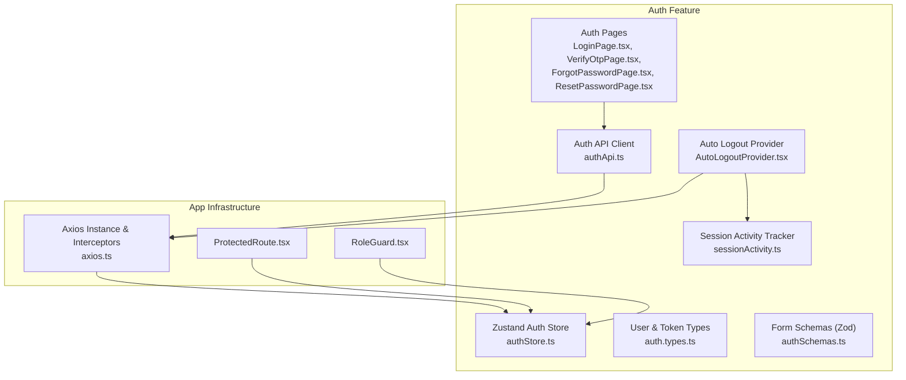
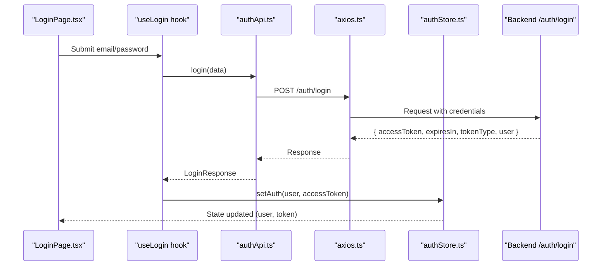
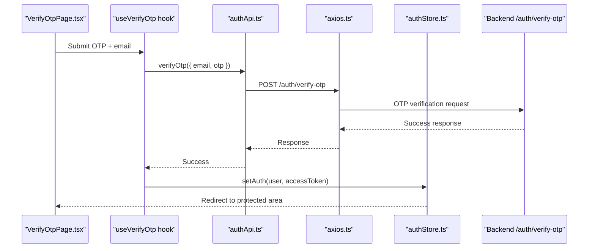
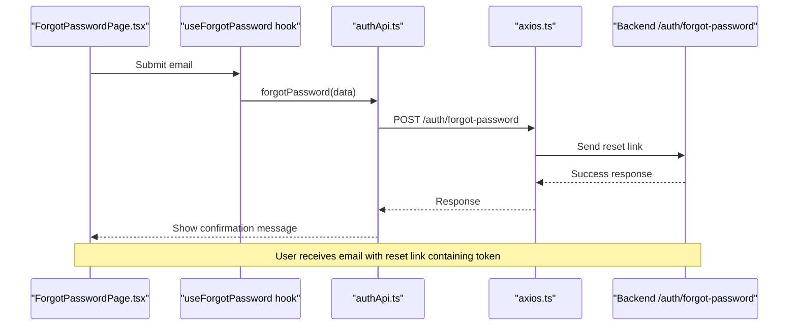
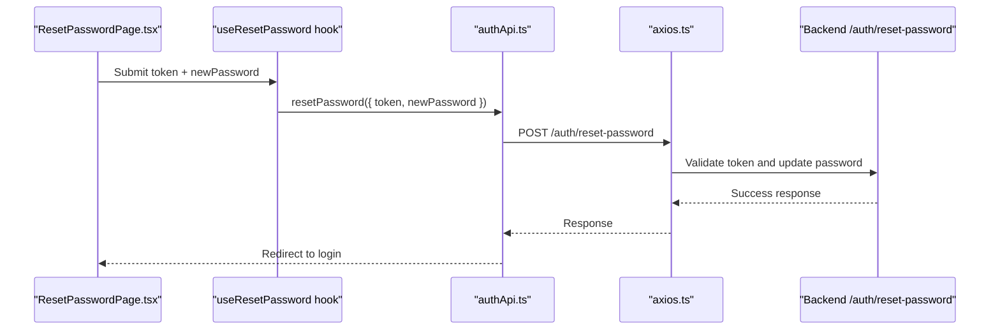
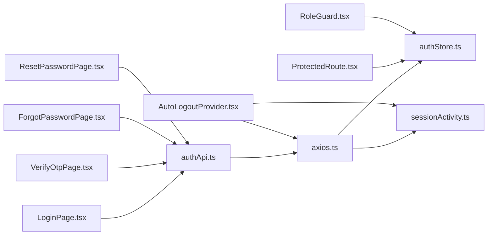

# Authentication Module

<cite>
**Referenced Files in This Document**
- [authStore.ts](file://frontend/src/features/auth/store/authStore.ts)
- [axios.ts](file://frontend/src/lib/axios.ts)
- [authApi.ts](file://frontend/src/features/auth/api/authApi.ts)
- [auth.types.ts](file://frontend/src/features/auth/types/auth.types.ts)
- [authSchemas.ts](file://frontend/src/features/auth/schemas/authSchemas.ts)
- [ProtectedRoute.tsx](file://frontend/src/routes/ProtectedRoute.tsx)
- [RoleGuard.tsx](file://frontend/src/routes/RoleGuard.tsx)
- [sessionActivity.ts](file://frontend/src/features/auth/sessionActivity.ts)
- [AutoLogoutProvider.tsx](file://frontend/src/features/auth/components/AutoLogoutProvider.tsx)
- [LoginPage.tsx](file://frontend/src/features/auth/pages/LoginPage.tsx)
- [VerifyOtpPage.tsx](file://frontend/src/features/auth/pages/VerifyOtpPage.tsx)
- [ForgotPasswordPage.tsx](file://frontend/src/features/auth/pages/ForgotPasswordPage.tsx)
- [ResetPasswordPage.tsx](file://frontend/src/features/auth/pages/ResetPasswordPage.tsx)
</cite>

## Table of Contents
1. Introduction
2. Project Structure
3. Core Components
4. Architecture Overview
5. Detailed Component Analysis
6. Dependency Analysis
7. Performance Considerations
8. Troubleshooting Guide
9. Conclusion

## Introduction
This document explains the frontend authentication module, focusing on JWT-based authentication, OTP verification, session management, and role-based route protection. It covers the Zustand store for auth state, token handling, integration with backend authentication APIs, error handling strategies, and security considerations such as auto-logout due to inactivity.

## Project Structure
The authentication feature is organized under the frontend application:
- Store and types define the auth state model and user profile shape.
- API layer encapsulates HTTP calls to backend endpoints.
- Pages implement login, OTP verification, forgot password, and reset password flows.
- Route guards enforce authentication and roles.
- Axios interceptors manage token injection, refresh, and logout.
- Session activity tracking and an auto-logout provider handle idle timeouts.

**Diagram sources**
- [authStore.ts:1-47](file://frontend/src/features/auth/store/authStore.ts#L1-L47)
- [axios.ts:1-128](file://frontend/src/lib/axios.ts#L1-L128)
- [authApi.ts:1-54](file://frontend/src/features/auth/api/authApi.ts#L1-L54)
- [auth.types.ts:1-22](file://frontend/src/features/auth/types/auth.types.ts#L1-L22)
- [authSchemas.ts:1-71](file://frontend/src/features/auth/schemas/authSchemas.ts#L1-L71)
- [ProtectedRoute.tsx:1-14](file://frontend/src/routes/ProtectedRoute.tsx#L1-L14)
- [RoleGuard.tsx:1-23](file://frontend/src/routes/RoleGuard.tsx#L1-L23)
- [sessionActivity.ts:1-28](file://frontend/src/features/auth/sessionActivity.ts#L1-L28)
- [AutoLogoutProvider.tsx:1-95](file://frontend/src/features/auth/components/AutoLogoutProvider.tsx#L1-L95)
- [LoginPage.tsx:1-26](file://frontend/src/features/auth/pages/LoginPage.tsx#L1-L26)
- [VerifyOtpPage.tsx:1-51](file://frontend/src/features/auth/pages/VerifyOtpPage.tsx#L1-L51)
- [ForgotPasswordPage.tsx:1-25](file://frontend/src/features/auth/pages/ForgotPasswordPage.tsx#L1-L25)
- [ResetPasswordPage.tsx:1-44](file://frontend/src/features/auth/pages/ResetPasswordPage.tsx#L1-L44)

**Section sources**
- [authStore.ts:1-47](file://frontend/src/features/auth/store/authStore.ts#L1-L47)
- [axios.ts:1-128](file://frontend/src/lib/axios.ts#L1-L128)
- [authApi.ts:1-54](file://frontend/src/features/auth/api/authApi.ts#L1-L54)
- [ProtectedRoute.tsx:1-14](file://frontend/src/routes/ProtectedRoute.tsx#L1-L14)
- [RoleGuard.tsx:1-23](file://frontend/src/routes/RoleGuard.tsx#L1-L23)
- [sessionActivity.ts:1-28](file://frontend/src/features/auth/sessionActivity.ts#L1-L28)
- [AutoLogoutProvider.tsx:1-95](file://frontend/src/features/auth/components/AutoLogoutProvider.tsx#L1-L95)

## Core Components
- Zustand auth store: Holds user profile, access token, initialization flag, and helpers to set/clear auth state while maintaining a session indicator in localStorage.
- Axios instance and interceptors: Injects Bearer tokens, handles 401 responses by refreshing tokens or expiring sessions, and centralizes logout logic.
- Auth API client: Encapsulates login, registration, OTP verification/resend, logout, forgot password, and reset password calls.
- Route guards: Protect routes based on authentication status and user roles.
- Session activity tracker: Tracks last activity timestamps and determines if a session is idle.
- Auto-logout provider: Prompts users before idle timeout and performs logout when necessary.

Key responsibilities:
- Token lifecycle: Set after login, attach to requests, refresh on 401, clear on expiration.
- User profile: Stored in memory via Zustand; used for UI and role checks.
- Security: HttpOnly cookies for refresh tokens; sensitive data not persisted in localStorage.

**Section sources**
- [authStore.ts:1-47](file://frontend/src/features/auth/store/authStore.ts#L1-L47)
- [axios.ts:1-128](file://frontend/src/lib/axios.ts#L1-L128)
- [authApi.ts:1-54](file://frontend/src/features/auth/api/authApi.ts#L1-L54)
- [ProtectedRoute.tsx:1-14](file://frontend/src/routes/ProtectedRoute.tsx#L1-L14)
- [RoleGuard.tsx:1-23](file://frontend/src/routes/RoleGuard.tsx#L1-L23)
- [sessionActivity.ts:1-28](file://frontend/src/features/auth/sessionActivity.ts#L1-L28)
- [AutoLogoutProvider.tsx:1-95](file://frontend/src/features/auth/components/AutoLogoutProvider.tsx#L1-L95)

## Architecture Overview
The authentication flow integrates React pages, Zustand store, Axios interceptors, and backend endpoints. The following sequence diagrams illustrate key workflows.

### Login Flow

**Diagram sources**
- [LoginPage.tsx:1-26](file://frontend/src/features/auth/pages/LoginPage.tsx#L1-L26)
- [authApi.ts:11-15](file://frontend/src/features/auth/api/authApi.ts#L11-L15)
- [axios.ts:79-90](file://frontend/src/lib/axios.ts#L79-L90)
- [authStore.ts:34-46](file://frontend/src/features/auth/store/authStore.ts#L34-L46)

### OTP Verification Flow

**Diagram sources**
- [VerifyOtpPage.tsx:1-51](file://frontend/src/features/auth/pages/VerifyOtpPage.tsx#L1-L51)
- [authApi.ts:27-30](file://frontend/src/features/auth/api/authApi.ts#L27-L30)
- [axios.ts:79-90](file://frontend/src/lib/axios.ts#L79-L90)
- [authStore.ts:34-46](file://frontend/src/features/auth/store/authStore.ts#L34-L46)

### Password Reset Workflow

**Diagram sources**
- [ForgotPasswordPage.tsx:1-25](file://frontend/src/features/auth/pages/ForgotPasswordPage.tsx#L1-L25)
- [authApi.ts:41-44](file://frontend/src/features/auth/api/authApi.ts#L41-L44)
- [axios.ts:1-17](file://frontend/src/lib/axios.ts#L1-L17)

### Reset Password Submission

**Diagram sources**
- [ResetPasswordPage.tsx:1-44](file://frontend/src/features/auth/pages/ResetPasswordPage.tsx#L1-L44)
- [authApi.ts:46-52](file://frontend/src/features/auth/api/authApi.ts#L46-L52)
- [axios.ts:1-17](file://frontend/src/lib/axios.ts#L1-L17)

## Detailed Component Analysis

### Zustand Auth Store
- State fields:
  - user: Current authenticated user profile.
  - accessToken: In-memory Bearer token attached to requests.
  - isInitialized: Indicates whether auth state has been initialized.
- Mutators:
  - setAuth(user, accessToken): Sets user and token, marks session active.
  - clearAuth(): Clears user and token, marks session inactive.
- Session indicator:
  - A lightweight localStorage flag indicates presence of an active session without storing credentials.

Complexity:
- O(1) operations for setting/clearing state and toggling session indicator.

Security:
- Credentials are not stored in localStorage; only a boolean indicator is kept there.

**Section sources**
- [authStore.ts:1-47](file://frontend/src/features/auth/store/authStore.ts#L1-L47)

### Axios Interceptors and Token Handling
- Request interceptor:
  - Attaches Authorization header with Bearer token when present.
  - Checks session idle status and triggers logout if needed.
- Response interceptor:
  - Detects 401 responses and attempts token refresh using refresh endpoint.
  - If refresh fails or session is expired, triggers logout and redirects to login.
- Refresh coordination:
  - Uses navigator.locks to serialize refresh across tabs and concurrent requests.
  - Prevents redundant refreshes and ensures consistent state updates.
- Expire session:
  - Centralized logout function clears store, cancels queries, dispatches logout event, and calls backend logout endpoints.

Error handling:
- Normalizes error details and attaches safe messages and trace IDs.

Performance:
- Avoids multiple simultaneous refreshes and reduces unnecessary network calls.

**Section sources**
- [axios.ts:1-128](file://frontend/src/lib/axios.ts#L1-L128)

### Auth API Client
- Endpoints:
  - POST /auth/login
  - POST /auth/register (student/teacher variants)
  - POST /auth/verify-otp
  - POST /auth/resend-otp
  - POST /auth/logout
  - POST /auth/forgot-password
  - POST /auth/reset-password
- Integration:
  - Uses axiosInstance for consistent configuration and interceptors.
  - Delegates logout to expireSession to ensure centralized cleanup.

Validation:
- Input schemas defined separately; API methods accept typed inputs.

**Section sources**
- [authApi.ts:1-54](file://frontend/src/features/auth/api/authApi.ts#L1-L54)

### Form Schemas (Zod)
- Login schema validates email and password.
- Registration schemas validate full name, email domain patterns, and strong password rules.
- OTP verification schema enforces 6-digit numeric code.
- Forgot password schema validates email format.
- Reset password schema validates token length/format and password strength plus confirmation match.

These schemas provide robust client-side validation prior to API calls.

**Section sources**
- [authSchemas.ts:1-71](file://frontend/src/features/auth/schemas/authSchemas.ts#L1-L71)

### Route Guards
- ProtectedRoute:
  - Redirects unauthenticated users to login.
  - Checks both user and accessToken presence.
- RoleGuard:
  - Ensures user exists and has one of the allowed roles.
  - Redirects unauthorized users to home page.

Usage:
- Wrap protected routes with ProtectedRoute.
- Use RoleGuard with allowedRoles array for role-based access control.

**Section sources**
- [ProtectedRoute.tsx:1-14](file://frontend/src/routes/ProtectedRoute.tsx#L1-L14)
- [RoleGuard.tsx:1-23](file://frontend/src/routes/RoleGuard.tsx#L1-L23)

### Session Activity Tracking
- Tracks last activity timestamp in localStorage with memory fallback.
- Provides functions to read, record, mark ended, and check idle status.
- Idle timeout configurable via environment variable.

Behavior:
- When idle threshold is exceeded, session is considered expired.
- Used by auto-logout provider and axios interceptors to enforce inactivity policies.

**Section sources**
- [sessionActivity.ts:1-28](file://frontend/src/features/auth/sessionActivity.ts#L1-L28)

### Auto-Logout Provider
- Monitors user interactions and prompts before idle timeout.
- Sends periodic heartbeat to /auth/me upon interaction to keep server aware.
- On idle or prompt dismissal, triggers logout via expireSession.
- Listens for auth:logout events to coordinate UI transitions.

UX:
- Modal dialog prompts user to continue or logout.
- Graceful handling of failed continuation attempts with toast notifications.

**Section sources**
- [AutoLogoutProvider.tsx:1-95](file://frontend/src/features/auth/components/AutoLogoutProvider.tsx#L1-L95)

### Auth Pages
- LoginPage:
  - Uses react-hook-form with Zod resolver.
  - Calls useLogin hook to submit credentials and navigate after success.
- VerifyOtpPage:
  - Validates OTP input and supports resend with countdown timer.
  - Navigates back to login if email parameter missing.
- ForgotPasswordPage:
  - Submits email to receive reset instructions.
  - Shows success feedback and allows resending link.
- ResetPasswordPage:
  - Extracts token from URL hash/query.
  - Validates token format and submits new password.

All pages integrate with their respective hooks and use BrightAuthLayout for consistent styling.

**Section sources**
- [LoginPage.tsx:1-26](file://frontend/src/features/auth/pages/LoginPage.tsx#L1-L26)
- [VerifyOtpPage.tsx:1-51](file://frontend/src/features/auth/pages/VerifyOtpPage.tsx#L1-L51)
- [ForgotPasswordPage.tsx:1-25](file://frontend/src/features/auth/pages/ForgotPasswordPage.tsx#L1-L25)
- [ResetPasswordPage.tsx:1-44](file://frontend/src/features/auth/pages/ResetPasswordPage.tsx#L1-L44)

## Dependency Analysis
The following diagram shows how components depend on each other during authentication flows.

**Diagram sources**
- [LoginPage.tsx:1-26](file://frontend/src/features/auth/pages/LoginPage.tsx#L1-L26)
- [VerifyOtpPage.tsx:1-51](file://frontend/src/features/auth/pages/VerifyOtpPage.tsx#L1-L51)
- [ForgotPasswordPage.tsx:1-25](file://frontend/src/features/auth/pages/ForgotPasswordPage.tsx#L1-L25)
- [ResetPasswordPage.tsx:1-44](file://frontend/src/features/auth/pages/ResetPasswordPage.tsx#L1-L44)
- [authApi.ts:1-54](file://frontend/src/features/auth/api/authApi.ts#L1-L54)
- [axios.ts:1-128](file://frontend/src/lib/axios.ts#L1-L128)
- [authStore.ts:1-47](file://frontend/src/features/auth/store/authStore.ts#L1-L47)
- [sessionActivity.ts:1-28](file://frontend/src/features/auth/sessionActivity.ts#L1-L28)
- [AutoLogoutProvider.tsx:1-95](file://frontend/src/features/auth/components/AutoLogoutProvider.tsx#L1-L95)
- [ProtectedRoute.tsx:1-14](file://frontend/src/routes/ProtectedRoute.tsx#L1-L14)
- [RoleGuard.tsx:1-23](file://frontend/src/routes/RoleGuard.tsx#L1-L23)

## Performance Considerations
- Token refresh serialization:
  - Uses navigator.locks to prevent concurrent refresh requests across tabs.
- Minimal persistence:
  - Only non-sensitive session indicators and activity timestamps are stored in localStorage.
- Heartbeat strategy:
  - Periodic /auth/me pings triggered by user interactions reduce unnecessary server load while keeping sessions alive.
- Query cache invalidation:
  - Centralized logout clears and cancels queries to avoid stale data.

[No sources needed since this section provides general guidance]

## Troubleshooting Guide
Common issues and resolutions:
- 401 Unauthorized errors:
  - Axios interceptors attempt automatic refresh; if refresh fails, user is redirected to login.
  - Check network connectivity and backend availability for /auth/refresh-token.
- Session idle timeout:
  - Ensure user interactions are recorded; verify idle timeout configuration.
  - Confirm AutoLogoutProvider is mounted and listening to events.
- OTP verification failures:
  - Validate OTP format and ensure correct email parameter is passed.
  - Resend OTP if necessary; confirm email delivery and spam folder.
- Password reset link invalid:
  - Verify token format and expiry; regenerate link if expired.
- Logout not clearing state:
  - Ensure expireSession is called and auth:logout event listeners are active.

**Section sources**
- [axios.ts:92-127](file://frontend/src/lib/axios.ts#L92-L127)
- [AutoLogoutProvider.tsx:40-67](file://frontend/src/features/auth/components/AutoLogoutProvider.tsx#L40-L67)
- [VerifyOtpPage.tsx:17-45](file://frontend/src/features/auth/pages/VerifyOtpPage.tsx#L17-L45)
- [ResetPasswordPage.tsx:11-24](file://frontend/src/features/auth/pages/ResetPasswordPage.tsx#L11-L24)

## Conclusion
The authentication module implements a secure, user-friendly JWT-based flow with OTP verification, robust session management, and role-based route protection. It leverages Zustand for state management, Axios interceptors for token lifecycle handling, and an auto-logout provider to enforce inactivity policies. The design emphasizes security by avoiding sensitive data persistence in localStorage and centralizing logout and refresh logic. Proper validation via Zod schemas and comprehensive error handling ensure a resilient user experience.

[No sources needed since this section summarizes without analyzing specific files]