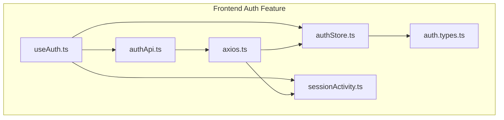
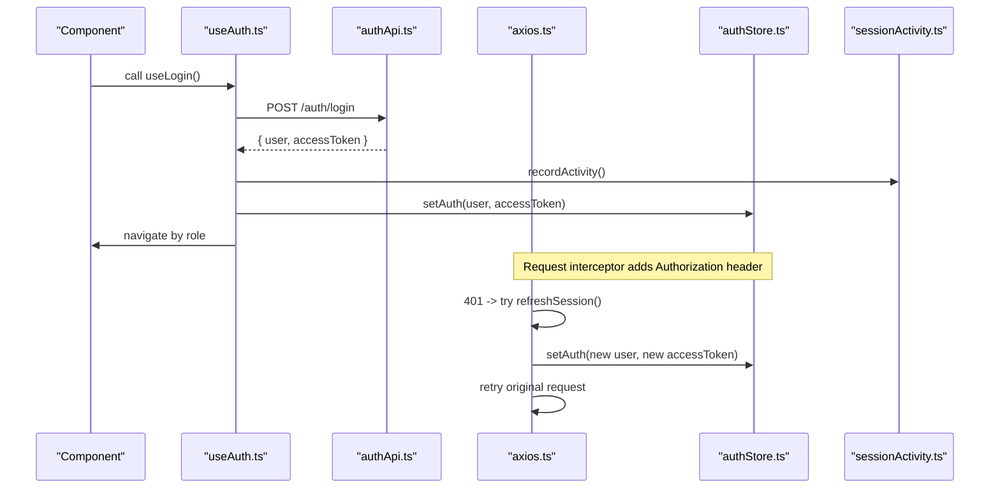
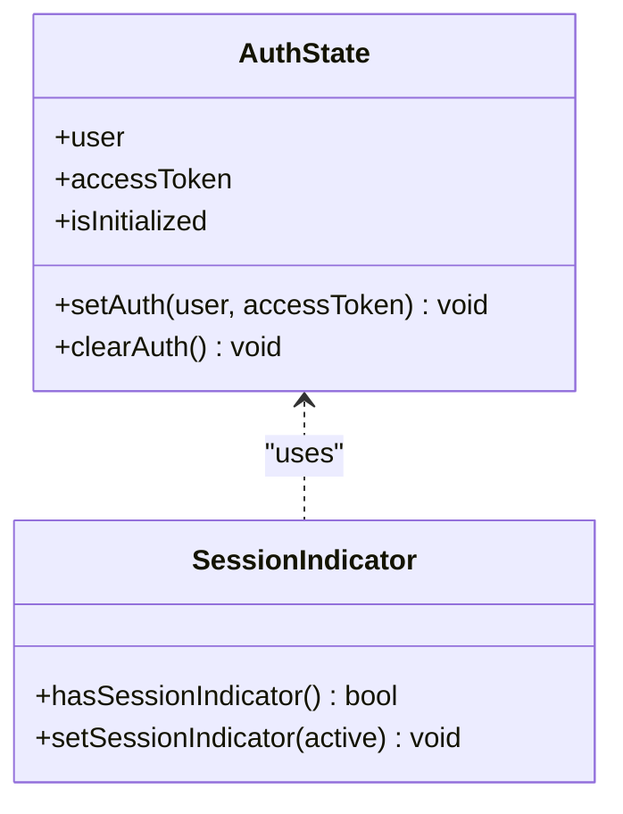
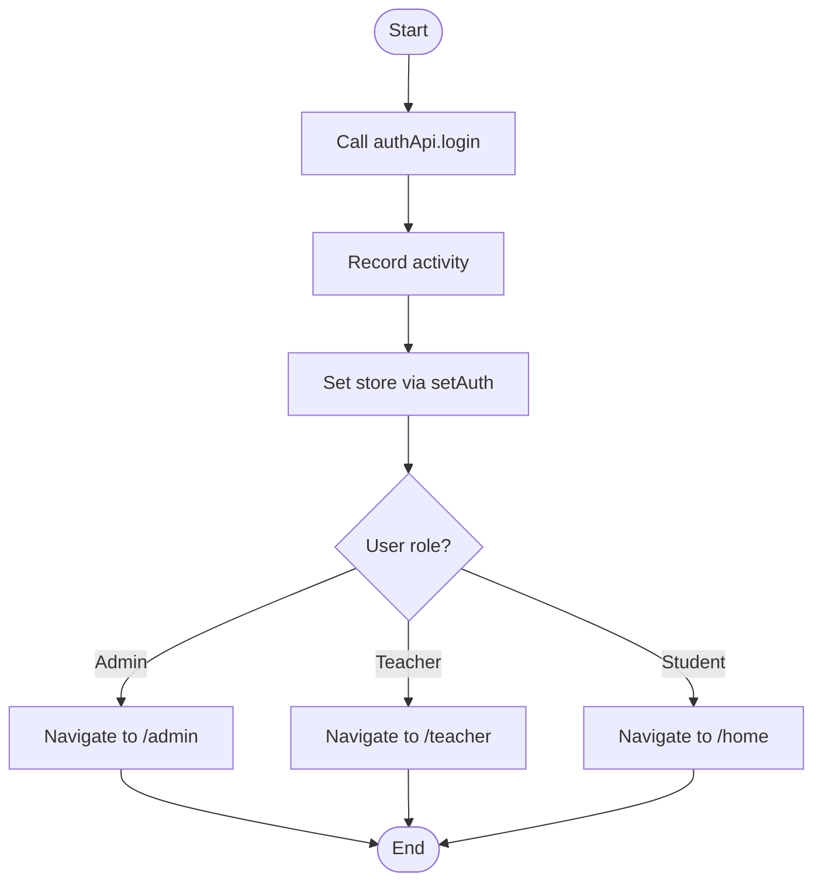
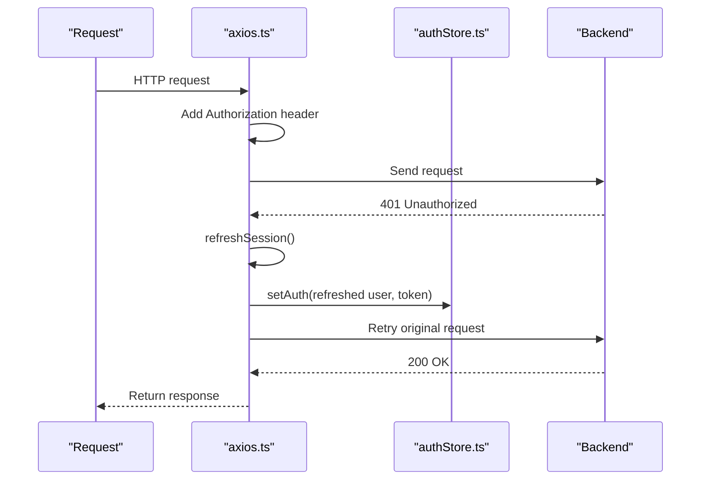
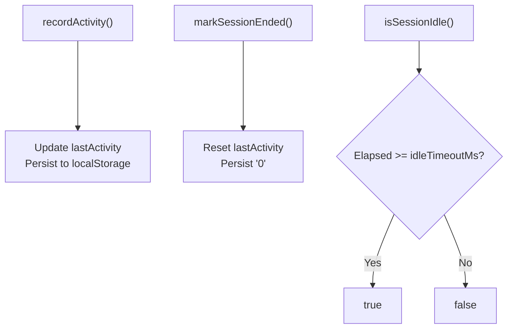
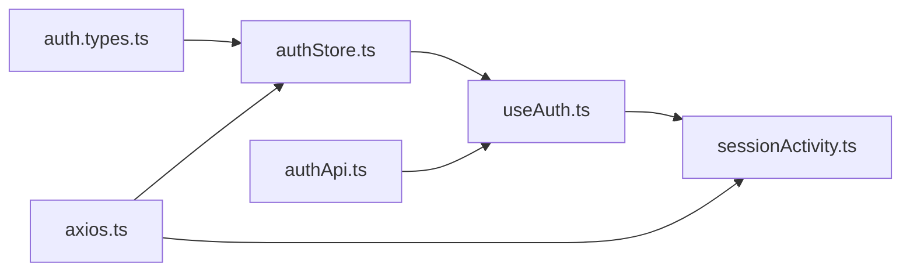

# Authentication Store Management

<cite>
**Referenced Files in This Document**
- [authStore.ts](file://frontend/src/features/auth/store/authStore.ts)
- [auth.types.ts](file://frontend/src/features/auth/types/auth.types.ts)
- [useAuth.ts](file://frontend/src/features/auth/hooks/useAuth.ts)
- [authApi.ts](file://frontend/src/features/auth/api/authApi.ts)
- [axios.ts](file://frontend/src/lib/axios.ts)
- [sessionActivity.ts](file://frontend/src/features/auth/sessionActivity.ts)
</cite>

## Table of Contents
1. [Introduction](#introduction)
2. [Project Structure](#project-structure)
3. [Core Components](#core-components)
4. [Architecture Overview](#architecture-overview)
5. [Detailed Component Analysis](#detailed-component-analysis)
6. [Dependency Analysis](#dependency-analysis)
7. [Performance Considerations](#performance-considerations)
8. [Troubleshooting Guide](#troubleshooting-guide)
9. [Conclusion](#conclusion)

## Introduction
This document explains the authentication store management system implemented with Zustand. It covers user session persistence, token handling, and the session indicator functionality. You will learn how to use the store in components, handle authentication state changes, and manage the user data lifecycle across login, logout, and token refresh flows.

## Project Structure
The authentication feature is organized into focused modules:
- Store: Zustand-based state for user and access token
- Types: Shared TypeScript interfaces for User and tokens
- Hooks: React Query hooks for login, register, OTP, password reset, and logout
- API: HTTP client wrappers for auth endpoints
- Axios Interceptors: Token injection, refresh, and session expiration logic
- Session Activity: Idle timeout tracking and session end markers

**Diagram sources**
- [authStore.ts:1-47](file://frontend/src/features/auth/store/authStore.ts#L1-L47)
- [auth.types.ts:1-22](file://frontend/src/features/auth/types/auth.types.ts#L1-L22)
- [useAuth.ts:1-150](file://frontend/src/features/auth/hooks/useAuth.ts#L1-L150)
- [authApi.ts:1-54](file://frontend/src/features/auth/api/authApi.ts#L1-L54)
- [axios.ts:1-128](file://frontend/src/lib/axios.ts#L1-L128)
- [sessionActivity.ts:1-28](file://frontend/src/features/auth/sessionActivity.ts#L1-L28)

**Section sources**
- [authStore.ts:1-47](file://frontend/src/features/auth/store/authStore.ts#L1-L47)
- [auth.types.ts:1-22](file://frontend/src/features/auth/types/auth.types.ts#L1-L22)
- [useAuth.ts:1-150](file://frontend/src/features/auth/hooks/useAuth.ts#L1-L150)
- [authApi.ts:1-54](file://frontend/src/features/auth/api/authApi.ts#L1-L54)
- [axios.ts:1-128](file://frontend/src/lib/axios.ts#L1-L128)
- [sessionActivity.ts:1-28](file://frontend/src/features/auth/sessionActivity.ts#L1-L28)

## Core Components
- Zustand store (useAuthStore): Holds user, accessToken, and initialization flag; exposes setAuth and clearAuth; integrates a session indicator in localStorage.
- Types (User, AuthTokens, LoginResponse): Define the shape of authenticated user and token payloads.
- Hooks (useLogin, useLogout, etc.): Coordinate API calls via React Query, update store, navigate, and record activity.
- API layer (authApi): Thin wrappers around HTTP endpoints for login, registration, OTP, password reset, and logout.
- Axios interceptors: Attach Authorization headers, refresh tokens, handle 401s, and enforce idle session timeouts.
- Session activity: Tracks last activity timestamp and determines idle state.

Key responsibilities:
- Persisting minimal session indicators while keeping credentials in memory or HttpOnly cookies.
- Centralizing token refresh and logout behavior.
- Providing a simple interface for components to read and mutate auth state.

**Section sources**
- [authStore.ts:26-46](file://frontend/src/features/auth/store/authStore.ts#L26-L46)
- [auth.types.ts:4-21](file://frontend/src/features/auth/types/auth.types.ts#L4-L21)
- [useAuth.ts:11-42](file://frontend/src/features/auth/hooks/useAuth.ts#L11-L42)
- [useAuth.ts:131-149](file://frontend/src/features/auth/hooks/useAuth.ts#L131-L149)
- [authApi.ts:11-52](file://frontend/src/features/auth/api/authApi.ts#L11-L52)
- [axios.ts:19-77](file://frontend/src/lib/axios.ts#L19-L77)
- [axios.ts:79-127](file://frontend/src/lib/axios.ts#L79-L127)
- [sessionActivity.ts:1-28](file://frontend/src/features/auth/sessionActivity.ts#L1-L28)

## Architecture Overview
The authentication flow combines a lightweight Zustand store with React Query hooks and Axios interceptors:
- Login hook calls the API, records activity, updates the store, and navigates based on role.
- Logout hook clears the store, marks session ended, and navigates to login.
- Axios request interceptor attaches Bearer tokens and enforces idle session checks.
- On 401 responses, Axios attempts a single coordinated token refresh; if it fails, it triggers logout.

**Diagram sources**
- [useAuth.ts:11-42](file://frontend/src/features/auth/hooks/useAuth.ts#L11-L42)
- [authApi.ts:11-15](file://frontend/src/features/auth/api/authApi.ts#L11-L15)
- [axios.ts:79-127](file://frontend/src/lib/axios.ts#L79-L127)
- [authStore.ts:34-46](file://frontend/src/features/auth/store/authStore.ts#L34-L46)
- [sessionActivity.ts:15-18](file://frontend/src/features/auth/sessionActivity.ts#L15-L18)

## Detailed Component Analysis

### Zustand Store: useAuthStore
Responsibilities:
- State fields: user, accessToken, isInitialized
- Methods:
  - setAuth(user, accessToken): sets session indicator to active, then updates state
  - clearAuth(): removes session indicator, resets user and token, ensures initialized
- Session indicator:
  - hasSessionIndicator(): reads a boolean flag from localStorage
  - setSessionIndicator(active): writes/removes the flag in localStorage

Complexity:
- All operations are O(1).
- localStorage access is wrapped in try/catch to tolerate unavailable storage.

Usage patterns:
- Read state via selectors in components or hooks.
- Mutate via setAuth and clearAuth.

**Diagram sources**
- [authStore.ts:26-46](file://frontend/src/features/auth/store/authStore.ts#L26-L46)
- [authStore.ts:6-24](file://frontend/src/features/auth/store/authStore.ts#L6-L24)

**Section sources**
- [authStore.ts:6-24](file://frontend/src/features/auth/store/authStore.ts#L6-L24)
- [authStore.ts:26-46](file://frontend/src/features/auth/store/authStore.ts#L26-L46)

### Types: User and Tokens
- User: id, email, fullName, role, status, optional emailVerifiedAt
- AuthTokens: accessToken, expiresIn, tokenType
- LoginResponse: extends AuthTokens with user

These types define contracts between API responses and the store/hook layers.

**Section sources**
- [auth.types.ts:1-22](file://frontend/src/features/auth/types/auth.types.ts#L1-L22)

### Hooks: useLogin and useLogout
- useLogin:
  - Calls authApi.login
  - Records activity
  - Updates store via setAuth
  - Navigates based on user role
  - Handles specific error codes (e.g., unverified email, pending account)
- useLogout:
  - Calls authApi.logout
  - Clears store via clearAuth
  - Marks session ended
  - Navigates to login
  - Ensures cleanup even if API fails

**Diagram sources**
- [useAuth.ts:11-42](file://frontend/src/features/auth/hooks/useAuth.ts#L11-L42)
- [authApi.ts:11-15](file://frontend/src/features/auth/api/authApi.ts#L11-L15)
- [authStore.ts:38-41](file://frontend/src/features/auth/store/authStore.ts#L38-L41)

**Section sources**
- [useAuth.ts:11-42](file://frontend/src/features/auth/hooks/useAuth.ts#L11-L42)
- [useAuth.ts:131-149](file://frontend/src/features/auth/hooks/useAuth.ts#L131-L149)

### API Layer: authApi
- Provides typed methods for login, register student/teacher, verify OTP, resend OTP, logout, forgot password, reset password.
- Uses axiosInstance which handles base URL and credentials.

Integration points:
- Login returns LoginResponse consumed by useLogin.
- Logout delegates to expireSession to ensure proper cleanup.

**Section sources**
- [authApi.ts:1-54](file://frontend/src/features/auth/api/authApi.ts#L1-L54)

### Axios Interceptors: Token Handling and Refresh
Key behaviors:
- Request interceptor:
  - Adds Authorization header when accessToken exists
  - Enforces idle session check and cancels requests if idle
- Response interceptor:
  - Detects 401 and known session errors
  - Attempts refreshSession once per request
  - On success, retries original request with new token
  - On failure, redirects to login and clears state
- refreshSession:
  - Guards against concurrent refreshes using navigator.locks
  - Updates store with refreshed user and token
  - Rejects if session expired due to inactivity
- expireSession:
  - Marks session ended, clears store, cancels queries, dispatches auth:logout event
  - Performs server-side logout and refresh-token/logout

**Diagram sources**
- [axios.ts:79-127](file://frontend/src/lib/axios.ts#L79-L127)
- [axios.ts:48-77](file://frontend/src/lib/axios.ts#L48-L77)
- [authStore.ts:38-41](file://frontend/src/features/auth/store/authStore.ts#L38-L41)

**Section sources**
- [axios.ts:19-77](file://frontend/src/lib/axios.ts#L19-L77)
- [axios.ts:79-127](file://frontend/src/lib/axios.ts#L79-L127)

### Session Activity: Idle Timeout Tracking
- Stores last activity timestamp in localStorage with memory fallback
- Exposes functions to record activity, mark session ended, and check idle state
- Used by hooks and axios interceptors to enforce idle timeouts

**Diagram sources**
- [sessionActivity.ts:1-28](file://frontend/src/features/auth/sessionActivity.ts#L1-L28)

**Section sources**
- [sessionActivity.ts:1-28](file://frontend/src/features/auth/sessionActivity.ts#L1-L28)

## Dependency Analysis
- useAuthStore depends on:
  - Types (User)
  - Session indicator helpers (localStorage)
- useAuth hooks depend on:
  - authApi for network calls
  - useAuthStore for state mutations
  - sessionActivity for activity tracking
- authApi depends on:
  - axiosInstance (base URL, credentials)
- axios.ts depends on:
  - useAuthStore for reading/writing tokens
  - sessionActivity for idle checks and session end marking

**Diagram sources**
- [auth.types.ts:1-22](file://frontend/src/features/auth/types/auth.types.ts#L1-L22)
- [authStore.ts:1-47](file://frontend/src/features/auth/store/authStore.ts#L1-L47)
- [useAuth.ts:1-150](file://frontend/src/features/auth/hooks/useAuth.ts#L1-L150)
- [authApi.ts:1-54](file://frontend/src/features/auth/api/authApi.ts#L1-L54)
- [axios.ts:1-128](file://frontend/src/lib/axios.ts#L1-L128)
- [sessionActivity.ts:1-28](file://frontend/src/features/auth/sessionActivity.ts#L1-L28)

**Section sources**
- [authStore.ts:1-47](file://frontend/src/features/auth/store/authStore.ts#L1-L47)
- [useAuth.ts:1-150](file://frontend/src/features/auth/hooks/useAuth.ts#L1-L150)
- [authApi.ts:1-54](file://frontend/src/features/auth/api/authApi.ts#L1-L54)
- [axios.ts:1-128](file://frontend/src/lib/axios.ts#L1-L128)
- [sessionActivity.ts:1-28](file://frontend/src/features/auth/sessionActivity.ts#L1-L28)

## Performance Considerations
- Minimal state: Only user and accessToken are stored in memory; no heavy serialization.
- LocalStorage usage is guarded with try/catch to avoid blocking the main thread when storage is unavailable.
- Token refresh is serialized using navigator.locks to prevent concurrent refresh storms.
- Idle timeout prevents unnecessary network traffic by canceling requests early.

[No sources needed since this section provides general guidance]

## Troubleshooting Guide
Common issues and resolutions:
- Storage unavailable:
  - Session indicator and activity tracking gracefully fall back to memory.
  - Check browser privacy settings that may block localStorage.
- Unexpected logouts:
  - Verify idle timeout configuration and user activity recording.
  - Ensure recordActivity is called after meaningful user interactions.
- Repeated refresh loops:
  - Confirm that refreshSession guards against concurrent refreshes and that expired sessions trigger expireSession.
- Navigation not updating:
  - Ensure hooks call navigate after successful mutations and that route guards respect auth state.

Operational tips:
- Use hasSessionIndicator to quickly detect an active session without exposing credentials.
- Prefer using useLogin and useLogout hooks rather than directly calling API methods to keep state consistent.
- When debugging, inspect the Authorization header added by the request interceptor and the presence of the session indicator key.

**Section sources**
- [authStore.ts:6-24](file://frontend/src/features/auth/store/authStore.ts#L6-L24)
- [sessionActivity.ts:6-18](file://frontend/src/features/auth/sessionActivity.ts#L6-L18)
- [axios.ts:48-77](file://frontend/src/lib/axios.ts#L48-L77)
- [axios.ts:79-127](file://frontend/src/lib/axios.ts#L79-L127)

## Conclusion
The authentication store management system uses a small, focused Zustand store to hold user and token state, combined with React Query hooks for orchestration and Axios interceptors for robust token handling and session enforcement. The design keeps credentials out of persistent storage, tracks minimal session indicators, and provides clear APIs for components to manage authentication lifecycle events safely and efficiently.

[No sources needed since this section summarizes without analyzing specific files]